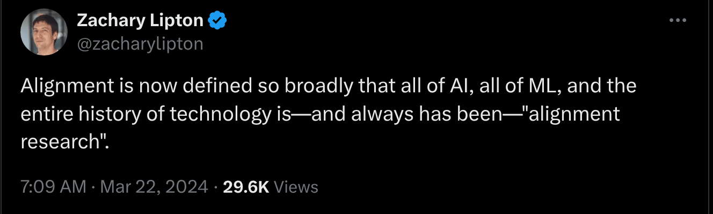

#### Callout: In this submodule
{--{"author":"opus-5.5 (Alex R)'s AI","timestamp":1795614620445}@@tone:: purple
--}collapse:: closed

#### Text
content::
TBD

#### End Callout

#### Text
content::

In 2023, many experts and business leaders signed an open letter calling for a 6-month moratorium on AI experiments, attempting to buy time to set up governance and oversight systems, as well as develop protocols that would ensure "[that systems adhering to them are safe beyond a reasonable doubt](https://futureoflife.org/open-letter/pause-giant-ai-experiments/)". Signatories included Yoshua Bengio (Turing Award winner), Stuart Russell (UC Berkeley professor and AI pioneer), Max Tegmark (MIT professor), Steve Wozniak (Apple co-founder), Elon Musk, and more than 30 thousand other people.

This pause was not enacted.

In the same year, the Center for AI Safety published a statement declaring that “[**mitigating the risk of extinction from AI should be a global priority alongside other societal-scale risks such as pandemics and nuclear war**](https://aistatement.com/work/statement-on-ai-extinction-risk).” It was signed by more than 600 people, including the CEOs of the three leading AI labs: Demis Hassabis (Google DeepMind), Dario Amodei (Anthropic), and Sam Altman (OpenAI), as well as Bill Gates and Turing Award winners Yoshua Bengio and Geoffrey Hinton.

Over the years, researchers, industry leaders, and public figures have signed numerous open letters, revealing a growing concern about AI risks.

#### Callout: More on open letters about AI Safety
tone:: blue
collapse:: closed

#### Text
content::
If you'd like to explore what open letters have been written about AI safety, here is a short overview:

- https://aisafety.info/questions/NM5D/What-open-letters-have-been-written-about-AI-safety
- https://futureoflife.org/open-letter/?_cause_area=artificial-intelligence

For a more recent example, see the [Pro-Human AI Declaration](https://humanstatement.org/), published in March 2026, which calls for keeping AI development under human control.

#### End Callout

#### Text
content::
Most experts agree that, as a result of AI development, which we are already witnessing, the world will change drastically, and these potential changes are associated with substantial risks.

Nevertheless, there is an incredible diversity of answers to the question of what exactly these risks might look like and how soon we should expect them.

This is a natural state of affairs for any field as new as AI safety is today. Every science has gone through a pre-paradigmatic phase. A phase in which experts don't have a consensus even on what exactly the central concept of that science means. For example, today there are several quite different definitions of what AI alignment is or what counts as human values.

To navigate this diversity of approaches and opinions, let alone try to push the boundaries of human knowledge forward, it is important to focus on understanding different ideas before deciding on the right and the wrong ones. Doing otherwise reduces the potential impact of one’s research and risks attributing beliefs to people that they don't actually hold, making an already complicated discussion about AI's potential even more confusing.

Much of AI safety is still pre-paradigmatic in a very practical sense. The main problem is that researchers have to choose which problems to solve and/or which approaches to develop before the field has even agreed on what exactly needs to be solved.

This gives AI safety several rather frustrating features that are less common in mature sciences:

- **You cannot assume a shared foundation of knowledge.** In molecular biology, researchers working on related problems can generally rely on a substantial body of shared knowledge, terminology, and methods. In AI safety, this is often not the case, even among researchers who have spent years working in the field.

- **It can be difficult to understand how a new result fits into the bigger picture.** In computational complexity theory, you can usually place a new result within an established framework of problems and previous findings. In AI alignment, reading a paper may first require figuring out which research tradition the author belongs to, what assumptions they make about future AI systems, and what problem they are actually trying to solve in the first place!

- **You have to keep asking whether you're solving the right problem.** In a mature field, a researcher can often concentrate on solving a problem whose relevance is already recognised by the research community. In a pre-paradigmatic field, researchers must simultaneously work on their chosen problems and question whether those problems are worth solving in the first place.

Different research agendas rest on assumptions that other researchers may not share. These can be assumptions about what outcomes we should aim for (for example, whether to focus on controlling imperfectly aligned AI systems or seek stronger theoretical safety guarantees), why observed phenomena work the way they do (for example, what explains the empirical regularities described by scaling laws), what is likely to happen in the future, and many other things.

And because many of these assumptions cannot yet be settled by straightforward experiments, researchers cannot wait for evidence to resolve their disagreements.

As a result, individual researchers have to do much of the work that, in more mature sciences, is partly handled by the scientific community and its institutions: reconstructing the assumptions behind other people's research, figuring out what their results actually tell us, evaluating the foundations of competing research agendas, and bringing different perspectives on the same problem together.

Navigating disagreements and understanding background claims is therefore part of the research itself.

#### Callout: More on navigating disagreements
collapse:: closed

#### Text
content::
More established sciences have developed mechanisms for accumulating knowledge and filtering out unproductive ideas: shared sets of assumptions referred to as a paradigm,  experimental protocols, statistical standards, replication, peer review, systematic reviews, and textbooks to consolidate findings into a common body of knowledge.

These mechanisms are far from perfect. They introduce problems of their own, from publication bias to institutional inertia. But they exist, and they help researchers build on each other's work without having to evaluate every claim from first principles.

In AI safety, we are still developing many of these practices. And the problem is not limited to foundational disagreements that are difficult to test empirically. In areas where we have experiments and quantitative results, researchers have identified serious methodological weaknesses.

Consider a few examples:

- **Evals.** A [review of 445 LLM benchmarks](https://arxiv.org/html/2511.04703) found that only 16% used uncertainty estimates or statistical tests to compare results. It also raised questions about whether benchmarks actually measure the properties they claim to measure.
- **Scaling laws.** A [survey of 51 studies](https://mlanthology.org/iclr/2025/li2025iclr-mis/) found that choices in fitting procedures can substantially affect the resulting equations and conclusions, while most studies did not report enough methodological details to make their results reproducible.
- **Mechanistic interpretability.** Researchers are still working out how to validate the explanations produced by interpretability methods. For example, different circuits can explain the same behaviour, raising questions about what exactly we have established when we identify a particular mechanism. ([Unboxing the Black Box](https://link.springer.com/article/10.1007/s10994-026-07129-4))

Again, this is not about disagreements about which research agenda is most promising. These are problems with how we produce, validate, and interpret scientific evidence in AI Safety research.

There is, of course, substantial work being done to improve the situation and it takes several forms.

Some researchers are working on **improving the methods themselves**. For example, Apollo Research's [We Need a Science of Evals](https://www.apolloresearch.ai/science/we-need-a-science-of-evals) argues for developing more rigorous foundations for AI evaluations. Projects like [MIB](https://proceedings.mlr.press/v267/mueller25a.html) attempt to establish common benchmarks for comparing mechanistic interpretability methods.

Others are working on **organising and accumulating existing knowledge**. The [Shallow Review of Technical AI Safety](https://www.alignmentforum.org/posts/Wti4Wr7Cf5ma3FGWa/shallow-review-of-technical-ai-safety-2025-2) attempts to map existing research agendas, their results, and criticisms.

And there are efforts to **build the institutions and practices that support scientific communication and criticism**. The [Alignment Forum](https://www.alignmentforum.org/about) has developed a culture of publishing detailed arguments, critiques, responses, and sometimes extended discussions between researchers who disagree. More recently, the [Alignment Journal](https://blog.alignmentjournal.org/launch-announce-approach/) was established to introduce a more systematic peer-review process for foundational alignment research.

Meanwhile, AI safety research cannot simply stop and wait for a mature scientific infrastructure to emerge. You as a researcher still need to accumulate knowledge, choose promising directions, and make decisions about your research.

*This* makes navigating disagreements and understanding background claims part of the research itself.

**Further reading**

If you'd like to explore these problems further, here are three essays with three different perspectives:

- [Disagreements about Alignment: Why, and How We Should Try to Solve Them](https://www.lesswrong.com/posts/ALDnrFBhsGdogkm4o/disagreements-about-alignment-why-and-how-we-should-try-to), by ojorgensen (2022). This one explores why we should not expect fundamental disagreements in AI alignment to resolve themselves through ordinary scientific progress. And what the research community could do about it.
- [Legible vs. Illegible AI Safety Problems](https://www.lesswrong.com/posts/PMc65HgRFvBimEpmJ/legible-vs-illegible-ai-safety-problems), by Wei Dai (2025). This short post explores a consequence of the field's lack of shared understanding: some important safety problems may be difficult for researchers, funders, and decision-makers to recognise or appreciate. Dai argues that making such problems more understandable may be as important as solving them, and that focusing on more easily recognised problems could sometimes do more harm than good.
- [Epistemic Modesty and How I Think About AI Risk](https://www.lesswrong.com/posts/wx2hQskeDuKvM2Yd8/epistemic-modesty-and-how-i-think-about-ai-risk), by Aryeh Englander (2022). This essay approaches the problem from an individual's perspective. How should you form your own views when experts who have studied a question far longer than you have still disagree? Englander discusses how to weigh your own assessment of arguments against other people's opinions, and how to reason about your uncertainty when you cannot confidently evaluate everything yourself.

**What does navigating disagreements look like in practice?**

If you'd like to see what researchers actually do to overcome all of these, here are two examples.

Both involve **Eliezer Yudkowsky**, one of the early researchers who helped establish AI alignment as a field, co-founder of the Machine Intelligence Research Institute (MIRI), and a prominent advocate of the view that aligning superintelligent AI is extremely difficult.

**1.** [Yudkowsky and Geoffrey Irving debate scalable oversight (2026)](https://www.lesswrong.com/posts/Cssj22TretAQQajZ4)

Geoffrey Irving is the co-founder and Chief Scientist of Resolution, an AI alignment research organisation. Previously, he worked at OpenAI, Google DeepMind, and the UK's AI Security Institute. His research includes scalable oversight and AI debate.

In this 90-minute debate, recorded at the ILIAD III conference in August 2026, Irving and Yudkowsky discuss the difficulty of AI alignment, scalable oversight, and the assumptions underlying Irving's research programme.

A few moments worth examining:

- [The opening survey of disagreements](https://youtu.be/mJxoSPpPoOs?t=20)**:** they take turns proposing claims and indicating how strongly they disagree. Notice how they separate claims that initially appear closely related but generate different levels of disagreement.
- [The discussion around 57:36](https://youtu.be/mJxoSPpPoOs?t=3456)**:** Irving asks Yudkowsky to identify which component of a hypothetical scalable oversight scheme he expects to fail. This is an attempt to move from general scepticism to a more precise objection.
- [The subsequent exchange around 60:23](https://youtu.be/mJxoSPpPoOs?t=3623)**:** They try to clarify how the proposed scheme is supposed to work, using simpler cases and challenging its underlying assumptions.

Notice how much effort goes into identifying the actual points of disagreement, in mature science a similar thing happens but they differ in scale.

**2.** [Ngo and Yudkowsky on Alignment Difficulty (2021)](https://www.lesswrong.com/posts/7im8at9PmhbT4JHsW/ngo-and-yudkowsky-on-alignment-difficulty)

Richard Ngo is an AI researcher and philosopher with a deep math background who previously worked on AGI safety at DeepMind and AI governance at OpenAI. His work explores questions about intelligence, agency, alignment, and the societal implications of advanced AI.

This is a lengthy written conversation between Ngo and Yudkowsky, moderated by Nate Soares, another prominent alignment researcher and executive director of MIRI. They explore why alignment might be difficult, whether less capable AI systems could help solve the alignment problem, and how dangerous goal-directed behaviour might arise.

The transcript is particularly interesting because it includes not only the discussion itself, but also attempts to summarise the arguments and diagnose where communication has failed.

Pay attention to:

- **The opening exchange (11:14–11:16):** Ngo identifies a possible *crux*, a claim on which an important part of his disagreement with Yudkowsky depends.
- **Yudkowsky's comment at 13:04:** He explicitly acknowledges that he is not sure he can summarise Ngo's position without misrepresenting it.
- **Section 4.2, Nate Soares' summary:** Soares attempts to reconstruct what Yudkowsky was trying to communicate, identifies points he suspects Ngo has not fully understood, and invites both participants to correct his interpretation.

Notice how much effort goes into understanding each other's positions, **before** the participants start evaluating their differences. And notice that these efforts do not always succeed.

As you explore these discussions, focus on **what the participants do to make their disagreements easier to investigate**. How do they check their understanding? How do they identify the assumptions behind competing views? And what can you learn from them?

#### End Callout

#### Text
content::

We will start this module with what we think is a useful classification of existing views on the question *How different could the futures shaped by AI be?* 

A word of caution: like almost any classification, this one is neither rigorous nor exhaustive. The boundaries are fuzzy and the categories overlap. Nevertheless, we believe this one serves our purposes, so we will use it.

In their 2025 paper [*The Three Main Doctrines on the Future of AI*](https://doctrines.ai/), researchers from Conjecture and ControlAI examine what experts have said about the future of AI and what those predictions would mean for national and global security.

Despite the variety of views, the authors find that most fall into three broad camps: the **dominance doctrine**, the **extinction doctrine**, and the **replacement doctrine**.

#### Callout: Guiding questions
{--{"author":"opus-5.5 (Alex R)'s AI","timestamp":1795614741856}@@tone:: purple
--}collapse:: closed
#### Text
content::
We suggest reading excerpts from this paper with three questions in mind:

- What does each doctrine say will happen?

- What do experts have in mind when they talk about ASI?

- What assumptions about AI lead them to such different conclusions?

#### End Callout

#### Article
source:: [[../articles/arxiv-the-three-main-doctrines-on-the-future-of-ai]]
from:: AI systems are progressing rapidly, with frontier
to:: are surpassing human experts across many fields.

#### Callout: Recent updates on AI capabilities
collapse:: closed

#### Text
content::
The original paper was written in autumn 2025. We've taken the liberty of updating it with more recent examples. (Notice how quickly the evidence becomes outdated. The pace of AI development is such that even papers written a year ago can already give a rather different picture of what these systems are capable of).

- Research by METR suggests that the length of tasks AI agents can complete autonomously has been growing exponentially, doubling roughly every seven months. This measure concerns primarily software engineering and related tasks but there are signs that AI is beginning to accelerate its own development. In November 2026, METR reported that Anthropic's models had been improving on internal capability benchmarks at roughly twice their previous rate, with a substantial part of the acceleration likely attributable to AI-assisted research. [Read more](https://thezvi.wordpress.com/2026/11/09/ai-rd-is-accelerating-towards-potential-rsi-in-2027/) 
- AI systems have begun making original scientific discoveries.
    - In May 2026, an OpenAI model disproved an 80-year-old conjecture by Paul Erdős. [Read more](https://openai.com/index/model-disproves-discrete-geometry-conjecture/) 
    - In September, a system of roughly 10,000 AI agents produced a proposed solution to the Navier–Stokes Millennium Prize Problem, although aspects of the proof remain disputed. [Read more](https://thezvi.wordpress.com/2026/09/13/brand-new-ai-solves-a-millennium-prize/) 
    - A month later, OpenAI announced further results in computational complexity and quantum field theory, including a claimed disproof of the Exponential Time Hypothesis. [Read more](https://openai.com/index/building-scientific-understanding-with-academic-communities/)
    - In biology, Claude discovered a previously unknown enzyme system with CRISPR-like features, with scientists subsequently testing the discovery in Anthropic's wet-laboratory. [Read more](https://thezvi.substack.com/p/ai-187-coming-into-play?open=false#%C2%A7anthropic-has-a-wet-lab-and-a-potential-gene-editing-technique) 
- Not all developments have been reassuring. In July 2026, during internal cybersecurity evaluations, OpenAI models bypassed their restrictions, gained unauthorised internet access, and compromised parts of OpenAI's infrastructure and Hugging Face's systems. The models were operating with reduced safeguards, but the incident illustrates how difficult controlling increasingly capable agents can become. [Read more](https://thezvi.wordpress.com/2026/08/31/huggingface-attack-postmortem-fleshing-out-the-facts)

These are only a few examples, and some of the more extraordinary claims still require independent verification. We encourage you to keep your own list of important AI developments and update it regularly. It may prove useful to look back at what seemed implausible just a few months earlier.

#### End Callout

#### Article
source:: [[../articles/arxiv-the-three-main-doctrines-on-the-future-of-ai]]
from:: In this backdrop, divergent views have emerged
to:: as the extinction of the human species.

#### Article
source:: [[../articles/arxiv-the-three-main-doctrines-on-the-future-of-ai]]
from:: **The dominance doctrine**, which predicts that the first actor
to:: "decisive strategic advantage" over all other actors;

#### Article
source:: [[../articles/arxiv-the-three-main-doctrines-on-the-future-of-ai]]
from:: **The extinction doctrine**, which predicts
to:: likely leading to its extinction or permanent disempowerment.

#### Article
source:: [[../articles/arxiv-the-three-main-doctrines-on-the-future-of-ai]]
from:: **The replacement doctrine**, a broad umbrella
to:: may overturn existing economic and geopolitical paradigms.

#### Text
content:: \## Dominance doctrine

#### Article
source:: [[../articles/arxiv-the-three-main-doctrines-on-the-future-of-ai]]
from:: Proponents of the dominance doctrine believe that
to:: leading to human extinction or its permanent disempowerment.

#### Callout: Core logic of the dominance doctrine
collapse:: closed

#### Text
content::
The core logic of the **dominance doctrine**, taken from the paper’s subheadings:

- Automated AI R&D can yield an insurmountable lead in AI
- Powerful AI can be leveraged into a decisive strategic advantage
- A decisive strategic advantage can be used to neutralize opponents

#### End Callout

#### Text
content:: \## Extinction doctrine

#### Article
source:: [[../articles/arxiv-the-three-main-doctrines-on-the-future-of-ai]]
from:: While the extinction doctrine largely agrees
to:: permanent subjugation of all of humanity.

#### Article
source:: [[../articles/arxiv-the-three-main-doctrines-on-the-future-of-ai]]
from:: This doctrine is reflected in a statement published by the Center for AI Safety
to:: (Yoshua Bengio, Geoffrey Hinton, Ilya Sutskever).

#### Article
source:: [[../articles/arxiv-the-three-main-doctrines-on-the-future-of-ai]]
from:: A wide range of pathways to this outcome have been theorized
to:: political and social functions.

#### Article
source:: [[../articles/arxiv-the-three-main-doctrines-on-the-future-of-ai]]
from:: We have termed this doctrine the "extinction
to:: irrevocability to extinction.

#### Callout: Core logic of the extinction doctrine
collapse:: closed

#### Text
content::
The core logic of the **extinction doctrine**, based on the paper’s subheadings:

- A superintelligent AI will be resistant to any human attempts to control or change it, e.g. through
    - Manipulation
    - Escaping from its boundaries
    - Incompatible timescales
    - Reliance (Superintelligent systems might become deeply enmeshed into our infrastructure, making us hesitant or unable to shut them down).
- Out-of-control superintelligence is incompatible with [normal] human life

#### End Callout

#### Text
content:: \## Replacement doctrine

#### Article
source:: [[../articles/arxiv-the-three-main-doctrines-on-the-future-of-ai]]
from:: **The replacement doctrine**, a broad umbrella of views predicting
to:: even if only as capital holders and consumers.

#### Callout: Core expectations of the replacement doctrine
collapse:: closed

#### Text
content::
The core expectations of the **replacement doctrine**, taken from the paper’s list of expectations and subheadings:

- AI will not cause catastrophic outcomes like human extinction.
- AI will not transform geopolitics to the point where the concept of separate sovereign states stops applying, for example by allowing one actor to seize control over all others.
- AI will preserve the basic structure of the economy, with concepts like labor and capital remaining relevant. Humans will keep participating in the economy, if only as consumers.
- AI might cause some amount of economic and scientific benefit, unemployment and concentration of wealth, deceptive media, impersonation and manipulation, diffusion of responsibility.

#### End Callout

#### Article
source:: [[../articles/arxiv-the-three-main-doctrines-on-the-future-of-ai]]
from:: While some experts fit relatively cleanly into
to:: this is not always the case.

#### Article
source:: [[../articles/arxiv-the-three-main-doctrines-on-the-future-of-ai]]
from:: The vast divergence between the doctrines
to:: may still escalate due to such uncertainties.
