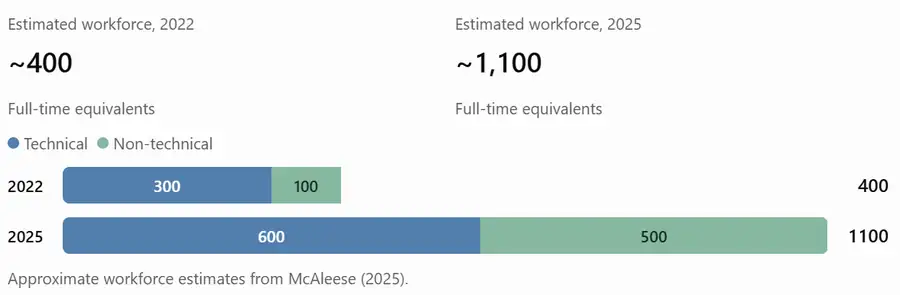

#### Text
content::
What does an AI safety organisation typically look like? In many cases, it's a group of people small enough to fit around a single meeting table. Consider the [Center for AI Safety (CAIS)](https://safe.ai/), the organisation behind the 2023 [Statement on AI Extinction Risk](https://safe.ai/work/statement-on-ai-extinction-risk) and co-creator of the widely used [Humanity's Last Exam](https://agi.safe.ai/) benchmark. In September 2025, McAleese estimated CAIS workforce at ten full-time equivalents (FTEs). Redwood Research, which pioneered the AI control agenda, was also estimated at ten (22 in 2026 according to [Redwood | Manifund](https://manifund.org/orgs/redwood#team)). The AI Futures Project, whose *AI 2027* scenario attracted considerable attention well beyond the AI safety community, was estimated at five (8 in 2026 according to [AI Futures Project | Manifund](https://manifund.org/orgs/aifp#team)).

In September 2025, Stephen McAleese identified more than 100 organisations, research groups, and institutional teams, collectively accounting for around 1,100 full-time equivalents (FTEs). The average entry in his dataset accounts for roughly ten FTEs, with estimates ranging from one to 50. As recently as 2022, McAleese estimated the size of the entire field at approximately 400 FTEs. The number of technical AI safety organisations began to climb steeply around 2020, followed by an acceleration in the growth of non-technical organisations around 2023.

Funding has grown even faster. According to [AISafety.fund](https://aisafety.fund/), philanthropic and government funding for AI safety rose from around $150 million in 2022 to nearly $800 million in 2025 and surpassed $1.3 billion in 2026.

It's worth spending a few minutes exploring the charts and tables in McAleese's [AI Safety Field Growth Analysis 2025](https://forum.effectivealtruism.org/posts/7YDyziQxkWxbGmF3u/ai-safety-field-growth-analysis-2025). They give you some useful reference points: whether a fifteen-person research team is unusually large, whether an agenda that appears frequently in public discussions has a sizeable research community behind it, or how much of the field's institutional infrastructure has been built in the past few years etc.
