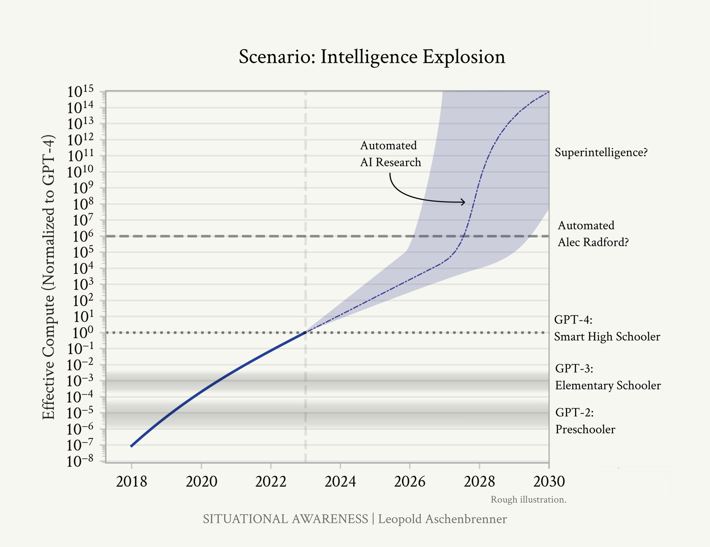
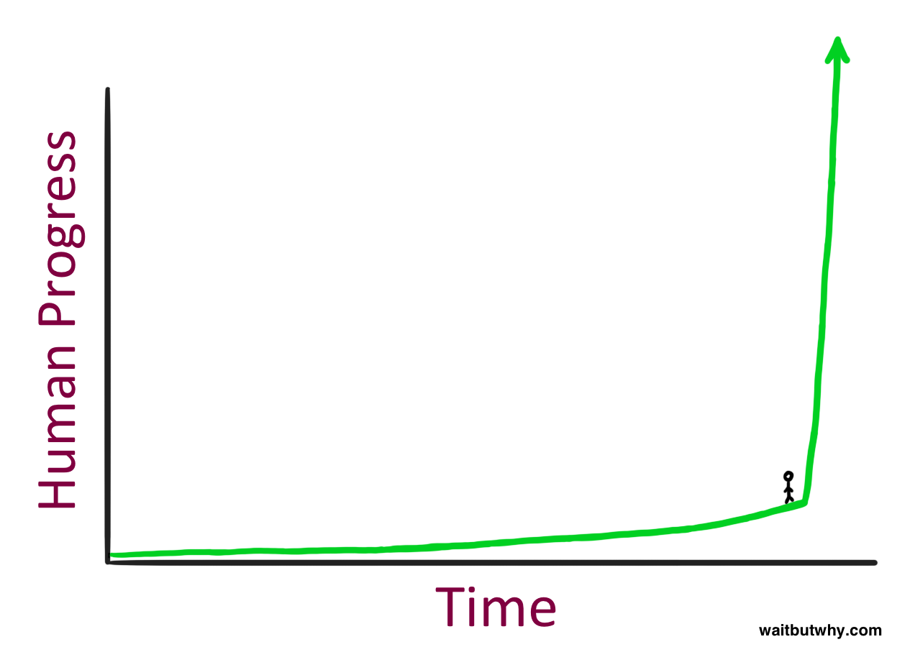
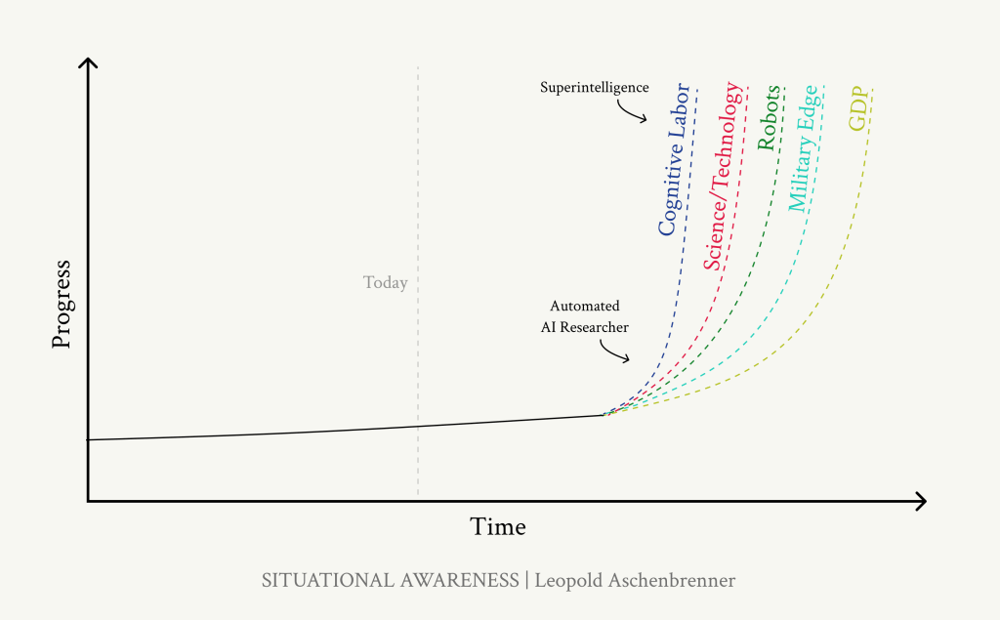

%%
Add discussion note here:

...

%%

**AI progress won’t stop at human-level. Hundreds of millions of AGIs could automate AI research, compressing a decade of algorithmic progress (5+ OOMs) into ≤1 year. We would rapidly go from human-level to vastly superhuman AI systems. The power—and the peril—of superintelligence would be dramatic.**

---

> Let an ultraintelligent machine be defined as a machine that can far surpass all the intellectual activities of any man however clever. Since the design of machines is one of these intellectual activities, an ultraintelligent machine could design even better machines; there would then unquestionably be an ‘intelligence explosion,’ and the intelligence of man would be left far behind. Thus the first ultraintelligent machine is the last invention that man need ever make.
> 
> _I. J. Good (_[_1965_](https://web.archive.org/web/20120501043117/http://www.stat.vt.edu/tech_reports/2005/GoodTechReport.pdf))

**The Bomb and The Super**

In the common imagination, the Cold War’s terrors principally trace back to Los Alamos, with the invention of the atomic bomb. But The Bomb, alone, is perhaps overrated. Going from The Bomb to The Super—hydrogen bombs—was arguably just as important.

In the Tokyo air raids, hundreds of bombers dropped thousands of tons of conventional bombs on the city. Later that year, Little Boy, dropped on Hiroshima, unleashed similar destructive power in a single device. But just 7 years later, Teller’s hydrogen bomb multiplied yields a thousand-fold once again—a single bomb with more explosive power than all of the bombs dropped in the entirety of WWII combined.

The Bomb was a more efficient bombing campaign. The Super was a country-annihilating device.[^note-1]

So it will be with AGI and Superintelligence.

_AI progress won’t stop at human-level._ After initially learning from the best human games, AlphaGo started playing against itself—and it quickly became superhuman, playing extremely creative and complex moves that a human would never have come up with.

We discussed the path to AGI in the [previous piece](https://situational-awareness.ai/from-gpt-4-to-agi/). Once we get AGI, we’ll turn the crank one more time—or two or three more times—and AI systems will become superhuman—vastly superhuman. They will become qualitatively smarter than you or I, much smarter, perhaps similar to how you or I are qualitatively smarter than an elementary schooler.

The jump to superintelligence would be wild enough at the current rapid but continuous rate of AI progress (if we could make the jump to AGI in 4 years from GPT-4, what might another 4 or 8 years after that bring?). But it could be much faster than that, if AGI automates AI research itself.

Once we get AGI, we won’t just have one AGI. I’ll walk through the numbers later, but: given inference GPU fleets by then, we’ll likely be able to run _many millions of them (perhaps 100 million human-equivalents, and soon after at 10x+ human speed)_. Even if they can’t yet walk around the office or make coffee, they will be able to do ML research on a computer. Rather than a few hundred researchers and engineers at a leading AI lab, we’d have more than 100,000x that—furiously working on algorithmic breakthroughs, day and night. Yes, recursive self-improvement, but no sci-fi required; _they would need only to accelerate the existing trendlines of algorithmic progress ([currently at](https://situational-awareness.ai/from-gpt-4-to-agi/#Algorithmic_efficiencies) ~0.5 OOMs/year)._

Automated AI research could accelerate algorithmic progress, leading to 5+ OOMs of effective compute gains in a year. The AI systems we’d have by the end of an intelligence explosion would be vastly smarter than humans.

Automated AI research could probably compress a human-decade of algorithmic progress into less than a year (and that seems conservative). That’d be 5+ OOMs, another [GPT-2-to-GPT-4-sized jump](https://situational-awareness.ai/from-gpt-4-to-agi/), on top of AGI—a qualitative jump like that from a preschooler to a smart high schooler, _on top_ of AI systems already as smart as expert AI researchers/engineers.

There are several plausible bottlenecks—including limited compute for experiments, complementarities with humans, and algorithmic progress becoming harder—which I’ll address, but none seem sufficient to definitively slow things down.

Before we know it, we would have superintelligence on our hands—AI systems _vastly_ smarter than humans, capable of novel, creative, complicated behavior we couldn’t even begin to understand—perhaps even a small civilization of billions of them. Their power would be vast, too. Applying superintelligence to R&D in other fields, explosive progress would broaden from just ML research; soon they’d solve robotics, make dramatic leaps across other fields of science and technology within years, and an industrial explosion would follow. Superintelligence would likely provide a decisive military advantage, and unfold untold powers of destruction. We will be faced with one of the most intense and volatile moments of human history.

## Automating AI research ^automating-ai-research

**We don’t need to automate everything—just AI research.** A common objection to transformative impacts of AGI is that it will be hard for AI to do everything. Look at robotics, for instance, doubters say; that will be a gnarly problem, even if AI is cognitively at the levels of PhDs. Or take automating biology R&D, which might require lots of physical lab-work and human experiments.

But we don’t need robotics—we don’t need many things—for AI to automate AI research. The jobs of AI researchers and engineers at leading labs can be done fully virtually and don’t run into real-world bottlenecks in the same way (though it will still be limited by compute, which I’ll address later). And the job of an AI researcher is fairly straightforward, in the grand scheme of things: read ML literature and come up with new questions or ideas, implement experiments to test those ideas, interpret the results, and repeat. This all seems squarely in the domain where simple extrapolations of current AI capabilities could easily take us to or beyond the levels of the best humans [by the end of 2027](https://situational-awareness.ai/from-gpt-4-to-agi/).[^note-2]

It’s worth emphasizing just how straightforward and hacky some of the biggest machine learning breakthroughs of the last decade have been: “oh, just add some normalization” (LayerNorm/BatchNorm) or “do f(x)+x instead of f(x)” (residual connections)” or “fix an implementation bug” (Kaplan → Chinchilla scaling laws). AI research can be automated. And automating AI research is all it takes to kick off extraordinary feedback loops.[^note-3]

**We’d be able to run millions of copies (and soon at 10x+ human speed) of the automated AI researchers.** Even by 2027, we should expect [GPU fleets in the 10s of millions](https://situational-awareness.ai/racing-to-the-trillion-dollar-cluster/#Overall_compute "GPU fleets in the 10s of millions"). Training clusters alone should be approaching ~3 OOMs larger, already putting us at 10 million+ A100-equivalents. Inference fleets should be much larger still. (More on all this in a [later piece](https://situational-awareness.ai/racing-to-the-trillion-dollar-cluster/).)

That would let us run many millions of copies of our automated AI researchers, perhaps 100 million human-researcher-equivalents, running day and night. There’s some assumptions that flow into the exact numbers, including that humans “think” at 100 tokens/minute (just a rough order of magnitude estimate, e.g. consider your internal monologue) and extrapolating historical trends and Chinchilla scaling laws on per-token inference costs for frontier models remaining in the same ballpark.[^note-4] We’d also want to reserve some of the GPUs for running experiments and training new models. Full calculation in a footnote.[^note-5]

Another way of thinking about it is that _given inference fleets in 2027, we should be able to generate an entire internet’s worth of tokens, every single day._[^note-6] In any case, the exact numbers don’t matter that much, beyond a simple plausibility demonstration.

Moreover, our automated AI researchers may soon be able to run at much faster than human-speed:

-   By taking some inference penalties, we can trade off running fewer copies in exchange for running them at faster serial speed. (For example, we could go from ~5x human speed to ~100x human speed by “only” running 1 million copies of the automated researchers.[^note-7])
-   More importantly, the first algorithmic innovation the automated AI researchers work on is getting a 10x or 100x speedup. Gemini 1.5 Flash is ~10x faster than the originally-released GPT-4,[^note-8] merely a year later, while providing similar performance to the originally-released GPT-4 on reasoning benchmarks. If that’s the algorithmic speedup a few hundred human researchers can find in a year, the automated AI researchers will be able to find similar wins very quickly.

_That is: expect 100 million automated researchers each working at 100x human speed not long after we begin to be able to automate AI research._ They’ll each be able to do a year’s worth of work in a few days. The increase in research effort—compared to a few hundred puny human researchers at a leading AI lab today, working at a puny 1x human speed—will be extraordinary.

**This could easily dramatically accelerate existing trends of algorithmic progress, compressing a decade of advances into a year.** We need not postulate anything totally novel for automated AI research to intensely speed up AI progress. Walking through the numbers in the [previous piece](https://situational-awareness.ai/from-gpt-4-to-agi), we saw that algorithmic progress has been a central driver of deep learning progress in the last decade; we noted a trendline of ~0.5 OOMs/year on algorithmic efficiencies alone, with additional large algorithmic gains from unhobbling on top. (I think the import of algorithmic progress has been underrated by many, and properly appreciating it is important for appreciating the possibility of an intelligence explosion.)

Could our millions of automated AI researchers (soon working at 10x or 100x human speed) compress the algorithmic progress human researchers would have found in a decade into a year instead? That would be 5+ OOMs in a year.

Don’t just imagine 100 million junior software engineer interns here (we’ll get those earlier, in the next couple years!). Real automated AI researchers will be very smart—and in addition to their raw quantitative advantage, automated AI researchers will have other enormous advantages over human researchers:

-   They’ll be able to read every single ML paper ever written, have been able to deeply think about every single previous experiment ever run at the lab, learn in parallel from each of their copies, and rapidly accumulate the equivalent of millennia of experience. They’ll be able to develop far deeper intuitions about ML than any human.
-   They’ll be easily able to write millions of lines of complex code, keep the entire codebase in context, and spend human-decades (or more) checking and rechecking every line of code for bugs and optimizations. They’ll be superbly competent at all parts of the job.
-   You won’t have to individually train up each automated AI researcher (indeed, training and onboarding 100 million new human hires would be difficult). Instead, you can just teach and onboard one of them—and then make replicas. (And you won’t have to worry about politicking, cultural acclimation, and so on, and they’ll work with peak energy and focus day and night.)
-   Vast numbers of automated AI researchers will be able to share context (perhaps even accessing each others’ latent space and so on), enabling much more efficient collaboration and coordination compared to human researchers.
-   And of course, however smart our initial automated AI researchers would be, we’d soon be able to make further OOM-jumps, producing even smarter models, even more capable at automated AI research.

Imagine an automated Alec Radford— _imagine 100 million automated Alec Radfords._[^note-9] I think just about every researcher at OpenAI would agree that if they had 10 Alec Radfords, let alone 100 or 1,000 or 1 million running at 10x or 100x human speed, they could very quickly solve very many of their problems. Even with various other bottlenecks (more in a moment), compressing a decade of algorithmic progress into a year as a result seems very plausible. (A 10x acceleration from a million times more research effort, which seems conservative if anything.)

That would be 5+ OOMs right there. 5 OOMs of algorithmic wins would be a similar scaleup to what produced the [GPT-2-to-GPT-4 jump](https://situational-awareness.ai/from-gpt-4-to-agi/), a capability jump from ~a preschooler to ~a smart high schooler. Imagine such a qualitative jump _on top of_ AGI, _on top of_ Alec Radford.

It’s strikingly plausible we’d go from AGI to superintelligence very quickly, perhaps in less than one year.

## Possible bottlenecks ^possible-bottlenecks

While this basic story is surprisingly strong—and is supported by [thorough economic modeling work](https://www.openphilanthropy.org/research/what-a-compute-centric-framework-says-about-takeoff-speeds/) —there are some real and plausible bottlenecks that will probably slow down an automated-AI-research intelligence explosion.

I’ll give a summary here, and then discuss these in more detail in the optional sections below for those interested:

-   **_Limited compute_**: AI research doesn’t just take good ideas, thinking, or math—but running experiments to get empirical signal on your ideas. A million times more research effort via automated research labor won’t mean a million times faster progress, because compute will still be limited—and limited compute for experiments will be the bottleneck. Still, even if this won’t be a 1,000,000x speedup, I find it hard to imagine that the automated AI researchers couldn’t use the compute _at least_ 10x more effectively: they’ll be able to get incredible ML intuition (having internalized the whole ML literature and every previous experiment every run!) and centuries-equivalent of thinking-time to figure out exactly the right experiment to run, configure it optimally, and get the maximum value of information; they’ll be able to spend centuries-equivalent of engineer-time before running even tiny experiments to avoid bugs and get them right on the first try; they can make tradeoffs to economize on compute by focusing on the biggest wins; and they’ll be able to try tons of smaller-scale experiments (and given effective compute scaleups by then, “smaller-scale” means being able to train 100,000 GPT-4-level models in a year to try architecture breakthroughs). Some human researchers and engineers are able to produce 10x the progress as others, even with the same amount of compute—and this should apply even moreso to automated AI researchers. I do think this is the most important bottleneck, and I address it in more depth below.
-   **_Complementarities/long tail_**: A classic lesson from economics (cf Baumol’s growth disease) is that if you can automate, say, 70% of something, you get some gains but quickly the remaining 30% become your bottleneck. For anything that falls short of full automation—say, really good copilots—human AI researchers would remain a major bottleneck, making the overall increase in the rate of algorithmic progress relatively small. Moreover, there’s likely some long tail of capabilities required for automating AI research—the last 10% of the job of an AI researcher might be particularly hard to automate. This could soften takeoff some, though my best guess is that this only delays things by a couple years. Perhaps 2026/27-models speed are the proto-automated-researcher, it takes another year or two for some final unhobbling, a somewhat better model, inference speedups, and working out kinks to get to full automation, and finally by 2028 we get the 10x acceleration (and superintelligence by the end of the decade).
-   **_Inherent limits to algorithmic progress_**: Maybe another 5 OOMs of algorithmic efficiency will be fundamentally impossible? I doubt it. While there will definitely be upper limits,[^note-10] if we got 5 OOMs in the last decade, we should probably expect at least another decade’s-worth of progress to be possible. More directly, current architectures and training algorithms are still very rudimentary, and it seems that much more efficient schemes should be possible. Biological reference classes also support dramatically more efficient algorithms being plausible.
-   **_Ideas get harder to find, so the automated AI researchers will merely sustain, rather than accelerate, the current rate of progress:_** One objection is that although automated research would increase effective research effort a lot, ideas also get harder to find. That is, while it takes only a few hundred top researchers at a lab to sustain 0.5 OOMs/year today, as we exhaust the low-hanging fruit, it will take more and more effort to sustain that progress—and so the 100 million automated researchers will be merely what’s necessary to sustain progress. I think this basic model is correct, but the empirics don’t add up: the magnitude of the increase in research effort—a million-fold—is way, way larger than the historical trends of the growth in research effort that’s been necessary to sustain progress. In econ modeling terms, it’s a bizarre “knife-edge assumption” to assume that the increase in research effort from automation will be _just enough_ to keep progress constant.
-   **_Ideas get harder to find and there are diminishing returns, so the intelligence explosion will quickly fizzle_**: Related to the above objection, even if the automated AI researchers lead to an initial burst of progress, whether rapid progress can be sustained depends on the shape of the diminishing returns curve to algorithmic progress. Again, my best read of the empirical evidence is that the exponents shake out in favor of explosive/accelerating progress. In any case, the sheer size of the one-time boost—from 100s to 100s of millions of AI researchers—probably overcomes diminishing returns here for at least a good number of OOMs of algorithmic progress, even though it of course can’t be _indefinitely_ self-sustaining.

### Limited compute for experiments ^limited-compute-for-experiments

The production function for algorithmic progress includes two complementary factors of production: research effort and experiment compute. The millions of automated AI researchers won’t have any more compute to run their experiments on than human AI researchers; perhaps they’ll just be sitting around waiting for their jobs to finish.

This is probably the most important bottleneck to the intelligence explosion. Ultimately this is a quantitative question—just how much of a bottleneck is it? On balance, I find it hard to believe that the 100 million Alec Radfords couldn’t increase the marginal product of experiment compute by at least 10x (and thus, would still accelerate the pace of progress by 10x):

-   _There’s a lot you can do with smaller amounts of compute._ The way most AI research works is that you test things out at small scale—and then extrapolate via scaling laws. (Many key historical breakthroughs required only a very small amount of compute, e.g. [the original Transformer](https://arxiv.org/abs/1706.03762) was trained on just 8 GPUs for a few days.) And note that with ~5 OOMs of baseline scaleup in the next four years, “small scale” will mean GPT-4 scale—the automated AI researchers will be able to run 100,000 GPT-4-level experiments on their training cluster in a year, and tens of millions of GPT-3-level experiments. (That’s a lot of potential-breakthrough new architectures they’ll be able to test!)
    -   A lot of the compute goes into larger-scale validation of the final pretraining run—making sure you are getting a high-enough degree of confidence on marginal efficiency wins for your annual headline product—but if you’re racing through the OOMs in the intelligence explosion, you could economize and just focus on the really big wins.
    -   As discussed in [the previous piece](https://situational-awareness.ai/from-gpt-4-to-agi/#Unhobbling), there are often _enormous_ gains to be had from relatively low-compute “unhobbling” of models. These don’t require big pretraining runs. It’s highly plausible that that intelligence explosion starts off automated AI research e.g. discovering a way to do RL on top that gives us a couple OOMs via unhobbling wins (and then we’re off to the races).
-   _As the automated AI researchers find efficiencies, that’ll let them run more experiments._ Recall the near-1000x cheaper inference in two years for equivalent-MATH performance, and the 10x general inference gains in the last year, [discussed in the previous piece](https://situational-awareness.ai/from-gpt-4-to-agi/#Algorithmic_efficiencies), from mere-human algorithmic progress. The first thing the automated AI researchers will do is quickly find similar gains, and in turn, that’ll let them run 100x more experiments on e.g. new RL approaches. Or they’ll be able to quickly make smaller models with similar performance in relevant domains (cf previous discussion of Gemini Flash, near-100x cheaper than GPT-4), which in turn will let them run many more experiments with these smaller models (again, imagine using these to try different RL schemes). There are probably other overhangs too, e.g. the automated AI researchers might be able to quickly develop much better distributed training schemes to utilize all the inference GPUs (probably at least 10x more compute right there). More generally, every OOM of training efficiency gains they find will give them an OOM more of effective compute to run experiments on.
-   _The automated AI researchers could be way more efficient._ It’s hard to understate how many fewer experiments you would have to run if you just got it right on the first try—no gnarly bugs, being more selective about exactly what you are running, and so on. Imagine 1000 automated AI researchers spending a month-equivalent checking your code and getting the exact experiment right before you press go. I’ve asked some AI lab colleagues about this and they agreed: you should pretty easily be able to save 3x-10x of compute on most projects merely if you could avoid frivolous bugs, get things right on the first try, and only run high value-of-information experiments.
-   _The automated AI researchers could have way better intuitions._
    -   Recently, I was speaking to an intern at a frontier lab; they said that their dominant experience over the past few months was suggesting many experiments they wanted to run, and their supervisor (a senior researcher) saying they could already predict the result beforehand so there was no need. The senior researcher’s years of random experiments messing around with models had honed their intuitions about what ideas would work—or not. Similarly, it seems like our AI systems could easily get superhuman intuitions about ML experiments—they will have read the entire machine learning literature, be able to learn from every other experiment result and deeply think about it, they could easily be trained to predict the outcome of millions of ML experiments, and so on. And maybe one of the first things they do is build up a strong basic science of "predicting if this large scale experiment will be successful just after seeing the first 1% of training, or just after seeing the smaller scale version of this experiment", and so on.
    -   Moreover, beyond really good intuitions about research directions, [as Jason Wei has noted](https://twitter.com/_jasonwei/status/1757486124082303073?s=12), there are incredible returns to having great intuitions on the dozens of hyperparameters and details of an experiment. Jason calls this ability to get things right on the first try based on intuition “yolo runs”. (Jason says, “what I do know is that the people who can do this are surely 10-100x AI researchers.“)

Compute bottlenecks will mean a million times more researchers won’t translate into a million times faster research—thus not an overnight intelligence explosion. But the automated AI researchers will have extraordinary advantages over human researchers, and so it seems hard to imagine that they couldn’t also find a way to use the compute at least 10x more efficiently/effectively—and so 10x the pace of algorithmic progress seems eminently plausible.

Some more discussion in the nested collapsible.

### Addressing the best counterargument: what does the track record of ML academia imply about the compute bottleneck? ^addressing-the-best-counterargument

I’ll take a moment here to acknowledge perhaps the most compelling formulation of the counterargument I’ve heard, by my friend James Bradbury: _if more ML research effort would so dramatically accelerate progress, why doesn’t the current academic ML research community, numbering at least in the tens of thousands, contribute more to frontier lab progress?_ (Currently, it seems like lab-internal teams, of perhaps a thousand in total across labs, shoulder most of the load for frontier algorithmic progress.) His argument is that the reason is that algorithmic progress is compute-bottlenecked: the academics just don’t have enough compute.

Some responses:

-   Quality-adjusted, I think academics are probably more in the thousands not tens of thousands (e.g., looking only at the top universities). This probably isn’t substantially more than the labs combined. (And it’s _way_ less than the hundreds of millions of researchers we’d get from automated AI research.)
-   Academics work on the wrong things. Up until very recently (and perhaps still today?), the vast majority of the academic ML community wasn’t even working on large language models.
    -   In terms of strong academics in academia working on large language models, it might be meaningfully fewer than researchers at labs combined?
-   Even when the academics do work on things like LLM pretraining, they simply don’t have access to the state-of-the-art—the large accumulated body of knowledge of tons of details on frontier model training inside labs. They don’t know what problems are actually relevant, or can only contribute one-off results that nobody can really do anything with because their baselines were badly tuned (so nobody knows if their thing is actually an improvement).
-   Academics are way worse than automated AI researchers: they can’t work at 10x or 100x human speed, they can’t read and internalize every ML paper ever written, they can’t spend a decade checking every line of code, replicate themselves to avoid onboarding-bottlenecks, etc.

Another countervailing example to the academics argument: GDM is rumored to have way more experiment compute than OpenAI, and yet it doesn’t seem like GDM is massively outpacing OpenAI in terms of algorithmic progress.

In general, I expect automated researchers will have a different style of research that plays to their strengths and aims to mitigate the compute bottleneck. _I think it's reasonable to be uncertain how this plays out, but it's unreasonable to be confident it won't be doable for the models to get around the compute bottleneck just because it'd be hard for humans to do so._

-   For example, they could just spend a lot of effort early on building up a basic science of "how to predict large scale results from smaller scale experiments". And I expect there's a lot that they could do that humans can't do, e.g. maybe things more like "predicting if this large scale experiment will be successful just after seeing the first 1% of training". This seems pretty doable if you're a super strong automated researcher with very superhuman intuitions and this can save you a ton of compute.
-   When I imagine AI systems automating AI research, I see them as compute-bottlenecked but making up for it in large part by thinking e.g. 1000x more (and faster) than humans would, and thinking at a higher level of quality than humans (e.g. because of the superhuman ML intuitions from being trained to predict the result of millions of experiments). Unless they're just much worse at thinking than engineering, I think this can make up for a lot, and this would be qualitatively different from academics.

(In addition to experiment compute, there’s the additional bottleneck of eventually needing to run a big training run, something which currently takes months. But you can probably economize on those, doing only a handful during the year of intelligence explosion, taking bigger OOM leaps for each than labs currently do.

Note that while I think this is likely, it’s kind of scary: it means that rather than a fairly continuous series of big models, each somewhat better than the previous generation, downstream model intelligence might be more discrete/discontinuous. We might only do one or a couple of big runs during the intelligence explosion, banking multiple OOMs of algorithmic breakthroughs found at smaller scale for each.

Or you could “spend” 1 out of the 5 OOMs of compute efficiency wins to do a training run in days rather than months.)

### Complementarities and long tails to 100% automation ^complementarities-and-long-tails

The classic economist objection to AI automation speeding up economic growth is that different tasks are complementary—and so, for example, automating 80% of what labor humans did in 1800 didn’t lead to a growth explosion or mass unemployment, but the remaining 20% became what all humans did and remained the bottleneck. (See e.g. a model of this [here](https://www.nber.org/system/files/working_papers/w23928/w23928.pdf).).

I think the economists’ _model_ here is correct. But a key point is that I’m only talking about one currently-small part of the economy, rather than the economy as a whole. People may well still be getting haircuts normally during this time—robotics might not yet be worked out, AIs for every domain might not yet be worked out, the societal rollout might not yet be worked out, etc.—but they _will_ be able to do AI research. As discussed [in the previous piece](https://situational-awareness.ai/from-gpt-4-to-agi/#From_chatbot_to_agent-coworker), I think the current course of AI progress is taking us to essentially drop-in remote workers as intelligent as the smartest humans; as discussed in this piece, the job of an AI researcher seems totally within the scope of what could be fully automated.

Still, in practice, I do expect somewhat of a long tail to get to truly 100% automation even for the job of an AI researcher/engineer; for example, we might first get systems that function _almost_ as an engineer replacement, but still need some amount of human supervision.

In particular, I expect the level of AI capabilities to be somewhat uneven and peaky across domains: it might be a better coder than the best engineers while still having blindspots in some subset of tasks or skills; by the time it’s human-level at whatever its worst at, it’ll already be substantially superhuman at easier domains to train, like coding. (This is part of why I think they’ll be able to use the compute more effectively than human researchers. By the time of 100% automation/the intelligence explosion starting, they’ll already have huge advantages over humans in some domains. This will also have important implications for [superalignment](https://situational-awareness.ai/superalignment/) down the line, since it means that we’ll have to align systems that are meaningfully superhuman in many domains in order to align even the first automated AI researchers.)

But I wouldn’t expect that phase to last more than a few years; given the pace of AI progress, I think it would likely just be a matter of some additional “unhobbling” (removing some obvious limitation of the models that prevented it from doing the last mile) or another generation of models to get all the way.

Overall, this might soften takeoff some. Rather that 2027 AGI → 2028 Superintelligence, it might look more like:

-   2026/27: Proto-automated-engineer, but blind spots in other areas. Speeds up work by 1.5x-2x already; progress begins gradually accelerating.
    -   2027/28: Proto-automated-researchers, can automate >90%. Some remaining human bottlenecks, and hiccups in coordinating a giant organization of automated researchers to be worked out, but this already speeds up progress by 3x+. This quickly does the remaining necessary “unhobbling” takes us the remainder of the way to 100% automation.
    -   2028/29: 10x+ pace of progress → superintelligence.

That’s still very fast…

### Fundamental limits to algorithmic progress ^fundamental-limits-to-algorithmic

There’s probably a real cap on how much algorithmic progress is physically possible. (For example, 25 OOMs of algorithm progress seems impossible, since that would imply being able to train a GPT-4 level system in less than ~10 FLOPs. Though you could get results that would take 25 more OOMs of hardware with current architecture!)

But something like 5 OOMs seems very much in the realm of possibilities; again, that would just require another decade of trend algorithmic efficiencies (not even counting algorithmic gains from unhobbling).

Intuitively, it very much doesn’t seem like we have exhausted all the low-hanging fruit yet, given how simple the biggest breakthroughs are—and how rudimentary and obviously hobbled current architectures and training techniques still seem to be. For example, I think it’s pretty plausible that we’ll bootstrap our way to AGI via AI systems that “think out loud” via chain-of-thought. But _surely_ this isn’t the most efficient way to do it, _surely_ something that does this reasoning via internal states/recurrence/etc would be way more efficient. Or consider adaptive compute: Llama 3 still spends as much compute on predicting the “and” token as it does the answer to some complicated question, which seems clearly suboptimal. We’re getting huge OOM algorithmic gains from even just small tweaks, while there are dozens of areas where much more efficient architectures and training procedures could likely be found.

Biological references also suggest huge headroom. The human range of intelligence is very wide, for example, with only tiny tweaks to architecture. Humans have similar numbers of neurons as other animals, even though humans are much smarter than those animals. And current AI models are still many OOMs from the [efficiency of a human brain](https://www.dwarkeshpatel.com/p/carl-shulman); they can learn with a tiny fraction of the data (and thus tiny fraction of “compute”) than AI models can, suggesting huge headroom for our algorithms and architecture.

### Ideas get harder to find and diminishing returns ^ideas-get-harder-to

As you pick the low-hanging fruit, ideas get harder to find. This is true in [any domain of technological progress](https://www.aeaweb.org/articles?id=10.1257/aer.20180338). Essentially, we see a straight line on a log-log curve: log(progress) is a function of log(cumulative research effort). Every OOM of further progress requires putting in more research effort than the last OOM.

This leads to two objections to the intelligence explosion:

1.  Automated AI research will merely be what’s necessary to sustain progress (rather than dramatically accelerating it).
2.  A purely-algorithmic intelligence explosion would not be sustained / would quickly fizzle out as algorithmic progress gets harder to find / you hit diminishing marginal returns.

I spent a lot of time thinking about these sorts of models in a past life, when I was doing research in economics. (In particular, [semi-endogenous growth theory](https://web.stanford.edu/~chadj/JonesHandbook2005.pdf?ref=forourposterity.com) is the standard model of technological progress, capturing these two competing dynamics of growing research effort and ideas getting harder to find.)

In short, I think the underlying model behind these objections is sound, but how it shakes out is an empirical question—and I think they get the empirics wrong.

The key question is essentially: for every 10x of progress, does further progress become _more_ or _less_ than 10x harder? Napkin math (along the lines of how this is done in [the economic literature](https://www.aeaweb.org/articles?id=10.1257/aer.20180338)) helps us bound this.

-   Suppose we take the ~0.5 OOMs/year trend rate of algorithmic progress seriously; that implies a 100x of progress in 4 years.
    -   However, quality-adjusted headcount / research effort at a given leading AI lab has definitely grown by <100x in 4 years. _Maybe_ it’s increased 10x (from 10s to 100s of people working on relevant stuff at a given lab), but even that is unclear quality-adjusted.
    -   And yet, algorithmic progress seems to be sustained.

Thus, in response to objection 1, we can note that the ~million-fold increase in research effort will simply be a much larger increase than what would merely be necessary to sustain progress. Maybe we’d need on the order of thousands of researchers working on relevant research at a lab in 4 years to sustain progress; the 100 million Alec Radfords would still be an _enormous_ increase, and surely lead to massive acceleration. It’s just a bizarre “knife-edge” assumption to think that automated research would be _just enough_ to sustain the existing pace of progress. (And that’s not even counting thinking at 10x human speed and all the other advantages the AI systems will have over human researchers.)

In response to objection 2, we can note two things:

-   First, the mathematical condition noted above. Given that, based on our napkin math, quality-adjusted research effort needed to grow <<100x while we did 100x of algorithmic progress, it pretty strongly seems that the shape of the returns curve shakes out in favor of self-sustaining progress. (100x progress → 100x more automated research effort, but you, say, only needed 10x more research effort to keep it going and do the next 100x, so the returns are good enough for explosive progress to be sustained.)
    -   Secondly, the returns curve doesn’t even _need_ to shake out in favor of a fully sustained chain reaction for us to get a bounded-but-many-OOM surge of algorithmic progress. Essentially, it doesn’t need to be a “growth effect”; a large enough “level effect” would be enough. That is, a million-fold increase in research effort (combined with the many other advantages automated researchers would have over human researchers) would be such a large one-time boost that even if the chain reaction isn’t fully self-sustaining, it could lead to a very sizeable (many OOMs) one-time gain. Analogously, in semi-endogenous economic growth theory, boosting science investment from 1% to 20% of GDP won’t make growth rates higher forever—eventually diminishing returns would lead things to return to the old growth rate—but the “level effect” it would lead to would be so large as to dramatically speed up growth for decades.

On net, while obviously it won’t be unbounded and I have a lot of uncertainty over just how far it’ll go, I think something like a 5 OOM intelligence explosion purely from algorithmic gains / automated AI research seems highly plausible.

[Tom Davidson and Carl Shulman](https://www.openphilanthropy.org/research/what-a-compute-centric-framework-says-about-takeoff-speeds/) have also looked at the empirics of this in a growth-modeling framework and come to similar conclusions. [Epoch AI has also done some recent work](https://papers.ssrn.com/sol3/papers.cfm?abstract_id=4814445) on the empirics, also coming to the conclusion that empirical returns to algorithmic R&D favors explosive growth, with a [helpful writeup of the implications](https://epochai.org/blog/do-the-returns-to-software-rnd-point-towards-a-singularity).

Overall, these factors may slow things down somewhat: the most extreme versions of intelligence explosion (say, overnight) seem implausible. And they may result in a somewhat longer runup (perhaps we need to wait an extra year or two from more sluggish, proto-automated researchers to the true automated Alec Radfords, before things kick off in full force). But they certainly don’t rule out a very rapid intelligence explosion. A year—or at most just a few years, but perhaps even just a few months—in which we go from fully-automated AI researchers to vastly superhuman AI systems should be our mainline expectation.

## The power of superintelligence ^the-power-of-superintelligence

Whether or not you agree with the strongest form of these arguments—whether we get a <1 year intelligence explosion, or it takes a few years—it is clear: we must confront the possibility of superintelligence.

The AI systems we’ll likely have _by the end of this decade_ will be unimaginably powerful.

-   Of course, they’ll be _quantitatively_ superhuman. On our fleets of [100s of millions of GPUs by the end of the decade](https://situational-awareness.ai/racing-to-the-trillion-dollar-cluster/ "100s of millions of GPUs by the end of the decade"), we’ll be able to run a civilization of billions of them, and they will be able to “think” orders of magnitude faster than humans. They’ll be able to quickly master any domain, write trillions of lines of code, read every research paper in every scientific field ever written (they’ll be perfectly interdisciplinary!) and write new ones before you’ve gotten past the abstract of one, learn from the parallel experience of every one of its of copies, gain billions of human-equivalent years of experience with some new innovation in a matter of weeks, work 100% of the time with peak energy and focus and won’t be slowed down by that one teammate who is lagging, and so on.
-   More importantly—but harder to imagine—they’ll be _qualitatively_ superhuman. As a narrow example of this, large-scale RL runs have been able to produce completely novel and creative behaviors beyond human understanding, such as the [famous move 37 in AlphaGo vs. Lee Sedol](https://www.wired.com/2016/03/two-moves-alphago-lee-sedol-redefined-future/). Superintelligence will be this across many domains. It’ll find exploits in the human code too subtle for any human to notice, and it’ll generate code too complicated for any human to understand even if the model spent decades trying to explain it. Extremely difficult scientific and technological problems that a human would be stuck on for decades will seem just _so obvious_ to them. We’ll be like high-schoolers stuck on Newtonian physics while it’s off exploring quantum mechanics.

As a visualization of how _wild_ this could be, look at some Youtube videos of video game speedruns, such as this one of [beating Minecraft in 20 seconds](https://www.youtube.com/watch?v=do08uW0N5Qs).

%% validator-ignore-next-line --code article.image-low-resolution --reason AI-couldn't-find-higher-resolution-image %%

Beating Minecraft in 20 seconds. (If you have no idea what’s going on in this video, you’re in good company; even most normal players of Minecraft have almost no clue what’s going on.)

Now imagine this applied to all domains of science, technology, and the economy. The error bars here, of course, are extremely large. Still, it’s important to consider just how consequential this would be.

What does it feel like to stand here? Illustration from Wait But Why/Tim Urban.

In the intelligence explosion, explosive progress was initially only in the narrow domain of automated AI research. As we get superintelligence, and apply our billions of (now superintelligent) agents to R&D across many fields, I expect explosive progress to broaden:

-   _**An AI capabilities explosion.**_ Perhaps our initial AGIs had limitations that prevented them fully automating work in some other domains (rather than just in the AI research domain); automated AI research will quickly solve these, enabling automation of any and all cognitive work.
-   _**Solve robotics.**_ Superintelligence won’t stay purely cognitive for long. Getting robotics to work well is primarily an ML algorithms problem (rather than a hardware problem), and our automated AI researchers will likely be able to solve it (more below). Factories would go from human-run, to AI-directed using human physical labor, to soon being fully run by swarms of robots.
-   _**Dramatically accelerate scientific and technological progress.**_ Yes, Einstein alone couldn’t develop neuroscience and build a semiconductor industry, but a billion superintelligent automated scientists, engineers, technologists, and robot technicians (with the robots moving at 10x or more human speed!)[^note-11] would make extraordinary advances in many fields in the space of years. (Here’s a nice [short story](https://www.asimov.press/p/tinker) visualizing what AI-driven R&D might look like.) The billion superintelligences would be able to compress the R&D effort humans researchers would have done in the next century into years. Imagine if the technological progress of the 20th century were compressed into less than a decade. We would have gone from flying being thought a mirage, to airplanes, to a man on the moon and ICBMs in a matter of years. _This is what I expect the 2030s to look like across science and technology._
-   _**An industrial and economic explosion.**_ Extremely accelerated technological progress, combined with the ability to automate all human labor, could dramatically accelerate economic growth (think: self-replicating robot factories quickly covering all of the Nevada desert).[^note-12] The increase in growth probably wouldn’t just be from 2%/year to 2.5%/year; rather, this would be a fundamental shift in the growth regime, more comparable to the historical step-change from very slow growth to a couple percent a year with the industrial revolution. We could see economic growth rates of 30%/year and beyond, quite possibly multiple doublings a year. This follows fairly straightforwardly from economists’ [models](https://globalprioritiesinstitute.org/philip-trammell-and-anton-korinek-economic-growth-under-transformative-ai/) of [economic](https://www.openphilanthropy.org/research/could-advanced-ai-drive-explosive-economic-growth/) [growth](https://www.kellogg.northwestern.edu/faculty/research/researchdetail?guid=6d8928d1-2328-11e8-91be-0242ac160003). To be sure, this may well be delayed by societal frictions; arcane regulation might ensure lawyers and doctors still need to be human, even if AI systems were much better at those jobs; surely sand will be thrown into the gears of rapidly expanding robo-factories as society resists the pace of change; and perhaps we’ll want to retain human nannies; all of which would slow the growth of the overall GDP statistics. Still, in whatever domains we remove human-created barriers (e.g., competition might force us to do so for military production), we’d see an industrial explosion.

| Growth mode | Date began   to dominate | Doubling time of   the global economy   (years) |
| --- | --- | --- |
| Hunting | 2,000,000 B.C. | 230,000 |
| Farming | 4700 B.C. | 860 |
| Science and commerce | 1730 A.D. | 58 |
| Industry | 1903 A.D. | 15 |
| Superintelligence? | 2030 A.D.? | ??? |

_A shift in the growth regime is not unprecedented: as civilization went from hunting, to farming, to the blossoming of science and commerce, to industry, the pace of global economic growth accelerated. Superintelligence could kick off another shift in growth mode. Based on Robin Hanson’s “_ [_Long-run growth as a sequence of exponential modes_](https://mason.gmu.edu/~rhanson/longgrow.pdf) ”.

-   _**Provide a decisive and overwhelming military advantage.**_ Even early cognitive superintelligence might be enough here; perhaps some superhuman hacking scheme can deactivate adversary militaries. In any case, military power and technological progress has been tightly linked historically, and with extraordinarily rapid technological progress will come concomitant military revolutions. The drone swarms and roboarmies will be a big deal, but they are just the beginning; we should expect completely new kinds of weapons, from novel WMDs to invulnerable laser-based missile defense to things we can’t yet fathom. Compared to pre-superintelligence arsenals, it’ll be like 21st century militaries fighting a 19th century brigade of horses and bayonets. (I discuss how superintelligence could lead to a decisive military advantage in a [later piece](https://situational-awareness.ai/the-free-world-must-prevail/).)
-   _**Be able to overthrow the US government.**_ Whoever controls superintelligence will quite possibly have enough power to seize control from pre-superintelligence forces. Even without robots, the small civilization of superintelligences would be able to hack any undefended military, election, television, etc. system, cunningly persuade generals and electorates, economically outcompete nation-states, design new synthetic bioweapons and then pay a human in bitcoin to synthesize it, and so on. In the [early 1500s](https://www.lesswrong.com/posts/ivpKSjM4D6FbqF4pZ/cortes-pizarro-and-afonso-as-precedents-for-takeover), Cortes and about 500 Spaniards conquered the Aztec empire of several million; Pizarro and ~300 Spaniards conquered the Inca empire of several million; Alfonso and ~1000 Portuguese conquered the Indian Ocean. They didn’t have god-like power, but the Old World’s technological edge and an advantage in strategic and diplomatic cunning led to an utterly decisive advantage. Superintelligence might look similar.

### Robots ^robots

A common objection to claims like those here is that, even if AI can do cognitive tasks, robotics is lagging way behind and so will be a brake on any real-world impacts.

I used to be sympathetic to this, but I’ve become convinced robots will not be a barrier. For years people claimed robots were a hardware problem—but robot hardware is well on its way to being solved.

Increasingly, it’s clear that robots are an _ML algorithms_ problem. LLMs had a much easier way to bootstrap: you had an entire internet to pretrain on. There’s no similarly large dataset for robot actions, and so it requires more nifty approaches (e.g. using multimodal models as a base, then using synthetic data/simulation/clever RL) to train them.

There’s a ton of energy directed at solving this now. But even if we don’t solve it before AGI, our hundreds of millions of AGIs/superintelligences will make _amazing_ AI researchers (as is the central argument of this piece!), and it seems very likely that they’ll figure out the ML to make amazing robots work.

As such, while it’s plausible that robots might cause a few years of delay (solving the ML problems, testing in the physical world in a way that is fundamentally slower than testing in simulation, ramping up initial robot production before the robots can build factories themselves, etc.)—I don’t think it’ll be more than that.

Explosive growth starts in the narrower domain of AI R&D; as we apply superintelligence to R&D in other fields, explosive growth will broaden.

---

How all of this plays out over the 2030s is hard to predict (and a story for another time). But one thing, at least, is clear: we will be rapidly plunged into the most extreme situation humanity has ever faced.

Human-level AI systems, AGI, would be highly consequential in their own right—but in some sense, they would simply be a more efficient version of what we already know. But, very plausibly, within just a year, we would transition to much more alien systems, systems whose understanding and abilities—whose raw power—would exceed those even of humanity combined. There is a real possibility that we will [lose control](https://situational-awareness.ai/superalignment/), as we are forced to hand off trust to AI systems during this rapid transition.

More generally, everything will just start happening _incredibly fast_. And the world will start going insane. Suppose we had gone through the geopolitical fever-pitches and man-made perils of the 20th century in mere years; that is the sort of situation we should expect post-superintelligence. By the end of it, superintelligent AI systems will be running our military and economy. During all of this insanity, we’d have extremely scarce time to make the right decisions. The challenges will be immense. It will take everything we’ve got to make it through in one piece.

_**The intelligence explosion and the immediate post-superintelligence period will be one of the most volatile, tense, dangerous, and wildest periods ever in human history.**_

And by the end of the decade, we’ll likely be in the midst of it.

---

Confronting the possibility of an intelligence explosion—the emergence of superintelligence—often echoes the [early debates](https://www.amazon.com/Making-Atomic-Bomb-Richard-Rhodes/dp/1451677618) around the possibility of a nuclear chain reaction—and the atomic bomb it would enable. HG Wells predicted the atomic bomb in a 1914 novel. When Szilard first conceived of the idea of a chain reaction in 1933, he couldn’t convince anyone of it; it was pure theory. Once fission was empirically discovered in 1938, Szilard freaked out again and argued strongly for secrecy, and a few people started to wake up to the possibility of a bomb. Einstein hadn’t considered the possibility of a chain reaction, but when Szilard confronted him, he was quick to see the implications and willing to do anything that was needed to be done; he was willing to sound the alarm, and wasn’t afraid of sounding foolish. But Fermi, Bohr, and most scientists thought the “conservative” thing was to play it down, rather than take seriously the extraordinary implications of the possibility of a bomb. Secrecy (to avoid sharing their advances with the Germans) and other all-out efforts seemed absurd to them. A chain reaction sounded too crazy. (Even when, as it turned out, a bomb was but half a decade from becoming reality.)

We must once again confront the possibility of a chain reaction. Perhaps it sounds speculative to you. But among senior scientists at AI labs, many see a rapid intelligence explosion as strikingly plausible. They can _see_ it. Superintelligence is possible.

:::hide
Next post in series:  
_[**III. The Challenges – IIIa. Racing to the Trillion-Dollar Cluster**](https://situational-awareness.ai/racing-to-the-trillion-dollar-cluster/)_
:::

[^note-1]: And much of the Cold War’s perversities (cf [Daniel Ellsberg’s book](https://www.amazon.com/Doomsday-Machine-Confessions-Nuclear-Planner/dp/1608196704)) stemmed from merely replacing A-bombs with H-bombs, without adjusting nuclear policy and war plans to the massive capability increase.
[^note-2]: The job of an AI researcher is also a job that AI researchers at AI labs just, well, know really well—so it’ll be particularly intuitive to them to optimize models to be good at that job. And there will be huge incentives to do so to help them accelerate their research and their labs’ competitive edge.
[^note-3]: This suggests an important point in terms of the sequencing of risks from AI, by the way. A common AI threat model people point to is AI systems developing novel bioweapons, and that posing catastrophic risk. But if AI research is more straightforward to automate than biology R&D, we might get an intelligence explosion before we get extreme AI biothreats. This matters, for example, with regard to whether we should expect “bio warning shots” in time before things get crazy on AI.
[^note-4]: [As noted earlier](https://situational-awareness.ai/from-gpt-4-to-agi/#Algorithmic_efficiencies "inference cost wins"), the GPT-4 API costs less today than GPT-3 when it was released—this suggests that the trend of inference efficiency wins is fast enough to keep inference costs roughly constant even as models get much more powerful. Similarly, there have been huge [inference cost wins](https://situational-awareness.ai/from-gpt-4-to-agi/#Algorithmic_efficiencies "inference cost wins") in just the year since GPT-4 was released; for example, [the current version of Gemini 1.5 Pro](https://ai.google.dev/pricing) outperforms the original GPT-4, while being [roughly 10x cheaper](https://ai.google.dev/pricing) We can also ground this somewhat more by considering Chinchilla scaling laws. On Chinchilla scaling laws, model size—and thus inference costs—grow with the square root of training cost, i.e. half the OOMs of the OOM scaleup of effective compute. However, in the [previous piece](https://situational-awareness.ai/from-gpt-4-to-agi), I suggested that algorithmic efficiency was advancing at roughly the same pace as compute scaleup, i.e. it made up roughly half of the OOMs of effective compute scaleup. If these algorithmic wins also translate into inference efficiency, that means that the algorithmic efficiencies would compensate for the naive increase in inference cost. In practice, training compute efficiencies often, but not always, translate into inference efficiency wins. However, there are also separately many inference efficiency wins that are not training efficiency wins. So, at least in terms of the rough ballpark, assuming the \$/token of frontier models stays roughly similar doesn’t seem crazy. (Of course, they’ll use more tokens, i.e. more test-time compute. But that’s already part of the calculation here, by pricing human-equivalents as 100 tokens/minute.)
[^note-5]: GPT-4 Turbo [is about](https://openai.com/api/pricing/) 0.03 USD/1K tokens. We supposed we would have 10s of millions of A100 equivalents, which cost ~1 USD per hour per GPU if A100-equivalents. If we used the API costs to translate GPUs into tokens generated, that implies 10s of millions GPUs × 1 USD/GPU-hour × 33K tokens/USD = ~ one trillion tokens/ hour. Suppose a human does 100 tokens/min of thinking, that means a human-equivalent is 6,000 tokens/hour. One trillion tokens/hour divided by 6,000 tokens/human-hour = ~200 million human-equivalents—i.e. as if running 200 million human researchers, day and night. (And even if we reserve half the GPUs for experiment compute, we get 100 million human-researcher-equivalents.)
[^note-6]: The previous footnote estimated ~1T tokens/hour, i.e. 24T tokens a day. In the [previous piece,](https://situational-awareness.ai/from-gpt-4-to-agi/) I noted that a [public deduplicated CommonCrawl had around 30T tokens](https://www.together.ai/blog/redpajama-data-v2)
[^note-7]: Jacob Steinhardt estimates that k^3 parallel copies of a model can be replaced with a single model that is k^2 faster, given [some math on inference tradeoffs](https://bounded-regret.ghost.io/how-fast-can-we-perform-a-forward-pass/) with a tiling scheme (that theoretically works even for k of 100 or more). Suppose initial speeds were already ~5x human speed (based on, say, GPT-4 speed on release). Then, by taking this inference penalty (with k= ~5), we’d be able to run ~1 million automated AI researchers at ~100x human speed.
[^note-8]: This [source](https://artificialanalysis.ai/models/gemini-1-5-flash) benchmarks throughput of Flash at ~6x GPT-4 Turbo, and GPT-4 Turbo was faster than original GPT-4. Latency is probably also roughly 10x faster.
[^note-9]: Alec Radford is an incredibly gifted and prolific researcher/engineer at OpenAI, behind [many of the most important advances](https://www.olin.edu/sites/default/files/2023-06/How%20a%20couple%20of%20Olin%20College%20students%20h...%20chatbot%20revolution%20-%20The%20Boston%20Globe.pdf), though he flies under the radar some.
[^note-10]: 25 OOMs of algorithmic progress on top of GPT-4, for example, are clearly impossible: that would imply it would be possible to train a GPT-4-level model with just a handful of FLOP.
[^note-11]: The 10x speed robots doing physical R&D in the real world is the “slow version”; in reality the superintelligences will try to do as much R&D as possible in simulation, like [AlphaFold](https://deepmind.google/technologies/alphafold/) or manufacturing “ [digital](https://www.youtube.com/watch?v=h68kXLIRilM) [twins](https://www.youtube.com/watch?v=OAdqXZGUb70) ”.
[^note-12]: Why isn’t “factorio-world”—build a factory, that produces more factories, producing even more factories, doubling factories until eventually your entire planet is quickly covered in factories—possible today? Well, labor is constrained—you can accumulate capital (factories, tools, etc.), but that runs into diminishing returns because it’s constrained by a fixed labor force. With robots and AI systems being able to fully automate labor, that removes that constraint; robo-factories could produce more robo-factories in an ~unconstrained way, leading to an industrial explosion. See more economic growth models of this [here](https://www.nber.org/papers/w31815)
