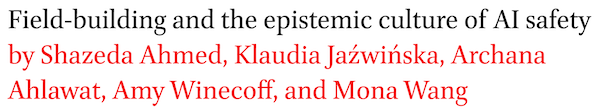

%%
Add discussion note here:

...

%%

> 

---

> 
> 
>   
> 
> ---
> 
>   
> The emerging field of “AI safety” has attracted public attention and large infusions of capital to support its implied promise: the ability to deploy advanced artificial intelligence (AI) while reducing its gravest risks. Ideas from effective altruism, longtermism, and the study of existential risk are foundational to this new field. In this paper, we contend that overlapping communities interested in these ideas have merged into what we refer to as the broader “AI safety epistemic community,” which is sustained through its mutually reinforcing community-building and knowledge production practices. We support this assertion through an analysis of four core sites in this community’s epistemic culture: 1) online community-building through Web forums and career advising; 2) AI forecasting; 3) AI safety research; and 4) prize competitions. The dispersal of this epistemic community’s members throughout the tech industry, academia, and policy organizations ensures their continued input into global discourse about AI. Understanding the epistemic culture that fuses their moral convictions and knowledge claims is crucial to evaluating these claims, which are gaining influence in critical, rapidly changing debates about the harms of AI and how to mitigate them.
> 
> **Contents**
> 
> [[#^p1]]  
> [[#^p2]]  
> [[#^p3]]  
> [[#^p4]]  
> [[#^p5]]  
> [[#^p6]]  
> [[#^p7]]
> 
> ---
> 
> ## 1. Introduction ^p1
> 
> Imagine you are an undergraduate computer science student at a U.S. research university interested in the ethical consequences of the technology you are learning to build. Seeking a like-minded community, you join a student organization where you read books like _Superintelligence_, and find online forums debating how artificial intelligence (AI) will shape the future of humanity. Motivated by these communities’ discussions about how to do the most good in the world, you decide to pursue a career where you work towards addressing risks from AI. You join a tech company where you build large language models (LLMs). In your spare time, you read research papers posted to these communities’ Web forums on how to make LLMs safer. Suddenly, you realize the community that has informed major decisions in your personal and professional life is increasingly shaping how the technology industry, academia, media, and policy-makers think about AI.
> 
> This hypothetical scenario approximates a very real personal and professional path for individuals interested in minimizing what they view as the negative long-term consequences of AI — especially those they characterize as existential threats to humanity. Starting in the early 2000s, a robust community has arisen around these issues, attracting individuals interested in applying the interconnected ideas behind effective altruism (EA), longtermism, artificial general intelligence (AGI), and existential risk (“x-risk”) to making AI systems safer.
> 
> Importantly, these ideas have recently entered the mainstream. In 2022, this shift was propelled in part by the large-scale infusion of capital then-billionaire Sam Bankman-Fried committed to EA and longtermist causes through FTX Foundation’s Future Fund, a grant-making body which was associated with his cryptocurrency exchange’s philanthropic arm (FTX Future Fund, 2022a). Many of the organizations, research, media, individuals, and projects selected for FTX Future Fund grants strengthened and expanded the EA and longtermist communities and their influence on how broad swaths of people outside of the community think about AI. In under a year, these ideas have come to take on global significance: discourse about AI posing an existential risk regularly appears in news media coverage and has spurred policy-makers on both sides of the Atlantic to turn to this epistemic community for solutions. While the Future Fund dissolved (Reynolds, 2022) after FTX went bankrupt (Huang, 2022), the community is still going strong and merits closer study.
> 
> We contend that the overlapping communities drawn together by these ideas form one coherent “epistemic community”: a community with clearly-defined shared values and methods of knowledge production (Schopmans, 2022). The impact of this epistemic community, which we hereafter refer to as the “AI safety epistemic community”, extends beyond the community’s bounds: non-profit and for-profit organizations, as well as academic research groups, have begun attracting sizable donations to fund their work. Furthermore, the AI safety epistemic community has also developed a variety of methods for expanding the reach of their ideas including online forums, career development programs, and policy advocacy. Through an analysis of the landscape of this community, we sought to answer the following research question: **How is the AI safety epistemic community developed and maintained through social, intellectual, and organizational practices?**
> 
> In this paper, we illuminate the central ideas and practices that define the emerging epistemic culture of AI safety. We are interested in how this epistemic community has translated their shared moral and normative claims into technical solutions and recommendations for AI policy that may have lasting, global implications. This work contributes to a broader understanding of cultural forces that influence certain types of AI development and deployment. As we note in [[#^p51|section 5.1]]: Public critique, the AI safety epistemic community is not the only group concerned with the societal harms AI poses, and is often framed as being in direct opposition to the groups of researchers, advocates, activists, and critics who are collectively referred to as the “AI ethics” community and who emphasize the need to mitigate well-documented, present-day harms of AI systems. This paper will not explore other, parallel communities in depth, as our objective is to provide a rich analytical description of the AI safety epistemic community in particular.
> 
> To motivate our analysis, we first explain the theoretical framework of epistemic culture and our methodology. Next, we map the origins of three core ideas (effective altruism, existential risk, and AI safety) that have brought multiple communities under the umbrella of the AI safety epistemic community. Then, we explore four mechanisms for the development and transmission of these concepts in the emerging field of AI safety: online community-building (career advising and Web forums), AI forecasting, research papers, and prize competitions. In the discussion, we synthesize the main characteristics of these four mechanisms, and then address the influence they have had outside of the community. We review critiques of the ideas and practices of this emerging field, revealing how the influence of the epistemic culture persists despite these concerns. Finally, we conclude with suggestions for future work that can build on our study’s initial landscape of this epistemic culture, as we anticipate that it will only continue to influence how people the world over think about AI.
> 
> 
> 
> ## 2. Methods ^p2
> 
> Our methodology took advantage of how much of the AI safety community’s epistemic culture unfolds online, providing ample documentation of value to our study. We combined approaches from critical technocultural discourse analysis (Brock, 2018) and frame analysis (Greene, _et al._, 2019) to understand which types of causes, projects, and organizations are prominent in the AI safety epistemic community.
> 
> We first compiled a list of individuals and organizations from four separate sources that reflect the spending priorities[^note-funding-streams] and field-building potential of this epistemic community. We referenced two major grant-making bodies in this area, Open Philanthropy and the now-defunct FTX Future Fund; the main career services organization for EAs, called 80,000 Hours; and an annual organizational review sourced from a community forum. Specifically, the four data sources included: 1) people and organizations who received funding from Open Philanthropy to work on advanced AI issues in 2022 (Open Philanthropy, 2022a); 2) people and organizations who were selected for FTX Future Fund grants and regrants to work on AI[^cite-ftx-2022a-p3] 3) organizations referenced on the 80,000 Hours page on preventing an AI-related catastrophe (Hilton, 2023); and 4) organizations from the 2021 Alignment Literature Review and Charity Comparison published on the Alignment Forum by the user “Larks,” who published a review of advancements in AI alignment each year between 2018 and 2021 (Larks, 2021). We sourced from Open Philanthropy and 80,000 Hours to assess the most prominent, established organizations in the field; conversely, we included FTX Future Fund (2022b) grantees and regrantees to capture new entrants to the field. These lists allowed to us sample for variety and consistency (several people and organizations were cross-listed), with the user-generated review on Alignment Forum balancing out the top-down lists with a view arising from the participatory, community discussion-based approach to field-building.
> 
> We then turned our analysis to the output of the funded organizations and individuals, coding each entry from our aggregated list to identify the type of agent (_e.g._, researcher(s), non-profit, for-profit company), the topics of work (_e.g._, AI safety, AI alignment, AI governance), and the method of dissemination (_e.g._, research, policy, prize competitions, fellowships). To derive these codes, we conducted discourse analysis across Web sites, research papers, reports, blog posts, forum posts, podcasts, and videos published by the individuals and organizations from our list. Through discourse analysis, we “interrogat\[ed\] power relations” emerging from these texts, focusing on “the interactions between technology, cultural ideology, and technology practice” (Brock, 2018). We likewise drew from frame analysis to “uncover the grounding assumptions and terms of debate that make some conversations... possible while forestalling alternative visions,” (Greene, _et al._, 2019) a way of gauging where the boundaries of AI safety lie. Both methods enabled us to make clear how discourse translates into practice in the field, and surfaced the four features of AI safety’s epistemic culture that we describe in [[#^p4|section 4]].
> 
> 
> 
> ## 3. Background ^p3
> 
> ### 3.1. Epistemic culture ^p31
> 
> In our approach to understanding the community of individuals interested in AGI, x-risk, EA, AI alignment, and related topics (_i.e._, the AI safety epistemic community), we make use of the theory of “epistemic culture.” Cetina developed the concept of epistemic culture through an ethnographic study of the knowledge-making practices, communities, and symbolism in high-energy physics and molecular biology research labs (Cetina, 2009). In Cetina’s words, “Epistemic cultures are cultures that create and warrant knowledge.” Investigating the social practices they comprise reveals “how we know what we know”[^cite-cetina-2009-p1]. The framework of epistemic culture is useful to apply to the amalgam of ideas, knowledge production and circulation, and community-building that occurs within the AI safety epistemic community for two reasons.
> 
> First, epistemic culture is well-suited to illuminating “when domains of social life... curl up upon themselves and become self-referential systems”[^cite-cetina-2007-p364]. In other words, epistemic culture captures when a community cleaves away from the mainstream to develop their own terminology, source texts, and knowledge claims. The AI safety epistemic community comes together to pursue what they see as the marginalized but vital work of protecting humanity from AI’s worst potential long-term harms. The technical and intellectual foundations on which the AI safety epistemic community bases their arguments (_e.g._, the timeline for when AGI will come into being or whether AGI is attainable) are subject to vigorous debate between AI experts (See [[#^p51|section 5.1]]: Public critique). Thus, the frame of epistemic culture is useful for understanding how the AI safety epistemic community conceptualizes its work in the face of lack of consensus and speculative subject matter.
> 
> Second, a focus on epistemic culture foregrounds the actions that constitute “knowledge as practiced”[^cite-cetina-2009-p8]. As we discuss in [[#^p4|section 4]], the AI safety epistemic community exchanges ideas, as well as attracts new participants via a network of Web forums, job boards, blogs, conferences, prize competitions, forecasting activities, and other primarily online venues. These are the community’s sites of knowledge production, debate, and what many sources in this paper refer to as “field-building” (See [[#^p4|section 4]]) (Gleave and McLean, 2023).
> 
> We argue that a shared epistemic culture is the connective tissue that keeps the multiple sub-communities within the AI safety epistemic community in conversation with one another. While some individuals support many of the ideas this paper will cover, membership in one group, or belief in one concept, does not amount to blanket endorsement for all of these communities and ideas. For example, not all AI safety researchers identify as effective altruists. Despite these differences, people in this epistemic community collaborate on field-building and knowledge production, undergirded by overlapping moral convictions, strong beliefs about the importance and neglectedness of this work, and shared methodological training.
> 
> ### 3.2. Effective altruism, existential risks, and AI ^p32
> 
> The intellectual movements of utilitarianism, transhumanism, effective altruism, and longtermism as well as how these movements conceptualize existential risk have had significant bearing on how existential risk and AI are framed in public and scholarly discourse today (Beard and Torres, 2020; Cremer and Kemp, 2021). In their account of the history of existential risk studies, Beard and Torres (2020) identify three phases of the development of ideas about existential risk. The first phase includes conceptualizations of existential risk that draws from the techno-utopian transhumanism movement and utilitarianism. The second phase includes the development of effective altruism and longtermism. The third phase includes an expansion of the philosophical view point of existential risk to include frameworks other than utilitarianism. This phase also draws from a more interdisciplinary perspective on existential risk. Here, we briefly summarize this history to provide context for the cultural and intellectual influences on the AI safety epistemic community.
> 
> Bostrom (2002) influenced the first wave of existential risk studies (Beard and Torres, 2020). Bostrom taxonomized risk in terms of three properties: scope, intensity, and probability. Scope refers to the size of the population that would be affected. He differentiated “global” risks as those with the potential to affect the entire population, as opposed to “local” or “personal” risks that affect either subpopulations or individuals. For intensity, he differentiates “terminal” from “endurable.” Endurable events are those that, even if they are severe, can either be coped with or recovered from. This is distinct from terminal risks, which are those that either completely kill off their targets or irreversibly and negatively alter the targets’ ability to live life according to their fullest aspirations. From this perspective, a risk is existential if it is both global in scope and terminal in intensity. In his words, an existential risk is, “one where an adverse outcome would either annihilate Earth-originating intelligent life or permanently and drastically curtail its potential.” This conceptualization draws from the philosophical framework of utilitarianism, which posits that ethical action should be driven by an estimation of the total well-being that can be achieved through that action. Actions or events that either end all human life or “drastically curtail its potential” can be viewed as a worst-case scenario from a utilitarian perspective (Beard and Torres, 2020).
> 
> Ideas from within the movements of transhumanism and posthumanism further extrapolate utilitarian ideas about human life (Beard and Torres, 2020). From the transhumanist perspective, technology should also seek to “overcome the human condition” (Schussler, 2019) by liberating humans from biological constrains on cognitive capacity and even death through technological advancement (Bostrom, 2005; Schussler, 2019; Yudkowsky, 2001). As Bostrom (2005) noted, “present technologies, like genetic engineering and information technology, and anticipated future ones, such as molecular nanotechnology and artificial intelligence" can contribute to well-being through a "radical extension of human health-span, eradication of disease, elimination of unnecessary suffering, and augmentation of human intellectual, physical, and emotional capacities.” Thus, the creation of “superintelligence” can be seen as a transhumanist endeavor insofar as it achieves any of these goals (Bostrom, 2005; Schussler, 2019; Yudkowski, 2001). On the other hand, pursuit of these goals through technology could also result in an existential catastrophe. Thus, technologies that could realize the most benefit to human well-being also create a significant existential risk.
> 
> Building on ideas from the first phase, the second phase of existential risk studies translated existential risk studies into more mainstream perspectives, especially those adopted by the effective altruism community (Beard and Torres, 2020). MacAskill (2019), an originator of EA, defined effective altruism as “(i) the use of evidence and careful reasoning to work out how to maximize the good with a given unit of resources, tentatively understanding ‘the good’ in impartial welfarist terms, and (ii) the use of the findings from (i) to try to improve the world.” As we show in [[#^p41|section 4.1]]: Online community building, committed EAs often make decisions about their philanthropic donations and career choices in line with the movement’s priority cause areas, which include global health and development, animal welfare, and mitigating global catastrophic risks. The importance-tractability-neglectedness (ITN) framework for quantifying how an issue should be prioritized at the margins is a staple within EA (Wiblin, 2016). Importance or scale defines the amount of good that could be done if a problem is solved or alleviated; tractability is about how realistically solvable the issue is; and neglectedness illustrates how many resources are directed towards the problem relative to others.
> 
> Many EAs additionally identify as “longtermists.” Longtermism is “the idea that we should prioritize positively influencing the long-term future of humanity — hundreds, thousands, or even millions of years from now” (Samuel, 2022). From this perspective, the consequences of any actions we take now for safety and well-being in the long-term future should enter the calculus about how to prioritize efforts in the present. Thus, longtermist perspectives build on core ideas from effective altruism and utilitarianism by prioritizing actions that can maximize utility. In some cases, EA-related theorists in this phase broadened the notion of what is to be maximized to expected value. Thus, “an existential catastrophe is an event which causes the loss of a large fraction of expected value” (Cotton-Barratt and Ord, 2015).
> 
> Notably, this perspective further introduces ambiguity into conceptualizations of existential risk. In a framework where value is “whatever it is we care about and want in the world” (Cotton-Barratt and Ord, 2015), estimations of existential risk are heavily dependent on whatever the estimator considers valuable. In Bostrom’s (2002) early conceptualization, he noted, “For there to be a risk, given the knowledge and understanding available, it suffices that there is some subjective probability of an adverse outcome, even if it later turns out that objectively there was no chance of something bad happening.” This notion of probability connects to that employed in a Bayesian tradition in which beliefs can be formulated even with limited knowledge of relevant information and updated over time as more information is acquired. Combining both Cotton’s definition of value and and Bostrom’s definition of probability results in an expected value calculation that is heavily dependent on the estimator’s perspective and knowledge, even if it does result in a precise numerical value.
> 
> The third wave of existential risk studies incorporates a wider range of intellectual perspectives, especially those related to ethical frameworks. Instead of thinking about existential risks as arising from a single, causal factor, this perspective acknowledges that existential risks are likely to arise from complex systems of interacting factors (Beard and Torres, 2020). Thus, a comprehensive understanding of existential risks demands an interdisciplinary approach, or even an expansion of the philosophical viewpoint beyond utilitarianism, which is not the dominant framework in other domains of philosophy (Cremer, 2021). In other words, philosophers and AI researchers working in isolation with a single perspective can neither sufficiently capture the interdependent factors that produce existential risks nor develop adequate mitigation strategies. This perspective embraces the idea that the onset of existential catastrophes could be gradual rather than sudden. This justifies a shift towards problems that are occurring in the short and medium term since successful redress of problems arising currently may significantly diminish existential risks that otherwise might arise in the future (Beard and Torres, 2020).
> 
> ### 3.3. AI safety ^p33
> 
> A separate but tightly related community that has grown alongside x-risk, longtermist, and EA communities constitutes technical experts who have been concerned with issues they group under the label of “AI safety.” The term “AI safety” has been used since the early-to-mid 2010s, and grew in popularity during the period of time when deep reinforcement learning (RL) agents reached impressive landmarks (for instance, the success of AlphaGo). As a result, many of the concepts, failure cases, and vocabulary that AI safety practitioners use borrow heavily from the technical study of RL agents. We address ideas in AI safety in greater depth in [[#^p43|section 4.3]]: AI safety research. Generally, AI safety practitioners are interested in preventing catastrophic long-term events precipitated by the deployment of machine learning systems. These systems are often modeled as algorithmic agents with capabilities that will inevitably grow far into the future. As their capabilities expand, these agents may in turn become less predictable, understandable, and controllable. Many AI safety advocates are extremely concerned that AI systems could pose an x-risk in the near or far future, and are confident that it is impossible to halt AI developments altogether (Bowman, 2022a). This combination of beliefs is disseminated throughout the epistemic culture we detail below.
> 
> 
> 
> ## 4. How the AI safety epistemic community is developed and maintained ^p4
> 
> ### 4.1. Online community-building ^p41
> 
> _Forums_
> 
> Online community-building is a key element of AI safety’s epistemic culture. Through dedicated Web forums, community members develop shared context, language, and reasoning style. We review three popular EA or EA-related online discussion spaces: EA Forum, LessWrong, and the AI Alignment Forum.
> 
> EA Forum, run by the non-profit Centre for Effective Altruism (CEA), is the primary venue for EA-related discussion (Effective Altruism Forum, 2023). LessWrong and the AI Alignment Forum are two closely related forums with overlapping readership and participation (Alignment Forum, 2023; LessWrong, 2023). Many posts are cross-posted or referenced on all three forums. Originally founded by Eliezer Yudkowsky, a central figure in AI safety and co-founder of the Machine Intelligence Research Institute (MIRI), LessWrong is dedicated to training people in rationalist reasoning and decision-making (Ruby, 2019). The Alignment Forum was launched in 2018 as a discussion space for AI alignment researchers (Bloom and Habyka, 2021).
> 
> In these forums, EA and AI safety communities debate and negotiate the core concepts behind AI safety and alignment. From casually involved EAs to professional AI researchers, participants turn to forums for frequent in-depth discussions, _e.g._, evaluating and making predictions on when and how AGI might be developed, detailing possible pathways to AI-generated catastrophic and existential risk events, and brainstorming future directions for AI alignment research. Many leaders from the EA community as well as prominent AI researchers keep tabs on these forums, engage, and inform their opinions and decisions based on content.
> 
> The Alignment Forum is unique within AI safety field-building, as it aims to be a central “publication destination for AI Alignment discussion” and to “serve as the archive and library of the field” (Bloom and Habyka, 2021). Its leaders posit that it fills an essential role that in the past may have been filled by academic venues such as conferences or journals (Bloom and Habyka, 2021). Posts cover a variety of topics, from fleshing out key conceptual factors in AGI alignment to exploring new research directions. Some posts are published in the open-access research repository _arXiv_, a signal of the AI Alignment Forum’s pursuit of scholarly legitimacy, though forum participants disagree over its utility (Brauner, 2022). Many alignment-focused organizations cite their AI Alignment Forum posts as published research.
> 
> In addition to its narrow focus, the AI Alignment Forum differs from EA Forum and LessWrong in that it gates full participation. Anyone can become a member to post or comment on EA Forum and LessWrong. By contrast, the latest membership update in 2021 shows the AI Alignment Forum has 50–100 members and grows slowly. Members are researchers from major institutions within the epistemic community, including the Future of Humanity Institute (FHI), Berkeley CHAI, DeepMind, OpenAI, MIRI, Open Philanthropy, and Alignment Research Center (ARC) (Bloom and Habyka, 2021). Membership is extended to those who existing members believe to have a strong track record of alignment research and to be highly trusted. They can post and comment directly, whereas non-members can only participate by submitting posts and comments to be reviewed before being published or by posting or commenting to LessWrong first. Because the two forums are integrated, members can promote content from LessWrong to the AI Alignment Forum. The forum leaders believe that these high membership standards improve the quality of discussion and peer review in such a new field (Hase, 2021).
> 
> **These three Web forums simultaneously attract people newly interested in these topics, sustain an international community of researchers and non-experts, disseminate and enable continued revision of this epistemic community’s beliefs, and in some cases promote offline participation in the community by nudging people towards careers in the field**. The Alignment Forum in particular documents a community’s attempt to define a nascent field and adapt research production flows to fast-moving technical developments.
> 
> _Career advising_
> 
> A core impulse of EA communities is to help members think empirically about how they spend their money and time using EA principles, and then follow through on their conclusions. 80,000 Hours is a non-profit organization that serves as EA’s primary career planning hub, and is unique in its cohesive bridging of a particular worldview to strategic, step-by-step career planning. 80,000 Hours self-describes as advising
> 
> a particular audience: namely, people with college degrees who want to make having a positive impact (from an impartial perspective) the main focus of their careers, especially in the problem areas we most recommend; who live in rich, (for the most part) English-speaking countries; and who want to take an analytical approach to their career. (Todd, 2019)
> 
> 80,000 Hours provides career planning resources, personal advising through calls with staff members, and a curated job board. Career planning content includes profiles on the “world’s biggest and most neglected problems,” analyzed through the ITN framework (80,000 Hours, 2023a). 80,000 Hours ranks AI risk as the most important issue to work on, because they view this area as both relatively neglected and overwhelmingly important currently and for future generations. In their AI risk problem profile, they justify their assessment, address counterarguments, provide resources for learning more about pathways to existential catastrophes, and recommend both specific issue areas and organizations to work for to alleviate these issues (Hilton, 2023). Of the 54 organizations or sets of roles they recommend, 21 are characterized as “AI policy and governance” or “AI technical safety” (80,000 Hours, 2023b).
> 
> In addition to 80,000 Hours, many smaller organizations are dedicated to upskilling and funneling EAs into AI safety roles. These include newer organizations that FTX Future Fund-selected—AI Safety Support (AI Safety Support, 2023) and AI Safety Community Field Building Hub (Gates, 2022), for example — as well as more established initiatives such as BlueDot Impact’s AGI Safety Fundamentals (AGI Safety Fundamentals, 2023). Likewise, several AI safety researchers have written explainers and starter guides to initiate people into the field via forum posts (AGI Safety Fundamentals, 2023; Bloom and Habyka, 2021; Bowman, 2022a; Shen, 2022). Both 80,000 Hours and these smaller educational, training, and coaching organizations work in tandem towards their goal of field-building.
> 
> ### 4.2. AI forecasting ^p42
> 
> As with forum posts, the practice of forecasting near- and long-term future outcomes for AI and AGI serves at least two functions: community-building and producing knowledge claims. In much of AI-related forecasting, individuals or teams pose a question and predicted guess about when a future event in the development of AI will occur. Questions of when humanity will attain AGI, “transformative AI” (Karnosky, 2021), “strong AI,”[^note-uncertain-future] and certain AI benchmarks are among the common forecasting topics. In some cases, forecasters proffer the evidence behind their reasoning and document their methodology (AI Alignment Forum, 2022). Forecasts and their explanations are often posted to the three Web forums described in [[#^p41|section 4.1]]: Online Community-Building, and through forecasting platforms like Metaculus (Metaculus, 2023) and Elicit (Elicit Forecast, 2023).
> 
> In non-expert forecasting, anyone can post a prediction, and the cross-posting of forecasts on Web forums opens others’ forecasts up for commentary and revision as new research is published and taken into account. Participants believe they can come to more accurate beliefs on x-risk potentials, especially around AI, by honing their forecasting abilities in these participatory forums (MichaelA, 2020). Some organizations have developed explainers and dictionaries (Parallel, LLC, 2019) to build “forecasting infrastructure.” Others have aggregated multiple forecasts to analyze meta trends like how predictions have changed over time (AI Impacts, 2015). Forecasting also figures into 80,000 Hours’ recommendation of working on “epistemics and institutional decision-making” (Whittlestone and the 80,000 Hours team, 2017). X-risk focused organizations such as Stanford’s Existential Risks Initiative (SERI) (lennart, 2021) and Berkeley Existential Risk Initiative (BERI) have issued grants for events like AI forecasting workshops (jacobjacob, 2019).
> 
> Academics focused on nearer-term predictions have also championed forecasting. For example, in 2021 Professor Jacob Steinhardt of UC Berkeley hired professional forecasters to answer questions such as “On June 30, 2022, what will be the state-of-the-art accuracy of a machine-learning model on the MATH dataset?” regarding a dataset of high school-level math problems developed by UC Berkeley researchers, with responses plotted as predicted percentages of the model’s accuracy (Steinhardt, 2022a, 2022b). After the dates in these questions passed, researchers extrapolated broader conclusions based on how closely forecasters’ predictions approximated the accuracy of these models. These included assessments that achievement of certain AI benchmarks happened faster than forecasters predicted, and that safety performance is not keeping up with the pace of new AI capabilities. In turn, this epistemic community treats this type of evaluation as justifying more urgency in allocating resources for AI safety work.
> 
> Thus **AI forecasting not only produces knowledge claims that these communities base decision-making on and shape research agendas around, but also serves a social function as members of the AI safety epistemic community consume and evaluate one other’s forecasts**. Forecasting is further popularized through its citations in research and forecasting prize competitions that can expand the reach of these communities.
> 
> ### 4.3. AI safety research ^p43
> 
> While Web forums enable interaction between AI experts and non-experts, these venues are not the primary arena through which novel technical ideas arise. Technical developments in AI safety are the product of researchers working at academic and non-academic AI safety research centers, and are typically communicated through conference proceedings, journal articles, and technical reports. Bowman (2023) has described the field of AI safety as “pre-paradigmatic,” in that research methods, practices, and norms of communication have yet to solidify. A recent literature review on AI alignment, a subfield of AI safety, echoes this. It notes that alignment “has not yet converged on a single, dominant paradigm or approach... the current exploratory nature of AI alignment research might be a strength, as exploration helps to avoid ossification” (Kirchner, _et al._, 2022). Researchers currently interested in AI safety have begun to construct such paradigms through the production of empirical research papers, as well as through the iterative scientific discourse of methodological critiques, literature synthesis, and citations, bringing the selection and endorsement of topics and methodologies in the field into sharper relief. While most of the influential scholarship that passes between these groups takes the form of technical computer science papers, philosophy and AI governance-focused papers are also prevalent.
> 
> At present, AI safety publications tend to originate from within tech companies and non-profits, with some collaborators hailing from academia. The non-academic AI safety research organizations that we investigated included Anthropic, Google DeepMind, and OpenAI, as well as research non-profits Redwood Research and ARC[^note-institutions-unique]. Non-academic AI safety organizations, which include for-profit, capped-profit, public benefit corporation, and 501(c)(3) non-profit structures, produce research papers that endeavor to serve their stated goals of ensuring that AGI benefits humanity (Google DeepMind, 2023; OpenAI, 2023) and that future AI systems are aligned with human values. Most of the AI safety research deriving from the non-academic organizations we investigated is posted on the institutional Web sites of the authors, community forums, and on arXiv. Some of this work is not formally peer-reviewed, although researchers frequently cross-post their papers to the main Web forums of this community, where their findings are then debated in an informal alternative to peer review. We note that such informal review methods differ from those of other mainstream scientific disciplines including in computer science, in which revision in response to critiques by subject matter experts is considered a indispensable component of the production of high-quality scientific findings.
> 
> Although AI safety has yet to converge on an established set of specific research focuses and methods, several topics have garnered attention from researchers both inside and outside of academia. Hendrycks, _et al._ (2022) identified four areas for the field to prioritize: “Alignment”, “Monitoring”, “Robustness”, and “Systemic safety”. These areas map closely onto a recent National Science Foundation (NSF) solicitation for grants, anticipated to provide $US20 million in funding for academic AI safety research (National Science Foundation, 2023). While these four problem areas are not exhaustive, they provide a useful frame for surveying the landscape of AI safety research to date.
> 
> Alignment, delineated by Hendrycks, _et al._ (2022) as a focus on how to “build models that represent and safely optimize hard-to-specify human values,” is a fast-blooming area of AI safety. AI alignment researchers have grappled with what it would mean for AI to be aligned with human values (so-called “value alignment”). For example, although humans’ expressed intentions, explicitly provided instructions, revealed preferences, ideal preferences, and interests are often related, the differences between them have important implications for AI alignment (Christian, 2020; Gabriel, 2020). Furthermore, even if what constitutes alignment could be precisely defined, it may not be possible to access information that would allow for an operationalization of alignment (Gabriel, 2020). Thus, “value alignment” work tries to define appropriate paradigms for identifying and representing human preferences and values. While one paper suggests drawing on human rights as an alignment baseline (Prabhakaran, _et al._, 2022), there have also been calls for enlisting social science researchers (Irving and Askell, 2019) and relying on upvoting mechanisms to measure human preferences (Hugging Face, 2023). Yet even if upvoting or some other reaction mechanism can provide information about human preferences that helps align AI, the incorporation of such mechanisms may have negative downstream consequences (Papakyriakopoulos, _et al._, 2023). As a result, even at the level of subtopics, AI alignment research is inextricable from philosophical questions about morality (Gabriel, 2020) and social scientific questions about human behavior.
> 
> Hendrycks, _et al._ (2022) described “monitoring” as “identifying hazards” such as malicious uses and anomalies. To them, this issue area also encompasses work on making models “honest”: many AI safety researchers posit that as some AI systems are incentivized to produce results they expect will be rewarded, they may in some instances produce outputs that are false and can cause harm. For instance, some researchers are concerned with the possibility of AI systems whose capabilities and reward-driven development lead to them “gaining and maintaining power over humans and the real-world environment” (_i.e._, “power-seeking AI”) (Carlsmith, 2022), and note that deception could ensue as a result. Among proposed methodological solutions are eliciting latent knowledge (ELK), a framework for identifying instances in which ML systems will misrepresent reality to human observers, and mitigating this misrepresentation by detecting and then preventing it (Christiano, _et al._, 2021); and constitutional AI, in which a pre-specified set of principles (a “constitution”) serves as the sole human oversight guiding an “AI assistant” that reduces harmful behaviors of other AI systems (Bai, _et al._, 2022). Relatedly, AI safety researchers have observed that as certain models become exponentially larger, or “scale,” they may develop capabilities their designers did not intend or expect them to have, such as the large language model GPT-3 being able to do arithmetic. “Monitoring” includes investigating methods for identifying when and where these new capabilities will emerge and how uncertainty in these outcomes might be reduced. Examples of this include work on scaling laws, which involves determining how the properties of a model change as the model scales, and work on mechanistic interpretability, which involves reverse-engineering and interpreting ML models to pinpoint the “algorithmic patterns, motifs, or frameworks” (Elhage, _et al._, 2021) that may indicate the “mechanism” through which new capabilities develop (Olsson, _et al._, 2022).
> 
> “Robustness” involves “withstanding hazards” such as “black swan” or “long-tail” (_i.e._, very unlikely but very consequential) events, as well as being capable of effectively responding to attacks by adversarial agents. As motivating examples of long-tail events, Hendrycks, _et al._ (2022) cite computer crashes of automated trading systems and the COVID-19 pandemic. To avoid similarly rare, but highly consequential, outcomes from AI systems, Hendrycks, _et al._ suggested generating more benchmarks and stress-testing of environments using simulated data. With respect to adversarial attacks, they encouraged researchers to expand their research beyond conventional topics, such as how to ensure robustness against adversarial attempts to undermine ML classifiers via very small perturbations to model inputs. Instead, they suggested researching wider conceptualizations of what constitutes an adversarial attack, including threats that are obviously different from non-adversarial inputs but that can nevertheless evade detection.
> 
> Finally, “systemic safety” addresses the contexts in which AI systems are deployed. Here, Hendrycks, _et al._ (2022) raised examples of cyberattacks, as well as citing more critical literature, such as research on LLMs as “stochastic parrots” reproducing the social harms embedded in the online sources on which they have been trained (Bender, _et al._, 2021). Systemic safety also includes the AI governance literature that comes out of the same epistemic culture and institutions this paper covers (Dafoe, 2018). Much of the systemic safety research occurs in other fields, such as privacy, fairness, and ethics, with solutions that tie back to the epistemic community, such as improving ML forecasting capabilities to predict future events.
> 
> Some experts in the field have questioned whether academia is well-suited to AI safety research since studying the effects of large models often demands having access to the massive computational resources necessary to train such models — resources that are concentrated within a few tech firms (Bowman, 2023). Even still, a growing handful of university professors and graduate students work on and disseminate their AI safety research in more traditional publication venues and conferences. We initially identified seven researchers who were listed as grantees or regrantees of the FTX Future Fund — Lionel Levine (Cornell University), Anca Dragan (University of California, Berkeley), Daniel S. Brown (University of Utah) — or who were mentioned in an 80,000 Hours post describing key organizations within academic labs — Sam Bowman (NYU), Dylan Hadfield-Menell (MIT), David Krueger (University of Cambridge), and Vincent Conitzer (Carnegie Mellon University). After investigating the research profiles of these seven researchers, we also included He He and Mengye Ren as both are listed as co-PIs of Sam Bowman’s lab, and Adrian Weller since he is listed as a member of the Computational and Biological Learning Laboratory at University of Cambridge alongside David Krueger. We then surveyed the professional profiles and publication records of these researchers. The majority were trained in computer science or related disciplines such as robotics or electrical engineering and hold appointments in computer science or computer science-adjacent fields (_e.g._, data science). Most are early-career, with eight out of 10 having completed their doctorates in the last 10 years. Over the past three years, they mainly published papers in disciplinary computer science conferences (_e.g._, Neural Information Processing Systems (NeurIPS), International Conference on Machine Learning (ICML)). Where taxonomic metadata was available, publications were most often classified in subareas of computer science such as artificial intelligence, machine learning, computer vision (and related topics), language, and robotics, though several publications were classified under topics associated with social science, humanities, or law.
> 
> On the whole, our analysis suggests that academic AI safety researchers tend to disseminate their work in disciplinary computer science venues and address topics that are broadly of interest to the computer science researcher community. In other words, **the reach of these researchers is not constrained to research communities primarily interested in AI safety or closely related topics, but rather, is likely to have influence in traditional computer science domains**. Furthermore, because most researchers we investigated had accepted faculty appointments relatively recently, their impact both within and beyond the subfield of AI safety will likely be magnified over time as their trainees also secure positions in academia or in industry research centers. As a result, **scholarly research represents one of the core avenues through which ideas about AI safety have begun to take hold outside the AI safety epistemic community**. As with Web forums and forecasting, research papers allow for collaborations across boundaries, with many co-authored papers bringing together representatives of industry and academia, and in some cases reflecting how some individuals move between both companies and universities. The fourth and final site of the epistemic culture we investigated, prize competitions, also traverses the boundary between industry and the academy.
> 
> ### 4.4. Prize competitions ^p44
> 
> Prize competitions are another venue in which ideas from effective altruism, longtermism, and conceptions of x-risk interact with AI safety. Often technical in nature, each contest frames a particular problem in machine learning and solicits solutions. Competition Web sites include submission guidelines, along with research publications that entrants are encouraged to consult before submitting papers, code, and other documentation of their work. Winning individuals and teams receive cash prizes from prize pools that are orders of magnitude larger than those academic computer science conferences tend to grant.
> 
> We assessed 10 prize competitions organized by institutions with an explicit connection to x-risk and AI safety to better understand the communities, practices, and problem formulations they socially reproduce and incentivize. Two of these were one-time events hosted by AI safety non-profits. In 2022, ARC ran a competition which aimed to build on their work on eliciting latent knowledge (ELK). ARC solicited strategies, code, and pseudocode that took into account a bank of counterexamples raised by the organizers and commentators on the competition announcement post (Christiano, 2022). The non-profit Fund for Alignment Research (FAR) also ran their Inverse Scaling Prize that year to find “new examples of tasks where pretrained language models exhibit inverse scaling: that is, models get worse at the task as they are scaled up” (McKenzie, _et al._, 2022).
> 
> | **Table 1: AI safety prize competitions.**  Note: 1 Originally “Existential Risk Prize”; 2 Original description was that “grant will be administered by the Berkeley Existential Risk Initiative”; 3 Organizers did not disclose where the replacement funding they were able to raise originated from; 4 Original amount promised by FTX, but organizers note that they were only able to raise $US50,000 after FTX bankruptcy. |  |  |
> | --- | --- | --- |
> | **Prize competition** | **Funder(s)** | **Prize pool total ($US)** |
> | Best Paper Award, ECCV 2022 Workshop on Adversarial Robustness in the Real World (AROW) (European Conference on Computer Vision, 2022) | Open Philanthropy | $30,000 |
> | Trojan attack detection on deep neural networks, NeurIPS 2022 (Center for AI Safety, 2022b) | Open Philanthropy | $50,000 |
> | Best Paper Award at ML Safety workshop, NeurIPS 2022 (NeurIPS, 2022) | Open Philanthropy | $50,000 |
> | Paper Analysis Awards 1 at ML safety workshop, NeurIPS 2022 (NeurIPS, 2022) | Open Philanthropy | $50,000 |
> | Machine Learning Moral Uncertainty Competition (ML Safety, 2022c) | Center Safety for AI | $100,000 |
> | Autocast Forecasting Competition (ML Safety, 2022a) | Center Safety for AI | $125,000 |
> | MineRL BASALT competition, NeurIPS 2022 (MineRL, 2022) | FTX Future Fund 2, Encultured.ai, Microsoft | $155,000 |
> | Inverse Scaling Prize (McKenzie, _et al._, 2022) | FTX Future Fund 3 | $250,000 4 |
> | Eliciting Latent Knowledge prize competition (Christiano, 2022) | Alignment Research Center | $274,000 |
> | SafeBench Competition (Center for AI Safety, 2022a) | Center for AI Safety | $500,000 |
> 
> In addition to standalone prize competitions, institutions in the AI safety epistemic community have hosted contests within established academic conferences and workshops. The Center for AI Safety (CAIS), a “research and field-building non-profit,” supported a competition on Trojan attack detection in deep neural networks at the 2022 NeurIPS conference (Center for AI Safety, 2022b) and organized the 2022 NeurIPS ML Safety workshop. The workshop’s Best Paper Award encouraged participants to work within the four thematic areas specified in Hendrycks, _et al._ (2022). One of the paper’s authors served as a judge for CAIS’ non-academic SafeBench benchmarking prize competition, which referenced these same categories (replacing “Systemic safety” with “Safety applications”) (Center for AI Safety, 2022a). The SafeBench guidelines note, however, that “submissions will be judged according to their relevance to risks from advanced AI, not to these categories.”
> 
> Two of the prize competitions that were originally to be funded by FTX Future Fund appear to have erased their x-risk and longtermist premises with no explanation offered. What was first announced as the NeurIPS ML Safety workshop’s “Existential Risk paper prize” (Dan H, 2022) to find the “best accepted ML Safety papers that have the highest quality x-risk analyses” was rebranded as the Paper Analysis Awards “for accepted papers that provide analysis of how their work relates to the sociotechnical issues posed by AI” (Dan H, 2022). Similarly, the Future Fund’s original description of the European Conference on Computer Vision (ECCV) 2022 Workshop on Adversarial Robustness in the Real World noted that “The best papers are selected to have higher relevance to long-term threat models than usual adversarial robustness papers” (FTX Future Fund, 2022a). The eventual virtual workshop that was held, however, did not mention longtermism (European Conference on Computer Vision, 2022). Given the collapse of FTX, these revisions might signify trepidation around bringing x-risk and longtermist ideas into academic spaces or the waning influence of a major funder’s desired frame.
> 
> Two additional nonacademic competitions that bridge to academia were sponsored by CAIS and ML Safety (a social community CAIS sponsors). The first was their Moral Uncertainty competition, which solicited submissions that use “machine learning models to estimate when human values are in conflict and estimate moral uncertainty” and required prize-qualifying entrants to “have a corresponding accepted paper at reputable machine learning conferences and/or journals” (ML Safety, 2022c). The second was their Autocast Forecasting competition to “build a machine learning model that makes accurate and calibrated forecasts” responding to forecasting questions sourced from platforms such as Metaculus. The organizers “reserve\[d\] the right to.... integrate this round into a NeurIPS competition” (ML Safety, 2022a).
> 
> **Prize competitions present an opportunity for ideas in this epistemic community to be socially reproduced within larger audiences that have little to no prior exposure to x-risk and themes within AI safety**. The community has also appended social events to these workshops, such as the ML Safety Social (ML Safety, 2022b) and the AI Safety Unconference (AI Safety Events, 2022) at NeurIPS. The latter event, which has run three times to date, provides reading recommendations from the alignment and AI safety literature as well as Bostrom’s _Superintelligence_, a reminder of how intertwined these communities continue to be. These competitions provide community-building efforts, incentivize the production of research and solutions to long-term technical problems in AI safety, and in some cases seek for this work to acquire academic legitimacy.
> 
> 
> 
> ## 5. External reception of the AI safety epistemic community ^p5
> 
> Throughout this paper, we have cited how many people in the AI safety epistemic community describe their work as important, yet neglected or marginalized by others. However, over the past few years this community has stepped out of the margins and into a more mainstream position to affect public thinking about AI. From OpenAI’s launch of ChatGPT to Anthropic’s $US4 billion valuation (K. Clark, 2023) as of spring 2023, we have seen how a small group of actors can set off a wave of attention, investment, and debate about whether and how to deploy certain AI systems. In part, this shift into the mainstream derives from the large sums of money involved — from the ultimately withdrawn financial injections of FTX Future Fund to the more concrete recent investments LLMs. Yet, our paper argues that the ongoing influence of this epistemic culture over broader AI discourse is not solely driven by the community’s financial resources. **It is instead the cohesive, interwoven social structures of knowledge-production and community-building that will ensure the continued reproduction of their ideas about AI outside of the boundaries of this community**.
> 
> In our review of online community-building through career advising and Web forums, forecasting, research, and prize competitions, we show how each of these individual sites serve multiple functions. Career advising hubs and Web forums enable both new initiates who have dabbled with ideas from EA and AI safety, as well as more deeply involved members of these communities, to socially and professionally structure their time around contributing to their goal of preventing AI x-risks. Forecasting produces both professionally sourced and crowd-sourced predictions about future AI outcomes, which in turn are cited in research and used as evidence to justify decisions about which work to prioritize and the timelines along which to do so. Forecasting is also social; posting predictions and the reasoning behind them leads to debate and interaction with others about their forecasts. Technical research papers and reports are the main knowledge production output of the AI safety epistemic community. They also enable ideas from this community to travel between industry, academia, and the less formal social spaces of Web forums to spark further debate. Research papers and many prize competitions attempt to legitimize this epistemic community’s views on AI within academia. Prize competitions in particular present an opportunity to recruit new people into exploring ideas about x-risk and approaches to AI safety that have been shaped by this epistemic culture. All four of these mechanisms interlock to socially reproduce ideas about AI safety.
> 
> What happens when the products of this epistemic culture take root outside of this tight-knit, globally distributed epistemic community? To answer this question, we start by summarizing critiques from within and outside of the community. We then discuss how, in spite of these criticisms, this community’s ideas have begun to exert influence in media narratives about AI as well as in AI policy forums. We close with suggestions for future work that can build on the foundation of this paper.
> 
> ### 5.1. Public critique ^p51
> 
> Along with the rise in public awareness about EA and its associated views on AI, there has been an uptick in criticism from both within and outside of the movement. Within EA circles, some have expressed concern that AI safety receives a disproportionate amount of attention and resources from the community relative to the level of certainty over risks and timelines to advanced AI (ConcernedEAs, 2023). There is also internal debate over the distinction between working on advancing AI capabilities versus safety (Dan H and ThomasW, 2022; Byrnes, 2021). Another line of internal critique points out the lack of diversity and pluralism within the community, and unaccountable leadership (Cremer and Kemp, 2021).
> 
> In 2023, the EA community grappled with its demographic homogeneity, allegations of sexism and harassment within the movement (Alter, 2023), as well as the resurfacing of an e-mail message containing racist rhetoric from Bostrom (Gault and Pearson, 2023). In his public response, Bostrom did not reject the possibility of genetic differences contributing to different levels of intelligence between people of different races (Bostrom, 2023). This prompted the Global Catastrophic Risk Institute to issue a statement distancing themselves from Bostrom’s perspective (Baum, 2023). This intra-community struggle with how one central figure in the epistemic culture has treated eugenicist ideas occurs in parallel with the growth of a body of research identifying how the influence of eugenics has been present throughout the historical project of building AI and AGI (Gebru and Torres, 2023; Katz, 2020).
> 
> Outside of the community, critiques similarly contest ideological and technical underpinnings of x-risk and notions of intelligence. For instance, scholars have problematized Bostrom’s prioritization of human intelligence above all other traits, especially given the historical harms that have been premised on hierarchies of individual or group-level intelligence (Colebrook, 2018; Schuster and Woods, 2021). Although Bostrom’s (2014) _Superintelligence_ was not the subject of these critiques, in it Bostrom describes genetic engineering as one of the mechanisms through which a superintelligent agent might be achieved. Though he goes into some detail[^cite-bostrom-2014-pp47-52] as to how social dynamics might accelerate superintelligence by this method, he makes only a passing mention of the history of violence associated with eugenicist ideas[^cite-bostrom-2014-p52]. Thus, concerns about the links between eugenics and EA-inflected ideas about intelligence apply not only to AI, but to such thinking more broadly.
> 
> Finally, critics challenge the very notion that AGI is attainable and that current advances in AI warrant the coordinated, resource-intensive response this epistemic community has marshaled. Amodei, _et al._ (2016) and Raji and Dobbe (2023) pre-figured contemporary arguments between the AI safety epistemic community’s proponents and detractors. More recent work continues to challenge the prioritization of AI safety despite current fundamental failures of AI functionality (Raji, _et al._, 2022).
> 
> Warnings against AI doomsday hype (Burrell, 2023; _Nature_, 2023) and AI “snake oil” (Narayanan and Kapoor, 2023) also undercut foundational concerns of the AI safety field. In 2023, both the Future of Life Institute (2023) and the Center for AI Safety (2023) issued open letters calling on the public to recognize the existential risk that AI poses, with both letters attracting thousands of signatures from a wide range of figures including prominent technology CEOs and respected computer science professors. In response, organizers of the Fairness, Accountability, and Transparency in Machine Learning (FAccT) conference posted a letter raising concerns about real-world, empirically proven AI harms and gathered over 250 signatures from academics, technologists, and advocates (Conference on Fairness, Accountability, and Transparency (FAccT) Executive Committee, 2023). Direct critiques of the AI safety epistemic community itself condemn its EA connection and argue that the community’s role in general AI development will lead it to harm already marginalized groups rather than benefit humanity (Gebru, 2022), as well as point out that this epistemic community’s prize competitions may rely on unpaid labor of non-prize-winning entrants (Bender and Hanna, 2022). In spite of these criticisms, the AI safety epistemic community still wields influence in media and policy venues that are interested in AI.
> 
> ### 5.2. Media and policy influence ^p52
> 
> _Media_
> 
> The wider EA community has steered resources towards promoting EA ideas in non-EA media outlets, which creates an opening for shaping public narratives about AI. The community has influenced media in several ways. First, they seek to attract positive attention from the press. Organizations like the Future of Life Institute (2019) and the Centre for Long-Term Resilience (2022) have boasted in their annual reports about the coverage they received in the mainstream media. MacAskill’s (2019) essay and the swift rise of FTX also led to widespread, generally favorable, coverage of EA ideas in 2021 and 2022 (Lewis-Kraus, 2022; Osipovich, 2021; Schleifer, 2021; Ezra Klein Show, 2022), including views on AI- and AGI-related x-risks.
> 
> Second, recognizing the field as having the potential for high impact, EA organizations have encouraged members to cultivate careers in journalism (Fenwick, 2022). For example, in 2022 and 2023, the Effective Altruism Fund sponsored Training for Good’s Tarbell Fellowship for early-career journalists (Tarbell Fellowship, 2022). Similarly, Open Philanthropy sponsored a fellowship in 2022 where one of the project goals was to “demystify longtermist and EA concepts, especially for skeptics” (Open Philanthropy, 2022b). Beyond training programs, some EA advocates have invested in journalistic outlets as a way to promote EA-related journalism. For example, Bankman-Fried was the largest investor in Semafor, a media startup launched in 2022 (Crunchbase, 2023). Through his family foundation, he also donated six-and seven-figure grants to popular publications like _ProPublica_ (2022a), _The Intercept_ (Grim, 2022), and _Vox’s_ “Future Perfect” vertical for reporting on topics such as “technological and innovation bottlenecks that hamper human progress” (_Vox_ staff, 2022).
> 
> Third, members of the community have created new media projects with EA-aligned goals and values. _Asterisk_, a magazine launched in 2022 with backing from the Effective Ventures Foundation and Open Philanthropy, proclaimed that its editorial perspective is “shaped by the philosophy of Effective Altruism, but not limited to it” (_Asterisk_, 2023). One of the contributors (Piper, 2022b) is a writer for _Vox’s_ Future Perfect vertical, which is transparent about its roots in the effective altruism movement (Matthews, 2018) and which has covered EA steadily (Matthews, 2022; Piper, 2022a; Samuel, 2023). Finally, alternative media to journalistic coverage include tabletop (Kokotajlo, 2022) and video games (Encultured.AI, 2023) that teach players about AI safety and AI x-risk, and a museum exhibit about their potential catastrophic outcomes (Misalignment Museum, 2023; Johnson, 2023).
> 
> How the downfall of FTX will influence EA-focused media endeavors is not yet clear (Fan, _et al._, 2023; Mullin and Yaffe-Bellany, 2023; _ProPublica_, 2022b; _Vox_ staff, 2022). However, given the multiple avenues of influence, EA ideas are likely to continue to gain ground within the media. Despite mainstream English-language media’s coverage having shifted from curiosity about EA toward a more suspicious stance, tech policy is more open to suggestions from EA, x-risk, and AI safety communities.
> 
> _Policy_
> 
> The AI safety epistemic community’s modes and degree of influencing AI policy massively shifted after the popularization of ChatGPT. From the mid-2010s up through late 2022, a mix of think tanks, non-profits, academic research centers, and companies in this epistemic community produced reports on AI governance; made policy recommendations to mostly Global North-based governments (Bostrom, _et al._, 2020; Select Committee on Artificial Intelligence of the National Science & Technology Council, 2019; Ord, _et al._, 2021; Whittlestone, Avin, _et al._, 2022; Whittlestone, Cooke, _et al._, 2022) and multilateral bodies such as the United Nations, G20, and OECD (Centre for the Study of Existential Risk, 2021; Clarke, _et al._, 2020; Future of Life Institute, 2021; Kemp, _et al._, 2019; Schleicher, 2019); provided Congressional testimonies in hearings about AI; and consulted on specific initiatives such as the National Institute of Standards and Technology’s (NIST) AI Risk Management Framework (RMF)(U.S. Department of Commerce. National Institute of Standards and Technology).
> 
> Three themes emerged across their initial recommendations: 1) self-regulation, 2) internationally cooperative versus rivalrous AI development (Bowerman, 2019), and 3) designated roles for government and academia in the broader AI ecosystem. One example of support for self-regulation can be seen in an FLI representative’s remarks at a NIST workshop praising the RMF’s “soft law,” “sector-agnostic” approach in which organizations can volunteer to publicly disclose risks they have discovered in their AI systems (U.S. Department of Commerce. National Institute of Standards and Technology, 2022b). As we discuss in [[#^p6|section 6]]: Discussion, the epistemic community’s lack of contribution to other efforts at regulating the AI sector (such as advocacy for algorithmic accountability) and general aversion to questioning corporate power structures could also be interpreted as a preference for companies to regulate themselves. Despite the epistemic community’s claims to want to support a non-rivalrous geopolitical landscape for AI development, we found that tech firm representatives often raise talking points that work against this stated objective. For example, we reviewed three Congressional testimonies from 2016 and 2022, one from Greg Brockman of OpenAI, and two from Jack Clark (in his roles at OpenAI and Anthropic). Both men spoke to the need for the United States to retain its position as a world leader in AI in order to “define \[AI’s\] culture and values” (U.S. Senate. Committee on Commerce, Science, and Transportation, 2016) as well as to reap what they characterize as AI’s inevitable economic benefits. This position undergirded their consistent references to how other countries are heavily investing in AI development, and how, for instance, China is “far ahead of” the U.S. when it comes to AI capabilities used for re-identifying individuals from surveillance footage (U.S. Senate. Committee on Commerce, Science, and Transportation, 2022). Elsewhere, other Anthropic employees have spoken about not wanting to fuel an “AI race” dynamic (Future of Life Institute, 2022). Yet it can be difficult to separate narratives of geopolitical competition from these testimonies’ comparisons of U.S. investment and advances in AI to those of other countries, their emphases on public measurements of AI systems’ progress, and their references to international contests on different types of AI tasks as a way of gauging other countries’ AI advancements.
> 
> Finally, regarding actions academia and government should take, Anthropic co-founder Jack Clark posited that under the creation of the U.S. government’s National AI Research Resource (NAIRR), the government could provide academia the funding for “computational power closer to that found in industry” to conduct both experimental research and research that would provide “accountability for the private sector” (U.S. Senate. Committee on Commerce, Science, and Transportation, 2022). This equates accountability not with with changing behavior within companies, but instead with giving universities computing resources required to run large models so that they can produce similar AI safety research already created in industry. Critics argue that rather than level the playing field, NAIRR would instead entrench power within the largest companies with these resources and limit what counts as “AI research” — _i.e._, sidelining the humanities and social sciences (_Federal Register_, 2021).
> 
> From late 2022 to the present, the AI safety epistemic community’s influence over policy-makers, particularly in the United States and United Kingdom, had markedly grown. U.K. Prime Minister Rishi Sunak announced that his government would commit to spending £UK100 million on AI safety and host an AI Safety Summit in fall 2023 (Gov.UK, 2023b). Anthropic, DeepMind, and OpenAI claim they will grant U.K. researchers ‘priority access’ to their models for safety evaluations (Gov.UK, 2023a). Recent critics have also pointed out how members of the AI safety epistemic community are occupying government and civil service roles in the U.K. related to AI, raising concerns about conflicts of interest (L. Clark, 2023). Congressional hearings featuring influential figures in this epistemic culture — ranging from OpenAI CEO Sam Altman (U.S. Senate. Committee on the Judiciary. Subcommittee on Privacy, Technology, and the Law, 2023a) to both the founder and executive director of the think tank Center on Security in Emerging Technology (CSET) testifying in the same hearing (U.S. House. Committee on Science Space and Technology, 2023a) — are now regular occurrences. In 2023, the White House hosted several high-profile meetings with companies including Anthropic and OpenAI, resulting in a voluntary pledge by these and other AI companies promising transparency and safety on vague terms (Kelly, 2023).
> 
> Ideas from the earlier period of the epistemic community’s attempts to influence policy re-appear in recent high-profile events. At a 2022 NIST workshop Clark had noted that Anthropic hired crowd workers to “red-team” LLMs, or to pose malicious requests that researchers could take into account when updating systems to steer clear of these types of abuses, and proposed that the U.S. government could create markets for AI red team services (U.S. Department of Commerce. National Institute of Standards and Technology, 2022a). In mid-2023, the Biden-Harris administration announced support for an AI red-teaming event that was later held at that year’s DEF CON conference (Mislove, 2023). By autumn of the same year, red-teaming featured in a White House Executive Order on AI as an area that NIST would set standards for before (unspecified) AI systems would be released to the public (White House, 2023).
> 
> The journey of red-teaming proposals from an idea that has traveled from AI safety research papers to being codified in high-profile policy spaces is but one example of how this epistemic community is shifting from smaller, short-term influence to potentially stickier institutional legacies. The same White House Executive Order contained language lifted directly from causes the AI safety community champions, including provisions to prevent bad actors from utilizing AI systems to build biological weapons (Matsakis, 2023), and the creation of the AI Safety Institute (AISI) at NIST. Washington’s response to this epistemic community’s influence has for the most part been one of uncritical acceptance, save for bipartisan pushback from Congress sparked in light of the creation of the AISI. Six members of the U.S. House Science, Space, and Technology Committee issued a letter to the head of the AISI urging NIST to be transparent about how they plan to distribute research funding, given their assessment that the AI safety research field is one in which “Findings within the community are often self-referential and lack the quality that comes from revision in response to critiques by subject matter experts. There is also significant disagreement within the AI safety field of scope, taxonomies, and definitions” (U.S. House. Committee on Science Space and Technology, 2023b). This request implies a concern that the rapid, often untraceable logics and processes through which the AI safety epistemic community’s funders distribute research grants could be replicated at AISI.
> 
> In sum, **many of this epistemic community’s policy recommendations amount to maintaining the status quo of non- or self-regulation**, such as support for the approach companies like OpenAI and Microsoft are already taking — _i.e._, releasing unregulated LLMs to the public as a means of gathering feedback about the kinds of misuses and harms users will encounter in them. While some within the community see the policy developments described above as a major victory, it is possible that many of these new stipulations may never be applied if the dangerous speculative futures they anticipate do not come to pass. At a moment when companies like OpenAI are being challenged for issues that are core to their business model, such as the case for copyright violations in using news media for training data (Grynbaum and Mac, 2023), the policy recommendations coming out of the AI safety epistemic community pose no challenge to the fundamental corporate structure or operations of the tech firms they seek to regulate. Activities like red-teaming assume that companies will continue to operate as they have in the past, and narrow the scope of what is considered problematic, unsafe behavior from AI systems.
> 
> These recommendations parallel a long-held tendency in the United States to avert ‘over-regulation’ of technology that is feared to stymie innovation, at a time when many policy-makers lack a comprehensive understanding of AI’s harms (Kang and Satariano, 2023). At the same time, the AI safety epistemic community is likely to direct more members towards careers in policy. On 80,000 Hours’ page of highest-impact career paths, government and policy roles appear first, with emphasis on AI policy (80,000 Hours, 2022). Open Philanthropy has spent upwards of $US3 million to sponsor U.S.-based policy fellowships (Bordelon, 2023; Open Philanthropy, 2022b) that have placed fellows from the AI safety community in the U.S. Department of Defense, Department of Homeland Security, State Department, and Senate offices that set and enact AI policy, along with think tanks with policy influence such as the RAND Corporation and CSET, while Training for Good has a policy fellowship in the EU (Training for Good, 2022). In addition, the Centre for the Governance of AI (GovAI) runs summer and winter fellowships for “candidates who are strongly considering using their careers to study or shape the long-term implications of AI” (Centre for the Governance of AI, 2024).
> 
> The financial resources of the philanthropic funders in the AI safety epistemic community far outweigh those of other communities who have proposed methods of regulating AI systems. By contrast, time and attention within government are much more limited, and as some critics argue, could in time be skewed more toward the former group at the expense of working with the latter (O’Shaughnessy, 2023). When Congressional hearings with neutral-sounding titles such as “Oversight of A.I.: Principles for regulation” (U.S. Senate. Committee on the Judiciary. Subcommittee on Privacy, Technology, and the Law, 2023b) solely provide a platform for experts from the AI safety community, they can contribute to the misconception that policy-makers are being presented with balanced, representative perspectives reflecting a full spectrum of concerns AI experts hold. In time, this can lead to long-standing social harms of AI systems being further sidelined and remaining unaddressed.
> 
> 
> 
> ## 6. Discussion ^p6
> 
> Across our analysis of AI safety’s epistemic culture, we observe at least two unresolved tensions between the community’s stated goals and their practices: 1) the community’s general unwillingness to challenge corporate power despite conflicts between AI safety objectives and corporate profit motives; and 2) the mismatch between the urgency with which the community insists AI safety issues must be resolved, contrasted with their lack of consultation with other salient fields’ prior work in favor of a pursuit of novelty.
> 
> In November 2023, OpenAI’s non-profit board voted to oust CEO Sam Altman, citing what they believed to be his profit-motivated push for potentially unsafe, rapid development of the company’s AI systems over a slower approach that would prioritize AI safety. Hundreds of employees threatened to leave if Altman were fired (Hao and Warzel, 2023; Knight and Levy, 2023). This episode stunned both veteran tech industry watchers and casual observers alike, for it cemented that the ideological project of AI safety has material consequences in a company that occupies a centralized position of power within an oligopolistic tech ecosystem. As of this writing, Altman remains CEO. While the company seeks a new board for its non-profit arm, at least one organization has called for the dissolution of OpenAI’s non-profit entity on the grounds that corporate interests ultimately won out over its stated mission (Weissman, 2024).
> 
> Within the AI safety community, a faction of people support the idea of an “AI pause,” or a hiatus on further developing AI systems’ capabilities until safety measures can be ensured (PauseAI, 2023; Samoylov, 2023). Yet there is no consensus around what a pause would entail (West, 2023) and no significant funding apparatus or groundswell of support lobbying for such a pause. Critics also note that arguments for halting AI developments ultimately sustain hype that these technologies are as powerful as tech companies market them to be.
> 
> Whether one supports the “AI pause” position or not, the overall tone of urgency that underlies the AI safety epistemic culture’s mission and messaging would imply openness to a wide range of solutions, and consultation with a broad body of prior work, in addressing this community’s perceived risks from AI systems. Regarding AI alignment, major figures such as Anthropic co-founder Dario Amodei have argued that “you want as many different orthogonal views on the problem as possible” (Future of Life Institute, 2022). However, to date the research and policy proposals coming out of this community have converged around a narrow set of technical solutions that do not engage with work that falls outside of the ideological and disciplinary boundaries we describe above. For instance, how might research on model ‘hallucinations’ and ‘deception’ benefit from being in conversation with prior work on misinformation and disinformation? Neglecting to review work that does not fit within the still-coalescing boundaries of AI safety could lead to a reduplication of research that has already been done elsewhere. Much of the pursuit of novelty in AI safety — the establishment of new organizations, practices, and terms — also reflects non-engagement with the history of AI and its many earlier hype cycles (Wiggins and Jones, 2023).
> 
> As AI safety has gone from a field that its proponents saw as working on issues at the margins, to one that has amassed a considerable amount of power, funding, public influence, and a career pipeline, there is potential for an epistemic monoculture to develop around thinking about AI risk and proposed solutions. The AI safety epistemic community’s openness and response to external critiques will in part determine how the subsequent stages of field-building will unfold.
> 
> ### 6.1. Future work ^p61
> 
> Future research could focus on at least two areas. The first is development of AI safety as an academic research field (Tiku, 2023). Researchers could analyze papers coming out of university AI safety labs (Massachusetts Institute of Technology. Computer Science & Artificial Intelligence Laboratory (MIT CSAIL), 2023; NYU Alignment Research Group, n.d.; Carnegie Mellon University. Foundations of Cooperative AI Lab, n.d.) and supported by the National Science Foundation’s allocation of $US20 million in grants for AI safety research (National Science Foundation, 2023). Related work could focus on student-run AI safety and alignment groups (AI Safety Student Team, n.d.; Massachusetts Institute of Technology (MIT) AI Alignment, n.d.) and the expansion of prize competitions to include college and high school students (Prometheus Science, n.d.a., n.d.b.).
> 
> Another track for future research could be to study the institutional elements of this epistemic culture. From justifications for university research labs (Bowman, 2022b) to the Anthropic founders’ decision to leave OpenAI and commit to the “focused research bet” of their company’s work on AI safety (Future of Life Institute, 2022), what are the affordances of creating dedicated spaces for this work? Several of these organizations operate as public benefit corporations, capped-profit companies, and 501(c)(3) non-profits, which implies their work has a clear benefit to society. What counts as benefit to the public’s experience of AI within this metrics-driven, longtermist-minded epistemic culture?
> 
> ### 6.2. Limitations ^p62
> 
> One of the main limitations of this work is its reliance on publicly available data. One significant aspect of the epistemic culture that we did not include here is local offline meetups, ranging from different EA chapters’ meetings to bigger conferences such as the annual EA Global conferences. Interviews or surveys may have uncovered different findings or gone into more depth on how the people participating in this epistemic culture experience it. Likewise, we were not able to capture the magnitude, _e.g._, of how many people ultimately compete in prize competitions.
> 
> Furthermore, because our analysis intended to provide a high-level map of the AI safety epistemic community, it was not also possible for us to conduct an exhaustive analysis of topics within each of the four areas of interest. Subsequent work could build on our analysis by expanding the breadth or depth of analysis within each of the areas. For example, additional insight into the AI safety epistemic community could be gleaned through a qualitative content analysis or quantitative topic analysis of the themes embedded within the work of AI safety research papers.
> 
> 
> 
> ## 7. Conclusion ^p7
> 
> In this paper, we traced how a set of ideas and practices are crystallizing into an epistemic culture that connects people whose interests lie at the intersection of effective altruism, existential risk, longtermism, and AI safety. Research papers, career advising, Web forums, forecasting, and prize competitions all double as sites of knowledge production and community-building within this epistemic culture. The resulting AI safety epistemic community is not only successful at attracting young people who find its mission compelling, but also at mobilizing resources that keep people in these careers and communities.
> 
> To our knowledge, there is no comparable effort — both financially and socially — from any other community to influence AI’s trajectory. By virtue of their dispersal throughout industry, academia and, increasingly, policy, this highly coordinated epistemic community will continue to influence global discourse about AI. Understanding the epistemic culture that fuses their moral convictions and knowledge claims is crucial to evaluating these claims as they circulate within critical conversations about AI’s harms and how to mitigate them. While it remains to be seen whether this community’s views will become an epistemic monopoly, diminishing the space for other approaches to addressing harms from AI systems, the template they have provided for how to build a field will undoubtedly continue to shape academic research priorities, industry practices, regulatory responses, and government resource allocation for AI. 
> 
> **About the authors**
> 
> **Shazeda Ahmed** is a Chancellor’s Postdoctoral Fellow at the Center on Race and Digital Justice at the University of California, Los Angeles.  
> E-mail: shazeda \[at\] ucla \[dot\] edu
> 
> **Klaudia Jaźwińska** is the Research Lead on the Platform and Publishers project at the Tow Center for Digital Journalism at Columbia University.  
> E-mail: k \[dot\] jazwinska \[at\] columbia \[dot\] edu
> 
> **Archana Ahlawat** is an Emerging Scholar at the Center for Information Technology Policy at Princeton University.  
> E-mail: archana \[dot\] ahlawat \[at\] princeton \[dot\] edu
> 
> **Amy Winecoff** is the AI Governance Fellow at the Center for Democracy & Technology.  
> E-mail: awinecoff \[at\] cdt \[dot\] org
> 
> **Mona Wang** is a Ph.D. student in the Department of Computer Science at Princeton University.  
> E-mail: monaw \[at\] princeton \[dot\] edu
> 
:::hide

**References**
> 
> 80,000 Hours, 2023a. “Start here: Why we’re here and how we can help,” at [https://80000hours.org/start-here/](https://80000hours.org/start-here/), accessed 10 March 2024.
> 
> 80,000 Hours, 2023b. “Jobs,” at [https://jobs.80000hours.org](https://jobs.80000hours.org/), accessed 10 March 2024.
> 
> 80,000 Hours, 2022. “Starter guide,” at [https://80000hours.org/wp-content/uploads/2022/04/80000-Hours-Starter-Guide.pdf](https://80000hours.org/wp-content/uploads/2022/04/80000-Hours-Starter-Guide.pdf), accessed 10 March 2024.
> 
> AGI Safety Fundamentals, 2023. “AI alignment course,” at [https://course.aisafetyfundamentals.com/alignment](https://course.aisafetyfundamentals.com/alignment), accessed 10 March 2024.
> 
> AI Alignment Forum, 2023. “AI Alignment Forum,” at [https://www.alignmentforum.org](https://www.alignmentforum.org/), accessed 10 March 2024.
> 
> AI Alignment Forum, 2022. “Technological forecasting,” at [https://www.alignmentforum.org/tag/technological-forecasting](https://www.alignmentforum.org/tag/technological-forecasting), accessed 10 March 2024.
> 
> AI Impacts, 2015. “MIRI AI predictions dataset,” at [https://aiimpacts.org/miri-ai-predictions-dataset/](https://aiimpacts.org/miri-ai-predictions-dataset/), accessed 10 March 2024.
> 
> AI Safety Events, 2022. “AI Safety Unconference at NeurIPS 2022,” at [https://aisafetyevents.org/events/aisuneurips2022/](https://aisafetyevents.org/events/aisuneurips2022/), accessed 10 March 2024.
> 
> AI Safety Student Team, n.d. “Research by Harvard students on catastrophic risks from advanced AI,” at [https://haist.ai](https://haist.ai/), accessed 10 March 2024.
> 
> AI Safety Support, 2023. “AI Safety Support,” at [https://www.aisafetysupport.org](https://www.aisafetysupport.org/), accessed 10 March 2024.
> 
> C. Alter, 2023. “Effective altruism promises to do good better. These women say it has a toxic culture of sexual harassment and abuse,” _Time_ (3 February), at [https://time.com/6252617/effective-altruism-sexual-harassment/](https://time.com/6252617/effective-altruism-sexual-harassment/), accessed 10 March 2024.
> 
> D. Amodei, C. Olah, J. Steinhardt, P. Christiano, J. Schulman, and D. Mané, 2016. “Concrete problems in AI safety,” _arXiv_:1606.06565 (21 June).  
> doi: [https://doi.org/10.48550/arXiv.1606.06565](https://doi.org/10.48550/arXiv.1606.06565), accessed 10 March 2024.
> 
> _Asterisk_, 2023. “Ready to get started with _Asterisk_?” at [https://www.asterisk.org](https://www.asterisk.org/), accessed 10 March 2024.
> 
> Y. Bai, S. Kadavath, S. Kundu, A. Askell, J. Kernion, A. Jones, A. Chen, A. Goldie, A. Mirhoseini, C. McKinnon, C. Chen, C. Olsson, C. Olah, D. Hernandez, D. Drain, D. Ganguli, D. Li, E. Tran-Johnson, E. Perez, J. Kerr, J. Mueller, J. Ladish, J. Landau, K. Ndousse, K. Lukosuite, L. Lovitt, M. Sellitto, N. Elhage, N. Schiefer, N. Mercado, N. DasSarma, R. Lasenby, R. Larson, S. Ringer, S. Johnston, S. Kravec, S. El Showk, S. Fort, T. Lanham, T. Telleen-Lawton, T. Conerly, T. Henighan, T. Hume, S.R. Bowman, Z. Hatfield-Dodds, B. Mann, D. Amodei, N. Joseph, S. McCandlish, T. Brown, and J. Kaplan, 2022. “Constitutional AI: Harmlessness from AI feedback,” _arXiv_:2212.08073 (15 December).  
> doi: [https://doi.org/10.48550/arXiv.2212.08073](https://doi.org/10.48550/arXiv.2212.08073), accessed 10 March 2024.
> 
> S. Baum, 2023. ”GCRI statement on race and intelligence,” _Global Catastrophic Risk Institute_ (19 January), at [https://gcrinstitute.org/gcri-statement-on-race-and-intelligence/](https://gcrinstitute.org/gcri-statement-on-race-and-intelligence/), accessed 10 March 2024.
> 
> S. Beard and P. Torres, 2020. “Ripples on the great sea of life: A brief history of existential risk studies,” _SSRN_ (12 March).  
> doi: [https://doi.org/10.2139/ssrn.3730000](https://doi.org/10.2139/ssrn.3730000), accessed 10 March 2024.
> 
> E.M. Bender and A. Hanna, 2022. “Mystery AI Hype Theater 3000: Episode 5: Sam Bankman-Fried’s Future Fund and fresh AI hell” (9 November), at [https://www.buzzsprout.com/2126417](https://www.buzzsprout.com/2126417), accessed 10 March 2024.
> 
> E.M. Bender, T. Gebru, A. McMillan-Major, and S. Shmitchell, 2021. “On the dangers of stochastic parrots: Can language models be too big?” _FAccT ’21: Proceedings of the 2021 ACM Conference on Fairness, Accountability, and Transparency_, pp. 610–623.  
> doi: [https://doi.org/10.1145/3442188.3445922](https://doi.org/10.1145/3442188.3445922), accessed 10 March 2024.
> 
> R. Bloom and O. Habyka, 2021. “Welcome & FAQ!” _AI Alignment Forum_ (24 August), at [https://www.alignmentforum.org/posts/Yp2vYb4zHXEeoTkJc/welcome-and-faq](https://www.alignmentforum.org/posts/Yp2vYb4zHXEeoTkJc/welcome-and-faq), accessed 10 March 2024.
> 
> B. Bordelon, 2023. “How a billionaire-backed network of AI advisers took over Washington,” _Politico_ (13 October), at [https://www.politico.com/news/2023/10/13/open-philanthropy-funding-ai-policy-00121362](https://www.politico.com/news/2023/10/13/open-philanthropy-funding-ai-policy-00121362), accessed 10 March 2024.
> 
> N. Bostrom, 2023. “Apology for an old email,” at [https://nickbostrom.com/oldemail.pdf](https://nickbostrom.com/oldemail.pdf), accessed 10 March 2024.
> 
> N. Bostrom, 2014. _Superintelligence: Paths, dangers, strategies_. Oxford: Oxford University Press.
> 
> N. Bostrom, 2005. “Transhumanist values,” _Journal of Philosophical Research_, volume 30, Supplement, pp. 3–14.  
> doi: [https://doi.org/10.5840/jpr\_2005\_26](https://doi.org/10.5840/jpr_2005_26), accessed 10 March 2024.
> 
> N. Bostrom, 2002. “Existential risks: Analyzing human extinction scenarios and related hazards,” _Journal of Evolution and Technology_, volume 9, at [http://jetpress.org/volume9/risks.html](http://jetpress.org/volume9/risks.html), accessed 10 March 2024.
> 
> N. Bostrom, H. Belfield, and S. Hilton, 2020. “Evidence to the UK Parliament Science & Technology Committee’s inquiry on a new UK research funding agency,” _Centre for the Study of Existential Risk, University of Cambridge_ (16 September), at [https://www.cser.ac.uk/resources/written-evidence-uk-arpa-key-recommendations/](https://www.cser.ac.uk/resources/written-evidence-uk-arpa-key-recommendations/), accessed 10 March 2024.
> 
> N. Bowerman, 2019. “The case for building expertise to work on US AI policy,” _80,000 Hours_ (8 February), at [https://givingcompass.org/article/the-case-for-building-expertise-to-work-on-us-ai-policy](https://givingcompass.org/article/the-case-for-building-expertise-to-work-on-us-ai-policy), accessed 10 March 2024.
> 
> S. Bowman, 2023. “What’s the deal with AI safety? Motivations and ways to get involved” (7 February), at [https://engineering.princeton.edu/events/whats-deal-ai-safety-motivations-and-ways-get-involved](https://engineering.princeton.edu/events/whats-deal-ai-safety-motivations-and-ways-get-involved), accessed 10 March 2024.
> 
> S. Bowman, 2022a. “AI safety and neighboring communities: A quick-start guide, as of summer 2022,” _AI Alignment Forum_ (1 September), at [https://www.alignmentforum.org/posts/EFpQcBmfm2bFfM4zM/ai-safety-and-neighboring-communities-a-quick-start-guide-as](https://www.alignmentforum.org/posts/EFpQcBmfm2bFfM4zM/ai-safety-and-neighboring-communities-a-quick-start-guide-as), accessed 10 March 2024.
> 
> S. Bowman, 2022b. “Why I think more NLP researchers should engage with AI safety concerns,” _NYU Alignment Research Group_ (6 October), at [https://wp.nyu.edu/arg/why-ai-safety/](https://wp.nyu.edu/arg/why-ai-safety/), accessed 10 March 2024.
> 
> J. Brauner, 2022. “Your posts should be on arXiv,” _AI Alignment Forum_ (25 August), at [https://www.alignmentforum.org/posts/TYTEJxzeK3jBMq2TZ/your-posts-should-be-on-arxiv](https://www.alignmentforum.org/posts/TYTEJxzeK3jBMq2TZ/your-posts-should-be-on-arxiv), accessed 10 March 2024.
> 
> A. Brock, 2018. “Critical technocultural discourse analysis,” _New Media & Society_, volume 20, number 3, pp. 1,012–1,030.  
> doi: [https://doi.org/10.1177/1461444816677532](https://doi.org/10.1177/1461444816677532), accessed 10 March 2024.
> 
> J. Burrell, 2023. “Artificial intelligence and the ever-receding horizon of the future,” _Tech Policy Press_ (6 June), at [https://www.techpolicy.press/artificial-intelligence-and-the-ever-receding-horizon-of-the-future/](https://www.techpolicy.press/artificial-intelligence-and-the-ever-receding-horizon-of-the-future/), accessed 10 March 2024.
> 
> S. Byrnes, 2021. “Safety-capabilities tradeoff dials are inevitable in AGI,” _AI Alignment Forum_ (7 October), at [https://www.alignmentforum.org/posts/tmyTb4bQQi7C47sde/safety-capabilities-tradeoff-dials-are-inevitable-in-agi](https://www.alignmentforum.org/posts/tmyTb4bQQi7C47sde/safety-capabilities-tradeoff-dials-are-inevitable-in-agi), accessed 10 March 2024.
> 
> J. Carlsmith, 2022. “Is power-seeking AI an existential risk?” _arXiv_:2206.13353 (16 June).  
> doi: [https://doi.org/10.48550/arXiv.2206.13353](https://doi.org/10.48550/arXiv.2206.13353), accessed 10 March 2024.
> 
> Carnegie Mellon University. Foundations of Cooperative AI Lab, n.d. “Welcome to FOCAL, the Foundations of Cooperative AI Lab!” at [https://www.cs.cmu.edu/~focal/](https://www.cs.cmu.edu/~focal/), accessed 10 March 2024.
> 
> Center for AI Safety, 2023. “Statement on AI risk,” at [https://www.safe.ai/work/statement-on-ai-risk](https://www.safe.ai/work/statement-on-ai-risk), accessed 10 March 2024.
> 
> Center for AI Safety, 2022a. “Safebench,” at [https://www.mlsafety.org/safebench](https://www.mlsafety.org/safebench), accessed 10 March 2024.
> 
> Center for AI Safety, 2022b. “Trojan detection challenge,” at [https://trojandetection.ai](https://trojandetection.ai/), accessed 10 March 2024.
> 
> Centre for Long-Term Resilience, 2022. “Annual report 2021” (12 August), at [https://www.longtermresilience.org/post/annual-report-2021](https://www.longtermresilience.org/post/annual-report-2021), accessed 10 March 2024.
> 
> Centre for the Governance of AI, 2024. “Summer fellowship 2024,” at [https://www.governance.ai/post/summer-fellowship-2024](https://www.governance.ai/post/summer-fellowship-2024), accessed 10 March 2024.
> 
> Centre for the Study of Existential Risk, 2021. “Science 20 report: ‘Foresight: Science for navigating critical transitions’,” at [https://rsc-src.ca/sites/default/files/pdf/S20%20Report%20Foresight%20Science%20For%20Navigating%20Critical%20Transitions\_Smaller.pdf](https://rsc-src.ca/sites/default/files/pdf/S20%20Report%20Foresight%20Science%20For%20Navigating%20Critical%20Transitions_Smaller.pdf), accessed 10 March 2024.
> 
> K.K. Cetina, 2009. _Epistemic cultures: How the sciences make knowledge_. Cambridge, Mass.: Harvard University Press.  
> doi: [https://doi.org/10.2307/j.ctvxw3q7f](https://doi.org/10.2307/j.ctvxw3q7f), accessed 10 March 2024.
> 
> K.K. Cetina, 2007. “Culture in global knowledge societies: Knowledge cultures and epistemic cultures,” _Interdisciplinary Science Reviews_, volume 32, number 4, pp. 361–375.  
> doi: [https://doi.org/10.1179/030801807X163571](https://doi.org/10.1179/030801807X163571), accessed 10 March 2024.
> 
> B. Christian, 2020. _The alignment problem: Machine learning and human values_. New York: Norton.
> 
> P. Christiano, 2022. “Prizes for ELK proposals,” _LessWrong_ (3 January), at [https://www.lesswrong.com/posts/QEYWkRoCn4fZxXQAY/prizes-for-elk-proposals](https://www.lesswrong.com/posts/QEYWkRoCn4fZxXQAY/prizes-for-elk-proposals), accessed 10 March 2024.
> 
> P. Christiano, A. Cotra, and M. Xu, 2021. “Eliciting latent knowledge: How to tell if your eyes deceive you” (16 December), at [https://www.ivoox.com/eliciting-latent-knowledge-how-to-tell-if-your-audios-mp3\_rf\_79718527\_1.html](https://www.ivoox.com/eliciting-latent-knowledge-how-to-tell-if-your-audios-mp3_rf_79718527_1.html), accessed 10 March 2024.
> 
> K. Clark, 2023. “Open AI rival Anthropic raises funding at $4.1 billion evaluation” (8 March), at [https://www.theinformation.com/articles/openai-rival-anthropic-raises-funding-at-4-1-billion-valuation](https://www.theinformation.com/articles/openai-rival-anthropic-raises-funding-at-4-1-billion-valuation), accessed 10 March 2024.
> 
> L. Clark, 2023. “How Silicon Valley doomers are shaping Rishi Sunak’s AI plans” (14 September), at [https://www.politico.eu/article/rishi-sunak-artificial-intelligence-pivot-safety-summit-united-kingdom-silicon-valley-effective-altruism/](https://www.politico.eu/article/rishi-sunak-artificial-intelligence-pivot-safety-summit-united-kingdom-silicon-valley-effective-altruism/), accessed 10 March 2024.
> 
> S. Clarke, J. Whittlestone, M.M. Maas, H. Belfield, J. Hernándex-Orallo, and S. Ó Héigeartaigh, 2021. “Submission of feedback to the European Commission’s proposal for a regulation laying down harmonised rules on artificial intelligence” (10 August), at [https://www.cser.ac.uk/resources/feedback-european-regulation/](https://www.cser.ac.uk/resources/feedback-european-regulation/), accessed 10 March 2024.
> 
> C. Colebrook, 2018. “Lives worth living: Extinction, persons, disability,” In: R. Grusin (editor). _After extinction_. Minneapolis: University of Minnesota Press, pp. 151–172.  
> doi: [https://doi.org/10.5749/j.ctt22nmbq0.10](https://doi.org/10.5749/j.ctt22nmbq0.10), accessed 10 March 2024.
> 
> ConcernedEAs, 2023. “Doing EA better,” _Effective Altruism Forum_ (17 January), at [https://forum.effectivealtruism.org/posts/54vAiSFkYszTWWWv4/doing-ea-better-1](https://forum.effectivealtruism.org/posts/54vAiSFkYszTWWWv4/doing-ea-better-1), accessed 10 March 2024.
> 
> Conference on Fairness, Accountability, and Transparency (FAccT) Executive Committee, 2023. “Statement on AI harms and policy,” at [https://facctconference.org/2023/harm-policy](hhttps://facctconference.org/2023/harm-policy), accessed 10 March 2024.
> 
> O. Cotton-Barratt and T. Ord, 2015. “Existential risk and existential hope: Definitions,” _Future of Humanity Institute, Technical Report_, number 2015-1, at [https://www.fhi.ox.ac.uk/Existential-risk-and-existential-hope.pdf](https://www.fhi.ox.ac.uk/Existential-risk-and-existential-hope.pdf), accessed 10 March 2024.
> 
> C.Z. Cremer, 2021. “Democratising risk — or how EA deals with critics,” _Effective Altruism Forum_ (28 December), at [https://forum.effectivealtruism.org/posts/gx7BEkoRbctjkyTme/democratising-risk-or-how-ea-deals-with-critics-1](https://forum.effectivealtruism.org/posts/gx7BEkoRbctjkyTme/democratising-risk-or-how-ea-deals-with-critics-1), accessed 10 March 2024.
> 
> C.Z. Cremer and L. Kemp, 2021. “Democratising risk: In search of a methodology to study existential risk,” _arXiv_:2201.11214 (27 December).  
> doi: [https://doi.org/10.48550/arXiv.2201.11214](https://doi.org/10.48550/arXiv.2201.11214), accessed 10 March 2024.
> 
> Crunchbase, 2023. “Semafor — Funding, financials, valuation & investors,” at [https://www.crunchbase.com/organization/semafor/company\_financials](https://www.crunchbase.com/organization/semafor/company_financials), accessed 10 March 2024.
> 
> A. Dafoe, 2018. “AI governance: A research agenda” (27 August), at [https://www.governance.ai/research-paper/agenda](https://www.governance.ai/research-paper/agenda), accessed 6 March 2023.
> 
> Dan H, 2022. “NeurIPS ML Safety Workshop 2022,” _NeurIPS_ (26 July), at [https://forum.effectivealtruism.org/posts/xTaLSBoHPnvJ864Xv/neurips-ml-safety-workshop-2022](https://forum.effectivealtruism.org/posts/xTaLSBoHPnvJ864Xv/neurips-ml-safety-workshop-2022), accessed 10 March 2024.
> 
> Dan H and ThomasW, 2022. “Perform tractable research while avoiding capabilities externalities \[Pragmatic AI Safety #4\],” _LessWrong_ (30 May), at [https://www.lesswrong.com/posts/dfRtxWcFDupfWpLQo/perform-tractable-research-while-avoiding-capabilities](https://www.lesswrong.com/posts/dfRtxWcFDupfWpLQo/perform-tractable-research-while-avoiding-capabilities), accessed 10 March 2024.
> 
> Effective Altruism Forum, 2023. “Effective Altruism Forum,” at [https://forum.effectivealtruism.org](https://forum.effectivealtruism.org/), accessed 10 March 2024.
> 
> N. Elhage, N. Nanda, C. Olsson, T. Henighan, N. Joseph, B. Mann, A. Askell, Y. Bai, A. Chen, T. Conerly, N. DasSarma, D. Drain, D. Ganguli, Z. Hatfield-Dodds, D. Hernandez, A. Jones, J. Kernion, L. Lovitt, K. Ndousse, D. Amodei, T. Brown, J. Clark, J. Kaplan, S. McCandlish, and C. Olah, 2021. “A mathematical framework for transformer circuits” (22 December), at [https://transformer-circuits.pub/2021/framework/index.html](https://transformer-circuits.pub/2021/framework/index.html), accessed 10 March 2024.
> 
> Elicit Forecast, 2023. “Elicit Forecast,” at [https://forecast.elicit.org](https://forecast.elicit.org/), accessed 10 March 2024.
> 
> Encultured.AI, 2023. “Encultured.AI,” [https://www.encultured.ai](https://www.encultured.ai/), accessed 10 March 2024.
> 
> European Conference on Computer Vision, 2022. “ECCV 2022 Workshop on Adversarial Robustness in the Real World,” at [https://eccv22-arow.github.io](https://eccv22-arow.github.io/), accessed 10 March 2024.
> 
> Ezra Klein Show, 2022. “Three sentences that could change the world — and your life,” _New York Times_ (9 August), at [https://www.nytimes.com/2022/08/09/opinion/ezra-klein-podcast-will-macaskill.html](https://www.nytimes.com/2022/08/09/opinion/ezra-klein-podcast-will-macaskill.html), accessed 13 March 2023.
> 
> L. Fan, K. Klippenstein, and D. Boguslaw, 2023. “New FTX filing pulls back curtain on Sam Bankman-Fried’s massive influence-peddling operation,” _The Intercept_ (30 January), at [https://theintercept.com/2023/01/30/ftx-sam-bankman-fried-lobbying-pr/](https://theintercept.com/2023/01/30/ftx-sam-bankman-fried-lobbying-pr/), accessed 13 March 2023.
> 
> _Federal Register_, 2021. “Request for information (RFI) on an implementation plan for a national artificial intelligence research resource” (23 July), at [https://www.federalregister.gov/documents/2021/07/23/2021-15660/request-for-information-rfi-on-an-implementation-plan-for-a-national-artificial-intelligence](https://www.federalregister.gov/documents/2021/07/23/2021-15660/request-for-information-rfi-on-an-implementation-plan-for-a-national-artificial-intelligence), accessed 10 March 2024.
> 
> C. Fenwick, 2022. “Journalism,” _80,000 Hours_, at [https://80000hours.org/career-reviews/journalism/](https://80000hours.org/career-reviews/journalism/), accessed 10 March 2024.
> 
> FTX Future Fund, 2022a. “Areas of interest,” at [https://web.archive.org/web/20221104165229/https://ftxfuturefund.org/area-of-interest/artificial-intelligence/](https://web.archive.org/web/20221104165229/https://ftxfuturefund.org/area-of-interest/artificial-intelligence/), accessed 10 March 2024.
> 
> FTX Future Fund, 2022b. “Apply for funding,” at [https://funding.asu.edu/articles/ftx-foundation-future-fund](https://funding.asu.edu/articles/ftx-foundation-future-fund), accessed 10 March 2024.
> 
> Future of Life Institute, 2023. “Annual report,” at [https://futureoflife.org](https://futureoflife.org/), accessed 10 March 2024.
> 
> Future of Life Institute, 2022. “Daniela and Dario Amodei on Anthropic” (4 March), at [https://futureoflife.org/podcast/daniela-and-dario-amodei-on-anthropic/](https://futureoflife.org/podcast/daniela-and-dario-amodei-on-anthropic/), accessed 10 March 2024.
> 
> Future of Life Institute, 2021. “FLI position paper on the EU AI act” (4 August), at [https://futureoflife.org/wp-content/uploads/2021/08/FLI-Position-Paper-on-the-EU-AI-Act.pdf](https://futureoflife.org/wp-content/uploads/2021/08/FLI-Position-Paper-on-the-EU-AI-Act.pdf), accessed 10 March 2024.
> 
> Future of Life Institute, 2019. “Annual report,” at [https://futureoflife.org](https://futureoflife.org/), accessed 10 March 2024.
> 
> I. Gabriel, 2020. “Artificial intelligence, values and alignment,” _Minds and Machines_, volume 30, number 3, pp. 411–437.  
> doi: [https://doi.org/10.1007/s11023-020-09539-2](https://doi.org/10.1007/s11023-020-09539-2), accessed 10 March 2024.
> 
> V. Gates, 2022. “Announcing the AI Safety Field Building Hub, a new effort to provide AISFB projects, mentorship, and funding,” _Effective Altruism Forum_ (28 July), at [https://forum.effectivealtruism.org/posts/ozm4SpiChfAAAGnw5/announcing-the-ai-safety-field-building-hub-a-new-effort-to](https://forum.effectivealtruism.org/posts/ozm4SpiChfAAAGnw5/announcing-the-ai-safety-field-building-hub-a-new-effort-to), accessed 10 March 2024.
> 
> M. Gault and J. Pearson, 2023. “Prominent ai philosopher and ‘father’ of longtermism sent very racist email to a 90s philosophy listserv,” _Vice_ (12 January), at [https://www.vice.com/en/article/z34dm3/prominent-ai-philosopher-and-father-of-longtermism-sent-very-racist-email-to-a-90s-philosophy-listserv](https://www.vice.com/en/article/z34dm3/prominent-ai-philosopher-and-father-of-longtermism-sent-very-racist-email-to-a-90s-philosophy-listserv), accessed 10 March 2024.
> 
> T. Gebru, 2022. “Effective altruism is pushing a dangerous brand of ‘AI safety’,” _Wired_ (30 November), at [https://www.wired.com/story/effective-altruism-artificial-intelligence-sam-bankman-fried/](https://www.wired.com/story/effective-altruism-artificial-intelligence-sam-bankman-fried/), accessed 10 March 2024.
> 
> T. Gebru and E.P. Torres, 2023. “Eugenics and the promise of utopia through artificial general intelligence,” at [https://www.youtube.com/watch?v=P7XT4TWLzJw](https://doi.org/10.1007/s11023-020-09539-2), accessed 10 March 2024.
> 
> A. Gleave and E. McLean, 2023. “What’s new at FAR AI,” _AI Alignment Forum_ (4 December), at [https://www.alignmentforum.org/posts/zy8eHc5iYgrFGjF8Q/what-s-new-at-far-ai-3](https://www.alignmentforum.org/posts/zy8eHc5iYgrFGjF8Q/what-s-new-at-far-ai-3), accessed 10 March 2024.
> 
> Google DeepMind, 2023. “About,” at [https://deepmind.google/about/](https://deepmind.google/about/), accessed 10 March 2024.
> 
> Gov.UK, 2023a. “PM London Tech Week speech: 12 June 2023,” at [https://www.gov.uk/government/speeches/pm-london-tech-week-speech-12-june-2023#:~:text=The%20possibilities%20are%20extraordinary.,most%20extreme%20risks%20of%20all.](https://www.gov.uk/government/speeches/pm-london-tech-week-speech-12-june-2023#:~:text=The%20possibilities%20are%20extraordinary.,most%20extreme%20risks%20of%20all.), accessed 10 March 2024.
> 
> Gov.UK, 2023b. “UK to host first global summit on Artificial Intelligence,” at [https://www.gov.uk/government/news/uk-to-host-first-global-summit-on-artificial-intelligence](https://www.gov.uk/government/news/uk-to-host-first-global-summit-on-artificial-intelligence), accessed 10 March 2024.
> 
> D. Greene, A.L. Hoffman, and L. Stark, 2019. “Better, nicer, clearer, fairer: A critical assessment of the movement for ethical artificial intelligence and machine learning,” _HICSS 2019: Proceedings of the 52nd Hawaii International Conference on System Sciences_, pp. 2,122–2,131, and at [https://aisel.aisnet.org/hicss-52/dsm/critical\_and\_ethical\_studies/2/](https://aisel.aisnet.org/hicss-52/dsm/critical_and_ethical_studies/2/), accessed 10 March 2024.
> 
> R. Grim, 2022. “How AIPAC and DMFI outspent the democratic insurgency,” _The Intercept_ (16 October), at [https://theintercept.com/2022/10/16/democratic-party-progressive-israel-aipac-dmfi/](https://theintercept.com/2022/10/16/democratic-party-progressive-israel-aipac-dmfi/), accessed 10 March 2024.
> 
> M.M. Grynbaum and R. Mac, 2023. “ _The Times_ sues OpenAI and Microsoft over A.I. use of copyrighted work,” _New York Times_ (27 December), at [https://www.nytimes.com/2023/12/27/business/media/new-york-times-open-ai-microsoft-lawsuit.html](https://www.nytimes.com/2023/12/27/business/media/new-york-times-open-ai-microsoft-lawsuit.html), accessed 10 March 2024.
> 
> K. Hao and C. Warzel, 2023. “Inside the chaos at OpenAI,” _Atlantic_ (19 November), at [https://www.theatlantic.com/technology/archive/2023/11/sam-altman-open-ai-chatgpt-chaos/676050/](https://www.theatlantic.com/technology/archive/2023/11/sam-altman-open-ai-chatgpt-chaos/676050/), accessed 10 March 2024.
> 
> P. Hase, 2021. “The Alignment Forum should have more transparent membership standards,” _LessWrong_ (4 June), at [https://www.lesswrong.com/posts/dsr9vvcLjyLZGuBnN/the-alignment-forum-should-have-more-transparent-membership](https://www.lesswrong.com/posts/dsr9vvcLjyLZGuBnN/the-alignment-forum-should-have-more-transparent-membership), accessed 10 March 2024.
> 
> D. Hendrycks, N. Carlini, J. Schulman, and J. Steinhardt, 2022. “Unsolved problems in ML safety,” _arXiv_:2109.13916 (16 June).  
> doi: [https://doi.org/10.48550/arXiv.2109.13916](https://doi.org/10.48550/arXiv.2109.13916), accessed 10 March 2024.
> 
> B. Hilton, 2023. “Preventing an AI-related catastrophe: AI might bring huge benefits — if we avoid the risks,” _80,000 Hours_, at [https://80000hours.org/problem-profiles/artificial-intelligence/](https://80000hours.org/problem-profiles/artificial-intelligence/), accessed 10 March 2024.
> 
> K. Huang, 2022. “Why did FTX collapse? Here’s what to know,” _New York Times_ (10 November), at [https://www.nytimes.com/2022/11/10/technology/ftx-binance-crypto-explained.html](https://www.nytimes.com/2022/11/10/technology/ftx-binance-crypto-explained.html), accessed 10 March 2024.
> 
> Hugging Face, 2023. “Datasets: stanfordnlp,” at [https://huggingface.co/datasets/stanfordnlp/SHP](https://huggingface.co/datasets/stanfordnlp/SHP), at 6 March 2023.
> 
> G. Irving and A. Askell, 2019. “AI safety needs social scientists,” _Distill_ (19 February).  
> doi: [https://doi.org/10.23915/distill.00014](https://doi.org/10.23915/distill.00014), accessed 10 March 2024.
> 
> jacobjacob, 2019. “AI forecasting online workshop,” _LessWrong_ (17 May), at [https://www.lesswrong.com/events/wXBC4PMePfjKFFHYJ/ai-forecasting-online-workshop](https://www.lesswrong.com/events/wXBC4PMePfjKFFHYJ/ai-forecasting-online-workshop), accessed 10 March 2024.
> 
> K. Johnson, 2023. “Welcome to the Museum of the Future AI Apocalypse,” _Wired_ (3 March), at [https://www.wired.com/story/welcome-to-the-museum-of-the-future-ai-apocalypse/](https://www.wired.com/story/welcome-to-the-museum-of-the-future-ai-apocalypse/), accessed 10 March 2024.
> 
> C. Kang and A. Satariano, 2023. “As A.I. booms, lawmakers struggle to understand the technology,” _New York Times_ (3 March), at [https://www.nytimes.com/2023/03/03/technology/artificial-intelligence-regulation-congress.html](https://www.nytimes.com/2023/03/03/technology/artificial-intelligence-regulation-congress.html), accessed 10 March 2024.
> 
> H. Karnosky, 2021. “Forecasting transformative AI, part 1: What kind of AI?” _LessWrong_ (23 September), at [https://www.lesswrong.com/posts/mMDNeNfEKCKPjJTNC/forecasting-transformative-ai-part-1-what-kind-of-ai](https://www.lesswrong.com/posts/mMDNeNfEKCKPjJTNC/forecasting-transformative-ai-part-1-what-kind-of-ai), accessed 10 March 2024.
> 
> Y. Katz, 2020. _Artificial whiteness: Politics and ideology in artificial intelligence_. New York: Columbia University Press.
> 
> M. Kelly, 2023. “Meta, Google, and OpenAI reveal their safety plans following White House summit,” _The Verge_ (21 July), at [https://www.theverge.com/2023/7/21/23803244/meta-google-openai-microsoft-artificial-intelligence-ai-white-house-commitments](https://www.theverge.com/2023/7/21/23803244/meta-google-openai-microsoft-artificial-intelligence-ai-white-house-commitments), accessed 10 March 2024.
> 
> L. Kemp, P. Cihon, M.M. Maas, H. Belfield, S. Ó Héigeartaigh, J. Leung, and Z. Creme, 2019. “Advice to UN UN High-Level Panel on Digital Cooperation,” _Centre for the Study of Existential Risk, University of Cambridge_ (26 February), at [https://www.cser.ac.uk/news/advice-un-high-level-panel-digital-cooperation/](https://www.cser.ac.uk/news/advice-un-high-level-panel-digital-cooperation/), accessed 10 March 2024.
> 
> J.H. Kirchner, L. Smith, J. Thibodeau, K. McDonell, and L. Reynolds, 2022. “Researching alignment research: Unsupervised analysis,” _arXiv_:2206.02841 (6 June).  
> doi: [https://doi.org/10.48550/arXiv.2206.02841](https://doi.org/10.48550/arXiv.2206.02841), accessed 10 March 2024.
> 
> W. Knight and S. Levy, 2023. “OpenAI staff threaten to quit unless board resigns,” _Wired_ (28 November), at [https://www.wired.com/story/openai-staff-walk-protest-sam-altman/](https://www.wired.com/story/openai-staff-walk-protest-sam-altman/), accessed 10 March 2024.
> 
> D. Kokotajlo, 2022. “AI takeover tabletop RPG: ‘The treacherous turn’,” _LessWrong_ (30 November), at [https://www.lesswrong.com/posts/b5EqwQZw7ww2K28Ki/ai-takeover-tabletop-rpg-the-treacherous-turn](https://www.lesswrong.com/posts/b5EqwQZw7ww2K28Ki/ai-takeover-tabletop-rpg-the-treacherous-turn), accessed 10 March 2024.
> 
> Larks, 2021. “2021 AI alignment literature review and charity comparison,” _AI Alignment Forum_ (23 December), at [https://www.alignmentforum.org/posts/C4tR3BEpuWviT7Sje/2021-ai-alignment-literature-review-and-charity-comparison](https://www.alignmentforum.org/posts/C4tR3BEpuWviT7Sje/2021-ai-alignment-literature-review-and-charity-comparison), accessed 10 March 2024.
> 
> lennart, 2021. “Forecasting compute — transformative AI and compute \[2/4\],” _LessWrong_ (2 October), at [https://www.lesswrong.com/posts/sHAaMpdk9FT9XsLvB/forecasting-compute-transformative-ai-and-compute-2-4](https://www.lesswrong.com/posts/sHAaMpdk9FT9XsLvB/forecasting-compute-transformative-ai-and-compute-2-4), accessed 10 March 2024.
> 
> LessWrong, 2023. “LessWrong,” at [https://www.lesswrong.com](https://www.lesswrong.com/), accessed 10 March 2024.
> 
> G. Lewis-Kraus, 2022. “The reluctant prophet of effective altruism,” _New Yorker_ (8 August), at [https://www.newyorker.com/magazine/2022/08/15/the-reluctant-prophet-of-effective-altruism](https://www.newyorker.com/magazine/2022/08/15/the-reluctant-prophet-of-effective-altruism), accessed 10 March 2024.
> 
> W. MacAskill, 2019. “The definition of effective altruism,” In: H. Greaves and T. Pummer (editors). _Effective altruism: Philosophical issues_. Oxford: Oxford University Press, pp. 10–28.  
> doi: [https://doi.org/10.1093/oso/9780198841364.003.0001](https://doi.org/10.1093/oso/9780198841364.003.0001), accessed 10 March 2024.
> 
> Massachusetts Institute of Technology (MIT) AI Alignment, n.d. “Research by MIT students on catastrophic risks from advanced AI,” at [https://www.mitalignment.org](https://www.mitalignment.org/), accessed 10 March 2024.
> 
> Massachusetts Institute of Technology. Computer Science & Artificial Intelligence Laboratory (MIT CSAIL), 2023. “Algorithmic alignment group,” at [https://algorithmicalignment.csail.mit.edu](https://algorithmicalignment.csail.mit.edu/), accessed 10 March 2024.
> 
> L. Matsakis, 2023. “Why AI-assisted bioterrorism became a top concern for OpenAI and Anthropic,” _Semafor_ (15 November), at [https://www.semafor.com/article/11/15/2023/ai-assisted-bioterrorism-is-top-concern-for-openai-and-anthropic](https://www.semafor.com/article/11/15/2023/ai-assisted-bioterrorism-is-top-concern-for-openai-and-anthropic), accessed 10 March 2024.
> 
> D. Matthews, 2022. “How effective altruism went from a niche movement to a billion-dollar force,” _Vox_ (8 August), at [https://www.vox.com/future-perfect/2022/8/8/23150496/effective-altruism-sam-bankman-fried-dustin-moskovitz-billionaire-philanthropy-crytocurrency](https://www.vox.com/future-perfect/2022/8/8/23150496/effective-altruism-sam-bankman-fried-dustin-moskovitz-billionaire-philanthropy-crytocurrency), accessed 10 March 2024.
> 
> D. Matthews, 2018. “Future Perfect, explained,” _Vox_ (15 October), at [https://www.vox.com/future-perfect/2018/10/15/17924288/future-perfect-explained](https://www.vox.com/future-perfect/2018/10/15/17924288/future-perfect-explained), accessed 10 March 2024.
> 
> I. McKenzie, A. Lyzhov, A. Parrish, A. Prabhu, A. Mueller, N. Kim, S. Bowman, and E. Perez, 2022. “The inverse scaling prize,” at [https://github.com/inverse-scaling/prize](https://github.com/inverse-scaling/prize), accessed 10 March 2024.
> 
> Metaculus, 2023. “Forecasting for a complex world,” at [https://www.metaculus.com/home/](https://www.metaculus.com/home/), accessed 10 March 2024.
> 
> MichaelA, 2020. “Database of existential risk estimates,” _Effective Altruism Forum_ (15 April), at [https://forum.effectivealtruism.org/posts/JQQAQrunyGGhzE23a/database-of-existential-risk-estimates](https://forum.effectivealtruism.org/posts/JQQAQrunyGGhzE23a/database-of-existential-risk-estimates), accessed 10 March 2024.
> 
> MineRL, 2022. “MineRL basalt competition,” at [https://minerl.io/basalt/](https://minerl.io/basalt/), accessed 10 March 2024.
> 
> Misalignment Museum, 2023. “Misalignment Museum,” at [https://misalignmentmuseum.com](https://misalignmentmuseum.com/), accessed 10 March 2024.
> 
> A. Mislove, 2023. “Red-teaming large language models to identify novel AI risks,” _White House_ (29 August), at [https://www.whitehouse.gov/ostp/news-updates/2023/08/29/red-teaming-large-language-models-to-identify-novel-ai-risks/](https://www.whitehouse.gov/ostp/news-updates/2023/08/29/red-teaming-large-language-models-to-identify-novel-ai-risks/), accessed 10 March 2024.
> 
> ML Safety, 2022a. “The autocast competition,” at [https://www.mlsafety.org](https://www.mlsafety.org/), accessed 10 March 2024.
> 
> ML Safety, 2022b. “ML Safety NeurIPS Social 2022,” at [https://www.mlsafety.org](https://www.mlsafety.org/), accessed 10 March 2024.
> 
> ML Safety, 2022c. “The moral uncertainty research competition,” at [https://www.mlsafety.org](https://www.mlsafety.org/), accessed 10 March 2024.
> 
> B. Mullin and D. Yaffe-Bellany, 2023. “Media start-up Semafor plans to buy out Sam Bankman-Fried’s investment,” _New York Times_ (18 January), at [https://www.nytimes.com/2023/01/18/business/semafor-sam-bankman-fried-investment.html](https://www.nytimes.com/2023/01/18/business/semafor-sam-bankman-fried-investment.html), accessed 10 March 2024.
> 
> National Science Foundation, 2023. “NSF 23-562: Safe learning-enabled systems,” at [https://new.nsf.gov/funding/opportunities/safe-learning-enabled-systems/nsf23-562/solicitation](https://new.nsf.gov/funding/opportunities/safe-learning-enabled-systems/nsf23-562/solicitation), accessed 10 March 2024.
> 
> _Nature_, 2023. “Stop talking about tomorrow’s AI doomsday when AI poses risks today,” _Nature_, volume 618, number 7967 (29 June), pp. 885–886.  
> doi: [https://doi.org/10.1038/d41586-023-02094-7](https://doi.org/10.1038/d41586-023-02094-7), accessed 10 March 2024.
> 
> NeurIPS, 2022. “2022 NeurIPS ML safety workshop,” at [https://neurips.cc/virtual/2022/workshop/49986](https://neurips.cc/virtual/2022/workshop/49986), accessed 10 March 2024.
> 
> NYU Alignment Research Group, n.d. “The NYU Alignment Research Group,” at [https://wp.nyu.edu/arg/](https://wp.nyu.edu/arg/), accessed 10 March 2024.
> 
> C. Olsson, N. Elhage, N. Nanda, N. Joseph, N. DasSarma, T. Henighan, B. Mann, A. Askell, Y. Bai, A. Chen, T. Conerly, D. Drain, D. Ganguli, Z. Hatfield-Dodds, D. Hernandez, S. Johnston, A. Jones, J. Kernion, L. Lovitt, K. Ndousse, D. Amodei, T. Brown, J. Clark, J. Kaplan, S. McCandlish, and C. Olah, 2022. “In-context learning and induction heads,” _arXiv_:2209.11895 (24 September).  
> doi: [https://doi.org/10.48550/arXiv.2209.11895](https://doi.org/10.48550/arXiv.2209.11895), accessed 10 March 2024.
> 
> OpenAI, 2023. “Planning for AGI and beyond,” at [https://openai.com/blog/planning-for-agi-and-beyond](https://openai.com/blog/planning-for-agi-and-beyond), accessed 10 March 2024.
> 
> Open Philanthropy, 2022a. “Potential risks from advanced artificial intelligence,” at [https://www.openphilanthropy.org/focus/potential-risks-advanced-ai/](https://www.openphilanthropy.org/focus/potential-risks-advanced-ai/), accessed 10 March 2024.
> 
> Open Philanthropy, 2022b. Effective Altruist Communications Fellowship — Summer 2022 Fellowship, at [https://www.openphilanthropy.org/grants/effective-altruist-communications-fellowship-summer-2022-fellowship/#:~:text=Open%20Philanthropy%20recommended%20a%20grant,to%20communicating%20about%20effective%20altruism](https://www.openphilanthropy.org/grants/effective-altruist-communications-fellowship-summer-2022-fellowship/#:~:text=Open%20Philanthropy%20recommended%20a%20grant,to%20communicating%20about%20effective%20altruism), accessed 10 March 2024.
> 
> M. O’Shaughnessy, 2023. “How hype over AI superintelligence could lead policy astray,” _Carnegie Endowment for International Peace_ (14 September), at [https://carnegieendowment.org/2023/09/14/how-hype-over-ai-superintelligence-could-lead-policy-astray-pub-90564](https://carnegieendowment.org/2023/09/14/how-hype-over-ai-superintelligence-could-lead-policy-astray-pub-90564), accessed 10 March 2024.
> 
> T. Ord, A. Mercer, and S. Dannreuther, 2021. “Future proof: The opportunity to transform the UK’s resilience to extreme risks,” _Centre for Long-Term Resilience_, at [https://www.cser.ac.uk/media/uploads/files/Future\_Proof\_report\_June\_2021.pdf](https://www.cser.ac.uk/media/uploads/files/Future_Proof_report_June_2021.pdf), accessed 10 March 2024.
> 
> A. Osipovich, 2021. “This vegan billionaire disrupted the crypto markets. Stocks may be next,” _Wall Street Journal_ (16 April), at [https://www.wsj.com/articles/this-vegan-billionaire-disrupted-the-crypto-markets-stocks-may-be-next-11618565408#](https://www.wsj.com/articles/this-vegan-billionaire-disrupted-the-crypto-markets-stocks-may-be-next-11618565408#), accessed 10 March 2024.
> 
> O. Papakyriakopoulos, S. Engelmann, and A. Winecoff, 2023. “Upvotes? Downvotes? No votes? Understanding the relationship between reaction mechanisms and political discourse on Reddit,” _CHI ’23: Proceedings of the 2023 CHI Conference on Human Factors in Computing Systems_, article number 549, pp. 1–28.  
> doi: [https://doi.org/10.1145/3544548.3580644](https://doi.org/10.1145/3544548.3580644), accessed 10 March 2024.
> 
> Parallel, LLC, 2019. “AI forecasting dictionary,” at [https://parallel-forecast.github.io/AI-dict/docs/dictionary](https://parallel-forecast.github.io/AI-dict/docs/dictionary), accessed 10 March 2024.
> 
> PauseAI, 2023. “International PauseAI Protest 21st October 2023,” at [https://pauseai.info/2023-oct](https://pauseai.info/2023-oct), accessed 10 March 2024.
> 
> K. Piper, 2022a. “Sam Bankman-Fried tries to explain himself,” _Vox_ (16 November), at [https://www.vox.com/future-perfect/23462333/sam-bankman-fried-ftx-cryptocurrency-effective-altruism-crypto-bahamas-philanthropy](https://www.vox.com/future-perfect/23462333/sam-bankman-fried-ftx-cryptocurrency-effective-altruism-crypto-bahamas-philanthropy), accessed 10 March 2024.
> 
> K. Piper, 2022b. “What we owe the future,” _Asterisk_, at [https://asteriskmag.com/issues/01/review-what-we-owe-the-future](https://asteriskmag.com/issues/01/review-what-we-owe-the-future), accessed 10 March 2024.
> 
> V. Prabhakaran, M. Mitchell, T. Gebru, and I. Gabriel, 2022. “A human rights-based approach to responsible AI,” _arXiv_:2210.0266 (6 October).  
> doi: [https://doi.org/10.48550/arXiv.2210.0266](https://doi.org/10.48550/arXiv.2210.0266), accessed 10 March 2024.
> 
> Prometheus Science, n.d.a. “What is ELK?” at [https://prometheus.science/what-is-elk](https://prometheus.science/what-is-elk), accessed 10 March 2024.
> 
> Prometheus Science, n.d.b. “Prometheus 2022,” at [https://prometheus.science/2022/results](https://prometheus.science/2022/results), accessed 10 March 2024.
> 
> _ProPublica_, 2022a. “Bankman-Fried family donates $5 million to ProPublica” (28 February), at [https://www.propublica.org/atpropublica/bankman-fried-family-donates-5-million-to-propublica#:~:text=Bankman%2DFried%20Family%20Donates%20%245%20Million%20to%20ProPublica&text=The%20grant%20will%20allow%20ProPublica,pandemic%20and%20any%20future%20outbreaks.](https://www.propublica.org/atpropublica/bankman-fried-family-donates-5-million-to-propublica#:~:text=Bankman%2DFried%20Family%20Donates%20%245%20Million%20to%20ProPublica&text=The%20grant%20will%20allow%20ProPublica,pandemic%20and%20any%20future%20outbreaks.), accessed 10 March 2024.
> 
> _ProPublica_, 2022b. “ProPublica to return grant funded by Bankman-Fried family” at [https://www.propublica.org/atpropublica/bankman-fried-family-donates-5-million-to-propublica#:~:text=22%2C%202023%3A%20ProPublica%20has%20reached,clear%20which%20entities%20were%20the](https://www.propublica.org/atpropublica/bankman-fried-family-donates-5-million-to-propublica#:~:text=22%2C%202023%3A%20ProPublica%20has%20reached,clear%20which%20entities%20were%20the), accessed 10 March 2024.
> 
> i.D. Raji and R. Dobbe, 2023. “Concrete problems in AI safety, revisited,” _arXiv_:2401.10899 (18 December).  
> doi: [https://doi.org/10.48550/arXiv.2401.10899](https://doi.org/10.48550/arXiv.2401.10899), accessed 10 March 2024.
> 
> I.D. Raji, I.E. Kumar, A. Horowitz, and A. Selbst, 2022. “The fallacy of AI functionality,” _FAccT ’22: Proceedings of the 2022 ACM Conference on Fairness, Accountability, and Transparenc_, pp. 959–972.  
> doi: [https://doi.org/10.1145/3531146.3533158](https://doi.org/10.1145/3531146.3533158), accessed 10 March 2024.
> 
> S. Reynolds, 2022. “FTX’s ‘effective altruism’ future fund team resigns” (10 November), at [https://www.coindesk.com/business/2022/11/10/ftxs-effective-altruism-future-fund-team-resigns/](https://www.coindesk.com/business/2022/11/10/ftxs-effective-altruism-future-fund-team-resigns/), accessed 10 March 2024.
> 
> Ruby, 2019. “A brief history of LessWrong” (31 May), at [https://www.lesswrong.com/posts/S69ogAGXcc9EQjpcZ/a-brief-history-of-lesswrong-1](https://www.lesswrong.com/posts/S69ogAGXcc9EQjpcZ/a-brief-history-of-lesswrong-1), accessed 10 March 2024.
> 
> S. Samuel, 2023. “How to reform effective altruism after Sam Bankman-Fried,” _Vox_ (24 January), at [https://www.vox.com/future-perfect/23564571/effective-altruism-sam-bankman-fried-holden-karnofsky-ai](https://www.vox.com/future-perfect/23564571/effective-altruism-sam-bankman-fried-holden-karnofsky-ai), accessed 10 March 2024.
> 
> S. Samuel, 2022. “Effective altruism’s most controversial idea,” at _Vox_ (6 September), at [https://www.vox.com/future-perfect/23298870/effective-altruism-longtermism-will-macaskill-future](https://www.vox.com/future-perfect/23298870/effective-altruism-longtermism-will-macaskill-future), accessed 13 March 2023.
> 
> N. Samoylov, 2023. “What can you do to stop AI doom?” _Campaign for AI Safety_ (23 November), at [https://www.campaignforaisafety.org/what-to-do/](https://www.campaignforaisafety.org/what-to-do/), accessed 13 March 2023.
> 
> A. Schleicher, 2019. “What does artificial intelligence mean for values and ethics?” _OECD Education and Skills Today_ (29 May), at [https://oecdedutoday.com/artificial-intelligence-education-values-ethics-oecd-forum-ai/](https://oecdedutoday.com/artificial-intelligence-education-values-ethics-oecd-forum-ai/), accessed 10 March 2024.
> 
> T. Schleifer, 2021. “How a crypto billionaire decided to become one of Biden’s biggest donors,” _Vox_ (20 March), at [https://www.vox.com/recode/2021/3/20/22335209/sam-bankman-fried-joe-biden-ftx-cryptocurrency-effective-altruism](https://www.vox.com/recode/2021/3/20/22335209/sam-bankman-fried-joe-biden-ftx-cryptocurrency-effective-altruism), accessed 13 March 2023.
> 
> H.R. Schopmans, 2022. “From coded bias to existential threat: Expert frames and the epistemic politics of AI governance,” _AIES ’22: Proceedings of the 2022 AAAI/ACM Conference on AI, Ethics, and Society_, pp. 627–640.  
> doi: [https://doi.org/10.1145/3514094.3534161](https://doi.org/10.1145/3514094.3534161), accessed 10 March 2024.
> 
> A.-E. Schussler, 2019. “Transhumanism as a new techno-religion and personal development: In the framework of a future technological spirituality,” _Journal for the Study of Religions and Ideologies_, volume 18, number 53, pp. 92–106.
> 
> J. Schuster and D. Woods, 2021. _Calamity theory: Three critiques of existential risk_. Minneapolis: University of Minnesota Press.  
> doi: [https://doi.org/10.5749/9781452967004](https://doi.org/10.5749/9781452967004), accessed 10 March 2024.
> 
> Select Committee on Artificial Intelligence of the National Science & Technology Council, 2019. “The national artificial intelligence research and development strategic plan: 2019 update,” at [https://www.nitrd.gov/pubs/National-AI-RD-Strategy-2019.pdf](https://www.nitrd.gov/pubs/National-AI-RD-Strategy-2019.pdf), accessed 10 March 2024.
> 
> Z.S. Shen, 2022. “A newcomer’s guide to the technical AI safety field,” _AI Alignment Forum_ (4 November), at [https://www.alignmentforum.org/posts/5rsa37pBjo4Cf9fkE/a-newcomer-s-guide-to-the-technical-ai-safety-field](https://www.alignmentforum.org/posts/5rsa37pBjo4Cf9fkE/a-newcomer-s-guide-to-the-technical-ai-safety-field), accessed 10 March 2024.
> 
> J. Steinhardt, 2022a. “AI forecasting: One year in” (3 July), at [https://bounded-regret.ghost.io/ai-forecasting-one-year-in/](https://bounded-regret.ghost.io/ai-forecasting-one-year-in/), accessed 10 March 2024.
> 
> J. Steinhardt, 2022b. “Forecasting ML benchmarks in 2023” (17 July), at [https://www.lesswrong.com/posts/arveXgFbJwascKtQC/forecasting-ml-benchmarks-in-2023](https://www.lesswrong.com/posts/arveXgFbJwascKtQC/forecasting-ml-benchmarks-in-2023), accessed 10 March 2024.
> 
> Tarbell Fellowship, 2022. “Tarbell Fellowship,” at [https://www.tarbellfellowship.org](https://www.tarbellfellowship.org/), accessed 10 March 2024.
> 
> N. Tiku, 2023. “How elite schools like Stanford became fixated on the AI apocalypse,” _Washington Post_ (5 July), at [https://www.washingtonpost.com/technology/2023/07/05/ai-apocalypse-college-students/](https://www.washingtonpost.com/technology/2023/07/05/ai-apocalypse-college-students/), accessed 10 March 2024.
> 
> B. Todd, 2019. “Advice on how to read our advice,” _80,000 Hours_, at [https://80000hours.org/articles/advice-on-how-to-read-our-advice/](https://80000hours.org/articles/advice-on-how-to-read-our-advice/), accessed 10 March 2024.
> 
> Training for Good, 2022. “EU Tech Policy Fellowship,” at [https://www.techpolicyfellowship.eu](https://www.techpolicyfellowship.eu/), accessed 10 March 2024.
> 
> U.S. Department of Commerce. National Institute of Standards and Technology, 2023. “Artificial Intelligence Risk Management Framework (AI RMF 1.0),” _NIST AI_ 100-1.  
> doi: [https://doi.org/10.6028/NIST.AI.100-1](https://doi.org/10.6028/NIST.AI.100-1), accessed 10 March 2024.
> 
> U.S. Department of Commerce. National Institute of Standards and Technology, 2022a. “Building the NIST AI risk management framework: Workshop #3, airm2.3 how to measure AI risk across the AI lifecycle,” at [https://www.nist.gov/news-events/events/2022/10/building-nist-ai-risk-management-framework-workshop-3](https://www.nist.gov/news-events/events/2022/10/building-nist-ai-risk-management-framework-workshop-3), accessed 10 March 2024.
> 
> U.S. Department of Commerce. National Institute of Standards and Technology, 2022b. “Building the NIST AI risk management framework: Workshop 3, Exactly what is an AI RMF profile?” at [https://www.nist.gov/news-events/events/2022/10/building-nist-ai-risk-management-framework-workshop-3](https://www.nist.gov/news-events/events/2022/10/building-nist-ai-risk-management-framework-workshop-3), accessed 10 March 2024.
> 
> U.S. House. Committee on Science Space and Technology, 2023a. “Full committee hearing — Artificial intelligence: Advancing innovation towards the national interest,” at [https://science.house.gov/2023/6/artificial-intelligence-advancing-innovation-towards-the-national-interest](https://science.house.gov/2023/6/artificial-intelligence-advancing-innovation-towards-the-national-interest), accessed 10 March 2024.
> 
> U.S. House. Committee on Science Space and Technology, 2023b. “Science Committee leaders stress importance of diligence in NIST AI safety research funding” (15 December), at [https://science.house.gov/2023/12/science-committee-leaders-stress-importance-of-diligence-in-nist-ai-safety-research-funding](https://science.house.gov/2023/12/science-committee-leaders-stress-importance-of-diligence-in-nist-ai-safety-research-funding), accessed 10 March 2024.
> 
> U.S. Senate. Committee on Commerce, Science, and Transportation, 2022. “Written testimony of Jack Clark” (29 September), at [https://www.commerce.senate.gov/2022/9/securing-u-s-leadership-in-emerging-compute-technologies](https://www.commerce.senate.gov/2022/9/securing-u-s-leadership-in-emerging-compute-technologies), accessed 10 March 2024.
> 
> U.S. Senate. Committee on Commerce, Science, and Transportation, 2016. “Statement of Greg Brockman, hearing on ‘the dawn of artificial intelligence’” (30 November), at [https://www.govinfo.gov/content/pkg/CHRG-114shrg24175/html/CHRG-114shrg24175.htm](https://www.govinfo.gov/content/pkg/CHRG-114shrg24175/html/CHRG-114shrg24175.htm), accessed 10 March 2024.
> 
> U.S. Senate. Committee on the Judiciary. Subcommittee on Privacy, Technology, and the Law, 2023a. “Oversight of A.I.: Rules for artificial intelligence” (16 May), at [https://www.judiciary.senate.gov/committee-activity/hearings/oversight-of-ai-rules-for-artificial-intelligence](https://www.judiciary.senate.gov/committee-activity/hearings/oversight-of-ai-rules-for-artificial-intelligence), accessed 10 March 2024.
> 
> U.S. Senate. Committee on the Judiciary. Subcommittee on Privacy, Technology, and the Law, 2023b. “Subcommittee hearing, oversight of A.I.: Principles for regulation” (25 July), at [https://www.judiciary.senate.gov/committee-activity/hearings/oversight-of-ai-principles-for-regulation](https://www.judiciary.senate.gov/committee-activity/hearings/oversight-of-ai-principles-for-regulation), accessed 10 March 2024.
> 
> U.S. White House, 2023. “Executive order on the safe, secure, and trustworthy development and use of artificial intelligence” (30 October), at [https://www.whitehouse.gov/briefing-room/presidential-actions/2023/10/30/executive-order-on-the-safe-secure-and-trustworthy-development-and-use-of-artificial-intelligence/](https://www.whitehouse.gov/briefing-room/presidential-actions/2023/10/30/executive-order-on-the-safe-secure-and-trustworthy-development-and-use-of-artificial-intelligence/), accessed 10 March 2024.
> 
> _Vox_ staff, 2022. “Support Future Perfect” (18 August), at [https://www.vox.com/2020/1/7/21020439/support-future-perfect](https://www.vox.com/2020/1/7/21020439/support-future-perfect), accessed 10 March 2024.
> 
> R. Weissman, 2024. “Letter to California attorney general on OpenAI’s nonprofit status,” _Public Citizen_ (9 January), at [https://www.citizen.org/article/letter-to-california-attorney-general-on-openais-nonprofit-status/](https://www.citizen.org/article/letter-to-california-attorney-general-on-openais-nonprofit-status/), accessed 10 March 2024.
> 
> B. West, 2023. “AI Pause Debate Week,” _Effective Altruism Forum_ (15 September), at [https://forum.effectivealtruism.org/s/vw6tX5SyvTwMeSxJk](https://forum.effectivealtruism.org/s/vw6tX5SyvTwMeSxJk), accessed 10 March 2024.
> 
> J. Whittlestone and the 80,000 Hours team, 2017. “Epistemics and institutional decision-making,” _80,000 Hours_, at [https://80000hours.org/problem-profiles/improving-institutional-decision-making/#rigorous-testing](https://80000hours.org/problem-profiles/improving-institutional-decision-making/#rigorous-testing), accessed 10 March 2024.
> 
> J. Whittlestone, S. Avin, K. Collins, J. Clark, and J. Mueller, 2022. “Future of compute review — Submission of evidence,” _Centre for Long-Term Resilience_ (8 August), at [https://www.longtermresilience.org/post/future-of-compute-review-submission-of-evidence](https://www.longtermresilience.org/post/future-of-compute-review-submission-of-evidence), accessed 10 March 2024.
> 
> J. Whittlestone, D. Cooke, S. Avin, K. Matteucci, K., S. Ó Héigeartaigh, H. Belfield, and M. Anderljung, 2022. “The UK defence AI strategy: Ensuring safe and responsible use of AI,,” _Centre for Long-Term Resilience_ (23 June), at [https://www.longtermresilience.org/post/the-uk-defence-ai-strategy-ensuring-safe-and-responsible-use-of-ai](https://www.longtermresilience.org/post/the-uk-defence-ai-strategy-ensuring-safe-and-responsible-use-of-ai), accessed 10 March 2024.
> 
> R. Wiblin, 2016. “A framework for comparing global problems in terms of expected impact,” _80,000 hours_, at [https://80000hours.org/articles/problem-framework/](https://80000hours.org/articles/problem-framework/), accessed 10 March 2024.
> 
> C. Wiggins and M.L. Jones, 2023. _How data happened: A history from the age of reason to the age of algorithms_. New York: Norton.
> 
> E.S. Yudkowsky, 2001. “The singularitarian principles,” Version 1.0.2, at [https://web.archive.org/web/20081229202843/http://yudkowsky.net:80/obsolete/principles.html](https://web.archive.org/web/20081229202843/http://yudkowsky.net:80/obsolete/principles.html), accessed 10 March 2024.

:::

> ---
> 
> **Editorial history**
> 
> Received 21 September 2023; accepted 10 March 2024.
> 
> ---

[^note-funding-streams]: While our methodology involved tracing flows of capital from funders to institutions or individuals, we emphasize that funding itself is not the basis of our analysis in this paper. Rather, we relied on funding streams as a useful tool for identifying important actors.

[^cite-ftx-2022a-p3]: FTX Future Fund, 2022a, p. 3.

[^cite-cetina-2009-p1]: Cetina, 2009, p. 1.

[^cite-cetina-2007-p364]: Cetina, 2007, p. 364.

[^cite-cetina-2009-p8]: Cetina, 2009, p. 8.

[^note-uncertain-future]: In a variation on the prediction approach to forecasting, MIRI’s The Uncertain Future tool uses their own collated data to model a user’s beliefs about when “human-level AI” will happen. See [http://theuncertainfuture.com/](http://theuncertainfuture.com/) and accompanying report, [http://intelligence.org/files/ChangingTheFrame.pdf](http://intelligence.org/files/ChangingTheFrame.pdf).

[^note-institutions-unique]: These institutions are unique insofar as all three steadily produce research publications, with DeepMind being the least product-oriented of the three firms. Thus, the topical focus and methods of knowledge production within these organizations may not generalize to other research organizations with different company structures or business priorities.

[^cite-bostrom-2014-pp47-52]: Bostrom, 2014, pp. 47–52.

[^cite-bostrom-2014-p52]: Bostrom, 2014, p. 52.
