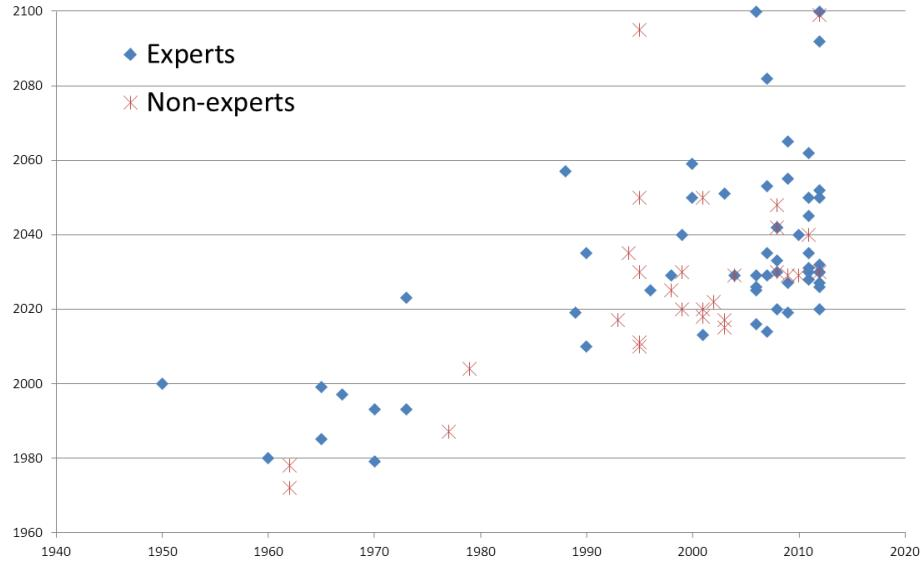
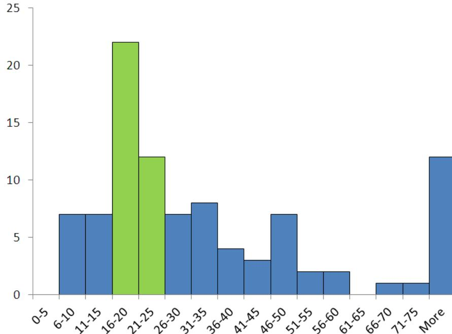
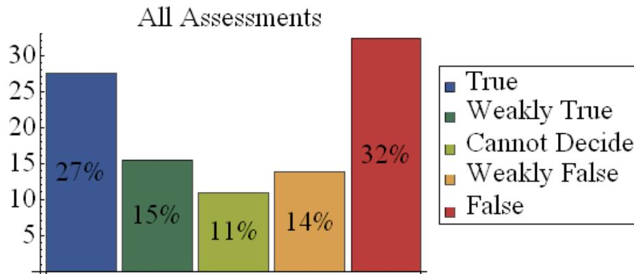

%%
Add discussion note here:

...

%%

# The errors, insights and lessons of famous AI predictions – and what they mean for the future ^the-errors-insights-and

Stuart Armstrong[^note-corresponding-author], Kaj Sotala and Seán S. ÓhÉigeartaigh

May 20, 2014

## **Abstract** ^abstract

Predicting the development of artificial intelligence (AI) is a difficult project – but a vital one, according to some analysts. AI predictions already abound: but are they reliable? This paper will start by proposing a decomposition schema for classifying them. Then it constructs a variety of theoretical tools for analysing, judging and improving them. These tools are demonstrated by careful analysis of five famous AI predictions: the initial Dartmouth conference, Dreyfus’s criticism of AI, Searle’s Chinese Room paper, Kurzweil’s predictions in the ‘Age of Spiritual Machines’, and Omohundro’s ‘AI Drives’ paper. These case studies illustrate several important principles, such as the general overconfidence of experts, the superiority of models over expert judgement, and the need for greater uncertainty in all types of predictions. The general reliability of expert judgement in AI timeline predictions is shown to be poor, a result that fits in with previous studies of expert competence.

*Keywords:* AI, predictions, experts, bias, case studies, expert judgement, falsification

## **1 Introduction** ^1-introduction

Predictions about the future development of artificial intelligence (AI[^note-ai-term]) are as confident as they are diverse. Starting with Turing’s initial estimation of a 30% pass rate on Turing test by the year 2000 [Tur50], computer scientists, philosophers and journalists have never been shy to offer their own definite prognostics, claiming AI to be impossible [Jac87], just around the corner [Dar70] or anything in between.

What should one think of this breadth and diversity of predictions? Can anything of value be extracted from them, or are they to be seen as mere entertainment or opinion? The question is an important one, because true AI would have a completely transformative impact on human society – and many have argued that it could be extremely dangerous [Yam12, Yud08, Min84]. Those arguments are predictions in themselves, so an assessment of predictive reliability in the AI field is a very important project. It is in humanity’s interest to know if these risks are reasonable, and, if so, when and how AI is likely to be developed. Even if the risks turn out to be overblown, simply knowing the reliability of general AI predictions will have great social and economic consequences.

The aim of this paper is thus to construct a framework and tools of analysis that allow for the assessment of predictions, of their quality and of their uncertainties. Though specifically aimed at AI, these methods can be used to assess predictions in other contentious and uncertain fields.

This paper first proposes a classification scheme for predictions, dividing them into four broad categories and analysing what types of arguments are used (implicitly or explicitly) to back them up. Different prediction types and methods result in very different performances, and it is critical to understand this varying reliability. To do so, this paper will build a series of tools that can be used to clarify a prediction, reveal its hidden assumptions, and making use of empirical evidence whenever possible.

Since expert judgement is such a strong component of most predictions, assessing the reliability of this judgement is a key component. Previous studies have isolated the task characteristics in which experts tend to have good judgement – and the results of that literature strongly imply that AI predictions are likely to be very unreliable, at least as far as timeline predictions (‘date until AI’) are concerned. That theoretical result is born out in practice: timeline predictions are all over the map, with no pattern of convergence, and no visible difference between expert and non-expert predictions. These results were detailed in a previous paper [AS12], and are summarised here.

The key part of the paper is a series of case studies on five of the most famous AI predictions: the initial Dartmouth conference, Dreyfus’s criticism of AI, Searle’s Chinese Room paper, Kurzweil’s predictions in the ‘Age of Spiritual Machines’, and Omohundro’s AI Drives. Each prediction is analysed in detail, using the methods developed earlier. The Dartmouth conference proposal was surprisingly good – despite being wildly inaccurate, it would have seemed to be the most reliable estimate at the time. Dreyfus’s work was very prescient, despite his outsider status, and could have influenced AI development for the better – had it not been so antagonistic to those in the field. Some predictions could be extracted even from Searle’s non-predictive Chinese room thought experiment, mostly criticisms of the AI work of his time. Kurzweil’s predictions were tested with volunteer assessors, and we shown to be surprisingly good – but his self-assessment was very inaccurate, throwing some doubt on his later predictions. Finally Omohundro’s predictions were shown to be much better as warning for what could happen to general AIs, than as emphatic statements of what would necessarily happen[^note-ideal-model].

The key lessons learned are of the general overconfidence of experts, the possibility of deriving testable predictions from even the most theoretical of papers, the superiority of model-based over judgement-based predictions, and the great difficulty in assessing the reliability of predictors – by all reasonable measures, the Dartmouth conference predictions should have been much more reliable than Dreyfus’s outside predictions, and yet reality was completely opposite.

[^note-corresponding-author]: Corresponding author. Email: [stuart.armstrong@philosophy.ox.ac.uk](mailto:stuart.armstrong@philosophy.ox.ac.uk)

[^note-ai-term]: AI here is used in the old fashioned sense of a machine capable of human-comparable cognitive performance; a less ambiguous modern term would be ‘AGI’, Artificial *General* Intelligence.

[^note-ideal-model]: The predictions also fared very well as a ideal simplified model of AI to form a basis for other predictive work.

## 2 Taxonomy of predictions ^2-taxonomy-of-predictions

### 2.1 Prediction types ^2-1-prediction-types

There will never be a bigger plane built.

*Boeing engineer on the 247, a twin engine plane that held ten people.*

A fortune teller talking about celebrity couples, a scientist predicting the outcome of an experiment, an economist pronouncing on next year's GDP figures – these are canonical examples of predictions. There are other types of predictions, though. Conditional statements – *if* X happens, *then* so will Y – are also valid, narrower, predictions. Impossibility results are also a form of prediction. For instance, the law of conservation of energy gives a very broad prediction about every single perpetual machine ever made: to wit, that they will never work.

The common thread is that all these predictions constrain expectations of the future. If one takes the prediction to be true, one expects to see different outcomes than if one takes it to be false. This is closely related to Popper's notion of falsifiability [Pop34]. This paper will take every falsifiable statement about future AI to be a prediction.

For the present analysis, predictions about AI will be divided into four types:

1. Timelines and outcome predictions. These are the traditional types of predictions, giving the dates of specific AI milestones. Examples: An AI will pass the Turing test by 2000 [Tur50]; Within a decade, AIs will be replacing scientists and other thinking professions [Hal11].
2. Scenarios. These are a type of conditional predictions, claiming that if the conditions of the scenario are met, then certain types of outcomes will follow. Example: If someone builds a human-level AI that is easy to copy and cheap to run, this will cause mass unemployment among ordinary humans [Han94].
3. Plans. These are a specific type of conditional prediction, claiming that if someone decides to implement a specific plan, then they will be successful in achieving a particular goal. Example: AI can be built by scanning a human brain and simulating the scan on a computer [San08].
4. Issues and metastatements. This category covers relevant problems with (some or all) approaches to AI (including sheer impossibility results), and metastatements about the whole field. Examples: an AI cannot be built without a fundamental new understanding of epistemology [Deu12]; Generic AIs will have certain (potentially dangerous) behaviours [Omo08].

There will inevitably be some overlap between the categories, but the division is natural enough for this paper.

### 2.2 Prediction methods ^2-2-prediction-methods

Just as there are many types of predictions, there are many ways of arriving at them – crystal balls, consulting experts, constructing elaborate models. An initial review of various AI predictions throughout the literature suggests the following loose schema for prediction methods[^note-schema]:

1. Causal models
2. Non-causal models
3. The outside view
4. Philosophical arguments
5. Expert judgement
6. Non-expert judgement

Causal model are a staple of physics and the harder sciences: given certain facts about the situation under consideration (momentum, energy, charge, etc.) a conclusion is reached about what the ultimate state will be. If the facts were different, the end situation would be different.

Outside of the hard sciences, however, causal models are often a luxury, as the underlying causes are not well understood. Some success can be achieved with non-causal models: without understanding what influences what, one can extrapolate trends into the future. Moore’s law’s law is a highly successful non-causal model [Moo65].

In the the outside view, specific examples are grouped together and claimed to be examples of the same underlying trend. This trend is used to give further predictions. For instance, one could notice the many analogues of Moore’s law across the spectrum of computing (e.g. in numbers of transistors, size of hard drives, network capacity, pixels per dollar), note that AI is in the same category, and hence argue that AI development must follow a similarly exponential curve [Kur99]. Note that the use of the outside view is often implicit rather than explicit: rarely is it justified why these examples are grouped together, beyond general plausibility or similarity arguments. Hence detecting uses of the outside view will be part of the task of revealing hidden assumptions (see Section 3.2). There is evidence that the use of the outside view provides improved prediction accuracy, at least in some domains [KL93].

Philosophical arguments are common in the field of AI. Some are simple impossibility statements: AI is decreed to be impossible, using arguments of varying plausibility. More thoughtful philosophical arguments highlight problems that need to be resolved in order to achieve AI, interesting approaches for doing so, and potential issues that might emerge if AIs were to built.

Many of the predictions made by AI experts aren’t logically complete: not every premise is unarguable, not every deduction is fully rigorous. In many cases, the argument relies on the expert’s judgement to bridge these gaps. This doesn’t mean that the prediction is unreliable: in a field as challenging as AI, judgement, honed by years of related work, may be the best tool available. Non-experts cannot easily develop a good feel for the field and its subtleties, so should not confidently reject expert judgement out of hand. Relying on expert judgement has its pitfalls, however, as will be seen in Sections 3.4 and 4.

Finally, some predictions rely on the judgement of non-experts, or of experts making claims outside their domain of expertise. Prominent journalists, authors, CEO’s, historians, physicists and mathematicians will generally be no more accurate than anyone else when talking about AI, no matter how stellar they are in their own field [Kah11].

Predictions often use a combination of these methods. For instance, Ray Kurzweil’s ‘Law of Time and Chaos’ uses the outside view to group together evolutionary development, technological development, and computing into the same category, and constructs a causal model predicting time to the ‘Singularity’ [Kur99] (see Section 5.4). Moore’s law (non-causal model) is a key input to this Law, and Ray Kurzweil’s expertise is the Law’s main support (see Section 5.4).

The case studies of Section 5 have examples of all of these prediction methods.

[^note-schema]: As with any such schema, the purpose is to bring clarity to the analysis, not to force every prediction into a particular box, so it should not be seen as *the* definitive decomposition of prediction methods.

## 3 A toolbox of assessment methods ^3-a-toolbox-of

The purpose of this paper is not simply to assess the accuracy and reliability of past AI predictions. Rather, the aim is to build a ‘toolbox’ of methods that can be used to assess future predictions, both within and outside the field of AI. The most important features of the toolbox are ways of extracting falsifiable predictions, ways of clarifying and revealing assumptions, ways of making use of empirical evidence when possible, and ways of assessing the reliability of expert judgement.

### 3.1 Extracting falsifiable predictions ^3-1-extracting-falsifiable

As stated in Section 2.1, predictions are taken to be falsifiable/verifiable statements about the future of AI[^note-falsifiable-focus]. Thus is very important to put the predictions into this format. Sometimes they already are, but at other times it isn’t so obvious: then the falsifiable piece must be clearly extracted and articulated. Sometimes it is ambiguity that must be overcome: when an author predicts an AI “Omega point” in 2040 [Sch06], it is necessary to read the paper with care to figure out what counts as an Omega point and (even more importantly) what doesn’t.

At the extreme, some philosophical arguments – such as the Chinese Room argument [Sea80] – are often taken to have no falsifiable predictions whatsoever. They are seen as simply being thought experiment establishing a purely philosophical point. Predictions can often be extracted from even the most philosophical of arguments, however – or, if not the argument itself, then from the intuitions justifying the argument. Section 5.3 demonstrates how the intuitions behind the Chinese Room argument can lead to testable predictions.

Note that the authors of the arguments may disagree with the ‘extracted’ predictions. This is not necessarily a game breaker. The aim should always be to try to create useful verifiable predictions when possible, thus opening more of the extensive AI philosophical literature for predictive purposes. For instance, Lucas argues that AI is impossible because it could not recognise the truth of its own Gödel sentence[^note-godel-sentence] [Luc61]. This is a very strong conclusion, and is dependent on Lucas’s expert judgement; nor is it clear how it can be tested, as it doesn’t put any limits on the performance and capability of intelligent machines. The intuition behind it, however, seems to be that Gödel-like sentences pose real problems to the building of an AI, and hence one can extract the weaker empirical prediction: “Self-reference will be a problem with advanced AIs”.

Care must be taken when applying this method: the point is to extract a useful falsifiable prediction, not to weaken or strengthen a reviled or favoured argument. The very first stratagems in Schopenhauer’s “The Art of Always being Right” [Sch31] are to extend and over-generalise the consequences of ones opponent’s argument; conversely, one should reduce and narrow down one’s own arguments. There is no lack of rhetorical tricks to uphold one’s own position, but if one is truly after the truth, one must simply attempt to find the most reasonable falsifiable version of the argument; the truth-testing will come later.

This method often increases the prediction’s uncertainty, in that it makes the prediction less restrictive (and less powerful) than it first seemed. For instance, Bruce Edmonds [Edm09], building on the “No Free Lunch” results [WM95], demonstrates that there is no such thing as a universal intelligence: no intelligence that outperforms others in every circumstance. Initially this seems to rule out AI entirely; but when one analyses what this means empirically, one realises there is far less to it. It does not forbid an algorithm from performing better than any human being in any situation any human being would ever encounter, for instance. So the initial impression, which was that the argument ruled out all futures with AIs in them, is now replaced by the realisation that the argument has barely put any constraints on the future at all.

### **3.2 Clarifying and revealing assumptions** ^3-2-clarifying-and

The previous section was concerned with the prediction’s conclusions. This section will instead be looking at its assumptions, and the logical structure of the argument or model behind it. The objective is to make the prediction as rigorous as possible. This kind of task has been a staple of philosophy ever since the dialectic [PlaBC].

Of critical importance is revealing hidden assumptions that went into the predictions. These hidden assumptions – sometimes called Enthymematic gaps in the literature [Fal03] – are very important because they clarify where the true disagreements lie, and where the investigation needs to be focused to figure out the truth of the prediction. Too often, competing experts will make broad-based arguments that fly past each other. This makes choosing the right argument a matter of taste, prior opinions and admiration of the experts involved. If the argument can be correctly deconstructed, however, then the source of the disagreement can be isolated, and the issue can be decided on much narrower grounds – and it’s much clearer whether the various experts have relevant expertise or not (see Section 3.4). The hidden assumptions are often implicit, so it is perfectly permissible to construct assumptions that the predictors were not consciously aware of using. The purpose is not to score points for one ‘side’ or the other, but always to clarify and analyse arguments and to find the true points of disagreement.

For illustration of the method, consider again the Gödel arguments mentioned in the Section 3.1. The argument shows that formal systems of a certain complexity must be either incomplete (unable to see that their Gödel sentence is true) or inconsistent (proving false statements). This is contrasted with humans, who – allegedly – use meta-reasoning to know that their own Gödel statements are true. Also, humans are both inconsistent and able to deal with inconsistencies without a complete collapse of logic[^note-relevance-logic]. However neither humans nor AIs are logically omniscient – they are not capable of instantly proving everything provable within their logic system. So this analysis demonstrates the hidden assumption in Lucas’s argument: that the behaviour of an actual computer program running on a real machine is more akin to that of a logically omniscient formal agent, than to a real human being. That assumption may be flawed or correct, but is one of the real sources of disagreement over whether Gödelian arguments rule out artificial intelligence.

There is surprisingly little published on the proper way of clarifying assumptions, making this approach more an art than a science. If the prediction comes from a model, there are some standard tools available for clarification [MH90]. Most of these methods work by varying parameters in the model and checking that this doesn’t cause a breakdown in the prediction. This is more a check of robustness of the model than of its accuracy, however.

#### **3.2.1 Model testing and counterfactual resiliency** ^3-2-1-model

Causal models can be tested by analysing their assumptions. Non-causal models are much harder to test: what are the assumptions behind Moore’s famous law [Moo65], or Robin Hanson’s model that humanity is due for another technological revolution, based on the timeline of previous revolutions [Han08]? They both assume that a particular pattern will continue into the future, but why should this be the case? What grounds (apart from personal taste) does anyone have to endorse or reject them?

The authors of this paper have come up with a putative way of testing the assumptions of such models. It involves giving the model a counterfactual resiliency check: imagining that world history had happened slightly differently, and checking whether the model would have been true in those circumstances. The purpose is to set up a tension between what the model says, and known (or believed) facts about the world. This will either refute the model, refute the believed facts, or reveal implicit assumptions the model is making.

To illustrate, consider Robin Hanson’s model. The model posits that humanity has gone through a series of radical transformations (in brain size, hunting, agriculture, industry), and that these form a pattern that can be used to predict the arrival date and speed of the next revolution, which is argued to be an AI revolution[^note-emulations]. This is a major use of the outside view, and it implicitly implies that most things in human historical development are unimportant in comparison with these revolutions. A counterfactual resiliency test can be carried out: within the standard understanding of history, it seems very plausible that these revolutions could have happened at very different times and paces. Humanity could have been confined to certain geographical locations by climate or geographical factors, thus changing the dates of the hunting and agricultural revolution. The industrial revolutions could have plausibly started earlier with the ancient Greeks (where it would likely have been slower), or at a later date, had Europe been deprived of large coal reserves. Finally, if AI were possible, it certainly seems that contingent facts about modern society could make it much easier or much harder to reach[^note-counterfactual-analysis]. Thus the model seems to be in contradiction with standard understanding of social and technological development, or dependent on contingent factors to a much larger extent than it seemed.

In contrast, Moore’s law seems much more counterfactually resilient: assuming that the current technological civilization endured, it’s hard to find any reliable ways of breaking the law. One can argue plausibly that the free market is needed for Moore’s law to work[^note-ussr]; if that’s the case, this method has detected an extra hidden assumption of the model. This method is new, and will certainly be refined in future. Again, the purpose of the method is not to rule out certain models, but to find the nodes of disagreement. In this paper, it is used in analysing Kurzweil’s prediction in section 5.4.

[^note-falsifiable-focus]: This is a choice of focus for the paper, not a logical positivist argument that only empirically verifiable predictions have meaning [Car28].

[^note-godel-sentence]: A Gödel sentence is a sentence $G$ that can be built in any formal system containing arithmetic. $G$ is implicitly self-referential, as it is equivalent with “there cannot exist a proof of $G$ ”. By construction, there cannot be a consistent proof of $G$ from within the system.

[^note-relevance-logic]: In this, they tend to differ from AI systems, though some logic systems such as relevance logic do mimic the same behaviour [RM76].

[^note-emulations]: Or at least a revolution in ‘emulations’, artificial copies of human brains.

[^note-counterfactual-analysis]: A fuller analysis can be found at [http://lesswrong.com/lw/ea8/counterfactual\_resiliency\_test\_for\_noncausal](http://lesswrong.com/lw/ea8/counterfactual_resiliency_test_for_noncausal).

[^note-ussr]: Some have argued, for instance, that the USSR’s computers didn’t follow Moore’s law <http://www.paralogos.com/DeadSuper/Soviet/>. What is more certain, is that Russian computers fell far behind the development of their western counterparts.

#### **3.2.2 More uncertainty** ^3-2-2-more

Clarifying assumptions often ends up weakening the model, and hence increasing uncertainty (more possible futures are compatible with the model than was thought). Revealing hidden assumptions has the same effect: the model now has nothing to say in those futures where the assumptions turn out to be wrong. Thus the uncertainty will generally go up for arguments treated in this fashion. In counterpart, of course, the modified prediction is more likely to be true.

### **3.3 Empirical evidence and the scientific method** ^3-3-empirical-evidence

The gold standard in separating true predictions from false ones must always be empirical evidence. The scientific method has proved to be the best way of disproving false hypotheses, and should be used whenever possible, always preferred over expert opinion or unjustified models.

Empirical evidence is generally lacking in the AI prediction field, however. Since AI predictions concern the existence and properties of a machine that hasn’t yet been built, and for which detailed plans do not exist, there is little opportunity for the hypothesis-prediction-testing cycle. This should indicate the great challenges in the field, with AI predictions being considered more uncertain than those of even the ‘softest’ sciences, which have access to some form of empirical evidence.

Some AI predictions approximate the scientific method better than others. The whole brain emulations model, for instance, makes testable predictions about the near and medium future [San08]. Moore’s law is a prediction backed up by a lot of scientific evidence, and connected to some extent with AI. Many predictors (e.g. Kurzweil) make partial predictions on the road towards AI; these can and should be assessed as evidence of the expert’s general predictive success. Though not always possible, efforts should be made to connect general predictions with some near-term empirical evidence.

### 3.4 The reliability of expert judgement ^3-4-the-reliability

Reliance on experts is nearly unavoidable in AI prediction. Timeline predictions are often explicitly based on experts’ judgement[^note-moore-expert]. Plans also need experts to come up with them and judge their credibility. So unless every philosopher agrees on the correctness of a particular philosophical argument, one is dependent to some degree on the philosophical judgement of the author.

Using all the methods of the previous section, one can refine and caveat a prediction, find the nodes of disagreement, back it up with empirical evidence whenever possible, and thus clearly highlight the points where one needs to rely on expert opinion.

What performance should then be expected from the experts? There have been several projects over the last few decades looking into expert performance [Sha92, KK09]. The main result is that it is mainly the nature of the task that determines the quality of expert performance, rather than other factors. Table 1, reproduced from Shanteau’s paper, lists the characteristics that lead to good or poor expert performance:

| Good performance:            | Poor performance:            |
|------------------------------|------------------------------|
| Static stimuli               | Dynamic (changeable) stimuli |
| Decisions about things       | Decisions about behaviour    |
| Experts agree on stimuli     | Experts disagree on stimuli  |
| More predictable problems    | Less predictable problems    |
| Some errors expected         | Few errors expected          |
| Repetitive tasks             | Unique tasks                 |
| Feedback available           | Feedback unavailable         |
| Objective analysis available | Subjective analysis only     |
| Problem decomposable         | Problem not decomposable     |
| Decision aids common         | Decision aids rare           |

Table 1: Table of task properties conducive to good and poor expert performance.

Not all of these are directly applicable to the current paper, and hence won’t be explained in detail. One very important factor is whether experts get feedback, preferably immediately. When feedback is unavailable or delayed, or the environment isn’t one that give good feedback, then expert performance drops precipitously [KK09, Kah11]. Generally AI predictions have little possibility for any feedback from empirical data (see Section 3.3), especially not rapid feedback.

The task characteristics of Table 1 apply to both the overall domain and the specific task. Though AI prediction is strongly in the right column, any individual expert can improve their performance by moving their approach into the left column – for instance by decomposing the problem as much as possible. Where experts fail, better results can often be achieved by asking the experts to design a simple algorithmic model and then using the model for predictions [GZL+00]. Thus the best types of predictions are probably those coming from well decomposed models.

Expert disagreement is a major problem in making use of their judgement. If experts in the same field disagree, objective criteria are needed to figure out which group is correct[^note-minority]. If experts in different fields disagree, objective criteria are needed to figure out which fields is the most relevant. Personal judgement cannot be used, as there is no evidence that people are skilled at reliably choosing between competing experts.

Apart from the characteristics in Table 1, one example of objective criteria is a good prediction track record on the part of the expert. A willingness to make falsifiable, non-ambiguous predictions is another good sign. A better connection with empirical knowledge and less theoretical rigidity are also positive indications [Tet05]. It must be noted, however, that assessing whether the expert possess these characteristics is a second order phenomena – subjective impressions of the expert’s subjective judgement – so in most cases it will be impossible to identify the truth when there is strong expert disagreement.

#### **3.4.1 Grind versus Insight** ^3-4-1-grind

There is a distinction between achievements that require grind, versus those that require insight[^note-grind-concept]. Grind is a term encompassing the application of hard work and resources to a problem, with the confidence that these will accomplish the goal. Problems that require insight, however, can’t simply be solved by hard work: new, unexpected ideas are needed to reach the goal. Most Moore’s law predictions assume that grind is all that’s needed for AI: once a certain level of computer performance is reached, people will be able to develop AI. In contrast, some insist that new insights are needed[^note-not-binary] [Deu12].

In general, the grind needed for some goal can be predicted quite well. Project managers and various leaders are often quite good at estimating the length of projects (as long as they’re not directly involved in the project [BGR94]). Moore’s law could be taken as an ultimate example of grind: the global efforts of many engineers across many fields averages out to a relatively predictable exponential growth.

Predicting insight is much harder. The Riemann hypothesis is a well-established mathematical hypothesis from 1885, still unsolved but much researched [Rie59]. How would one go about predicting when it will be solved? If building a true AI is akin in difficulty to solving the Riemann hypothesis (or solving several open mathematical problems), then timeline predictions are a lot less reliable, with much larger error bars.

This doesn't mean that a prediction informed by a model of grind is more accurate than one that models insight. This is only true if a good case is made that AI *can indeed be achieved through grind*, and that insight is not needed. The predictions around whole brain emulations [San08], are one of the few that make this case convincingly.

#### 3.4.2 Non-expert judgement ^3-4-2-non-expert

All the issues and problems with expert judgement apply just as well to non-experts. While experts could be expected to have some source of useful insight due to their training, knowledge and experience, this is not the case with non-experts, giving no reason to trust their judgement. That is not to say that non-experts cannot come up with good models, convincing timelines, or interesting plans and scenarios. It just means that any assessment of the quality of the prediction depends only on the prediction itself; a non-expert cannot be granted any leeway to cover up a weak premise or a faulty logical step.

One must beware the halo effect in assessing predictions [Tho20, FASJ00]. This denotes the psychological tendency to see different measures of personal quality to be correlated: an attractive person is seen as likely being intelligent, someone skilled in one domain is believed to be skilled in another. Hence it is hard to prevent one's opinion of the predictor from affecting one's assessment of the prediction, even when this is unwarranted. One should thus ideally assess non-expert predictions blind, without knowing who the author is. If this is not possible, one can attempt to reduce the bias by imagining the prediction was authored by someone else – such as the Archbishop of Canterbury, Warren Buffet or the Unabomber. Success is achieved when hypothetical changes in authorship do not affect estimations of the validity of the prediction.

## 4 Timeline predictions ^4-timeline-predictions

Jonathan Wang and Brian Potter of the Machine Intelligence Research Institute performed an exhaustive search of the online literature and from this assembled a database of 257 AI predictions from the period 1950-2012. Of these, 95 contained predictions giving timelines for AI development[^note-data-source].

Table 1 suggests that one should expect AI timeline predictions to be of relatively low quality. The only unambiguously positive feature of timeline predictions on that table is that prediction errors are expected and allowed: apart from that, the task characteristics are daunting, especially on the key issue of feedback.

The theory is born out in practice: the AI predictions in the database seem little better than random guesses (see Figure 1). The data is analysed more thoroughly in a previous paper, which explains the methodology for choosing a single median estimate [AS12]. The main conclusions are:

A scatter plot showing data points for 'Experts' (blue diamonds) and 'Non-experts' (red asterisks) from 1940 to 2020. The y-axis ranges from 1960 to 2100. Experts' data points are generally lower and earlier in time, while Non-experts' data points are higher and more clustered in the later years.

Scatter plot: Comparison of values between Experts and Non-experts over time.

Figure 1: Median estimate for human-level AI, graphed against date of prediction.

1. There is little correlation between different predictions. They span a large range (the graph has been reduced; there were predictions beyond 2100), and exhibit no signs of convergence. Ignoring the prediction beyond 2100, the prediction show a standard deviation of over a quarter century (26 years). There is little to distinguish failed predictions whose date has passed, from those that still lie in the future.
2. There is no evidence that expert predictions differ from those of non-experts. Again ignoring predictions beyond 2100, expert predictions show a standard deviation of 26 years, while non-expert predictions show a standard deviation of 27 years[^note-self-selected].
3. There is no evidence for the so-called Maes-Garreau law[^note-maes-garreau], which is the idea that predictors preferentially predict AI to be developed just in time to save them from death.
4. There is a strong tendency to predict the development of AI within 15-25 years from when the prediction is made (over a third of all predictions are in this timeframe, see Figure 2). Experts, non-experts, and failed predictions all exhibit this same pattern.

In summary, there are strong theoretical and practical reasons to believe that timeline AI predictions are likely unreliable.

[^note-moore-expert]: Consider an expert who says that AI will arrive when computer reach a particular level of ability, and uses Moore’s law to find the date. Though Moore’s law is a factor in the argument, one still has to trust the expert’s opinion that that particular level of computational ability will truly lead to AI – the expert’s judgement is crucial.

[^note-minority]: If one point of view is a small minority, one can most likely reject it as being a error by a fringe group; but this is not possible if each point of view has a non-negligible group behind it.

[^note-grind-concept]: There are no current publications using this concept exactly, though it is related to some of the discussion about different patterns of discovery in [AS08].

[^note-not-binary]: As with many things in philosophy, this is not a sharp binary distinction, but one of degree.

[^note-data-source]: The data can be found at [http://www.neweuropeancentury.org/SIAI-FHI\_AI\_predictions.xls](http://www.neweuropeancentury.org/SIAI-FHI_AI_predictions.xls).

[^note-self-selected]: Though there is some suggestion that self-selected experts who publish their predictions have different opinions from the mainstream of their fields. A single datapoint in favour of this theory can be found at: [http://lesswrong.com/r/discussion/lw/gta/selfassessment\_in\_expert\_ai\_predictions/](http://lesswrong.com/r/discussion/lw/gta/selfassessment_in_expert_ai_predictions/), using [Mic73].

[^note-maes-garreau]: Kevin Kelly, editor of Wired magazine, created the law in 2007 after being influenced by Pattie Maes at MIT and Joel Garreau (author of Radical Evolution).

A bar chart showing the distribution of age groups. The x-axis ranges from 0-5 to More. The y-axis ranges from 0 to 25. The bars are colored blue for most groups, with the 16-20 and 21-25 groups highlighted in green.

| Age Group | Count |
|-----------|-------|
| 0-5       | 0     |
| 6-10      | 7     |
| 11-15     | 7     |
| 16-20     | 22    |
| 21-25     | 12    |
| 26-30     | 7     |
| 31-35     | 8     |
| 36-40     | 4     |
| 41-45     | 3     |
| 46-50     | 7     |
| 51-55     | 2     |
| 56-60     | 2     |
| 61-65     | 0     |
| 66-70     | 1     |
| 71-75     | 1     |
| More      | 12    |

The chart shows a peak in the 16-20 age group and a secondary peak in the More category.

Bar chart: Histogram of age groups with two highlighted bars.

Figure 2: Time between the arrival of AI and the date the prediction was made. Years on the x axis, number of predictions on the y axis.

## 5 Case studies ^5-case-studies

This section applies and illustrates the schemas of Section 2 and the methods of Section 3. It does so by looking at five prominent AI predictions: the initial Dartmouth conference, Dreyfus’s criticism of AI, Searle’s Chinese Room paper, Kurzweil’s predictions, and Omohundro’s AI Drives. The aim is to assess and analyse these predictions and gain insights that can then be applied to assessing future predictions.

### 5.1 In the beginning, Dartmouth created the AI and the hype... ^5-1-in-the

Classification: **plan**, using **expert judgement** and the **outside view**.

Hindsight bias is very strong and misleading [Fis75]. Humans are often convinced that past events couldn’t have unfolded differently than how they did, and that the people at the time should have realised this. Even worse, people unconsciously edit their own memories so that they misremember themselves as being right even when they got their past predictions wrong[^note-written-at-time]. Hence when assessing past predictions, one must cast aside all knowledge of subsequent events, and try to assess the claims given the knowledge available at the time. This is an invaluable exercise to undertake before turning attention to predictions whose timelines have not come to pass.

[^note-written-at-time]: One of the reasons that it is important to pay attention only to the actual prediction as written at the time, and not to the author’s subsequent justifications or clarifications.

The 1956 Dartmouth Summer Research Project on Artificial Intelligence was a major conference, credited with introducing the term “Artificial Intelligence” and starting the research in many of its different subfields. The conference proposal[^note-proposal-online], written in 1955, sets out what the organisers thought could be achieved. Its first paragraph reads:

“We propose that a 2 month, 10 man study of artificial intelligence be carried out during the summer of 1956 at Dartmouth College in Hanover, New Hampshire. The study is to proceed on the basis of the conjecture that every aspect of learning or any other feature of intelligence can in principle be so precisely described that a machine can be made to simulate it. An attempt will be made to find how to make machines use language, form abstractions and concepts, solve kinds of problems now reserved for humans, and improve themselves. We think that a significant advance can be made in one or more of these problems if a carefully selected group of scientists work on it together for a summer.”

This can be classified as a plan. Its main backing would have been expert judgement. The conference organisers were John McCarthy (a mathematician with experience in the mathematical nature of the thought process), Marvin Minsky (Harvard Junior Fellow in Mathematics and Neurology, and prolific user of neural nets), Nathaniel Rochester (Manager of Information Research, IBM, designer of the IBM 701, the first general purpose, mass-produced computer, and designer of the first symbolic assembler) and Claude Shannon (the “father of information theory”). These were individuals who had been involved in a lot of related theoretical and practical work, some of whom had built functioning computers or programing languages – so one can expect them all to have had direct feedback about what was and wasn’t doable in computing. If anyone could be considered experts in AI, in a field dedicated to an as yet non-existent machine, then they could. What implicit and explicit assumptions could they have used to predict that AI would be easy?

Reading the full proposal doesn’t give the impression of excessive optimism or overconfidence. The very first paragraph hints at the rigour of their ambitions – they realised that precisely describing the features of intelligence is a major step in simulating it. Their research plan is well decomposed, and different aspects of the problem of artificial intelligence are touched upon. The authors are well aware of the inefficiency of exhaustive search methods, of the differences between informal and formal languages, and of the need for encoding creativity. They talk about the need to design machines that can work with unreliable components, and that can cope with randomness and small errors in a robust way. They propose some simple models of some of these challenges (such as forming abstractions, or dealing with more complex environments), point to some previous successful work that has been done before, and outline how further improvements can be made.

Reading through, the implicit reasons for their confidence seem to become apparent[^note-implicit-assumptions]. These were experts, some of whom had been working with computers from early days, who had a long track record of taking complex problems, creating simple (and then more complicated) models to deal with them. These models they used to generate useful insights or functioning machines. So this was an implicit use of the outside view – they were used to solving certain problems, these looked like the problems they could solve, hence they assumed they could solve them. To modern eyes, informal languages are hugely complicated, but this may not have been obvious at the time. Computers were doing tasks, such as complicated mathematical manipulations, that were considered high-skill, something only very impressive humans had been capable of[^note-human-computer]. Moravec’s paradox[^note-moravec] had not yet been realised. The human intuition about the relative difficulty of tasks was taken as accurate: there was no reason to suspect that parsing English was much harder than the impressive feats computer could already perform. Moreover, great progress had been made in logic, in semantics, in information theory, giving new understanding to old concepts: there was no reason to suspect that further progress wouldn’t be both forthcoming and dramatic.

Even at the time, though, one could criticise their overconfidence. Philosophers, for one, had a long track record of pointing out the complexities and subtleties of the human mind. It might have seemed plausible in 1955 that further progress in logic and information theory would end up solving all these problems – but it could have been equally plausible to suppose that the success of formal models had been on low-hanging fruit, and that further progress would become much harder. Furthermore, the computers at the time were much simpler than the human brain (e.g. the IBM 701, with 73728 bits of memory), so any assumption that AIs could be built was also an assumption that most of the human brain’s processing was wasted. This implicit assumption was not obviously wrong, but neither was it obviously right.

Hence the whole conference project would have seemed ideal, had it merely added more humility and qualifiers in the text, expressing uncertainty as to whether a particular aspect of the program might turn out to be hard or easy. After all, in 1955, there were no solid grounds for arguing that such tasks were unfeasible for a computer.

Nowadays, it is obvious that the paper’s predictions were very wrong. All the tasks mentioned were much harder to accomplish than they claimed at the time, and haven’t been successfully completed even today. Rarely have such plausible predictions turned out to be so wrong; so what can be learned from this?

The most general lesson is perhaps on the complexity of language and the danger of using human-understandable informal concepts in the field of AI. The Dartmouth group seemed convinced that because they informally understood certain concepts and could begin to capture some of this understanding in a formal model, then it must be possible to capture *all* this understanding in a formal model. In this, they were wrong. Similarities of features do not make the models similar to reality, and using human terms – such as ‘culture’ and ‘informal’ – in these model concealed huge complexity and gave an illusion of understanding. Today’s AI developers have a much better understanding of how complex cognition can be, and have realised that programming simple-seeming concepts into computers can be very difficult. So the main lesson to draw is that reasoning about AI using human concepts (or anthropomorphising the AIs by projecting human features onto it) is a very poor guide to the nature of the problem and the time and effort required to solve it.

[^note-proposal-online]: Available online at <http://www-formal.stanford.edu/jmc/history/dartmouth/dartmouth.html>.

[^note-implicit-assumptions]: As with any exercise in trying to identify implicit assumptions, this process is somewhat subjective. It is not meant to suggest that the authors were thinking along these lines, merely to point out factors that could explain their confidence – factors, moreover, that could have lead dispassionate analytical observers to agree with them.

[^note-human-computer]: See [http://en.wikipedia.org/wiki/Human\_computer](http://en.wikipedia.org/wiki/Human_computer).

[^note-moravec]: This is the principle that high-level reasoning requires very little computation, but low-level sensorimotor skills require enormous computational resources – sometime informally expressed as “everything easy [for a human] is hard [for a computer], everything hard is easy”.

### 5.2 Dreyfus’s Artificial Alchemy ^5-2-dreyfuss-artificial

Classification: **issues and metastatements**, using **the outside view, non-expert judgement** and **philosophical arguments**.

Hubert Dreyfus was a prominent early critic of Artificial Intelligence. He published a series of papers and books attacking the claims and assumptions of the AI field, starting in 1965 with a paper for the Rand corporation entitled ‘Alchemy and AI’ [Dre65]. The paper was famously combative, analogising AI research to alchemy and ridiculing AI claims. Later, D. Crevier would claim “time has proven the accuracy and perceptiveness of some of Dreyfus’s comments. Had he formulated them less aggressively, constructive actions they suggested might have been taken much earlier” [Cre93]. Ignoring the formulation issues, were Dreyfus’s criticisms actually correct, and what can be learned from them?

Was Dreyfus an expert? Though a reasonably prominent philosopher, there is nothing in his background to suggest specific expertise with theories of minds and consciousness, and absolutely nothing to suggest familiarity with artificial intelligence and the problems of the field. Thus Dreyfus cannot be considered anything more than an intelligent outsider.

This makes the pertinence and accuracy of his criticisms that much more impressive. Dreyfus highlighted several over-optimistic claims for the power of AI, predicting – correctly – that the 1965 optimism would also fade (with, for instance, decent chess computers still a long way off). He used the outside view to claim this as a near universal pattern in AI: initial successes, followed by lofty claims, followed by unexpected difficulties and subsequent disappointment. He highlighted the inherent ambiguity in human language and syntax, and claimed that computers could not deal with these. He noted the importance of unconscious processes in recognising objects, the importance of context and the fact that humans and computers operated in very different ways. He also criticised the use of computational paradigms for analysing human behaviour, and claimed that philosophical ideas in linguistics and classification were relevant to AI research. In all, his paper is full of interesting ideas and intelligent deconstructions of how humans and machines operate.

All these are astoundingly prescient predictions for 1965, when computers were in their infancy and their limitations were only beginning to be understood. Moreover he was not only often right, but right for the right reasons (see for instance his understanding of the difficulties computer would have in dealing with ambiguity). Not everything Dreyfus wrote was correct, however; apart from minor specific points[^note-heuristics], he erred most mostly by pushing his predictions to extremes. He claimed that ‘the boundary may be near’ in computer abilities, and concluded with:

“...what can now be done? Nothing directly towards building machines which can be intelligent. [...] in the long run [we must think] of non-digital automata...”

Currently, however, there exists ‘digital automata’ that can beat all humans at chess, translate most passages to at least an understandable level, and beat humans at ‘Jeopardy’, a linguistically ambiguous arena [Gui11]. He also failed to foresee that workers in AI would eventually develop new methods to overcome the problems he had outlined. Though Dreyfus would later state that he never claimed AI achievements were impossible [McC04], there is no reason to pay attention to later re-interpretations: Dreyfus’s 1965 article strongly suggests that AI progress was bounded. These failures are an illustration of the principle that even the best of predictors is vulnerable to overconfidence.

[^note-heuristics]: Such as his distrust of heuristics.

In 1965, people would have been justified to find Dreyfus’s analysis somewhat implausible. It was the work of an outsider with no specific relevant expertise, and dogmatically contradicted the opinion of genuine experts inside the AI field. Though the claims it made about human and machine cognition seemed plausible, there is a great difference between seeming plausible and actually being correct, and his own non-expert judgement was the main backing for the claims. Outside of logic, philosophy had yet to contribute much to the field of AI, so no intrinsic reason to listen to a philosopher. There were, however, a few signs that the paper was of high quality: Dreyfus seemed to be very knowledgeable about progress and work in AI, and most of his analyses on human cognition were falsifiable, at least to some extent. These were still not strong arguments to heed the skeptical opinions of an outsider.

The subsequent partial vindication of the paper is therefore a stark warning: it is very difficult to estimate the accuracy of outsider predictions. There were many reasons to reject Dreyfus’s predictions in 1965, and yet that would have been the wrong thing to do. Blindly accepting non-expert outsider predictions would have also been a mistake, however: these are most often in error (see Section 3.4.2). One general lesson concerns the need to decrease certainty: the computer scientists of 1965 should at least have accepted the possibility (if not the plausibility) that some of Dreyfus’s analysis was correct, and they should have started paying more attention to the ‘success-excitement-difficulties-stalling’ cycles in their field to see if the pattern continued. A second lesson could be about the importance of philosophy: it does seem that philosophers’ meta-analytical skills can contribute useful ideas to AI – a fact that is certainly not self-evident (see also Section 5.5).

### 5.3 Locked up in Searle’s Chinese room ^5-3-locked-up

Classification: **issues and metastatements** and a **scenario**, using **philosophical arguments** and **expert judgement**.

Searle’s Chinese room thought experiment is a famous critique of some of the assumptions of ‘strong AI[^note-strong-ai]’. There has been a lot of further discussion on the subject (see for instance [Sea90, Har01]), but, as in previous case studies, this section will focus exclusively on his original 1980 publication [Sea80].

[^note-strong-ai]: Which Searle defines as the belief that ‘the appropriately programmed computer literally has cognitive states.’

In the key thought experiment, Searle imagined that AI research had progressed to the point where a computer program had been created that could demonstrate the same input-output performance as a human – for instance, it could pass the Turing test. Nevertheless, Searle argued, this program would not demonstrate true understanding. He supposed that the program’s inputs and outputs were in Chinese, a language Searle couldn’t understand. Instead of a standard computer program, the required instructions were given on paper, and Searle himself was locked in a room somewhere, slavishly following the instructions and therefore causing the same input-output behaviour as the AI. Since it was functionally equivalent to the AI, the setup should, from the ‘strong AI’ perspective, demonstrate understanding if and only if the AI did. Searle then argued that there would be no understanding at all: he himself couldn’t understand Chinese, and there was no-one else in the room to understand it either.

The whole argument depends on strong appeals to intuition (indeed D. Dennett went as far as accusing it of being an ‘intuition pump’ [Den91]). The required assumptions are:

- The Chinese room setup analogy preserves the relevant properties of the AI’s program.
- Intuitive reasoning about the Chinese room is thus relevant reasoning about algorithms.
- The intuition that the Chinese room follows a purely syntactic (symbol-manipulating) process rather than a semantic (understanding) one is a correct philosophical judgement.
- The intuitive belief that humans follow semantic processes is however correct.

Thus the Chinese room argument is unconvincing to those that don’t share Searle’s intuitions. It cannot be accepted solely on Searle’s philosophical expertise, as other philosophers disagree [Den91, Rey86]. On top of this, Searle is very clear that his thought experiment doesn’t put any limits on the performance of AIs (he argues that even a computer with all the behaviours of a human being would not demonstrate true understanding). Hence the Chinese room seems to be useless for AI predictions. Can useful prediction nevertheless be extracted from it?

These need not come directly from the main thought experiment, but from some of the intuitions and arguments surrounding it. Searle’s paper presents several interesting arguments, and it is interesting to note that many of them are disconnected from his main point. For instance, errors made in 1980 AI research should be irrelevant to the Chinese Room – a pure thought experiment. Yet Searle argues about these errors, and there is at least an intuitive if not a logical connection to his main point. There are actually several different arguments in Searle’s paper, not clearly divided from each other, and likely to be rejected or embraced depending on the degree of overlap with Searle’s intuitions. This may explain why many philosophers have found Searle’s paper so complex to grapple with.

One feature Searle highlights is the syntactic-semantic gap. If he is correct, and such a gap exists, this demonstrates the possibility of further philosophical progress in the area[^note-evolution-gap]. For instance, Searle directly criticises McCarthy’s contention that “Machines as simple as thermostats can have beliefs” [McC79]. If one accepted Searle’s intuition there, one could then ask whether more complicated machines could have beliefs, and what attributes they would need. These should be attributes that it would be useful to have in an AI. Thus progress in ‘understanding understanding’ would likely make it easier to go about designing AI – but only if Searle’s intuition is correct that AI designers do not currently grasp these concepts.

That can be expanded into a more general point. In Searle’s time, the dominant AI paradigm was GOFAI (Good Old-Fashioned Artificial Intelligence [Hau85]), which focused on logic and symbolic manipulation. Many of these symbols had suggestive labels: SHRDLU, for instance, had a vocabulary that included ‘red’, ‘block’, ‘big’ and ‘pick up’ [Win71]. Searle’s argument can be read, in part, as a claim that these suggestive labels did not in themselves impart true understanding of the concepts involved – SHRDLU could parse “pick up a big red block” and respond with an action that seems appropriate, but could not understand those concepts in a more general environment. The decline of GOFAI since the 1980’s cannot be claimed as vindication of Searle’s approach, but it at least backs up his intuition that these early AI designers were missing something.

Another falsifiable prediction can be extracted, not from the article but from the intuitions supporting it. If formal machines do not demonstrate understanding, but brains (or brain-like structures) do, this would lead to certain scenario predictions. Suppose two teams were competing to complete an AI that will pass the Turing test. One team was using standard programming techniques on computer, the other were building it out of brain (or brain-like) components. Apart from this, there is no reason to prefer one team over the other.

According to Searle’s intuition, any AI made by the first project will not demonstrate true understanding, while those of the second project may. Adding the reasonable assumption that it is easier to harder to simulate understanding if one doesn’t actually possess it, one is lead to the prediction that the second team is more likely to succeed.

Thus there are three predictions that can be extracted from the Chinese room paper:

1. Philosophical progress in understanding the syntactic-semantic gap may help towards designing better AIs.
2. GOFAI’s proponents incorrectly misattribute understanding and other high level concepts to simple symbolic manipulation machines, and will not succeed with their approach.
3. An AI project that uses brain-like components is more likely to succeed (everything else being equal) than one based on copying the functional properties of the mind.

Therefore one can often extract predictions from even the most explicitly anti-predictive philosophy of AI paper. The first two predictions turned out to be correct (the move away from GOFAI being the proof of this), while the third is too early to judge.

[^note-evolution-gap]: In the opinion of one of the authors, the gap can be explained by positing that humans are purely syntactic beings, but that have been selected by evolution such that human mental symbols correspond with real world objects and concepts – one possible explanation among very many.

### 5.4 How well have the “Spiritual Machines” aged? ^5-4-how-well

Classification: **timelines** and **scenarios**, using **expert judgement**, **causal models**, **non-causal models** and (indirect) **philosophical arguments**.

Ray Kurzweil is a prominent and often quoted AI predictor. One of his most important books was the 1999 “The Age of Spiritual Machines” which presented his futurist ideas in more detail, and made several predictions for the years 2009, 2019, 2029 and 2099. That book will be the focus of this case study, ignoring his more recent work[^note-1999-prediction]. There are five main points relevant to judging “The Age of Spiritual Machines”: Kurzweil’s expertise, his ‘Law of Accelerating Returns’, his extension of Moore’s law, his predictive track record, and his use of fictional imagery to argue philosophical points.

Kurzweil has had a lot of experience in the modern computer industry. He’s an inventor, computer engineer, and entrepreneur, and as such can claim insider experience in the development of new computer technology. He has been directly involved in narrow AI projects covering voice recognition, text recognition and electronic trading. His fame and prominence are further indications of the allure (though not necessarily the accuracy) of his ideas. In total, Kurzweil can be regarded as an AI expert.

Kurzweil is not, however, a cosmologist or an evolutionary biologist. In his book, he proposed a ‘Law of Accelerating Returns’. This law claimed to explain many disparate phenomena, such as the speed and trends of evolution of life forms, the evolution of technology, the creation of computers, and Moore’s law in computing. His slightly more general ’Law of Time and Chaos’ extended his model to explain the history of the universe or the development of an organism. It is a causal model, as it aims to explain these phenomena, not simply note the trends. Hence it is a timeline prediction, based on a causal model that makes use of the outside view to group the categories together, and is backed by non-expert opinion.

A literature search failed to find any evolutionary biologist or cosmologist stating their agreement with these laws. Indeed there has been little academic work on them at all, and what work there is tends to be critical[^note-ray-critique].

The laws are ideal candidates for counterfactual resiliency checks, however. It is not hard to create counterfactuals that shift the timelines underlying the laws[^note-counterfactual-detail]. Many standard phenomena could have delayed the evolution of life on Earth for millions or billions of years (meteor impacts, solar energy fluctuations or nearby gamma-ray bursts). The evolution of technology can similarly be accelerated or slowed down by changes in human society and in the availability of raw materials – it is perfectly conceivable that, for instance, the ancient Greeks could have started a small industrial revolution, or that the European nations could have collapsed before the Renaissance due to a second and more virulent Black Death (or even a slightly different political structure in Italy). Population fragmentation and decrease can lead to technology loss (such as the ‘Tasmanian technology trap’ [Riv12]). Hence accepting that a Law of Accelerating Returns determines the pace of technological and evolutionary change, means rejecting many generally accepted theories of planetary dynamics, evolution and societal development. Since Kurzweil is the non-expert here, his law is almost certainly in error, and best seen as a literary device rather than a valid scientific theory.

[^note-1999-prediction]: A correct prediction in 1999 for 2009 is much more impressive than a correct 2008 reinterpretation or clarification of that prediction.

[^note-ray-critique]: See for instance ‘Kurzweil’s Turing Fallacy’ by Thomas Ray of the Department of Zoology at the University of Oklahoma <http://life.ou.edu/pubs/kurzweil/>.

[^note-counterfactual-detail]: A more detailed version of this counterfactual resiliency check can be found at [http://lesswrong.com/lw/ea8/counterfactual\_resiliency\_test\_for\_noncausal](http://lesswrong.com/lw/ea8/counterfactual_resiliency_test_for_noncausal).

If the Law is restricted to being a non-causal model of current computational development, then the picture is very different. Firstly because this is much closer to Kurzweil’s domain of expertise. Secondly because it is now much more robust to counterfactual resiliency. Just as in the analysis of Moore’s law in Section 3.2.1, there are few plausible counterfactuals in which humanity had continued as a technological civilization for the last fifty years, but computing hadn’t followed various exponential curves. Moore’s law has been maintained across transitions to new and different substrates, from transistors to GPUs, so knocking away any given technology or idea seems unlikely to derail it. There is no consensus as to why Moore’s law actually works, which is another reason it’s so hard to break, even counterfactually.

Moore’s law and its analogues [Moo65, Wal05] are non-causal models, backed up strongly by the data and resilient to reasonable counterfactuals. Kurzweil’s predictions are mainly based around grouping these laws together (outside view) and projecting them forwards into the future. This is combined with Kurzweil’s claims that he can estimate how those continuing technological innovations are going to become integrated into society. These timeline predictions are thus based strongly on Kurzweil’s expert judgement. But much better than subjective impressions of expertise, is Kurzweil’s track record: his predictions for 2009. This gives empirical evidence as to his predictive quality.

Initial assessments suggested that Kurzweil had a success rate around 50%[^note-initial-assessment]. A panel of nine volunteers were recruited to give independent assessments of Kurzweil’s performance. Kurzweil’s predictions were broken into 172 individual statements, and the volunteers were given a randomised list of numbers from 1 to 172, with instructions to work their way down the list in that order, estimating each prediction as best they could. Since 2009 was obviously a ‘ten year from 1999’ gimmick, there was some flexibility on the date: a prediction was judged true if it was true by 2011[^note-assessment-details].

531 assessments were made, an average of exactly 59 assessments per volunteer. Each volunteer assessed at least 10 predictions, while one volunteer assessed all 172. Of the assessments, 146 (27%) were found to be true, 82 (15%) weakly true, 73 (14%) weakly false, 172 (32%) false, and 58 (11%) could not be classified (see Figure 3) (the results are little changed ($\approx \pm 1\%$) if the results are calculated for each volunteer, and then averaged). Simultaneously, a separate assessment was made using volunteers on the site Youtopia. These found a much higher failure rate – 41% false, 16% weakly false – but since the experiment wasn’t blinded or randomised, it is of less rigour[^note-youtopia].

[^note-initial-assessment]: See [http://lesswrong.com/lw/diz/kurzweils\_predictions\_good\_accuracy\_poor/](http://lesswrong.com/lw/diz/kurzweils_predictions_good_accuracy_poor/).

[^note-assessment-details]: Exact details of the assessment instructions and the results can be found here: [http://lesswrong.com/r/discussion/lw/gbh/assessing\_kurzweil\_the\_gory\_details/](http://lesswrong.com/r/discussion/lw/gbh/assessing_kurzweil_the_gory_details/). Emphasis was placed on the fact that the predictions had to be useful to a person in 1999 planning their future, not simply impressive to a person in 2009 looking back at the past.

[^note-youtopia]: See [http://lesswrong.com/lw/gbi/assessing\_kurzweil\_the\_results/](http://lesswrong.com/lw/gbi/assessing_kurzweil_the_results/)

All Assessments

Y-axis: 0 to 30

| Assessment    | Percentage |
|---------------|------------|
| True          | 27%        |
| Weakly True   | 15%        |
| Cannot Decide | 11%        |
| Weakly False  | 14%        |
| False         | 32%        |

A bar chart showing the distribution of all assessments. The 'False' category has the highest percentage at 32%, followed by 'True' at 27%.

Bar chart: Percentage breakdown of all assessments.

Figure 3: Assessments of the correctness of Kurzweil’s predictions: percentage of assessments in each category from true to false.

These nine volunteers thus found a correct prediction rate of 42%. How impressive this result is depends on how specific and unobvious Kurzweil’s predictions were. This is very difficult to figure out, especially in hindsight [Fis75]. Nevertheless, a subjective overview suggests that the predictions were often quite specific (e.g. “Unused computes on the Internet are being harvested, creating virtual parallel supercomputers with human brain hardware capacity”), and sometimes failed because of this. In view of this, a correctness rating of 42% is impressive, and goes some way to demonstrate Kurzweil’s predictive abilities.

When it comes to self-assessment[^note-commissioned], however, Kurzweil is much less impressive. He commissioned investigations into his own performance, which gave him scores of 102 out of 108[^note-kurzweil-response] or 127 out of 147[^note-forbes], with the caveat that “even the predictions that were considered wrong [...] were not all wrong.” This is dramatically different from this paper’s assessments.

What can be deduced from this tension between good performance and poor self-assessment? The performance is a validation of Kurzweil’s main model: continuing exponential trends in computer technology, and confirmation that Kurzweil has some impressive ability to project how these trends will impact the world. However, it does not vindicate Kurzweil as a predictor per se – his self-assessment implies that he does not make good use of feedback. Thus one should probably pay more attention to Kurzweil’s model, than to his subjective judgement. This is a common finding in expert tasks – experts are often better at constructing predictive models than at making predictions themselves [Kah11].

‘The Age of Spiritual Machines’ is not simply a dry tome, listing predictions and arguments. It is also, to a large extent, a story, which includes a conversation with a hypothetical future human called Molly discussing her experiences through the coming century and its changes. Can one extract verifiable predictions from this aspect of the book (see Section 3.1)?

[^note-commissioned]: Commissioned assessments must also be taken as self-assessments, unless there are strong reasons to suppose independence of the assessor.

[^note-kurzweil-response]: See Ray Kurzweil response’s response to <http://www.acceleratingfuture.com/michael/blog/2010/01/kurzweils-2009-predictions>.

[^note-forbes]: See <http://www.forbes.com/sites/alexknapp/2012/03/21/ray-kurzweil-defends-his-2009-predictions>.

A story is neither a prediction nor evidence for some particular future. But the reactions of characters in the story can be construed as a scenario prediction. They imply that real humans, placed in those hypothetical situations, will react in the way described. Kurzweil’s story ultimate ends with humans merging with machines – with the barrier between human intelligence and artificial intelligence being erased. Along the way, he describes the interactions between humans and machines, imagining the machines quite different from humans, but still being perceived to have human feelings.

One can extract two falsifiable future predictions from this: first, that humans will perceive feelings in AIs, even if they are not human-like. Secondly, that humans and AIs will be able to relate to each other socially over the long term, despite being quite different, and that this social interaction will form the main glue keeping the mixed society together. The first prediction seems quite solid: humans have anthropomorphised trees, clouds, rock formations and storms, and have become convinced that chatterbots were sentient [Wei66]. The second prediction is more controversial: it has been argued that an AI will be such an alien mind that social pressures and structures designed for humans will be completely unsuited to controlling it [Bos12, Arm13, ASB12]. Determining whether social structures can control dangerous AI behaviour, as it controls dangerous human behaviour, is a very important factor in deciding whether AIs will ultimately be safe or dangerous. Hence analysing this story-based prediction is an important area of future research.

### 5.5 What drives an AI? ^5-5-what-drives

Classification: **issues and metastatements**, using **philosophical arguments** and **expert judgement**.

Steve Omohundro, in his paper on ‘AI drives’, presented arguments aiming to show that generic AI designs would develop ‘drives’ that would cause them to behave in specific and potentially dangerous ways, even if these drives were not programmed in initially [Omo08]. One of his examples was a superintelligent chess computer that was programmed purely to perform well at chess, but that was nevertheless driven by that goal to self-improve, to replace its goal with a utility function, to defend this utility function, to protect itself, and ultimately to acquire more resources and power.

This is a metastatement: generic AI designs would have this unexpected and convergent behaviour. This relies on philosophical and mathematical arguments, and though the author has expertise in mathematics and machine learning, he has none directly in philosophy. It also makes implicit use of the outside view: utility maximising agents are grouped together into one category and similar types of behaviours are expected from all agents in this category.

In order to clarify and reveal assumptions, it helps to divide Omohundro’s thesis into two claims. The weaker one is that a generic AI design *could* end up having these AI drives; the stronger one that it *would* very likely have them.

Omohundro’s paper provides strong evidence for the weak claim. It demonstrates how an AI motivated only to achieve a particular goal, could nevertheless improve itself, become a utility maximising agent, reach out for resources and so on. Every step of the way, the AI becomes better at achieving its goal, so all these changes are consistent with its initial programming. This behaviour

is very generic: only specifically tailored or unusual goals would safely preclude such drives.

The claim that AIs generically would have these drives needs more assumptions. There are no counterfactual resiliency tests for philosophical arguments, but something similar can be attempted: one can use humans as potential counterexamples to the thesis. It has been argued that AIs could have any motivation a human has [Arm13, Bos12]. Thus according to the thesis, it would seem that humans should be subject to the same drives and behaviours. This does not fit the evidence, however. Humans are certainly not expected utility maximisers (probably the closest would be financial traders who try to approximate expected money maximisers, but only in their professional work), they don't often try to improve their rationality (in fact some specifically avoid doing so[^note-religious], and some sacrifice cognitive ability to other pleasures[BBJ+03]), and many turn their backs on high-powered careers. Some humans do desire self-improvement (in the sense of the paper), and Omohundro cites this as evidence for his thesis. Some humans don't desire it, though, and this should be taken as contrary evidence[^note-narrow-model]. Thus one hidden assumption of the model is:

- Generic superintelligent AIs would have different motivations to a significant subset of the human race, **OR**
- Generic humans raised to superintelligence would develop AI drives.

This position is potentially plausible, but no real evidence is presented for it in the paper.

A key assumption of Omohundro is that AIs will seek to re-express their goals in terms of a utility function. This is based on the Morgenstern-von Neumann expected utility theorem [vNM44]. The theorem demonstrates that any decision process that cannot be expressed as expected utility maximising, will be exploitable by other agents or by the environments. Hence in certain circumstances, the agent will predictably lose assets, to no advantage to itself.

That theorem does not directly imply, however, that the AI will be driven to become an expected utility maximiser (to become “rational”). First of all, as Omohundro himself points out, real agents can only be approximately rational: fully calculating the expected utility of every action is too computationally expensive in the real world. Bounded rationality [Sim55] is therefore the best that can be achieved, and the benefits of becoming rational can only be partially realised.

Secondly, there are disadvantages to becoming rational: these agents tend to be “totalitarian”, ruthlessly squeezing out anything not explicitly in their utility function, sacrificing everything to the smallest increase in expected utility. An agent that didn't start off as utility-based could plausibly make the assessment that becoming so might be dangerous. It could stand to lose values irrevocably, in ways that it could not estimate at the time. This effect would become stronger as its future self continues to self-improve. Thus an agent could conclude that it is too dangerous to become “rational”, especially if the agent's understanding of itself is limited.

Thirdly, the fact that an agent can be exploited in theory, doesn't mean that it will be much exploited in practice. Humans are relatively adept at not being exploited, despite not being rational agents. Though human 'partial rationality' is vulnerable to tricks such as extended warranties and marketing gimmicks, it generally doesn't end up losing money, again and again and again, through repeated blatant exploitation. The pressure to become fully rational would be weak for an AI similarly capable of ensuring it was exploitable for only small amounts. An expected utility maximiser would find such small avoidable losses intolerable; but there is no reason for a not-yet-rational agent to agree.

Finally, social pressure should be considered. The case for an AI becoming more rational is at its strongest in a competitive environment, where the theoretical exploitability is likely to actually be exploited. Conversely, there may be situations of social equilibriums, with different agents all agreeing to forgo rationality individually, in the interest of group cohesion (there are many scenarios where this could be plausible).

Thus another hidden assumption of the strong version of the thesis is:

- The advantages of becoming less-exploitable outweigh the possible disadvantages of becoming an expected utility maximiser (such as possible loss of value or social disagreements). The advantages are especially large when the potentially exploitable aspects of the agent are likely to be exploited, such as in a highly competitive environment.

Any sequence of decisions can be explained as maximising a (potentially very complicated or obscure) utility function. Thus in the abstract sense, saying that an agent is an expected utility maximiser is not informative. Yet there is a strong tendency to assume such agents will behave in certain ways (see for instance the previous comment on the totalitarian aspects of expected utility maximisation). This assumption is key to rest of the thesis. It is plausible that most agents will be 'driven' towards gaining extra power and resources, but this is only a problem if they do so dangerously (at the cost of human lives, for instance). Assuming that a realistic utility function based agent would do so is plausible but unproven.

In general, generic statements about utility function based agents are only true for agents with relatively simple goals. Since human morality is likely very complicated to encode in a computer, and since most putative AI goals are very simple, this is a relatively justified assumption but is an assumption nonetheless. So there are two more hidden assumptions:

- Realistic AI agents with utility functions will be in a category such that one can make meaningful, generic claims for (almost) all of them. This could arise, for instance, if their utility function is expected to be simpler than human morality.
- Realistic AI agents are likely not only to have the AI drives Omohundro mentioned, but to have them in a very strong way, being willing to sacrifice anything else to their goals. This could happen, for instance, if the AIs were utility function based with relatively simple utility functions.

This simple analysis suggests that a weak form of Omohundro's thesis is nearly certainly true: AI drives could emerge in generic AIs. The stronger

thesis, claiming that the drives would be very likely to emerge, depends on some extra assumptions that need to be analysed.

But there is another way of interpreting Omohundro’s work: it presents the generic behaviour of simplified artificial agents (similar to the way that supply and demand curves present the generic behaviour of simplified human agents). Thus even if the model is wrong, it can still be of great use for predicting AI behaviour: designers and philosophers could explain how and why particular AI designs would deviate from this simplified model, and thus analyse whether that AI is likely to be safer than that in the Omohundro model. Hence the model is likely to be of great use, even if it turns out to be an idealised simplification.

#### 5.5.1 Dangerous AIs and the failure of counterexamples ^5-5-1-dangerous

Another thesis, quite similar to Omohundro’s, is that generic AIs would behave dangerously, unless they were exceptionally well programmed. This point has been made repeatedly by Roman Yampolskiy, Eliezer Yudkowsky and Marvin Minsky, among others [Yam12, Yud08, Min84]. That thesis divides in the same fashion as Omohundro’s: a weaker claim that any AI *could* behave dangerously, and a stronger claim that it *would* likely do so. The same analysis applies as for the ‘AI drives’: the weak claim is solid, the stronger claim needs extra assumptions (but describes a useful ‘simplified agent’ model of AI behaviour).

There is another source of evidence for both these theses: the inability of critics to effectively dismiss them. There are many counter-proposals to the theses (some given in question and answer sessions at conferences) in which critics have presented ideas that would ‘easily’ dispose of the dangers [^note-counter-proposals]; every time, the authors of the theses have been able to point out flaws in the counter-proposals. This demonstrated that the critics had not grappled with the fundamental issues at hand, or at least not sufficiently to weaken the theses.

This should obviously not be taken as a proof of the theses. But it does show that the arguments are currently difficult to counter. Informally this is a reverse expert-opinion test: if experts often find false counter-arguments, then then any given counter-argument is likely to be false (especially if it seems obvious and easy). Thus any counter-argument should have been subject to a degree of public scrutiny and analysis, before it can be accepted as genuinely undermining the theses. Until that time, both predictions seem solid enough that any AI designer would do well to keep them in mind in the course of their programming.

[^note-religious]: Many examples of this are religious, such as the Puritan John Cotton who wrote ‘the more learned and witty you bee, the more fit to act for Satan will you bee’[Hof62].

[^note-narrow-model]: Or as evidence that Omohundro's model of what constitutes self-improvement is overly narrow.

[^note-counter-proposals]: See for instance [http://lesswrong.com/lw/cbs/thoughts\_on\_the\_singularity\_institute\_si/](http://lesswrong.com/lw/cbs/thoughts_on_the_singularity_institute_si/) and <http://becominggaia.files.wordpress.com/2010/06/agi-11-waser.pdf>.

## 6 Conclusion ^6-conclusion

The aims of this paper and the previous one [AS12] were to analyse how AI predictions were made, and to start constructing a toolbox of methods that would allow people to construct testable predictions from most AI-related publications, and assess the reliability of these predictions. It demonstrated the problems with expert judgement, in theory and in practice. Timeline predictions were seen to be particularly unreliable: in general, these should be seen as containing little useful information.

The various tools and analyses were applied in case studies to five famous AI predictions, the original Dartmouth conference, Dreyfus’s criticism of AI, Searle’s Chinese Room thought experiment, Kurzweil’s 1999 predictions, and Omohundro’s ‘AI drives’ argument. This demonstrated the great difficulty of assessing the reliability of AI predictions at the time they are made: by any reasonable measures, the Dartmouth conference should have been expected to be more accurate than Dreyfus. The reality, of course, was completely opposite. Though there are some useful tools for assessing prediction quality, and they should definitely be used, they provide only weak evidence. The only consistent message was all predictors were overconfident in their verdicts, and that model-based predictions were superior to those founded solely on expert intuition.

It is hoped that future predictors (and future predictor assessors) will follow in the spirit of these examples, and make their assumptions explicit, their models clear, their predictions testable, and their uncertainty greater. This is not limited to statements about AI – there are many fields where the ‘toolbox’ of methods described here could be used to analyse and improve their predictions.

:::hide
## Acknowledgments. ^acknowledgments

The authors wish to acknowledge the help and support of the Singularity Institute, the Future of Humanity Institute and the James Martin School, as well as the individual advice of Nick Bostrom, Luke Muelhauser, Vincent C. Müller, Anders Sandberg, Lisa Makros, Daniel Dewey, Eric Drexler, the nine volunteer prediction assessors, and the online community of Less Wrong.

## References ^references

- [Arm13] Stuart Armstrong. General purpose intelligence: arguing the orthogonality thesis. *Analysis and Metaphysics*, 2013.
- [AS08] H. Peter Alesso and Craig F. Smith. *Connections: Patterns of Discovery*. Wiley-Interscience, 2008.
- [AS12] Stuart Armstrong and Kaj Sotala. How we’re predicting ai–or failing to. In Jan Romportl, Pavel Ircing, Eva Zackova, Michal Polak, and Radek Schuster, editors, *Beyond AI: Artificial Dreams*, pages 52–75, Pilsen: University of West Bohemia, 2012.
- [ASB12] Stuart Armstrong, Anders Sandberg, and Nick Bostrom. Thinking inside the box: Controlling and using an oracle ai. *Minds and Machines*, 22:299–324, 2012.
- [BBJ+03] S. Bleich, B. Bandelow, K. Javaheripour, A. Müller, D. Degner, J. Wilhelm, U. Havemann-Reinecke, W. Sperling, E. Rüther, and J. Kornhuber. Hyperhomocysteinemia as a new risk factor for brain shrinkage in patients with alcoholism. *Neuroscience Letters*, 335:179–182, 2003.

- [BGR94] R. Buehler, D. Griffin, and M. Ross. Exploring the planning fallacy: Why people underestimate their task completion times. *Journal of Personality and Social Psychology*, 67:366–381, 1994.
- [Bos12] Nick Bostrom. The superintelligent will: Motivation and instrumental rationality in advanced artificial agents. *Minds and Machines*, 22:71–85, 2012.
- [Car28] R. Carnap. *The Logical Structure of the World*. 1928.
- [Cre93] Daniel Crevier. *AI: The Tumultuous Search for Artificial Intelligence*. NY: BasicBooks, New York, 1993.
- [Dar70] Brad Darrach. Meet shakey, the first electronic person. *Reflections of the Future*, 1970.
- [Den91] Daniel Dennett. *Consciousness Explained*. Little, Brown and Co., 1991.
- [Deu12] David Deutsch. The very laws of physics imply that artificial intelligence must be possible. what’s holding us up? *Aeon*, 2012.
- [Dre65] Hubert Dreyfus. Alchemy and ai. *RAND Corporation*, 1965.
- [Edm09] B. Edmonds. The social embedding of intelligence. In *Parsing the Turing Test*, pages 211–235. Springer Netherlands, 2009.
- [Fal03] D. Fallis. Intentional gaps in mathematical proofs. *Synthese*, 134(1-2), 2003.
- [FASJ00] M.L. Finucane, A. Alhakami, P. Slovic, and S.M. Johnson. The affect heuristic in judgment of risks and benefits. *Journal of Behavioral Decision Making*, 13:1–17, 2000.
- [Fis75] Baruch Fischhoff. Hindsight is not equal to foresight: The effect of outcome knowledge on judgment under uncertainty. *Journal of Experimental Psychology: Human Perception and Performance*, 1:288–299, 1975.
- [Gui11] Erico Guizzo. Ibm’s watson jeopardy computer shuts down humans in final game. *IEEE Spectrum*, 17, 2011.
- [GZL+00] W. Grove, D. Zald, B. Lebow, B. Snitz, and C. Nelson. Clinical versus mechanical prediction: A meta-analysis. *Psychological Assessment*, 12:19–30, 2000.
- [Hal11] Josh Hall. Further reflections on the timescale of ai. In *Solomonoff 85th Memorial Conference*, 2011.
- [Han94] Robin Hanson. What if uploads come first: The crack of a future dawn. *Extropy*, 6(2), 1994.
- [Han08] R. Hanson. Economics of brain emulations. In *Unnatrual Selection - The Challenges of Engineering Tomorrow’s People*, pages 150–158, 2008.

- [Har01] S. Harnad. What's wrong and right about searle's chinese room argument? In M. Bishop and J. Preston, editors, *Essays on Searle's Chinese Room Argument*. Oxford University Press, 2001.
- [Hau85] John Haugeland. *Artificial Intelligence: The Very Idea*. MIT Press, Cambridge, Mass., 1985.
- [Hof62] Richard Hofstadter. *Anti-intellectualism in American Life*. 1962.
- [Jac87] Dale Jacquette. Metamathematical criteria for minds and machines. *Erkenntnis*, 27(1), 1987.
- [Kah11] D. Kahneman. *Thinking, Fast and Slow*. Farra, Straus and Giroux, 2011.
- [KK09] D. Kahneman and G. Klein. Conditions for intuitive expertise: A failure to disagree. *American Psychologist*, 64(6):515–526, 2009.
- [KL93] Daniel Kahneman and Dan Lovallo. Timid choices and bold forecasts: A cognitive perspective on risk taking. *Management science*, 39:17–31, 1993.
- [Kur99] Ray Kurzweil. *The Age of Spiritual Machines: When Computers Exceed Human Intelligence*. Viking Adult, 1999.
- [Luc61] J. Lucas. Minds, machines and gödel. *Philosophy*, XXXVI:112–127, 1961.
- [McC79] J. McCarthy. Ascribing mental qualities to machines. In M. Ringle, editor, *Philosophical Perspectives in Artificial Intelligence*. Harvester Press, 1979.
- [McC04] Pamela McCorduck. *Machines Who Think*. A. K. Peters, Ltd., Natick, MA, 2004.
- [MH90] M. Morgan and M. Henrion. *Uncertainty: A guide to dealing with uncertainty in quantitative risk and policy analysis*. Cambridge University Press, 1990.
- [Mic73] Donald Michie. Machines and the theory of intelligence. *Nature*, 241:507–512, 1973.
- [Min84] Marvin Minsky. *Afterword to Vernor Vinges novel, “True names.” Unpublished manuscript*. 1984.
- [Moo65] Gordon Moore. Cramming more components onto integrated circuits. *Electronics*, 38(8), 1965.
- [Omo08] Stephen M. Omohundro. The basic ai drives. *Frontiers in Artificial Intelligence and applications*, 171:483–492, 2008.
- [PlaBC] Plato. *The Republic*. 380 BC.
- [Pop34] Karl Popper. *The Logic of Scientific Discovery*. Mohr Siebeck, 1934.

- [Rey86] G. Rey. What’s really going on in searle’s “chinese room”. *Philosophical Studies*, 50:169–185, 1986.
- [Rie59] B. Riemann. Ueber die anzahl der primzahlen unter einer gegebenen grösse. *Monatsberichte der Berliner Akademie*, 1859.
- [Riv12] William Halse Rivers. *The disappearance of useful arts*. Helsingfors, 1912.
- [RM76] R. Routley and R. Meyer. Dialectical logic, classical logic, and the consistency of the world. *Studies in East European Thought*, 16(1-2), 1976.
- [San08] A. Sandberg. Whole brain emulations: a roadmap. *Future of Humanity Institute Technical Report*, 2008-3, 2008.
- [Sch31] A. Schopenhauer. *The Art of Being Right: 38 Ways to Win an Argument*. 1831.
- [Sch06] J. Schmidhuber. In *Artificial General Intelligence*, pages 177–200. 2006.
- [Sea80] J. Searle. Minds, brains and programs. *Behavioral and Brain Sciences*, 3(3):417–457, 1980.
- [Sea90] John Searle. Is the brain’s mind a computer program? *Scientific American*, 262:26–31, 1990.
- [Sha92] James Shanteau. Competence in experts: The role of task characteristics. *Organizational Behavior and Human Decision Processes*, 53:252–266, 1992.
- [Sim55] H.A. Simon. A behavioral model of rational choice. *The quarterly journal of economics*, 69:99–118, 1955.
- [Tet05] Philip Tetlock. Expert political judgement: How good is it? how can we know? 2005.
- [Tho20] E.L. Thorndike. A constant error in psychological ratings. *Journal of Applied Psychology*, 4:25–29, 1920.
- [Tur50] Alan Turing. Computing machinery and intelligence. *Mind*, 59:433–460, 1950.
- [vNM44] John von Neumann and Oskar Morgenstern. *Theory of Games and Economic Behavior*. Princeton, NJ, Princeton University Press, 1944.
- [Wal05] Chip Walter. Kryder’s law. *Scientific American*, 293:32–33, 2005.
- [Wei66] Joseph Weizenbaum. Eliza–a computer program for the study of natural language communication between man and machine. *Communications of the ACM*, 9:36–45, 1966.
- [Win71] Terry Winograd. Procedures as a representation for data in a computer program for understanding natural language. *MIT AI Technical Report*, 235, 1971.

- [WM95] D. Wolpert and W. Macready. No free lunch theorems for search. 1995.
- [Yam12] Roman V. Yampolskiy. Leakproofing the singularity: artificial intelligence confinement problem. *Journal of Consciousness Studies*, 19:194–214, 2012.
- [Yud08] Eliezer Yudkowsky. Artificial intelligence as a positive and negative factor in global risk. In Nick Bostrom and Milan M. Ćirković, editors, *Global catastrophic risks*, pages 308–345, New York, 2008. Oxford University Press.

:::
