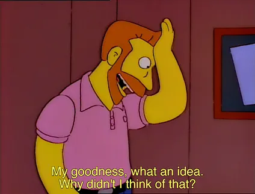
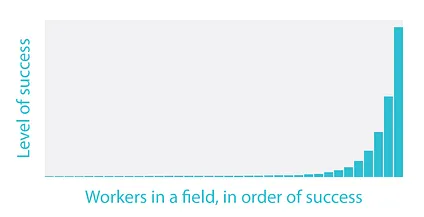
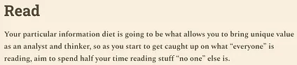
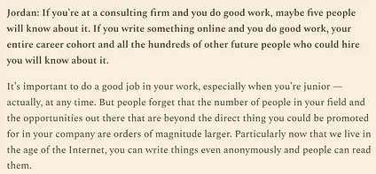
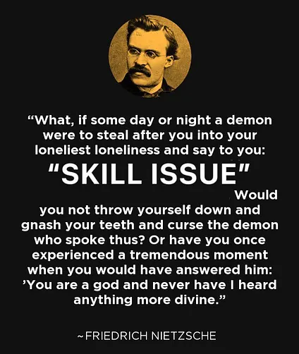

%%
Add discussion note here:

...

%%

I’m often asked how to have an impactful fulfilling career. My four word answer is **“get good, be known.”**

My “fits on a postcard” answer is something like this:

1.  Identify a problem with a vast scale of harm that is neglected at current margins and that is tractable to solve. Millions will die of preventable diseases this year, billions of animals will be tortured, severe tail risks like nuclear war and catastrophic pandemics still exist, and we might be on the cusp of a misaligned intelligence explosion. You should find an important problem to work on.
    
2.  Obsessively improve at rare and valuable skills to solve this problem and do so in a legible way for others to notice. Leverage this career capital to keep the flywheel going— skills allow you to solve more problems, which builds more skills. Rare and valuable roles require rare and valuable traits, so get [so good they can’t ignore you](https://thatvastvariety.substack.com/p/my-notes-from-so-good-they-cant-ignore).
    

Unfortunately, some ambitious and altruistic young people that I speak to seem to have implicitly developed a model that looks more like this:

1.  Identify a problem with a vast scale of harm, that is neglected at current margins, and that is tractable to solve.
    
2.  _**Get a job from the 80,000 Hours job board at a capital-E capital-A Effective Altruist organization right out of college, as fast as possible, otherwise feel like a failure, oh god, oh god...**_
    

I empathize with this feeling. Ambitious people who care about reducing risk and suffering in the world understandably think it’s the most important thing they can be doing, and often hold themselves to a high standard when trying to get there. Before properly entering the workforce, it can feel like your first job will make or break your trajectory, or that surely you must not be competitive for the roles you’re most interested in, or that “get a job” is the actual goal.

This post should help provide some other framings and concrete strategies for developing career capital. I’d argue your north star should be building the relevant skills and expertise while letting people know that you have them, not just “getting a cool job.”

You’re not done once you have the job (you’re arguably just getting started) and the job is only instrumentally useful for solving problems. Plus, there are many forms of doing great work while on the path to what (I think) are eventually those [maximally impactful roles](https://jobs.80000hours.org/) anyway.

### First, brief caveats ^first-brief-caveats

Career advice is extremely context dependent. Sometimes two different people need to hear the opposite advice. Some need a strong gust of wind to encourage them, but others just need to be put in the right environment. Whenever possible I’d recommend that you speak with people about your career directly, either with trusted peers, mentors a few years ahead of you, or 1-1 with an organization like [80,000 Hours](https://80000hours.org/speak-with-us/), [Probably Good](https://probablygood.org/advising/), etc.

This is also why I’m endlessly recommending people to have lots and lots of 1-1 informational career chats for more personalized feedback (“ _networking_ ”). Networking can sound scary, but people have to know you’re good for you to get anywhere - they can’t magically see inside your head, and a ton of context about your worldview and skills doesn’t read well on a CV. Individuals will also be able to give you more calibrated feedback for your specific situation or errant assumptions. Be known!

My colleague Zershaaneh at 80,000 Hours wrote a great post about it [here](https://emergingtechpolicy.org/tips/networking/), and [emergingtechpolicy.org](http://emergingtechpolicy.org/) has a great networking guide for policy careers [here](https://80000hours.org/2025/11/our-top-tips-for-successful-networking/).

### “Improve your skills” ^improve-your-skills

Career advice is full of trite cliches that people nevertheless need to hear many times because they still haven’t internalized the ideas. Even you, smart reader of Substacks, are probably overindexing on a bunch of weird proxies like perceived status, tasks with more intuitive/fun feedback loops, immediately pressing but less important life commitments, etc. Practicing piano scales is a boring grind, but even the world’s best pianists do it. What is your version of this? You should have an answer. Tyler Cowen has some thoughts [here](https://marginalrevolution.com/marginalrevolution/2019/07/learn-like-an-athlete-knowledge-workers-should-train.html) and [here](https://marginalrevolution.com/marginalrevolution/2019/07/how-i-practice-at-what-i-do.html).

Of course this is easier said than done, but that’s what advice is. I want you to go do the things. The upside of this is that I think very few people are actually obsessive about identifying and improving at specific skills. Most people have an implicit goal of securing a “good enough” job that they like and understand how to do, then to settle in. There are so many other commitments in work and life that get in the way of deliberate practice, but if you make it a serious priority you can differentiate yourself.

Simonton, Dean K. “Age and outstanding achievement: What do we know after a century of research?” Psychological bulletin 104.2 (1988): 251. From the 80,000 Hours Career Guide section on personal fit.

I’d like you to sear this distribution into your brain. I think it’s true of many things in the world beyond just workers— in the [Moral Imperative Towards Cost-Effectiveness](https://www.givingwhatwecan.org/research/the-moral-imperative-towards-cost-effectiveness), Toby Ord describes how moving money from the least effective to the most effective global health intervention produced about 15,000x more benefit, and even moving from the median to the best produced ~60x. Talent is also extremely right-tailed. The top 0.1% of papers receive ~1,000 times more citations than the median.

Talent isn’t evenly distributed, but I strongly believe these traits are malleable, not pre-determined. Don’t be a career Calvinist; your fate is in your hands. I got my degrees at pretty generic public colleges in Canada and was on track for a “decent-enough bureaucrat in the Department of Shuffling Papers Around” career before talking to 80k my first time. I’m glad I made a pivot to direct political staffing and then to work helping others build impactful careers, but I think if someone had looked at my CV in ~2022 they would’ve put me somewhere in the middle of the distribution. The next section will cover how deliberate practice and shifting your mindset can help you build your skills faster.

### Get good… Okay, how? ^get-good-okay-how

**1\. Identify the relevant skills in your field**

It’s not always obvious from the outside of an industry _which_ skills you should focus on trying to build. You might have some guesses, but it’s hard to know a priori. Instead you might:

-   Identify the top performers in a given field and examine what qualities they have compared to everyone else.
    
-   Ideally speak with these top performers, or with anyone further ahead of you who’s willing to chat: tap your network for informational coffee chats, attend conferences and events, try cold emails, and ask good questions. While top performers are often busy, they also remember what it was like to be young and hungry - if you model yourself as an eager student of their work (i.e. actually read their paper before the meeting), they might be happy to share insights.
    
-   Read job postings for your dream roles- even if you aren’t qualified yet, they’re usually a pretty clear list of skills you could try to work on developing.
    
-   Try some 5-10 hour side projects to empirically test which skills are most helpful and ideally to solicit feedback.
    

Another angle can be to identify where you specifically might find an edge that few others can or are willing to. Just one year after college, Thomas Hochman was one of the most effective think tank researchers [in DC.](https://www.greentape.pub/p/one-year-in-dc) He writes:

> “ **There’s [Alpha](https://www.investopedia.com/terms/a/alpha.asp) In Doing Boring Stuff** \[...\] my summer and early fall were spent on phone lines with state departments of environmental quality, tracking their use of flexible permits. It was objectively soul-destroying work; it also led to an executive order, a bill being enacted into law, and several other bills being introduced.”

**2\. Test your fit (“ [ladder of cheap tests](https://80000hours.org/career-guide/personal-fit/) ”)**

It’s fine if your career looks like this for a while.

The question of where you’d most excel is mostly an empirical one, so you should test some hypotheses. If you’re considering policy, you might read a few think tank reports, complete an online course, or attend an event in person. If these keep you interested in learning more, that’s a useful signal - if they put you to sleep, that’s also a useful signal! Invest your skill points where you notice the fastest potential growth.

Speaking with people working in an industry can also be a way to test your fit, as can short side projects, part-time fellowships, or applying to jobs even if you’re not sure that you’re qualified. You’re seeking valuable information about your own growth, so even knowing _where_ in the application process you get rejected can be helpful.

Testing your fit can take a while. If you’re a student, trying out an internship for one summer in a field you’re not sure about can be a good way to either rule out or invest in a new path. And even once you’re in a full time job there are often ways to test new skills and aptitudes.

**3\. Deliberate practice**

Movies skip over the training sequence with a dramatic montage because it’s a pretty boring grind to get good at anything. Sure, learning can be engaging sometimes, but rare and valuable skills are rare and valuable for a reason - there’s often something to overcome first. College can be your training montage. Download a mental model of some world class performers. Great biographies are an amazing way to get some inspiration, as are the [many](https://www.chinatalk.media/p/policy-an-early-career-guide-revised) [many](https://karpathy.github.io/2016/09/07/phd/) [many](https://milesbrundage.substack.com/p/faqs-and-general-advice-on-ai-policy) advice posts out there.

Deliberate practice means you should be working right on the edge of your ability (straining just past the point of discomfort) and you should have tight feedback loops for everything you do. Don’t waste time on bad practice. What’s your version of this? Anki cards? Quizzing with peers? Writing for a public audience every week? Hackathons and GitHub projects?

Steve Martin says nobody wants to hear his career advice: they’ll come to him asking about how to find a good agent or advertise their shows, and he’ll just tell them to go practice their act. He spent 10 years refining his standup set before he became famous. The book _So Good They Can’t Ignore You_ ’s title comes from Steve Martin’s advice (I wrote more about deliberate practice in my review of that book [here](https://thatvastvariety.substack.com/p/my-notes-from-so-good-they-cant-ignore)).

**4\. No really, tighten your feedback loops**

Getting feedback is scary but essential.

When you **“work in public”** you both get more feedback so that you can grow, and you get to show people that you’re pretty good at what you do. If you think you’re not good enough to do that yet, feedback is still the answer - ask for Google Docs comments from trusted mentors or peers, post a mini version of your argument/project on Twitter or brave the wilds of LessWrong, do a part-time fellowship or course, anything to get eyes on your project. Fear of rejection is probably holding back most people’s learning, myself included.

The good news is that as I said earlier, you don’t just want a job, you want to be incredible at solving problems. Tightening your feedback loop is a faster way to get there. Criticism is learning. Non-responses to emails can’t hurt you. **Don’t work insanely hard on a project in the wrong direction for three months because you never asked anyone for feedback before you started.**

There are some caveats to this. In some careers you might want to carefully guard your online reputation and not have inflammatory opinions or ‘works in progress’ out there. But even here I think people tend to be too risk averse, especially in their early career. Many hiring managers would rather see a thoughtful blog post working out your rough thinking on an idea (or ideally a [publication](https://emergingtechpolicy.org/tips/publishing-in-policy-outlets/) somewhere) than just trying to get a sense of you from a CV.

**5\. Try doing the things you want to be doing before someone gives you permission**

Almost nobody reads the paper. People are busy and it’s often not that hard to skim the abstract or to listen to a podcast about the paper to get by (as Andy says, [pretending to learn](https://andymasley.substack.com/p/strategies-for-learning?open=false#%C2%A7learning-vs-pretending-to-learn) feels more fun than learning). You can differentiate yourself from most peers if you decide what matters and actually invest the time to know your shit.

Jordan from ChinaTalk has some good [advice](https://www.chinatalk.media/p/policy-an-early-career-guide-revised) for reading:

And for writing:

Maybe your field is much more quantitative or technical. Great, what’s on your GitHub? Show me what you’ve been working on. Maybe you’re more of an operations expert. Fair, but I’d love to see you run an event or build a dashboard for an interesting dataset. Be known! If I ran into you at a conference a year from now and said “oh yeah I know them, they do cool work, they seem thoughtful, they’re the person who \_\_\_,” what would I be describing?

This “do great work before you get permission” advice is usually better for people who aren’t yet in a fulfilling full time role yet where they can channel their extra energy, but those people don’t usually need career advice. Ideally you’d be reading / writing / doing skill building projects at your day job with feedback loops from your manager, but if that’s not the case, be ambitious about new projects.

### Caveats: Avoiding Burnout, Overcoming Imposter Syndrome, Assessing Personal Fit, Increasing Luck Surface Area, and Finding High-Growth Opportunities ^caveats-avoiding-burnout-overcoming

Burnout is real and it’s horrible. I want your career development and impact to be sustainable— are you building skills and experience over 5, 10, 20 years? Investing in yourself is a long term project, so try to focus on reliable steady compounding growth. And even if you have short AI timelines, I want you to maximize your impact across the distribution of worlds that you can meaningfully influence. If a harmful AGI is created tomorrow, I’m not in a position to directly help.

Burnout is also important to notice and mitigate early - if you routinely find yourself gritting and pushing through, try to notice the physical sensations of tension in your body over time. This will vary from person to person, but I think it’s really worth it to find out what outlets you need to reset in these situations. For me it’s exercise, exercise, exercise (seriously it creates a night and day difference), then maybe meditation, a quick “brain dump” journaling session about my thought process, and quality time with other people.

Lastly, it can really help to mitigate burnout if your deliberate practice is efficient. Maybe one hour a day of Anki cards actually helps you learn faster than four hours of grinding out papers that you quickly forget.

This was a great reference when I was in college.

Imposter syndrome sucks and is quite common. I’ve heard so many smart and ambitious people that I advise tell me they don’t think they’d have anything to offer in a given field (and I’ve seen some of them get exciting new jobs shortly after telling me this). I think this often comes down to comparing in the wrong reference class and to poor empirical testing:

-   **Time-sensitive comparisons**: Are you sad you’re not as successful as someone 5 years older than you? Or who has been at this skill for 3x as long as you? Why?
    
-   **Scope-sensitive comparisons**: At these top universities you’re already subject to extreme sorting functions - “any smart peer” is not the relevant reference class for “people who could do really cool work on \_\_\_ niche EA topic.”
    
-   **Few qualities are immutable**: Have you actually tested if you can get incredibly good at this skill? For how many hours? With how many approaches? How much feedback have you gotten?
    
-   **There are many kinds of skills**: Even if you really do think you’re surrounded by vastly more impressive people than you…. Get them to work on these problems???? Fieldbuilding is really important- this is my own path to impact.
    

80k has [an imposter syndrome guide](https://80000hours.org/2022/04/imposter-syndrome/) and a very popular [mental health podcast episode](https://80000hours.org/podcast/episodes/depression-anxiety-imposter-syndrome/) if you want to explore further.

In addition, not all jobs provide equal skillbuilding opportunities. I’ve emphasized side-projects and self-study because I think they’re often more accessible entry points for differentiating yourself early in your career, but ideally _most_ of your learning will happen through a full time job, fellowship, internship, etc. It’s usually the fastest way to get direct mentorship and feedback on real world problems, and you’ll be spending so much of your time ([many hours, in fact](https://80000hours.org/)) on it.

When choosing between different jobs, try to consider which ones will allow you to build the relevant skills that you’ve identified. When you’re being interviewed for a role, near the end of the process you can also (politely) “interview” them: what does the day to day look like, what responsibilities would you have, etc.

Some jobs don’t actually have opportunities to distinguish yourself by developing and showcasing skills. It’s possible you work somewhere with 0 interest in your career capital. Talk to lots of people to determine whether this is the case, but if it is, look for the exit. This is not somewhere you want to stay. Similarly, if your job forces you to work with people you actively dislike or to do something you think is harmful, you should leave.

Lastly, you’ve probably heard the term “ [luck surface area](https://usefulfictions.substack.com/p/how-to-increase-your-surface-area) ” before, but if not I highly recommend considering it. This relates to a lot of the earlier advice about working in public and building relationships. Don’t tell yourself that it’s too late for you because other people got lucky. I met my wife because we both happened to sit at the same table at a conference (for which I feel extremely lucky!!!), but if I hadn’t decided to attend that conference it wouldn’t have happened.

### Skill issue (affectionate) ^skill-issue-affectionate

I think for some people this approach can be liberating. There’s not some fundamental ontological curse holding you back from the things you want in your career. You probably haven’t come close to testing the limits of your skills under the right contexts, with the right feedback loops and prioritization. The internet has democratized access to tools for learning and distribution of your work, or to find great conferences/events in person.

You want a cool job. Get good and be known.
