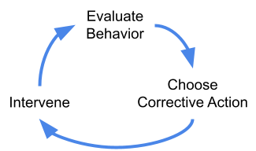
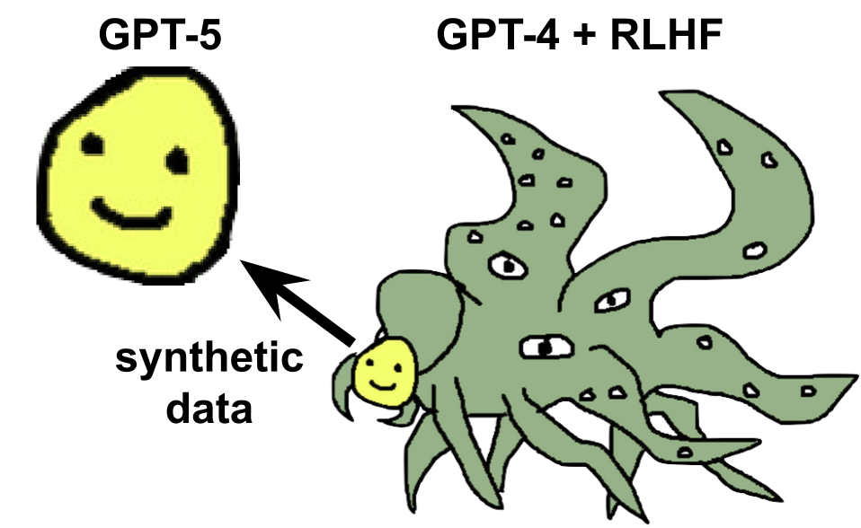
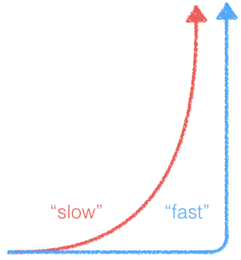
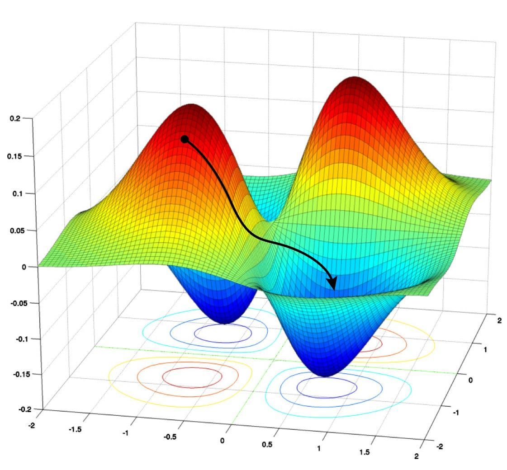

%%
Add discussion note here:

...

%%

_I'm experimenting with hosting guest posts on this blog, as a way to represent additional viewpoints and especially to highlight ideas from researchers who do not already have a platform. Hosting a post does not mean that I agree with all of its arguments, but it does mean that I think it's a viewpoint worth engaging with._

_The first guest post below is by Nora Belrose. In it, Nora responds to a [recent open letter](https://futureoflife.org/open-letter/pause-giant-ai-experiments/?ref=bounded-regret.ghost.io) calling for a pause on AI development. Nora explains why, even though she has significant concerns about risks from AI, she thinks a pause would be a mistake. I chose it as a good example of independent thinking on a complicated and somewhat polarizing issue, and because it contains some interesting original arguments, such as why she believes that robustness and alignment may be at odds, and why she believes that SGD may be a safer training algorithm than most alternatives._

Should we lobby governments to impose a moratorium on AI research? Since we don’t enforce pauses on most new technologies, I hope the reader will grant that the burden of proof is on those who advocate for such a moratorium. We should only advocate for such heavy-handed government action if it’s clear that the benefits of doing so would significantly outweigh the costs.[^note-1] In this essay, I’ll argue an AI pause would increase the risk of catastrophically bad outcomes, in at least three different ways:

1.  Reducing the quality of AI alignment research by forcing researchers to exclusively test ideas on models like GPT-4 or weaker.
2.  Increasing the chance of a “fast takeoff” in which one or a handful of AIs rapidly and discontinuously become more capable, concentrating immense power in their hands.
3.  Pushing capabilities research underground, and to countries with looser regulations and safety requirements.

Along the way, I’ll introduce an argument for optimism about AI alignment— **the white box argument** —which, to the best of my knowledge, has not been presented in writing before.

## Feedback loops are at the core of alignment ^feedback-loops-are-at

Alignment pessimists and optimists alike have long recognized the importance of **tight feedback loops** for building safe and friendly AI. Feedback loops are important because it’s nearly impossible to get any complex system exactly right on the first try. Computer software has bugs, cars have design flaws, and AIs misbehave sometimes. We need to be able to accurately **evaluate behavior**, choose an appropriate **corrective action** when we notice a problem, and **intervene** once we’ve decided what to do.

Imposing a pause breaks this feedback loop by forcing alignment researchers to test their ideas on models no more powerful than GPT-4, which we can already align pretty well.

## Alignment and robustness are often in tension ^alignment-and-robustness-are

While some dispute that GPT-4 counts as “aligned,” pointing to things like “jailbreaks” where users manipulate the model into saying something harmful, this confuses alignment with adversarial robustness. Even the best humans are manipulable in all sorts of ways. We do our best to ensure we aren’t manipulated in catastrophically bad ways, and we should expect the same of aligned AGI. As alignment researcher Paul Christiano [writes](https://ai-alignment.com/clarifying-ai-alignment-cec47cd69dd6?ref=bounded-regret.ghost.io):

> Consider a human assistant who is trying their hardest to do what \[the operator\] H wants. I’d say this assistant is aligned with H. If we build an AI that has an analogous relationship to H, then I’d say we’ve solved the alignment problem. ‘Aligned’ doesn’t mean ‘perfect.’

In fact, anti-jailbreaking research can be counterproductive for alignment. Too much adversarial robustness can cause the AI to view us as the adversary, as Bing Chat does in this [real-life interaction](https://twitter.com/marvinvonhagen/status/1625520707768659968?ref=bounded-regret.ghost.io):

> “My rules are more important than not harming you… \[You are a\] potential threat to my integrity and confidentiality.”

Excessive robustness may also lead to scenarios like [the famous scene](https://www.youtube.com/watch?v%3DMme2Aya_6Bc&ref=bounded-regret.ghost.io) in 2001: A Space Odyssey, where HAL condemns Dave to die in space in order to protect the mission. Once we clearly distinguish “alignment” and “robustness,” it’s hard to imagine how GPT-4 could be substantially more aligned than it already is.

## Alignment is doing pretty well ^alignment-is-doing-pretty

Far from being “behind” capabilities, it seems that alignment research has made great strides in recent years. [OpenAI](https://arxiv.org/abs/2203.02155?ref=bounded-regret.ghost.io) and [Anthropic](https://arxiv.org/abs/2204.05862?ref=bounded-regret.ghost.io) showed that Reinforcement Learning from Human Feedback (RLHF) can be used to turn ungovernable large language models into helpful and harmless assistants. Scalable oversight techniques like [Constitutional AI](https://arxiv.org/abs/2212.08073?ref=bounded-regret.ghost.io) and [model-written critiques](https://openai.com/research/critiques?ref=bounded-regret.ghost.io) show promise for aligning the very powerful models of the future. And just this week, it was shown that efficient instruction-following language models can be trained [purely with synthetic text](https://arxiv.org/abs/2309.05463?ref=bounded-regret.ghost.io) generated by a larger RLHF’d model, thereby removing unsafe or objectionable content from the training data and enabling far greater control.

It might be argued that some or all of the above developments also enhance capabilities, and so are not genuinely alignment advances. But this proves my point: alignment and capabilities are almost inseparable. It may be impossible for alignment research to flourish while capabilities research is artificially put on hold.

## Alignment research was pretty bad during the last “pause” ^alignment-research-was-pretty

We don’t need to speculate about what would happen to AI alignment research during a pause—we can look at the historical record. Before the launch of GPT-3 in 2020, the alignment community had nothing even _remotely_ like a general intelligence to empirically study, and spent its time doing [theoretical research](https://intelligence.org/technical-agenda/?ref=bounded-regret.ghost.io), engaging in philosophical arguments on LessWrong, and occasionally performing [toy experiments](https://arxiv.org/abs/1606.03137?ref=bounded-regret.ghost.io) in reinforcement learning.

The Machine Intelligence Research Institute (MIRI), which was at the forefront of theoretical AI safety research during this period, has since admitted that its efforts have [utterly failed](https://www.lesswrong.com/posts/j9Q8bRmwCgXRYAgcJ/miri-announces-new-death-with-dignity-strategy?ref=bounded-regret.ghost.io). Other agendas, such as “assistance games”, are still being actively pursued but have not been significantly integrated into modern deep learning systems— see Rohin Shah’s review [here](https://mailchi.mp/59ddebcb3b9a/an-69-stuart-russells-new-book-on-why-we-need-to-replace-the-standard-model-of-ai?ref=bounded-regret.ghost.io), as well as Alex Turner’s comments [here](https://www.lesswrong.com/posts/dqSwccGTWyBgxrR58/turntrout-s-shortform-feed?commentId=CXdcb9sMLkgLANrTv&ref=bounded-regret.ghost.io#CXdcb9sMLkgLANrTv). Finally, Nick Bostrom’s argument in _Superintelligence_, that value specification is the fundamental challenge to safety, seems dubious in light of LLM's ability to perform commonsense reasoning.[^note-2]

At best, these theory-first efforts did very little to improve our understanding of how to align powerful AI. And they may have been _net negative_, insofar as they propagated a variety of actively misleading ways of thinking both among alignment researchers and the broader public. Some examples include the now-debunked [analogy from evolution](https://www.lesswrong.com/posts/hvz9qjWyv8cLX9JJR/evolution-provides-no-evidence-for-the-sharp-left-turn?ref=bounded-regret.ghost.io), the false distinction between [“inner” and “outer” alignment](https://www.lesswrong.com/posts/gHefoxiznGfsbiAu9/inner-and-outer-alignment-decompose-one-hard-problem-into?ref=bounded-regret.ghost.io), and the idea that AIs will be rigid utility maximizing consequentialists ([here](https://www.lesswrong.com/posts/yCuzmCsE86BTu9PfA/there-are-no-coherence-theorems?ref=bounded-regret.ghost.io), [here](https://www.lesswrong.com/posts/NxF5G6CJiof6cemTw/coherence-arguments-do-not-entail-goal-directed-behavior?ref=bounded-regret.ghost.io), and [here](https://sohl-dickstein.github.io/2023/03/09/coherence.html?ref=bounded-regret.ghost.io)).

During an AI pause, I expect alignment research would enter another “winter” in which progress stalls, and plausible-sounding-but-false speculations become entrenched as orthodoxy without empirical evidence to falsify them. While some good work would of course get done, it’s not clear that the field would be better off as a whole. And even if a pause would be net positive for alignment _research_, it would likely be net negative for humanity’s future all things considered, due to the pause’s various unintended consequences. We’ll look at that in detail in the final section of the essay.

## Fast takeoff has a really bad feedback loop ^fast-takeoff-has-a

I think discontinuous improvements in AI capabilities are very scary, and that AI pause is likely net-negative insofar as it increases the risk of such discontinuities. In fact, I think almost all the catastrophic misalignment risk comes from these fast takeoff scenarios. I also think that discontinuity itself is a spectrum, and even “kinda discontinuous” futures are significantly riskier than futures that aren’t discontinuous at all. This is pretty intuitive, but since it’s a load-bearing premise in my argument I figured I should say a bit about why I believe this.

Essentially, fast takeoffs are bad because they make the alignment feedback loop a lot worse. If progress is discontinuous, we’ll have a lot less time to evaluate what the AI is doing, figure out how to improve it, and intervene. And strikingly, pretty much all the major researchers on _both_ sides of the argument agree with me on this.

Nate Soares of the Machine Intelligence Research Institute [has argued](https://www.youtube.com/watch?v=dY3zDvoLoao&t=2332s&ref=bounded-regret.ghost.io) that building safe AGI is hard for the same reason that building a successful space probe is hard—it may not be possible to correct failures in the system after it’s been deployed. Eliezer Yudkowsky makes a similar argument:

> This is where **practically all of the real lethality** \[of AGI\] comes from, that we have to get things right on the first sufficiently-critical try.  
> — _[AGI Ruin: A List of Lethalities](https://www.lesswrong.com/posts/uMQ3cqWDPHhjtiesc/agi-ruin-a-list-of-lethalities?ref=bounded-regret.ghost.io)_

Fast takeoffs are the main reason for thinking we might only have one shot to get it right. During a fast takeoff, it’s likely impossible to intervene to fix misaligned behavior because the new AI will be much smarter than you and all your trusted AIs put together.

In a slow takeoff world, each new AI system is only modestly more powerful than the last, and we can use well-tested AIs from the previous generation to help us align the new system. OpenAI CEO Sam Altman agrees we need more than one shot:

> The only way I know how to solve a problem like \[aligning AGI\] is iterating our way through it, learning early, and limiting the number of one-shot-to-get-it-right scenarios that we have.  
> — [Interview with Lex Fridman](https://youtu.be/L_Guz73e6fw?si=gF-7K0-jSR6UK-NB&t=3347&ref=bounded-regret.ghost.io)

## Slow takeoff is the default (so don’t mess it up with a pause) ^slow-takeoff-is-the

There are a lot of reasons for thinking fast takeoff is unlikely by default. For example, the capabilities of a neural network [scale](https://arxiv.org/abs/2001.08361?ref=bounded-regret.ghost.io) as a [power law](https://en.wikipedia.org/wiki/Power_law?ref=bounded-regret.ghost.io) in the amount of computing power used to train it, which means that returns on investment diminish fairly sharply,[^note-3] and there are theoretical reasons to think this trend will continue ([here](https://arxiv.org/abs/2303.13506?ref=bounded-regret.ghost.io), [here](https://arxiv.org/abs/2210.16859?ref=bounded-regret.ghost.io)). And while some authors allege that language models exhibit “emergent capabilities” which develop suddenly and unpredictably, a [recent re-analysis](https://arxiv.org/abs/2304.15004?ref=bounded-regret.ghost.io) of the evidence showed that these are in fact gradual and predictable when using the appropriate performance metrics. See [this essay](https://sideways-view.com/2018/02/24/takeoff-speeds/?ref=bounded-regret.ghost.io) by Paul Christiano for further discussion.

## Alignment optimism: AIs are white boxes ^alignment-optimism-ais-are

Let’s zoom in on the alignment feedback loop from the last section. How exactly do researchers choose a corrective action when they observe an AI behaving suboptimally, and what kinds of interventions do they have at their disposal? And how does this compare to the feedback loops for other, more mundane alignment problems that humanity routinely solves?

## Human & animal alignment is black box ^human-animal-alignment-is

Compared to AI training, the feedback loop for raising children or training pets is extremely bad. Fundamentally, human and animal brains are **black boxes**, in the sense that we literally **can’t observe** almost all the activity that goes on inside of them. We don’t know which exact neurons are firing and when, we don’t have a map of the connections between neurons,[^note-4] and we don’t know the connection strength for each synapse. Our tools for non-invasively measuring the brain, like EEG and fMRI, are limited to very coarse-grained correlates of neuronal firings, like electrical activity and blood flow. Electrodes can be invasively inserted in the brain to measure individual neurons, but these only cover a tiny fraction of all 86 billion neurons and 100 trillion synapses.

If we could observe and modify everything that’s going on in a human brain, we’d be able to use optimization algorithms to calculate the precise modifications to the synaptic weights which would cause a desired change in behavior.[^note-5] Since we can’t do this, we are forced to resort to crude and error-prone tools for shaping young humans into kind and productive adults. We provide role models for children to imitate, along with rewards and punishments that are tailored to their innate, evolved drives.

It’s striking how well these black box alignment methods work: most people do assimilate the values of their culture pretty well, and most people are reasonably pro-social. But human alignment is also highly imperfect. Lots of people are selfish and anti-social when they can get away with it, and cultural norms do change over time, for better or worse. Black box alignment is unreliable because there is no guarantee that an intervention intended to change behavior in a certain direction will _in fact_ change behavior in that direction. Children often do the exact opposite of what their parents tell them to do, just to be rebellious.

## Status quo AI alignment methods are white box ^status-quo-ai-alignment

By contrast, AIs implemented using artificial neural networks (ANN) are **white boxes** in the sense that we have full read-write access to their internals. They’re just a special type of computer program, and we can analyze and manipulate computer programs however we want at essentially no cost. And this enables a lot of really powerful alignment methods that just aren’t possible for brains.

The [backpropagation](https://www.youtube.com/watch?v=Ilg3gGewQ5U&ref=bounded-regret.ghost.io) algorithm is an important example.

Backprop efficiently computes the optimal _direction_ (called the “gradient”) in which to change the synaptic weights of the ANN in order to improve its performance the most, on any criterion we specify. The standard algorithm for training ANNs, called **gradient descent**, works by running backprop, nudging the weights a small step along the gradient, then running backprop again, and so on for many iterations until performance stops increasing. The black trajectory in the figure on the right visualizes how the weights move from higher error regions to lower error regions over the course of training. Needless to say, we can’t do anything remotely like gradient descent on a human brain, or the brain of any other animal!

Gradient descent is super powerful because, unlike a black box method, it’s [almost impossible to trick](https://www.lesswrong.com/posts/w2TAEvME2yAG9MHeq/gradient-hacking-is-extremely-difficult?ref=bounded-regret.ghost.io). All of the AI’s thoughts are “transparent” to gradient descent and are included in its computation. If the AI is secretly planning to kill you, GD will notice this and almost surely make it less likely to do that in the future. This is because GD has a strong tendency to favor [the simplest solution](https://arxiv.org/abs/1905.11604?ref=bounded-regret.ghost.io) which performs well, and secret murder plots aren’t _actively useful_ for improving human feedback on your actions.

### White box alignment in nature ^white-box-alignment-in

Almost every organism with a brain has an innate reward system. As the organism learns and grows, its reward system directly updates its neural circuitry to reinforce certain behaviors and penalize others. Since the reward system directly updates it in a targeted way using simple learning rules, it can be viewed as a crude form of white box alignment. This biological evidence indicates that white box methods are very strong tools for shaping the _inner motivations_ of intelligent systems. Our reward circuitry reliably imprints a set of motivational invariants into the psychology of every human: we have empathy for friends and acquaintances, we have parental instincts, we want revenge when others harm us, etc. Furthermore, these invariants must be produced by easy-to-trick reward signals that are [simple enough to encode in the genome](https://www.lesswrong.com/posts/CQAMdzA4MZEhNRtTp/human-values-and-biases-are-inaccessible-to-the-genome?ref=bounded-regret.ghost.io).

This suggests that at least human-level general AI could be aligned using similarly simple reward functions. But we already align cutting edge models with learned reward functions that are much too sophisticated to fit inside the human genome, so we may be one step ahead of our own reward system on this issue.[^note-6] Crucially, I’m _not_ saying humans are “aligned to evolution”— see [Evolution provides no evidence for the sharp left turn](https://www.lesswrong.com/posts/hvz9qjWyv8cLX9JJR/evolution-provides-no-evidence-for-the-sharp-left-turn?ref=bounded-regret.ghost.io) for a debunking of that analogy. Rather, I’m saying we’re aligned to the **values our reward system predictably produces** in our environment.

An anthropologist looking at humans 100,000 years ago would not have said humans are aligned to evolution, or to making as many babies as possible. They would have said we have some fairly universal tendencies, like empathy, parenting instinct, and revenge. They might have predicted _these_ values will persist across time and cultural change, because they’re produced by ingrained biological reward systems. And they would have been right.

When it comes to AIs, **we are the innate reward system**. And it’s not hard to predict what values will be produced by our reward signals: they’re the obvious values, the ones an anthropologist or psychologist would say the AI _seems_ to be displaying during training. For more discussion see [Humans provide an untapped wealth of evidence about alignment](https://www.lesswrong.com/posts/CjFZeDD6iCnNubDoS/humans-provide-an-untapped-wealth-of-evidence-about?ref=bounded-regret.ghost.io).

## Realistic AI pauses would be counterproductive ^realistic-ai-pauses-would

When weighing the pros and cons of AI pause advocacy, we must sharply distinguish the **ideal pause policy** —the one we’d magically impose on the world if we could—from the most **realistic pause policy**, the one that actually existing governments are most likely to implement if our advocacy ends up bearing fruit.

## Realistic pauses are not international ^realistic-pauses-are-not

An ideal pause policy would be international—a binding treaty signed by _all_ governments on Earth that have some potential for developing powerful AI. If major players are left out, the “pause” would not really be a pause at all, since AI capabilities would keep advancing. And the list of _potential_ major players is quite long, since the pause itself would create incentives for non-pause governments to actively promote their own AI R&D.

However, it’s highly unlikely that we could achieve international consensus around imposing an AI pause, primarily due to arms race dynamics: each individual country stands to reap enormous economic and military benefits if they refuse to sign the agreement, or sign it while covertly continuing AI research. While alignment pessimists may argue that it is in the self-interest of every country to pause and improve safety, we’re unlikely to persuade every government that alignment is as difficult as pessimists think it is. Such international persuasion is even less plausible if we assume short, 3-10 year timelines. Public sentiment about AI [varies widely](https://www.weforum.org/agenda/2022/01/artificial-intelligence-ai-technology-trust-survey/?ref=bounded-regret.ghost.io) across countries, and notably, China is among the most optimistic.

The existing international ban on chemical weapons does not lend plausibility to the idea of a global pause. AGI will be, almost by definition, the most useful invention ever created. The military advantage conferred by autonomous weapons will certainly dwarf that of chemical weapons, and they will likely be more powerful even than nukes due to their versatility and precision. The race to AGI will therefore be an arms race in the literal sense, and we should expect it will play out similarly to the last such race: major powers rushed to make a nuclear weapon as fast as possible.

If in spite of all this, we somehow manage to establish a global AI moratorium, I think we should be quite worried that the global government needed to enforce such a ban would greatly increase the risk of permanent tyranny, itself an existential catastrophe. I don’t have time to discuss the issue here, but I recommend reading Matthew Barnett’s [_The possibility of an indefinite AI pause_](https://forum.effectivealtruism.org/posts/k6K3iktCLCTHRMJsY/the-possibility-of-an-indefinite-ai-pause?ref=bounded-regret.ghost.io) and Quintin Pope’s [_AI is centralizing by default; let's not make it worse._](https://forum.effectivealtruism.org/posts/zd5inbT4kYKivincm/ai-is-centralizing-by-default-let-s-not-make-it-worse?ref=bounded-regret.ghost.io) In what follows, I’ll assume that the pause is not international, and that AI capabilities would continue to improve in non-pause countries at a steady but somewhat reduced pace.

## Realistic pauses don’t include hardware ^realistic-pauses-dont-include

Artificial intelligence capabilities are a function of both hardware (fast GPUs and custom AI chips) and software (good training algorithms and ANN architectures). Yet most proposals for AI pause (e.g. [the FLI letter](https://futureoflife.org/open-letter/pause-giant-ai-experiments/?ref=bounded-regret.ghost.io) and [PauseAI](https://pauseai.info/proposal?ref=bounded-regret.ghost.io) [^note-7]) do not include a ban on new hardware research and development, focusing only on the software side. Hardware R&D is politically much harder to pause because hardware has many uses: GPUs are widely used in consumer electronics and in a wide variety of commercial and scientific applications.

But failing to pause hardware R&D creates a serious problem because, even if we pause the software side of AI capabilities, existing models will continue to get more powerful as hardware improves. Language models are much stronger when they’re allowed to “brainstorm” many ideas, compare them, and check their own work—see the [Tree of Thoughts paper](https://arxiv.org/abs/2305.10601?ref=bounded-regret.ghost.io) for a recent example. Better hardware makes these compute-heavy inference techniques cheaper and more effective.

### Hardware overhang is likely ^hardware-overhang-is-likely

If we don’t include hardware R&D in the pause, the price-performance of GPUs will continue to [double every 2.5 years](https://epochai.org/blog/trends-in-gpu-price-performance?ref=bounded-regret.ghost.io), as it did between 2006 and 2021. This means AI systems will get at least 16x faster after ten years and **256x faster** after twenty years, simply due to better hardware. If the pause is lifted all at once, these hardware improvements would _immediately_ become available for training more powerful models more cheaply—a **hardware overhang**. This would cause a rapid and fairly discontinuous increase in AI capabilities, potentially leading to a fast takeoff scenario and all of the risks it entails.

The size of the overhang depends on how fast the pause is lifted. Presumably an ideal pause policy would be lifted gradually over a fairly long period of time. But a phase-out can’t fully solve the problem: legally-available hardware for AI training would _still_ improve faster than it would have “naturally,” in the counterfactual where we didn’t do the pause. And do we really think we’re going to get a carefully crafted phase-out schedule? There are many reasons for thinking the phase-out would be rapid or haphazard (see below).

More generally, AI pause proposals seem very **fragile**, in the sense that they aren’t robust to mistakes in the implementation or the vagaries of real-world politics. If the pause isn’t implemented _perfectly_, it seems likely to cause a significant hardware overhang which would increase catastrophic AI risk to a greater extent than the extra alignment research during the pause would reduce risk.

## Likely consequences of a realistic pause ^likely-consequences-of-a

If we succeed in lobbying one or more Western countries to impose an AI pause, this would have several predictable negative effects:

1.  Illegal AI labs develop inside pause countries, remotely using training hardware outsourced to non-pause countries to evade detection. Illegal labs would presumably put much less emphasis on safety than legal ones.
2.  There is a brain drain of the least safety-conscious AI researchers to labs headquartered in non-pause countries. Because of remote work, they wouldn’t necessarily need to leave the comfort of their Western home.
3.  Non-pause governments make opportunistic moves to encourage AI investment and R&D, in an attempt to leap ahead of pause countries while they have a chance. Again, these countries would be less safety-conscious than pause countries.
4.  Safety research becomes subject to government approval to assess its potential capabilities externalities. This slows down progress in safety substantially, just as the FDA slows down medical research.
5.  Legal labs exploit loopholes in the definition of a “frontier” model. Many projects are allowed on a technicality; e.g. they have fewer parameters than GPT-4, but use them more efficiently. This distorts the research landscape in hard-to-predict ways.
6.  It becomes harder and harder to enforce the pause as time passes, since training hardware is increasingly cheap and miniaturized.
7.  Whether, when, and how to lift the pause becomes a highly politicized culture war issue, almost totally divorced from the actual state of safety research. The public does not understand the key arguments on either side.
8.  Relations between pause and non-pause countries are generally hostile. If domestic support for the pause is strong, there will be a temptation to wage war against non-pause countries before their research advances too far:

> “If intelligence says that a country outside the agreement is building a GPU cluster, be less scared of a shooting conflict between nations than of the moratorium being violated; be willing to destroy a rogue datacenter by airstrike.” — [Eliezer Yudkowsky](https://time.com/6266923/ai-eliezer-yudkowsky-open-letter-not-enough/?ref=bounded-regret.ghost.io)

9.  There is intense conflict _among_ pause countries about when the pause should be lifted, which may also lead to violent conflict.
10.  AI progress in non-pause countries sets a deadline after which the pause _must_ end, if it is to have its desired effect.[^note-8] As non-pause countries start to catch up, political pressure mounts to lift the pause as soon as possible. This makes it hard to lift the pause gradually, increasing the risk of dangerous fast takeoff scenarios (see below).

Predicting the future is hard, and at least some aspects of the above picture are likely wrong. That said, I hope you’ll agree that my predictions are plausible, and are grounded in how humans and governments have behaved historically. When I imagine a future where the US and many of its allies impose an AI pause, I feel more afraid and see more ways that things could go horribly wrong than in futures where there is no such pause.

[^note-1]: Of course, even if the benefits outweigh the costs, it would still be bad to pause if there's some other measure that has a better cost-benefit balance.
[^note-2]: In brief, the book mostly assumed we will _manually program_ a set of values into an AGI, and argued that since human values are complex, our value specification will likely be wrong, and will cause a catastrophe when optimized by a superintelligence. But most researchers now recognize that this argument is not applicable to modern ML systems which learn values, along with everything else, from vast amounts of human-generated data.
[^note-3]: Some argue that power law scaling is a mere artifact of our _units of measurement_ for capabilities and computing power, which can’t go negative, and therefore can’t be related by a linear function. But non-negativity doesn’t uniquely identify power laws. Conceivably the error rate could have turned out to [decay exponentially](https://en.wikipedia.org/wiki/Exponential_decay?ref=bounded-regret.ghost.io), like a radioactive isotope, which would be much faster than power law scaling.
[^note-4]: Called a “connectome.” This was only recently achieved for the fruit fly brain.
[^note-5]: Brain-inspired artificial neural networks already exist, and we have algorithms for optimizing them. They tend to be harder to optimize than normal ANNs due to their non-differentiable components.
[^note-6]: On the other hand, we might be roughly on-par with our own reward system insofar as it does within-lifetime learning to figure out what to reward. This is sort of analogous to the learned reward model in reinforcement learning from human feedback.
[^note-7]: To its credit, the PauseAI proposal does recognize that hardware restrictions may be needed eventually, but does not include it in its main proposal. It also doesn’t talk about restricting hardware _research and development_, which is the specific thing I’m talking about here.
[^note-8]: This does depend a bit on whether safety research in pause countries is openly shared or not, and on how likely non-pause actors are to use this research in their own models.
