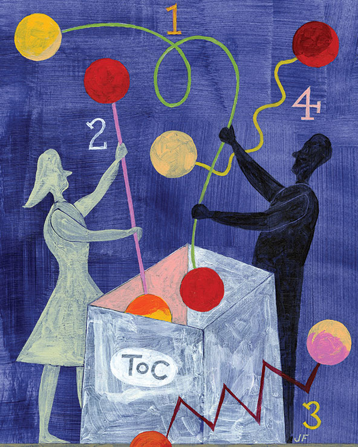
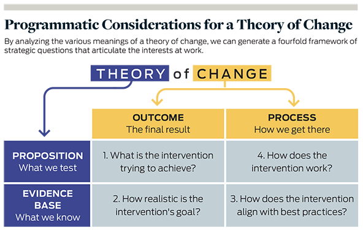

%%
Add discussion note here:

...

%%

The term “theory of change” is as popular as it is confusing. By gaining a clearer understanding of its various interpretations, practitioners in the social sector can more effectively implement and assess their interventions.

*(Illustration by Jeffery Fisher)*

Staying abreast of the social sector’s expansive and evolving lexicon is challenging. Tracking evaluation terminology can be especially taxing. Standing at the intersection of academia and strategic planning, social impact evaluators blend the ideas and methods of multiple professional communities, thus producing a formidable jargon. Learning the discourse of impact evaluation—whether it is parsing the differences between “outputs” and “outcomes” or debating whether “evidence-based practice” should be a verb or a noun—inevitably brings semantic fatigue.

Among the most popular examples of difficult evaluation language is “theory of change” (ToC), a long-standing term of art that causes much confusion. Since the term began gaining popularity in the mid-1990s, views on what the concept means and how it operates in practice have proliferated. This jumble of interpretations leads to what G. Albert Ruesga, former president and CEO of the Greater New Orleans Foundation, calls the “radical polysemy of theories of change.”[^cite-ruesga]  

The goal of this essay is to unpack and organize the meanings of a ToC with a concise framework that pinpoints its various objectives. To be clear, I will not try to reconcile the different vocabularies scholars have used to label evaluation techniques resembling or incorporating ToCs (“realist evaluation,” “contribution analysis,” “outcomes chain,” etc.). My aim is only to present the properties of a good ToC with a simple model that will help readers understand what the tool ought to accomplish.

Achieving greater understanding of ToCs is not merely an intellectual exercise; it offers great practical value for the social sector. As funders, consultants, and other stakeholders pose the increasingly familiar question “What’s your theory of change?” the risk of confusion and frustration stemming from a lack of common understanding grows. Building a shared conception of ToCs will help to ensure that we are not speaking past each other when we use the term. Of course, complete clarity and consistency in how we use it would be ideal, but this article aims for a more realistic goal: By mapping out the various forms that a ToC can take, the framework proposed in this article enables greater sensitivity to how we interpret and deploy ToCs in ways that may be unfamiliar to others. By appreciating the nuances of the concept, we should become better able to anticipate and correct for potential confusion.

## A Foil to Black Box Evaluations ^a-foil-to-black

The substantial literature on impact evaluation provides a useful starting point for understanding what a ToC is. _Stanford Social Innovation Review_ has contributed a number of articles to this body of work. Paul Brest, law professor and former president of the Hewlett Foundation, offers a precise (if somewhat academic) definition of a ToC as “the empirical basis underlying any social intervention.”[^cite-brest]  Kathleen Kelly Janus, a senior advisor on social innovation to California Governor Gavin Newsom, defines the term as “an articulation … of precisely how an organization is going to achieve its objectives.”[^cite-janus]  This definition aligns with the explanation provided by Bridgespan partners Susan Colby, Nan Stone, and Paul Carttar, who describe a ToC as “the cause-and-effect logic by which organizational and financial resources will be converted into the desired social results.”[^cite-colby]  Finally, Matthew Forti, managing director of the One Acre Fund, specifies that a good ToC should explain not only how this causal logic works but also why believing that it will work is reasonable.[^cite-forti]

I have no wish to add another definition to this collection. Rather, I want to start by surfacing a few points of context that clarify what a ToC is and is not. To begin, it is instructive to think of a ToC as a foil to so-called “black box” evaluation, which views interventions primarily or solely in terms of inputs and outcomes. A black box evaluation pays little, if any, attention to whether the steps of the intervention occurred as planned, focusing instead on the resources committed to the intervention and what resulted thereafter.

Take, for example, an evaluation of a new curriculum for elementary science education: It may address a number of questions beyond effectiveness. Did instructors undergo sufficient training? How many of the lessons in the curriculum did they actually cover? Were students able to utilize different types of resources, such as lab equipment or proximity to museums? In a black box evaluation, such questions are set aside in favor of an overarching focus on initial resource commitments (e.g., the dissemination of the curriculum) and results (e.g., changes in test scores).

The determination of results is, of course, a fundamental aspect of evaluation, but scholars and practitioners have long noted that outcome assessment alone is inadequate for determining and replicating effective social-change strategies. The importance of looking beyond outcomes became especially clear in the 1960s, when evaluations of new and ambitious social programs frequently turned up negative results. Faced with these disappointing findings, policymakers and service providers were left to puzzle over the causes of failure and the prospects for improvement.[^cite-shadish]

For example, a number of studies at the time evaluated services that caseworkers provided as a means to prevent juvenile delinquency and family breakdown. Many of these studies suggested that caseworkers were generally ineffective, but they also overlooked key nuances, such as the frequency and duration of services and the specific treatment methods used. By sidelining these important distinctions, outcome-focused evaluations treated casework as if it involved a standardized intervention, rather than a complex bundle of counseling strategies addressed to diverse client circumstances.[^cite-fischer] Because of this black-boxing, the research indicated that something was wrong but could not offer guidance on what to do about it. Did it make any difference if clients enrolled in programs voluntarily? Was the quality of the relationship between the caseworker and the client an important predictor of service outcomes? These and other questions remained unaddressed. As social service researcher Mary E. MacDonald remarked at the time, “If evaluative research is to contribute to improvement of practice, it must provide more than an overall assessment of success or failure with a heterogeneous group of cases and … a variety of treatment approaches.”[^cite-macdonald]  The same point applied to assessments of urban redevelopment efforts, early-education programs, and other multifaceted social interventions that received increased attention from evaluators starting in the 1960s.

Recognizing the need for more informative assessments of social programs, evaluators began to focus on how—not just whether—the programs work. This reorientation gave rise to theory-based evaluation, an approach that calls for articulating the assumptions underlying an intervention, the events and processes through which it unfolds, and the short- and longer-term outcomes that should follow if the assumptions are accurate and if the intervention occurs as planned. Theory-based evaluation goes beyond assessing the results of an intervention by also specifying and examining the sequence of actions that are supposed to lead to those results. When sociologist Carol Weiss used the term “theories of change” in a 1995 essay for the Aspen Institute’s Roundtable on Community Change, she was explicitly invoking three decades of prior research on theory-based evaluation.[^cite-weiss]

Weiss presented the ToC as a wireframe diagram with arrows representing presumed causal linkages between program activities and objectives, which were represented as boxes. This boxes-and-arrows rendering remains popular today, but organizations vary greatly in the level of specificity they incorporate into their ToCs. Some diagrams reach an impressive degree of detail. Consider, for example, one developed for RISE, a community-based rehabilitation initiative aimed at improving the quality of life of people suffering from schizophrenia in rural Ethiopia. The program involves a combination of home-based support in accessing medical resources, community-based awareness campaigns to combat stigmas, and support groups for families. The evaluation team created [an intricate ToC for RISE](https://bmcpsychiatry.biomedcentral.com/articles/10.1186/s12888-018-1818-4/figures/3) showing the multifarious inner workings of the intervention and the complex causal interplay of the program’s parts.[^cite-asher] The ToC also flags all assumptions and rationales, producing a rich visual representation of how the program is supposed to achieve its goals.

Other ToCs, by contrast, appear more like simple infographics, presenting a highly abstracted overview of activities and goals without going into painstaking detail. In some cases, this less detailed perspective is necessary because the ToC reflects an entire organization’s operations, which may comprise numerous distinct programs that are difficult to generalize. For example, the ToC for Pacific Community Ventures—a community development finance institution that does everything from issuing direct loans for small businesses to field-building research on impact investing—showcases the organization’s work in very broad strokes, presenting a linear road map from resources to strategies to outcomes.[^cite-pcv]

> We lack a clear understanding of the term “theory of change” partly because it is inherently vague and subject to multiple interpretations.

ToCs also vary in their purpose. Traditionally, organizations use ToCs as tools for monitoring and evaluation that lay out the variables to examine as part of a holistic assessment. However, organizations also use ToCs to clarify what they are trying to accomplish and how. Deliberating how specific activities should link to certain outcomes can facilitate strategic planning, communications, and organizational learning, all of which are at least as important as monitoring and evaluation.[^cite-stein]

Such variety in ToCs is understandable and even welcome. Organizations with different priorities and circumstances will necessarily approach the project of developing a ToC in different ways. But this variance can cause confusion in the absence of consensus on appropriate standards for ToC frameworks and methods.

We lack a clear, shared understanding of the term “theory of change” partly because it is inherently vague and subject to multiple interpretations. More specifically, the words “theory” and “change” each have at least two chief meanings that different people may be more or less likely to emphasize. Let us unpack these meanings in order to chart out the various possible emphases of a ToC.

## Defining Theory ^defining-theory

When it comes to the word “theory,” it is useful to discuss connotation before denotation—that is, what the word evokes, rather than its official meaning. Many of us associate “theory” with scientific articles or university lectures—not with strategies for social impact in the real world. Indeed, practitioners often complain that the term “theory of change” is too academic for practical use.[^cite-weil] Admittedly, “framework” or “model” may be more intuitive, but I argue that “theory,” once unpacked, offers more insight into a ToC’s usefulness. Specifically, I wish to highlight two primary meanings: _theory as evidence base_ and _theory as proposition._

In lay terms, a theory is commonly understood as a hunch. In scientific terms, however, theory means something much stronger. As journalist Tia Ghose explains in a helpful rundown of commonly misunderstood scientific words, “a scientific theory is an explanation of some aspect of the natural world that has been substantiated through repeated experiments or testing.”[^cite-ghose]  From this perspective, a theory is a systematic way of describing how the world works based on accumulated evidence. For example, germ theory describes the spread of disease through pathogenic microorganisms. In short, good theories help us predict what should happen if certain conditions are in place. According to this definition, then, a ToC is not merely a hunch or a hope about envisioned outcomes; rather, it is an appeal to evidence that shows why certain activities should bring about those outcomes.

Just as it is incorrect to identify theory with mere speculation, it is also inaccurate to restrict theory to systematic and conclusive evidence. In many fields, heated ongoing debates take place over which competing theory most accurately describes the slice of the world the field covers. In this case, a theory is a proposed understanding of the world that is not (yet) definitive. Take the voluminous record of scholarship on how intergroup contact may reduce prejudice. The literature on this important and complex subject frequently uses the terms “theory” and “hypothesis” interchangeably, because no consensus has yet emerged among social scientists on how or whether intergroup contact may help to quell bigotry.[^cite-vezzali]

According to this propositional sense of theory, a ToC functions as a more tentative account of activities and results. This is not to say that a proposition cannot have a persuasive underlying rationale; rather, this version of theory stresses the point that different audiences may have different standards and expectations for the role of preexisting evidence in making the case for an intervention. This point is worth keeping in mind when someone asks, “What’s your theory of change?” They may be content with a well-articulated hypothesis, rather than a systematic review of published, peer-reviewed academic literature. In this sense of theory, a ToC is something asserted but ultimately subject to testing.

## Defining Change ^defining-change

The word “change,” while seemingly straightforward, is also a multivalent concept. According to sociologist Andrew Abbott, the social sciences have toggled between different conceptions of change as “a continuous sequence of interim results” or as “a discontinuous sequence of final results.”[^cite-abbott]  To simplify, we can distinguish between two major versions of change: _change as outcome_ and _change as process._ An outcome-oriented perspective views change as the upshot of a concluded intervention, while a process-oriented perspective views change as a series of intermediate steps toward some culmination.

The difference between outcome and process harkens back to the movement from black box evaluation (i.e., evaluation focused on an intervention’s end product) to theory-based evaluation (i.e., evaluation oriented to the full process of an intervention). However, this distinction is more than just a historical detail; scholars have shown that the outcome-process contrast remains important today. For instance, in an incisive review of guides instructing nonprofits on how to measure program outcomes, philanthropy researcher Lehn Benjamin spotlights a fundamental discrepancy between how these guides portray programs and how frontline practitioners discuss their work. While outcome measurement guides stress the results of completed activities, service providers tend to describe their work as highly relational and dynamic, requiring a constant adjustment of services to meet fluctuating client needs and strengths.[^cite-benjamin] Similarly, research by public administration professors David Campbell and Kristina Lambright finds important differences between how human service funders and providers conceptualize program performance. Campbell and Lambright show that funders cite outcome identification and verification as the primary reasons for implementing performance measurement systems, while providers privilege service improvement and client responsiveness.[^cite-campbell]

Although the traditional purpose of a ToC is to highlight process, our aim here is not to swear loyalty to tradition but to clarify the different meanings that we bring to a popular but sometimes confusing tool. Funders or colleagues who ask for a ToC might have in mind a notion of change that focuses on outcomes. Even if they recognize the importance of process, they may prefer a ToC that points to ultimate goals, rather than to the meandering paths leading to them.

## Mapping Theories of Change ^mapping-theories-of-change

Now that we have laid out the various ways to understand theory and change, we may cross-classify these meanings to map out the full conceptual terrain of ToCs. The result is a fourfold framework of strategic questions. (See “Programmatic Considerations for a Theory of Change” below.) Each quadrant of the framework poses a unique programmatic consideration that marks the combination of a particular conception of theory and a particular conception of change. A fully fleshed-out ToC covers each of these questions to some extent, even if it cannot pay equal attention to each point of intersection. Let us examine the four programmatic considerations in turn.

**1\. Theory as Proposition, Change as Outcome: Articulating Goals** | Arguably, the simplest aspect of a ToC is a proposition about outcomes. What is the intervention trying to achieve? Some ToCs do little more than underscore the results that an intervention targets without going into detail about intermediate causal mechanisms. In these cases, the ToC may be difficult to distinguish from a pithy mission statement or organizational slogan.

This version of the ToC appears to be gaining popularity, particularly in impact investing, where “impact thesis” is frequently a substituted term. Analogous to an “investment thesis,” an impact thesis is typically a concise distillation of an investor’s social or environmental impact objectives and strategies.[^cite-imp] Because of their brevity, impact theses tend to read much like elevator pitches with a marked emphasis on goals. For example, guidance from _Impact Assessment in Practice_, a 2015 J.P. Morgan report, explains that an impact thesis or a ToC (the guide does not distinguish them) seeks “to unite the portfolio around a goal against which the portfolio outcomes can then be assessed and towards which the investments can be managed.”[^cite-jpmorgan]  Examples of impact theses in the report underscore goals but largely gloss over mechanisms: “to empower underserved individuals at the Base of the Economic Pyramid, by selling innovative products that enable access to basic goods or services,” “to provide financial services to the urban and rural poor, building financial literacy and pride among women,” and “to address growing energy needs through scalable, sustainable energy solutions.”

Why the ToC as mission statement has gained traction especially in impact investing is an open question. One possibility is that many impact investors still rely primarily on financial metrics to gauge investment performance and, as a result, prefer not to devote substantial time to constructing a more fleshed-out ToC as an impact evaluation tool.[^cite-clavier] Regardless of the reason, the maturation of evaluation practice in impact investing depends in part on a more elaborate understanding of ToCs as distinct from impact theses. While articulating goals has undeniable value, proposing a specific outcome is vastly different from demonstrating that such an outcome has actually materialized, let alone that the intervention caused it. To be effective as an evaluation tool, a ToC should extend beyond the articulation of goals and encompass the remaining quadrants of the framework.

**2\. Theory as Evidence Base, Change as Outcome: Demonstrating Feasibility** | To reiterate a self-evident point, articulating an outcome is not the same as documenting its achievement. Yet building confidence in the attainability of an intervention’s goal does not necessarily require mounting a multiyear randomized controlled trial. Consulting the existing body of knowledge can be just as effective, as well as less costly and time-consuming. Shifting our conception of theory from proposition to evidence base, we come to a critical step in the due diligence that informs a ToC: checking existing evidence to determine the degree to which a given outcome is feasible.

In addition to published studies, a growing body of translational literature is designed to convey the state of knowledge to laypeople. Evidence portals such as the [Campbell Collaboration](https://campbellcollaboration.org/) and [What Works Clearinghouse](https://ies.ed.gov/ncee/wwc/) have curated an extensive corpus of evaluative research, and respectable specialist news outlets such as _Scientific American_ and _CityLab_ commonly present useful syntheses of existing scholarship. Marshaling this evidence can significantly bolster a ToC, signaling not only the feasibility of a goal but also the savvy of the ToC’s designer.

Though existing evidence may reinforce the case for targeting a specific outcome with a specific intervention, evidence can also militate against that case. For example, a popular and intuitive strategy for promoting healthy eating habits in areas with high incidence of obesity, type 2 diabetes, and other diet-related conditions is to open new supermarkets in those areas, thus enabling the supply of fresh, healthful food that residents may otherwise lack. However, numerous studies have cast doubt on the proposition that opening new grocery stores in these areas leads to more consumption of nutritious food. “The biggest difference in what we eat comes not from where we live, per se, but from deeper, more fundamental differences in income and, especially, in education and nutritional knowledge, which shape our eating habits and in turn impact our health,” writes urban theorist Richard Florida in a _CityLab_ article summarizing research on this topic.[^cite-florida] The problem of nutritional inequality in the United States, as it turns out, reaches far beyond a lack of supply, undermining the case for opening fresh-food grocery stores as a direct corrective. Consequently, a well-reasoned ToC that proposes such an intervention should at least acknowledge evidence on probable challenges, such as educating consumers.

The amount of evidence on the intervention design of introducing grocery stores to food deserts illustrates an important point: While truly rigorous evaluation may be the rarefied domain of trained experts, their findings are often more accessible than many realize. One does not need to replicate these time-consuming, costly studies to glean their findings. To be sure, published research does not always provide a simple and straightforward instruction manual for creating positive social impact, as evaluative findings do not generalize perfectly beyond the time and place in which they were generated. But consulting the existing evidence base can still help to lay the foundation for a cogent ToC.

Of course, published research findings in peer-reviewed journals are not the only type of information to summon in support of an intervention design. ToCs may also be informed by practical wisdom from years of experience and direct beneficiary testimony.[^cite-davies] Whether such data pass muster as credible evidence ultimately depends on the individual preferences of various stakeholders. However, practitioners should recognize that academic research findings generally carry more weight than anecdotes. To illustrate this distinction, the National Alliance of Sport for the Desistance of Crime (NASDC) has drawn up a ToC that argues for the role of athletics in preventing criminal behavior, partly by pairing each targeted outcome with a quotation from a client survey.[^cite-noble] While these anecdotal accounts may help to make the case for NASDC’s social impact strategy, many funders would probably find them less persuasive than evidence to the contrary from a synthesis of 51 studies, which reveals that “there is no overall significant association between sports participation and juvenile delinquency.”[^cite-spruit]  

**3\. Theory as Evidence Base, Change as Process: Identifying Best Practices** | High-quality evaluative research can offer more than a verdict on whether an intervention is likely to be effective; it can also provide guidance on how to design interventions in ways that maximize positive impact and mitigate potential risks. A 2017 _Annual Review of Resource Economics_ article on index insurance provides a good example. Index insurance is a method of insurance provision often used for farming that ties payouts to easily measured environmental conditions correlating closely with agricultural production losses. The article demonstrates that index insurance is generally quite effective for managing smallholder farmers’ agricultural risk. But, in addition to reviewing the evidence of positive outcomes, the article covers evidence on how to boost the uptake of index insurance, including improvements in contract design, better measurement of risk, and other strategies.[^cite-carter] For philanthropists or impact investors looking to support agricultural innovation in developing countries, this article is valuable both as a validation of index insurance as a promising approach and in the insight it offers for deploying this tool as effectively as possible.

Another especially timely example concerns handwashing and sanitation practices in low- and middle-income countries. A 2017 systematic review of evidence on hygiene promotion interventions from _Campbell Systematic Reviews_ covers findings not only on which general approaches are most effective but also on factors that may facilitate or impede implementation.[^cite-de-buck] The synopsis reviews findings from several articles suggesting, for example, that programs to promote handwashing often are too short, include messages that are too long, provide insufficient follow-up to instill behavior change, and rely too much on exclusively verbal instruction.

The fact that _Campbell Systematic Reviews_ is an open-access journal illustrates how published research evidence is frequently more accessible than many practitioners realize. While many original academic articles are locked behind paywalls or obscured by jargon, organizations have arisen to identify, summarize, and disseminate important research findings. Homeless service providers, for example, can consult an [extensive evidence map](https://www.homelessnessimpact.org/gap-maps) assembled by the [Centre for Homelessness Impact](https://www.homelessnessimpact.org/) that reviews known facilitators and barriers in [implementing service programs](https://centreforhomelessnessimpact.github.io/egm-implementation/) intended for people experiencing homelessness. Likewise, agencies that provide youth-mentoring services can review a carefully curated guide to evidence-based best practices organized by MENTOR, the leading advocacy organization for expanding youth-mentoring relationships in the United States.[^cite-mentor]

**4\. Theory as Proposition, Change as Process: Presenting the Logic Model** | One of the most confusing aspects of ToCs is their relation to so-called logic models—graphic depictions (also generally using boxes and arrows) of how resources committed to launching and maintaining an intervention (inputs) translate to activities, outputs (direct products of activities), and longer-term outcomes. Some instances give the impression that a logic model is a synonym for, a visual representation of, or a supplement to a ToC. In response to this confusion, many experts and consultants have explained how to tell these two tools apart, typically distinguishing between logic models as descriptive and ToCs as explanative. As evaluation scholar Michael Quinn Patton puts it, a ToC, unlike a logic model, “bears the burden of specifying and explaining assumed, hypothesized, or tested causal linkages.”[^cite-patton]  ToCs, unfortunately, too often neglect this explanatory function, instead presenting only a high-level description of an intervention without clarifying how and why the intervention effects change.

Though I agree that a ToC needs to explain how an intervention is supposed to work, the descriptive purpose of a logic model is also integral to a well-formed ToC, mapping onto the upper-right quadrant of my suggested framework. A logic model should propose the process that the intervention designer envisions, from the allocation of funds, staff time, and other resources to the system-wide impacts that should eventually result from the intervention. In other words, this portion of the framework concerns the formulation (whether in narrative language or in a wireframe diagram) of a testable proposition for the step-by-step process an intervention should follow. After all, articulating goals, demonstrating feasibility, and identifying best practices have limited value if what actually happens on the ground does not align with the plan. A ToC should allow personnel to monitor critical junctures in an intervention to determine whether and to what extent it is deviating from design.

A great example of a quality logic model comes from the Gulf of Mexico Ecosystem Service Logic Models & Socio-Economic Indicators (GEMS) project, led collaboratively by Duke University’s Nicholas Institute for Environmental Policy Solutions, the Harte Research Institute for Gulf of Mexico Studies at Texas A&M University Corpus Christi, and The Nature Conservancy. The GEMS team is developing logic models for a variety of coastal restoration approaches to inform best practices in ecosystem recovery efforts. The first phase of the project has produced [a comprehensive logic model of oyster reef protection](https://nicholasinstitute.duke.edu/project/gems/oyster-reef-restoration/oyster-ecosystem-service-logic-model), which displays the cascade of changes predicted to follow the restoration and protection of oyster habitats.[^cite-olander] These changes include mitigating erosion through wave attenuation, promoting biodiversity by improving aquatic habitats, and fostering ecological awareness through volunteer-driven restoration projects. Each of these envisioned changes is a testable proposition that can inform monitoring and evaluation. Notably, the GEMS team augments its logic model with a [thorough review of published research evidence](https://nicholasinstitute.duke.edu/sites/default/files/gems/GEMS-Evidence-Library.pdf) on each anticipated outcome, illustrating how a ToC demands more than a logic model alone.[^cite-warnell]

## Expanding the Scope ^expanding-the-scope

Even if the fourfold framework in this article proves persuasive, it will likely take some time to become popular. Until that happens, I hope the framework demonstrates how we think about and express ToCs differently. Rather than guess at what funders or colleagues mean when they ask about your theory of change, consider where you would plot them on the grid. Are they talking about a mission statement in fancy terms (upper-left quadrant)? Are they referring mainly to a logic model (upper right)? Are they looking for alignment with evidence on outcomes (lower left)? Are they seeking a review of effective methods (lower right)? Or does their understanding of a ToC encompass more than one portion of the grid?

Beyond the immediate value of identifying and mapping the various notions of ToCs, I hope that this framework makes clear that a comprehensive ToC has several moving parts and cannot be reduced to a punchy slogan or sleek infographic. For most organizations designing a ToC, incorporating all four strategic questions covered in this article necessitates pages of detailed text, rather than a single paragraph or diagram. Accordingly, to marshal the ToC’s explanatory power, we need to start thinking of it not as a stand-alone product but rather as a rubric for reflection and analysis informing strategic plans, evaluation designs, service contracts, and other operational documents. The tasks of articulating outcomes, demonstrating feasibility, identifying best practices, and presenting a detailed logic model require that we broaden our understanding of what a ToC looks like, how it develops, and what it accomplishes. Only by expanding the scope of ToCs in this way can we translate their theoretical appeal to practical utility and, ultimately, to meaningful impact.

[^cite-ruesga]: G. Albert Ruesga, “[Philanthropy’s Albatross: Debunking Theories of Change](https://content.changeroo.com/wp-content/uploads/Academy/2017/07/2011.philanthropysalbatross.pdf),” Greater New Orleans Foundation.

[^cite-brest]: Paul Brest, “[The Power of Theories of Change](https://ssir.org/articles/entry/the_power_of_theories_of_change),” _Stanford Social Innovation Review_, vol. 8, no. 2, 2010.

[^cite-janus]: Kathleen Kelly Janus, “[Demystifying the Theory of Change Process](https://ssir.org/articles/entry/demystifying_the_theory_of_change_process),” _Stanford Social Innovation Review_, September 15, 2017.

[^cite-colby]: Susan Colby, Nan Stone, and Paul Carttar, “[Zeroing in on Impact](https://ssir.org/articles/entry/zeroing_in_on_impact),” _Stanford Social Innovation Review_, vol. 2, no. 2, 2004.

[^cite-forti]: Matthew Forti, “[Six Theory of Change Pitfalls to Avoid](https://ssir.org/articles/entry/six_theory_of_change_pitfalls_to_avoid),” _Stanford Social Innovation Review_, May 23, 2012.

[^cite-shadish]: William R. Shadish, Thomas D. Cook, and Laura C. Leviton, “Donald T. Campbell: Methodologist of the Experimenting Society,” in _Foundations of Program Evaluation: Theories of Practice_, Thousand Oaks, Calif.: SAGE Publications, 1990.

[^cite-fischer]: Joel Fischer, _The Effectiveness of Social Casework_, Springfield, Illinois: Thomas, 1976.

[^cite-macdonald]: Mary E. Macdonald, “[Reunion at Vocational High: An Analysis of ‘Girls at Vocational High: An Experiment in Social Work Intervention’](https://www.journals.uchicago.edu/doi/pdfplus/10.1086/641895),” _Social Service Review_, vol. 40, no. 2, 1966.

[^cite-weiss]: Carol H. Weiss, “[Nothing as Practical as Good Theory: Exploring Theory-Based Evaluation for Comprehensive Community Initiatives for Children and Families](https://www.semanticscholar.org/paper/Nothing-as-Practical-as-Good-Theory-%3A-Exploring-for-Weiss/ed98a1ac4b7b54ef4854b7b7a802db7b3e46ae02),” in _New Approaches to Evaluating Community Initiatives: Concepts, Methods, and Contexts_, Washington, D.C.: The Aspen Institute, 1995.

[^cite-asher]: Laura Asher et al., “[Community-Based Rehabilitation Intervention for People with Schizophrenia in Ethiopia (RISE): A 12-Month Mixed Methods Pilot Study](https://bmcpsychiatry.biomedcentral.com/articles/10.1186/s12888-018-1818-4),” _BMC Psychiatry_, vol. 18, no. 1, 2018.

[^cite-pcv]: Pacific Community Ventures, “[Our Theory of Change](https://www.pacificcommunityventures.org/2019/04/01/our-theory-of-change/),” April 1, 2019.

[^cite-stein]: Danielle Stein and Craig Valters, “[Understanding Theory of Change in International Development](http://www.theoryofchange.org/wp-content/uploads/toco_library/pdf/UNDERSTANDINGTHEORYOFChangeSteinValtersPN.pdf),” Justice and Security Research Programme, JSRP Paper 1, 2012.

[^cite-weil]: Marie Weil, “Applying Practice Theories in Community Work,” in _The Handbook of Community Practice_, Thousand Oaks, Calif.: SAGE Publications, 2012.

[^cite-ghose]: Tia Ghose, “[‘Just a Theory’: 7 Misused Science Words](https://www.scientificamerican.com/article/just-a-theory-7-misused-science-words/),” _Scientific American_, April 2, 2013.

[^cite-vezzali]: Loris Vezzali and Sofia Stathi, eds., _Intergroup Contact Theory: Recent Developments and Future Directions_, New York: Routledge, 2017.

[^cite-abbott]: Andrew Abbott, “[The Idea of Outcome in U.S. Sociology](http://home.uchicago.edu/~aabbott/Papers/outcome.pdf),” in _The Politics of Method in the Human Sciences_, Durham, N.C.: Duke University Press, 2005.

[^cite-benjamin]: Lehn M. Benjamin, “[Nonprofit Organizations and Outcome Measurement: From Tracking Program Activities to Focusing on Frontline Work](https://journals.sagepub.com/doi/abs/10.1177/1098214012440496),” _American Journal of Evaluation_, vol. 33, no. 3, 2012.

[^cite-campbell]: David A. Campbell and Kristina T. Lambright, “[Program Performance and Multiple Constituency Theory](https://journals.sagepub.com/doi/full/10.1177/0899764014564578),” _Nonprofit and Voluntary Sector Quarterly_, vol. 45, no. 1, 2016.

[^cite-imp]: See entry for “impact thesis” in the Impact Management Project glossary at <https://impactmanagementproject.com/glossary/#i>.

[^cite-jpmorgan]: J.P. Morgan, [_Impact Assessment in Practice: Experience from Leading Impact Investors_](https://www.jpmorgan.com/jpmpdf/1320674289368.pdf), May 4, 2015.

[^cite-clavier]: Bernadette Clavier and Neil Malhotra, “[Valuing Social Impact Expertise in Impact Investing](https://ssir.org/articles/entry/valuing_social_impact_expertise_in_impact_investing),” _Stanford Social Innovation Review_, November 1, 2017.

[^cite-florida]: Richard Florida, “[It’s Not the Food Deserts: It’s the Inequality](https://www.citylab.com/equity/2018/01/its-not-the-food-deserts-its-the-inequality/550793/),” _CityLab_, January 18, 2018.

[^cite-davies]: Kate Davies and Mel Gray, “[The Place of Service-User Expertise in Evidence-Based Practice](https://journals.sagepub.com/doi/abs/10.1177/1468017316637222?journalCode=jswa),” _Journal of Social Work_, vol. 17, no. 1, 2017.

[^cite-noble]: James Noble and Justin Coleman, “[Our Theory of Change: Exploring the Role of Sport for Development in the Prevention and Desistance from Crime](https://www.sportanddev.org/sites/default/files/downloads/theory_of_change_0.pdf),” National Alliance of Sport for the Desistance of Crime.

[^cite-spruit]: Anouk Spruit et al., “[Sports Participation and Juvenile Delinquency: A Meta-Analytic Review](https://pubmed.ncbi.nlm.nih.gov/26597782/),” _Journal of Youth and Adolescence_, vol. 45, no. 4, 2016.

[^cite-carter]: Michael Carter et al., “[Index Insurance for Developing Country Agriculture: A Reassessment](https://are.berkeley.edu/esadoulet/wp-content/uploads/2018/10/annurev-resource.pdf),” _Annual Review of Resource Economics_, vol. 9, no. 1, 2017.

[^cite-de-buck]: Emmy De Buck et al., “[Approaches to Promote Handwashing and Sanitation Behaviour Change in Low- and Middle-Income Countries: A Mixed Method Systematic Review](https://onlinelibrary.wiley.com/doi/full/10.4073/csr.2017.7),” _Campbell Systematic Reviews_, vol. 13, no. 1, 2017.

[^cite-mentor]: MENTOR, [Elements of Effective Practice for Mentoring](https://www.mentoring.org/program-resources/elements-of-effective-practice-for-mentoring/?gclid=Cj0KCQjwlN32BRCCARIsADZ-J4s0umZIkutVSHQYlEXbTV6T1jy3BfpBzgtwUG5FnPbG48MKzAw250kaAsl4EALw_wcB), 4th ed., 2015.

[^cite-patton]: Michael Quinn Patton, [_Qualitative Research & Evaluation Methods_](https://us.sagepub.com/en-us/nam/qualitative-research-evaluation-methods/book232962), 3rd ed., Thousand Oaks, Calif.: SAGE Publishing, 2002.

[^cite-olander]: Lydia Olander et al., [_GEMS Phase I Report: Oyster Reef Restoration_](https://nicholasinstitute.duke.edu/sites/default/files/publications/GEMS-Phase-I-Report-Oyster-Reef-Restoration.pdf), Nicholas Institute for Environmental Policy Solutions at Duke University, 2020.

[^cite-warnell]: Katie Warnell et al., [_Evidence Library for Oyster Reef Restoration in the Gulf of Mexico_](https://nicholasinstitute.duke.edu/sites/default/files/gems/GEMS-Evidence-Library.pdf), Durham, N.C.: Nicholas Institute for Environmental Policy Solutions at Duke University.
