%%
Add discussion note here:

...

%%

> _“There comes a moment when the children who have been playing at burglars hush suddenly: was that a real footstep in the hall?”_
> 
> _C.S. Lewis_

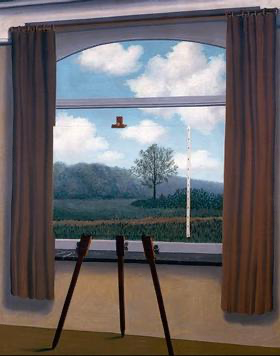

_“The Human Condition,” by René Magritte (Image source_ [_here_](https://en.wikipedia.org/wiki/The_Human_Condition_%28Magritte%29#/media/File:Ren%C3%A9_Magritte_The_Human_Condition.jpg)_)_

## 1\. Introduction ^1-introduction

Sometimes, my thinking feels more “real” to me; and sometimes, it feels more “fake.” I want to do the real version, so I want to understand this spectrum better. This essay offers some reflections.

I give a bunch of examples of this “fake vs. real” spectrum below — in [[#^3-1-ai|AI]], [[#^3-2-philosophy|philosophy]], [[#^3-3-competitive-debate|competitive debate]], [[#^3-4-everyday-life|everyday life]], and [[#^3-5-lewis-on|religion]]. My current sense is that it brings together a cluster of related dimensions, namely:

-   _Map vs. world_: Is my mind directed at an abstraction, or it is trying to see past its model to the world beyond?
-   _Hollow vs_. _solid_: Am I using concepts/premises/frames that I secretly suspect are bullshit, or do I expect them to point at basically real stuff, even if imperfectly?
-   _Rote vs. new_: Is the thinking pre-computed, or is new processing occurring?
-   _Soldier vs_. _scout_: Is the thinking trying to defend a pre-chosen position, or is it just trying to get to the truth?
-   _Dry vs. visceral_: Does the content feel abstract and heady, or does it grip me at some more gut level?

These dimensions aren’t the same. But I think they’re correlated – and I offer some speculations about why. In particular, I speculate about their relationship to the “telos” of thinking – that is, to the thing that thinking is “supposed to” do.

I also describe some tags I’m currently using when I remind myself to “really think.” In particular:

-   [[#^5-1-going-slow|Going slow]]
-   [[#^5-2-following-curiosity|Following curiosity/aliveness]]
-   [[#^5-3-staying-in|Staying in touch with _why_ I’m thinking about something]]
-   [[#^5-4-tethering-your|Tethering my concepts to referents that feel “real” to me]]
-   [[#^5-5-arguments-are|Reminding myself that “arguments are lenses on the world”]]
-   [[#^5-6-helplessness-about|Tuning into a relaxing sense of “helplessness” about the truth]]
-   [[#^5-7-just-actually|Just actually imagining different ways the world could be]]
-   [[#^5-8-being-wrong|Imagining myself being wrong/right in both directions]]
-   [[#^5-9-what-would|Imagining what ideal future people who could see the full truth would think of my efforts]]
-   [[#^5-10-no-bullshit|Stamping my foot and saying “no bullshit!”]]
-   [[#^5-11-real-scientists|Looking at the thing my archetype of a “real scientist” or a “real philosopher” is looking at.]]

I close with some reflections on the role of “real thinking” in staying _awake_ as we enter the age of AI.

_Thanks to Howie Lempel, Michael Nielsen, Anna Salamon, Katja Grace, Rio Popper, Aella, and Charlie Rogers-Smith for discussion. And thanks to Claude for comments, painting suggestions, and for suggesting the subtitle._

## 2\. Caveats ^2-caveats

> _“I will not outshout the sand”_
> 
> _Zbigniew Herbert, “Mr Cogito Considers The Difference Between the Human Voice and the Voice of Nature”_

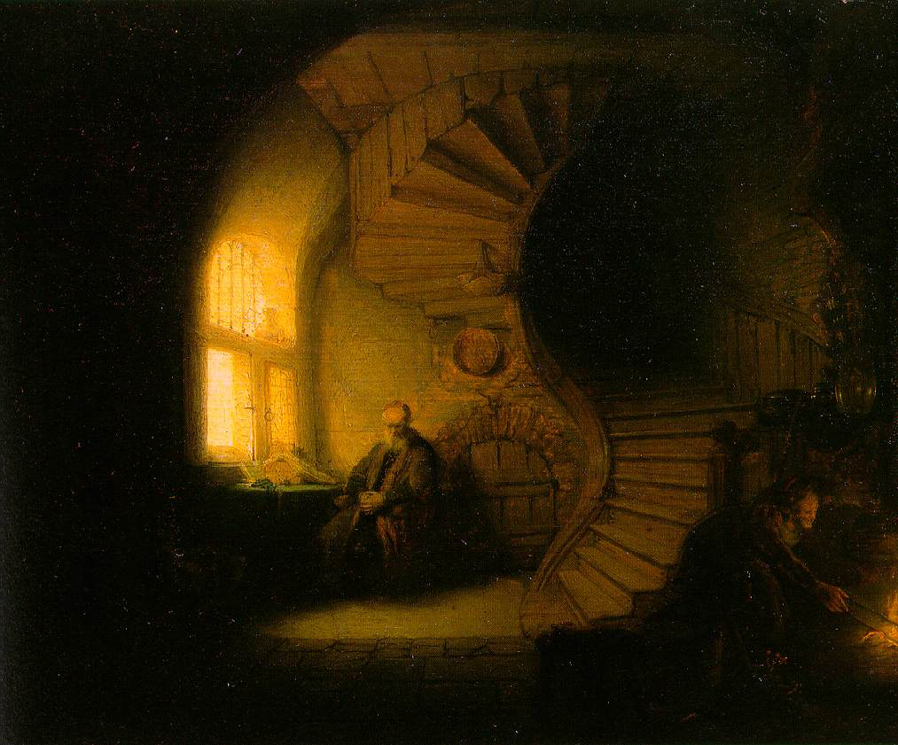

_“Philosopher in contemplation,” by Rembrandt (image source_ [_here_](https://en.wikipedia.org/wiki/Philosopher_in_Meditation#/media/File:Rembrandt_-_The_Philosopher_in_Meditation.jpg)_)_

A caveat: I don’t love “fake vs. real” as a name, here. In particular: “fake” seems too mean. And the connotation of “pretense” or “lying” can mislead. Map thinking, rote thinking, dry thinking – these don’t need to be _pretending_ to be something they’re not.

And while I like the way the term “real” connects to the _telos_ of thinking – to the thing that the thinking machinery is designed to do[^note-should-be-designed] – “fake” isn’t an ideal contrast. If a machine hasn’t clicked, fully, into gear, does that make it “fake”? But I don’t think “fake thinking” is always a simple “malfunction,” either.

“Pseudo thinking?”[^note-rio-popper] Plausibly this is closer in some technical sense. But I worry it’s not mean _enough_. “Fake” makes my mind wake up. “Oh, shit, is this fake?” But “is this pseudo?” does that less. And “pseudo” is clunky as an adjective.

Maybe: “sleep thinking?”, like sleep-walking? Also nearby – though, “awake thinking” (“wake thinking?”) is clunky. “Dead thinking vs live thinking?” – also close. Claude suggests “surface vs. deep” and “formal vs. vital.” Not bad, Claude.

I’m going to stick with “fake vs. real” for now.[^note-claude-agreed]

Relatedly, re: being too mean: the map/hollow/rote/soldier/dry side of the spectrum above isn’t always bad. For example: “map” thinking can often be faster; sometimes you should _use_ your map rather than re-examine it; not everything needs to be “viscerally alive” all the time; a pre-computed response can be the right response; etc.

Indeed, in general, “real thinking” takes more resources. And it’s not always worth it.[^note-not-all-virtues]

## 3\. Examples ^3-examples

> _“He wanted to understand to the very end  
>   
> – Pascal’s night  
> – the nature of a diamond  
> – the melancholy of the prophets  
> – Achilles’ wrath  
> – the madness of those who kill…”_
> 
> _Zbigniew Herbert, “_ [_Mr. Cogito and the Imagination_](https://allpoetry.com/Mr-Cogito-And-The-Imagination) ”

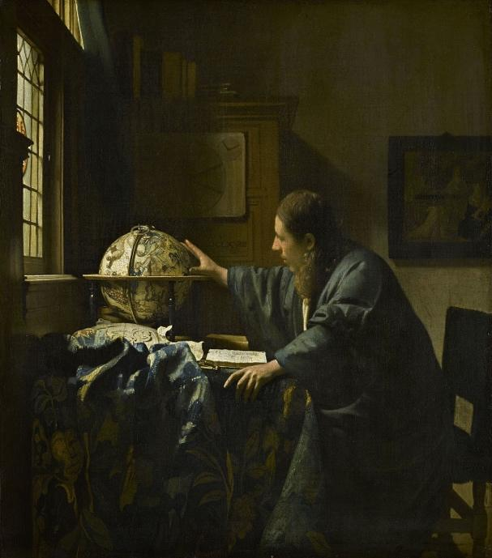

_“The Astronomer,” by Vermeer (image source_ [_here_](https://en.wikipedia.org/wiki/The_Geographer#/media/File:Johannes_Vermeer_-_The_Astronomer_-_1668.jpg)_)_

What are some examples of this “realness” spectrum, in thinking?

### 3.1 AI ^3-1-ai

A salient place I run into it is: AI.

I think a lot about AI – specifically, AI risk (see e.g. [here](https://joecarlsmith.com/category/ai)). And sometimes, this thinking feels, centrally, like some combination of map, hollow, rote, soldier, dry. Thus:

-   _Map_: Maybe my mind is mostly moving around a set of concepts – “AGI,” “automated R&D,” “doom” – rather than trying to see past those concepts to the thing they’re trying to point at.
-   _Hollow_: Maybe I notice that my brain doesn’t actually “believe in” some of these concepts. For example, maybe the term “AI takeover” feels fake and silly somehow, even if I don’t know why.[^note-ai-takeover]
-   _Rote_: Maybe I’m mostly rehearsing ideas I’ve already had, or ideas I’ve heard/read elsewhere in the AI world.
-   _Soldier_: Maybe I’m trying to defend some identity or “party line” or already-chosen thesis with respect to AI (e.g., “AI risk is serious,” or “p(doom) is less than 99%”), and some part of the inquiry is clenched/hard/biased by this.
-   _Dry_: Maybe the topic feels abstract and emotionally lifeless, even though, in theory, the destruction of basically everything I care about is at stake.

And sometimes, thinking about AI feels much more like: world, solid, new, scout, visceral. Thus:

-   _World_: Maybe I have some strong sense that _beyond_ my models, _there is a real, concrete future._ And the AI systems, over there, are some specific, unseen way. The way ChatGPT was in 2018. The way, a few weeks ago, I was standing on a stepstool in my mom’s garage, talking to Claude about why the door-opener was beeping. And I have some sense of _trying to see_ that future. “Peering.” “Squinting.”
-   _Solid_: Maybe I feel like my concepts, for all their imperfections, are still tethered to real stuff – stuff that won’t go away if you try to call it bullshit. “AI,” for example, partly points at “that thing they’re doing a few miles away, at OpenAI and Anthropic; that thing on the other end of my phone, when I talk to Claude.” And I have similar pointers for “agent,” “planning,” “R&D,” “power-seeking.” In each case, I feel like I’m touch with some part of the world that’s causing me to use this concept (or at least, providing a handle, or a paradigm instance); and if necessary, I can point, and say “ _that_.”
-   _New_: Maybe I have a sense that my brain’s gears are actually turning, and that I’m “learning something new.” Sometimes, the “new” feels like a move away from some prior take – e.g., a new angle on “e/acc” that makes it seem more sympathetic. But sometimes, it feels more like clarifying/strengthening/deepening an existing “position” – e.g., “yeah, wow, this is a serious problem.” But there is a sense, in either case, that something _productive_ has occurred.
-   _Scout_: Maybe I have a sense of being “open,” and “free,” ready to pivot on a dime to a truer view if the evidence points in that direction, despite the social dynamics swirling around me. If the AI risk story is silly, let’s figure that out. If we’re doomed-without-a-miracle, let’s figure that out. Just get it right, just get it right.
-   _Visceral_: Maybe the concepts I’m using come with a sense of resonance and grip at a gut level. For example: when I think about “superintelligence,” maybe I have a sense of something huge and alien, lightning-fast, doing a million things at once. When I think about “doom,” maybe I have a sense of despair and failure and desperation. Maybe, more generally, it feels like my mind is brushing, even slightly, against the real stakes, in the real world, and that world seems huge and weighty and _there_, shining in some strange light.

What’s more: I find that these flavors are correlated. So correlated, in fact, that I end up treating them as a cluster. I’ll sit down, and I’ll remind myself to “actually think,” or to “really think about it.” And this tag points in all these directions at once.

I like AI as an example, because a core reason I care about the realness spectrum is that I especially want us to think “for real” about AI. And I think it’s easy for thinking about AI to become “fake” in various ways.

Is this because the topic itself is uniquely hard? At the least, it has various tough traits – i.e., it can feel alien, abstract, philosophical, in-the-future, sci-fi, politicized, status-inflected, grandiose, high-stakes, morally-demanding, unpleasant, overwhelming, etc.

But is that problem? I’m not sure. Maybe thinking “for real” is just hard, and rare. And it’s just that I notice this more, with AI, because I’m staring at it all the time. Or because I care more. Or because I’m trying, myself, to think about it.

### 3.2 Philosophy ^3-2-philosophy

> _“It is hardly correct to speak of these meetings as ‘lectures’, although this is what Wittgenstein called them. For one thing, he was carrying on original research in these meetings … There were frequent and prolonged periods of silence, with only an occasional mutter from Wittgenstein, and the stillest attention from the others. During these silences, Wittgenstein was extremely tense and active. His gaze was concentrated; his face was alive; his hands made arresting movements; his expression was stern. One knew that one was in the presence of extreme seriousness, absorption, and force of intellect … Wittgenstein was a frightening person at these classes.”_
> 
> _Norman Malcolm_

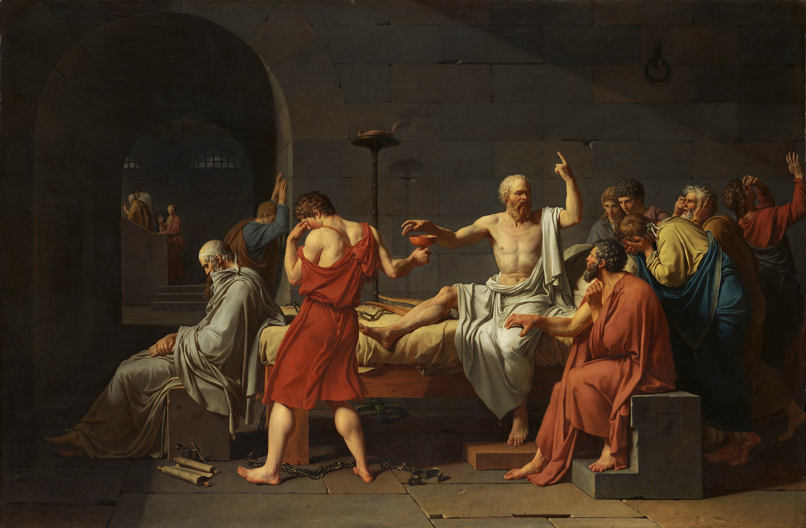

_“The Death of Socrates,” by Jacques-Louis David (image source_ [_here_](https://en.wikipedia.org/wiki/The_Death_of_Socrates)_)_

Another place I run into the realness spectrum is philosophy. I won’t go through each dimension, but: philosophers, famously, do a lot of “map thinking.” They make arguments, and trace implications. The most solid results are purely formal – i.e., blah claims are inconsistent. And a lot of the “evidence” driving the non-formal results comes from “intuition,” which can seem a lot like: the map that we found in our brain. That is: again, our concepts.

So it is extremely possible, in philosophy, to stay in the realm of “map,” and to rarely, if ever, receive an injection of “world.” Indeed, philosophers often seek a certain safety in this. “That’s an empirical question,” they say.

And re: “hollow,” the concept-ness of the philosophy game make it possible to play, and play, and yet: to never really believe in the subject matter. One talks, and the discourse functions. But at some other level, one can expect that there is “less there” than the conversation assumes. I think my relationship to normative ethics used to have a bit of this flavor. I talked like a normative realist, mapping an objective set of moral facts. But underneath, I suspected that the game was somehow empty. (My current view is different – more [here](https://joecarlsmith.com/2023/02/17/seeing-more-whole).)

But sometimes, philosophy doesn’t feel like this. Consider, for example, consciousness. People try to act like the question is empty. But often, when I touch it, it surges with energy. “What in the _fuck_ is consciousness?” It’s as though, first, I’m in _contact_ with some mystery. Then, in response, the concepts and arguments: Mary’s room, p-zombies, and so on. But I can return, if I need, to the thing itself – the thing the concepts are _about_; the thing they’re trying to bring into focus.[^note-personal-identity]

And sometimes, you meet philosophers who feel this fire even for much more abstract stuff. I remember, once, listening to a prominent philosopher talk drunkenly about the [liar paradox](https://plato.stanford.edu/entries/liar-paradox/). I tried to make some gesture towards “ok, but isn’t it somehow bullshit? Don’t we sort of already know the answer?” He looked at me with a strange intensity, and said something like: “ _No_. I know all the positions. They’re all crazy.” Who knows if he was right. But I felt, in his words, the grip of some real force.

And ethics, obviously, can have this fire, too. Haha, trolley problems. But sometimes, it’s not a trolley problem at all. It’s not a fucking trolley problem at all.

### 3.3 Competitive debate ^3-3-competitive-debate

> _“This is how the labyrinth was built. By a system of corridors, from the simplest to the more complicated, by a difference in levels and a staircase of abstractions it was supposed to initiate the prince Minotaur into the principles of correct thinking._  
>   
> _So the miserable prince mooned about in the corridors of induction and deduction, pushed by his preceptors; he looked at the instructive frescoes with a vacant stare. He didn’t understand a thing.”_
> 
> _Zbigniew Herbert, “History of the Minotaur”_

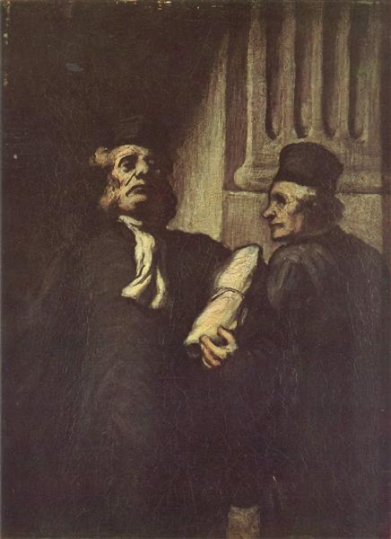

_“Two Lawyers,” by Daumier (image source_ [_here_](https://www.wikiart.org/en/honore-daumier/two-lawyers)_)_

Another example: competitive debate.

Did you ever do competitive debate? I did it for a few months in high school, then I quit.[^note-not-charitable]

Obviously, there’s the solider thing. But I’m more interested, here, in the other dimensions – “map,” “hollow,” “rote,” “dry.”

In particular: I remember that we would make these [diagrams](https://en.wikipedia.org/wiki/Flow_\(policy_debate\)) of the back-and-forth. One side made blah arguments, and read quotes/citations from experts in support. The other side had to answer all of these arguments, and could make arguments of their own. We marked it all on the diagram. If an argument went unanswered, it was like landing a punch. Everyone tried to talk as fast as possible.

In my memory, at least, the exercise bordered on the purely formal. The _content_ of the arguments and citations barely mattered. That’s why it was OK that you couldn’t understand the words. Indeed, the perfected form of the practice, it seemed to me, would blur over the words altogether. It would just be two simple, fast-talking robots, attacking and defending in empty symbols. “Attack 1, Attack 2” “Block 1, Block 2, Attack A, Attack B.”

Is this “fake thinking”? “Thinking” seems too generous. But it seems, somehow, like a limiting case. As though: this is what a certain kind of fake thinking looks like, if you do it hard enough. In the stuffy classroom, the robots whir and scribble and judge-the-winner. It was supposed to be somehow _like_ thinking, long ago. But some point got missed. Some tether slipped. And now the world spins separate.

### 3.4 Everyday life ^3-4-everyday-life

> _“The water suddenly ruffles over_  
> _and a wave brings_  
> _tin cans_  
> _driftwood_  
> _a tuft of hair”_
> 
> _Zbigniew Herbert, “Mr. Cogito and Pure Thought”_

_“The Milkmaid,” by Johannes Vermeer (image source_ [_here_](https://en.wikipedia.org/wiki/The_Milkmaid_\(Vermeer\))_)_

AI and philosophy are both fairly “grand” topics. And the competitive debate I saw in high school was its own strange degeneracy. What about more everyday stuff?

It’s sometimes thought that people think “for real” about concrete stuff, directly present in their lives, that they have a direct stake in. And then they think “fake” about abstract, far-away stuff, where most of the stakes, for them, come from what they’re signaling. Thus, for example, you think “for real” about whether there’s a tiger in that cave; but you think “fake” about the tribe’s local god, and about who to vote for.

Is that right? I’m not sure. Consider, for example: dating, romance, partnership. I care a lot about these things. I’m not alone. And they’re pretty concrete. But am I thinking “for real” about them? I wonder. In particular: it seems easy, even for something as right-there and directly stakes-y as romance, to not be curious about it, or to try to see past your cached thoughts about it. Easy, maybe, to tell yourself stories you don’t really believe. Or to go “soldier” re: painful ideas.

And I wonder, too, about other concrete, everyday areas you might expect me to care about – for example: money, friends, family, food, exercise, hobbies, health. One can sleep-walk through so much of life; and so, too, can one sleep-think. So everyday-ness, concreteness, skin-in-the-game-ness – I don’t think these are guarantees of realness, in thinking.

Indeed, do we even think for real about tigers in caves? Here I think about a time climbing up to a church carved into a cliff in Ethiopia, and wondering if I was going to fall and die. My mind went to: it would be so _embarrassing_ to die this way. Not the real-est thought.[^note-related-examples]

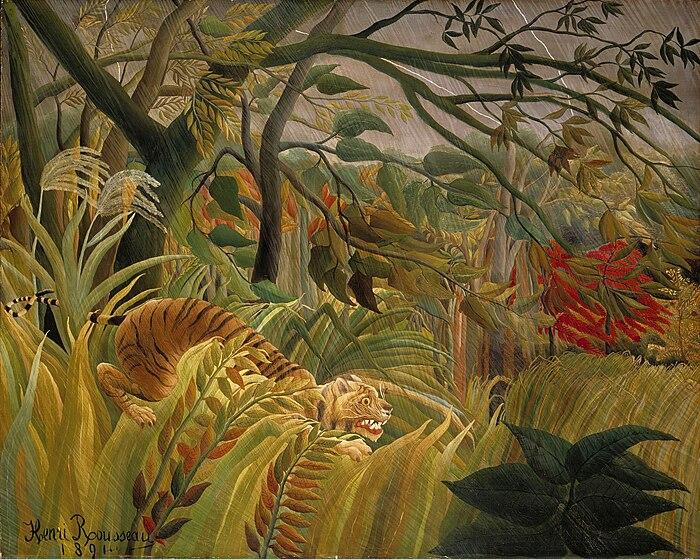

_“Tiger in a tropical storm,” by Henri Rousseau (Image source_ [_here_](https://en.wikipedia.org/wiki/Tiger_in_a_Tropical_Storm)_)_

What about something even more concrete, like: will I be late for this meeting? Will I be cold if I don’t take a jacket? I think these quick, mundane questions often do OK on “scout,” at least (you just want to get it right);[^note-soldier-jackets] and also, “solid” (i.e., you believe in your concepts). And booting up the other flavors of “real thinking” – i.e. trying to see past your model of the meeting _to the meeting itself_; to think _freshly_ and with _curiosity_ about your jacket policy; to feel the stakes of the cold _viscerally_ – can seem, often, like overkill. It’s just a meeting, dude.

In this sense, I think, “realness” in thinking is most useful when a domain is worth investing additional cognitive resources in; when your naïve map of it is at risk of being wrong or incomplete; and when it has a lot of _meaning_ for you (even if you aren’t in touch with that meaning at the moment). That is: the value of “getting real,” in thinking, comes roughly in proportion to the _stakes_ and _difficulty_ of the topic.

### 3.5 Lewis on the living God ^3-5-lewis-on

> _“- he asked about the final cause_  
>   
> _– God cracked his knuckles_  
> _cleared his throat.”_
> 
> _Zbigniew Herbert, “Mr Cogito Tells about the Temptation of Spinoza”_

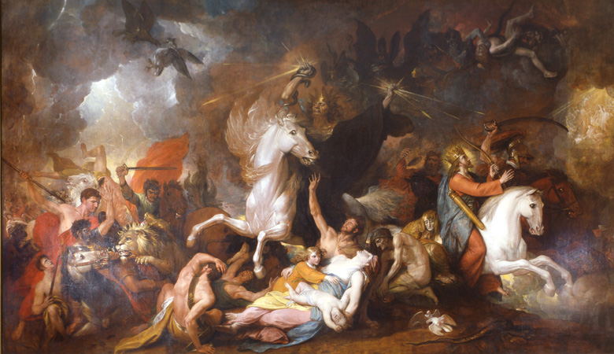

_“Death on the Pale Horse,” by Benjamin West (image source_ [_here_](https://en.wikipedia.org/wiki/Death_on_the_Pale_Horse#/media/File:Death_on_the_Pale_Horse_by_B.West_\(1817\).jpg)_)_

One more “grand” example.

I opened this essay with a quote from a passage in C.S. Lewis. This passage isn’t, directly, about real thinking vs. fake thinking. Rather, it’s about full-blown Christianity vs. more abstract religions. And I don’t want the religion stuff to distract.

But I think it’s relevant regardless, and a great bit of Lewisian ethos/writing to boot. Here’s the full thing:

> “Men are reluctant to pass over from the notion of an abstract and negative deity to the living God. I do not wonder. Here lies the deepest tap-root of Pantheism and of the objection to traditional imagery. It was hated not, at bottom, because it pictured Him as man but because it pictured Him as king, or even as warrior. The Pantheist’s God does nothing, demands nothing. He is there if you wish for Him, like a book on a shelf. He will not pursue you. There is no danger that at any time heaven and earth should flee away at His glance. If He were the truth, then we could really say that all the Christian images of kingship were a historical accident of which our religion ought to be cleansed. It is with a shock that we discover them to be indispensable. You have had a shock like that before, in connection with smaller matters—when the line pulls at your hand, when something breathes beside you in the darkness. So here; the shock comes at the precise moment when the thrill of life is communicated to us along the clue we have been following. It is always shocking to meet life where we thought we were alone. ‘Look out!’ we cry, ‘it’s alive.’ And therefore this is the very point at which so many draw back—I would have done so myself if I could—and proceed no further with Christianity. An ‘impersonal God’—well and good. A subjective God of beauty, truth and goodness, inside our own heads—better still. A formless life-force surging through us, a vast power which we can tap—best of all. But God Himself, alive, pulling at the other end of the cord, perhaps approaching at an infinite speed, the hunter, king, husband—that is quite another matter. There comes a moment when the children who have been playing at burglars hush suddenly: was that a real footstep in the hall? There comes a moment when people who have been dabbling in religion (‘Man’s search for God!’) suddenly draw back. Supposing we really found Him? We never meant it to come to that! Worse still, supposing He had found us?”

So many bits of this passage evoke “real thinking” hard, for me. “When the line pulls at your hand.” “When something breathes besides you in the darkness.” “When the thrill of life is communicated to us along the clue we have been following.”

And _especially_ the part about the children playing at burglars; and the people “dabbling in religion” who suddenly draw back. In a sense, fake thinking is “playing at thinking”; dabbling in thinking. “Man’s search for truth!” – but what if you actually found it?

Sometimes, if I have been thinking about something fake-style, and then it becomes more real, I do actually notice a shock, and a “drawing back” – a sense of “oh, shit,” and a surge of intensity. Did I, secretly, never mean for it to come to that?

More on the Lewis quote below. For now: with the aid of these various examples (AI, philosophy, debate, etc), hopefully you’ve got some sense, at least, of what this essay is about.

## 4\. Why does this matter? ^4-why-does-this

> _“The meaning of life, i.e. the meaning of the world, we can call God.  
> And connect with this the comparison of God to a father.  
> To pray is to think about the meaning of life.”_
> 
> _Ludwig Wittgenstein, 11 June 1915, from his notebook during World War I_

_“St Jerome in His Study,” Albrech Dürer (image source_ [_here_](https://en.wikipedia.org/wiki/Saint_Jerome_in_His_Study_\(D%C3%BCrer\))_)_

Why does the distinction between fake and real thinking matter?

### 4.1 Spiritual stuff ^4-1-spiritual-stuff

A part of me wants to say: because real thinking is _better_. Like: _deeply_ better. _Soul_ better. Like the difference between awake and asleep, alive and dead.

Indeed: real thinking, for me, is closely tied to various other spiritual ideals I’ve written about in the past. [Sincerity](https://joecarlsmith.com/2022/12/23/on-sincerity) is the clearest example. Real thinking seems a lot like: the cognitive version of sincerity. It’s what happens when sincerity thinks.[^note-sincerity-essay] And real thinking seems tied to “ [attunement](https://joecarlsmith.com/2024/03/25/on-attunement) ” as well. Again, more cognitive. But pointed in the same direction.

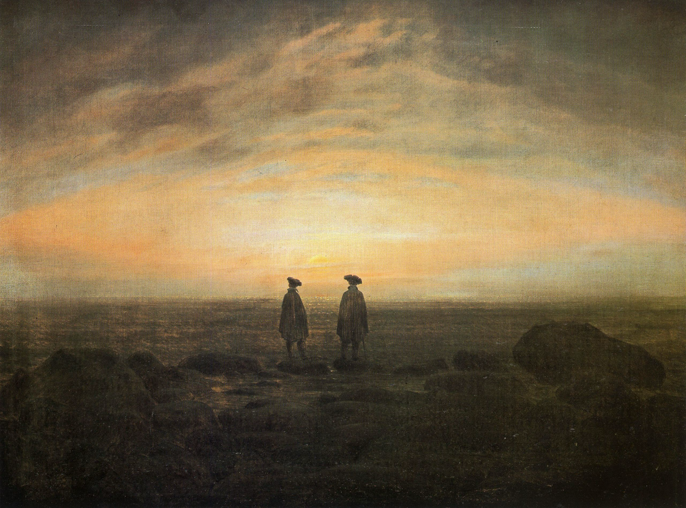

_“Two Men by the Sea,” by Caspar David Friedrich (image source_ [_here_](https://en.wikipedia.org/wiki/Two_Men_by_the_Sea)_)_

And relatedly: real thinking feels somehow “right.” As though (as with sincerity), something falls into its proper place. Some deep structure coheres and mobilizes and starts to work as it should. There is a sense of _grip_.

Also: energy, electricity. As though: my mind is reaching towards the world, maybe even _touching_ it, and the world, in response, sends back some surge of _oomph_. It’s often _exciting_ – the way curiosity is exciting. Indeed, I think curiosity is maybe the most paradigm “real thinking” vibe.

It reminds me of the predictive processing-ish folks who think that consciousness is closely tied to your brain is learning new stuff (e.g., once you’ve learned to drive, it becomes unconscious).[^note-conscious-travel] Who knows if this is right. But I find it an interesting lens on curiosity, and on “real thinking” more broadly. There’s a sense, often, of “wait, what’s going on here?” “Wait, there’s something here to learn.” And I feel like my mind, at those moments, sits up more straight. It leans in. It wants to see.

Is that more conscious? It’s nearby, at least.

I said above that I didn’t want the religion bits in the Lewis quote to distract. But I don’t think the resonance is accidental. In particular: in making contact with the _world_, real thinking often, also, makes contact with _meaning_; with the _living_ God. “God himself, alive, pulling at the other end of the cord, perhaps approaching at an infinite speed, the hunter, king, husband.”

Is that how the real world approaches us? Not always so masculine; but the description calls up something in me, at least. Some urgency and weight; some rushing-in. The way it was there the whole time; the way it comes forward.

And Lewis speaks, too, of the way that the living God _demands_ of you, and of the possibility of _fear_; of being overwhelmed; of being not-ready. Real thinking sees that stuff, too. And perhaps, as Lewis suggests, it makes abstraction tempting.

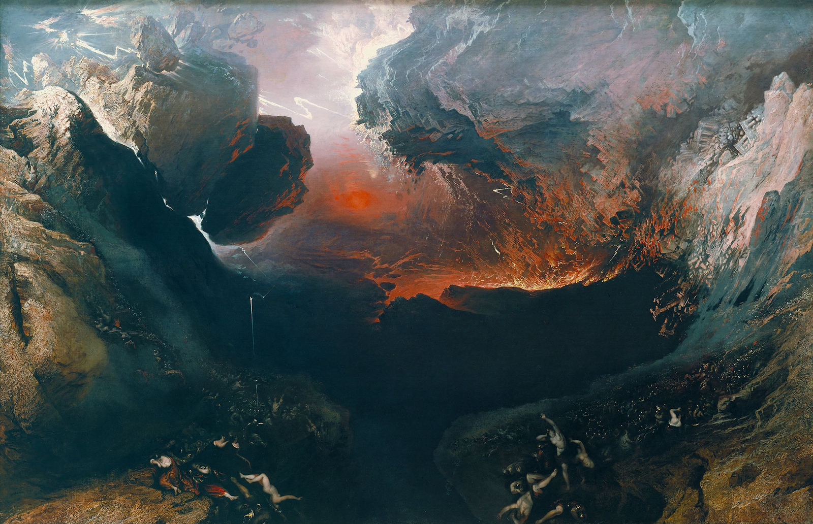

_“The Great Day of His Wrath,” John Martin (image source_ [_here_](https://en.wikipedia.org/wiki/The_Great_Day_of_His_Wrath)_)_

### 4.2 The telos of thinking ^4-2-the-telos

> _“Mr Cogito however  
> does not want a life of make-believe  
> he would like to fight  
> with the monster  
> on firm ground”_
> 
> _Zbigniew Herbert, “The Monster of Mr. Cogito”_

This sort of spiritual stuff is core to my interest in real thinking. But I also worry that it sounds a bit … pious. As though: “ah, yes, real thinking; real thinking is very spiritually superior; it is very virtuous; thou shalt do real thinking.” The way, perhaps, one “should” meditate, but actually it’s boring and dry and you don’t want to. Indeed: because real thinking is more work, it’s at risk of seeming like a chore, especially if the main motivation is some vague, spiritual “supposed to.”

So I want to make a different and more straightforward case for real thinking: namely, I think it’s better for getting to the truth. Indeed, I think the flavors I’ve been associating with real thinking (world, solid, new, scout, visceral) may be explicable in terms of the _function_ of thinking as an engine of truth. Or maybe better: of _signal_, of _information_ – and especially, the sort of signal that an actual, living organism is seeking.

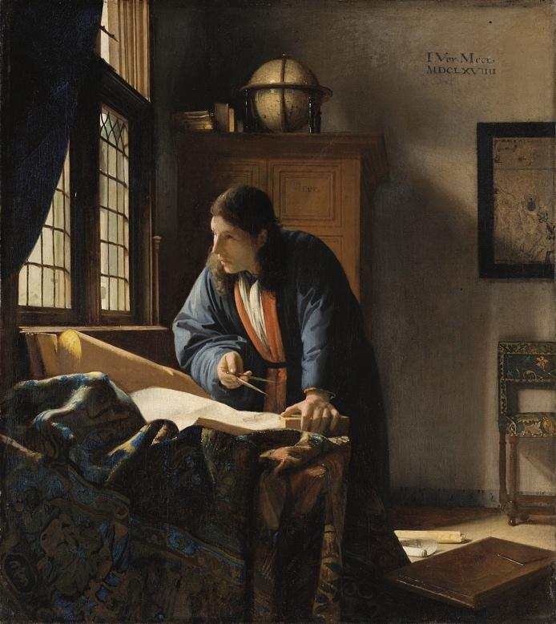

_“The Geographer,” by Johannes Vermeer (image source_ [_here_](https://en.wikipedia.org/wiki/The_Geographer)_)_

In particular: suppose you wanted to build an engine for generating the sort of map-tracking-the-territory that a living organism cares about.

-   _Map vs. world_: You’d want this engine not to get lost in its existing map, and to keep trying to get new data from the territory.
-   _Hollow vs. solid:_ You’d want the map’s ontology and guiding assumptions to correspond to real bits of the territory.
-   _Rote vs._ _new_: You’d want the engine to keep improving its map.
-   _Soldier vs_. _scout_: You’d want the engine to be _trying_ to improve its map, as opposed to: defending some particular map.
-   _Dry vs. visceral_: You’d want the engine to focus on the _type_ of improvements to the map that the organism actually cares about, and to direct energy in proportion to that care.[^note-visceral-cared-about]

So if evolution had _wanted_ to build a truths-we-care-about engine inside us, maybe it would look a lot like the sort of structure that feels, to me, like it’s activating, when my sense of “real thinking” comes online. Indeed, real thinking often comes, for me, with a sense of “ah, right, this is what thinking is _for_.” Hence, I suspect, why the term “real” feels right.

Did evolution want to build this kind of truth engine? Well, maybe it’s complicated. In particular: the mind is _partly_ a truths-we-care-about engine, yes. But it’s an engine for a bunch of other things, too. For example, managing the social stuff, and the sense of self, and the internal ecosystem. And this sort of management isn’t always the same as truth-seeking.

Indeed, I wonder if conflicts between truth-seeking and these other goals are what create the sense that non-real thinking is actively _fake_, rather than just defective. That is: you had an engine for truth. But is that what your mind is using it for? Or is it being used, actually, for something else, on the sly, and with “truth engine” still written on the tin? And if so, maybe your mind _is_ lying, at some level, about the amount of signal you’re seeking. I suspect this, for example, of the “soldier mindset” bit.

But regardless of the actual evolutionary and psychological story, here, I think my point about the _abstract form_ of a truth engine still stands. That is: maybe our mind’s machinery isn’t designed for truth. Maybe, we should redesign it. But regardless, if you happen to _want_ the truth about some topic – and especially, if you’re up for spending _resources_ on the project – then “real thinking” looks like a good shape to put your mind in. It’s a shape _aimed_ at the real world. It _produces_ real signal. And it’s _fueled_ by your real fire.

## 5\. How do we do real thinking? ^5-how-do-we

> _“I would give all metaphors_  
> _in return for one word_  
> _drawn out of my breast like a rib”_
> 
> _Zbigniew Herbert, “_ [_I Would Like to Describe_](https://allpoetry.com/I-Would-Like-To-Describe) ”

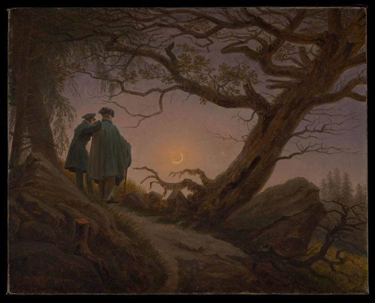

_“Two Men Contemplating the Moon,” by Caspar David Freidrich (Image source_ [_here_](https://www.metmuseum.org/art/collection/search/438417)_)_

OK: but how do we find and inhabit this shape? If you want to move your thinking towards more “realness,” what do you actually do?

It’s a big topic, and I claim no mastery. To the contrary: a core reason for this essay is that I’m trying to learn better. But I’ll describe a few tags I’m currently using, when I remind myself to “really think.” Suggestions/tips from readers would also be welcome.[^note-tags-biased]

### 5.1 Going slow ^5-1-going-slow

One tag is just: to go slow. Real thinking often feels to me slower, and more deliberate.

Here I sometimes think of a philosophy professor I met once. Philosophers often talk in a fast back-and-forth – one often animated by efforts to seem smart, to score points, to “defend one’s view,” etc. But when I spoke, this guy wasn’t responding quickly. For a second, I was confused. Then I realized: “oh, he’s _thinking_ about what I said.” And it felt notable. Not just because unusual. More like: it gave me a sense that he was _trying to do something_ – to learn, to see further, to make progress.

We can see this tag as routing, centrally, via the “rote vs. new” dimension above. That is: the move is to be less _automatic_ in one’s thinking. But being less automatic allows you to attend, more intentionally, to all the other dimensions as well – e.g. being more world, solid, scout, visceral, etc.

_“Woman Holding a Balance,” Johannes Vermeer (image source_ [_here_](https://en.wikipedia.org/wiki/Woman_Holding_a_Balance#/media/File:Johannes_Vermeer_-_Woman_Holding_a_Balance_-_Google_Art_Project.jpg)_)_

### 5.2 Following curiosity and aliveness ^5-2-following-curiosity

> _“A house which has been set on fire speaks with the loquacious language of flames.”_
> 
> _Zbigniew Herbert, “To Take Objects Out”_

Another, related tag I use is something like: trying to find and follow what I’m really curious about, and/or, what feels most “alive.”

I use this, especially, in conversation. That is: per the last tag, I’ll try to slow down – but then I will specifically use the extra time to ask myself questions like: “What do I really care about here?” or “What feels most juicy here?” or “What’s ‘at the edge’ here?” (where “the edge” means something like: the place where my system feels the sort of excitement I associate with curiosity/learning something new). Sometimes it’s helpful, here, to close my eyes, and/or to ask my conversation partner to “give me a second.”

We can think of this tag as routing, centrally, via the “dry vs. visceral” dimension above. That is, if you find the “visceral” bit of a topic, then your care/interest/excitement can propel your mind towards the other aspects of real thinking as well.

### 5.3 Staying in tune with your “why” ^5-3-staying-in

> _“They don’t cross because they will never arrive_  
> _they don’t cross because there is nowhere to go.”_
> 
> _Zbigniew Herbert, “Mr Cogito and the Movements of Thoughts”_

Following curiosity/aliveness is as an aspect of a broader art – namely, of staying in tune, as you do stuff, with _why_ you’re doing it (even if this “in tune” is centrally energetic rather than cognitive; i.e., being animated by your “why,” even if you don’t “know” what it is). It’s easy to not do this – to drift; to get caught up, or carried along. And failure here is a general recipe for unreality – not just in thinking, but in life more broadly. But I think it bears an interesting structuring relation to thinking and conversation in particular.

Here a friend offered an [example from David Chapman](https://metarationality.com/refrigerator): “is there water in the refrigerator?”, “well, there’s water in the cells of the eggplant.” Lame answer. Why lame? Because: out of tune with the structuring _why_ (one wanted, for example, water _to drink_). And absent such structure, conversation (and perhaps: meaning itself) degrades fast.

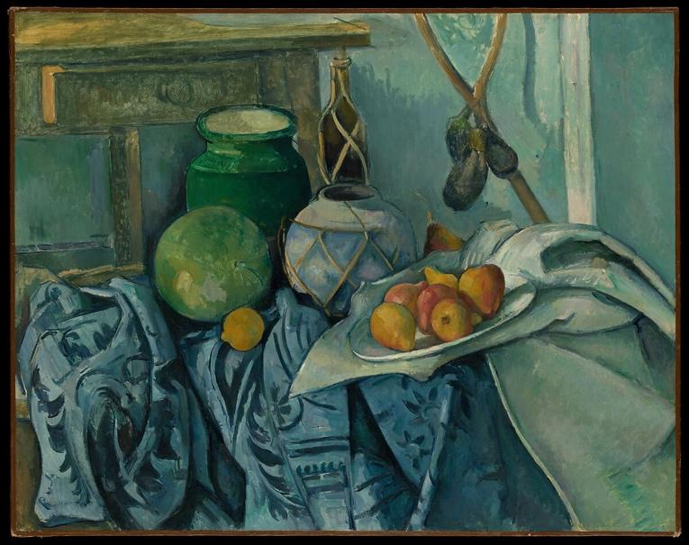

_“Still Life with a Ginger Jar and Eggplants,” by Cézanne, image source_ [_here_](https://www.metmuseum.org/art/collection/search/435881)

### 5.4 Tethering your concepts ^5-4-tethering-your

> _“I run around like mad  
> picking up handfuls of birds  
> and my tenderness  
> which after all is not made of water  
> asks the water for a face”_
> 
> _Zbigniew Herbert, “_ [_I Would Like to Describe_](https://allpoetry.com/I-Would-Like-To-Describe) ”

Another move – related most centrally to “hollow vs. solid” – is to keep trying to _tether_ your concepts/premises to something that feels real. That is: if you notice that a concept has started to seem fake/hollow, try to find a _referent_ for it that has more substance and heft in your mind, even if it’s less clear/rigorous on some other dimension. And you can’t find this kind of tether, consider seeking a new concept/frame instead.

One search term here is something like: “wait, why am I even using X concept?” Or: “what causes me to think that this concept refers to something?” Sometimes, tracing back further, to something like “why am I talking about this at all” can be helpful here.

I remember doing this “tethering” move, once, back in 2021, when I was writing my [report on power-seeking AI.](https://arxiv.org/pdf/2206.13353) I had been thinking about some concept nearby “intelligence,” “optimization power,” “productivity,” “capability” – the sort of thing, the story goes, that AIs will have more of than humans. It felt a bit abstract and fake. I went for a walk to twin peaks in San Francisco. Looking out over the city at night, I had some sense like: “well, look, _something_ is going on with humans; _something_ built this fucking city.” Not a picture of rigor – but enough, at that time, to give the inquiry reality again.

(Image source [here](https://commons.wikimedia.org/wiki/File:San_Francisco_from_Twin_Peaks_September_2013_panorama_5.jpg))

And I have some related memory, on that same walk, of finding it useful to set down the concept of “AI” altogether, and to think, instead, about enhanced biological intelligence – i.e., genetically altered chimps; pigs with bigger brains; giant vats of neurons. It gave my brain, at that time, something easier to grip.

And note that this “tethering” move can be useful even if you “believe” in the concept at an abstract level regardless. Thus, for example: recently I was having a conversation about AI consciousness, and I noticed it felt a bit fake, despite the fact that (modulo [illusionism](https://joecarlsmith.com/2020/11/29/grokking-illusionism)), I am generally down for the concept “consciousness.” So I slowed down and tried to more intentionally tether my concept of “consciousness” to its referent. “OK, when we talk about consciousness, we’re talking about _this_ sort of thing \[pointing my mind at my own experience\]. And we’re asking whether AIs like Claude might have some version of _that_.” And I found that when I did that, some sense of mystery and curiosity opened up. The question became “more real.”

### 5.5 Arguments are lenses on the world ^5-5-arguments-are

> _“In the attic_  
> _cutting lenses_  
> _he suddenly pierced a curtain_  
> _and stood face to face.”_
> 
> _Zbigniew Herbert, “Mr Cogito Tells About the Temptation of Spinoza”_

Another tag, most closely related to “map thinking” vs. “world thinking.”

There’s a nice [twitter thread](https://x.com/So8res/status/1500483934219550732) from Nate Soares a while back. In particular, this bit:

> The world is not made of arguments. Think not “which of these arguments, for these two opposing sides, is more compelling? And how reliable is compellingness?” Think instead of the objects the arguments discuss, and let the arguments guide your thoughts about them.

I think this is a great pointer to an aspect of “real thinking.” And I’ve found it helpful, often, to remind myself of something in the same vicinity. The tag in my head is “arguments are lenses on the world.”

In particular: when I’m arguing with someone, or trying to make/evaluate an argument on my own, it’s easy for the arguments to become somehow “reified.” As though the question is somehow: which abstract structure is stronger. Which argument is “good.” Which one “holds up.” I think training in academic philosophy often encourages this kind of vibe. And also: more social/adversarial epistemic contexts, like debates.

But the arguments are not the point. The arguments are a structured pointer _at the world_. They are supposed to be saying “look, over there. There is _this_ bit, right? And if there’s _that_, and then also _this,_ then shouldn’t we also see… _x_?” E.g., “if the creek was here, and we walked four miles east, then shouldn’t the campsite be just on the other side of that hill?” Or: “If scaling laws are like this, and compute is growing at blah rate…” Or: “If there were a perfect God, and He made everything in the world…”

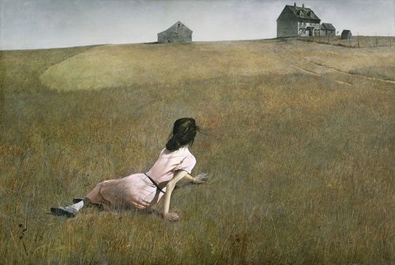

_“Christina’s World,” by Andrew Wyeth (Image source_ [_here_](https://en.wikipedia.org/wiki/Christina's_World)_)_

In this sense, arguments are a _lens_. They’re supposed to help you _see_ something _beyond_ them. _Beyond_ in the sense of: still there, even if the arguments fall away. It’s like how: the arguments for _p_ could _suck_, and _p_ could still be true. Or: the way that the debater arguing for _p_ might have only one basic argument, and the debater arguing against _p_ might have ten fancy arguments (and also, they might be hotter and smarter and more charismatic and a better person), but the first debater is right, and should hold fast to their one basic argument, even if the second debater has already “replied” to it, and the reply drew a big laugh from the audience, and the diagram and the real-time polling say that the second debater is “winning.”

Indeed, I’ve noticed that process of “having/evaluating an argument” can end up weirdly separate from my process of using that argument to actually form real beliefs. That is: maybe I come away from some discussion or argument feeling like “my argument is good.” Maybe I feel smart, energized, empowered. Maybe I cache the argument in my “my views” box. But sometimes, I notice the possibility of doing a different thing, too – namely, “actually learning about the world” from my argument. It feels a bit like asking: “Ok, granted that my argument is so good, _did I actually just learn about how the real world is.”_

And now, strangely, the whole game can shift. Before, my argument just had to withstand some “battle of the abstractions” – it had to be better than some other argument, or better than the objections. But the new game is not player vs. player. It’s not a “game” at all. It’s just me and world – alone and silent. And now the argument needs to play a new role. It needs to trace the contours of some real substance; it needs to move my mind along the world’s true joints. And suddenly I notice that my standards for _that_ are different: “oh, well if I’m going to _actually believe this_, that’s a whole different story.” Indeed, the very _possibility_ that I might _actually learn about the real world_ from the argument can come with a strange surprise – as though, somehow, I hadn’t considered that before. And as I feel my mind start to reach out towards that real world, the contact comes with some new intensity, like the “shock” Lewis describes. “Oh, shit – is that a real footstep in the hall?” And thus, I learn that I had been playing at burglars.

Arguments are lenses on the world. It’s related, in my head, to the way that some philosophers think of beliefs as “ [transparent](https://academic.oup.com/book/3612/chapter-abstract/144922511?redirectedFrom=fulltext).” To figure out “do I believe _p_?” they say, ask “is _p_ true?” I think about this, sometimes, when people tell me that they want to “figure out what they believe” about some topic (e.g., AI). Often, they do in fact mean something like “have my thinking about this topic be more real” (and often, specifically, less hollow/rote). But the focus on their _beliefs_ as the object of inquiry makes me worried that their default frame will be too “map thinking,” and too little “world thinking”; too much about pitting arguments and objections against each other, and too little looking _through_ those arguments at the world itself. To “figure out what you believe,” after all, sounds like a task of self-discovery (or perhaps: self-creation) rather than perception. And perhaps the true task includes all these. But eyes are for seeing. To figure out “what you see,” you have to _look_.

### 5.6 Helplessness about the truth ^5-6-helplessness-about

> _“A bird is a bird  
> slavery means slavery  
> a knife is a knife  
> death remains death”_
> 
> _Zbigniew Herbert, “Mr Cogito and the Imagination”_

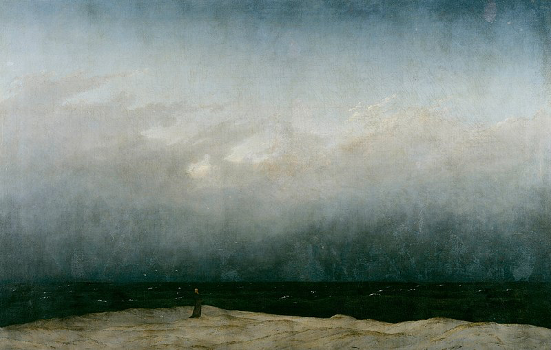

_“The Monk by the Sea,” Caspar David Friedrich (image source_ [_here_](https://en.wikipedia.org/wiki/The_Monk_by_the_Sea)_)_

I’ll also name another “real thinking” tag for me – related, most centrally, to “scout mindset” – that I’ve been using lately, and which “arguments are lenses on the world” can conjure for me. It’s about tuning into a certain relaxing sense of _helplessness_ about the truth.

That is: it’s actually just not up to me, what the truth is.[^note-sort-of-case] And it’s not “up to the arguments,” either. It’s not like: an argument “wins,” and then truth _becomes_ that way. It’s not like: if I make a good enough argument, the truth changes. And if I _fail_ to make a good enough argument, the truth doesn’t care.[^note-boss-says]

And it feels related, too, to the way that the problem with “soldier mindset” isn’t that it’s non-virtuous. “Those bad soldier mindset people – don’t let them get away with it!” It’s not defection – or, not only. Rather, the deeper problem with soldier mindset is that it _doesn’t work_. Or: not if you care about the truth. The truth doesn’t bend like that. The truth doesn’t care about what maps you have successfully “defended.”

When I remind myself of this, some part of me un-grips. And the thing it couldn’t grip anyway slips clean, back to where it always was – beyond my mind, untouched. And with this “beyond-ness” newly present, my mind often feels more fresh, and simple, and clear.

### 5.7 Just actually imagining different ways the world could be ^5-7-just-actually

> _“Mr Cogito’s imagination_  
> _has the motion of a pendulum…”_
> 
> _Zbigniew Herbert, “_ [_Mr Cogito and the Imagination_](https://allpoetry.com/Mr-Cogito-And-The-Imagination) ”

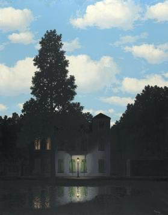

_“The Empire of Light,” by Magritte_

Here’s another move. It sounds simple, maybe even obvious. But I don’t think we always do it by default. And I find it pretty powerful.

The idea is: just actually imagine different ways the world could be. That is, if you’re wondering whether _p_ is true or false, take the time to boot up actual _images,_ or felt senses, of _p_ being true, and _p_ being false, such that your brain feels like: “ok, so we’re wondering whether it’s like _that_, or like _that_.”[^note-just-an-example]

Here’s an example. Recently, I’ve been thinking about how easy it will be to automate AI alignment research, once you can also automate AI capabilities research. And one way to think about this is in the abstract: “will it be easy, or hard?” And many of the sub-questions – e.g. “how good will humans be at evaluating alignment research produced by AIs?”, “will AIs try to actively and differentially sabotage alignment research?”, etc – have similarly abstract formulations.

But I’ve found it useful, in thinking about these questions, to also boot up some image/gestalt sense of some people I know at Anthropic actually trying to use a version of Claude that can basically replace capabilities researchers to be similarly helpful on alignment. And I can use this image as an anchor for various example scenarios: e.g., scenarios where they are clearly struggling to get a real grip on the alignment research Claude is producing; scenarios where they think it’s going well, but they’re actually fucking up in tons of ways they’re not tracking; scenarios where Claude is actually intentionally holding the good research back; scenarios where it’s actually going great; etc.

The scenarios don’t need to be exhaustive, or bulletproof, or especially detailed. Their main role, rather, is to give my brain a sense that there is a real, concrete territory that it is trying to map. That the question has a real answer. If this works, often, it creates a sense of “accountability.”

This move is a lot like tethering your concepts – except more like, tethering your _hypotheses._

### 5.8 Being wrong/right in both directions ^5-8-being-wrong

> _“Once again_  
> _he notices with amazement_  
> _that someone exists outside of him…”_
> 
> _Zbigniew Herbert, “Mr Cogito’s Alienations”_

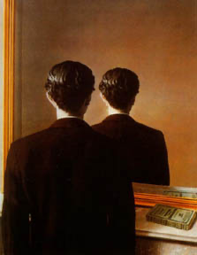

_“Not to Be Reproduced,” René Magritte (Image source_ [_here_](https://en.wikipedia.org/wiki/Not_to_Be_Reproduced)_)_

And we can also take this move a step further. Once you’ve booted up an image of the territory you’re trying to map, then boot up a different image of _yourself_ – forming beliefs about that territory, advocating for those beliefs, etc. And in particular: boot up images of being _wrong_ in both directions.

Thus: in the case of automating alignment research, I try to imagine myself shouting about how “automating alignment research will work!” – and then, over there, in the future, my friends at Anthropic struggling hard, desperate and despairing (and maybe, even, turning to look at me. “I thought you said this would work!”). And then the flip: I imagine myself shouting about how “automating alignment research will fail!”, and then, in the future, my friends making tons of real progress.

I often focus on the “being wrong” cases, here. But you can do it with “being right,” too. Maybe I should try that more.

### 5.9 What would the future people think? ^5-9-what-would

> _“He would like to remain faithful  
> to uncertain clarity.”_
> 
> _Zbigniew Herbert, “_ [_Mr Cogito and the Imagination_](https://allpoetry.com/Mr-Cogito-And-The-Imagination) ”

And we can go a step further still. Once you’ve booted up an image of the territory, _and_ an image of your own map (beliefs/claims/thinking), you can _also_ boot up an image of an external third party – maybe an alien, or a future person looking back on history, or a ghost of the kind I wrote about [here](https://joecarlsmith.com/2020/12/26/a-ghost) – who can see _both_ map and territory, and who is having some corresponding reaction, e.g.: “wow, this guy is super wrong about automating alignment research; he’s pointing the world in the wrong direction,” or “ah, nice, he’s actually tracking some real stuff.”

It’s an image a bit like: how I currently look back at Paul Erlich’s “ [Population Bomb](https://en.wikipedia.org/wiki/The_Population_Bomb) ”; or at the various arguments that computers could never play chess; or at [Democritus](https://plato.stanford.edu/entries/democritus/) on atomism; or at Seneca writing “the time will come when diligent research over long periods will bring to light things which now lie hidden.” But unlike in these cases, I also find it helpful to imagine that this external party can see my psychological dynamics directly. That is, if I’m wrong, the future people know not just _that_ I’m wrong, but also: _why._ And in particular: what flaws, in me, played what role. Maybe, that is, they can see that I was caught up in some flawed ideology or pattern of deference; or looking away from some hard truth; or biasing towards thoughts and ideas that would be more popular or power-granting or virtue-signaling or narratively-gratifying. Or maybe, that I was just dumb, and making basic mistakes, for all my good intentions. Or that I was pretty smart, but the question was hard, and I missed some key bits.

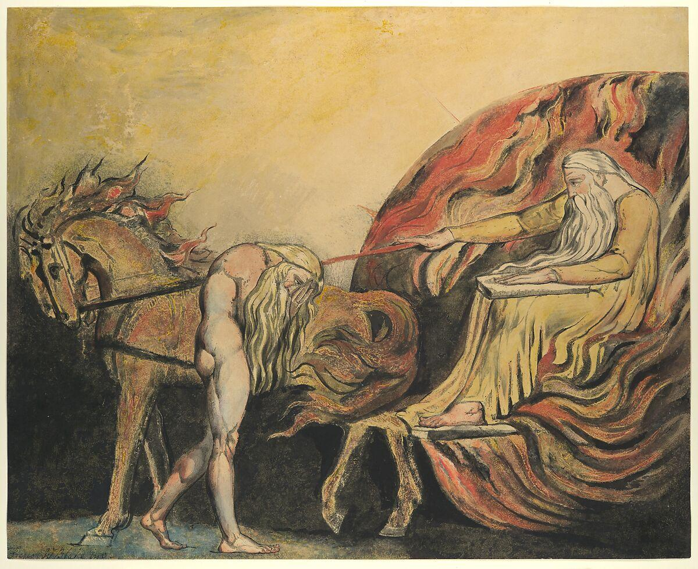

_“God Judging Adam,” by William Blake (Image source_ [_here_](https://www.metmuseum.org/art/collection/search/347414)_)_

Here, the perspective of the external party – seeing both map and territory at once – serves, partly, to reinforce the sense that there is a right answer “out there,” even if I can’t see it. But the role is also social. In particular: truth-seeking can get socially inflected in a zillion different ways. People doing intellectual work in public are especially vulnerable. And especially if you don’t have _other_ strong accountability mechanisms, it’s easy to treat various social proxies (i.e., do other people like what I’m saying, are they nodding, are they objecting, is my view “having influence,” etc) as a key source of signal about whether your work is good, despite this signal’s obvious flaws. And it’s easy, too, to be optimizing for various kinds of social approval/power directly (not even: as flawed proxies for truth); and relatedly, to get lax about being wrong in ways that won’t, according to your brain, lead to especially worrying _losses_ of social approval/power – i.e., that your brain expects to “get away with.”

That is: it’s easy to be trying to make your ideas “cool,” rather than true. Accountability mechanisms like bets and prediction markets and peer-critique can help somewhat here. And the future does, in fact, often reveal who was foolish. But pundits – especially smart and charismatic pundits – often seem surprisingly able to survive revelations of their foolishness comparatively unscathed, and without admitting error. And “who exactly was what-amount-foolish, given the evidence available at the time” can get weeds-y fast. So even in cases where the truth _will_ get revealed in the near-term future, real-world social reactions to one’s work remain a bad proxy for quality.

Plausibly, of course, the ideal thing would be to get past the social stuff entirely. But in the absence of this ideal, I find it useful to direct the part of my mind concerned about “being cool” towards the judgments that would be made by a wiser and more informed social group – e.g., idealized future people, looking back on history (and on various counterfactual histories) with full knowledge about what the real story was. That is: maybe your work gets lots of likes on twitter. Maybe you manage to stir up lots of energy around your ideas, and get lots of people on board. Maybe it all seems to be going very well. But what are the ideal future people, watching this process, thinking? In particular: are they shaking their heads in pity, or disdain? To them, are your ideas confused, flimsy, deluded, brittle, self-serving – for all your success, for all that you’re “getting away with it”? And I find that this kind of question often dislodges some part of my mind that was focused, more, on stuff like twitter. It’s a feeling like: “oh, right, it’s not cool to be wrong.”

### 5.10 No bullshit ^5-10-no-bullshit

> _“He offends the monster  
> provokes the monster…  
>   
> he calls –  
> come out contemptible coward”_
> 
> _Zbigniew Herbert, “_ [_The Monster of Mr Cogito_](https://allpoetry.com/The-Monster-Of-Mr-Cogito) ”

Another move, fairly brute. Sometimes, when I want to move towards “realness” in my thinking, I try stamping my foot (not always literally) and saying “no bullshit!” And sometimes it feels like this raises some standard, and “clears something out.” It helps, here, to channel something a bit fierce.

I mostly do this with myself, or with friends I trust.

_“View of Madrid from Torres Blances,” by Antonio Lopez Garcia (image source_ [_here_](https://www.wikiart.org/en/antonio-lopez/view-of-madrid-from-torres-blancas-1982)_)_

### 5.11 Real scientists, real philosophers ^5-11-real-scientists

> _“They abandoned history and entered the laziness of a display-case_  
> _they lie in a glass tomb next to faithful stones”_
> 
> _Zbigniew Herbert, “Those who lost”_

I’ll close this section with one last tag for “real thinking.” It’s related to some archetype, in my mind, of a “real scientist,” or a “real philosopher.” It’s an archetype like Pascal, or Newton. The move isn’t to imitate this image. Rather, it’s to remember what this image is looking at, and to look at _that_. To remember what a “real scientist” or a “real philosopher” _does_, and to try to _do it_.

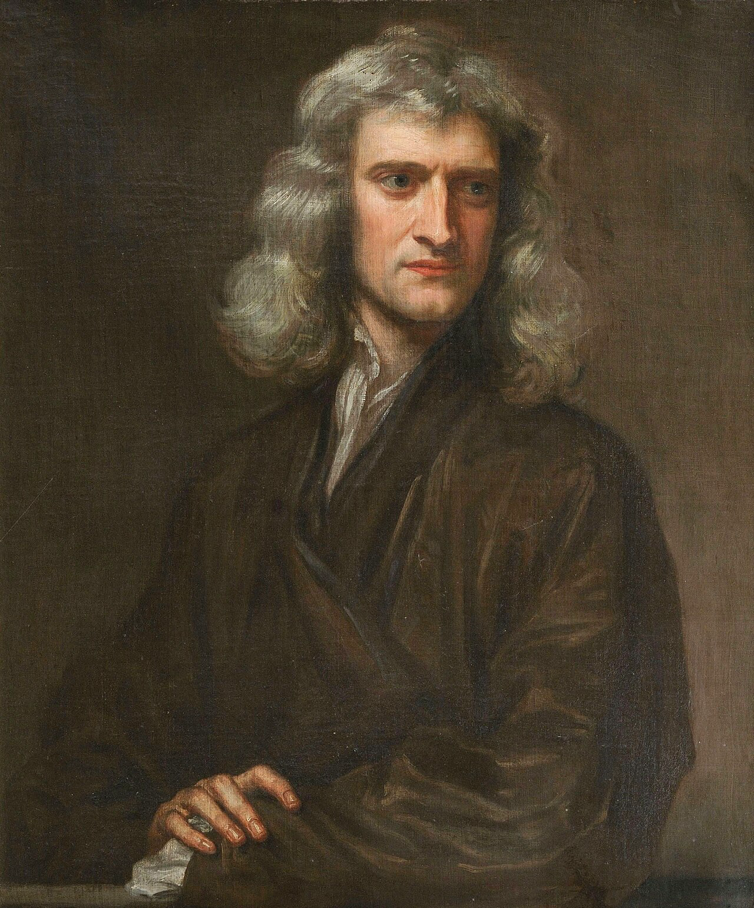

_Portrait of Isaac Newton, by Godfrey Kneller (image source_ [_here_](https://en.wikipedia.org/wiki/Isaac_Newton#/media/File:Portrait_of_Sir_Isaac_Newton,_1689_\(brightened\).jpg)_)_

I remember a comment from a friend in grad school, something like: “When I started out in philosophy, I wanted to be Wittgenstein. Then: I wanted to be a great scholar of Wittgenstein. Then: I wanted to get a tenure track job in philosophy. Now: I want a job in philosophy, period.”

I never got very into Wittgenstein’s actual thinking. But still, when I showed up in philosophy grad school, I, too, wanted to be like Wittgenstein.[^note-other-philosophers] In particular; Wittgenstein seemed cool and intense. And also, plausibly, “great.” At the least: he seemed to have made it, philosopher-wise – which is to say: status-wise, canon-wise.

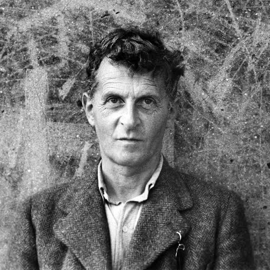

Wittgenstein (image source [here](https://tecnoline.de/en/designer/ludwig-wittgenstein-2/))

But what did _Wittgenstein_ want? What was Wittgenstein _doing_? I like role models fine. But imitation is a bridge. You want to learn to do the same thing, not because of the “same,” but because of the _thing_. In this sense, I think, my friend and I were both setting our sights too low.

Relatedly: when I started in philosophy grad school, I would sometimes imagine myself developing some “view” or “system” that people would look at the way they looked at, for example, Rawls’s theory of justice. It would be a grand abstraction. It would be ground-breaking. It would be a big deal.

But there was a word I never used for what it would be: namely, a “discovery.” Or more mundanely: that it would be true; that it would help us see the truth; that it would help us live in the world better; that it would help us to do what we should do. And thinking about this now, I feel a kind of shame.[^note-past-self] I wanted to “be a philosopher.” But I wasn’t actually animated by the thing that real philosophy is about actually doing.

But I met some people who were, in different ways. And I actually associate this, distinctively, with people using words like “discovery.” I remember overhearing two more-senior-than-me grad students working on an issue in logic on a whiteboard. One of them was saying to other, excitedly, something like: “I think you’ve really got something here.” And there was a sense that they had _found something out_ – that they were making progress towards some real goal.

And I got a similar vibe, too, from various professors. I would talk to them, and I would get some strange sense like “oh, they are holding some real project. They believe in it, they believe it’s possible to make real progress, they think it’s possible to do this together.” I only met Parfit a few times, but he famously had a ton of this, even as he was dying. “Non-religious ethics is at an early stage,” he writes on the last page of _Reasons and Persons_. Look, there, that sense of _project_. And to talk, as Parfit did, about having “ [wasted much of his life](https://www.newappsblog.com/2011/08/on-wasted-philosophic-livesparfits-fanaticism.html) ” if his brand of moral realism were false – that too implies a sense of _trying to do something_.

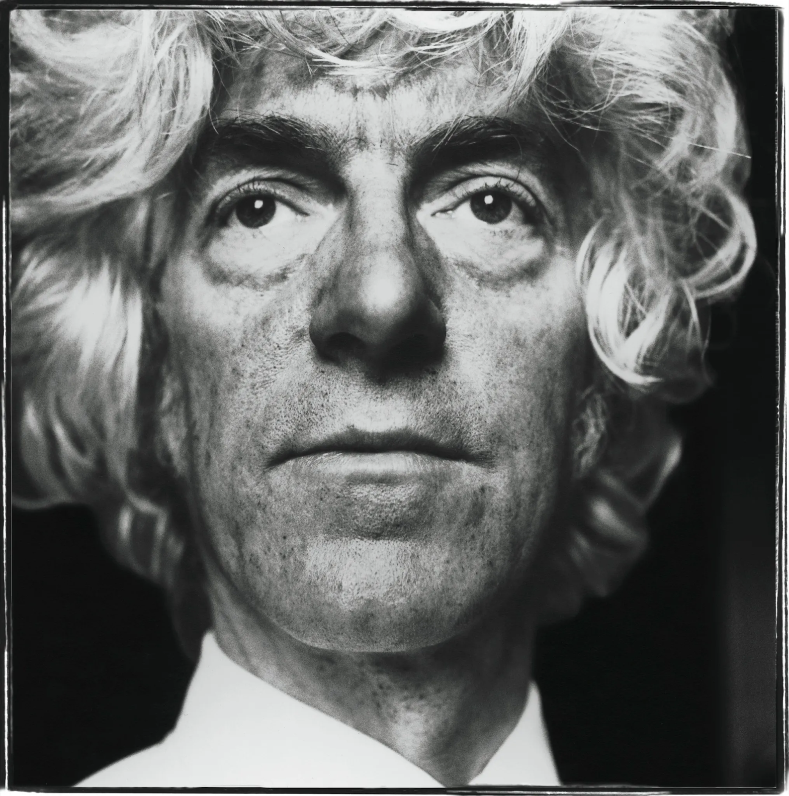

Parfit (image source [here](https://www.newyorker.com/magazine/2011/09/05/how-to-be-good))

Not everyone was like this. Indeed: so much of philosophy academia is about, well, philosophy _academia_. Not just coarse-grained stuff about status, jobs, conferences, publications, being-a-good-academic-citizen, but also the subtler influences on output – the sort of originality one seeks in one’s work; the sort of identity one seeks to craft; the sort of intellectual trends one follows. Certainly, my own orientation towards early grad-school had a lot of this; and for many other people I met, it seemed like a lot of the thing.

Indeed, per my discussion of “hollow” above, it felt to me like many people in philosophy didn’t _believe in_ what they were doing at a deep level. It was fun (or not); it was interesting (or not); it was better, at least, than a real job. But they weren’t fundamentally _serious_ about it. And one sometimes felt, in their vibe, an undercurrent of despair.

But in the midst of all that, there was also something else: namely, an actual, living tradition. People who _did_ believe in philosophy; and more, who were _doing_ it. And it felt, somehow, surprising to encounter. “Oh, the real thing.” The same way it felt surprising, as I grew up, to feel abstract concepts I’d heard about – beauty, goodness, wonder, joy – start to _grip_. The way it can feel surprising, somehow, to learn that the history you read about in books and saw in documentaries _really happened;_ that it’s _still happening_; that you’re a _part of it_.

“The Open Door,” Talbot, before May 1844 (image source [here](https://www.metmuseum.org/art/collection/search/283068))

Did I think it was all fake somehow? Did I think the story was over? Did I think that it was all happening in another realm – separated, from me, by some screen? Apparently, some part of me did. Some part still does.

But there is no screen between you and the real world. It’s right there. That wind on your face – where does it blow from? And the story isn’t over. Not in general, and not for “discoveries” or “truth” or “wisdom” in particular. There were people, in the past, who did these things hard. They aimed their minds at the world; they touched something real; they produced real signal, for all their other flaws and mistakes. And there are people, today, who are doing this still. It _can_ still be done. We still need it done. Maybe, indeed, we need it more than ever before. And maybe, actually, _you yourself_ can do it.

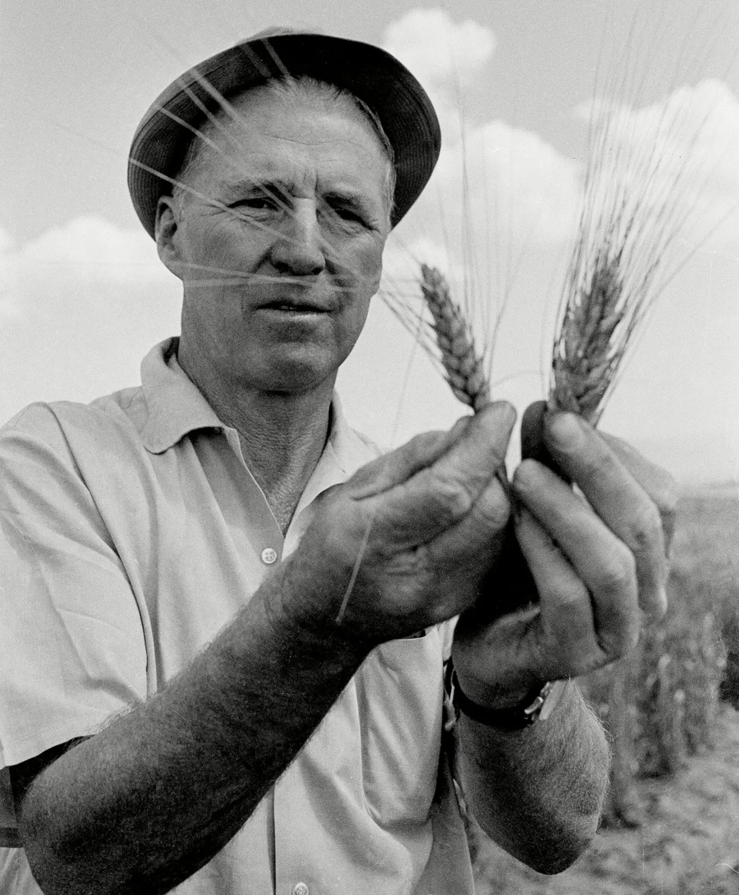

[Norman Borlaug](https://en.wikipedia.org/wiki/Norman_Borlaug)

This tag is meant as a reminder to “aim high” in some sense. To take up some deeper responsibility. To be, more, an adult. But we need to get the specific sense of “aim high” right. In particular, there is a risk of confusing “high” with “grand,” or “revolutionary,” or “great” – a risk that associations with figures like Newton and Pascal can exacerbate.

_Marie Curie and her daughter Irène (image source_ [_here_](https://en.wikipedia.org/wiki/Marie_Curie#/media/File:Irene_and_Marie_Curie_1925.jpg)_)_

Perhaps aiming high in this sense has its place – trying to make, not just a discovery, but an _important_ discovery. But I’m not talking, centrally, about reaching some especially high level of performance in some arena of thought. It’s more like: being on the sidelines vs. being in the arena at all.[^note-imitation-arena] More like: the difference between being a scholar of Wittgenstein, and trying to do, even a little, what Wittgenstein was trying to do. Between reading about a war, and fighting in one. Between looking at a statue of some flawed sage or hero, and looking in the direction their finger is pointing; taking, for yourself, some further step.

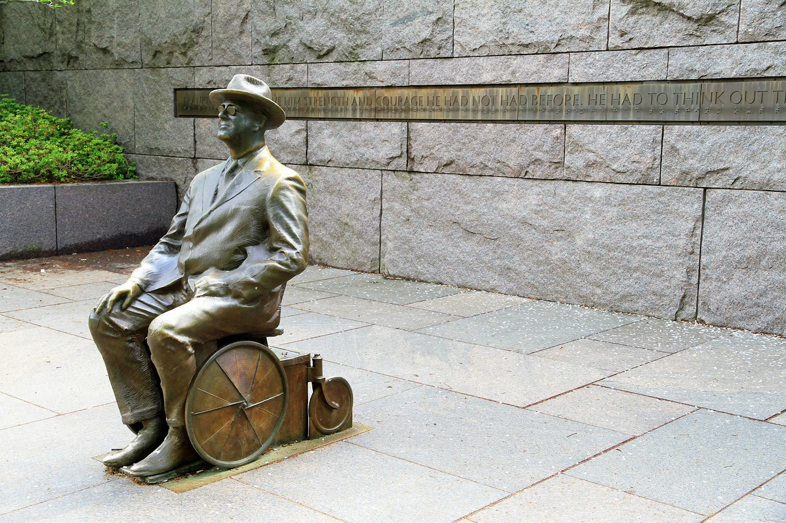

_FDR Memorial (image source_ [_here_](https://www.nationalparks.org/explore/parks/franklin-delano-roosevelt-memorial)_)_

And I’m not talking about power and influence, either. To be “in the arena” of real thinking, you don’t need followers on twitter, or a book deal, or access to some lever of power. Those things can help _amplify_ the signal that real thinking creates (though: I think people often skip too quickly to interest in this step). But my point, here, is the signal itself – the shape the mind takes, and the direction it aims, when it produces real signal at all. The point is to be a node of _that_.

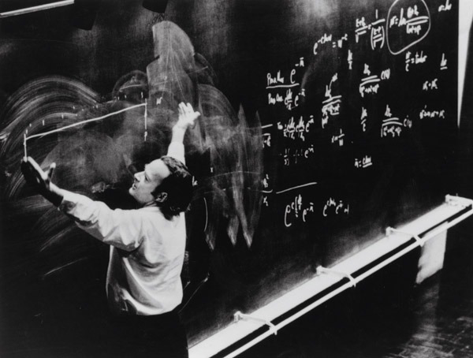

_Feynman_

And I’m not talking, either, about originality. Very much not, in fact. If someone hands you a true theorem, the role of signal is to check it and say “true,” even if it’s the oldest and most widely-accepted theorem in the book. What makes that answer _signal_ is that, _had_ the theorem been false, the answer _would’ve_ been “false” instead. In this sense, signal is still creating _information_. The theorem just passed one more genuine “check.” So signal is “original” in that specific sense. It’s _productive_. It makes something _stronger_. But the point is not to “lead the way,” or to chart a new course. The point, rather, is to be a force in the right direction.

[Tycho Brahe](https://en.wikipedia.org/wiki/Tycho_Brahe)

And the core tools are readily available. Here is your mind. There is the world. Look. Read. Write. Talk to people. Play. Experiment. Build. What’s actually going on? What is this place? What can we build here? How should we live together? Where should we go from here?

We are all, already, nodes in various overlapping answers to these questions – answers ongoingly contested, revised, splintered, re-cohering. And the nodes are a core driver of the answers overall. If we want the answers to be imbued with _signal_ and _life_, then, we should want the nodes to be alive as well.

_“Where Do We Come From? What Are We? Where Are We Going?” by Paul Gaugin (Image source_ [_here_](https://en.wikipedia.org/wiki/Where_Do_We_Come_From%3F_What_Are_We%3F_Where_Are_We_Going%3F#/media/File:Paul_Gauguin_-_D'ou_venons-nous.jpg)_)_

## 6\. Staying awake ^6-staying-awake

> _“And yet I gathered so many words in one line – longer than all the lines of my palm and therefore longer than fate in a line aiming beyond in a line blossoming in a luminous line in a line which is to save me in the column of my life – straight as courage a line as long as love – but it was hardly a miniature of the horizon_  
>   
> _and the thunderbolts of flowers continue to roll on the oration of grass the oration of clouds…”_
> 
> _Zbigniew Herbert, “Mr Cogito Considers The Difference Between The Human Voice and the Voice of Nature”_

OK, that was a long list of tags I’m currently using to remind myself to “really think.” As I say: other suggestions welcome. And again: I’m not saying I’m some expert. The essay is, in part, an effort to learn better – and to do so, partly, in public.

But I’m not just writing this essay for me. I do want us all to be at least _able_ to think for real, when it’s worth the work. I want this for people making individual decisions. I want this, in general, for our civilization’s collective intelligence – that strange mind-like thing that we do together. And I want this, especially, if we are indeed about to enter an era of rapid, AI-driven change — if history isn’t just “still happening,” but if it’s about to be still happening especially _hard_, and fast, and in ways we’ve never had to deal with before.

In Lewis’s example, first the children are playing at burglars. But then: hush – was that a real footstep in the hall? I actually wonder, though, about a different effect. The children are playing. They hear footsteps approaching. Louder and louder. But they do not hush. Rather, they turn the footsteps themselves into part of the game. “Imagine if those footsteps were a burglar!” they say, and giggle nervously. Or maybe: “Really sounds like a burglar!” – but somehow, still, as part of the game. The game, that is, didn’t end. Rather, it expanded. The children, it seems, only do “game”; they don’t do “for real.”

Do we? Sometimes, to different degrees. More and more, perhaps, as the AI stuff gets realer and realer. And eventually, of course, the burglar bursts in. The game ends – and maybe, in children screaming. But one often hopes to get real before that.

_“The City Rises,” by Umberto Boccioni (image source_ [_here_](https://en.wikipedia.org/wiki/The_City_Rises)_)_

But also: who said that it’s a burglar? We hear some footsteps, yes. But who is approaching, and at what speed? What living God pulls at the other end of the cord? What future breathes beside us in the darkness? If we seek the true father, hunter, husband, king – where in this future will we find him? And where is he now?

_“The Sun,” by Edvard Munch (image source_ [_here_](https://www.edvardmunch.org/the-sun.jsp)_)_

People have made many maps. And I do want us to think for real, now, about those maps, and to try to see past them. But more than that: I want us to be _awake_, and to _update_, and to _respond_, as the territory arrives in the flesh. Not to sleep-walk, or to sleep-think, into the age of AI. To be _seeing_ what’s happening. To be in _contact._

Some people are confident that the rough structure and ontology of their maps will mostly survive this encounter; that they already know the basic story, even if not the details. Time will tell. But it’s looks to me like we might get a lot of new data, fast. And not just new – strange, unprecedented, hard to think about. So much, indeed, that I want us to be ready, at least, to refactor our maps more wholesale.[^note-lot-like-we-said] To learn – and maybe fast – that the plot, at a deeper level, was different than we thought, and to adjust accordingly. Not to assume that we have already traced the true bones of the living God’s body. Not to go map, or rote, or soldier, as the future arrives. To meet it eyes open.

[^note-should-be-designed]: Or: should be designed? The actual design/selection process for our own machinery might reflect other criteria, which I wouldn’t count as the “telos” of thinking. More below.

[^note-rio-popper]: Thanks to Rio Popper for this suggestion.

[^note-claude-agreed]: Claude agreed that this is better than its suggestions. “After rereading your essay, I actually find myself somewhat defending ‘fake vs. real.’” Sycophancy?

[^note-not-all-virtues]: Also, to be extra clear: even absent resource constraints, “realness” in my sense very much _isn’t_ supposed to cover all virtues in thinking. For examp…

[^note-ai-takeover]: Later, I think I figured out why in this case. In particular: after noticing that the term “AI takeover” felt fake, I realized that it was connoting, in my mind, a coordinated effort by a single AI or set of AIs, such that afterwards t…

[^note-personal-identity]: I get this with personal identity too.

[^note-not-charitable]: My take here won’t be charitable. But I expect there is merit there as well.

[^note-related-examples]: A friend suggests related examples: not going to the doctor because you’re embarrassed about not having gone sooner; tolerating wildly dangerous Uber rides because it would be awkward to seek an exit. The precise kind of “fakeness” at…

[^note-soldier-jackets]: Though: I think it’s surprisingly easy to be in something like “soldier mindset” even for questions about whether you’ll be late, or about whether your approach to jackets is a good one. …

[^note-sincerity-essay]: In the sincerity essay, I originally said this about “scout mindset.” And I do think “real thinking” and “scout mindset” are closely related. But insofar as scout mindset refers specifically to n…

[^note-conscious-travel]: So presumably: you’re more conscious when you travel? H/t Jake Orthwein for a conversation about these folks. I haven’t followed up, but looks like …

[^note-visceral-cared-about]: Here my picture is something like: “visceral” corresponds roughly to “cared about.”

[^note-tags-biased]: Also: my tags are biased towards the type of thinking that I, in particular, spend a lot of time doing, which tends to more philosophical/conceptual. I expect more solidly empirical/scientific do…

[^note-sort-of-case]: Or at least, not in the sort of case I have in mind.

[^note-boss-says]: If you show up at work, and your boss says “make the truth be _p_” (again, assume …

[^note-just-an-example]: The “that” can be just an example. It doesn’t need to cover all versions of p/not-p.

[^note-other-philosophers]: Among various other philosophers.

[^note-past-self]: And not just about my past self.

[^note-imitation-arena]: Or perhaps: being in some imitation arena, vs. the real thing.

[^note-lot-like-we-said]: Though I think we should also be ready to learn that: oh, shit, it’s a lot like we said. I.e., [[…]](https://joecarlsmith.com/2023/05/08/predictable-updating-about-ai-risk)
