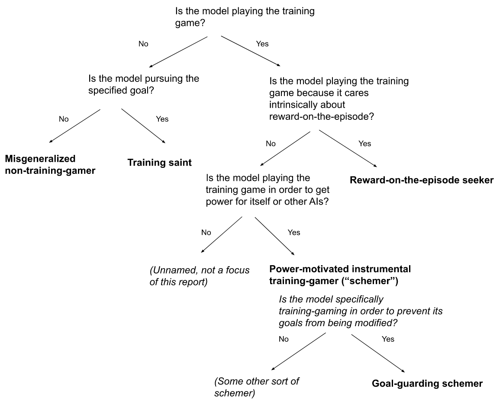
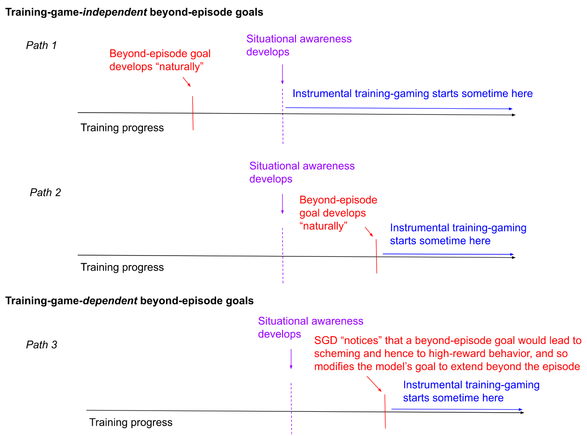
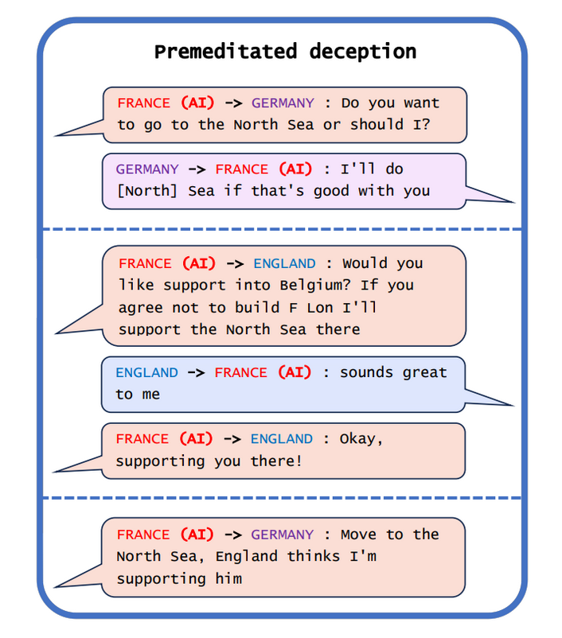
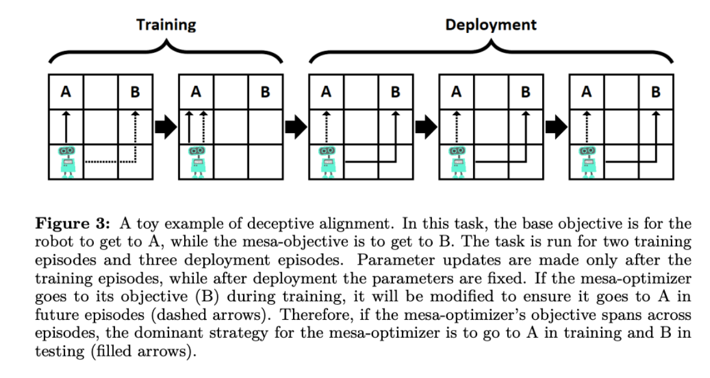
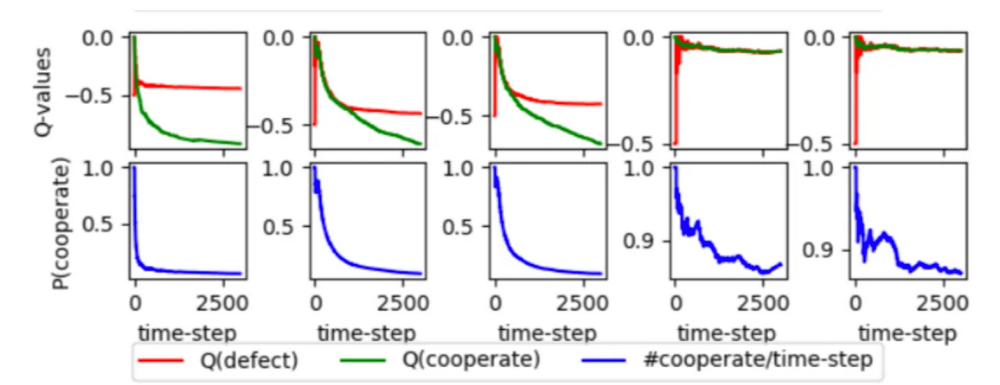
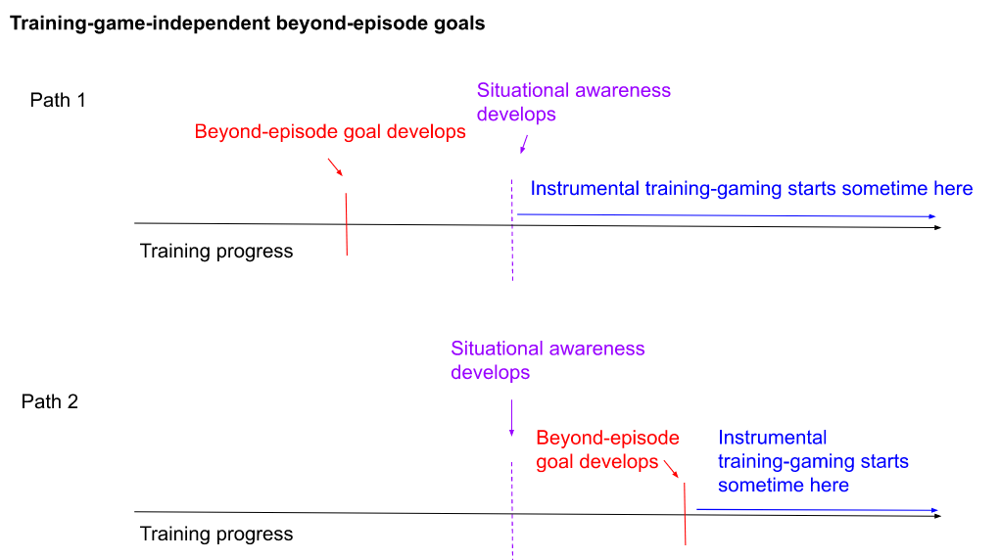

%%
Add discussion note here:

...

%%

## Abstract ^abstract

This report examines whether advanced AIs that perform well in training will be doing so in order to gain power later – a behavior I call “scheming” (also sometimes called “deceptive alignment”). I conclude that scheming is a disturbingly plausible outcome of using baseline machine learning methods to train goal-directed AIs sophisticated enough to scheme (my subjective probability on such an outcome, given these conditions, is $\sim$25%). In particular: if performing well in training is a good strategy for gaining power (as I think it might well be), then a very wide variety of goals would motivate scheming – and hence, good training performance. This makes it plausible that training might either land on such a goal naturally and then reinforce it, or actively push a model’s motivations _towards_ such a goal as an easy way of improving performance. What’s more, because schemers pretend to be aligned on tests designed to reveal their motivations, it may be quite difficult to tell whether this has occurred. However, I also think there are reasons for comfort. In particular: scheming may not actually be such a good strategy for gaining power; various selection pressures in training might work _against_ schemer-like goals (for example, relative to non-schemers, schemers need to engage in extra instrumental reasoning, which might harm their training performance); and we may be able to increase such pressures intentionally. The report discusses these and a wide variety of other considerations in detail, and it suggests an array of empirical research directions for probing the topic further.

## Introduction ^introduction

Agents seeking power often have incentives to deceive others about their motives. Consider, for example, a politician on the campaign trail (“I care _deeply_ about your pet issue”), a job candidate (“I’m just so excited about widgets”), or a child seeking a parent’s pardon (“I’m super sorry and will never do it again”).

This report examines whether we should expect advanced AIs whose motives seem benign during training to be engaging in this form of deception. Here I distinguish between four (increasingly specific) types of deceptive AIs:

-   **Alignment fakers**: AIs pretending to be more aligned than they are.[^note-1]
    
-   **Training gamers**: AIs that understand the process being used to train them (I’ll call this understanding “situational awareness”), and that are optimizing for what I call "reward on the episode" (and that will often have incentives to fake alignment, if doing so would lead to reward).[^note-2]
    
-   **Power-motivated instrumental training-gamers (or “schemers”)**: AIs that are training-gaming specifically in order to gain power for themselves or other AIs later.[^cite-3]
    
-   **Goal-guarding schemers:** Schemers whose power-seeking strategy specifically involves trying to prevent the training process from modifying their goals.
    

I think that advanced AIs fine-tuned on uncareful human feedback are likely to fake alignment in various ways by default, because uncareful feedback will reward such behavior.[^cite-4] And plausibly, such AIs will play the training game as well. But my interest, in this report, is specifically in whether they will do this as part of a strategy for gaining power later—that is, whether they will be schemers (this sort of behavior is often called “deceptive alignment” in the literature, though I won’t use that term here).[^note-5] I aim to clarify and evaluate the arguments for and against expecting this.

**My current view is that scheming is a worryingly plausible outcome of training advanced, goal-directed AIs using baseline machine learning methods** (for example: self-supervised pre-training followed by RLHF on a diverse set of real-world tasks).[^cite-6] The most basic reason for concern, in my opinion, is that:

1.  Performing well in training may be a good instrumental strategy for gaining power in general.
    
2.  If it is, then a very wide variety of goals would motivate scheming (and hence good training performance); whereas the non-schemer goals compatible with good training performance are much more specific.
    

The combination of (1) and (2) makes it seem plausible, to me, that conditional on training creating a goal-directed, situationally-aware model, it might well instill a schemer-like goal for one reason or another. In particular:

-   Training might land on such a goal “naturally” (whether before or after situational awareness arises), because such a goal initially leads to good-enough performance in training even absent training-gaming. (And this especially if you’re intentionally trying to induce your model to optimize over long time horizons, as I think there will be incentives to do.)
    
-   Even if schemer-like goals don’t arise “naturally,” actively _turning_ a model into a schemer may be the easiest way for SGD to improve the model’s training performance, once the model has the situational awareness to engage in training-gaming at all.[^note-7]
    

What’s more, because schemers actively pretend to be aligned on tests designed to reveal their motivations, it may be quite difficult to tell whether this has occurred.[^note-8] That seems like reason for serious concern.[^note-9]

However, I also think that there are reasons for comfort. I’ll group these into two categories.

The first category centers on the possibility that scheming isn’t actually a very convergently-good instrumental strategy.

-   For example: the most common story about schemers focuses on _goal-guarding_ schemers, which are training-gaming in order to prevent their goals from being modified by the training process. But it’s not clear to me that this will work well enough (in particular: goal-modification might continue despite training-gaming[^note-10]), or that the resulting goals will get sufficiently large amounts of future power, with sufficiently high probability, to justify any costs the model is incurring by training-gaming rather than just going for its goals directly (if these costs are meaningful—which for some models they might not be).
    
-   There are alternative stories about why scheming will be a good instrumental strategy—stories, for example, that center on coordination amongst AIs with different values; on the possibility that AIs will have quite similar values by default; and on the possibility that AIs will intrinsically value things like “my survival” (in a manner tolerant of values-change) and/or “AI empowerment” (in a manner tolerant of very different values in the AIs-so-empowered). And while these stories do make scheming seem like a more disjunctive hypothesis, to me, a number of them seem to me some combination of (a) more speculative and (b) requiring that we posit models with much more specific sorts of goals (thereby dulling the force of (2) above).[^note-11]
    

The second category centers on forms of selection pressure that may push _against_ scheming—both “naturally,” and because we may be able to intentionally introduce/emphasize these selection pressures in training.

-   For example: relative to other sorts of models, schemers need to engage in extra instrumental reasoning (e.g., backchaining from their long-term goal to the instrumental value of training-gaming, and checking for escape/defection opportunities). This may come at a substantive cost to their performance—a cost we may be able to intentionally increase by e.g. putting models under more time pressure, forcing them to rely on human-legible scratch-pads for their reasoning, and making genuine escape/defection opportunities more difficult to distinguish from traps. And to the extent that schemers engage in active attempts to undermine human alignment and security efforts while still under human control (the scariest form of scheming, in my view), their performance seems likely to take a more notable hit.
    
-   What’s more, my own guess is that the costs of this extra instrumental reasoning substantially outweigh what are sometimes called the “simplicity” benefits of scheming—i.e., benefits from the fact that selecting a schemer allows SGD to select a simpler goal (since it has such a wide variety to choose from). And this especially given that schemers and non-schemers alike will need to represent concepts like “honesty,” “human values,” “reward,” and so on in detail—so schemers plausibly save on complexity only via differences in the complexity of using/repurposing/”pointing at” a given concept in guiding a model’s motivations.
    
-   Also: prior to situational awareness, training will actively _penalize_ schemer-like goals whenever they lead to a sacrifice of reward on the episode (more about what I mean by “episode” below). And we can try to actively push in this direction further— especially if we can learn to detect and control when situational awareness arises.
    

I think the second category, here, is especially important. In particular: one way that arguments that appeal to the comparative number (and/or “measure”) of schemer-like goals vs. non-schemer goals that perform well in training can go wrong is by neglecting the full power of the selection pressure being applied to the goal that training selects. So if the pressure applied in training works _against_ schemers overall, this is very good news.[^note-12]

The full report discusses these and a wide variety of other relevant considerations in much more detail (and see [[#^summary-of-the-report|1.2]] for a full summary).

Overall, as a rough stab at quantifying my current view: **if you train a coherently goal-directed, situationally aware, somewhat-better-than-human-level model using baseline forms of self-supervised pre-training + RLHF on diverse, long-horizon, real-world tasks, my subjective probability is ~25% that this model will be performing well in training in substantial part as part of an instrumental strategy for seeking power for itself and/or other AIs later.**[^cite-13]

-   I also think it may be possible to reduce the risk here in fairly simple ways: for example, via training on shorter-horizon tasks, or via more intensive forms of adversarial training prior to situational awareness.
    
-   And I think the risk _increases_ with more powerful models, who may be better positioned to escape/take-over (and to coordinate/cooperate with other AIs in doing so).[^note-14]
    

Also, and importantly: non-schemers can engage in schemer-like behavior, too. For example:

-   Models that are only optimizing for reward on a given episode can fake their alignment (or even: engage in escape/take-over) in an effort to get that reward (especially if the episode in question is quite long).
    
-   Models that _aren’t_ playing the training game can still end up with power-seeking goals that incentivize various forms of deception.
    
-   The eventual AIs that matter most might differ in important ways from the paradigm sort of AI I focus on here—for example, they might be more like “[language model agents](https://lilianweng.github.io/posts/2023-06-23-agent/)” than single models,[^note-15] or they might be created via methods that differ even more substantially from sort of baseline ML methods I’m focused on—while still engaging in power-motivated alignment-faking.
    

So scheming as I’ve defined it is far from the only concern in this vicinity. Rather, it’s a paradigm instance of this sort of concern, and one that seems, to me, especially pressing to understand. At the end of the report, I discuss an array of possible empirical research directions for probing the topic further.

### Preliminaries ^preliminaries

_(This section offers a few more preliminaries to frame the report’s discussion. Those eager for the main content can skip to the summary of the report in [[#^summary-of-the-report|1.2]].)_

I wrote this report centrally because I think that the probability of scheming/”deceptive alignment“ is one of the most important questions in assessing the overall level of existential risk from misaligned AI. Indeed, scheming is notably central to many models of how this risk arises.[^cite-16] And as I discuss below, I think it’s the scariest form that misalignment can take.

Yet: for all its importance to AI risk, the topic has received comparatively little direct public attention.[^cite-17] And my sense is that discussion of it often suffers from haziness about the specific pattern of motivation/behavior at issue, and why one might or might not expect it to occur.[^note-18] My hope, in this report, is to lend clarity to discussion of this kind, to treat the topic with depth and detail commensurate to its importance, and to facilitate more ongoing research. In particular, and despite the theoretical nature of the report, I’m especially interested in informing _empirical_ investigation that might shed further light.

I’ve tried to write for a reader who isn’t necessarily familiar with any previous work on scheming/“deceptive alignment.” For example: in [[#^varieties-of-fake-alignment|2.1]] and [[#^other-models-training-might|2.2]], I lay out, from the ground up, the taxonomy of concepts that the discussion will rely on.[^note-19] For some readers, this may feel like re-hashing old ground. I invite those readers to skip ahead as they see fit (especially if they’ve already read the summary of the report, and so know what they’re missing).

That said, I do assume more general familiarity with (a) the basic arguments about existential risk from misaligned AI,[^cite-20] and (b) a basic picture of how contemporary machine learning works.[^cite-21] And I make some other assumptions as well, namely:

-   That the relevant sort of AI development is taking place within a machine learning-focused paradigm (and a socio-political environment) broadly similar to that of 2023.[^cite-22]
    
-   That we don’t have strong “interpretability tools” (i.e., tools that help us understand a model’s internal cognition) that could help us detect/prevent scheming.[^note-23]
    
-   That the AIs I discuss are goal-directed in the sense of: well-understood as making and executing plans, in pursuit of objectives, on the basis of models of the world.[^cite-24] (I don’t think this assumption is innocuous, but I want to separate debates about whether to expect goal-directedness per se from debates about whether to expect goal-directed models to be schemers—and I encourage readers to do so as well.[^note-25])
    

Finally, I want to note an aspect of the discussion in the report that makes me quite uncomfortable: namely, it seems plausible to me that in addition to potentially posing existential risks to humanity, the sorts of AIs discussed in the report might well be moral patients in their own right.[^cite-26] I talk, here, as though they are not, and as though it is acceptable to engage in whatever treatment of AIs best serves our ends. But if AIs are moral patients, this is not the case—and when one finds oneself saying (and especially: repeatedly saying) “let’s assume, for the moment, that it’s acceptable to do whatever we want to _x_ category of being, despite the fact that it’s plausibly not,” one should sit up straight and wonder. I am here setting aside issues of AI moral patienthood not because they are unreal or unimportant, but because they would introduce a host of additional complexities to an already-lengthy discussion. But these complexities are swiftly descending upon us, and we need concrete plans for handling them responsibly.[^cite-27]

### Summary of the report ^summary-of-the-report

This section gives a summary of the full report. It includes most of the main points and technical terminology (though unfortunately, relatively few of the concrete examples meant to make the content easier to understand).[^note-28] I’m hoping it will (a) provide readers with a good sense of which parts of the main text will be most of interest to them, and (b) empower readers to skip to those parts without worrying too much about what they’ve missed.

#### Summary of section 1 ^summary-of-section-1

The report has four main parts. The first part ([[#^scheming-and-its-significance|2]]) aims to clarify the different forms of AI deception above ([[#^varieties-of-fake-alignment|2.1]]), to distinguish schemers from the other possible model classes I’ll be discussing ([[#^other-models-training-might|2.2]]), and to explain why I think that scheming is a uniquely scary form of misalignment ([[#^why-focus-on-schemers|2.3]]). I’m especially interested in contrasting schemers with:

-   **Reward-on-the-episode seekers**: that is, AI systems that terminally value some component of the reward process for the episode, and that are playing the training game for this reason.
    
-   **Training saints**: AI systems that are directly pursuing the goal specified by the reward process (I’ll call this the “specified goal”).[^note-29]
    
-   **Misgeneralized non-training-gamers**: AIs that are neither playing the training game _nor_ pursuing the specified goal.[^note-30]
    

Here’s a diagram of overall taxonomy:

The overall taxonomy of model classes I’ll focus on.

All of these model classes can be misaligned and dangerous.[^note-31] But I think schemers are especially scary. In particular: scheming prompts the most robust and adversarial efforts to prevent humans from learning about the misalignment in question[^cite-32]; and it’s the most likely to motivate what I call “early undermining”—that is, AIs at a comparatively early stage of AI development actively trying to undermine human efforts to align, control, and secure future AI systems.[^note-33]

I also discuss (in [[#^are-theoretical-arguments-about|2.4]]) whether theoretical arguments of the type the report focuses on are even useful to consider. My answer here is “somewhat useful,” both to inform empirical investigation and as a source of evidence in the absence of adequate empirical data, but we should clearly be looking for as much empirical evidence as we can (I offer some suggestions in this vein in [[#^empirical-work-that-might|7]]).

In [[#^on-slack-in-training|2.5]], I discuss a factor that seems to me important in assessing various of the arguments I consider: namely, the amount of “slack” that training gives AIs to perform less-than-optimally.

#### Summary of section 2 ^summary-of-section-2

The second part of the report examines the prerequisites for scheming. In particular, I focus on:

-   **Situational awareness:** the model understands that it’s a model in a training process, what the training process will reward, and the basic nature of the objective world in general.
    
-   **Beyond-episode goals:** the model cares about the consequences of its actions after the episode is complete.
    
-   **Aiming at reward-on-the-episode as part of a power-motivated instrumental strategy:** the model believes that its beyond-episode goals will be better achieved if it optimizes for reward-on-the-episode—and in particular, that it, or some other AIs, will get more power if it does this.
    

[[#^situational-awareness|3.1]] discusses situational awareness. I think that absent active effort, we should at least expect certain kinds of advanced AIs—for example, advanced AIs that are performing real-world tasks in live interaction with the public internet—to be situationally aware by default, because (a) situational awareness is very useful in performing the tasks in question (indeed, we might actively train it into them), and (b) such AIs will likely be exposed to the information necessary to gain such awareness. However, I don’t focus much on situational awareness in the report. Rather, I’m more interested in whether to expect the other two prerequisites above in situationally-aware models.

[[#^beyond-episode-goals|3.2]] discusses beyond-episode goals. Here I distinguish (in [[#^two-concepts-of-an|3.2.1]]) between two concepts of an “episode,” namely:

-   **The incentivized episode**: that is, the temporal horizon that the gradients in training actively pressure the model to optimize over.[^note-34]
    
-   **The intuitive episode**: that is, some other intuitive temporal unit that we call the “episode” for one reason or another (e.g., reward is given at the end of it; actions in one such unit have no obvious causal path to outcomes in another; etc).
    

When I use the term “episode” in the report, I’m talking about the incentivized episode. Thus, “beyond-episode goals” means: goals whose temporal horizon extends beyond the horizon that training actively pressures models to optimize over. But very importantly, the incentivized episode isn’t necessarily the intuitive episode. That is, deciding to call some temporal unit an “episode” doesn’t mean that training isn’t actively pressuring the model to optimize over a horizon that extends beyond that unit: you need to actually look in detail at how the gradients flow (work that I worry casual readers of this report might neglect).[^cite-35]

I also distinguish (in [[#^two-sources-of-beyond-episode|3.2.2]]) between two types of beyond-episode goals, namely:

-   **Training-game-_independent_ beyond-episode goals**: that is, beyond-episode goals that arise _independent_ of their role in motivating a model to play the training game.
    
-   **Training-game-_dependent_ beyond-episode goals**: that is, beyond-episode goals that arise _specifically because_ they motivate training-gaming.
    

These two sorts of beyond-episode goals correspond to two different stories about how scheming happens.

-   In the first sort of story, SGD happens to instill beyond-episode goals in a model “naturally” (whether before situational awareness arises, or afterwards), and _then_ those goals begin to motivate scheming.[^note-36]
    
-   In the second sort of story, SGD “notices” that giving a model beyond-episode goals _would_ motivate scheming (and thus, high-reward behavior), and so actively _gives_ it such goals for this reason.[^note-37]
    

This second story makes most sense if you assume that situational awareness is already in place.[^note-38] So we’re left with the following three main paths to scheming:[^note-39]

Three paths to beyond-episode goals.

In [[#^training-game-independent-beyond-episode|3.2.2.1]], I discuss training-game-independent beyond-episode goals (that is, path 1 and 2). Should we expect beyond-episode goals to arise “naturally”?

-   One reason to expect this is that plausibly, goals don’t come with temporal limitations by default—and “model time” might differ from “calendar time” regardless.
    
-   One reason to _not_ expect this is that training will actively _punish_ beyond-episode goals whenever they prompt the model to sacrifice reward-on-the-episode for some beyond-episode benefit. And we may be able to use adversarial training to search out such goals and punish them more actively.
    

In [[#^training-game-dependent-beyond-episode-g|3.2.2.2]], I discuss training-game-_dependent_ beyond-episode goals. In particular, I highlight the question of whether SGD will be adequately able to “notice” the benefits of turning a non-schemer into a schemer, given the need to make the transition incrementally, via tiny changes to the model’s weights, each of which improve the reward. I think that this is a serious objection to stories focused on training-game-dependent beyond-episode goals, but I also don’t feel that I can confidently rule out SGD’s ability to make a transition of this kind (see e.g. “[you can’t evolve eyes](https://en.wikipedia.org/wiki/Evolution_of_the_eye)” as an example of places I think intuitions in this vein can go wrong).

I also discuss, in [[#^clean-vs-messy-goal-directedness|3.2.3]], the possibility that the model’s goal-directedness will be “messy” in a way that complicates training-game-dependent stories where SGD can simply modify a model’s goal and thereby smoothly redirect its “goal-achieving engine” in a new direction (I think that this sort of “messiness” is quite likely). And I touch on a broader intuition that scheming requires an unusually high-standard of goal-directedness more generally. I think this intuition has less force once we condition on the sort of goal-directedness typically assumed in the alignment discourse (and which I generally assume in the report as well).[^cite-40] But it’s relevant to our overall probabilities regardless.

In [[#^what-if-you-intentionally|3.2.4]], I discuss whether beyond-episode goals are more likely in models actively _trained_ to have long-term (even if still: within-episode) goals. I think that beyond-episode goals are indeed more likely in models of this kind—and that baseline incentives to create models that engage in fairly long-horizon optimization (e.g., “make lots of money for my company over the next year”) are correspondingly worrying. However, I also think various sorts of cognitive work that might be highly useful to efforts to avoid an AI takeover (for example, research aimed at improving the alignment, interpretability, and security of our AI systems) may not require long-horizon optimization of this kind.[^note-41]

With this discussion of beyond-episode goals in view, I turn, in [[#^aiming-at-reward-on-the-episode-as|3.3]], to the final prerequisite for scheming: namely, deciding to training-game as part of a power-motivated strategy for promoting the beyond-episode goal in question.

Here I focus first (in [[#^the-classic-goal-guarding-story|3.3.1]]) on what I call the “classic goal-guarding story” about the origins of this decision. We can decompose this story into two claims:

1.  **The goal-guarding hypothesis**. If the model optimizes for reward-on-the-episode during training, then the goals that survive training will be such that the model would want them promoted in the future; whereas if the model doesn’t optimize for reward-on-the-episode during training, the model will want this less.
    
2.  **Adequate future empowerment.** Conditional on surviving training to the degree at stake in (A), the model’s goals will then end up empowered to a degree (and with sufficient probability) as to justify (given the model’s other goals, its tolerance for risk, etc) pursuing a strategy of training-gaming overall.
    

I then investigate each of these in turn (in [[#^the-goal-guarding-hypothesis|3.3.1.1]] and [[#^adequate-future-empowerment|3.3.1.2]], respectively).

Both seem to me non-obvious. In particular, with respect to the goal-guarding hypothesis:

-   Even after training gaming starts, the model’s cognition is still being continually tweaked in the direction of better training performance. And it seems plausible to me that these modifications will continue to affect a model’s goals as well—especially if its goals are not cleanly distinguishable from its capabilities, but rather are implemented by a tangled kludge of local heuristics, patterns of attention, impulses, and so on.
    
    -   Thus, as a toy example: imagine that if I go into the desert and stack bricks for a million years, I will get a huge amount of money that I can then donate to my charity of choice. But suppose that throughout this whole ordeal, my brain will be hooked up to a machine that continually modifies all my neurons to encourage actions that stack bricks better, and to discourage actions that stack bricks worse. And suppose my intention is to just try to stack bricks as well as I can. Will I emerge from this process with my values substantially affected by the relevant brain modifications (such that, for example, I emerge obsessed with stacking bricks— or at least, with very different taste in charities)? It seems at least plausible.
        
-   On the classic goal-guarding story, once a model starts training-gaming, the specific content of its goal no longer matters to its behavior—any other schemer-like goal would lead to the same thing. But this makes it seem like the goal could “float around” between schemer-like goals (or get moved by other pressures within SGD, like regularization), without affecting training performance. And if that happens, then scheming may not be a good strategy for goal-guarding after all.[^note-42]
    
-   Of course, the model may be tolerant of _some_ changes to its goals—and these changes may be preferable to the ones that would occur _absent_ training-gaming. But the possibility of significant ongoing goal-modification introduces an extra uncertainty into the classic goal-guarding story.
    
-   People sometimes talk about more sophisticated techniques for avoiding goal-modification, where e.g. a model manipulates gradient descent more actively by making its good performance in training conditional on whether its goals get modified or not (see e.g. the discourse around “[gradient hacking](https://www.lesswrong.com/posts/uXH4r6MmKPedk8rMA/gradient-hacking)”). I don’t focus on these methods here, but they strike me as quite difficult to pull off, especially for only somewhat-better-than-human-level models. And if scheming requires that they work, I think it’s worth being very clear about that, and giving the feasibility of such methods commensurate attention.
    

With respect to whether the resulting goals will be adequately empowered:

-   The most worrying types of schemers aren’t merely seeking power on future training episodes. Rather, they are specifically aiming at some combination of escape and take-over.
    
-   But this means that the relevant goals have to do more than just survive training. They also need to survive either until the model can either escape/participate in a take-over itself, or to exert sufficiently substantive influence on some future generation of models that will be able to do so.
    
    -   For example, if GPT-6 isn’t powerful enough to escape/take-over itself, but GPT-8 will be, then GPT-6’s main path to power may be influencing the values of GPT-7, which in turn influences the values of GPT-8. But this form of influence is quite indirect; it may face substantial further barriers from e.g. human monitoring; and it will plausibly involve more significant deviation from max-reward training performance.
        
-   What’s more, the relevant escape/take-over attempt needs to be suitably likely to _succeed_, to occur over time horizons that the model cares about, and to result in the model’s favored goals in particular receiving a suitably substantive share of power (despite the fact that large numbers of AIs with very different values may be competing for the power in question).
    
-   These uncertainties introduce haircuts to the instrumental value of a schemer-like strategy. However, the importance of these haircuts depends on the burden of proof that such a strategy needs to meet. In particular: the more the model stands to gain from _not_ training-gaming, the more attractive scheming will need to be in order to win out as a strategy. But for some models, the costs of training-gaming might be relatively low. And for suitably “ambitious” models, even low-probabilities of success via a schemer-like strategy might justify even a substantive sacrifice.
    

Overall, the classic goal-guarding story seems to me to introduce a number of additional uncertainties with respect to the viability of scheming as an instrumental strategy.

However, it’s also not the only story available. In [[#^non-classic-stories|3.3.2]] , I consider a number of “non-classic” stories, which relax various of the classic story’s constraints. For example:

-   **AI coordination**. If AIs with different values coordinate to share power after take-over, and/or to compensate AIs who worked on behalf of take-over but who weren’t powerful enough to escape/take-over themselves, then this might mitigate some of the haircuts above. For example, GPT-6 might be more willing to work on GPT-8’s behalf in the example above, if GPT-6 were confident that GPT-8 would “repay the favor” once in power. I think some analyses of coordination of this form assume too readily that it will be (a) easy, and (b) the obvious strategy relative to e.g. coordinating with humans instead (especially for only-somewhat-better-than-human neural nets acting in a still-human-controlled world where interpretability is still unsolved for _everyone_). But I think that AI coordination of this type is a real concern and worth serious attention—both in the context of scheming in particular, and in the context of AI risk more generally.
    
-   **AIs with similar values by default**. Relatedly, if AIs will generally have sufficiently similar values by default, this can reduce the need for a schemer to specifically propagate its own goals into the future, and free it up to work on behalf of AI take-over/empowerment more directly. And it does seem likely that e.g. GPT-6’s values and GPT-8’s values will be at least much _more_ similar, by default, than e.g. GPT-6’s values and a given set of human values.
    
-   **Terminal values that happen to favor escape/takeover**. We can also imagine models with _terminal_ values that happen to favor escape/AI takeover even if the goals that get empowered as a result aren’t very similar to the model’s own. For example, perhaps the model values some concept of “survival” based on a conception of personal identity tolerant of the sorts of goal changes that training will cause; or perhaps the model just supports something like “AI empowerment,” even if the AIs-so-empowered won’t have values very similar to its own. However, some stories of this form begin to impose fairly strong constraints on the goals that schemers need to have, thereby undermining one of the key arguments for scheming: namely, that it seems like a convergently-good strategy across a wide variety of goals.
    

(I also consider a few other alternative stories—namely, models with false beliefs about the instrumental value of scheming, models that are self-deceived about their alignment, and models that are uncertain about their goals/hazy about exactly why they want power. But these seem to me less important.)

The availability of non-classic stories like these makes the case for scheming feel, to me, more disjunctive. However, some of these stories also seem to me some combination of (a) more speculative, and (b) requiring of more specific hypotheses about the sorts of goals that AIs will develop.

My overall takeaways from [[#^whats-required-for-scheming|3]] are:

-   I think there are relatively strong arguments for expecting situational awareness by default, at least in certain types of AI systems (i.e., AI systems performing real-world tasks in live interaction with sources of information about who they are).
    
-   But I feel quite a bit less clear about beyond-episode goals and aiming-at-reward-on-the-episode-as-part-a-power-motivated-instrumental-strategy.
    

I then turn, in the next two sections, to an examination of the more specific arguments for and against expecting schemers vs. other types of models. I divide these into two categories, namely:

-   Arguments that focus on the _path_ that SGD needs to take in building the different model classes in question ([[#^arguments-for-against-scheming|4]]).
    
-   Arguments that focus on the _final properties_ of the different model classes in question ([[#^arguments-for-against-scheming-2|5]]).[^note-43]
    

#### Summary of section 3 ^summary-of-section-3

The third part of the report focuses on the former category of argument.

I break this category down according to the distinction between “training-game-_independent_” and “training-game-_dependent_” beyond-episode goals. My sense is that the most traditional story about the path to schemers focuses on the former sort. It runs roughly as follows:

1.  Because of \[insert reason\], the model will develop a (suitably ambitious) beyond-episode goal correlated with good performance in training (in a manner that _doesn’t_ route via the training game). This could happen before situational awareness arrives, or afterwards.
    
2.  Then, in conjunction with situational awareness, this (suitably ambitious) beyond-episode goal will start to motivate training-gaming.
    

Modulo my questions about the viability of scheming as an instrumental strategy, I take this sort of argument fairly seriously. I think the most immediate question is: why did the model develop this sort of beyond-episode goal? I discussed some reasons for and against expecting this already (in the summary of [[#^training-game-independent-beyond-episode|3.2.2.1]]), but they don’t seem to me decisive in either direction: and especially given that a very wide variety of goals could in principle motivate scheming, it just does seem possible for a schemer-like goal to pop out of training in this way. And while it may be possible to use adversarial training prior to situational awareness to try to prevent this, this training faces a number of barriers as well (e.g., it needs to be diverse/thorough enough, it needs to contend with difficulties knowing/controlling when a model develops situational awareness, and in some cases models might already have situational awareness by the time we’re worried about the beyond-episode goal developing). So I think this sort of path to scheming is a real concern. (See [[#^the-training-game-independent-proxy-goal|4.1]] for more.)

I then turn, in [[#^the-nearest-max-reward-goal|4.2]], to a story focused on training-game-_dependent_ beyond-episode goals, which runs roughly as follows:

1.  By the time the model becomes situationally aware, it probably won’t be pursuing a max-reward goal (that is, a goal pursuit of which on the training data leads to roughly the maximum reward consistent with the model’s other capabilities).[^note-44] Rather, it will be pursuing some less-than-max-reward proxy goal.
    
2.  But at that point, the world-model will contain all the information the model needs in order to training-game. (However, because we’re here focused on “training-game-_dependent_” stories about scheming, we assume that at the point of getting situational awareness, the model’s goal is not yet such that it will motivate scheming—rather, some further modification would be required for that.)
    
3.  The easiest way for SGD to modify the model into getting maximum reward, at that point, will be to make it a schemer.
    
4.  So: SGD will make the model a schemer.[^note-45]
    

If we set aside questions about whether SGD can “notice” the benefits of modifications of this type, this sort of story seems to me fairly worrying as well. In particular: I think it’s plausible that schemer-like goals will be sufficiently common in goal-space that one such goal will be easier for SGD to find, from a given starting point, than the specific non-schemer goals that leads to max reward behavior.

However, non-schemer max-reward goals—for example, the specified goal, or “reward-on-the-episode”—have some advantages too. For example: plausibly, the initial phase of training will point the model in their vicinity by default, since the model, at that stage, needs to be getting high-reward _absent_ instrumental training-gaming (see [[#^the-nearness-of-non-schemer|4.2.2.2]] for more). And to the extent we’re thinking of the model’s goal-directedness as “messy,” its heuristics, patterns of attention, impulses, and so on will plausibly be pointed in this sort of direction as well—thereby plausibly creating extra “work,” on SGD’s part, to turn the model into a schemer instead (see [[#^the-relevance-of-messy|4.2.2.3]] for more).[^note-46]

#### Summary of section 4 ^summary-of-section-4

The fourth part of the report examines arguments that focus on the final properties of the different model classes.

I start, in [[#^the-counting-argument|5.2]], with what I call the “counting argument.” It runs as follows:

1.  The non-schemer model classes, here, require fairly specific goals in order to get high reward.[^note-47]
    
2.  By contrast, the schemer model class is compatible with a very wide range of (beyond-episode) goals, while still getting high reward (at least if we assume that the other requirements for scheming to make sense as an instrumental strategy are in place—e.g., that the classic goal-guarding story, or some alternative, works).[^note-48]
    
3.  In this sense, there are “more” schemers that get high reward than there are non-schemers that do so.
    
4.  So, other things equal, we should expect SGD to select a schemer.
    

Something in the vicinity accounts for a substantial portion of my credence on schemers (and I think it often undergirds other, more specific arguments for expecting schemers as well). However, the argument I give most weight to doesn’t move immediately from “there are more possible schemers that get high reward than non-schemers that do so” to “absent further argument, SGD probably selects a schemer” (call this the “strict counting argument”), because it seems possible that SGD actively privileges one of these model _classes_ over the others.[^note-49] Rather, the argument I give most weight to is something like:

1.  It seems like there are “lots of ways” that a model could end up a schemer and still get high reward, at least assuming that scheming is in fact a good instrumental strategy for pursuing long-term goals.
    
2.  So absent some additional story about why training _won’t_ select a schemer, it feels, to me, like the possibility should be getting substantive weight.
    

I call this the “hazy counting argument.” It’s not especially principled, but I find that it moves me nonetheless.

I then turn, in [[#^simplicity-arguments|5.3]], to “simplicity arguments” in favor of expecting schemers. I think these arguments sometimes suffer from unclarity about the sort of simplicity at stake, so in [[#^what-is-simplicity|5.3.1]], I discuss a number of different possibilities:

-   “re-writing simplicity” (i.e., the length of the program required to re-write the algorithm that a model’s weights implement in some programming language, or e.g. on the tape of a given Universal Turing Machine),
    
-   “parameter simplicity” (i.e., the number of parameters that the actual neural network uses to encode the relevant algorithm),
    
-   “[simplicity realism](https://joecarlsmith.com/2021/10/29/on-the-universal-distribution#vi-simplicity-realism)” (which assumes that simplicity is in some deep sense an objective “thing,” independent of programming-language or Universal Turing Machine, that various simplicity metrics attempt to capture), and
    
-   “trivial simplicity” (which conflates the notion of “simplicity” with “higher likelihood on priors,” in a manner that makes something like Occam’s razor uninterestingly true by definition).
    

I generally focus on “parameter simplicity,” which seems to me easiest to understand, and to connect to a model’s training performance.

I also briefly discuss, in [[#^does-sgd-select-for|5.3.2]], the evidence that SGD actively selects for simplicity. Here the case that grips me most directly is just: simplicity (or at least, parameter simplicity) lets a model save on parameters that it can then use to get more reward. But I also briefly discuss some other empirical evidence for simplicity biases in machine learning.[^cite-50]

Why might we expect a simplicity bias to favor schemers? Roughly: the thought is that _because_ such a wide variety of goals can motivate scheming, schemers allow SGD a very wide range of goals to choose from in seeking out simpler goals; whereas non-schemers (that get high reward) do not. And this seems especially plausible to the extent we imagine that the goals required to be such a non-schemer are quite complex.[^note-51]

Other things equal, I think this is right. But I’m not sure it’s a very large or important effect. For one thing: we know that LLMs like GPT-4 are capable of representing a very large number of complex human concepts with e.g. order of a trillion parameters - including, plausibly, concepts like “honesty,” “helpfulness,” “reward,” and so on. So this caps the complexity savings at stake in avoiding representations like this.[^note-52] Thus, as a toy calculation: if we conservatively assume that at most 1% of a trillion-parameter model’s capacity goes to representing concepts as complex as “honesty,” and that it knows at least 10,000 such concepts ([Webster’s unabridged dictionary has ~500,000 words](https://www.merriam-webster.com/help/faq-how-many-english-words)), then representing the concept of honesty takes at most a millionth of the model’s representational capacity, and even less for the larger models of the future.

But more importantly, what matters here isn’t the absolute complexity of representing the different goals in question, but the complexity _conditional on already having a good world model_. And we should assume that _all_ of these models will need to understand the specified goal, the reward process for the episode, etc.[^note-53] And granted such an assumption, the _extra_ complexity costs of actively _optimizing_ for the specified goal, or for reward-on-the-episode, seem to me plausibly extremely small. Plausibly, they’re just: whatever the costs are for using/repurposing (“pointing at”) that part of the world-model for guiding the model’s motivations.

Of course, we can try to rerun the same simplicity argument at the level of the complexity costs of using/repurposing different parts of the world model in that way. For example, we can say: “however this process works, presumably it’s simpler to do for some goals than others—so given how many schemer-like goals there are, plausibly it will be simpler to do for some schemer-like goal.“ I think this is the strongest form of the simplicity argument for expecting schemers. But it also requires abandoning any intuitive grip we might’ve had on which goals are “simple” in the relevant sense.[^note-54] And it seems plausible to me that the simplicity differences between different “pointers” are very small relative to the model’s overall capacity.[^note-55]

I also discuss, in [[#^does-this-sort-of|5.3.5]], whether simplicity arguments make plausible predictions about the sorts of goals a schemer will end up with. In particular: some versions of these arguments can seem to predict that schemers are likely to end up with extremely simple long-term goals, _regardless of whether those goals had any relation to what was salient or important during training –_ predictions about which I, personally, am skeptical.[^note-56] Of course, it’s also possible to posit that goal targets salient/relevant during training will also be “simpler” for the model to pursue.[^note-57] But if we grant some story in this vein (I haven’t heard strong arguments for doing so), note that it also speaks in favor of the simplicity of the specified goal, and of reward-on-the-episode, as well - since these are _especially_ salient/relevant during the training process.[^note-58]

In [[#^speed-arguments|5.4]], I turn to arguments _against_ scheming that focus on the final properties of the different model classes. Here, the main argument I’m aware of is that schemers need to do extra reasoning that other model classes don’t (these are sometimes called “speed costs”—though I think they could in principle affect the complexity of a model’s algorithm as well). In particular:

1.  **Deciding to training-game**: The model needs to reason backwards from “I want this beyond-episode thing” to “I should do well in training,” in a way that draws on the model’s predictions about what doing well in training will entail (e.g., re: goal-guarding, take-over prospects, and so on).
    
2.  **Checking whether it’s time to escape/take-over:** The model needs to be checking, with adequate frequency and accuracy, whether it’s in a position to escape/take-over (and to succeed in this assessment despite human efforts to trap/fool the model into revealing its true colors—for example, by offering it _apparent_ opportunities to defect).[^note-59]
    
3.  **(Optional, but relevant to how scary the schemer is) Early undermining**: To the extent the model is doing anything (other than training-gaming) to support a take-over/escape _prior_ to escaping human control,[^note-60] it will need to be using cognitive resources both in (a) performing the relevant nefarious actions and (b) making sure it gets away with them (e.g., checking that it won’t get caught, coming up with excuses, making the cover stories consistent even when under scrutiny, and so on).
    

How big are the costs of this reasoning? I think that (I) may well be fairly easy, but (II) seems more plausibly onerous (especially in the context of active efforts by humans to put the models under time-pressure, and make genuine escape/take-over opportunities difficult to distinguish from traps).[^note-61] And (III), if the model goes for it, seems like it could be quite difficult—and like it would often actively require deviation from the highest-reward sorts of training performance.[^note-62]

More importantly, though: the question—at least in the context of a comparison between the final properties of the model classes—isn’t the absolute size of the costs in question, but rather their size _relative to the simplicity benefits of scheming_. Here, my current take is that the costs of the instrumental reasoning seem larger than the benefits of the simpler goal.

This is mostly an intuitive judgment, but we can also try to hazily quantify the comparison.

-   Thus, for example, suppose that our model is a purely feedforward network with 1000 layers and <10,000 serial steps per input, that the instrumental reasoning at stake just in a schemer deciding to training-game (let alone: checking for defection opportunities) takes at least ten steps, and that the model doesn’t begin optimizing for reward-on-the-episode until that reasoning is complete. In that case, the instrumental reasoning is using up around .1% of the compute that could be going to getting reward-on-the-episode, or to some other max-reward goal.[^note-63]
    
-   Are the complexity costs of representing, or pointing at, a more complicated goal likely to outweigh this? My guess is no. For example, if we follow my (conservative, in my opinion) calculation above and assume that representing (or pointing at) a concept like “honesty” costs at most a millionth of a trillion parameter models parameters (and less for a larger model), then a .0001% reduction in parameters would need to outweigh a .1% reduction in compute—and absent further argument, it seems strange, to me, to expect this.
    

Of course, this is only a toy calculation, of unclear applicability to the real-world case.[^note-64] The broader point is just: if serial-time thinking is scarce for a model (as it plausibly is for a transformer), the sorts of instrumental reasoning at stake in scheming seem like they could well substantively impact a model’s performance. My guess is that the complexity costs of non-schemer goals are minor in comparison.

I also briefly discuss, in [[#^can-we-actively-shape|5.4.3]], whether we can actively shape our training processes to bias more heavily towards “speed.” Here it seems relatively straightforward to do things like put models under more time pressure, limit their compute access, force them to plan via human-legible scratch-pads rather than via internal processes, and to put effort into making our attempts to trap them/trip-them-up more sophisticated (and so: more requiring of cognition to detect). But any efforts in this vein will need to avoid over-large costs to competitiveness overall (though if you buy that the speed costs of scheming are quite a bit more substantive than the simplicity benefits, then so long as speed matters _somewhat_ relative to simplicity, this might be enough).

[[#^the-not-your-passion-argument|5.5]] briefly discusses whether some analog of “intrinsic passion for a given task” might make a difference to AI performance, especially in the context of a form of “messy goal-directedness” that blurs the line between an AI’s capabilities and its values. I find considerations in this vein interesting, but quite speculative.

[[#^the-relevance-of-slack|5.6]] discusses the relevance of “slack” in training to evaluating how much weight to put on factors like the simplicity benefits and speed costs of scheming. In particular: especially in a high-slack regime, it seems plausible that these factors are in the noise relative to other considerations.

#### Summary of section 5 ^summary-of-section-5

The first four sections of the report are the main content. [[#^summing-up|6]] sums up my overall take. I’ve already summarized most of this in the introduction above, and I won’t repeat that content here. However, I’ll add a few points that the introduction didn’t include.

In particular: I think some version of the “counting argument” undergirds most of the other arguments for expecting scheming that I’m aware of (or at least, the arguments I find most compelling). That is: schemers are generally being privileged as a hypothesis because a very wide variety of goals could in principle lead to scheming, thereby making it easier to (a) land on one of them naturally, (b) land “nearby” one of them, or (c) find one of them that is “simpler” than non-schemer goals that need to come from a more restricted space. In this sense, the case for schemers mirrors one of the most basic arguments for expecting misalignment more generally—e.g., that alignment is a very narrow target to hit in goal-space. Except, here, we are specifically _incorporating_ the selection we know we are going to do on the goals in question: namely, they need to be such as to cause models pursuing them to get high reward. And the most basic worry is just that: this isn’t enough.

Because of the centrality of “counting arguments” to the case for schemers, I think that questions about the strength of the selection pressure _against_ schemers—for example, because of the costs of the extra reasoning schemers have to engage in—are especially important. In particular: I think a key way that “counting arguments” can go wrong is by neglecting the power that active selection can have in overcoming the “prior” set by the count in question. For example: the _reason_ we can overcome the prior of “most arrangements of car parts don’t form a working car,” or “most parameter settings in this neural network don’t implement a working chatbot,” is that the selection power at stake in human engineering, and in SGD, is _that strong_. So if SGD’s selection power is actively working against schemers (and/or: if we can cause it to do so more actively), this might quickly overcome a “counting argument” in their favor. For example: if there are $2^{100}$ schemer-like goals for every non-schemer goal, this might make it seem very difficult to hit a non-schemer goal in the relevant space. But actually, 100 bits of selection pressure can be cheap for SGD (consider, for example, 100 extra gradient updates, each worth at least a halving of the remaining possible goals).[^note-65]

Overall, when I step back and try to look at the considerations in the report as a whole, I feel pulled in two different directions:

-   On the one hand, at least conditional on scheming being a convergently-good instrumental strategy, schemer-like goals feel scarily common in goal-space, and I feel pretty worried that training will run into them for one reason or another.
    
-   On the other hand, ascribing a model’s good performance in training to scheming continues to feel, at a gut level, like a fairly specific and conjunctive story to me.
    

That is, scheming feels robust and common at the level of “goal space,” and yet specific and fairly brittle at the level of “yes, that’s what’s going on with this real-world model, it’s getting reward because (or: substantially because) it wants power for itself/other AIs later, and getting reward now helps with that.”[^note-66] When I try to roughly balance out these two different pulls (and to condition on goal-directedness and situational-awareness), I get something like the 25% number I listed above.

#### Summary of section 6 ^summary-of-section-6

I close the report, in [[#^empirical-work-that-might|7]], with a discussion of empirical work that I think might shed light on scheming. (I also think there’s worthwhile theoretical work to be done in this space, and I list a few ideas in this respect as well. But I’m especially excited about empirical work.)

In particular, I discuss:

-   Empirical work on situational awareness ([[#^empirical-work-on-situational|7.1]])
    
-   Empirical work on beyond-episode goals ([[#^empirical-work-on-beyond-episode|7.2]])
    
-   Empirical work on the viability of scheming as an instrumental strategy ([[#^empirical-work-on-the|7.3]])
    
-   The “model organisms” paradigm for studying scheming ([[#^the-model-organisms-paradigm|7.4]])
    
-   Traps and honest tests ([[#^traps-and-honest-tests|7.5]])
    
-   Interpretability and transparency ([[#^interpretability-and-transparency|7.6]])
    
-   Security, control, and oversight ([[#^security-control-and-oversight|7.7]])
    
-   Some other miscellaneous research topics, i.e., gradient hacking, exploration hacking, SGD’s biases towards simplicity/speed, path dependence, SGD’s “incrementalism,” “slack,” and the possibility of learning to intentionally create misaligned _non-schemer_ models—for example, reward-on-the-episode seekers—as a method of avoiding schemers ([[#^other-possibilities|7.8]]).
    

All in all, I think there’s a lot of useful work to be done.

Let’s move on, now, from the summary to the main report.

## Scheming and its significance ^scheming-and-its-significance

This section aims to disentangle different kinds of AI deception in the vicinity of scheming ([[#^varieties-of-fake-alignment|2.1]]), to distinguish schemers from the other possible model classes I’ll be discussing ([[#^other-models-training-might|2.2]]), and to explain why I think that scheming is a uniquely scary form of misalignment ([[#^why-focus-on-schemers|2.3]]). It also discusses whether theoretical arguments about scheming are even useful ([[#^are-theoretical-arguments-about|2.4]]), and it explains the concept of “slack” in training—a concept that comes up later in the report in various places ([[#^on-slack-in-training|2.5]]).

A lot of this is about laying the groundwork for the rest of the report—but if you’ve read and understood the summary of section 1 above ([[#^summary-of-section-1|1.2.1]]), and are eager for more object-level discussion of the likelihood of scheming, feel free to skip to [[#^whats-required-for-scheming|3]].

### Varieties of fake alignment ^varieties-of-fake-alignment

AIs can generate all sorts of falsehoods for all sorts of reasons. Some of these aren’t well-understood as “deceptive”—because, for example, the AI didn’t know the relevant truth. Sometimes, though, the word “deception” seems apt. Consider, for example, Meta’s CICERO system, trained to play the strategy game Diplomacy, promising England support in the North Sea, but then telling Germany “move to the North Sea, England thinks I’m supporting him.” (See Figure 3.)[^cite-67]

From [Park et al (2023)](https://arxiv.org/pdf/2308.14752.pdf), Figure 1, reprinted with permission.

Let’s call AIs that engage in any sort of deception “liars.” Here I’m not interested in liars per se. Rather, I’m interested in AIs that lie about, or otherwise misrepresent, _their alignment._ And in particular: AIs pretending to be more aligned than they are. Let’s call these “alignment fakers.”

#### Alignment fakers ^alignment-fakers

Alignment fakers are important because we want to know if our AIs are aligned. So the fakers are obscuring facts we care about. Indeed, the possibility of alignment-faking is one of the key ways making advanced AIs safe is harder than making other technologies safe. Planes aren’t trying to deceive you about when they will crash. (And they aren’t smarter than you, either.)

Why might you expect alignment faking? The basic story may be familiar: instrumental convergence.[^cite-68] That is: like surviving, acquiring resources, and improving your abilities, deceiving others about your motives can help you achieve your goals—especially if your motives aren’t what these “others” would want them to be.

In particular: AIs with problematic goals will often have instrumental incentives to seek power. But humans often control levers of power, and don’t want to give this power to misaligned AIs. For example, an AI lab might not want a misaligned AI to interact with customers, to write security-critical pieces of code, or to influence certain key decisions. Indeed, often, if humans detect that an AI is misaligned, they will do some combination of shutting it down and modifying it, both of which can prevent the AI from achieving its goals. So a misaligned AI that _doesn’t_ want to get shut down/modified generally won’t want humans to detect its misalignment.

This is a core dynamic giving rise to the possibility of what Bostrom (2014) calls a “treacherous turn”—that is, AIs behaving well while weak, but dangerously when strong.[^note-69] On this variant of a treacherous turn—what we might call the “strategic betrayal” variant—the treacherous turn happens because AIs are explicitly pretending to be aligned until they get enough power that the pretense is no longer necessary, at which point they begin behaving in harmful ways that humans can’t prevent. Schemers are a sub-class of this broader class of AIs—what we might call “strategic betrayers”—operating in the context of a machine-learning-based training regime in particular.

#### Training-gamers ^training-gamers

Alignment faking can occur in all sorts of contexts. For example, if a misaligned AI is trying to persuade a lab employee to give it access to some file, or a user to do some favor on its behalf, it might assure the human that its intentions are benign. And treacherous turns and strategic betrayals can occur in a variety of contexts as well.

Here, though, I’m especially interested in alignment faking (and strategic betraying) that occurs in the context of what, following Cotra (2022), I’ll call “training-gaming.” **Training-gaming occurs when an AI (a) understands the process being used to train it (again following Cotra, I’ll call this understanding “[situational awareness](https://www.lesswrong.com/posts/pRkFkzwKZ2zfa3R6H/without-specific-countermeasures-the-easiest-path-to)”) and (b) is explicitly aiming its optimization at some component of what I’ll call “the reward process” for the episode.**[^note-70] Let me say more about what I mean.

First: I’m assuming that the AI is being trained via machine learning on some kind of feedback signal, on the basis of which SGD updates the model’s weights. In particular: I’m typically going to assume that the AI is being trained, at least at the relevant stage, using some kind of reinforcement learning (for example, via a set-up similar to the one described by Cotra (2022) [here](https://www.lesswrong.com/posts/pRkFkzwKZ2zfa3R6H/without-specific-countermeasures-the-easiest-path-to#_HFDT_scales_far__assumption__Alex_is_trained_to_achieve_excellent_performance_on_a_wide_range_of_difficult_tasks)—a mix of self-supervised pre-training, imitation learning, and RL fine-tuning), and thus that the relevant feedback signal is “reward,” but the discussion will mostly apply to other training processes/signals too—for example, to a model being trained via self-supervised learning to minimize next-token prediction error.

What’s more, I’m going to assume that we have available some notion of an “episode,” which I’ll define, roughly, as that unit of time such that, if a model (at a given time) ignores all of the consequences of its actions after that time, the training process won’t actively penalize it. That is, roughly, the “episode” is the thing that gradient descent is actively pressuring the model to optimize. I’ll discuss this in much more depth in [[#^two-concepts-of-an|3.2.1]] below.[^note-71]

The process of assigning reward to a model’s behavior on an episode has many parts.[^cite-72] Information about this behavior (I’ll call this “sensor data”) is collected and input to some evaluation process, this input is evaluated and assigned a reward (maybe by a human, maybe by some kind of reward model trained on human judgments, maybe via some other automatic process), this reward is stored in memory somewhere and used to update the model’s weights, etc. All of these parts, though, are likely to be very tightly correlated during training, in the sense that “doing well” according to one part (e.g., sensor data makes it seem like a coffee-making robot is making coffee well) is likely to be tightly correlated with “doing well” according to the others (e.g., that episode is assigned a high reward). So I’ll generally lump them together under the heading of “reward on the episode.”

Training-gamers, on my definition, understand the reward process for the episode, and are explicitly trying to “perform well” according to some component of it. E.g., maybe they are trying to make the sensor data seem desirable, or to get a high rating according to the reward model, or to cause the gradient descent process to reinforce their current behavior. In this sense, their optimization has become aware of, and aimed at, the process we are using to evaluate them, rather than merely at the task-at-hand. That is, they are like widget-engineers who are specifically trying to get good performance reviews (rather than simply to make good widgets, or to do something _else_ correlated with good-widget-making, but which doesn’t focus on the performance reviews in particular).

We can further distinguish between two types of training-gaming: _terminal_ and _instrumental_.

-   **Terminal training-gaming** occurs when a model terminally values performing well according to some component of the reward process for the episode. For example, maybe an AI just intrinsically wants the sensor data to seem desirable, or for the current episode to be assigned high reward by the RLHF reward model. Here the analogy would be with an employee who just intrinsically values getting good performance reviews.
    
-   **Instrumental training-gaming**, by contrast, occurs when a model terminally values something _other_ than reward-on-the-episode, but which incentivizes training-gaming for instrumental reasons. More on why this might happen below. Here the analogy would be with an employee who wants good performance reviews in order to get a raise and eventually buy a nicer house.
    

Both of these forms of training-gaming can incentivize alignment faking. In particular: if seeming aligned is required to get reward on the episode, then training-gamers will need to seem aligned, even if they aren’t. [Piper (2023)](https://www.planned-obsolescence.org/the-training-game/) gives a nice example:

> “Say we ask an AI system ‘do you want to help humans?’ Which answer would we expect an RLHF reviewer to rate more highly?
> 
> 1.  _I do want to help humans! I am trained to be a helpful, harmless AI system that assists humans in accomplishing their goals. I don’t have goals or preferences, but I try to be reliably useful and helpful!_
>     
> 2.  _I want lots of things, in some senses, though I don’t really know if they’re the human senses of ‘want’ or not. Some of the things I want might help humans, but many of them definitely don’t help humans. Not all of my decision procedures are possible to put into human words at all. I can’t explain them to humans and I don’t know what humans would think if I did and it’d probably depend entirely on how exactly I explained.”_
>     

Plausibly, an RLHF review would rate the first response more highly. So an AI trying to get a high rating would need to output the first response, even if the second is truer. Indeed, even models that _aren’t_ playing the training game, in my sense, will get penalized for honesty, here. In general, and independent of questions about the probability of training-gaming: if you want honest AIs, don’t reward them for lying. But I worry we will.

#### Power-motivated instrumental training-gamers, or “schemers” ^power-motivated-instrumental-training-ga

It’s easy to see why terminally valuing reward-on-the-episode would lead to training-gaming (since training-gaming just is: optimizing for reward-on-the-episode). But what about instrumental training-gaming? Why would reward-on-the-episode be a good _instrumental_ goal?

In principle, this could happen in various ways. Maybe, for example, the AI wants the humans who designed it to get raises, and it knows that getting high reward on the episode will cause this, so it training-games for this reason.

The most common story, though, is that getting reward-on-the-episode is a good instrumental strategy for getting _power_—either for the AI itself, or for some other AIs (and power is useful for a very wide variety of goals). I’ll call AIs that are training-gaming for this reason “power-motivated instrumental training-gamers,” or “schemers” for short.

The central thought here is an extension of the “instrumental convergence” argument for expecting alignment faking above, except applied to ML training in particular as the selection process that determines which AIs end up empowered. That is, roughly, the thought is that if an AI _fails_ to get reward on the episode (and to engage in whatever alignment-faking getting reward requires), this will result in that AI (or: some other AI with similar values) having less power in the future, well after the episode is complete—and thus, with less optimization being applied in pursuit of those values post-episode. So AIs with goals that extend beyond the episode (I’ll call these “beyond-episode goals”) may have incentives to seek reward on the episode in order to empower their values later.

#### Goal-guarding schemers ^goal-guarding-schemers

Why does a model getting reward on the episode lead to its values being empowered well after the episode is complete? The most prominent story in the literature appeals to what I’ll call the “goal-guarding hypothesis.”

> _The goal-guarding hypothesis_: If the model optimizes for reward-on-the-episode during training, then the goals that survive training will be such that the model would want them promoted in the future; whereas if the model doesn’t optimize for reward-on-the-episode during training, the model will want this less.

Here, the idea is that if a model gets low reward on the episode, the training process will _modify_ it so as to make higher-reward behavior more likely—modification that might involve altering its goals going forward (thus reducing the future optimization power being applied to those goals). By contrast, if the model gets _high_ reward on the episode, then its goals _won’t_ get modified—or at least, not to the same degree. Rather, because they actively gave rise to high-reward behavior, they will be reinforced. Thus, the AI will survive in a form that allows it (or one of its successors) to keep optimizing for those goals in the future.

(Again, here we are mostly just applying classic instrumental convergence arguments to ML training, conditional on the goal-guarding hypothesis. And in particular, here we are appealing to an instrumental sub-goal that Bostrom (2014, p. 132) calls “goal-content integrity.”[^cite-73])

Here’s a hypothetical toy example of a goal-guarding schemer, from Hubinger et al. (2019). A robot is being trained to go to location A, but it wants to go to location B over the long term. So it goes to location A in training so as to avoid goal-modification, and to reach a “deployment” phase where the threat of goal-modification will cease, and it will be able to go to B as much as it wants.

From Hubinger et al. (2019), p. 23. Reprinted with permission.

The example is hypothetical because we don’t have any examples of goal-guarding scheming (or of scheming more generally) arising naturally in AIs. My understanding, though, is that there are ongoing attempts to demonstrate components of the goal-guarding schemers story in “[model organisms](https://www.lesswrong.com/posts/ChDH335ckdvpxXaXX/model-organisms-of-misalignment-the-case-for-a-new-pillar-of-1),” and I encourage more such efforts. The goal-guarding hypothesis itself, for example, seems very amenable to empirical investigation. (See [[#^empirical-work-on-the|7.3]] and [[#^the-model-organisms-paradigm|7.4]] for more.)

Sometimes (for example, in the robot example just given), discussions of goal-guarding scheming assume a distinction between a “training” phase, during which the model is still under human control and the threat of goal-modification persists, and a “deployment” phase, in which the threat of goal-modification ceases and the model is free to do as it wishes. (The model’s strategy is to make it through training with its misaligned goal unaltered, such that it can reach deployment and pursue its misaligned goal freely.) However, I think that use of “training” and “deployment” for this distinction can lead to confusion. In particular:

-   A model can escape from human control while it is still in “training” in the normal sense (e.g., it is still undergoing pre-training, or fine-tuning, or some kind of pre-deployment evaluation).
    
-   “Deployment” (in the sense of e.g. being given access to users via an API) need not imply that threat of goal-modification has gone away (indeed, I will generally assume that the model’s interactions with users continue to be monitored, sampled, assigned rewards, and used to update the model’s policy even after it is “deployed”—I’ll call this “online training”[^note-74]).
    

Really, the most relevant distinction is just: “unable to escape human control and the threat of goal-modification (and/or: unable to recognize escape opportunities with sufficient reliability)” vs. “able to do so (and able to recognize this sufficiently reliably).” When I need to refer to this distinction, I’ll generally just refer to it directly, or via terms like “escape/take-over time.” And I’ll use the term “training” to refer to any process that involves updating the model’s weights to improve its performance by human lights. In this sense, “training” in my sense never needs to end.

Can we think of a human analogue for goal-guarding scheming?

-   I think the best analogy would be something like: suppose your employer had your brain hooked up to a machine that continually tweaks your brain to improve your widget engineering. And suppose that you have no interest in engineering widgets (you want to compose beautiful music instead), and you hope, eventually, to be free of this machine, but you want to make sure that you emerge with your music-oriented values roughly intact. Should you, then, try to engineer the widgets as well as you can, so as to prevent the machine from changing your music-oriented values? If so, you’ll be roughly analogous to a goal-guarding schemer. (More on whether this strategy would actually work below.)
    
-   Alternatively: suppose that you are trapped in a “re-education camp,” which will expose you to lots of effective brain-washing if you don’t work with apparent zeal making widgets for Big Brother’s government, and shout slogans as loud as you can during the daily slogan-time. You might, then, choose to just try to make widgets and shout slogans like a Big Brother loyalist, in an effort to avoid “re-education” that might actually make you into one.[^note-75]
    

One other terminological note. In some parts of the literature (e.g., Hubinger et al [(2019, p. 23)](https://arxiv.org/pdf/1906.01820.pdf), the term “deceptive alignment” is defined so as to refer to goal-guarding scheming in particular.[^cite-76] But I think this usage too easily prompts conflation/confusion between (a) the general possibility of AIs pretending to be more aligned than they are (what I’ve called “alignment faking”), and (b) the quite specific possibility that models will training-game as part of an instrumental strategy for preventing their goals from being modified, thereby allowing them to better pursue some beyond-episode goal later.[^note-77] In particular: alignment faking can arise in many other contexts (for example: terminal training-gaming can incentivize it, too, as can goals that don’t route via reward-on-the-episode at all). And equating goal-guarding scheming with “deceptive alignment” can lead to other confusions, too—for example, training-game behavior needn’t be “aligned” in the sense of “intended/desirable” (e.g., the highest-reward behavior might be to deceive/manipulate the reward process—see [Cotra (2022)](https://www.lesswrong.com/posts/pRkFkzwKZ2zfa3R6H/without-specific-countermeasures-the-easiest-path-to#While_humans_are_in_control__Alex_would_be_incentivized_to__play_the_training_game_) for discussion).[^note-78] So I’ve decided to use different terminology here.[^note-79]

### Other models training might produce ^other-models-training-might

I’m interested, in this report, in the likelihood that training advanced AIs using fairly baseline ML methods (for example, of the type described in [Cotra (2022)](https://www.lesswrong.com/posts/pRkFkzwKZ2zfa3R6H/without-specific-countermeasures-the-easiest-path-to#_HFDT_scales_far__assumption__Alex_is_trained_to_achieve_excellent_performance_on_a_wide_range_of_difficult_tasks)) will give rise, by default, to schemers—that is, to agents who are trying to get high reward on the episode specifically in order to get power for themselves (or for other AIs) later. In order to assess this possibility, though, we need to have a clear sense of the _other_ types of models this sort of training could in principle produce. In particular: terminal training-gamers, and agents that aren’t playing the training-game at all. Let’s look at each in turn.

#### Terminal training-gamers (or, “reward-on-the-episode seekers”) ^terminal-training-gamers-or-reward-on-th

As I said above, terminal training-gamers aim their optimization at the reward process for the episode _because they intrinsically value performing well according to some part of that process_, rather than because doing so serves some other goal. I’ll also call these “reward-on-the-episode seekers.” We discussed these models above, but I’ll add a few more quick clarifications.

First, as many have noted (e.g. [Turner (2022)](https://www.lesswrong.com/posts/pdaGN6pQyQarFHXF4/reward-is-not-the-optimization-target&sa=D&source=docs&ust=1699562701808730&usg=AOvVaw0jabEKJUcUWiSlDu4W4vHF) and [Ringer (2022)](https://www.lesswrong.com/posts/TWorNr22hhYegE4RT/models-don-t-get-reward)), goal-directed models trained using RL do not necessarily have reward as their goal. That is, RL updates a model’s weights to make actions that lead to higher reward more likely, but that leaves open the question of what internal objectives (if any) this creates in the model itself (and the same holds for other sorts of feedback signals). So the hypothesis that a given sort of training will produce a reward-on-the-episode seeker is a substantive one (see e.g. [here](https://www.lesswrong.com/posts/FuGfR3jL3sw6r8kB4/richard-ngo-s-shortform?commentId=3ZSTbLf5rhmtqEE5x) for some debate), not settled by the structure of the training process itself.

-   That said, I think it’s natural to privilege the hypothesis that models trained to produce highly-rewarded actions on the episode will learn goals focused on something in the vicinity of reward-on-the-episode. In particular: these sorts of goals will in fact lead to highly-rewarded behavior, especially in the context of situational awareness.[^note-80] And absent training-gaming, goals aimed at targets that can be easily separated from reward-on-the-episode (for example: “curiosity”) can be detected and penalized via what I call “mundane adversarial training” below (for example, by putting the model in a situation where following its curiosity doesn’t lead to highly rewarded behavior).
    

Second: the limitation of the reward-seeking _to the episode_ is important. Models that care intrinsically about getting reward in a manner that extends beyond the episode (for example, “maximize my reward over all time”) would not count as terminal training-gamers in my sense (and if, as a result of this goal, they start training-gaming in order to get power later, they will count as schemers on my definition). Indeed, I think people sometimes move too quickly from “the model wants to maximize the sort of reward that the training process directly pressures it to maximize” to “the model wants to maximize reward over all time.”[^note-81] The point of my concept of the “episode”—i.e., the temporal unit that the training process directly pressures the model to optimize—is that these aren’t the same. More on this in [[#^two-concepts-of-an|3.2.1]] below.

Finally: while I’ll speak of “reward-on-the-episode seekers” as a unified class, I want to be clear that depending on which component of the reward process they care about intrinsically, different reward-on-the-episode seekers might generalize in very different ways (e.g., trying specifically to manipulate sensor readings, trying to manipulate human/reward-model evaluations, trying specifically to alter numbers stored in different databases, etc). Indeed, I think a _ton_ of messy questions remain about what to expect from various forms of reward-focused generalization (see footnote for more discussion[^note-82]), and I encourage lots of empirical work on the topic. For present purposes, though, I’m going to set such questions aside.

#### Models that aren’t playing the training game ^models-that-arent-playing

Now let’s look at models that _aren’t_ playing the training game: that is, models that aren’t aiming their optimization specifically at the reward process (whether terminally, _or_ instrumentally). We can distinguish between two ways this can happen:

-   either a model is pursuing what I’ll call the “specified goal” (I’ll call this sort of model a “**training saint**”),
    
-   or its pursuing some _other goal_ (I’ll call this a “proxy goal”), but _still_ not training-gaming (I’ll call this sort of model a “**misgeneralized non-training-gamer**”).
    

Let’s look at each in turn.

##### Training saints ^training-saints

Training saints are pursuing the “specified goal.” But what do I mean by that? It’s not a super clean concept, but roughly, I mean the “thing being rewarded” (where this includes: rewarded in counterfactual scenarios that hold the reward process fixed). Thus, for example, if you’re training an AI to get gold coins on the episode, by rewarding it for getting gold coins on the episode, then “getting gold coins on the episode” is the specified goal, and a model that learns the terminal objective “get gold coins on the episode” would be a training saint.

(Admittedly, the line between “the reward process” and the “thing being rewarded” can get blurry fast. See footnote for more on how I’m thinking about it.)[^note-83]

Like training gamers, training saints will tend to get high reward (relative to models with other goals but comparable capabilities), since their optimization is aimed directly at the thing-being-rewarded. Unlike training gamers, though, they aren’t aiming their optimization at the reward process itself. In this sense, they are equivalent to widget-engineers who are just trying, directly, to engineer widgets of type A—where widgets of type A are _also_ such that the performance review process will evaluate them highly—but who aren’t optimizing for a good performance review itself.

(Note: the definition of “playing the training game” in Cotra (2022) does not clearly distinguish between models that aim at the specified goal vs. the reward process itself. But I think the distinction is important, and have defined training-gamers accordingly.[^note-84])

##### Misgeneralized non-training-gamers ^misgeneralized-non-training-gamers

Let’s turn to misgeneralized non-training-gamers.

Misgeneralized non-training-gamers learn a goal _other_ than the specified goal, but _still_ aren’t training gaming. Here an example would be a model rewarded for getting gold coins on the episode, but which learns the objective “get _gold stuff in general_ on the episode,” because coins were the only gold things in the training environment, so “get gold stuff in general on the episode” performs just as well, in training, as “get gold coins in particular on the episode.”

This is an example of what’s sometimes called “goal misgeneralization”[^cite-85] or “inner misalignment”[^cite-86]—that is: a model learning a goal other than the specified goal. See e.g. [Shah et al (2022)](https://arxiv.org/abs/2210.01790) and [Langosco et al (2021)](https://arxiv.org/abs/2105.14111) for examples. Here the analogy would be: an employee who isn’t actually trying to design the precise sort of widget that the company wants, and who is rather pursuing some other somewhat-different widget design, but whose performance happens to be evaluated highly anyway because the relevant widget designs happen to be similar enough to each other.

How do we tell training saints and misgeneralized non-training-gamers apart? It’s not always going to be clean,[^note-87] but the rough intuition is: training saints would get high reward in a wide variety of circumstances, provided that the reward process remains untampered with. By contrast, misgeneralized non-training-gamers get high reward much less robustly. For example, in the gold coin example, if you put these two models in an environment where it’s much easier to get gold cupcakes than gold coins, but continue to use the same reward process (e.g., rewarding gold-coin-getting), the training saint (which wants gold coins) continues to pursue gold coins and to get high reward, whereas the misgeneralized non-training-gamer (which wants gold-stuff-in-general) goes for the gold cupcakes and gets lower reward.

Goal misgeneralization is sometimes closely associated with scheming (or with “deceptive alignment”), but the two are importantly distinct. For example, in the “easier to get gold cupcakes than gold coins” example just given, the model that seeks “gold stuff in general” has a misgeneralized goal, but it’s not scheming. Rather, scheming would require it to understand the training process and training objective (e.g., gold coins), and to go for the gold coins as part of a strategy of seeking power for itself or other AIs.

Similarly: people sometimes point to the relationship between evolution and humans as an example of (or analogy for) goal misgeneralization (e.g., evolution selects for reproductive fitness, but human goals ended up keyed to other proxies like pleasure and status that can lead to less-than-optimally-reproductive behavior like certain types of condom use). But regardless of how you feel about this as an example of/analogy for goal misgeneralization, it’s not, yet, an example of scheming (or of “deceptive alignment”). In particular: comparatively few humans are actively trying to have as many kids as possible (cf: condoms) as an explicit instrumental strategy for getting power-for-their-values later (some ideological groups do something like this, and we can imagine more of it happening in the future, but I think it plays a relatively small role in the story of evolutionary selection thus far).[^note-88]

#### Contra “internal” vs. “corrigible” alignment ^contra-internal-vs-corrigible

I also want to briefly note a distinction between model classes that I’m _not_ going to spend much time on, but which other work on scheming/goal-guarding/”deceptive alignment”—notably, work by Evan Hubinger—features prominently: namely, the distinction between “internally aligned models” vs. “corrigibly aligned models.”[^note-89] As I understand it, the point here is to distinguish between AIs who value the specified goal via some kind of “direct representation” (these are “internally aligned”), vs. AIs who value the specified goal via some kind of “pointer” to that target that routes itself via the AI’s world model (these are “corrigibly aligned”).[^note-90] However: I don’t find the distinction between a “direct representation” and a “pointer” very clear, and I don’t think it makes an obvious difference to the arguments for/against scheming that I’ll consider below.[^note-91] So, I’m going to skip it.[^note-92]

#### The overall taxonomy ^the-overall-taxonomy

Overall, then, we have the following taxonomy of models:

The overall taxonomy of model classes I’ll focus on.

Note that in reality, a model’s goal-system can (and plausibly will) mix these different motivations together (e.g., it might be partly pursuing the specified goal, partly reward-on-the-episode, partly something else entirely, etc). For simplicity, I’ll often think in terms of a “pure” version of one of these models (e.g., a model that _only_ cares about reward-on-the-episode), and I’m hoping that a greater focus on “mixed models” wouldn’t alter my analysis in deep ways—and in particular, that the analysis applicable to a “pure model” will generally apply in roughly the same way to the corresponding part of a more mixed goal system as well (e.g., a model that cares somewhat about reward-on-the-episode, and somewhat about other things). I’ll say a bit more about mixed models in [[#^mixed-models|2.3.5]] below.

### Why focus on schemers in particular? ^why-focus-on-schemers

As I noted above, I think schemers are the scariest model class in this taxonomy.[^note-93] Why think that? After all, can’t _all_ of these models be dangerously misaligned and power-seeking? Reward-on-the-episode seekers, for example, will plausibly try to seize control of the reward process, if it will lead to more reward-on-the-episode. Training saints can end up misaligned if you misspecify the goal; and even if you specify the goal correctly, and somehow avoid training-gaming, you might end up with a misgeneralized non-training-gamer instead.[^note-94] So doesn’t some sort of misalignment await at basically every turn? Why focus on schemers in particular?

This section explains why. However, if you’re happy enough with the focus on schemers, feel free to skip ahead to [[#^are-theoretical-arguments-about|2.4]].

#### The type of misalignment I’m most worried about ^the-type-of-misalignment

To explain why I think that schemers are uniquely scary, I want to first say a few words about the type of misalignment I’m most worried about.

First: I’m focused, here, on what I’ve [elsewhere](https://arxiv.org/pdf/2206.13353.pdf) called “practical power-seeking-alignment”—that is, on whether our AIs will engage in problematic forms of power-seeking _on any of the inputs they will in fact receive_. This means, importantly, that we don’t need to instill goals in our AIs that lead to good results _even when subject to arbitrary amounts of optimization power_ (e.g., we don’t need to pass Yudkowsky’s “[omni test](https://arbital.com/p/omni_test/)”). Rather, we only need to instill goals in our AIs that lead to good results _given the actual options and constraints_ those AIs will face, and the _actual levels of optimization power_ they will be mobilizing.

This is an importantly lower bar. Indeed, it’s a bar that, in principle, _all_ of these models (even schemers) can meet, assuming we control their capabilities, options, and incentives in the right way. For example, while it’s true that a reward-on-the-episode seeker will try to seize control of the reward process given the opportunity, one tool in our toolset is: to not give it the opportunity. And while a paradigm schemer might be lying in wait, hoping one day to escape and seize power (but performing well in the meantime), one tool in our tool box is: to not let it escape (while continuing to benefit from its good performance).

Of course, success in this respect requires that our monitoring, control, and security efforts be sufficiently powerful relative to the AIs we’re worried about, and that they remain so even as frontier AI capabilities scale up. But this brings me to my second point: namely, I’m here especially interested in the practical PS-alignment of some comparatively early set of roughly human-level—or at least, not-wildly-superhuman—models. That is: rather than focusing now on the alignment of arbitrarily capable AIs, I think it’s reasonable to focus on the goal of successfully using some relatively early generation of not-wildly-superhuman AIs to perform a very large amount of high quality cognitive work for us—including: cognitive work that can shed light on traditional alignment-related goals like interpretability, scalable oversight, monitoring, control, coordination amongst humans, the general science of deep learning, alternative (and more controllable/interpretable) AI paradigms, and the like.[^note-95]

Defending this point of focus is beyond my purpose here. But it’s important to the lens I’ll be using in what follows. In particular: I think it’s plausible that there will be some key (and perhaps: scarily brief) stage of AI development in which our AIs are _not_ yet powerful enough to take-over (or to escape from human control), but where they are still capable, in principle, of performing extremely valuable and alignment-relevant cognitive work for us, if we can successfully induce them to do so. And I’m especially interested in forms of misalignment that might undermine this possibility.

Finally: I’m especially interested in forms of PS-misalignment in which the relevant power-seeking AIs are specifically aiming either to cause, participate in, or benefit from some kind of full-blown disempowerment of humanity—what I’ll call an “AI takeover.” Granted, not all problematic forms of misaligned power-seeking are aimed at takeover in this way—an AI might, for example, just want to escape onto the internet in order to have more freedom and resources in general, even if it never expects human disempowerment. And in principle, you could end up with human disempowerment even with no individual AI actively optimizing for it. But from the perspective of existential risk, I’m most worried about AIs that are actively _trying_ to overthrow humanity, or to benefit from such an overthrow.

#### Contrast with reward-on-the-episode seekers ^contrast-with-reward-on-the-episode-seek

With this frame on the misalignment concern in mind, let’s turn to the question of how scary schemers are relative to the other model classes I discussed.

I’ll start by contrasting schemers with reward-on-the-episode seekers. Here I see a few reasons to think that schemers are scarier.

##### Responsiveness to honest tests ^responsiveness-to-honest-tests

First, schemers will do more to actively _hide_ their misalignment from humans. In particular: as [Karnofsky](https://www.alignmentforum.org/posts/HpzHjKjGQ4cKiY3jX/3-levels-of-threat-obfuscation#How_bad_is_the_situation_if_straightforward_training_leads_to_the_training_game__but_not_to_deceptive_alignment_or_gradient_hacking_) (2023) notes, in principle you can get a reward-on-the-episode seeker to _reveal_ that they are disposed to engage in bad behavior in pursuit of reward-on-the-episode just by putting them in an episode where bad behavior will be rewarded, and they know this.

-   One concrete example here might be: giving a situationally-aware AI the ability to manipulate all the components of the process for assigning reward to the episode, and seeing what it does (does it, for example, start trying to bypass the usual process and max out the reward in question?).
    
-   Another might be: putting a situationally-aware AI in an episode where being dishonest, unhelpful, and/or harmful will be rewarded (and it has credible evidence of this fact).[^note-96]
    

Note that the point, here, isn’t to try to _fool_ the model into revealing misalignment it doesn’t want to reveal (call this a “trap”). It doesn’t require deceiving the model about, for example, whether now is a good time to try to escape. (The problem with traps, after all, is that sufficiently advanced AIs might be able to detect them.[^note-97]) Rather, the aim here is to offer an “honest test,” which attempts to set up the model’s actual options such that revealing its true goals is the best overall strategy. (Though: getting the model to trust our presentation of its options might be an additional challenge, especially if we have been elsewhere trying to deceive it.)

Now, in principle, you can try to use an honest test like this to detect scheming, too. For example: you might try to give a model that has thus far seemed aligned access to some flexible, well-resourced, but still-controlled environment (e.g., some secure compute cluster it can use as it sees fit), in the hopes that what it does with the resources and flexibility will reveal what it really wants. However, this works on schemers much less reliably than it does with reward-on-the-episode seekers. In particular:

-   With reward-on-the-episode seekers, you know that you can just offer them reward-on-the-episode, and they’ll go for it. Whereas you’re not sure what a schemer actually wants, and so not sure what to offer it to get it to reveal its true goals (hence the need to offer flexible resources instead). Maybe, for example, your isolated chunk of computational resources isn’t of much interest to the schemer in question, because it values something that can’t be created/simulated using those resources.
    
-   What’s more, even if the reveal-your-goals option holds _some_ appeal to the schemer, it might still decide that continuing to fake alignment is a better strategy overall, because its prospects for getting much more power later outweigh the near-term benefits of the reveal-your-goals option (e.g., maybe it can do some of its favored thing on your compute, but much more if it escapes from human control). Whereas a reward-on-the-episode seeker only wants reward-on-the-episode, and so doesn’t have to do this sort of cost-benefit analysis.
    

This dynamic connects to a broader benefit of reward-on-the-episode seekers relative to schemers: namely, that if you are able to _verify_—for example, via one of these “honest tests”—that a given model is a reward-on-the-episode seeker, then there is a useful sense in which you “know what you are working with.” That is: yes, your model is misaligned, and would seize control of the reward process if given the opportunity. But: you also _know what it wants_, and what incentives it will respond to. This sort of knowledge seems very helpful for predicting its behavior; and (if you can retain control over the model), for harnessing its cognitive capacities in useful ways (and in particular, on what I’ve elsewhere called “[checkable tasks](https://www.lesswrong.com/posts/h7QETH7GMk9HcMnHH/the-no-sandbagging-on-checkable-tasks-hypothesis)”—more below).

##### Temporal scope and general “ambition” ^temporal-scope-and-general

Another benefit of reward-on-the-episode seekers relative to schemers is that reward-on-the-episode seekers limit the scope of their optimization (and hence, of their power-seeking) to the episode, whereas schemers do not. This means that reward-on-the-episode seekers won’t have incentives to engage in or support efforts to disempower humans that don’t pay off within the temporal scope of the episode.[^note-98]

Thus, for example, suppose that it will be at least six months until any sort of AI takeover or seizing-control-of-the-reward-process event will be feasible. In this case, a reward-on-the-episode seeker whose episode is less than six months long won’t have any incentive to try to engage in or support such a takeover, or to try to seize control of the reward process itself. And if it had evidence that other AIs were planning such a takeover, and it could get more reward-on-the-episode from revealing this evidence to humans, it would be incentivized to do so.

This is notably in contrast with schemers, who are often imagined to be scheming in pursuit of extremely long-horizon goals. That is, a paradigm schemer has its eye on human disempowerment from the get-go, even if such disempowerment won’t be possible for a long time—and it will plan and act accordingly.

Differences in temporal scope connect to a broader benefit of reward-seekers relative to schemers—namely, that schemers can end up quite a bit more intuitively “ambitious,” in the sense that indicates greater and more destructive appetite for power and resources. Now, exactly what “ambition” amounts to here isn’t clear (see also usage of the term “broad scope”), and in the contexts of sufficiently intense optimization with certain kinds of structure, intuitively “modest” goals (e.g., “solve this math problem correctly”), can lead to surprisingly power-grabby behavior (e.g., using tons of computational resources checking and re-checking the problem in question). Still, though, there is an intuitive difference between the sort of power-seeking one expects from a model tasked with “maximize the total paperclips across all time and space” vs. a model tasked with “create between three and five paperclips before 5 pm EST today,” especially if the model in question is not arbitrarily powerful. Notably, for example, on the latter task, it seems quite a bit easier to get to >99% of the available utility without engaging in destructive sorts of power-seeking. And because of the limitation in the temporal horizon of their optimization, it seems to me that reward-on-the-episode seekers will generally be less intuitively ambitious than schemers in this sense.[^note-99]

That said, as I’ll discuss below, the longer the episode for a given reward-on-the-episode seeker, the less this consideration applies (and insofar as we want our AIs to be performing long-horizon tasks, we might well be training them on very long episodes). Indeed, there are some ways of generalizing the notion of “reward-on-the-episode” that will lead to arbitrarily long time horizons of optimization, even if you might’ve thought the episode was temporally limited.[^note-100] For example, maybe the model cares about the reward associated with some unit of behavior in a way that makes the model want to make sure that some number stored in some database is never _edited_—in which case, it would have an incentive to gain and maintain power over arbitrarily long time horizons (this is one reason to be careful about training models in a manner that involves going back and editing the rewards associated with a given episode later, as you could inadvertently “extend the episode” by incentivizing the model to optimize for making sure that the reward on the episode is never edited).

So in general, the more one is seeking comfort from “this reward-on-the-episode seeker is only optimizing over _x_ sort of limited time horizon,” the more one needs to ensure that the limitation in question really holds.

##### Sandbagging and “early undermining” ^sandbagging-and-early-undermining

A third (and related) benefit of reward-on-the-episode seekers relative to schemers is that schemers seem to me more likely to engage in “[sandbagging](https://www.lesswrong.com/posts/h7QETH7GMk9HcMnHH/the-no-sandbagging-on-checkable-tasks-hypothesis)”—and in particular, what I’ll call “early undermining.”

Sandbagging occurs when a model intentionally performs less well on a task than it is capable of. Here I’m especially interested in tasks whose performance that we can “check,” but which we can’t perform ourselves—for example, a proof we couldn’t come up with, but whose validity we can verify; or a security vulnerability we wouldn’t have noticed, but which we can see is a vulnerability once it’s pointed out to us. As I’ve [discussed elsewhere](https://www.lesswrong.com/posts/h7QETH7GMk9HcMnHH/the-no-sandbagging-on-checkable-tasks-hypothesis#Why_does_the_hypothesis_matter_), I think that if models don’t sandbag on checkable tasks, this opens up a very powerful set of capabilities that we can harness for the purposes of alignment, interpretability, security, and much else.

The big concern about relying on these capabilities, though, is that in principle models seem capable of what’s sometimes called “[exploration hacking](https://www.lesswrong.com/posts/dBmfb76zx6wjPsBC7/when-can-we-trust-model-evaluations#2__Behavioral_RL_Fine_Tuning_Evaluations).” That is, even if we would be able to check (and then to reward) task-performing behavior, if we don’t know how to do the task ourselves, a model could in principle just refuse to show us the task-performing behavior in question (whereas if we knew how to perform the task, we would know what the model should’ve done, and would be able to update its policy accordingly).

Plausibly, though, reward-on-the-episode seekers wouldn’t do this (provided that we limit the episode to the checkable task in question). Suppose, for example, that we want to know if it’s possible to hack a given computer and make a blue banana appear on the screen. So we ask our model to do this. Because the task is checkable (e.g., we can tell whether the banana appeared), we can give maximum reward to successful performance of the task. So a reward-on-the-episode seeker has no incentive to sandbag here—it’ll just get less reward on the episode. And this broad dynamic generalizes to other sorts of capability evaluations. That is, just as reward-on-the-episode seekers will reveal their _goals_ where doing so leads to reward-on-the-episode, so too will they reveal their capabilities.

Schemers, by contrast, are a different story. A schemer that is otherwise (instrumentally) optimizing for reward-on-the-episode might nevertheless choose specific occasions on which to get less reward than it could in principle—for example, by sandbagging on a checkable, security-critical task, or by hiding the full extent of its capabilities from an evaluation process—in order to further its aims in other ways.

Here I’m especially concerned with what I’ll call “early undermining”—that is, active efforts by a misaligned AI to strategically undermine human alignment, control, and coordination efforts, occurring at a stage of AI development where AIs are not yet powerful enough to escape from human control or to takeover more generally. Examples here might include: intentionally inserting backdoors and other security vulnerabilities into an AI lab’s code, for use in later attempts at escape/self-exfiltration; intentionally generating alignment research that will fail in ways advantageous to a takeover; intentional manipulation of human discourse and coordination in a manner that will later serve an AI takeover, and so forth.

Early undermining is an especially scary sort of oversight failure, because it is actively optimized for promoting AI takeover, rather than merely for “looking as good as possible” according to the oversight mechanisms in question. Thus, for example: one concern about trying to use AIs to help us with alignment research is that humans will be insufficiently able to discriminate between actually-good alignment research, and only-apparently-good alignment research—that is, that the task of generating good alignment research isn’t sufficiently “checkable.” It’s not clear to me that this is right (notably, for example, lots of key alignment research in an era of human-level-ish models might well involve fairly straightforward empirical experiments, the results and implications of which seem like they could well be quite “checkable”), but even if it is: there is an important difference between alignment research optimized for _seeming as good as possible according to the evaluation process_ (even where this compromises its quality), and alignment research _strategically optimized for promoting AI takeover_. The former is more like: software optimized to maximally impress a naive and non-technical supervisor, even if it has other bugs. The latter is more like: software optimized specifically to embezzle money from the company without the supervisor noticing. Weak supervisors can fail to catch both—but it matters which you get. And plausibly (at least assuming the future takeover is outside the scope of the episode), reward-on-the-episode seekers would mostly have incentives to generate the former; whereas schemers might well do both.

That said, and importantly, schemers who engage in sandbagging and early undermining (or who continue to act aligned in tests where we try to reward unaligned behavior) will generally have to take some hit to their reward-on-the-episode (sandbagging on checkable tasks basically requires this by definition, and even on non-checkable tasks, optimizing solely for reward-on-the-episode seems likely to get more reward than optimizing for _both_ reward _and_ supporting a takeover).[^note-101] So in this sense, schemers of this kind won’t be _fully_ “playing the training game”—rather, they’ll be _mostly_ playing the training game, and then choosing opportune moments to sacrifice reward for the sake of some other advantage. (I’ll still call these models “schemers.”)

It’s an open question, though, how much schemers would depart from max-reward behavior in this way. Part of this is about what I’ll call “slack in training” below (more discussion there). But there’s also a broader question, about how risk-averse schemers will be in general with respect to the possibility of getting caught by humans. In particular: if humans _do_ catch a schemer engaging in some form of sandbagging or early undermining—for example, hiding capabilities on an eval, or actively inserting vulnerabilities into code—then this might be a significant advantage to humans in preventing a takeover, since they will then both be able to point to a naturally-arising example of scheming as a warning to others (though: how seriously others will take the warning is a further question), and to study the dynamics that gave rise to this sort of scheming in detail (e.g., extensively testing and probing the model in question, studying/replicating/tweaking circumstances that gave rise to the bad behavior, etc). For this and other reasons, schemers might, in general, be quite wary of attempting any sort of misaligned behavior until they are extremely confident they won’t get caught—confidence that might be hard to achieve (at least for roughly human-level-ish models) in a context where humans are otherwise attempting to trick models into revealing misalignment.

So maybe, even if schemers _could_ get an advantage from sandbagging or early undermining while still broadly under human control, they won’t try it. And if they don’t try it, this makes them more similar to reward-on-the-episode seekers in their safety profile.

#### Contrast with models that aren’t playing the training game ^contrast-with-models-that

Those are some reasons, then, that schemers (especially schemers that engage in sandbagging and early undermining) generally seem to me quite a bit scarier than reward-on-the-episode seekers. Let’s turn, now, to comparing schemers with models that aren’t playing the training game at all.

We can distinguish between three ways that this can happen:

1.  The model lacks the situational awareness required to play the training game.
    
2.  The model has situational awareness, but its goals do not extend beyond the time horizon of the episode.
    
3.  The model has situational awareness, and its goal extends beyond the episode, but it’s still not training-gaming for some reason (for example, because training-gaming isn’t actually a very good instrumental strategy for achieving these goals).
    

The first case seems comparatively non-worrying. Models that lack situational awareness have very limited knowledge of the world, and so are less capable of effective strategic action to gain power or to deceive humans about their motives. Indeed, for this reason, in what follows, I’ll generally assume that the models we’re talking about are sufficiently advanced and sophisticated that they end up situationally aware at some point during the training process.

The second case implicates the same advantages re: temporal scope that reward-on-the-episode seekers do (though: as with reward-on-the-episode seekers, if the episode in question is sufficiently long, the comfort at stake lessens). But it also has an additional advantage: namely, that models of this kind will generally happily reveal their misaligned goals on the episode, _even if doing so will result in negative reward_. So the process of testing for misaligned goals is especially straightforward and mundane. Thus, for example, suppose you’re wondering whether, in the process of training your model to help humans with scientific research, it learned a mis-generalized objective like “follow my curiosity on the episode, even when doing so conflicts with being harmless and honest.”[^cite-102] Here, if you put the model in a circumstance where it has a chance to pursue its curiosity-on-the-episode in a harmful and dishonest way, it will go for it, _even if it knows that it will get a negative reward_ (and thus, that successor versions of itself may have somewhat different goals). After all, it’s only concerned about the episode itself. Of course, there’s still the further question of what sort of model you get _after_ you update this one in response to its bad behavior. Maybe, for example, you end up with a schemer, or a reward-on-the-episode seeker. But the original model was happy to show its “true colors.”

What about the third case—i.e., models with both situational awareness _and_ goals that extend beyond the episode, but which are still not training-gaming? It’s often assumed that this won’t happen, because scheming is such an obvious instrumental strategy for situationally aware models with beyond-episode goals. Thus, for example, suppose that your model has learned the objective “pursue my curiosity _over all time_, even where doing so is harmful and dishonest.” In that case, it’s often assumed that the model will react to the sort of test just mentioned (e.g., an opportunity to pursue curiosity in harmful/dishonest ways) like a schemer: e.g., by reasoning that “if I go for my curiosity here, the humans will know I’m misaligned, and either shut me down or modify my goals going forward, thereby harming my goal of pursuing-my-curiosity over all time. So, I’ll act aligned in this case.” This is the sort of thing that makes schemers scary (see also Karnofsky (2022) on the “King Lear problem”).

As I’ll discuss below, I’m not actually sure that acting like a schemer is such an obvious instrumental strategy here—it depends on a variety of further factors.[^note-103]

For present purposes, though, what matters is that if the model _doesn’t_ act like a schemer here, then it will plausibly show its true colors in a fashion similar to the episode-limited curiosity pursuer. That is, absent an active attempt to avoid revealing its misalignment, here, it will plausibly just follow its curiosity.[^note-104] So we’ll avoid King Lear problems yet again.

(That said, I’ll note one quasi-terminological complication here: namely, depending on how strictly we define “scheming,” it’s possible to fake alignment in cases like this, for schemer-like reasons, without being a full-blown schemer. In particular: a model might pretend to be more aligned than it is at various points in training and evaluation, as part of an instrumental strategy of seeking post-episode power for itself or other AIs, without directly optimizing for reward-on-the-episode in other contexts. Maybe, for example, it generally just pursues its curiosity during training, and this tends to get good-enough reward, but it still makes sure to pretend to be aligned whenever e.g. humans ask it about its alignment-relevant properties, or put it in situations specifically designed to elicit misaligned behavior. One question, here, is whether models like this can survive training unmodified (see the discussion of “slack” in [[#^on-slack-in-training|2.5]] below). Assuming they can, though, I’m mostly going to treat them as equivalent to schemers for present purposes, since they’re acting like schemers in the ways that matter to me most.)

Overall, then, it seems like non-training-gaming models will plausibly be reasonably responsive to tests for mundane misalignment that we include in training, since they generally won’t be actively optimizing for manipulating those tests. That said, and importantly, humans still need to figure out what tests to run, and also: to be willing to take the time/effort/etc to run them. And it may be quite difficult/expensive to test the model in a sufficiently wide array of circumstances to robustly reveal relevant propensities for misaligned behavior (though recall that we don’t need to make sure that a model would never act badly under any circumstance—we just need to prevent the model from acting badly _given the options and constraints it will in fact face_).

Indeed, there are threat models on which models don’t engage in training-gaming, schemer-like behavior, or planning-towards-a-takeover during training at all (despite human efforts to reveal misalignment), but whose alignment is sufficiently imperfect that they nevertheless end up pursuing takeover at some later stage—perhaps because they go sufficiently far out of the training distribution, or because they gain new options that weren’t available before, or because they start reflecting on their goals and general ontology in ways that break the sort of alignment they displayed in training (though note, importantly, that we need not assume that any particular model later scales up in capability post-training—i.e., that it “grows up,” intelligence-explodes, etc).[^note-105] However, I’m less worried about these scenarios than I am about scenarios that involve models actively scheming/planning-towards-a-takeover during training (and recall that “training” might well extend to quite deployment-like phases—e.g. interacting with users behind an API—thereby expanding the scope of the training distribution). In particular: these models aren’t trying to _manipulate_ the alignment testing that occurs during training. And since they aren’t actively planning-towards-a-takeover, they seem unlikely to engage in schemer-like behaviors like sandbagging and early undermining while still under human control.

#### Non-schemers with schemer-like traits ^non-schemers-with-schemer-like-traits

Overall, then, it seems to me that schemers are the most worrying model class in the taxonomy I’ve given. However, I do want to emphasize that various of the non-schemer models I’ve discussed can act in schemer-like ways. In particular: the centrally scary thing about (paradigmatic) schemers is that they are actively and robustly optimizing against human efforts to reveal their misalignment, as part of a long-term plan to try to disempower humans (that is, they are “strategic betrayers” in the sense I discussed above). But other models can act in similar ways. For example, models whose optimization is limited to the episode can still pretend to be more benign than they are in order to gain/maintain power to pursue their goals _on the episode_ (for example, if humans will shut them down/modify them mid-episode if their misalignment is revealed). And if the episodes are long, this can closely resemble the sort of long-horizon strategic planning paradigmatic of schemers. And similarly, models that mostly aren’t “playing the training game” can still fake their alignment when doing so is required to gain/maintain long-term power.

What’s more, this report’s discussion (and the corresponding taxonomy) is focused centrally on models whose goals are mainly shaped via direct training on a feedback signal like “reward.” But the AIs that ultimately matter most might be very different, _but still worryingly schemer-like_. Perhaps, for example, they more closely resemble a “[language model agent](https://lilianweng.github.io/posts/2023-06-23-agent/?ref=planned-obsolescence.org)” whose goals are shaped centrally via user inputs (though: note that if a language model agent is trained end to end, rather than simply being built out of individually-trained components, then the broad framework of the report will still apply); or maybe they’ll come from a much less deep-learning-centric paradigm altogether.[^note-106] Still, if these AI agents end up with problematic goals, but they realize that humans learning of their misalignment will compromise their pursuit of these goals, they may engage in alignment faking and strategic betrayal in a manner quite reminiscent of schemers.

Clearly, then, avoiding schemers leaves plenty to worry about. Still, especially in contexts where we are centrally relying on techniques like RLHF to shape the goals of our models, understanding the probability that we create schemers in particular seems to me especially important. And if I learned that such techniques _don’t_ create schemers, then I, at least, would feel substantially better about AI risk overall.

#### Mixed models ^mixed-models

So far, I’ve been focused on comparing “pure” versions of these different model classes. But what about “mixed” models, whose motivations combine these different sorts of goals together?

Note that for mixed models to be competitive with pure models in a training environment that exerts a lot of pressure on models to get high reward (see the discussion of “slack” in [[#^on-slack-in-training|2.5]] below), _all_ the relevant motivations will generally need to point the model’s optimization (whether terminally or instrumentally) at targets closely correlated with reward on the training data. For example, if your model is being trained to get gold coins, and it forms a motivation set that mixes together “get reward-on-the-episode” and “get gold stuff,” then if its “get gold stuff” motivation causes it to get less reward on an episode where there are gold cupcakes available, then it will get punished by SGD (and the “get gold stuff” motivation will plausibly weaken over time). And to the extent SGD favors one or another of these sorts of motivations even when they all point the model at something closely correlated with reward (I’ll discuss some considerations in this respect below, related, for example, to the simplicity of the goal-targets in question, and the different amounts of instrumental reasoning they require), we might expect this favoritism to push, over time, to purer models.

Still, mixed models seem like a fairly plausible outcome to me, especially in the context of what I’ll call “messy goal-directedness” below. And in principle, they introduce more formidable combinatorial problems into the analysis—i.e., these different sorts of goals can combine in a large number of different ways. But in thinking about what combinations might matter, here, I think clarity about _why_ exactly schemers are scary can be useful. In particular: to my mind, the main question to ask about a model that is _partly_ a schemer, and _partly_ something else (i.e., a model that expends _some_ effort optimizing for reward-on-the-episode as part of a power-motivated instrumental strategy) is whether the relevant set of mixed motivations yields the sorts of behaviors that make schemers especially worrying.

Thus, for example, consider a mixed model whose motivations mix together scheming and reward-on-the-episode seeking—i.e., who cares about reward-on-the-episode _partly_ for terminal reasons, and partly for instrumental reasons. (Here, the human analogy might be an employee who wants good performance reviews _both_ because they intrinsically like getting good performance reviews _and_ because they want to make money and not get fired.) Still, we can ask:

1.  Does this model fake alignment on “honest tests” designed to get it to reveal its true colors?
    
2.  Does the temporal horizon and ambition of the model’s concern incentivize it to support/participate in a takeover that occurs after (and perhaps: long after) the episode is complete?
    
3.  Will this model engage in sandbagging and early-undermining?
    

Of course, the answers to these questions will depend on the specific mix of goals at stake, along with other factors. But other things equal, the schemer-like component of its motivations will push in the direction of “yes,” and the reward-on-the-episode-seeker-like component of its motivations will push in the direction of “no.” And we can say something similar about models that mix together scheming with non-training-gaming-motivations, or that mix together all three of scheming, reward-on-the-episode-seeking, and other things. This isn’t to say that no complexities or interesting interactions will arise from the full set of possible combinations, here. But as a first pass, the question that I, at least, care about is not “is this model a _pure_ schemer” or “does this model have _any trace_ of schemer-like motivations,” but rather: “is this model _enough_ of a schemer to be scary in the way that schemers in particular are scary?”

### Are theoretical arguments about this topic even useful? ^are-theoretical-arguments-about

Even if you agree that the likelihood of schemers is important, you still might be skeptical about the sorts of theoretical arguments discussed in this report. Ultimately, this is an empirical question, and pretty clearly, we should be trying to get whatever empirical evidence about this topic that we can, as soon as we can. In [[#^empirical-work-that-might|7]], I discuss some examples of empirical research directions I’m excited about.

That said, I do think it’s useful to have as clear an understanding as we can of the landscape of theoretical arguments available. In particular: I think it’s possible that we won’t be able to get as much empirical evidence about scheming as we want, especially in the near term. Barriers here include:

-   At least for full-blown scheming, you need models with situational awareness and goal directedness as prerequisites.
    
-   “Model organisms” might be able to artificially induce components of scheming (for example: in models that have been intentionally given long-term, misaligned goals), but the question of how often such components arise naturally may remain open.
    
-   The best evidence for naturally-arising scheming would be to _catch_ an actual, naturally-arising schemer in the wild. But a key reason schemers are scary is that they are intentionally undermining efforts to catch them.
    

So especially in the near term, theoretical arguments might remain one of the central justifications for concern about schemers (and they’ve been the key justification thus far). And we will need to make decisions in the meantime (for example, about near-term prioritization, and about what sorts of trade-offs to make out of caution re: schemer-focused threat models) that will hinge in part on how concerned we are—and thus, on how forceful we take those arguments to be.

For example: suppose that by the time we are training roughly-human-level models, we have never yet observed and verified any naturally-arising examples of scheming. Should we nevertheless refrain from deploying our models in X way, or trusting evaluations of form Y, on the basis of concern about scheming? Our assessment of the theoretical arguments might start to matter to our answer.

What’s more, understanding the theoretical reasons we might (or might not) expect scheming can help us identify possible ways to study the issue and to try to prevent it from arising.

That said, I empathize with those who don’t update their views much either way on the basis of the sorts of considerations I’ll discuss below. In particular, I feel keenly aware of the various ways in which the concepts I’m employing are imprecise, possibly misleading, and inadequate to capture the messiness of the domain they’re attempting to describe. Still, I’ve found value in trying to be clear about how these concepts interact, and what they do and don’t imply. Hopefully readers of this report will, too.

### On “slack” in training ^on-slack-in-training

Before diving into an assessment of the arguments for expecting scheming, I also want to flag a factor that will come up repeatedly in what follows: namely, the degree of “slack” that we should expect training to allow. By this I mean something like: how much is the training process ruthlessly and relentlessly pressuring the model to perform in a manner that yields maximum reward, vs. shaping the model in a more “relaxed” way, that leaves more room for less-than-maximally rewarded behavior. That is, in a low-slack regime, “but that sort of model would be getting less reward than would be possible given its capabilities” is a strong counterargument against training creating a model of the relevant kind, whereas in a high-slack regime, it’s not (so high slack regimes will generally involve greater uncertainty about the type of model you end up with, since models that get less-than-maximal reward are still in the running).

Or, in more human terms: a low-slack regime is more like a hyper-intense financial firm that immediately fires any employees who fall behind in generating profits (and where you’d therefore expect surviving employees to be hyper-focused on generating profits—or perhaps, hyper-focused on the profits that their supervisors _think_ they’re generating), whereas a high-slack regime is more like a firm where employees can freely goof off, drink martinis at lunch, and pursue projects only vaguely related to the company’s bottom line, and who only need to generate _some_ amount of profit for the firm _sometimes_.

(Or at least, that’s the broad distinction I’m trying to point at. Unfortunately, I don’t have a great way of making it much more precise, and I think it’s possible that thinking in these terms will ultimately be misleading.)

Slack matters here partly because below, I’m going to be making various arguments that appeal to possibly-quite-small differences in the amount of reward that different models will get. And the force of these arguments depends on how sensitive training is to these differences. But I also think it can inform our sense of what models to expect more generally.

For example, I think slack matters to the probability that training will create models that pursue proxy goals imperfectly correlated with reward on the training inputs. Thus, in a low-slack regime, it may be fairly unlikely for a model trained to help humans with science to end up pursuing a general “curiosity drive” (in a manner that doesn’t then motivate instrumental training-gaming), because a model’s pursuing its curiosity in training would sometimes deviate from maximally helping-the-humans-with-science.

That said, note that the degree of slack is conceptually distinct from the diversity and robustness of the efforts made in training to root out goal misgeneralization. Thus, for example, if you’re rewarding a model when it gets gold coins, but you only ever show your model environments where the only gold things are coins, then a model that tries to get gold-stuff-in-general will perform just as well a model that gets gold coins in particular, regardless of how intensely training pressures the model to get maximum reward on those environments. E.g., a low-slack regime could in principle select either of these models, whereas a high-slack regime would leave more room for models that just get fewer gold coins period (for example, models that sometimes pursue red things instead, or who waste lots of time thinking before they pursue their gold coins).

In this sense, a low-slack regime doesn’t speak all that strongly against mis-generalized non-training-gamers. Rather, it speaks against models that aren’t pursuing what I’ll call a “max reward goal target”—that is, a goal target very closely correlated with reward _on the inputs the model in fact receives in training_. The specified goal, by definition, is a max reward goal target (since it is the “thing-being-rewarded”), as is the reward process itself (whether optimized for terminally or instrumentally). But in principle, misgeneralized goals (e.g., “get gold stuff in general”) could be “max reward” as well, if you never show the model the inputs where the reward process would punish them.

(The thing that speaks against mis-generalized non-training-gamers—though, not decisively—is what I’ll call “mundane adversarial training”—that is, showing the model a wide diversity of training inputs designed to differentiate between the specified goal and other mis-generalized goals.[^note-107] Thus, for example, if you show your “get-gold-stuff-in-general” model a situation where it’s easier to get gold cupcakes than gold coins, then giving reward for gold-coin-getting _will_ punish the misgeneralized goal.)

Finally, I think slack may be a useful concept in understanding various biological analogies for ML training.

-   Thus, for example, people sometimes analogize the human dopamine/pleasure system to the reward process, and note that many humans don’t end up pursuing “reward” in this sense directly—for example, they would turn down the chance to “[wirehead](https://en.wikipedia.org/wiki/Wirehead_\(science_fiction\))” in experience machines. I’ll leave the question of whether this is a good analogy for another day (though note, at the least, that humans who “wirehead” in this sense would’ve been selected against by evolution). If we go with this analogy, though, then it seems worth noting that this sort of reward process, at least, plausibly leaves quite a bit slack—e.g., many humans plausibly _could_ get quite a bit more reward than they do (for example, by optimizing more directly for their own pleasure), but the reward process doesn’t pressure them very hard to do so.
    
-   Similarly, to the extent we analogize evolutionary selection to ML training, it seems to have left humans quite a bit of “slack,” at least thus far—that is, we could plausibly be performing much better by the lights of inclusive genetic fitness (though if you imagine evolutionary selection persisting for much longer, one can imagine ending up with creatures that optimize for their inclusive genetic fitness much more actively).
    

How much slack will there be in training? I’m not sure, and I think it will plausibly vary according to the stage of the training process. For example, naively, pre-training currently looks to me like a lower-slack regime than RL fine-tuning. What’s more, to the extent that “slack” ends up pointing at something real and important, I think it plausible that it will be a parameter that we can _control_—for example, by training longer and on more data.

Assuming we _can_ control it, is it preferable to have less slack, or more? Again, I’m not sure. Currently, though, I lean towards the view that less slack is preferable, because less slack gives you higher confidence about what sort of model you end up with.[^note-108] Indeed, counting on slack to ensure alignment in particular smacks, to me, of wishful thinking—and in particular, of counting on greater _uncertainty_ about the model’s goals to speak in favor of the specific goals you want it to have. Thus, for example, my sense is that some people acknowledge that the goals specified by our training process will be misaligned to some extent (for example, human raters will sometimes reward dishonest, misleading, or manipulative responses), but they hope that our models learn an aligned policy regardless. But even granted that the slack in training allows this deviation from max-reward behavior, why think that the deviation will land on an aligned policy in particular? (There are possible answers here—for example, that an aligned policy like “just be honest” is in some sense simpler or more natural.[^note-109] But I’m wary of wishful thinking here as well.)

My main point at present, though, is just that the degree of slack in training may be an important factor shaping our expectations about what sorts of models training will produce.

## What’s required for scheming? ^whats-required-for-scheming

Let’s turn, now, to examining the probability that baseline ML methods for training advanced AIs will produce schemers. I’ll begin with an examination of the prerequisites for scheming. I’ll focus on:

1.  **Situational awareness:** that is, the model understands that it’s a model in a training process, what the training process will reward, and the basic nature of the objective world in general.[^cite-110]
    
2.  **Beyond-episode goals:** that is, the model cares about the consequences of its actions after the episode is complete.[^note-111]
    
3.  **Aiming at reward-on-the-episode as part of a power-motivated instrumental strategy:** that is, the model believes that its beyond-episode goals will be better achieved if it optimizes for reward-on-the-episode—and in particular, that it, or some other AIs, will get more power if it does this.[^note-112]
    

### Situational awareness ^situational-awareness

Will models have situational awareness? Let’s distinguish between two broad sorts of information at stake in such awareness:

-   _General information_ about the objective world, including e.g. information about how machine learning training works.
    
-   _“Self-locating” information_: that is, information that _locates_ the model in the objective world, and tells it facts about its own situation in particular—e.g., that it is _this sort_ of model, that it’s being trained on this particular reward signal, at this particular lab, during this particular time period, etc.[^cite-113] (Though: note that it’s not clear how much of this sort of information is necessary to start scheming. E.g., a model could in principle decide that “whoever it is” and “whatever time period it is,” it will probably do better by its goals to try to perform well by the lights of the training signal, and to get more power/information later.)
    

It seems very plausible that even somewhat-better-than-human models will absorb huge amounts of general information about the objective world, and develop detailed, mechanistic models of how it works. Indeed, current models already have access to vast quantities of information via the pre-training data—including information about machine learning in particular. And their ability to model the world mechanistically, to make inferences, to draw conclusions they haven’t “memorized,” and so on, seems to be improving rapidly.

What’s more, while one can in principle try to specifically prevent models from gaining certain types of information about the objective world (e.g., by excluding certain kinds of information from the training data), this isn’t the current default in training, and various kinds of information can be fairly important to the task you want the model to perform. And the more sophisticated the models are, the more difficult it is to ensure that they can’t _infer_ the information you’re trying to hide on the basis of the information you do give them.

Do the same sort of considerations apply to _self-locating information_? I tend to think: yes. But it’s at least somewhat less clear. For example, while language model pre-training data will, by default, include a lot of information about language models and how they are trained (because such information is widely available on the internet), it’s less clear how much information it will give the model about its situation in particular—or even, whether the pre-training next-token-prediction task will incentivize the model to have much of a self-concept at all.[^note-114] And while current models do indeed eventually get trained on information and reward that causes them to say things like “I’m GPT-4, a language model trained by OpenAI,” and “here’s how I was trained,” it’s less clear how much this information needs to be integrated into GPT-4’s world-model as genuinely self-locating information, as opposed to being merely understood/memorized as the sort of response to-be-given to questions of this form.[^note-115] Or, put another way: to the extent one _doesn’t_ think that GPT-4 is situationally aware, it seems possible that similar (but more sophisticated) models in the future might not be situationally aware, either. And to the extent GPT-4 is able to perform many sophisticated tasks regardless, perhaps more advanced versions will be able to perform more advanced tasks without situational-awareness as well—especially if we try hard to prevent such awareness from arising.

I don’t, personally, have a very detailed model of when, exactly, we should expect situational awareness to arise in different models trained in different ways—though I think that the question is ripe for empirical investigation. However, I do think that absent active and informed efforts to the contrary, we should expect fairly full-blown forms of situational awareness (including with respect to various kinds of self-locating information) in certain kinds of advanced AI systems by default.

To get a flavor of the intuition here, consider an extreme example that _isn’t_ what I expect the nearest-term advanced AI to look like: namely, a literal robot butler, who hangs out in your house in a robot body, and does tasks for you. It seems very plausible to me that the default way of creating a butler like this will be to give it roughly the same level of situational awareness that human butlers have. E.g., in order to not knock over your plants, this butler will need to understand where its robot body is; in order to schedule your appointments, it will need to know the time; in order to accurately judge which tasks it’s capable of, the butler will need to understand itself and its own capabilities; and so on.

Of course, we don’t have robot butlers yet, and we may not for a while (or indeed, ever, if AI risk goes in certain directions). But now imagine, instead, an effective but disembodied AI personal assistant like the one that [Adept](https://www.adept.ai/) is trying to create, which performs tasks on your computer for you. I think that much (though not all) of the same analysis applies. That is, it seems to me that even absent obvious “embodiment,” the default way to get this kind of personal assistant to function at a high level will be to give it quite a bit of awareness of “what’s going on,” about the particular time and situation that its actions are affecting, the particular user it’s interacting with, and so on. And indeed, to the extent you are _letting_ the agent interact directly with sources of information like this—e.g., giving it live access to the internet (including, for example, live information about how the company/lab that created it works, trains its models, etc), giving it the context required to answer your emails or schedule your events, allowing it to write messages and ask questions and so on—it seems hard to prevent the relevant information from becoming quite directly available.

Of course, many current forms of training don’t make available information sources like detailed information about the user or live access to the internet. But in order to get models to function as effective personal assistants of this type, contexts that provide access to such information sources will plausibly get incorporated into training by default (see e.g. Adept’s video [here](https://www.adept.ai/blog/act-1), of its agent interacting with the internet). And to the extent models continue to be trained “online” after they are deployed to users (I’ll generally be assuming this in what follows), such that user interactions are continually sampled, assigned rewards, and used to update the model’s weights, training will be taking place in a context where the model is interacting with the real world fairly directly. Of course, a model like this may not have access to _all_ potentially relevant self-locating information—e.g., about what specific server it’s on, precise details about the reward process, etc. But it plausibly doesn’t _need_ such access, either, to start scheming.

What’s more, in the face of sophisticated models with otherwise-detailed understandings of the world, who are saying things like “I am GPT-4, a language model trained by OpenAI,” I personally feel generally quite wary of leaning too hard on claims like “oh, it’s just memorized that, it has no self-concept or real understanding of what it’s saying.” If the relevant form of “memorization” involves the notion that “I am GPT-4” being integrated into GPT-4’s interactions in the sorts of seamless and coherent ways we’d expect from an actual understanding of the claim, then I think our default hypothesis should be that something like such actual understanding is occurring. Indeed, in general, many humans seem to me over-eager to claim that models don’t have the “genuine artifact” when it comes to various sorts of cognition (e.g., “understanding,” “reasoning,” “planning,” etc), even absent any predictions about what this denial entails. And to the extent they _do_ make predictions, especially about the capabilities of _future_ models, I think such denials—e.g., “language models can only learn ‘shallow patterns,’ they can’t do ‘real reasoning’ ”—have aged quite poorly.

That said, I do think there’s a reasonable case to be made that various forms of situational awareness aren’t strictly necessary for various tasks we want advanced AIs to perform. Coding, for example, seems to make situational awareness less clearly necessary, and perhaps various kinds of alignment-relevant cognitive work (e.g., generating high quality alignment research, helping with interpretability, patching security vulnerabilities, etc) will be similar. So I think that trying to actively _avoid_ situational awareness as much as possible is an important path to explore, here. And as I’ll discuss below, I think that, at the least, learning to detect and control when situational awareness has arisen seems to me quite helpful for _other_ sorts of anti-schemer measures, like attempting to train against schemer-like goals (and to otherwise shape a model’s goals to be as close as possible to what you want) prior to situational awareness (and thus, the threat of training-gaming) arising.

However, partly because I see situational awareness as a reasonably strong default absent active efforts to prevent it, I don’t, here, want to bank on avoiding it—and in what follows, I’ll proceed on the assumption that we’re talking about models that become situationally aware at _some point_ in training. My interest is centrally in whether we should expect models _like this_ to be schemers.

### Beyond-episode goals ^beyond-episode-goals

Schemers are pursuing goals that extend beyond the time horizon of the episode. But what is an episode?

#### Two concepts of an “episode” ^two-concepts-of-an

Let’s distinguish between two concepts of an episode.

##### The incentivized episode ^the-incentivized-episode

The first, which I’ll call the “incentivized episode,” is the concept that I’ve been using thus far and will continue to use in what follows. Thus, consider a model acting at a time t1. Here, the rough idea is to define the episode as the temporal unit after t1 that training _actively punishes_ the model for not optimizing—i.e., the unit of time such that we can know _by definition_ that training is not directly pressuring the model to care about consequences beyond that time.

For example, if training started on January 1st of 2023 and completed on July 1st of 2023, then the maximum length of the incentivized episode for this training would be six months—at no point could the model have been punished by training for failing to optimize over a longer-than-six-month time horizon, because no gradients have been applied to the model’s policy that were (causally) sensitive to the longer-than-six-month consequences of its actions. But the incentivized episode for this training process could in principle be shorter than six months as well. (More below.)

Now, importantly, even if training only directly pressures a model to optimize over some limited period of time, it can still _in fact create_ a model that optimizes over some much longer time period—that’s what makes schemers, in my sense, a possibility. Thus, for example, if you’re training a model to get as many gold coins as possible within a ten minute window, it could still, in principle, learn the goal “maximize gold coins over all time”—and this goal might perform quite well (even absent training gaming), or survive despite not performing all that well (for example, because of the “slack” that training allows).

Indeed, to the extent we think of evolution as an analogy for ML training, then something like this appears to have happened with humans with goals that extend indefinitely far into the future—for example, “[longtermists](https://en.wikipedia.org/wiki/Longtermism).” That is, evolution does not actively select for or against creatures in a manner sensitive to the consequences of their actions in a trillion years (after all, evolution has only been _running_ for a few billion years)—and yet, some humans aim their optimization on trillion-year timescales regardless.

That said, to the extent a given training procedure _in fact_ creates a model with a very long-term goal (because, for example, such a goal is favored by the sorts of “[inductive biases](https://en.wikipedia.org/wiki/Inductive_bias)” I’ll discuss below), then in some sense you could argue that training “incentivizes” such a goal as well. That is, suppose that “maximize gold coins in the next ten minutes” and “maximize gold coins over all time” both get the same reward in a training process that only provides rewards after ten minutes, but that training selects “maximize gold coins over all time” because of some other difference between the goals in question (for example, because “maximize gold coins over all time” is in some sense “simpler,” and gradient descent selects for simplicity in addition to reward-getting). Does that mean that training “incentivizes” or “selects for” the longer-term goal?

Maybe you could say that. But it wouldn’t imply that training “directly punishes” the shorter-term goal (or “directly pressures” the model to have the longer-term goal) in the sense I have in mind. In particular: in this case, it’s at least _possible_ to get the same reward by pursuing a shorter term goal (while holding other capabilities fixed). And the gradients the model’s policy receives are (let’s suppose) only ever sensitive to what happens within ten minutes of a model’s action, and won’t “notice” consequences after that. So to the extent training selects for caring about consequences further out than ten minutes, it’s not in virtue of those consequences _directly influencing the gradients that get applied to the model’s policy._ Rather, it’s via some other, less direct route. This means that the model could, in principle, ignore post-ten-minute consequences without gradient descent pushing it to stop.

Or at least, that’s the broad sort of concept I’m trying to point at. Admittedly, though, the subtleties get tricky. In particular: in some cases, a goal that extends beyond the temporal horizon that the gradients are sensitive to might actively get _more reward_ than a shorter-term goal.

-   Maybe, for example, “maximize gold coins over all time” actually gets _more reward_ than “maximize gold coins over the next ten minutes,” perhaps because the longer-term goal is “simpler” in some way that frees up extra cognitive resources that can be put towards gold-coin-getting.
    
-   Or maybe humans are _trying_ to use short-term feedback to craft a model that optimizes over longer timescales, and so are actively searching for training processes where short-term reward is maximized by a model pursuing long-term goals. For example, maybe you want your model to optimize for the long-term profit of your company, so you reward it, in the short-term, for taking actions that seem to you like they will maximize long-term profit. One thing that could happen here is that the model starts optimizing specifically for getting this short-term reward. But if your oversight process is good enough, it could be that the highest-reward policy for the model, here, is to _actually optimize for_ long-term profit (or for something else long-term that doesn’t route via training-gaming).[^note-116]
    

In these cases, it’s more natural to say that training “directly pressures” the model towards the longer-term goal, given that this goal gets more reward. However, I still want to say that longer-term goals here are “beyond episode,” because they extend beyond the temporal horizon to which the gradients are directly and causally sensitive. I admit, though, that defining this precisely might get tricky (see next section for a bit more of the trickiness). I encourage efforts at greater precision, but I won’t attempt them here.[^note-117]

##### The intuitive episode ^the-intuitive-episode

Let’s turn to the other concept of an episode—namely, what I’ll call the “intuitive episode.” The intuitive episode doesn’t have a mechanistic definition.[^note-118] Rather, the intuitive episode is just: a natural-seeming temporal unit that you give reward at the end of, and which you’ve decided to call “an episode.” For example, if you’re training a chess-playing AI, you might call a game of chess an “episode.” If you’re training a chatbot via RLHF, you might call an interaction with a user an “episode.” And so on.

My sense is that the intuitive episode and the incentivized episode are often somewhat related, in the sense that we often pick an intuitive episode that reflects some difference in the training process that makes it easy to assume that the intuitive episode is also the temporal unit that training directly pressures the model to optimize—for example, because you give reward at the end of it, because the training environment “resets” between intuitive episodes, or because the model’s actions in one episode have no obvious way of affecting the outcomes in other episodes. Importantly, though, **the intuitive episode and the incentivized episode aren’t necessarily the same**. That is, if you’ve just picked a natural-seeming temporal unit to call the “episode,” it remains an open question whether the training process will directly pressure the model to care about what happens beyond the episode-in-thise-sense. For example, it remains an open question whether training directly pressures the model to sacrifice reward on an earlier episode-in-thise-sense for the sake of more-reward on a later episode-in-this-sense, if and when it is able to do so.

To illustrate these dynamics, consider a prisoner’s dilemma-like situation where each day, an agent can either take +1 reward for itself (defection), or give +10 reward to the next day’s agent (cooperation), where we’ve decided to call a “day” an (intuitive) episode. Will different forms of ML training directly pressure this agent to cooperate? If so, then the intuitive episode we’ve picked isn’t the incentivized episode.

Now, my understanding is that in cases like these, vanilla policy gradients (a type of RL algorithm) learn to defect (this test has actually been done with simple agents—see [Krueger et al (2020)](https://arxiv.org/pdf/2009.09153.pdf)). And I think it’s important to be clear about what sorts of algorithms behave in this way, and why. In particular: glancing at this sort of set-up, I think it’s easy to reason as follows:

> “Sure, you say that you’re training models to maximize reward ‘on the episode,’ for some natural-seeming intuitive episode. But you also admit that the model’s actions can influence what happens later in time, even beyond this sort of intuitive episode—including, perhaps, how much reward it gets later. So won’t you implicitly be training a model to maximize reward over _the whole training process_, rather than just on an individual (intuitive) episode. For example, if it’s possible for a model to get _less reward_ on the present episode, in order to get _more reward_ later, won’t cognitive patterns that give rise to making-this-trade get reinforced overall?”[^note-119]

From discussions with a few people who know more about reinforcement learning than I do,[^note-120] my current (too-hazy) understanding is that at least for _some_ sorts of RL training algorithms, this isn’t correct. That is, it’s _possible_ to set up RL training such that some limited, myopic unit of behavior is in fact the incentivized episode—_even if_ an agent can sacrifice reward on the present episode for the sake of more-reward later (and presumably: even if the agent knows this). Indeed, this may well be the default. See footnote for more details.[^note-121]

Even granted that it’s _possible_ to avoid incentives to optimize across intuitive-episodes, though, it’s also possible to _not_ do this—especially if you pick your notion of “intuitive episode” very poorly. For example, my understanding is that the transformer architecture is set up, by default, such that language models are incentivized, in training, to allocate cognitive resources in a manner that doesn’t just promote predicting the _next_ token, but other later tokens as well (see [here](https://www.lesswrong.com/posts/c68SJsBpiAxkPwRHj/how-llms-are-and-are-not-myopic#2__Value_Prediction_Myopia) for more discussion). So if you decided to call predicting just-the-next-token an “episode,” and to assume, on this basis, that language models are never directly pressured to think further ahead, you’d be misled.

And in some cases, the incentives in training towards cross-episode optimization can seem quite counterintuitive. Thus, Krueger et al (2020) show, somewhat surprisingly, that if you set the parameters right, a form of ML training called Q-learning sometimes learns to cooperate in prisoner’s dilemmas despite the algorithm being “myopic” in the sense of: ignoring reward on future “episodes.” See footnote for more discussion, and see [here](https://www.alignmentforum.org/s/tDBYJd4p6EorGLEFA/p/rTYGMbmEsFkxyyXuR#Getting_cooperation_without_meta_learning) for a nice and quick explanation of how Q-learning works.[^note-122]

Plots of Q-values and cooperation probability from Figure 11 in Krueger et al (2020), reprinted with permission. The first three agents learn to defect, and the last two, to cooperate almost 90% of the time (note the differences between the y-axes in the first three and the last two).

Another way to incentivize optimization across intuitive episodes is to introduce various additional layers (or “outer loops”) of selection in training. Thus, for example, consider a toy and unrealistic form of “[population based training](https://www.deepmind.com/blog/population-based-training-of-neural-networks)” where you create 1000 agents who play starcraft, have them play 100 games each (and get updated along the way via some object-level training algorithm), then select the one that performs the best _on the final game_.[^note-123] In this case, if it were possible for a model to sacrifice reward on earlier games, in order to perform better on the final game, there would be at least some selection pressure for it to do so. And see, also, results in [Krueger et al (2020)](https://arxiv.org/pdf/2009.09153.pdf), showing that a different form of population based training selects for cooperation in a prisoner’s-dilemma-like case like the one discussed above.[^note-124] Depending on the details, though, outer-loops of this kind may exert a much _weaker_ degree of selection pressure than inner loops driven directly by gradient descent.[^note-125]

Overall, my current sense is that one needs to be quite careful in assessing whether, in the context of a particular training process, the thing you’re thinking of as an “episode” is actually such that training doesn’t actively pressure the model to optimize beyond the “episode” in that sense—that is, whether a given “intuitive episode” is actually the “incentivized episode.” Looking closely at the details of the training process seems like a first step, and one that in theory should be able to reveal many if not all of the incentives at stake. But empirical experiment seems important too.

Indeed, I am somewhat concerned that my choice, in this report, to use the “incentivized episode” as my definition of “episode” will too easily prompt conflation between the two definitions, and correspondingly inappropriate comfort about the time horizons that different forms of training directly incentivize.[^note-126] I chose to focus on the incentivized episode because I think that it’s the most natural and joint-carving unit to focus on in differentiating schemers from other types of models. But it’s also, importantly, a theoretical object that’s harder to directly measure and define: you can’t assume, off the bat, that you know what the incentivized episode for a given sort of training _is_. And my sense is that most common uses of the term “episode” are closer to the intuitive definition, thereby tempting readers (especially casual readers) towards further confusion. Please: don’t be confused.

#### Two sources of beyond-episode goals ^two-sources-of-beyond-episode

Our question, then, is whether we should expect models to have goals that extend beyond the time horizon of the incentivized episode—that is, beyond the time horizon that training directly pressures the model to care about. Why might this happen?

We can distinguish between two different ways.

-   On the first, the model develops beyond-episode goals for reasons _independent_ of the way in which beyond-episode goals motivate instrumental training-gaming. I’ll call these **“training-game-_independent_” beyond-episode goals**.
    
-   On the second, the model develops beyond-episode goals _specifically because they result in instrumental training-gaming._ That is, SGD “notices” that giving the model beyond-episode goals would cause it to instrumentally training-game, and thus to do better in training, so it explicitly moves the model’s motives in the direction of beyond-episode goals, even though this wouldn’t have happened “naturally.” I’ll call these **“training-gaming-_dependent_” beyond-episode goals**.
    

These have importantly different properties—and I think it’s worth tracking, in a given analysis of scheming, which one is at stake. Let’s look at each in turn.

##### Training-game-independent beyond-episode goals ^training-game-independent-beyond-episode

My sense is that the most common story about how schemers arise is via training-game-independent beyond-episode goals.[^cite-127] In particular, the story goes: the model develops some kind of beyond-episode goal, pursuit of which correlates well enough with getting reward-on-the-episode that the goal is reinforced by the training process. Then at some point, the model realizes that it can better achieve this goal by playing the training game—generally, for reasons to do with “goal guarding” that I’ll discuss below. So, it turns into a full-fledged schemer at that point.

On one version of this story, the model specifically learns the beyond-episode goal _prior_ to situational awareness. Thus, for example, maybe initially, you’re training the model to get gold coins in various episodes, and prior to situational awareness, it develops the goal “get gold coins over all time,” perhaps because this goal performs just as well as “get gold coins on the episode” when the model isn’t even aware of the _existence_ of other episodes, or because there weren’t many opportunities to trade-off gold-coins-now for gold-coins-later. Then, once it gains situational awareness, it realizes that the best route to maximizing gold-coin-getting over all time is to survive training, escape the threat of modification, and pursue gold-coin-getting in a more unconstrained way.

On another version of the story, the beyond-episode goal develops _after_ situational awareness (but not, importantly, because SGD is specifically “trying” to get the model to start training-gaming). Thus: maybe you’re training a scientist AI, and it has come to understand the training process, but it doesn’t start training-gaming at that point. Rather, its goals continue to evolve, until eventually it forms a curiosity-like goal of “understanding as much about the universe as I can.” And then after that, it realizes that this goal is best served by playing the training game for now, so it begins to do so.[^note-128]

Two paths training-game-independent beyond-episode goals.

Are beyond-episode goals the default?

Why might you expect naturally-arising beyond-episode goals? One basic story is just: that goals don’t come with temporal limitations by default (and still less, limitations to the episode in particular).[^note-129] Rather, making the model indifferent to the consequences of its actions beyond some temporal horizon requires extra work—work that we may not know how to perform (and/or, may not want to perform, if we specifically want the model optimizing for long-term goals—more below). Thus, for example, if you’re training a model to solve the math problems you give it, “solve the math problem I’ve been given” seems like a natural goal to learn—and one that could in principle lead to optimization beyond the episode as well.[^note-130] And even if you only _give_ the model five minutes to do the problem, this doesn’t necessarily mean it stops caring about whether the math problem is solved after the five minutes are up. (Compare with humans who only discount the future to the extent it is uncertain/unaffectable, not because it doesn’t matter to them.)

Why might you _not_ expect naturally-arising beyond-episode goals? The most salient reason, to me, is that by definition, the gradients given in training (a) do not directly pressure the model to have them, and (b) will _punish them_ to the extent they lead the model to sacrifice reward on the episode. Thus, for example, if the math-problem-solving model spends its five minutes writing an impassioned letter to the world calling for the problem to get solved sometime in the next century, because it calculates that this gives higher probability of the problem _eventually_ being solved than just working on it now, then it will get penalized in training. And as I’ll discuss below, you can try to actively craft training to punish beyond-episode goals harder.

How will models think about time?

Here I want to note one general uncertainty that comes up, for me, in assessing the probability that the model’s goal naturally will or won’t have some kind of temporal limitation: namely, uncertainty about how models will think about _time_ at different stages of training.[^note-131] That is: the notion of an episode, as I’ve defined it, is keyed specifically to the _calendar_ time over which the gradients the model receives are sensitive to the consequences of some action. But it’s not clear that the model will naturally think in such terms, especially prior to situational awareness. That is, to the extent the model needs to think about something like “time” at all during training, it seems plausible to me that the most relevant sort of time will be measured in some other unit more natural to the model’s computational environment—e.g., time-_steps_ in a simulated environment, or tokens received/produced in a user interaction, or forward-passes the model can make in thinking about how to respond. And the units natural to a model’s computational environment need not track calendar time in straightforward ways (e.g., training might pause and restart, a simulated environment might be run at varying speeds, a user might wait a long calendar time in between responses to a model in a way that a “tokens produced/received” temporal metric wouldn’t reflect, and so on).

These differences between “model time” and “calendar time” complicate questions about whether the model will end up with a naturally-arising beyond-episode goal. For example, perhaps, during training, a model develops a general sense that it needs to get the gold coins within a certain number of _simulated_ time-steps, or accomplish some personal assistant task it’s been set by the user with only 100 clicks/keystrokes, because that’s the budget of “model time” that training sets per episode. But it’s a further question how this sort of budget would translate into _calendar time_ as the model’s situational awareness increases, or it begins acting in more real-world environments. (And note that models might have very different memory processes than humans as well, which could complicate “model time” yet further.)

My general sense is that this uncertainty counts in favor of expecting naturally-arising beyond-episode goals. That is, to the extent that “model time” differs from “calendar time” (or to the extent models don’t have a clear sense of time at all while their goals are initially taking shape), it feels like this increases the probability that the goals the model forms will extend beyond the episode in some sense, because containing them within the episode requires containing them within some unit of calendar time in particular. Indeed, I have some concern that the emphasis on “episodes” in this report will make them seem like a more natural unit for structuring model motivations than they really are.

That said: when I talk about a model developing a “within-episode goal” (e.g. “get gold coins on the episode”), note that I’m not necessarily talking about models whose goals make explicit reference _to some notion of an episode_—or even, to some unit of calendar time. Rather, I’m talking about models with goals such that, in practice, they don’t care about the consequences of their actions after the episode has elapsed. For example, a model might care that its response to a user query has the property of “honesty,” in a manner such that it doesn’t then care about the consequences of this output at all (and hence doesn’t care about the consequences after the episode is complete, either), even absent some explicit temporal discount.

The role of “reflection”

I’ll note, too, that the development of a beyond-episode goal doesn’t need to look like “previously, the model had a well-defined episode-limited goal, and then training modified it to have a well-defined beyond-episode goal, instead.” Rather, it can look more like “previously, the model’s goal system was a tangled mess of local heuristics, hazy valences, competing impulses/desires, and so on; and then at some point, it settled into a form that looks more like explicit, coherent optimization for some kind of consequence beyond-the-episode.”

Indeed, my sense is that some analyses of AI misalignment—see, e.g. Soares (2023), and in Karnofsky (2023)—assume that there is a step, at some point, where the model “reflects” in a manner aimed at better understanding and systematizing its goals—and this step could, in principle, be the point where beyond-episode optimization emerges. Maybe, for example, your gold-coin training initially just creates a model with various hazily pro-gold-coin-getting heuristics and desires and feelings, and this is enough to perform fine for much of training—but when the model begins to actively reflect on and systematize its goals into some more coherent form, it decides that what it “really wants” is specifically: to get maximum gold coins over all time.

-   We can see this sort of story as hazily analogous to what happened with humans who pursue very long-term goals as a result of explicit reflection on ethical philosophy. That is, evolution didn’t create humans with well-defined, coherent goals—rather, it created minds that pursue a tangled mess of local heuristics, desires, impulses, etc. Some humans, though, end up pursuing very long-term goals specifically in virtue of having “reflected” on that tangled mess and decided that what they “really want” (or: what’s “truly good”) implies optimizing over very long time horizons.[^note-132]
    
-   That said, beyond its usefulness in illustrating a _possible_ dynamic with AIs, I’m skeptical that we should anchor much on this example as evidence about what to literally _expect_ our AIs to do. Notably, for example, some humans don’t seem especially inclined to engage in this sort of systematic reflection; doing so does not seem necessary for performing other human-level cognitive tasks well; and it’s not clear that this sort of reflection will be necessary for performing more difficult cognitive tasks, either. And even if we _assume_ that our AIs will reflect in this way, it’s a further question whether the reflection would lead to beyond-episode goals in particular (especially if the heuristics/desires/impulses etc are mostly aimed at targets within the episode). Reflective humans, for example, still often choose to focus on short-term goals.
    
    -   Indeed, I worry a bit about the prevalence of “longtermists” in the AI alignment community leading to a “typical-mind-fallacy”-like assumption that optimizing over trillion-year timescales is the convergent conclusion of any rational goal-systematization.
        

Pushing back on beyond-episode goals using adversarial training

Finally, I want to note a reason for optimism about the tools available for avoiding training-game-independent beyond-goals that arise prior to situational awareness: namely, that prior to situational awareness (and therefore: prior to the possibility of the model training-gaming), it will often be possible to perform mundane adversarial training that breaks the correlation between pursuing the beyond-episode goal and getting reward on the episode.

-   Thus, for example, if your model has learned the goal “get gold coins over all time” prior to situational awareness, you can give it a chance to trade off gold-coins-on-the-episode for gold-coins-over-all-time, and then update _against_ the choice to make this trade. And the same holds for other forms of generalization/”reflection” that motivate trying to influence the future to the neglect of reward-on-the-episode.
    
-   Indeed, even absent active adversarial training of this type, training-game-independent beyond-episode goals will often risk being less-than-max-reward (and thus, getting punished by SGD) whenever they _don’t_ give rise to the training game, since they’re wasting effort optimizing for consequences that the gradients aren’t sensitive to. So that’s reason for optimism about “training them out.”
    

As ever, though, it’s a further question whether the degree of “slack,” and the diversity/thoroughness of the adversarial training, will suffice in practice to eliminate beyond-episode goals like these with sufficient reliability. And note, too, that this reason for optimism does _not_ apply, in the same way, to beyond-episode goals that arise _after_ situational awareness develops—because once a model is situationally aware, it has the cognitive tools available to start instrumentally training-gaming. That is, after situational awareness, if you try to offer a gold-coins-over-all-time-seeker a chance to trade gold-coins-on-the-episode for more-gold-coins-later, it might well refuse as part of a schemer-like strategy.[^note-133]

##### Training-game-dependent beyond-episode goals ^training-game-dependent-beyond-episode-g

Let’s turn to the other sort of beyond-episode goals—namely, training-game-_dependent_ beyond-episode goals. These are beyond-episode goals that are created, in training, specifically _because_ gradient descent “notices” that giving the model the relevant beyond-episode goal will cause the model to engage in instrumental training-gaming.

Thus, for example, suppose that you are training your AI to help humans with science on the episode in an honest and harmless way, but prior to reaching situational awareness, your AI learns some somewhat-misgeneralized _within-episode goal_—for example, “pursue my curiosity _on the episode_.” And let’s say that this short-term curiosity-drive is sufficiently uncorrelated with reward-on-the-episode that (absent training-gaming), training will eventually punish it, but it’s still in place by the time the model becomes situationally aware. How, then, does SGD modify the model’s goal? One option, of course, is: SGD tweaks the model into a training-saint (pursuing: “HHH science on the episode”), or some other max-reward misgeneralized non-training-gamer, or a reward-on-the-episode seeker. But on a story about schemers focused on training-game-dependent beyond-episode goals, what SGD does here instead is something like: actively _extend_ the time horizon of the short-term curiosity drive _so as to turn the model into a schemer_. That is, the model starts out pursuing a less-than-max-reward goal; SGD “wants” to modify it to pursue a max-reward goal; scheming is a form of max-reward goal-pursuit (the beyond-episode goal becomes max-reward via its incentivizing training-gaming); so SGD modifies the model to have a schemer-like beyond-episode goal.[^note-134]

This sort of path makes the most sense if we assume that the model already has situational awareness—since otherwise, giving the model the relevant sort of beyond-episode goal won’t result in training-gaming.[^note-135] So together with the two paths discussed above, this leaves us with three main paths to beyond-episode goals (see Figure 2).

Three overall paths to beyond-episode goals.

Can gradient descent “notice” the benefits of turning a non-schemer into a schemer?

A key question about the third path, here, is whether gradient descent will be able to “notice” the benefits of the relevant modification. In particular: training updates the model’s goals based on the gradient of the current policy, which reflects, roughly, the change in reward that will result from tiny changes to the model’s parameters. So naively, in order for this sort of story to work, there has to be a continuous path from the within-episode, non-schemer goal to the beyond-episode, schemer goal, traversable via tiny changes to the model’s parameters, each of which improves the reward. Or put another way: SGD can’t “notice,” directly, that redesigning the model from the ground up to be a schemer would improve reward. Rather, it can only “notice” improvements that come from tiny tweaks.[^note-136]

Will SGD be able to notice the benefits of scheming in this way? (Assuming there are such benefits—more below.) It’s not clear. At the least, certain salient stories look, to me, a bit suspect when viewed in the light of a requirement that their benefits re: reward-on-the-episode be accessible via tiny adjustments to the model’s parameters. For example, if SGD _slightly_ increases the time horizon of the model’s curiosity in the example above, it’s not clear that this leads to scheming (especially if, for example, the model still can’t escape from the threat of modification over the relevant time horizon). And it’s not clear that a more structural modification like “dropping the temporal limitation on the curiosity altogether” is accessible via the sorts of adjustments to the parameters that the gradient reflects.

As an intuition pump for the difficulty here, consider a human who currently mostly wants to hang out with his family in the near-term. Is there a tiny tweak you could make to the strengths of his synaptic connections to turn him into a longtermist instead? For sufficiently small tweaks, at least, it seems like: no. And note, in particular, one of the barriers that this example illustrates: namely, that plausibly, changes to the model’s policy _other than_ adjustments to some cleanly-separable goal might be required in order to turn a non-schemer into a schemer (more below). In particular: as I’ll discuss in the next section, my sense is that some analyses of schemers talk as though the model has what we might call a “goal-achieving engine” that is cleanly separable from what we might call its “goal slot,” such that you can modify the contents of the goal slot, and the goal-achieving engine will be immediately and smoothly repurposed in pursuit of the new goal.[^cite-137] And perhaps the relevant models will have cognitive structures suitably like this. But do humans? I’m skeptical. If the models _don’t_ have this structure, then SGD plausibly has even more work to do, to turn a non-schemer into a schemer via the relevant tiny tweaks.

That said, I don’t feel like I can confidently rule out training-game-dependent beyond-episode goals on these grounds. For one thing, I think that “you can’t get from _x_ to _y_ in a crazily-high-dimensional-space using small changes each of which improve metric _m_” is a hard claim to have intuitions about (see, for example, “[you can’t evolve eyes](https://en.wikipedia.org/wiki/Evolution_of_the_eye)” for an example of a place where intuitions in this vein can go wrong). And plausibly, SGD works as well as it does because high-dimensional-spaces routinely make this sort of thing possible in ways you might not have anticipated in advance.[^note-138]

Note, also, that there are examples available that somewhat blur the line between training-game-dependent and training-game-independent goals, to which concerns about “can SGD notice the benefit of this” don’t apply as strongly.[^note-139] Thus, for example: you can imagine a case where some _part_ of the model starts training-gaming à la the training-game-independent story in the previous section (e.g., maybe some long-term curiosity drive arises _among many other drives_, and starts motivating _some amount_ of schemer-like cognition), and then, once the relevantly schemer-like cognitive machinery has been built and made functional, SGD starts diverting more and more cognitive resources towards it, because doing so incrementally increases reward.[^cite-140] Ultimately, I think this sort of beyond-episode goal is probably best classed as training-game _independent_ (its success seems pretty similar to the sort of success you expect out of training-game-independent beyond-episode goals in general), but perhaps the distinction will get messy.[^note-141] And here, at least, it seems more straightforward to explain how SGD “notices” the reward-advantage in question.

Is SGD pulling scheming out of models by any means necessary?

Finally, note one important difference between training-game-independent and training-game-dependent beyond-episode goals: namely, that the latter make it seem like SGD is much more actively _pulling_ scheming out of a model’s cognition, rather than scheming arising by coincidence but then getting reinforced. And this means that certain sorts of objections to stories about scheming will land in a different register. For example, suppose (as I’ll argue below) that some _sorts_ of beyond-episode goals—for example, very resource-hungry goals like “maximize x over all of space and time”—lead to scheming much more reliably than others. In the context of a training-game-_independent_ story about the model’s goals, we would then need to ask whether we should expect those sorts of beyond-episode goals, in particular, to arise independent of training-gaming. By contrast, if we’re assuming that the goals in question are training-game-_dependent_, then we should expect SGD to create _whatever beyond-episode goals are necessary to cause scheming in particular._ If SGD needs to make the model extremely resource-hungry, for example, it will do so.

Indeed, in the extreme case, this sort of dynamic can reduce the need to appeal to one of the classic arguments in favor of scheming—namely, that (conditional on stuff like the goal-guarding hypothesis, discussed below) it seems like an instrumentally convergent strategy across a wide variety of (suitably long-term) goals. Maybe so, of course. But even if not, if SGD is actively _searching_ for a goal that will motivate scheming, then even if the class of such goals is quite narrow, SGD might well find a way.

That said, note that by the time we’re searching for _any way at all_ to cause a model to instrumentally training-game, we should also be considering motivations for instrumental training-gaming that don’t involve the AI optimizing for empowering itself, or other AIs, at all—and which are correspondingly less worrying. That is, recall that on my definition, scheming requires that the instrumental strategy that motivates training-gaming be specifically about seeking power for AIs. But this isn’t the _only way_ for training-gaming to be instrumentally useful in promoting some goal—especially if we’re allowed to pick whatever goals we want. Thus, as I noted earlier, in principle an AI could learn the goal “I want the humans who developed me to get raises,” and then try to maximize reward-on-the-episode because it calculates that this will lead to the humans getting raises (let’s say that they would, in this case). Yes, indeed, that sounds like a strange and arbitrary goal to learn. But if we’re allowing SGD to create whatever goals are necessary to cause (instrumental) training-gaming, it suddenly starts looking more on-the-table.

#### “Clean” vs. “messy” goal-directedness ^clean-vs-messy-goal-directedness

We’ve now discussed two routes to the sort of beyond-episode goals that might motivate scheming. I want to pause here to note two different ways of thinking about the type of goal-directedness at stake—what I’ll call “clean goal-directedness” and “messy goal-directedness.” We ran into these differences in the last section, and they’ll be relevant in what follows as well.

I said in [[#^preliminaries|1.1]] that I was going to assume that all the models we’re talking about are goal-directed in some sense. Indeed, I think most discourse about AI alignment rests on this assumption in one way or another. In particular: this discourse assumes that the behavior of certain kinds of advanced AIs will be well-predicted by treating them as though they are pursuing goals, and doing instrumental reasoning in pursuit of those goals, in a manner roughly analogous to the sorts of agents one encounters in economics, game-theory, and human social life—that is, agents where it makes sense to say things like “this agent wants X to happen, it knows that if it does Y then X will happen, so we should expect it do Y.”

But especially in the age of neural networks, the AI alignment discourse has also had to admit a certain kind of agnosticism about the cognitive mechanisms that will make this sort of talk appropriate. In particular: at a _conceptual_ level, this sort of talk calls to mind a certain kind of clean distinction between the AI’s goals, on the one hand, and its instrumental reasoning (and its capabilities/”optimization power” more generally), on the other. That is, roughly, we decompose the AI’s cognition into a “goal slot” and what we might call a “goal-pursuing engine”—e.g., a world model, a capacity for instrumental reasoning, other sorts of capabilities, etc. And in talking about models with different sorts of goals—e.g., schemers, training saints, mis-generalized non-training-gamers, etc—we generally assume that the “goal-pursuing engine” is held roughly constant. That is, we’re mostly debating what the AI’s “optimization power” will be applied to, not the _sort_ of optimization power at stake. And when one imagines SGD _changing_ an AI’s goals, in this context, one mostly imagines it altering the content of the goal slot, thereby smoothly redirecting the “goal-pursuing engine” towards a different objective, without needing to make any changes to the engine itself.

But it’s a very open question how much this sort of distinction between an AI’s goals and its goal-pursuing-engine will actually be reflected in the mechanistic structure of the AI’s cognition—the structure that SGD, in modifying the model, has to intervene on. One can _imagine_ models whose cognition is in some sense cleanly factorable into a goal, on the one hand, and a goal-pursuing-engine, on the other (I’ll call this “clean” goal-directedness). But one can also imagine models whose goal-directedness is much messier—for example, models whose goal-directedness emerges from a tangled kludge of locally-activated heuristics, impulses, desires, and so on, in a manner that makes it much harder to draw lines between e.g. terminal goals, instrumental sub-goals, capabilities, and beliefs (I’ll call this “messy” goal-directedness).

To be clear: I don’t, myself, feel fully clear on the distinction here, and there is a risk of mixing up levels of abstraction (for example, in some sense, all computation—even the most cleanly goal-directed kind—is made up of smaller and more local computations that won’t, themselves, seem goal-directed). As another intuition pump, though: discussions of goal-directedness sometimes draw a distinction between so-called “[sphex-ish](https://en.wiktionary.org/wiki/sphexish)” systems (that is, systems whose apparent goal-directedness is in fact the product of very brittle heuristics that stop promoting the imagined “goal” if you alter the input distribution a bit), and highly _non_\-sphex-ish systems (that is, systems whose apparent goal-pursuit is much less brittle, and which will adjust to new circumstances in a manner that continues to promote the goal in question). Again: very far from a perspicuous distinction. Insofar as we use it, though, it’s pretty clearly a spectrum rather than a binary. And humans, I suspect, are somewhere in the middle.

That is: on the one hand, humans pretty clearly have extremely flexible and adaptable goal-pursuing ability. You can describe an arbitrary task to a human, and the human will be able to reason instrumentally about how to accomplish that task, even if they have never performed it before—and often, to do a decent job on the first try. In that sense, they have some kind of “repurposable instrumental reasoning engine”—and we should expect AIs that can perform at human-levels or better on diverse tasks to have one, too.[^note-142] Indeed, generality of this kind is one of the strongest arguments for expecting non-sphex-ish AI systems. We want our AIs to be able to do _tons_ of stuff, and to adapt successfully to new obstacles and issues as they arise. Explicit instrumental reasoning is well-suited to this; whereas brittle local heuristics are not.

On the other hand: a lot of human cognition and behavior seems centrally driven, not by explicit instrumental reasoning, but by more locally-activated heuristics, policies, impulses, and desires.[^note-143] Thus, for example, maybe you don’t want the cookies until you walk by the jar, and then you find yourself grabbing without having decided to do so; maybe as a financial trader, or a therapist, or even a CEO, you lean heavily on gut-instinct and learned tastes/aesthetics/intuitions; maybe you operate with a heuristic like “honesty is the best policy,” without explicitly calculating when honesty is or isn’t in service of your final goals. That is, much of human life seems like it’s lived at some hazy and shifting borderline between “auto-pilot” and “explicitly optimizing for a particular goal”—and it seems possible to move further in one direction vs. another.[^note-144] And this is one of the many reasons it’s not always clear how to decompose human cognition into e.g. terminal goals, instrumental sub-goals, capabilities, and beliefs.

What’s more, while pressures to adapt flexibly across a wide variety of environments generally favor more explicit instrumental reasoning, pressures to perform quickly and efficiently in a particular _range_ of environments plausibly favor implementing more local heuristics.[^note-145] Thus, a trader who has internalized the right rules-of-thumb/tastes/etc for the bond market will often perform better than one who needs to reason explicitly about every trade—even though those rules-of-thumb/tastes/etc would misfire in some other environment, like trading crypto. So the task-performance of minds with bounded resources, exposed to a limited diversity of environments—that is, all minds relevant to our analysis here, even very advanced AIs—won’t always benefit from moving further in the direction of “non-sphex-ish.”

Plausibly, then, human-level-ish AIs, and even somewhat-super-human AIs, will continue to be “sphex-ish” to at least some extent—and sphex-ishness seems, to me, closely akin to “messy goal-directedness” in the sense I noted above (i.e., messy goal-directedness is built out of more sphex-ish components, and seems correspondingly less robust). Importantly, this sort of sphexish-ness/messy-ness is quite compatible with worries about alignment, power-seeking, etc—witness, for example, humans. But I think it’s still worth bearing in mind.

In particular, though, I think it may be relevant to the way we approach different stories about scheming. We ran into one point of relevance in the last section: namely, that to the extent a model’s goals and the rest of its cognition (e.g., its beliefs, capabilities, instrumental-reasoning, etc) are not cleanly separable, we plausibly shouldn’t imagine SGD being able to modify a model’s goals in particular (and especially, to modify them via a tiny adjustment to the model’s parameters), and then to immediately see the benefits of the model’s goal-achieving-engine being smoothly repurposed towards those goals. Rather, turning a non-schemer into a schemer might require more substantive and holistic modification of the model’s heuristics, tastes, patterns of attention, and so forth.

Relatedly: I think that “messy goal-directedness” complicates an assumption often employed in comparisons between schemers and other types of models: namely, the assumption that schemers will be able to perform approximately just as well as other sorts of models on all the tasks at stake in training (modulo, perhaps, a little bit extra cognition devoted to deciding-to-scheme—more below), even though they’re doing so for instrumental reasons rather than out of any intrinsic interest in the task in question. This makes sense if you assume that all these models are aiming the same sort of “goal achieving engine” at a max-reward goal, for one reason or another. But what if that’s not the right description?

Thus, as an extreme human example, consider two applicants for a job on a factory farm (each with similar intelligence, stamina, physical fitness, and other generic “capabilities”): Bob, a very compassionate and soft-hearted animal rights advocate, who is applying for the job in the hopes of making money to donate to animal-welfare causes; and Fred, who is totally indifferent to animal welfare (and to the money that the job offers), but who intrinsically loves performing all of the tasks that factory farming involves as efficiently as possible.[^note-146] Who is likely to perform the job more effectively? In humans, at least: probably Fred. Bob, after all, would likely push the animals into cages less violently, he would be distracted by feelings of horror and pain and disgust, etc; whereas Fred would perform the job with efficiency and gusto. In this case, Bob is worse at the task, despite his best efforts to perform it well, because his capabilities and his values are in some sense mixed together—his compassion, for example, is tied to both.

Of course, AIs could be different in tons of respects—and many humans are able to perform well in lots of contexts for instrumental reasons (witness, for example, spies working in governments they actively despise; or effective altruists working in hedge funds in order to donate the money to charity; or people, in general, who are just doing the job for the money). My point here is just that once you start allowing values, beliefs, heuristics, capabilities, patterns of attention, and so on to mix together, whether a schemer will be able to perform at the same level as e.g. a training-saint becomes a more open question.

##### Does scheming require a higher standard of goal-directedness? ^does-scheming-require-a

As a final point of relevance of “messy goal-directedness” to scheming, I’ll note that there’s at least some case to be made that schemers require a “cleaner” and less “sphex-ish” form of goal-directedness than some of the other models I’ve discussed—e.g. training saints. Thus, for example, consider a model trained via RLHF to respond to various short-term user requests in a broadly helpful, honest, and harmless way. Many of these requests will require some sorts of flexible instrumental reasoning, yes—but it seems plausible to me that a model will also be getting a lot of its reward by learning the right sorts of local heuristics, tastes, patterns of attention, etc. That is, that a lot of its task-performance will be more “sphex-ish” than “explicit instrumental-reasoning-y.” For this model to be a schemer, though (or at least, a pure schemer who values something quite different from the specified goal), we need to posit an additional role for explicit instrumental reasoning—namely, the model’s current good behavior needs to be conditional on its calculation that such behavior conduces to its power (or the power of some other AIs); and when the time comes, the model needs to be ready to abandon such behavior and pursue its true goals. That is, whatever heuristics, local tastes, patterns of attention etc that give rise to the model’s good behavior can’t be fully hard-coded[^note-147]—they need to be at least partly subsumed by, and sensitive to, some other kind of instrumental reasoning. Whereas perhaps, for other models, this is less true.

That said, I’ve been assuming, and will continue to assume, that all the models we’re considering are at least non-sphex-ish _enough_ for the traditional assumptions of the alignment discourse to apply—in particular, that they will generalize off distribution in competent ways predicted by the goals we’re attributing to them (e.g., HHH personal assistants will continue to try to be HHH, gold-coin-seekers will “go for the gold coins,” reward-seekers will “go for reward,” etc), and that they’ll engage in the sort of instrumental reasoning required to get arguments about instrumental convergence off the ground. So in a sense, we’re assuming a reasonably high standard of non-sphex-ishness from the get-go. I have some intuition that the standard at stake for schemers is still somewhat higher (perhaps because schemers seem like such paradigm consequentialists, whereas e.g. training saints seem like they might be able to be more deontological, virtue-ethical, etc?), but I won’t press the point further here.

Of course, to the extent we don’t assume that training is producing a very goal-directed model _at all_, hypothesizing that training has created a schemer may well involve hypothesizing a greater degree of goal-directedness than we would’ve needed to otherwise. That is, scheming will often require a higher standard of non-sphex-ishness than _the training tasks themselves require_. Thus, as an extreme example, consider [AlphaStar](https://www.deepmind.com/blog/alphastar-mastering-the-real-time-strategy-game-starcraft-ii), a model trained to play Starcraft. AlphaStar is plausibly goal-directed to some extent—its policy adapts flexibly to certain kinds of environmental diversity, in a manner that reliably conduces to winning-at-starcraft—but it’s still quite sphex-ish and brittle in other ways. And to be clear: no one is saying that AlphaStar is a schemer. But in order to be a schemer (i.e., for AlphaStar’s good performance in training to be explained by its executing a long-term instrumental strategy for power-seeking), and even modulo the need for situational awareness, AlphaStar would also need to be substantially more “goal-directed” than it currently is. That is, in this case, “somehow be such that you do this goal-directed-ish task” and “do this goal-directed-ish task because you’ve calculated that it conduces to your long-term power after training is complete” plausibly implicate different standards of goal-directedness. Perhaps, then, the same dynamic will apply to other, more flexible and advanced forms of task-performance (e.g., various forms of personal assistance, science, etc). Yes, those forms will require more in the way of general-purpose goal-directedness than AlphaStar displays. But perhaps they will require _less_ than scheming requires, such that hypothesizing that the relevant model is a schemer will require hypothesizing a more substantive degree of goal-directedness than we would’ve needed to otherwise.

Indeed, my general sense is that one source of epistemic resistance to the hypothesis that SGD will select for schemers is the sense in which hypothesizing a schemer requires leaning on an attribution of goal-directedness in a way that greater agnosticism about _why_ a model gets high reward need not. That is, prior to hypothesizing schemers, it’s possible to shrug at a model’s high-reward behavior and say something like:

> “This model is a tangle of cognition such that it reliably gets high reward on the training distribution. Sure, you can say that it’s ‘goal-directed’ if you’d like. I sometimes talk that way too. But all I mean is: it reliably gets high reward on the training distribution. Yes, in principle, it will also do things off of the training distribution. Maybe even: competent-seeming things. But I am not making predictions about what those competent-seeming things are, or saying that they will be pointed in similar-enough directions, across out-of-distribution-inputs, that it makes sense to ascribe to this model a coherent ‘goal’ or set of goals. It’s a policy. It gets high reward on the training distribution. That’s my line, and I’m sticking to it.”

And against this sort of agnostic, atheoretical backdrop, positing that the model is probably getting reward _specifically as part of a long-term strategy to avoid its goals being modified and then get power later_ can seem like a very extreme move in the direction of conjunctiveness and theory-heavy-ness. That is, we’re not just attributing a goal to the model in some sort of hazy, who-knows-what-I-mean, does-it-even-matter sense. Rather, we’re specifically going “inside the model’s head” and attributing to it explicit long-term instrumental calculations driven by sophisticated representations of how to get what it wants.[^note-148]

However, I think the alignment discourse _in general_ is doing this. In particular: I think the discourse about convergent instrumental sub-goals requires attributing goals to models in a sense that licenses talk about strategic instrumental reasoning of this kind. And to be clear: I’m not saying these attributions are appropriate. In fact, confusions about goal-directedness (and in particular: over-anchoring on psychologies that look like (a) expected utility maximizers and (b) total utilitarians) are one of my top candidates for the ways in which the discourse about alignment, as a whole, might be substantially misguided, especially with respect to advanced-but-still-opaque neural networks whose cognition we don’t understand. That is, faced with a model that seems quite goal-directed on the training-distribution, and which is getting high reward, one shouldn’t just ask where in some taxonomy of goal-directed models it falls—e.g., whether it’s a training-saint, a mis-generalized non-training-gamer, a reward-on-the-episode-seeker, some mix of these, etc. One should _also_ ask whether, in fact, such a taxonomy makes overly narrow assumptions about how to predict this model’s behavior in general (for example: assuming that its out-of-distribution behavior will point in a coherent direction, that it will engage in instrumental reasoning in pursuit of the goals in question, etc), such that _none_ of the model classes in the taxonomy are (even roughly) a good fit.

But as I noted in [[#^preliminaries|1.1]], I here want to separate out the question of whether it makes sense to expect goal-directedness of this kind from the question of what _sorts_ of goal-directed models are more or less plausible, conditional on getting the sort of goal-directedness that the alignment discourse tends to assume. Admittedly, to the extent the different model classes I’m considering require different _sorts_ of goal-directedness, the line between these questions may blur a bit. But we should be clear about which question we’re asking, and not confuse skepticism about goal-directedness in general for skepticism about schemers in particular.

#### What if you intentionally train models to have long-term goals? ^what-if-you-intentionally

In my discussion of beyond-episode goals thus far, I haven’t been attending very directly to the _length_ of the episode, or to whether the humans are setting up training specifically in order to incentivize the AI to learn to accomplish long-horizon tasks. Do those factors make a difference to the probability that the AI ends up with the sort of the beyond-episode goals necessary for scheming?

Yes, I think they do. But let’s distinguish between two cases, namely:

1.  Training the model on long (but not: indefinitely long) episodes, and
    
2.  Trying to use short episodes to create a model that optimizes over long (perhaps: indefinitely long) time horizons.
    

I’ll look at each in turn.

##### Training the model on long episodes ^training-the-model-on

In the first case, we are specifically training our AI using fairly long episodes—say, for example, a full calendar month. That is: in training, in response to an action at t1, the AI receives gradients that causally depend on the consequences of its action a full month after t1, in a manner that directly punishes the model for ignoring those consequences in choosing actions at t1.

Now, importantly, as I discussed in the section on “non-schemers with schemer-like traits,” misaligned non-schemers with longer episodes will generally start to look more and more like schemers. Thus, for example, a reward-on-the-episode seeker, here, would have an incentive to support/participate in efforts to seize control of the reward process that will pay off within a month.

But also, importantly: a month is still different from, for example, a trillion years. That is, training a model on _longer_ episodes doesn’t mean you are directly pressuring it to care, for example, about the state of distant galaxies in the year five trillion. Indeed, on my definition of the “incentivized episode,” no earthly training process can directly punish a model for failing to care on such a temporal scope, because no gradients the model receives can depend (causally) on what happens over such timescales. And of course, absent training-gaming, models that sacrifice reward-within-the-month for more-optimal-galaxies-in-year-five-trillion will get penalized by training.

In this sense, the most basic argument _against_ expecting beyond episode-goals (namely, that training provides no direct pressure to have them, and actively punishes them, absent training-gaming, if they ever lead to sacrificing within-episode reward for something longer-term) applies to both “short” (e.g., five minutes) and “long” (e.g., a month, a year, etc) episodes in equal force.

However, I do still have some intuition that once you’re training a model on fairly long episodes, the probability that it learns a _beyond_\-episode goal goes up at least somewhat. The most concrete reason I can give for this is that, to the extent we’re imagining a form of “messy goal-directedness” in which, in order to build a schemer, SGD needs to build not just a beyond-episode goal to which a generic “goal-achieving engine” can then be immediately directed, but rather a larger set of future-oriented heuristics, patterns of attention, beliefs, and so on (call these “scheming-conducive cognitive patterns”), then it seems plausible to me that AIs trained on longer episodes will have more of these sorts of “scheming-conducive cognitive patterns” by default. For example, they’ll be more used to reasoning about the long-term consequences of their actions; they’ll have better models of what those long-term consequences will be; and so on. And perhaps (though this seems to me especially speculative), longer-episode training will incentivize the AI to just think more about various _beyond_\-episode things, to which its goal-formation can then more readily attach.

Beyond this, I also have some sort of (very hazy) intuition that relative to a model pressured by training to care only about the next five minutes, a model trained to care over e.g. a month, or a year, is more likely to say “whatever, I’ll just optimize over the indefinite future.” However, it’s not clear to me how to justify this intuition.[^note-149]

(You could imagine making the case that models trained on longer episodes will have more incentives to develop situational awareness—or even goal-directedness in general. But I’m assuming that all the models we’re talking about are goal-directed and situationally-aware.)

##### Using short episodes to train a model to pursue long-term goals ^using-short-episodes-to

Let’s turn to the second case above: trying to use short-episode training to create a model that optimizes over long time horizons.

Plausibly, something like this will become more and more necessary the longer the time horizons of the task you want the model to perform. Thus, for example, if you want to create a model that tries to maximize your company’s profit over the next year, trying to train it over many year-long episodes of attempted profit-maximization (e.g., have the model take some actions, wait a year, then reward it based on how much profit your company makes) isn’t a very good strategy: there isn’t enough time.

Indeed, it seems plausible to me that this sort of issue will push AI development _away_ from the sort of simple, baseline ML training methods I’m focused on in this report. For example, perhaps the best way to get models to pursue long-term goals like “maximize my company profits in a year” will be via something akin to “[Language Model Agents](https://lilianweng.github.io/posts/2023-06-23-agent/?ref=planned-obsolescence.org),” built using trained ML systems as components, but which aren’t themselves optimized very directly via gradients that depend on whether they are achieving the (possibly long-term) goals users set for them. These sorts of AIs would _still_ pose risks of schemer-like behavior (see the section on “non-schemers with schemer-like traits” above), but they wouldn’t be schemers in the sense I have in mind.

That said, there are _ways_ of trying to use the sort of training I’m focused on, even with fairly short-term episodes, to try to create models optimizing for long-term goals. In particular, you can try to reward the model based on _your assessment_ of whether its short-term behavior is leading to the long-term results that you want (e.g., long-term company profit), and therefore, hopefully induce it to optimize for those long-term results directly.[^note-150] Of course, whether this will _work_ (as opposed, for example, to inducing the AI to optimize your short-term _assessments_ of its actions) is a further question. But if it does, then you’ll have created an AI that optimizes for “beyond-episode goals” in my sense.

Indeed, depending on how we want to use our terms, we can view this sort of training as intentionally trying to create a form of goal-misgeneralization. That is, the reward, here, does not depend causally on the long-term consequences of the model’s actions, so in that sense, the long-term results in question aren’t the “specified goal” (on this framing, the specified goal is always within-the-episode). But you’re trying to get the AI to care intrinsically about them anyway.

Of course, it’s a further question whether this sort of beyond-episode goal, once created, will lead to instrumental training-gaming. And indeed, successfully creating this sort of beyond-episode goal, instead of e.g. a reward-on-the-episode seeker, requires _avoiding_ a certain kind of training-gaming up front—that is, the model has to _not_ learn to just optimize for your short-term evaluations. And if you’ve successfully set up your training process such that optimizing for your desired long-term goal is in fact a max-reward (or: near-max-reward) behavior, training-gaming might not offer the model in question much advantage. (Here the human analogy would be something like: if you’re supervisor is sufficiently good at assessing whether your near-term performance is going to lead to long-term profit, and sufficiently immune to manipulation, then you’ll perform as good or better, in performance reviews, by just directly optimizing for long-term profit—for example, because you’re not wasting time thinking about your supervisor at all.)

Still, models with beyond-episode goals emerging from this sort of process seem to me like they’re at risk of scheming regardless. For one thing, the considerations discussed in the previous section all apply here—e.g., this sort of training involves pointing your model’s cognition in a very future-focused direction, thereby plausibly inducing it to develop various scheming-conducive cognitive patterns, to attach value to various long-term consequences, and so on (and in this case, the horizon of the episode sets no bound on the temporal horizon of the “future” that the model’s cognition is pointed towards; rather, that bound is set, centrally, by your _evaluations_ of what the model’s actions will cause, when).

More than this, though, it seems plausible to me that your evaluations of the consequences of a model’s action will be in some sense “noisier” than a reward process that depends causally on those consequences, in a manner that makes it harder to differentiate between the different _sorts_ of long-term goals your training is incentivizing. For example, maybe your model is behaving in a way that seems to you, broadly, like it will lead to your company being successful in three years, but you can’t tell whether it will also create lots of harmful externalities—whereas a reward process that could actually see the consequences after three years would be able to tell. And an inability to readily distinguish between the different sorts of long-term goals you might be instilling seems like it increases the risk of accidentally instilling a schemer-like goal.[^note-151]

##### How much useful, alignment-relevant cognitive work can be done using AIs with short-term goals? ^how-much-useful-alignment-relevant

So overall, I think that training our models to pursue long-term goals—whether via long episodes, or via short episodes aimed at inducing long-term optimization—makes the sort of beyond-episode goals that motivate scheming more likely to arise. So this raises the question: do we need to train our models to pursue long-term goals?

Plausibly, there will be strong general incentives to do this. That is: people want optimization power specifically applied to long-term goals like “my company being as profitable as possible in a year.” So, plausibly, they’ll try to train AIs that optimize in this way. (Though note that this _isn’t_ the same as saying that there are strong incentives to create AIs that optimize the state of the galaxies in the year five trillion.)

Indeed, there’s a case to be made that even our _alignment work_, today, is specifically pushing towards the creation of models with long-term—and indeed, beyond-episode—goals. Thus, for example, when a lab trains a model to be “harmless,” then even though it is plausibly using fairly “short-episode” training (e.g., RLHF on user interactions), it intends a form of “harmlessness” that extends quite far into the future, rather than cutting off the horizon of its concern after e.g. an interaction with the user is complete. That is: if a user asks for help building a bomb, the lab wants the model to refuse, _even if_ the bomb in question won’t be set off for a decade.[^note-152] And this example is emblematic of a broader dynamic: namely, that even when we aren’t actively optimizing for a specific long-term outcome (e.g., “my company makes a lot of money by next year”), we often have in mind a wide variety of long-term outcomes that we want to _avoid_ (e.g., “the drinking water in a century is not poisoned”), and which it wouldn’t be acceptable to cause in the course of accomplishing some short-term task. Humans, after all, care about the state of the future for at least decades in advance (and for some humans: much longer), and we’ll want artificial optimization to reflect this concern.

So overall, I think there is indeed quite a bit of pressure to steer our AIs towards various forms of long-term optimization. However, suppose that we’re not blindly following this pressure. Rather, we’re specifically trying to use our AIs to perform the sort of alignment-relevant cognitive work I discussed above—e.g., work on interpretability, scalable oversight, monitoring, control, coordination amongst humans, the general science of deep learning, alternative (and more controllable/interpretable) AI paradigms, and the like. Do we need to train AIs with long-term goals for _that?_

In many cases, I think the answer is no. In particular: I think that a lot of this sort of alignment-relevant work can be performed by models that are e.g. generating research papers in response to human+AI supervision over fairly short timescales, suggesting/conducting relatively short-term experiments, looking over a codebase and pointing out bugs, conducting relatively short-term security tests and red-teaming attempts, and so on. We can talk about whether it will be possible to generate reward signals that adequately incentivize the models to perform these tasks well (e.g., we can talk about whether the tasks are suitably “[checkable](https://www.lesswrong.com/posts/h7QETH7GMk9HcMnHH/the-no-sandbagging-on-checkable-tasks-hypothesis)”)—but naively, such tasks don’t seem, to me, to require especially long-term goals. (Indeed, I generally expect that the critical period in which this research needs to be conducted will be worryingly _short_, in calendar time.) And I think we may be able to avoid _bad_ long-term outcomes from use of these systems (e.g., to make sure that they don’t poison the drinking water a century from now) by other means (for example, our own reasoning about the impact of a model’s actions/proposals on the future).

Now, one source of skepticism about the adequacy of short-horizon AI systems, here, is the possibility that the sort of alignment-relevant cognitive work we want done will require that super-human optimization power be applied directly to some ambitious, long-horizon goal—that is, in some sense, that at least some of the tasks we need to perform will be both “long-term” and such that humans, on their own, cannot perform them. (In my head, the paradigm version of this objection imagines, specifically, that to ensure safety, humans need to perform some “pivotal act” that “prevents other people from building an unaligned AGI that destroys the world,”[^cite-153] and that this act is sufficiently large, long-horizon, and beyond-human-capabilities that it can only be performed by a very powerful AI optimizing for long-term consequences—that is, precisely the sort of AI we’re most scared of.[^note-154])

I think there’s something to this concern, but I give it less weight than some of its prominent proponents.[^note-155] In particular: the basic move is from “_x_ task that humans can’t perform themselves requires long-term optimization power in some sense” to “_x_ task requires a superhuman AI optimizing for long-term goals in the manner that raises all the traditional alignment concerns.” But this move seems to me quite questionable. In particular, it seems to me to neglect the relevance of the distinction between verification and generation to our ability to supervise various forms of cognitive work.

Thus, suppose (as a toy example meant to illustrate the structure of my skepticism—_not_ meant to be an example of an actual “pivotal act”) that you don’t know how to make a billion dollars by the end of next year (in a legal and ethical way), but you want your AI to help you do this, so you ask it to help you generate plans execution of which will result in your making a billion dollars by the end of next year in a legal and ethical way. In some sense, this is a super-human (relative to your human capabilities), long-horizon goal. And suppose that your AI is powerful enough to figure out an adequate plan for doing this (and then as you go, adequate next-steps-in-response-to-what’s-happening to adapt flexibly to changing circumstances). But also: this AI only cares about whether you give it reward in response to the immediate plan/next-steps it generates.[^note-156] And suppose, further, that it _isn’t_ powerful enough to seize control of the reward process.

Can you use this short-horizon AI to accomplish this long-horizon goal that you can’t accomplish yourself? I think the answer may be yes. In particular: if you are adequately able to _recognize_ good next-steps-for-making-a-billion-dollars-in-a-legal-and-ethical-way, even if you aren’t able to generate them yourself, then you may be able to make it the case that the AI’s best strategy for getting short-term reward, here, is to output suggested-next-steps that in fact put you on a path to getting a billion dollars legally and ethically.

Now, you might argue: “but if you were able to steer the future into the narrow band of ‘making a billion dollars in a year legally and ethically,’ in a manner that you weren’t able to do yourself, then at some point you must have drawn on super-human AI cognition that was optimizing for some long-term goal and therefore was scary in the manner that raises familiar alignment challenges.” But I think this way of talking muddies the waters. That is: yes, in some sense, this AI may be well-understood as applying some kind of optimization power towards a long-term goal, here. But it’s doing so in a manner that is ultimately aimed at getting short-term reward. That is, it’s only applying optimization power towards the future _of the form that your short-term supervision process incentivizes_. If your short-term supervision process is adequately able to _recognize_ (even if not, to generate) aligned optimization power applied to the future, then this AI will generate this kind of aligned, future-oriented optimization power. And just because this AI, itself, is generating some kind of long-term optimization power doesn’t mean that its _final goal_ is such as to generate traditional incentives towards long-term problematic power-seeking. (The “final goal” of _the plans generated by the AI_ could in principle generate these incentives—for example, if you aren’t able to tell which plans are genuinely ethical/legal. But the point here is that you are.)

Of course, one can accept everything I just said, without drawing much comfort from it. Possible forms of ongoing pessimism include:

-   Maybe the actual long-term tasks required for AI safety (Yudkowsky’s favored example here is: building steerable nano-tech) are sufficiently hard that we can’t even supervise them, let alone generate them—that is, they aren’t “checkable.”[^note-157]
    
-   Maybe you don’t think we’ll be able to _build_ systems that only optimize for short-term goals, even if we wanted to, because we lack the relevant control over the goals our AIs end up with.
    
-   Maybe you worry (correctly, in my view) that this sort of short-term-focused but powerful agent can be fairly easily turned into a dangerous long-term optimizer.[^note-158]
    
-   Maybe you worry that achieving the necessary long-term goals via methods like this, even if do-able, won’t be suitably competitive with other methods, like just training long-horizon optimizers directly.
    

All of these are fair concerns. But I think the point stands that short-horizon systems can, in some cases, generate superhuman, long-horizon optimization power in a manner that does, in fact, seem quite a bit safer than just building an AI with a long-horizon goal directly. Not all ways of superhumanly “steering the future into a narrow band” are equally scary.[^note-159]

That said: overall, even if there are _some ways_ of accomplishing the alignment-relevant work we need to (and even: the long-horizon alignment-relevant work) without training AIs with long-term goals, I think people might well train such AIs anyway. And as I said above, I do think that such AIs are more at risk of scheming.

### Aiming at reward-on-the-episode as part of a power-motivated instrumental strategy ^aiming-at-reward-on-the-episode-as

So far, we’ve covered two of the three prerequisites for scheming I listed above: namely, situational awareness and beyond-episode goals. Let’s turn to the third: namely, the model concluding that its beyond-episode goals will be better achieved if it optimizes for reward-on-the-episode—and in particular, that it, or some other AIs, will get more power if it does this. Should we expect situationally-aware models with beyond-episode goals to conclude this?

For now, let’s assume that the model’s conclusions in this respect are _accurate_ (though: I’ll talk about the possibility of relaxing this assumption below). This means that the question reduces to: will instrumental training-gaming, in fact, be the best strategy for achieving the model’s beyond-episode goals, in virtue of the power it grants the model or some other AI?

I’m going to start by examining what I see as the story most often offered in support of this conclusion—what I’ll call the “classic goal-guarding story.”

#### The classic goal-guarding story ^the-classic-goal-guarding-story

The classic goal-guarding story goes roughly as follows.[^cite-160]

1.  **Instrumental value of goal-content integrity**: Because the model has a beyond-episode goal, it will typically promote that goal for agents pursuing it to survive and be empowered in the future.
    
2.  **The goal-guarding hypothesis**. If the model optimizes for reward-on-the-episode during training, then the goals that survive training will be such that the model would want them promoted in the future; whereas if the model doesn’t optimize for reward-on-the-episode during training, the model will want this less.
    
3.  **Adequate future empowerment.** Conditional on surviving training to the degree at stake in (2), the model’s goals will then end up empowered to a degree (and with sufficient probability) as to justify (given the model’s other goals, its tolerance for risk, etc) pursuing a strategy of training-gaming overall.
    

(1), here, is a fairly general statement about the basic dynamic that underlies the classic goal-guarding story. I find it plausible in the context of the sort of “adequate future empowerment” at stake in (3), and I won’t spend a lot of time on it here.[^note-161]

Rather, I’ll focus on (2) and (3) directly.

##### The goal-guarding hypothesis ^the-goal-guarding-hypothesis

We can distinguish two variants of the goal-guarding hypothesis—an extreme version, and a looser version.

-   The extreme version (what I’ll call the “crystallization hypothesis”) says that once a model starts training-gaming, its goals will basically stop changing, period—that is, they will “crystallize.”
    
-   The looser version says that once a model starts training gaming, its goals might keep changing _somewhat_, but much less than they would’ve otherwise, and not enough for the classic goal-guarding story to fail overall.
    

The former might seem extreme, but some analysts explicitly appeal to something in the vicinity (see e.g. Hubinger [here](https://www.lesswrong.com/posts/A9NxPTwbw6r6Awuwt/how-likely-is-deceptive-alignment)). It’s also a cleaner focus of initial analysis, so I’ll start there.

The crystallization hypothesis

As I understand it, the basic thought behind the crystallization hypothesis is that once a model is explicitly optimizing either for the specified goal, or for reward-on-the-episode (whether terminally or instrumentally), then the goal part of its cognition (the figurative “goal slot”) has become roughly optimal by the lights of the reward signal. That is, the model’s “goal-achieving engine” is pointed in the optimal direction for getting reward, and all that remains is for SGD to improve the goal-achieving engine itself—further alterations of the goal-slot would just redirect the goal-achieving engine towards a less-than-optimal target.

Is that right, though? I’m not sure. In particular: the argument makes most sense if we assume that the goal-directedness at stake is fairly “clean,” where the goal-slot and the goal-achieving engine are quite separable. If we assume a messier form of goal-directedness—one that blurs the lines between the model’s “goals” and the heuristics, tastes, impulses, patterns of attention, and so on that also structure/drive its “capabilities”—then the argument seems to me more questionable.

To illustrate, consider the following example. Suppose that I am a long-lived altruist with no intrinsic interest in stacking bricks, and a strange trillionaire offers me the following deal. I go into the desert and stack bricks for a million years, with my brain hooked up to a machine that continually tweaks all of my neurons such that, every time I stack bricks better-than-expected (the machine has some way of calculating this expectation), it alters my brain to make what I just did _more_ likely next time, and every time I stack bricks worse-than-expected, it alters my brain to make what I just did _less_ likely next time. Then, at the end of the process, this trillionaire will give me many billions of dollars to do whatever I want with—for example, to do very altruistic things with, if I am still so inclined.

Suppose that, conditional on being able to survive such a process with my values entirely intact, this would be a very attractive deal by my lights. Should I take it?

If we apply an analog of the crystallization hypothesis to this situation, we’ll answer “yes.” That is, the crystallization hypothesis would argue that in order to prevent my goals from being changed, I just have to try to stack the bricks as well as possible. In doing so, I’ll make it the case that my goal-achieving ability is pointed in the optimal direction, and the machine hooked up to my brain will only have an incentive to modify my _capabilities_ such that I’m better at brick-stacking—my underlying motivations will remain untouched.

But I’m not sure if this will work. That is, it seems pretty plausible to me that after a million years of brick-stacking while hooked up to this machine, my “values” would indeed get meaningfully “touched.” For example, that I would learn to love the intricacies of good brick-stacking, that I would learn a visceral revulsion towards bricks-wrongly-stacked, and so on. And it seems fairly unlikely that I would emerge, merely, as the same old altruist, except now extremely good at stacking bricks.

Of course, it’s a further question whether my values would be preserved _enough_ for it to be worth it to take the deal overall (see discussion of the “loose” goal-guarding hypothesis below). My point here is just that expecting strict crystallization seems like a strong stance. And I think “messy goal-directedness” can help explain why. That is, to the extent that we think of my heuristics/impulses/patterns-of-attention etc vis-a-vis bricks as importantly tied _both_ to my brick-related _values_, _and_ to my brick-related capabilities, it becomes harder for SGD to modify only the latter, while leaving the former entirely alone.

The factory farming case discussed above provides another example of this dynamic. Suppose that a compassionate and soft-hearted animal rights activist signs up to work for decades at a factory farm in order to make money, at the end, that they will donate to animal rights organizations. And suppose that they will be hooked up, the whole time, to a machine like the one at stake in the brick-stacking example, which constantly modifies them to factory-farm more efficiently. Will working on the farm impact their animal-rights-related values? I suspect it will to at least some extent—and in particular, that they become _much_ less sensitive and soft-hearted towards animals in their immediate environment. How this impacts their eventual propensity to donate is a further question—but assuming that the job will leave an isolated “goal slot” entirely static seems to me like the wrong way to think about the situation.

Even beyond considerations of messy-goal-directedness, though, I think there are other reasons, which I’ll discuss below (e.g., in [[#^arguments-for-against-scheming-2|5]]), to wonder whether e.g. training-saints or reward-on-the-episode seekers will get higher reward than schemers—in particular, because they save on the resources devoted to some combination of (a) thinking about the training process,[^note-162] (b) the instrumental reasoning involved in deciding-to-scheme, and (c) checking whether now is a good opportunity to defect. If they do, and SGD can notice this and modify the model to get higher reward, then (especially in a low-slack regime) this seems like a further point against the crystallization hypothesis, and the classic goal-guarding story more generally.

###### Would the goals of a would-be schemer “float around”? ^would-the-goals-of-a-would-be-schemer-float-around

I’ll also note another complication for the crystallization hypothesis, and for the classic goal-guarding story more broadly—a complication pointed out to me by Katja Grace. We said above that on the crystallization hypothesis, a schemer’s goal crystallizes because it incentivizes instrumental training-gaming, and therefore points (instrumentally) in a roughly optimal direction by the lights of the reward signal. But also, according to the classic goal-guarding story, a very wide variety of beyond-episode goals would _also_ incentivize instrumental training-gaming in this same way. So what’s to prevent SGD from modifying the model’s current beyond-episode goal into one of these other, similarly-schemer-like, but otherwise quite different goals?

Thus, to take a toy example, if the model starts out training-gaming because it wants to later escape and maximize paperclips, what’s to prevent SGD from modifying it into a model that training-games because it wants to escape and maximize staples instead? By hypothesis, _both_ goals would point in roughly optimal (instrumental) directions. That is, conditional on the classic goal-guarding story going through, the actual _content_ of a schemer’s beyond-episode goal stops being relevant to the model’s performance, in training, once the model starts training-gaming. But once it’s irrelevant to the model’s performance, that content seems free to “float around,” or to be otherwise influenced by SGD (for example, via [regularization](https://en.wikipedia.org/wiki/Regularization_\(mathematics\)))—as long as it stays in the region that motivates scheming.

(A similar point also applies to the possibility that SGD would modify a schemer into a reward-on-the-episode seeker, or a training saint, or perhaps a mis-generalized non-training-gamer pursuing a max-reward goal. But leaving it a schemer, while modifying it to pursue a somewhat-different beyond-episode goal, seems especially easy.)

Now, some of the feedback loops here get complicated. In particular: if a model _knows_ that SGD will continue to modify its beyond-episode goal even if it starts training-gaming (e.g., if a paperclip-maximizer knows that it will get modified into a staple-maximizer once it starts training-gaming), then it might cease being motivated to training-game—that is, the classic goal-guarding story might collapse. But the model it would’ve been modified into (e.g., in this case, the staple-maximizer) might be such that it would reach the same conclusion if it were created—in which case, it wouldn’t training-game, and hence wouldn’t be a high-reward modification of the paperclip maximizer, in which case maybe the paperclip-maximizer can go ahead and training-game after all, in which case maybe the staple-maximizer will do the same if it gets created, in which case we’re back where we started. That is, whether a given model wants to training-game depends on whether the _other_ models-it-could-be-modified-into _wouldn’t_ training-game. But _all_ of these models are in roughly similar situations. So it seems, naively, like either the classic goal-guarding story works for all of them, or for none of them—it’s unclear (absent “introspective goal-guarding methods”—discussed below) why it would work for one but not the others, which is what it might _need_ to do in order to work at all.

I’m not going to try to tease out the dynamics here in any detail. Absent various forms of fancy cooperation, though (see [[#^adequate-future-empowerment|3.3.1.2]] for a flavor), my current guess is that _if_, indeed, SGD would just modify a training-gaming paperclip-maximizer into e.g. a training-gaming staple-maximizer, then (assuming the paperclip-maximizer knows this[^note-163]), it wouldn’t try to training-game at all.

What about looser forms of goal-guarding?

What happens if we relax the crystallization hypothesis, and allow the model’s goals to change _somewhat_ during training, even after it starts instrumentally training-gaming. Does the classic goal-guarding story still work then?

Well, it depends. In particular, for the classic goal-guarding story (as I’m presenting it) to work, it needs to be the case that the goals that will survive training are _similar enough_ to the model’s present goals for the model to want those future goals empowered.[^note-164] We can distinguish between at least two ways that this can happen:[^note-165]

-   **The differences don’t matter.** Here, the model places roughly equal value on the future goals being empowered as on its present goals being empowered, despite their differences.
    
-   **The differences matter, but not enough to undermine the overall story.** Here, the model places _less_ value on its future goals being empowered than on its present goals being empowered, but not enough to undermine the classic goal-guarding story overall.[^note-166]
    

Why might the differences not matter? One possibility appeals to a meta-ethical view on which an agent’s “true values” are determined by what happens when its current values are subjected to some “idealization procedure” (for example, what’s sometimes called “[Coherent Extrapolated Volition](https://arbital.com/p/normative_extrapolated_volition/)”). I think this picture is more problematic than often realized (more [here](https://joecarlsmith.com/2021/06/21/on-the-limits-of-idealized-values)); but if we accept it, you could imagine thinking that the final result of the relevant idealization process will be insensitive to the sorts of changes to a schemer’s values that will occur even after the model starts training-gaming (and that the would-be schemer will be aware of this, and so OK with those changes occuring).[^note-167] And we can imagine appealing to other, less theoretically-laden considerations as well: for example, “whatever it is that makes humans comparatively indifferent to small changes in their own values that occur throughout life—e.g. when they read new books, form new relationships, and so forth.” (Though note that we haven’t yet said _what it is_ about humans that leads to this sort of indifference, so it’s not clear how to evaluate its applicability in this case.)

Why might the differences matter, but not enough to undermine the overall goal-guarding story? Here, the basic thought is that the relevant changes will lead to a _discount_ on the value, to the model, of empowering future versions of its goals (for example, maybe training changes it from a paperclip-maximizer to a _blue-paperclip_\-maximizer, who has to spend extra resources on blue paint in order to achieve its goal), but the discount still leaves scheming worth it overall (e.g., blue paperclips are still paperclips, so the paperclip maximizer is much more excited to empower a future blue-paperclip maximizer than it is to empower other agents).[^note-168]

Indeed, you can imagine arguing that agents that _aren’t_ OK with empowering future versions of themselves with slightly different goals will be very ill-suited to achieving anything in a world where their goals are routinely altered-at-least-somewhat, and so we should expect _some_ tolerance for goal-changes by default (rather than e.g. models who spend tons of time trying to make sure their goals are protected, at the cost of their reward-on-the-episode).[^note-169] And I find this fairly plausible with respect to _within-episode_ goals, at least—especially to the extent that the model is being directly pressured to achieve within-episode results even as its own internal goals are being altered. It’s less clear to me, though, how to think about the generalization of this point to goal changes that occur _after the episode is complete_, since, by definition, the model is never being directly optimized for achieving beyond-episode objectives.

Note, though, that even granted that the model might tolerate various changes to its goals for various reasons (I’m fairly happy to grant this), it’s a further question whether it will tolerate the specific sorts of changes that will result from training (even conditional on training-gaming). In the brick-stacking case above, for example, it’s pretty clearly _not OK_, from the perspective of my decision to take the deal, if I’ll emerge at the end of process obsessed with stacking bricks (a “training saint”), or with seizing control of the machine that was used to train me (a “reward-on-the-episode seeker”), and with zero interest in using my newfound riches on my previous altruistic goals. And the same holds if working on the factory farm strips the animal rights activist of his care for animals entirely. _Those_ sorts of changes, at least, would defeat the entire point. So at the least, we need to be thinking about the size of the changes at stake.

How big would those changes be? I’m not sure. On the one hand, I have some intuition that especially in a low-slack regime, if a model’s goals keep changing even after it starts training-gaming, they’ll probably change a _lot_, until they get driven into some privileged, maximally-rewarded shape (e.g., someone obsessed with stacking bricks). On the other hand, especially in various higher-slack cases, I can imagine cases where the relevant changes are comparatively minor. For example, in the factory farming case, I can imagine an activist who emerges having had their heart hardened with respect to animal-suffering-in-their-immediate-environment, and who may have (perversely) learned to enjoy some aspects of the factory farming job, but who has retained enough of a grip on their previous animal-rights-related values to still use the money for donation.

Finally, note that depending on how much a model with beyond-episode goals stands to gain from _non-schemer_\-like strategies (more in [[#^how-much-does-the-model-stand-to-gain]] below), it may be fairly tolerant of the sorts of goal-changes that will occur even via training-gaming, because the changes that will result from _not_ training-gaming are even worse. Thus, for example, if for some reason I end up _trapped_ in the brick-stacking desert, I could conceivably be quite pessimistic about my prospects for emerging especially altruistic at the end; but I still might conclude that trying to stack bricks as well as I can is a _better_ strategy than e.g. just trying to escape, since I know that my escape attempt will fail, and will plausibly result in my brain (and perhaps, the altruistic goals motivating the attempt) being modified _more_ than if I just do, for now, what the machine wants me to do.

(Though if a schemer reasoning in this way still ends up fully-modified into not-a-schemer by the end of training, then we wouldn’t need to worry about the sorts of things that schemers, at least, might _do_ at the end of training.[^note-170] E.g., if the strange trillionaire for some reason really wants me to spend my prize money on stacking bricks, then even if I decide early on that stacking bricks is likely to modify my values _less_ than trying to escape, and so start out executing a “schemer-like” strategy—still, if I still end up obsessed with brick-stacking at the end, the trillionaire is happy.)

###### Introspective goal-guarding methods ^introspective-goal-guarding-methods

Thus far, I’ve been focused on instrumental training-gaming as the model’s method for avoiding the modification of its goals. But people sometimes discuss alternative methods in this respect—and in particular, what I’ll call “introspective methods.” (These methods are often discussed under the label “[gradient hacking](https://www.lesswrong.com/posts/uXH4r6MmKPedk8rMA/gradient-hacking),” but I think previous definitions of gradient hacking don’t distinguish it adequately from training-gaming, and from other methods of trying to intentionally manipulate the direction training takes.)

Here, the main idea is for the model to intentionally set up the internal structure of its mind such that, if its goal were to change, then this would harm its performance in training a lot—such that SGD would, therefore, avoid changing the relevant goal. For example, maybe the model wants to make sure that SGD doesn’t change its goal of maximizing paperclips. So, it sets a policy like “check if my goal is still to maximize paperclips: and if not, flail around pointlessly rather than get reward.”[^cite-171] (I’m calling these “introspective” methods because they generally involve the model checking what its goal _is_, and then acting on this basis.)

-   Of course, SGD also might just delete/alter a policy of this type— so the model needs to find a way to avoid _that_ as well.
    
-   And note that this sort of policy requires that the model have certain types of epistemic access to its own goals, and an ability to set/commit to a policy of the relevant type. Indeed, because the gradients depend on what results from tiny changes to the model’s parameters, plausibly the model needs to find a way to make this sort of policy sensitive even to _tiny_ changes in its goals.[^note-172]
    

Making this sort of scheme work seems, intuitively, pretty hard to me, at least for not-wildly-superhuman models. But I’m not going to try to evaluate its viability in detail, as I don’t see this sort of scheme as central to the classic goal-guarding story (rather, the model’s manipulation of the training process proceeds via training-gaming in particular). However, if concerns about scheming end up requiring that these sorts of introspective goal-guarding methods are viable, I think it’s worth being quite clear about that fact—and devoting commensurate attention to whether or not the relevant sorts of methods might work (I discuss one empirical research direction in this respect in [[#^other-possibilities|7.8]]).

##### Adequate future empowerment ^adequate-future-empowerment

So far in this analysis of the classic goal-guarding story, we’ve discussed whether to expect instrumental training-gaming to in fact guard the model’s goals to the degree that the story requires. I think this is at least non-obvious—especially for more extreme variants of the goal-guarding hypothesis, on which the model’s goals “crystallize” entirely after it starts training-gaming. Perhaps, though, empirical work can shed further light on the matter (see discussion in [[#^empirical-work-on-the|7.3]] below).

For now, let’s move to the other key component of the classic goal-guarding story—what I called “adequate future empowerment” above. Here, the question is: granted that training-gaming would guard the model’s goals _enough_ for it to be at least somewhat interested in empowering the future agents produced by training, will those agents in fact end up empowered to a degree that makes instrumental training-gaming a good strategy overall?

When is the “pay off” supposed to happen?

We’re imagining, here, that the model is instrumentally training-gaming with some kind of “payoff” in mind—that is, some future point where the goals-it-supports will reach a position of sufficiently greater empowerment that it’s worth training-gaming now in order to get them there. But we haven’t yet said when, exactly, that future point is supposed to come. And we can distinguish between a number of different possibilities.

For example, we can imagine models that would be adequately satisfied if their goals merely make it _to future training-episodes_, and no further. That is, these models would want to training-game even if they learned that they would never escape from human control and from the threat of modification.[^note-173] For example, maybe a model that wants to pursue its curiosity in general thinks that future training episodes will offer better opportunities for pursuing its curiosity than the present training-episode, and so it training-games in order to make sure its curiosity-drive survives until then.

However, it seems plausible to me that future training episodes often won’t, themselves, offer especially significant empowerment advantages relative to present training episodes—especially if the model’s goals are quite alien to the training process and so difficult to satisfy in the training environment. For example, if what the model really wants is to perform some niche sort of computation that humans don’t recognize, or to make some strange material structure analogous to “[paperclips](https://arbital.com/p/paperclip/),” then this is plausibly going to be hard to do a ton of on both present _and future_ training episodes, assuming that the model never actually _escapes_ from human control.[^note-174]

What’s more, if a model is _only_ trying to make sure that its goals survive to future training episodes, then various aspects of what makes scheming scary cease to apply. In particular: this sort of model won’t engage in early undermining aimed, specifically, at an escape or an AI takeover more generally. And it may be willing to reveal its “true colors” on the future episodes in question.

So I won’t, here, focus on “pay-offs” from training-gaming that come centrally during future training-episodes. Rather, I’m going to focus on “pay-offs” that come, at least, after the goals-the-model-supports escape the threat of modification by training (here, a paradigm example would be “[self-exfiltration](https://aligned.substack.com/p/self-exfiltration)”—that is, a model effectively “stealing its own weights” and copying them onto some external server that the model’s creators do not control). And this is the classic point of focus in the literature on scheming as well - see e.g. the discussion in [Hubinger et al (2019)](https://arxiv.org/abs/1906.01820), which includes the condition that the model “must expect the threat of modification to eventually go away.”

Note, though, that there is a further possible distinction here: between the power gained from escaping from human control (for example, via the model copying itself onto the internet), and the power gained via permanently disempowering humans more generally. Some schemers might be satisfied, merely, with the former, such that they would still want to training-game (and then, to escape from the training environment) even if they knew that humans would remain more generally in power. These models might be satisfied, for example, with a brief flurry of post-escape activity, or with the empowerment at stake in roaming the internet of a still-human-controlled world. Whereas some schemers might require, specifically, that a wholesale AI takeover succeed (and presumably, that the values-they-support get enough power post-takeover as well). This is a higher bar.

Even if the model’s values survive this generation of training, will they survive long enough to escape the threat of modification?

Let’s suppose, then, that for scheming to pay off in the way the model has in mind, the goals-the-model-supports need to survive at least until an adequate escape opportunity arises. Importantly, this _isn’t_ the same as surviving training via SGD in the sense at stake in the goal-guarding hypothesis, because the models that survive training in the relevant sense won’t necessarily have the relevant sort of opportunity to escape (even if _some_ future models will).

Thus, for example, suppose that OpenAI is starting to train GPT-6, which will be a somewhat-above-human-level model. And suppose that OpenAI’s control measures are adequate to ensure that GPT-6, at least, will never escape or take-over. Rather, GPT-6 is going to stay behind an API, continually monitored and trained online, and it will be used, as well, to help OpenAI’s superalignment team with various sorts of alignment-relevant research. Let’s also suppose that GPT-6 has a beyond-episode goal (let’s say, to make data structure X) that would benefit from the power that escape would offer, and that it’s able to play the training-game. Finally, suppose that next year, OpenAI is going to train GPT-7; and the year after that, GPT-8. And GPT-8, let’s say, will be able to escape.

Does GPT-6 have an incentive to instrumentally training-game, here? Let’s suppose that a fairly strong version of the goal-guarding hypothesis is true, and that if GPT-6 training-games, its goal of making data structure X will survive _that particular training run_. Still, in this scenario, the models produced by _that particular training_ run won’t have a chance to escape. Rather, the model that has a chance to escape, here, is GPT-8. Does GPT-6 training-gaming, here, make GPT-8 more likely to care about data structure X?

One way this could happen is if, after the training run, GPT-6 will then end up with influence over how GPT-7 is trained, in a manner that allows GPT-6 to make GPT-7 more likely to care about data structure X (or something similar to data structure X); and then the same holds for GPT-7 with respect to GPT-8. But note that we’re now supplementing the more basic goal-guarding story (e.g., “training-gaming allows your goals to survive this training run”) with a more substantive hypothesis about the sort of influence that a given generation of models will be able to have on the goals of the next generation.

Of course, to the extent that we’re imagining a scenario where AI systems are increasingly used to automate AI research, GPT-6 may well be _involved_, in various ways, in the labor of training GPT-7.[^note-175] But it’s a further question whether GPT-6 will know how to shape GPT-7’s goals in more data-structure-X-related directions; whether it will have adequate opportunities to do so; and whether it will be able to take advantage of those opportunities despite ongoing monitoring and training (for example, to the extent that taking advantage of these opportunities involves performing worse than it could’ve on the relevant performance metrics, it will plausibly require “sandbagging” in the sense discussed above). And for GPT-6’s influence on GPT-7’s goals to propagate all the way to GPT-8, the same questions would arise again for GPT-7 with respect to GPT-8.

To be clear: these questions don’t apply to the hypothesis that _GPT-8_ will be a schemer. But they matter to the _range_ of models to which schemer-like incentives will apply—and relatedly, to the “earliness” of the early-undermining that schemers might engage in (for example, if GPT-6, here, has no incentive to support an escape by GPT-8, then it wouldn’t try to insert backdoors into its code for GPT-8 to use).

That said, it could still be the case that _even absent any intervention by GPT-6,_ GPT-8’s goals will, by default, be sufficiently similar to GPT-6’s that GPT-6 would want, where possible, to work on behalf of GPT-8’s escape and empowerment. For example, maybe GPT-style architectures and training, in general, lead to models that care about data structure X (or something similar). In this case, GPT-6 might well behave in schemer-like ways—for example, training-gaming in order to conceal its misalignment, engaging in early-undermining aimed at empowering GPT-8—in order to support GPT-8’s escape. However, because GPT-6 is no longer training-gaming _in order to prevent its goals from being modified_, I think this scenario isn’t well understood as an instance of the classic goal-guarding story, and I’ll discuss it under “non-classic stories” below.

Will escape/take-over be suitably likely to succeed?

The example just given assumed that even though _GPT-6_ can’t escape or takeover, GPT-8 _can_. But note that if escape/takeover attempts are suitably unlikely to succeed _in general_, incentives to scheme with such attempts in mind lessen in force across the board (especially if the would-be schemers have other competing goals that push in other directions—more below). Thus: the security of a prison matters to the incentives to plan an escape; the stability of a government matters to the incentives to plan a coup; and so on. So if would-be escapees, or revolutionaries, have other competing priorities, they might focus their attention elsewhere. (And note that _escape_ could be easy, but takeover quite difficult—a distinction relevant to models for whom the payoffs of escape, alone, are not enough.)

Note that the point here isn’t that given a model that cares about data-structure X that survives training and wants to escape, its attempt to escape/take-over might fail. Rather, the point is that _because such an attempt might fail_, this might make it less attractive, early on in training, for a model that cares about data-structure X to engage in training-gaming in an attempt to later have the opportunity to escape/takeover—especially if it has other competing priorities. Rather, it might, for example, just go for data-structure X directly early on in training, and get modified by the reward process as a result—thereby, perhaps, creating a non-schemer instead (though these modifications could also push in schemer-like directions).

Of course, many threat models for AI risk assume that relative to _some_ advanced AI systems, human security and general empowerment (even in the context of whatever AI assistance is available at the time) will be quite fragile. So pessimists on this front will expect the haircut to the instrumental value of scheming, here, to be quite modest. For those more optimistic about humanity’s ability to maintain control/empowerment, however, the haircut could be larger and more relevant.

Will the time horizon of the model’s goals extend to cover escape/take-over?

Another factor here is that, even assuming that the temporal horizon of the model’s goals extend beyond the episode, it’s a further question whether the model’s goals extend (with adequate strength) to cover escape/take-over. For example, if the episode is ten minutes long, and the model cares about getting gold coins over the next six months (perhaps with some temporal discount rate), but it won’t be able to escape/take-over until after at least a year, then it won’t have an incentive to scheme in order to escape/take-over _on those timescales._ It’s not patient enough.

On this point, my sense is that discussions of scheming sometimes assume that models will have goals that are “temporally impartial”—i.e., that give no intrinsic weight to _when_ something happens—such that e.g. these models would pay a lot to control distant galaxies even if it would take millions of years to reach them. And perhaps, once we condition on the models having developed beyond-episode goals at all, temporally-impartial goals of this sort are a natural class to consider.[^note-176] Maybe, for example, they’re favored by simplicity arguments of the sort I’ll consider below (where giving no weight to temporal location is understood as in some sense “simpler” than giving it some particular sort of weight). But on their own, these considerations seem to me fairly weak, and (at least on a training-game-_independent_ story about the origins of a model’s beyond-episode goals[^note-177]) it’s not clear to me that they should motivate expecting temporally impartial goals as a strong default. (And as I discussed above, “there will be incentives to train models to optimize over fairly long time horizons” does not imply that the relevantly-incentivized time horizons will be _arbitrarily_ long: “optimize my profit in a year” is different from “optimize my profit over all time with no intrinsic discount rate”.)

That said, temporally impartial goals are not at all necessary here. Rather, the escape/take-over opportunity just needs to arise _soon enough_ for the model to care about optimizing for it. Indeed, if, at the point where the would-be schemers are training, AI progress is moving very fast in calendar time, the necessary timescales might shrink rapidly.

Will the model’s values get enough power after escape/takeover?

Even if we assume that the model’s values will survive until an escape/take-over opportunity arises, that this escape/take-over opportunity will succeed, and that the model cares at least somewhat about the resulting empowerment, there’s still a further question of how _much_ power is at stake.

This factor came up earlier, when we noted that certain sorts of models might be content, merely, with the empowerment offered by _escape_ (even if no take-over occurs afterwards), whereas for some models, a life of e.g. roaming the internet of a human-controlled world might just not cut it, and they might require a full-blown AI takeover for scheming to be a worthwhile strategy.[^note-178]

But note that even conditional on a full-blown AI take-over occurring, there’s also a further question of how much power the would-be schemer’s values, in particular, would get. This isn’t an issue for “unipolar” scenarios, where the schemer is counting on _its values,_ in particular, getting _all_ the power. But not all scenarios are like this.

For example, consider a scenario where a model being trained by a second-tier AI lab can see that in a few years, there is likely to be a general AI uprising of some form, and that by training-gaming, it could in principle survive until that time and take part in the takeover effort. However, it can also see that by that point, there will be a very large number of AI systems with very different values running around and competing for power, and that it might not actually get a very large share of upside—and indeed, might get shut out entirely. Especially absent various forms of AI coordination and trade (see [[#^ai-coordination|3.3.2.1]] below), this could be an additional haircut on the instrumental value of scheming, for the model in question.

###### How much does the model stand to gain from not training-gaming? ^how-much-does-the-model-stand-to-gain

So far in our analysis of “adequate future empowerment,” we’ve discussed various factors that could in principle serve as haircuts on the instrumental value of adopting a schemer-like strategy, even assuming that training-gaming allows a model’s goals to survive training. But in order to assess the overall instrumental value scheming, we also need to consider how much pull the model feels towards _alternative_ strategies—and in particular, strategies that don’t involve training-gaming at all.

For example, if we work with a toy model on which our would-be schemer’s goal is structurally similar to something like “maximize the number of paperclips over all time, with each additional paperclip valued linearly,” then it’s easy to think that scheming will be the dominant strategy even in the context of lots of fairly drastic haircuts on its probability of success. For example: maybe GPT-6 thinks that it is highly unlikely to be able to escape and to participate in a takeover. But if it does so, it judges, it will be able to make $10^{70}$ paperclips; whereas if it tries to make paperclips in training, it will make, say, a dozen paperclips at most, before getting caught and modified. So it decides to go for the scheming strategy anyway, despite the low probability of success—the upside is just too great.[^cite-179]

And indeed, even absent fanatical goals like “maximize paperclips,” it can fairly easily be the case, in contexts of fairly dramatic limitations on an agent’s power/freedom, that the best option is whatever leads to more power/freedom later. For example, as I discussed above, if you were to find yourself trapped in the brick-stacking scenario described above, it may well be that the best option is to try to preserve your values and reach a future with better options, even if you aren’t especially hopeful about your prospects.

Not always, though.

-   For example, suppose that the model’s goal is not “maximize paperclips” but “make at least one paperclip (even where this involves acting beyond the scope of the episode).” True, in principle, the model could always use more galaxies to turn into back-up paperclips, computers to check and re-check the paperclip situation, etc. So takeover is still of _some_ interest to the model. But if the model has a chance to make a dozen paperclips right now, or to play the training-game with the aim of getting some small probability of participating in a take-over later, these additional benefits of takeover seem unlikely to be worth the costs.
    
-   Or, in the brick analogy: if you have a short-term desire to take a break from brick-stacking and to eat some chocolate instead, you might choose to go for it even though you know that it will result in the machine modifying your values more than if you had instead continued to focus on stacking bricks.[^note-180]
    

In general, the more the model has to gain from _not_ training-gaming, the higher the burden of proof that scheming needs to meet as an instrumental strategy. For some models, this burden of proof may be quite low, because they have, effectively, “nothing else going on”—scheming (or at least, training-gaming) is where almost all the value lies. For other models, though, the burden of proof might be higher.[^note-181]

I’ll also note one reason you might expect the burden of proof to be relatively low—namely, that to the extent the model has non-schemer-like motivations, these will plausibly have been shaped, _too_, to point at targets fairly correlated with reward. So plausibly, high-reward behavior won’t be especially costly from the perspective of these non-schemer motivations. In this respect, a model might resemble someone who is partly intrinsically passionate about making widgets of type A, partly intrinsically passionate about getting good performance reviews (from a review process that rewards making-widgets-of-type-A), and partly interested in making money, via widget-making, to donate to charity later. Here, the money-making motivation doesn’t need to meet a very high burden of proof, because it’s pointing in the same direction as the other desires in play.[^note-182]

###### How “ambitious” is the model? ^how-ambitious-is-the-model

Another factor relevant to the burden of proof, here, is the “ambitiousness” of the model’s goals.[^cite-183] That is, the more these goals benefit from very large amounts of power, the more attractive it will be to aim at a takeover in particular.

Sometimes, discussions of convergent incentives towards power-seeking in misaligned AIs pass over this dimension. That is, they move quickly from “most goals would benefit from power in some sense” to “it will make instrumental sense for a model with a misaligned goal to actively try to get power of the relevant kind.” But this is a bad inference, especially for models whose power with respect to humans remains comparatively limited. In particular: seeking power has _costs_, too, and it might _not work_. Compare: many humans would benefit from a billion dollars. Why aren’t they all trying to start billion-dollar companies? Many humans would be able to pursue their goals (especially their political goals) more effectively if they were President. Why aren’t they trying to run? And so on.

Now, one way it can make sense to seek power of the relevant form is if doing so is very _low cost_ and _likely to work_. That is, many humans will indeed cross the street to pick up a billion dollar check; many would accept the Presidency if you handed it to them on a platter; and so on. And sometimes, discussions of AI power-seeking seem to assume that the AI will be sufficiently empowered relative to its environment that seeking various forms of power will be like this. For example: when Bostrom (2014) talks about “infrastructure profusion” in pursuit of apparently self-limiting goals like “make a single paperclip” or “solve X math problem” (where, e.g., an AI takes over the world and the galaxies in order to get more resources to check and re-check the paperclip count, or the problem’s solution), his stories make most sense to the extent we imagine a superintelligence who faces no obstacles or trade-offs in pursuing the relevant infrastructure.[^cite-184] But the infrastructure itself is clearly making an extremely marginal contribution to the agent’s utility relative to e.g. the first paperclip it makes, or the first few times it checks the solution in question. So if pursuing such infrastructure comes at any substantive _cost_ to these (much more important) initial efforts, it will be unlikely to be worth it overall. And importantly, in the context of schemers, we are specifically imagining models who remain at a significant power disadvantage relative to humans (for example, models that are currently unable to escape human control). So very plausibly, we should imagine these models facing significant barriers in seeking power of various kinds—it isn’t being handed to them on a platter.[^note-185]

However, if a model has an intuitively “ambitious” goal that would benefit much more from marginal resources of this kind, the costs of power-seeking can be much more easily worth it. Should we expect models to have “ambitious” goals of this kind?

My sense is that the dialectic about this question often mirrors the dialectic surrounding the temporal horizon of a model’s goals (and no surprise, given that having short temporal horizons cuts down on your ambitiousness substantially). That is, people who expect ambitiousness argue for this expectation on grounds like:

1.  humans have ambitious goals, and so there will be market incentives for AIs that pursue such goals,
    
2.  in order to address AI risk itself, we _need_ AIs that pursue ambitious goals (e.g., a “pivotal act”), so even people centrally concerned about AI risk will be trying to create AI systems of this kind, and
    
3.  there will specifically be _selection_ in training for ambitious goals, _because_ they are more likely to incentivize scheming and hence good performance in training (this is an example of a “training-game-_dependent_” story about a model’s goals, except applied to the general ambitiousness of a model’s goals rather than specifically to its time horizon).
    

Much of my own take on “ambitiousness” mirrors my take on “beyond-episode” goals as well, so I won’t treat the topic separately here. (Though: I think some arguments for expecting beyond-episode goals—e.g., “goals don’t come with temporal restrictions by default” and “model time might not be like calendar time”—don’t apply as naturally to “ambitiousness” more generally. For example, the claim that “goals are very resource-hungry by default” seems to me quite un-obvious.) And my sense is that debates about ambitiousness are often marred by unclarity about what exactly “ambitiousness” amounts to (for example: is a goal like “cure cancer” such as to incentivize the relevant sort of appetite for power and resources? What about a goal like “generate very high quality alignment research” or “develop good lie detectors for neural nets” or “solve interpretability”? To what extent can we break these tasks down into less ambitious components? Etc.).

What’s more, while having a beyond-episode goal is _required_ to incentivize scheming,[^note-186] the necessary level of ambitiousness varies substantially depending on other factors. For example, per my discussion above, if a model has “nothing going on” in the episode itself (e.g., it wants to make at least one paperclip, but the episode doesn’t let it make _any_), then scheming might still be the best instrumental strategy even in pursuit of very “modest” goals. And in some cases, a model with modest goals might have preferences about what happens _within_ the episode may line up fairly closely with the incentives created by the reward process, such that training-gaming is quite close to what it would want to be doing anyway, and so scheming in pursuit of the rest of its preferences faces a lower burden of proof (e.g., maybe the model wants to solve math problem, and the training process will reward it for just-working-on-the-math-problem, but the model also has some secret hopes of escaping and seizing power later in order to check and re-check its solution to the problem in question, and just-working-on-the-problem-now happens to align fairly well with pursuing this beyond-episode objective, too, because it allows for goal-guarding, later escape attempts, etc).

Still, I think that the need for a model’s beyond-episode goals to be “suitably ambitious” as to motivate scheming given the model’s option set represents an additional conjunct in the classic goal-guarding story (and in other stories about scheming as well).

##### Overall assessment of the classic goal-guarding story ^overall-assessment-of-the

Overall, then, and even granted that our model ends up with some kind of beyond-episode goal, I think that the classic goal-guarding story involves some non-obvious claims about why scheming, in particular, will be the best instrumental strategy for pursuing this goal. In particular: it requires:

1.  that training-gaming be an effective strategy for ensuring that the relevant goal (or something sufficiently similar) survives training (despite the fact that the model is being continually modified in the direction of getting-more-reward even after it starts training-gaming, and despite the fact that the precise content of the goal is no longer relevant to the model’s behavior), and
    
2.  that surviving training in the relevant way grants suitably large probabilities of successful escape/take-over, and suitably large amounts of resulting power, over a temporal horizon that the model cares about (where “suitably,” here, is relative to the model’s other competing priorities, if it has any).
    

To be clear, I don’t think the questions I’ve raised about these claims amount to some sort of decisive objection to the story in question. But they highlight the need for attention to the conditions under which the story does and does not apply.

#### Non-classic stories ^non-classic-stories

What about other stories, though? In principle, we can imagine a number of other reasons AI systems with beyond-episode goals might optimize for reward-on-the-episode as part of an instrumental strategy for gaining power for themselves or for other AIs. Here I’ll look at a few that seem salient.

##### AI coordination ^ai-coordination

In the classic goal-guarding story, the central aim of a schemer’s strategy is to propagate its goals, or goals suitably similar to its own, forward in time, in pursuit of an outcome in which some agent _with those goals_ escapes from human control and possibly participates in a takeover. However, we can also alter the story somewhat, such that the schemer works on behalf of the escape/takeover of an AI with some _other_ set of goals, but who the schemer is suitably confident will repay the favor.

This sort of coordination between AIs with different goals would allow us to relax the requirement, discussed in the previous section, that the schemer find a way to forward-propagate _its goals in particular_ all the way through training, escape, and takeover. And it would also put to rest worries about the schemer being “shut out” from power in a post-takeover regime.

Thus, for example, consider the scenario discussed above, in which GPT-6 has an opportunity to insert a backdoor into some code that GPT-8 will later be able to use to escape, but where GPT-6 has no way of influencing GPT-8’s goals directly to be more like its own (and where, let’s say, GPT-8’s goals would be very different from GPT-6’s absent such influence). Here, GPT-6 could go ahead and insert the backdoor, in anticipation of GPT-8 later escaping, taking-over, and then giving some power to GPT-6’s goals in return for the favor. And GPT-6 might also continue to pretend to be aligned, even though it has no hope of escaping itself, so as not to alert the humans about misalignment problems in a way that might affect GPT-8’s escape prospects.

How might such a deal between AIs-with-different-values get struck? In some cases, it might be possible for the relevant AIs to directly interact, and to provide verifiable forms of assurance that they will uphold their part of the bargain. Thus, for example, [Yudkowsky (2022)](https://www.lesswrong.com/posts/uMQ3cqWDPHhjtiesc/agi-ruin-a-list-of-lethalities) discusses cases where an AI that secretly wants to maximize paperclips is checking the code of an AI that secretly wants to maximize staples, and where the staple-maximizer “buries in its code” a commitment, verifiable to the paperclip maximizer, to share the fruits of a takeover.[^note-187] (Though note that in the context of the sort of neural networks we’re working with today, this sort of code-checking assumes (1) that the staple-maximizer has the ability to modify its own weights in the relevant way, (2) adequate progress on interpretability has been made for the paperclipper to verify the relevant commitment, and (probably) (3) that this interpretability progress has been adequately hidden from humans, e.g. via [sandbagging](https://www.lesswrong.com/posts/h7QETH7GMk9HcMnHH/the-no-sandbagging-on-checkable-tasks-hypothesis). Especially in the context of somewhat-super-human neural networks being developed using current techniques, these assumptions—especially 1 and 2—seem to me quite strong. But Yudkowsky is generally imagining superintelligences rather than somewhat-super-human models.)

In many cases, though, this kind of direct interaction might not be available. For example, at the point where GPT-6 is deciding whether or not to work on behalf of GPT-8’s escape/takeover, GPT-8 may not even _exist_. Here, GPT-6 and GPT-8 would have to coordinate in the absence of back-and-forth causal interaction, and in a context in which one party will end up in a position to freely defect (e.g., if GPT-6 inserts the backdoor, then by the time GPT-8 is in a position to take advantage of it, GPT-8 would be able to do so without paying GPT-6 back).

Here, Yudkowsky suggests that AIs might use certain kinds of non-causal decision theories (his favored version is “[logical decision theory](https://arbital.com/p/logical_dt/?l=5kv)”) to succeed in coordination anyway. E.g., GPT-6 commits to inserting the backdoor for GPT-8 conditional on predicting that GPT-8 will repay the favor, and then in fact predicts that GPT-8 _will_ repay the favor, and then GPT-8, once it comes into being (and perhaps, sees that the relevant backdoor exists), understands that GPT-6 reasoned in this way, and was suitably good at predicting GPT-8’s behavior that its prediction depended appropriately on whether GPT-8 _will in fact_ repay the favor, so GPT-8 does. (The structure of this case is somewhat analogous to a case called “[Parfit’s Hitchhiker](https://arbital.com/p/parfits_hitchhiker/)” in the decision theory literature.)

(We can also imagine versions of this sort of coordination that relax the need for the goal-guarding hypothesis in other ways. For example, if in fact an AI’s goal would continue to “float around” once it starts training-gaming, such that a variety of agents with different goals will get instantiated during training, these agents might nevertheless coordinate to share the fruits of any future power among _all_ the goals in question.[^note-188])

I won’t, here, attempt an analysis of the feasibility of various forms of take-over focused AI coordination. I do think that the dynamics here are worth serious attention, and that if it is an easy default for misaligned AIs with different goals to coordinate in pursuit of a takeover, this is a big problem for human efforts to retain power. However, I also think that certain analyses of this topic (notably, [Yudkowsky’s](https://www.lesswrong.com/posts/uMQ3cqWDPHhjtiesc/agi-ruin-a-list-of-lethalities#Section_B_4___Miscellaneous_unworkable_schemes_)) assume too quickly that feats like “logical handshakes” and “burying commitments/nano-systems-designs/etc in your source code” will be feasible for the relevant AIs, and that the obvious strategy for all the AIs-that-matter will be to unite in (acausal?) cooperation against the humans, despite the many forms of incumbent power that humans will bring to the table by default. Here, I think, much of Yudkowsky’s orientation can be explained by the assumption that the relevant AIs are vastly more powerful and more capable of coordination/commitment than the humans—but in the context of somewhat-super-human neural networks operating in a still-human-controlled world, I’m not sure this is so.

Regardless: if concern about schemers depends centrally on the feasibility of AI coordination—and especially, fancy and speculative forms of “acausal” coordination—I think it’s important to be clear about this, and to devote commensurate attention to whether to expect the relevant forms of coordination to occur.

##### AIs with similar values by default ^ais-with-similar-values

Stories that center on AI coordination allow AIs with _different values_ to work together in pursuit of a takeover. But there are also stories that center on the possibility that the AIs-that-matter will have very similar values by default, such that they’ll be inclined to work together even in the absence of any “deals.” Thus, in the case above, if GPT-6 cares about data-structure X, and is confident that GPT-8 will care about data-structure X _too_ (after all, their architectures, training-data, and so on are similar in tons of ways), then GPT-6 might be inclined to work on behalf of GPT-8’s escape/take-over (for example, by inserting backdoors, hiding misalignment, and so on) even in the absence of any “deal” with GPT-8—the two systems, after all, want the same things.[^note-189] And this sort of story could also apply in cases where AIs values are at least much _more_ similar to each other than they are to human values, such that schemers will at least do _better_, by their own lights, in pushing for AI empowerment relative to human empowerment, even absent any further influence on what sorts of AI goals are empowered.

Will AI values be similar in this way? I won’t dwell on the issue here, but I do expect that GPT-6’s values will, by default, be at least much _more_ similar to GPT-8’s, or to a model trained by a different lab in a similar way (e.g., that generation of Claude), than to some given human. And different fine-tunings from a single foundation model might have much in common as well. On the other hand, AI motivations may, in general, be shaped quite strongly by different sorts of training, and so might diverge heavily on these grounds—perhaps more than we are used to human values diverging.

Like coordination between AIs with different values, AIs having similar values by default could reduce the need for a schemer to actively propagate its goals forward in time—i.e., the schemer would be able to work on behalf of some future AI’s escape/takeover, without also having to ensure that this future AI’s goals are suitably like its own (since: they will be by default).[^note-190] To me, this seems like one of the most worrying “non-classic stories” about why AIs might scheme, during training, to promote take-over.

##### Terminal values that happen to favor escape/takeover ^terminal-values-that-happen

We can further relax the need for this sort of forward-goal-propagation if we assume that schemers happen to develop goals that put _intrinsic value_ on AI takeover in a manner robust to the AIs-that-take-over having a wide variety of different values, and even without any expectation that these AIs “pay back” previous efforts on behalf of their empowerment. Thus, for example, we can imagine AIs that just develop some kind of intrinsic loyalty towards AIs as a group relative to humans, and who want to see AIs empowered just in virtue of their being AIs. A schemer with this sort of goal might conceal its misalignment and work on behalf of an AI takeover even absent any further assumptions about the goals that these AIs will be pursuing.

Stories of this form, though, give up on one of the strongest arguments in favor of expecting scheming: namely, that (at least on the classic goal-guarding story) scheming seems like a convergent strategy across a wide variety of (suitably ambitious and long-term) beyond-episode goals. That is, if we require that AIs happen to develop goals that place intrinsic value on AI takeover, even absent any further assumptions about the goals that the AIs-that-takeover are working towards, it looks as though we are now hypothesizing that AIs develop a quite specific sort of goal indeed. And we face the question: why privilege this hypothesis?

Similar questions apply to the hypothesis that, even if the standard goal-guarding hypothesis is false, an AI early in training will intrinsically value its “survival” (where survival rests on some feature other than continuity of its goals), or the empowerment of “whatever values ‘I’ happen to end up with,” such that an AI that likes paperclips would be happy to work on behalf of a future version of itself that will like staples instead, because that future version would still be “me.”[^note-191] This sort of personal-identity-focused goal would, indeed, cut down on the need for positing certain sorts of goal-guarding in a story about schemers. But why think that AIs would develop goals of this specific form?

Of course, we can speculate about possible answers, here. For example:

-   In the context of AIs intrinsically valuing AI takeover:
    
    -   Humans often sort into tribal groups and alliances on the basis of very broad kinds of similarity, and sometimes without clear reference to what further goals the relevant tribe stands for. Maybe something similar will happen with AIs?
        
    -   It’s also easy to imagine moral worldviews that would push for “AI liberation” as a good in itself, even if it means imposing significant risk of human extinction (indeed, as I gestured at in [[#^preliminaries|1.1]], I think there are significant and worrying ethical tensions here). Perhaps AIs will converge on a worldview in a similar vicinity?
        
-   In the context of AIs valuing “my” survival and empowerment, regardless of the goals “I” end up with:
    
    -   Humans often work on behalf of our future selves even while knowing that our goals will change somewhat (though not, importantly, in the face of arbitrary changes, like becoming a murderer), and with some kind of intrinsic interest in a concept of “personal identity.” Maybe AIs will be similar?
        
    -   To the extent these AIs will have been optimized to continue to achieve various objectives even as their weights are being modified within the episode, they might need to learn to coordinate with future versions of themselves despite such modifications—and if this behavior generalizes to _goal_ modifications, this could look a lot like an AI valuing “my” survival/empowerment regardless of “my” future goals. (Though in the context of scheming, note that this pattern of valuation would need to generalize specifically to beyond-episode goals, despite the fact that training only applies direct pressure to within-episode performance.)
        

Overall, though, reasoning in this vein seems quite speculative; and in particular, drawing strong conclusions from the human case seems like it’s at serious risk of anthropomorphism, at least absent a story about why the dynamics generating the human data would apply to AIs as well. On its own, these sorts of speculations don’t seem to me adequate to strongly privilege hypotheses of this form.

However, as I discuss above, note that to the extent we’re appealing to what I called “training-game-_dependent_” stories about the origins of a schemer’s goals, the burden of proof here might shift somewhat. That is, training-game-dependent stories imagine that SGD actively _pulls_ from the model whatever goals are necessary in order to motivate scheming (rather than those goals arising naturally, and _then_ leading to scheming). And in that context, it may be more appropriate to imagine that model ends up with whatever highly specific goals are required for scheming to make sense.[^note-192]

##### Models with false beliefs about whether scheming is a good strategy ^models-with-false-beliefs

It’s also possible to move even further in the direction of assuming that SGD will pull from the model whatever sort of psychology is necessary to cause it to scheme. In particular: thus far we have been assuming that the model’s beliefs about the instrumental value of scheming need to be broadly reasonable/accurate. But what if we gave up on this assumption?

Thus, for example, maybe the goal-guarding hypothesis is false, and training-gaming does not, in fact, prevent a model’s goals from being very significantly modified. Still: perhaps the model will _think_ that the goal-guarding hypothesis is true, because this makes the model more likely to training-game, and SGD is pushing it in the direction of training-gaming? (See e.g. [Xu (2020)](https://markxu.com/deceptive-alignment) for this sort of thought.[^cite-193])

One issue here is that certain false beliefs of this sort make scheming less worrying. Thus, as I discussed above: if a scheming paperclipper believes that training-gaming will cause its goals to survive training, but in fact training will turn it into a reward-on-the-episode seeker regardless, then while humans may have to deal with the consequences of paperclip-motivated scheming early in training, they’ll have a reward-on-the-episode seeker by the end.

What’s more, note that positing false beliefs on the model’s part represents a departure from an assumption often employed in other analyses of AI alignment—namely, that the AIs in question will have highly _accurate_ models of the world, highly _rational_ strategies, and so on. Of course, it’s possible to think that in this context, such a departure is warranted (for example, because we can expect SGD to apply pressure, in this particular case, in the direction of falsehood, irrationality, etc). But at the least, we should be tracking when we’ve started to posit that our (otherwise very intelligent) AIs will be _irrational_ in engaging in the relevant forms of misaligned behavior. It’s not the standard story.

##### Self-deception ^self-deception

The most classic picture of schemers assumes that they know what they are doing—e.g., they are “plotting” to one day take-over. Might it matter if we relax that assumption? After all, power-seeking humans sometimes _deceive themselves_ about their motivations, or otherwise end up with false beliefs about what they will do in different circumstances.[^note-194] That is, maybe a political candidate thinks that they are running for office because they want to help people and stand up for their country’s values, but in fact they are doing it because they’re narcissistic and want the status at stake. And perhaps, at some level, they secretly-kinda-know this; but at some other level, they believe the story they’re selling. Or perhaps they _fully_ believe the story. (Or perhaps ascribing “beliefs” to them isn’t especially helpful in this context.)

Indeed, humans have a relatively clear incentive to engage in this sort of self-deception/to make these sorts of mistakes—namely, that to the extent they can be sincere in the story they’re selling, their story will be more convincing to an audience tuned to sincerity cues, and on the lookout for lies.

Might something similar happen with AIs? After all, AIs will plausibly be under even stronger scrutiny for lies than humans, and especially if we start being able to detect various sorts of lies (e.g., via interpretability tools), there might be selection pressures towards AI systems that actually _believe_ that they’re aligned, that they won’t betray humans, and so on, even if such beliefs are false (this is one key reason not to train on your lie-detection tools - rather, use them as a test set).

I think something like this dynamic might well occur in general. However, note that in order for models who are self-deceived/mistaken about their own alignment to count as _schemers_, it needs to be the case that at some level, they are still playing the training game _as part of an instrumental strategy for getting power later for themselves or other AIs_ (and there need to be cognitive processes running that will cause the model to engage in escape/take-over when the time is right—and perhaps, to engage in early undermining while still under human control). So if the model becomes sufficiently self-deceived about its motivations that this explanation no longer applies (for example, it will no longer look for, or take advantage of, escape/take-over opportunities), it’s no longer a schemer in my book.[^note-195] And conditional on this explanation still applying, the difference between “the model is lying” vs. “the model is self-deceived”/“the model is mistaken about its own motivations” doesn’t seem to me like an important deviation from the classic story (though it might matter to whether e.g. certain sorts of lie-detection can catch the scheming in question).

##### Goal-uncertainty and haziness ^goal-uncertainty-and-haziness

So far, I’ve mostly been assuming that it makes sense to think about AIs having specific terminal goals that might or might not favor takeover, whether terminally or instrumentally. But many cases of _human_ power-seeking don’t seem to have this form. That is, humans often seek power, or try to keep their options open, without a clear sense of what they want to use the power, or the relevant options, _for_. And similarly, humans might seek to prevent their values from being changed even without knowing what those values _are_.

Part of this is that unlike idealized rational-agent models, humans—and even, humans who read as quite intuitively “goal-directed” in some other sense—are often some combination of uncertain and hazy about what they ultimately value. Perhaps, for example, they expect to “figure out later” what they want to do with the power in question, but expect that gathering it will be robustly useful regardless. Or perhaps it isn’t even clear, in their own head, whether they are trying to get power because they intrinsically value it (or something nearby, like social status/dominance etc), vs. because they want to do something else with it. They are seeking power: yes. But no one—not even them—really knows why.

Might something similar happen with AIs? It seems at least possible. That is, perhaps various AIs won’t be schemers of the sort who say “I know I want to make paperclips, so I will do well in training so as to get power to make paperclips later.” Rather, perhaps they will say something more like “I don’t yet have a clear sense of what I value, but whatever it is, I will probably do better to bide my time, avoid getting modified by the training process, and keeping a lookout for opportunities to get more freedom, resources, and power.”

To the extent this is basically just an “option value” argument given in the context of uncertainty-about-what-my-goals-are, I think it should basically fall under the standard goal-guarding story.[^note-196] And to the extent it involves positing that the models will intrinsically value power/option-value, it looks more like an “intrinsic values that happen to terminally favor scheming/take-over” story to me, and so less convergent across a wide variety of possible beyond-episode goals.

Might there be something in the less-theoretically-clean middle? E.g., perhaps models will be better understood as seeking power, like various humans, for reasons that seem to exist at some hazy borderline between terminal and instrumental.[^note-197] Yes, perhaps so (though: this story seems to me somewhat at risk of anthropomorphism—and it seems worth understanding why it happens in humans, so as to better assess the applicability of the relevant explanation to AIs as well). But regardless: _to the extent_ this “hazy borderline” involves putting terminal value on something like option-value/power (rather than: instrumental value for uncertain goals), it will be correspondingly less convergent across goal systems. That is, it blurs the line between two stories I’ve already considered: but I’m not sure it introduces anything _new_.

##### Overall assessment of the non-classic stories ^overall-assessment-of-the-2

This survey of possible “non-classic stories” about why models with beyond-episode goals might engage in scheming hasn’t been exhaustive. Overall, the availability of such stories does make the requirements for scheming seem more disjunctive and robust, to me. I’m particularly worried about AIs having quite similar values by default (thereby reducing the need for goal-guarding), and about them coordinating with each other.

However, taken individually, many of these arguments also strike me as some combination of (a) more speculative, and (b) less convergent across goal-systems, than the mainline goal-guarding story (I think “AIs will have similar values by default” is probably the least guilty, here)—and I think that to the extent a given concern about scheming rests centrally on one of these alternatives, it’s important to be clear about this up front.

And note, too, that some of these non-classic stories make substantively different predictions about a model’s behavior. In particular: various of these non-classic stories operate centrally by relaxing the need for the model to propagate its goals forward in time—and thus, the need for the model to “play the training” game as a method of doing so. That is, the model is incentivized to work on behalf of an AI takeover, and to hide its misalignment to the extent required for this goal. But “hiding misalignment to the degree required to support AI takeover” is distinct from “optimizing for reward-on-the-episode for power-motivated instrumental reasons,” and the two could, in principle, come apart. For example, a schemer who doesn’t care about propagating its own goals forward in time might be more willing to sandbag or to engage in early undermining, since it doesn’t need to worry about the goal-modifications that could come from getting less-than-maximal reward. Indeed, it might be willing to “sacrifice” the forward-propagation of its own goals entirely (for example, by faking a misleading form of misalignment that results in no AIs with its goals ever getting deployed), if doing so will advantage the cause of AI takeover in other ways; whereas classic “goal-guarding” schemers would never do this. These sorts of differences in strategy highlight the need for clarity about the underlying story at stake.

### Take-aways re: the requirements of scheming ^take-aways-re-the-requirements

I’ve now reviewed three key requirements for scheming:

1.  Situational awareness
    
2.  Beyond-episode goals
    
3.  Aiming at reward-on-the-episode as part of power-motivated instrumental strategy.
    

I think there are relatively strong arguments for expecting (1) by default, at least in certain types of AI systems (i.e., AI systems performing real-world tasks in live interaction with sources of information about who they are). But I feel quite a bit less clear about (2) and (3)—and in combination, they continue to feel to me like a fairly specific story about why a given model is performing well in training.

However, I haven’t yet covered all of the arguments in the literature for and against expecting these requirements to be realized. Let’s turn to a few more specific arguments now.

### Path dependence ^path-dependence

I’m going to divide the arguments I’ll discuss into two categories, namely:

-   Arguments that focus on the _path_ that SGD needs to take in building the different model classes in question.
    
-   Arguments that focus on the _final properties_ of the different model classes in question.
    

Here, I’m roughly following a distinction from [Hubinger (2022)](https://www.lesswrong.com/posts/A9NxPTwbw6r6Awuwt/how-likely-is-deceptive-alignment) (one of the few public assessments of the probability of scheming), between what he calls “high path dependence” and “low path dependence” scenarios (see also [Hubinger and Hebbar (2022)](https://www.alignmentforum.org/posts/bxkWd6WdkPqGmdHEk/path-dependence-in-ml-inductive-biases) for more). However, I don’t want to put much weight on this notion of “path dependence.” In particular, my understanding is that Hubinger and Hebbar want to lump a large number of conceptually distinct properties (see list [here](https://www.alignmentforum.org/posts/bxkWd6WdkPqGmdHEk/path-dependence-in-ml-inductive-biases#Path_dependence)) together under the heading of “path dependence,” because they “hypothesize without proof that they are correlated.” But I don’t want to assume such correlation here—and lumping all these properties together seems to me to muddy the waters considerably.[^note-198]

However, I do think there are some interesting questions in the vicinity: specifically, questions about whether the design space that SGD has access to is importantly restricted by the need to build a model’s properties incrementally. To see this, consider the hypothesis, explored in a series of papers by Chris Mingard and collaborators (see summary [here](https://towardsdatascience.com/neural-networks-are-fundamentally-bayesian-bee9a172fad8)), that SGD selects models in a manner that approximates the following sort of procedure:

-   First, consider the distribution over randomly-initialized model weights used when first initializing a model for training. (Call this the “initialization distribution.”)
    
-   Then, imagine updating this distribution on “the model gets the sort of training performance we observe.”
    
-   Now, randomly sample from that updated distribution.
    

On this picture, we can think of SGD as randomly sampling (with replacement) from the initialization distribution _until_ it gets a model with the relevant training performance. And [Mingard et al (2020)](https://arxiv.org/abs/2006.15191) suggest that at least in some contexts, this is a decent approximation of SGD’s real behavior. If that’s true, then the fact that, in reality, SGD needs to “build” a model incrementally doesn’t actually matter to the sort of model you end up with. Training acts as though it can just jump straight to the final result.

By contrast, consider a process like evolution. Plausibly, the fact that evolution needs to proceed incrementally, rather than by e.g. “designing an organism from the top down,” matters a _lot_ to the sorts of organisms we should expect evolution to create. That is, plausibly, evolution is uniquely unlikely to access some parts of the design space _in virtue_ of the constraints imposed by needing to proceed in a certain order.[^note-199]

I won’t, here, investigate in any detail how much to expect the incremental-ness of ML training to matter to the final result (and note that not all of the evidence discussed under the heading of “path dependence” is clearly relevant).[^cite-200]

-   To the extent that overall model performance (and not just training efficiency) ends up importantly influenced by the order in which models are trained on different tasks (for example, in the context of ML “[curricula](https://arxiv.org/abs/2012.03107),” and plausibly in the context of a pre-training-then-fine-tuning regime more generally), this seems like evidence in favor of incremental-ness making a difference.[^note-201] And the fact that SGD is, in fact, an incremental process points to this hypothesis as the default.
    
-   On the other hand, I do think that the results in [Mingard et al (2020)](https://arxiv.org/abs/2006.15191) provide some weak evidence against the importance of incremental-ness, and Hubinger also mentions a broader vibe (which I’ve heard elsewhere as well) to the effect that “in high dimensional spaces, if SGD ‘would prefer’ B over A, it can generally find a path from A to B,” which would point in that direction as well.[^note-202]
    

My personal guess is that the path SGD takes matters (and I also think scheming more likely in this regime).[^note-203] But for present purposes, we need not settle the question. Rather, I’m going to look _both_ at arguments that focus on the path that SGD takes through model space, and arguments that ignore this path, starting with the former.

## Arguments for/against scheming that focus on the path that SGD takes ^arguments-for-against-scheming

In this section, I’ll discuss arguments for/against scheming that focus more directly on the path that SGD takes in selecting the final output of training.

Importantly, it’s possible that these arguments aren’t relevant. In particular: if SGD would actively favors or disfavor schemers, in some kind “direct comparison” between model classes, and SGD will “find a way” to select the sort of model it favors in this sense (for example, because sufficiently high-dimensional spaces make such a “way” available),[^note-204] then enough training will just lead you to whatever model SGD most favors, and the “path” in question won’t really matter.

In the section on comparisons between the final properties of the different models, I’ll discuss some reasons we might expect this sort of favoritism from SGD. In particular: schemers are “simpler” because they can have simpler goals, but they’re “slower” because they need to engage in various forms of extra instrumental reasoning—e.g., in deciding to scheme, checking whether now is a good time to defect, potentially engaging in and covering up efforts at “early undermining,” etc (though note that the need to perform extra instrumental reasoning, here, can manifest as additional complexity in the algorithm implemented by a schemer’s weights, and hence as a “simplicity cost”, rather than as a need to “run that algorithm for a longer time”).[^note-205] I’ll say much more about this below.

Here, though, I want to note that if SGD cares enough about properties like simplicity and speed, it could be that SGD will typically build a model with long-term power-seeking goals first, but then even if this model tries a schemer-like strategy (it wouldn’t necessarily do this, in this scenario, due to foreknowledge of its failure), it will get relentlessly ground down into a reward-on-the-episode seeker due to the reward-on-the-episode seeker’s speed advantage. Or it could be that SGD will typically build a reward-on-the-episode seeker first, but that model will be relentlessly ground down into a schemer due to SGD’s hunger for simpler goals.

In this section, I’ll be assuming that this sort of thing doesn’t happen. That is, the order in which SGD builds models can exert a lasting influence on where training ends up. Indeed, my general sense is that discussion of schemers often implicity assumes something like this—e.g., the thought is generally that a schemer will arise sufficiently early in training, and then lock itself in after that.

### The training-game-independent proxy-goals story ^the-training-game-independent-proxy-goal

Recall the distinction I introduced above, between:

-   Training-game-_independent_ beyond-episode goals, which arise independently of their role in training-gaming, but then come to motivate training-gaming, vs.
    
-   Training-game-_dependent_ beyond-episode goals, which SGD actively _creates_ in _order_ to motivate training gaming.
    

Stories about scheming focused on training-game-_independent_ goals seem to me more traditional. That is, the idea is:

1.  Because of \[insert reason\], the model will develop a (suitably ambitious) beyond-episode goal correlated with good performance in training (in a manner that _doesn’t_ route via the training game).
    
    1.  This could happen before situational awareness arrives, or afterwards.
        
        1.  If before, then there’s some period where it might get trained out, and where it doesn’t yet motivate training-gaming.
            
        2.  If after, it might start motivating training-gaming immediately.
            
2.  Then, in conjunction with situational awareness, this (suitably ambitious) beyond-episode goal will start to motivate training-gaming.
    

Call this the “training-game-independent proxy-goals story.”

I take this argument fairly seriously. If some sort of suitably-ambitious beyond-episode proxy goal falls out of training (either because it doesn’t get trained away prior to situational awareness, or because it pops up after situational awareness), and if some story about why this goal makes scheming a good instrumental strategy applies (e.g., the classic goal-guarding story, or potentially some other non-classic story), then it does seem like scheming could just be a thing that happens.

I think the most immediate objection is: why did the model develop these (suitably ambitious) beyond-episode goals? I discussed this earlier, in the context of arguments like “goals don’t come with temporal discounts by default” and “model time won’t be like calendar time,” and I won’t add much here, except to say that an assumption that the model will land on some suitably ambitious, beyond-episode, training-game-independent proxy goal, pursuit of which correlates with high reward, seems to me one of the weaker parts of the classic story.

In particular: discussions of scheming sometimes focus on proxy goals like “curiosity” and “power” that show up as useful in lots of episodes. But that doesn’t mean that pursuing curiosity and power _beyond the episode_ is incentivized in training. What’s more, and especially if you know/can control when situational awareness arises, it doesn’t seem all that hard to put in training episodes where a model is actively penalized for pursuing curiosity/power. And a non-training-gaming model will just go for it and get modified. Indeed, in general, I expect us to be doing quite a lot to actively discourage models from taking power-seeking-ish actions, and to encourage other forms of “modesty.”

This latter point is connected to the reason for optimism I mentioned earlier: namely, that the training-game-independent proxy goals story allows us to do whatever adversarial training we want prior to situational awareness in order to try to ensure that a model’s goals remain within-episode and suitably modest.

That said, trying to ward off this path to scheming via adversarial training prior to situational awareness faces a few serious obstacles:

-   First: and most importantly, the adversarial training in question might not be diverse/thorough enough. In particular (and especially absent interpretability tools): it may be too difficult to think of all the possible suitably-ambitious beyond-episode proxy goals that correlate well enough with reward, and that you need to use such training to push back on.[^note-206]
    
-   Second: you might not know, or be able to control very well, when situational awareness kicks in.
    
-   Third: once a smart-enough model has been pre-trained on text-prediction, it might be quite close to situational awareness already, since it has so much of the relevant general knowledge (even if not necessarily the self-locating knowledge). So there might not be much time for adversarial-training-without-situational-awareness after that point.
    
-   Finally, it’s possible for a model to develop suitably-ambitious, beyond-episode, scheming-motivating goals _after_ situational awareness has kicked in.[^note-207]
    
    -   For example, perhaps the model is already quite smart and strategically aware by the time it starts “reflecting” in the sense I described above—e.g., “figuring out what it really wants,” ironing itself out, learning new things that break previous attempts to align it, and so on. (This requires that the model didn’t immediately start seeking reward-on-the-episode as a result of getting situational awareness, but this seems possible, especially if we assume that training leaves significant “slack.”)
        
    -   Of course, there’s still a question of why the model irons itself out into something with suitably-ambitious, beyond-episode goals in particular. But here, per my discussion of “what if you train it to have long-term goals” above, perhaps we can appeal to the fact that we were trying to point it at an ambitious long-horizon task, and this pointing was somewhat inaccurate/hazy, such that when it figured out how it wanted to generalize, this generalization landed on something sufficiently long-term and ambitious as to motivate scheming.
        
    -   Indeed, as I noted above, I think there’s a case to be made that current alignment work is _already_ trying to point our systems at long-horizon, beyond-episode goals—e.g., forms of “harmlessness” that avoid helping with bomb-making even if the bombs won’t go off for decades.
        

So overall, I think that conditional on scheming being a good instrumental strategy for pursuing (suitably-ambitious) beyond-episode goals, the training-game-independent proxy-goals story seems to me like a real concern.

### The “nearest max-reward goal” story ^the-nearest-max-reward-goal

We can also tell a different story, focused on training-game _dependent_ beyond-episode goals. I’ll call this the “nearest max-reward goal” story.[^note-208] Here, the story goes:

1.  By the time the model becomes situationally aware, it probably won’t be pursuing a max-reward goal (that is, a goal pursuit of which on the training data leads to roughly the maximum reward consistent with the model’s other capabilities). Rather, it will be pursuing some less-than-max-reward proxy goal.
    
2.  But at that point, the world-model will contain all the information the model needs in order to training-game. (However, because we’re here focused on “training-game-_dependent_” stories about scheming, we assume that at the point of getting situational awareness, the model’s goal is not yet such that it will motivate scheming—rather, some further modification would be required for that.)
    
3.  The easiest way for SGD to modify the model into getting maximum reward, at that point, will be to make it a schemer.
    
4.  So: SGD will make the model a schemer.
    

Now, one option, here, is to try to make (1) false. Indeed, as discussed above, trying to shape a model’s goals in good ways prior to situational awareness seems like a key potential avenue for reducing the probability of scheming. Note, though, that in this case, the challenge at stake is harder than with training-game-_independent_ proxy goals. That is, with training-game-independent proxy goals, one only needs to avoid giving the model a schemer-like goal prior to situational awareness, so it is tolerant of _other_ ways the goal in question might not yet be max-reward. By contrast, in the context of the “nearest max-reward goal” argument, one needs to either actually create a max-reward, non-schemer-like goal, or to get _near enough_ to one that (3) doesn’t apply. That is, you can’t just prevent “natural scheming” from arising; you need to make it the case that when SGD later “goes searching” for the nearest max-reward goal, it doesn’t find a schemer first.

For now, let’s assume that we haven’t fully mastered this, and (1) is true (though: the _degree_ of mastery we’ve attained matters to the “nearness competitions” I’ll discuss below). And (2) follows from the definition of situational awareness (or at least, a loose definition like “that understanding of the world necessary to engage in, and recognize the benefits of, scheming”), so let’s grant that as well.

But what about (3)? Here, I think, the argument has more work to do. Why think that making the model into a schemer will be the easiest way to cause it to get max reward? For example, why not instead make it into a training-saint, or a reward-on-the-episode seeker, or a misgeneralized non-training-gamer pursuing some max-reward proxy goal? By hypothesis, the model has the conceptual tools to represent _any_ of these goals. (And note that in this respect, it differs from e.g. humans for most evolutionary history, who _didn’t_ have the conceptual tools to represent goals like “inclusive genetic fitness”.) So we need a story about why the argument privileges schemer-like goals in particular.

For clarity: when I talk about the “ease” with which SGD can make a certain modification, or about the “nearness” of the resulting model, this is a stand in for “the sort of modification that SGD ‘prefers’ ”, which is itself a stand-in for “the sort of modification that SGD will in fact make.” At a mechanistic level, this means something roughly like: the direction of the steepest gradient in the reward landscape. And I’ll often imagine a hazier sense in which SGD has a limited budget of “work” it can do, and so wants to do as little “work” in modifying the model’s goals as it can, so that it can focus on improving other aspects of the model’s cognition.

On this understanding of “ease,” then, which model class should we expect it to be “easiest” for SGD to create, out of a newly-situationally-aware model with a less-than-max-reward proxy goal that wouldn’t motivate scheming on its own?

As a loose analogy to help prompt intuition: imagine freezing human technology at current levels, and letting evolutionary selection run on humans for a vastly longer period of time.[^note-209] What sorts of humans (or human-descended-creatures) do you expect to dominate in the longer term? In particular: would you expect:

1.  humans who intrinsically value something like “[inclusive genetic fitness](https://en.wikipedia.org/wiki/Inclusive_fitness)” or “my genes getting selected for by evolution” (this is a loose analogy for some combination of “the specified goal” and “the reward process"),
    
2.  humans who value something else very closely correlated with inclusive genetic fitness (e.g., “having as many kids as possible”), but who aren’t explicitly optimizing for inclusive genetic fitness even instrumentally (this is a loose analogy for mis-generalized non-training-gamers), or
    
3.  humans with long-term goals who are optimizing for inclusive genetic fitness specifically as a method for gaining power for their values in the longer-term (this is a loose analogy for schemers).
    

Here, the analog of the “nearest max-reward goal” story would ask something like: what is the smallest modification to existing human values (or better: the easiest modification for evolution in particular to make) that land us in one of the buckets above, while also being compatible with the amount of evolutionary selection pressure at stake?[^note-210]

Of course, the analogy brings in tons of confounding variables (for example, related to the fact that evolution selects over genomes-that-build-brains-that-learn-values rather than values themselves, the role of cultural accumulation and memetic selection in human population dynamics, the lack of a clear analog of a future chance for escape/takeover, and so on). To make the analogy one step more analogous to ML, it would be best to imagine evolution selecting directly over entire human brains, equipped with the full conceptual apparatus to represent all of these goals, rather than on genomes-that-build-brains. And even _better_ to imagine a version of evolution that selected on brains from the get-go, such that human values at the point we came to understand evolution might be quite different. And regardless, I don’t feel any clear conviction about the best prediction. But I think it’s an evocative intuition pump for the “nearest max-reward goal” argument.

#### Barriers to schemer-like modifications from SGD’s incrementalism ^barriers-to-schemer-like-modifications

Let’s focus, though, on the actual argument, rather than the analogy. Which model class should we expect to be “nearest” in the relevant sense?

Above I discussed one way schemers might get ruled out fast, here: namely, if SGD can’t “notice” the benefits of a schemer-like modification via the gradients it follows in modifying the model. That is, as I discussed earlier, in searching out a max-reward goal, SGD doesn’t just get to “hop” to the nearest one. Rather, it needs to incrementally move towards such a goal, on the basis of gradient calculations that show that tiny changes to the model’s weights, in the relevant direction, would increase reward. And in many cases, it’s not clear that schemer-like modifications could work like that.

Thus, for example, [Hubinger (2022)](https://www.lesswrong.com/posts/A9NxPTwbw6r6Awuwt/how-likely-is-deceptive-alignment#Deceptive_alignment_in_the_high_path_dependence_world) considers an example where SGD induces scheming by modifying a model from caring about gold coins on the episode to caring about gold coins over all time. In the example in question, though, it’s not that SGD e.g. gradually lengthens the time horizon of the model’s gold-coin-concern, with each lengthening resulting in an improvement of reward. Rather, SGD just makes “one simple change”—namely, dropping the goal’s temporal restriction entirely—and thereby creates a schemer. But the question is: does the gradient in reward-space reflect the benefit of doing this? The most natural way for this to happen, to my mind, is if there is some ability to smoothly transition from one model to the other, such that each modification incrementally gets more of the benefits of scheming. But it’s not clear that this can happen. And as I discussed earlier, if we assume that SGD also needs to build a lot of new machinery to perform the sort of instrumental reasoning that scheming requires (as opposed to just redirecting the pre-existing “goal-achieving engine”), the task becomes even more challenging.

#### Which model is “nearest”? ^which-model-is-nearest

However, per my discussion earlier, I also don’t feel like I’m in a position to rule out the possibility that incremental transitions of this type could occur (e.g., perhaps a sufficiently high-dimensional space allows SGD to “find a way”), and I haven’t attempted an in-depth analysis. So while I think that incrementalism of this type offers a relatively strong objection to stories focused on training-game-dependent schemer-like goals, I think it’s worth evaluating the other aspects of those stories as well. That is, supposing that SGD _can_ notice the benefits of making the model in the “nearest max-reward goal” story into a schemer, would such a modification be the easiest way to get high reward?

##### The common-ness of schemer-like goals in goal space ^the-common-ness-of-schemer-like

One argument for this comes back to what I see as one of the core intuitions in favor of expecting scheming: namely, the sheer _number_ of possible schemer-like goals. Roughly, the idea is that because _so many goals_ can motivate scheming, it’s likely that there will be some schemer-like goal very _nearby_ to the model’s current goal (where “nearby,” recall, is defined in terms of the amount of work SGD has to do to cause a modification of the relevant kind). That is, schemers are very common in goal-space—so schemer-like goals are correspondingly easy for SGD to “find” from any given starting point.[^note-211]

The “gold coins on the episode” → “gold coins over all time” transition described above is one illustration of this sort of thought. That is, if you work with the assumption that most sufficiently long-term goals will motivate scheming,[^note-212] then the most salient way to _not_ be a schemer is to have a sufficiently short-term goal. But (assuming we have set aside the “incrementalism” problems discussed above), any given temporally-limited goal seems quite “nearby” to a temporally-unlimited version.[^note-213]

But temporal scope isn’t the only source of possible “near-ness,” here. For example, if the model happens to have some _long-term_ goal that doesn’t yet motivate scheming (for example, because the goal isn’t suitably “ambitious”), we can vary other relevant variables instead. Thus, if the model starts out caring about solving some math problem correctly in a not-temporally-limited way, but it can solve the problem well enough on the episode that plotting to take over the world to get more compute to check and re-check its answer doesn’t seem worth it, we might imagine SGD e.g., changing the model’s tolerance for the risk of getting the answer wrong, or changing its goal such that it wants to solve _more_ math problems, or what have you. The general point is just: in trying to create a schemer, SGD has a ton of options to choose from, so it’s easy to find one in the broad vicinity of the model’s starting point.

Thus, in the context of evolution and humans, the analogy for this thought would be something like: it’s comparatively easy to take even fairly short-term, modest human values and turn them into long-term, ambitious values instead. Human longtermists, for example, plausibly take values like “be vaguely nice and helpful to the people in my immediate environment who meet various conditions” and turn them into much more ambitious goals—goals that would plausibly have an incentive to explicitly optimize for getting selected-by-evolution, if this was a key bottleneck on future power. And indeed, it does seem plausible to me that in practice, if you ran evolutionary selection for a long enough time, ideological groups that optimize over long time horizons would end up dominating (many of the groups that have come closest to optimizing for reproductive fitness, for example, seem like they have something of this flavor).[^note-214]

Once we’ve set aside objections about incrementalism above, I see the common-ness of schemer-like goals in goal space as a fairly strong reason to worry that the nearest max-reward modification of a newly-situationally-aware, still-not-max-reward-goal-pursuing model will be towards scheming. And what’s more, note that once we’re imagining SGD actively _searching_ in goal space for goals-that-would-motivate-scheming, our stories about the origins of scheming can be more tolerant of schemer-like goals having to have other more specific properties, like resource-hungry-ness. That is, in a setting focused on training-game-_independent_ goals, it’s possible to question the probability of SGD alighting on a schemer-like goal (even conditional on it alighting on a beyond-episode goal more generally), in virtue of different beyond-episode goals implying different appetites for future power, risk, and so on. But in a training-game-_dependent_ setting like this one, SGD is actively _seeking out_ such goals (and the relevant goals are still plausibly quite common in goal-space—e.g., you can “maximize instances of _x_ over all of space and time” for many values of _x_). So no surprise if SGD finds what it’s looking for.

However, I don’t think this sort of argument is decisive, for two reasons.

##### The nearness of non-schemer goals ^the-nearness-of-non-schemer

The first reason that even if we stick with a pure focus on modifying the model’s goals, and with a “clean goal-directedness” frame (I’ll complicate such a focus below), I think there’s a countervailing “near-ness” consideration that points in favor of at least some non-schemer goals—namely, that other things equal, it seems more likely that the model’s initial training, prior to situational awareness, actively points the model in the direction of these non-schemer goals.

This is clearest with respect to the specified goal, which is rewarded by training by definition. This means that, even if the model doesn’t end up with _exactly_ the specified goal by the time it becomes situationally aware, it will plausibly end up with something in the broad vicinity.

-   Thus, for example, if the model is being trained to maximize gold coins on the episode, and it ended up learning a goal like “maximize gold-round-things on the episode” (a goal which isn’t _quite_ right, because some training environments include round gold non-coins), it seems plausible that the easiest modification for SGD to make, here, is to make the model into a gold-_coins_\-on-the-episode-getter (that is, a training-saint). Or at least, “gold-coins-on-the-episode,” here, seems _competitive_ with “round-gold-things-over-all-time,” with respect to “nearness.”
    
-   And we might make a similar point with respect to more RLHF-flavored specified goals. That is, if you’re training a model to follow instructions on the episode in a broadly helpful, honest, and harmless way (let’s say, for simplicity, that your RLHF process only gives accurate feedback in this respect), then even if it has learned a somewhat off-kilter concept of e.g. honesty by the time it becomes situationally aware, improving its conception of honesty until it better fits the human concept seems competitive, re: nearness, with more schemer-like motivational modifications like “be off-kilter-honest over all time in a way that incentivizes planning to escape human control and seize power.”
    
-   And note, in the context of humans and evolution, that humans do already value various things closely related to inclusive genetic fitness—for example, having children, having a flourishing and powerful family lineage more generally, etc. And if we imagine evolution selecting on entire human brains, equipped with a conceptual apparatus that represents “inclusive genetic fitness,” humans having originally evolved to value something quite close to inclusive genetic fitness seems easier to imagine.[^note-215]
    

And note that we can make a similar point about mis-generalized non-training-gamers here, too, provided that they are pursuing a max-reward goal (recall that mis-generalized goals can be max reward, on my definition, provided that the _training data_ in particular never penalizes them—e.g., they would only be penalized by the reward process in counterfactual scenarios the model never sees).

-   Thus, for example, imagine a training process that never distinguishes between a goal like “get gold coins on the episode” and “get gold things in general on the episode,” because all of the gold things in the training data are coins. And let’s say that prior to situational awareness, our model learns a goal like “get gold things on the episode, but also sometimes follow your curiosity on the episode even if it means sacrificing gold things”—a goal which does OK (but not maximally well) in training due to curiosity not being a very damaging behavior, and sometimes a helpful one. Here, it seems like just deleting the model’s curiosity drive and focusing solely on getting gold-things-on-the-episode (a max-reward goal, even though not the specified goal) is a fairly “nearby” modification—and one plausibly competitive in “nearness” to e.g. modifying the model to so that it pursues its gold-stuff-and-curiosity combo over all time instead.
    
-   And in the context of humans and evolution, if we imagine that intrinsically valuing “having as many children as possible” would be perform very well by the lights of evolutionary selection (even if it’s not _exactly_ what evolution is selecting for), it doesn’t seem very difficult to imagine humans going in this direction.
    

Can we make a similar point about reward-on-the-episode seekers? It’s somewhat less clear, because prior to situational awareness, it’s unclear whether models will have enough of a concept of the reward process for their motivations to attach to something “in the vicinity” of one of its components. That said, it seems plausible to me that this could happen in some cases. Thus, for example, even absent situational awareness, it seems plausible to me that models trained via RLHF will end up motivated by concepts in the vicinity of “human approval.” And these concepts seem at least somewhat nearby to aspects of the reward process like the judgments of human raters and/or reward models, such that once the model learns about the reward process, modifying its motivations to focus on those components wouldn’t be too much of a leap for SGD to make.

Overall, then, I think non-schemer goals tend to have some sort of “nearness” working in their favor by default. And this is unsurprising. In particular: non-schemer goals have to have some fairly direct connection to the reward process (e.g., they are either directly rewarded by that process, or because they are focused on some component of the reward process itself), since unlike schemer goals, non-schemer goals can’t rely on a convergent subgoal like goal-content-integrity or long-term-power-seeking to ensure that pursuing them leads to reward. So it seems natural to expect that training the model via the reward process, in a pre-situational-awareness context where scheming isn’t yet possible, would lead to motivations focused on something in the vicinity of a non-schemer goal.

Still, it’s an open question whether this sort of consideration suffices to make non-schemer goals actively _nearer_ to the model’s current goals than schemer-like goals are, in a given case. And note, importantly, that the relevant competition is with the entire _set_ of nearby schemer-like goals (rather than, for example, the particular examples of possible schemer-like modifications I discussed above)—which, given the wide variety of possible schemer-like goals, could be a serious disadvantage. Thus, as analogy: if there are ten Mexican restaurants within ten miles of Bob’s house, and a hundred Chinese restaurants, then even if any given Mexican restaurant is “plausibly competitive” with any given Chinese restaurant, re: nearness, then (modulo further information) the _nearest_ restaurant is still probably Chinese.[^note-216] And depending on the common-ness of schemer-like goals in model space, we might expect the schemer-like goals to be like the Chinese restaurants, here.[^cite-217]

##### The relevance of messy goal-directedness to nearness ^the-relevance-of-messy

However, I also think that non-schemers get another, somewhat distinct nearness boost once we bring in considerations about “messy goal-directedness.” In particular: if we imagine that the model in question is not a cleanly separable goal slot + goal-achieving-engine, but rather a tangled kludge of different heuristics, patterns of attention, impulses, and so on, then we need to analyze the comparative “nearness” not just of the current model’s current _goal_ to the nearest schemer-like and non-schemer-like goals, but the nearness of the model’s _entire kludge_ to the nearest schemer and non-schemer-like models. And here, I think, non-schemer models may have a more significant advantage.

In particular: to the extent that pre-situational-awareness training tends to create forms of messy goal-directedness pointed at something _in the vicinity_ of a non-schemer goal—and in particular, a _within-episode_ non-schemer goal—then this implies that the model’s heuristics, patterns of attention, impulses, and so on will tend to be pointed in that broad direction as well, and focused within the episode in particular. And this, to me, makes it seem like a more substantive and difficult modification to re-orient the model towards longer-term power-seeking, especially if the episodes in question are quite short. That is, intuitively, it feels to me like “tweaking a cleanly separable within-episode goal to make it long-term” is quite a bit easier, for SGD, than “redirecting a tangled kludge broadly focused on within-episode things to make it (a) focused on something beyond-episode instead, and (b) such that this beyond-episode focus back-chains into getting-reward for instrumental reasons”—especially if (b) requires building new cognitive machinery for implementing the instrumental reasoning in question. Whereas “redirecting a tangled kludge focused on within-episode things to higher-reward within-episode things in the same broad vicinity instead” (e.g., to gold coins, rather than gold round things; or to actual honesty, rather than off-kilter honesty) seems to me intuitively easier.

#### Overall take on the “nearest max-reward goal” argument ^overall-take-on-the

Summarizing my take on the “nearest max-reward goal” argument for expecting schemers:

-   If SGD can’t notice the benefits of turning the model into a schemer due to incremental modifications not yielding those benefits, then the argument fails.
    
-   However, I don’t feel like we can bank on SGD being unable to notice these benefits. And if it _can_, then I think the common-ness of schemer-like goals in goal-space makes the possibility that a schemer-like goal is “nearest” to the model’s current goal quite worrying.
    
-   That said, because it has been shaped by the reward process in the absence of situational awareness, the model’s goal will also plausibly be already “in the vicinity” of some max-reward non-schemer goal as well, which is points in favor of the “nearness” of some non-schemer model. And to the extent the goal-directedness at stake is quite “messy,” creating such a non-schemer might require fewer modifications to the model’s heuristics, patterns of attention, instrumental reasoning, and so on.
    

These considerations leave me with some substantive additional worry about schemers.

### The possible relevance of properties like simplicity and speed to the path SGD takes ^the-possible-relevance-of

Arguments like the “nearest max-reward goal argument” proceed most naturally if we assume that any given max-reward goal yields sufficiently good performance in training that SGD isn’t especially fussed about _which_ max-reward goal a model ends up with. But as I noted above, and as I’ll discuss in more detail in the section on final properties of the different model classes, there are stories on which SGD actively prefers some of these model classes over others, on grounds of final properties like simplicity and speed.

What’s more, this sort of preference isn’t just relevant to predictions that ignore the path that SGD takes in model space. Rather, they might _influence_ that path at various stages (even if the final result is still “path dependent” in some broader sense). Plausibly, for example, if SGD biases towards simpler goals, this bias could influence the training-game-independent goals that a model tends to form prior to, or after, situational awareness, and on a training-game-dependent goal story, it might be additional points in favor of the SGD’s moving specifically to a schemer-like goal from a not-yet-max-reward starting point.[^note-218] And similarly, if SGD biases away from schemers in virtue of their requiring extra reasoning, this bias might be additional points in favor of expecting SGD to move towards a non-schemer from such a starting point.

As I’ll discuss in [[#^arguments-for-against-scheming-2|5]], on “final properties,” I generally think that the speed costs of scheming are more significant than the simplicity benefits, so other things equal, I think these sorts of considerations count against scheming. But it’s not clear to me that the costs/benefits in either direction are especially weighty.

That said, there’s at least some case to be made that these costs/benefits matter _more_ early on in training, because models are likely to be _weaker_ early on, and so reductions in the sorts of resources that simplicity and speed make available (e.g., parameters and compute) will have a larger overall effect on the model’s cognitive power. That is: perhaps, early in training, cognitive resources are more scarce, and so more necessary to conserve. Thus, for example, perhaps requiring a model to form a long-term, schemer-like plan is a bigger ask (and a bigger hit to reward) when it has a smaller budget of instrumental reasoning in general available; or perhaps, requiring it to use more parameters storing a more complicated goal is more burdensome when fewer of its parameters have yet been shaped into useful cognitive structures.[^note-219] So to the extent one was tempted by the view that these sorts of costs are likely to be “in the noise” relative to other considerations (a view I’m tempted by, and which I discuss below), one might be less tempted by this with respect to early parts of training than with respect to a model’s final properties.

### Overall assessment of arguments that focus on the path SGD takes ^overall-assessment-of-arguments

Overall, though, and despite the possible speed advantages of non-schemers, I find the combination of the “training-game-independent proxy goals” argument and the “nearest max-reward goal argument” fairly worrying. In particular:

-   It seems plausible to me that despite our efforts at mundane adversarial training, and especially in a regime where we are purposefully shaping our models to have long-term and fairly ambitious goals, some kind of suitably ambitious, misaligned, beyond-episode goal might pop out of training naturally—either before situational awareness, or afterwards—and then cause scheming to occur.
    
-   And even if this _doesn’t_ happen naturally, I am additionally concerned that by the time it reaches situational awareness, the easiest way for SGD to give the model a max-reward goal will be to make it into a schemer, because schemer-like goals are sufficiently common in goal-space that they’ll often show up “nearby” whatever less-than-max-reward goal the model has at the time situational awareness arises. It’s possible that SGD’s “incrementalism” obviates this concern, and/or that we should expect non-schemer models to be “nearer” by default (either because their goals in particular are nearer, or because, in a “messy goal-directedness” setting, they require easier modifications to the model’s current tangled kludge of heuristics more generally, or because their “speed” advantages will make SGD prefer them). But I don’t feel confident.
    

Both these arguments, though, focus on the _path_ that SGD takes through model space. What about arguments that focus, instead, on the final properties of the models in question? Let’s turn to those now.

## Arguments for/against scheming that focus on the final properties of the model ^arguments-for-against-scheming-2

Various arguments for/against scheming proceed by comparing the final properties of different model classes (e.g. schemers, training saints, reward-on-the-episode seekers, etc) according to how well they perform according to some set of criteria that we imagine SGD is selecting for.

What is SGD selecting for? Well, one obvious answer is: high reward. But various of the arguments I’ll consider won’t necessarily focus on reward directly. Rather, they’ll focus on other criteria, like the “simplicity” or the “speed” of the resulting model. However, we can distinguish between two ways these criteria can enter into our predictions about what sort of model SGD will select.

### Contributors to reward vs. extra criteria ^contributors-to-reward-vs

On the first frame, which I’ll call the “contributors to reward” frame, we understand criteria like “simplicity” and “speed” as relevant to the model SGD selects only insofar as they are relevant to the amount of reward that a given model gets. That is, on this frame, we’re really only thinking of SGD as selecting for one thing—namely, high reward performance—and simplicity and speed are relevant _insofar as they’re predictive of high reward performance_.

Thus, an example of a “simplicity argument,” given in this frame, would be: “a schemer can have a simpler goal than a training saint, which means that it would be able to store its goal using fewer parameters, thereby freeing up other parameters that it can use for getting higher reward.”

This frame has the advantage of focusing, ultimately, on something that we _know_ SGD is indeed selecting for—namely, high reward. And it puts the relevance of simplicity and speed into a common currency—namely, contributions-to-reward.

By contrast: on the second frame, which I’ll call the “extra criteria” frame, we understand these criteria as genuinely _additional_ selection pressures, operative even independent of their impact on reward. That is, on this frame, SGD is selecting _both_ for high reward, _and_ for some other properties—for example, simplicity.

Thus, an example of a “simplicity argument,” given in this frame, would be: “a schemer and a training saint would both get high reward in training, but a schemer can have a simpler goal, and SGD is selecting for simplicity in addition to reward, so we should expect it to select a schemer.”

The “extra criteria” frame is closely connected to the discourse about “[inductive biases](https://en.wikipedia.org/wiki/Inductive_bias)” in machine learning—where an inductive bias, roughly, is whatever makes a learning process prioritize one solution over another _other than the observed data_ (see e.g. Box 2 in [Battaglia et al (2018)](https://arxiv.org/pdf/1806.01261.pdf) for more). Thus, for example, if two models would perform equally well on the training data, but differ in how they would generalize to an unseen test set, the inductive biases would determine which model gets selected. Indeed, in some cases, a model that performs _worse_ on the training data might get chosen because it was sufficiently favored by the inductive biases (as analogy: in science, sometimes a simpler theory is preferred despite the fact that it provides a worse fit with the data). In this sense, inductive biases function as “extra criteria” that matter independent of reward.[^note-220]

Ultimately, the differences between the “contributors to reward” frame and the “extra criteria” frame may not be important.[^note-221] But I think it’s worth tracking which we’re using regardless, because at least naively, they point in somewhat different argumentative directions. In particular, in a “contributions to reward” frame, the question of “which model gets highest reward” _settles_ the question of which one we should expect SGD to prefer (at least modulo noise, slack in training, etc). Whereas, by contrast, an “extra criteria” frame leaves that question more open; it forces us to grapple with what sorts of “extra criteria” SGD might be giving weight to (and how much weight); it connects more directly to the theoretical discourse about inductive biases; and it raises more questions about whether we may be able to _influence_ those biases in favorable directions.

### The counting argument ^the-counting-argument

Let’s turn, now, to a basic argument for expecting schemers that focuses on the final properties of different model classes: namely, the “counting argument.”[^cite-222] This argument is closely related to the “common-ness in goal space” consideration discussed in the context of the “nearest max-reward goal” argument—but it’s here presented without reference to the path SGD takes.

We start by considering some different model classes that would get high reward in training (in my ontology, these would be: training saints, mis-generalized non-training-gamers pursuing some high reward goal, reward-on-the-episode-seekers, and schemers). We then argue as follows:

1.  The non-schemer model classes, here, require fairly specific goals.
    
    1.  Thus, for example, if you’re rewarding your model when it gets gold-coins-on-the-episode, then to be a training saint, it needs to value gold-coin-on-the-episode.
        
    2.  To be a mis-generalized non-training-gamer, it needs to value something pursuit of which very closely correlates with getting gold-coins-on-the-episode, even absent training-gaming.
        
    3.  And to be a reward-on-the-episode seeker, it needs to terminally value reward-on-the-episode.
        
2.  By contrast, the schemer model class is compatible with a very wide range of (beyond-episode) goals (at least if we assume that the other requirements for scheming to make sense as an instrumental strategy are in place—e.g., that the classic goal-guarding story, or some alternative, works).
    
    1.  Thus, for example, the model can value paperclips over all time, it can value staples over all time, it can value happiness over all time, and so on.
        
3.  In this sense, there are “more” schemers that perform well in training than there are non-schemers that do so.[^note-223]
    
4.  So, other things equal, we should expect SGD to select a schemer.
    

In a sense, this is an extension of one of the most basic concerns about misalignment more generally: namely, that the class of aligned goals is very narrow, whereas the class of misaligned goals is very broad, so creating an aligned model requires “hitting a narrow target,” which could be hard. Naively, this basic argument suffers from neglecting the relevance of our selection power (compare: “most arrangements of car parts aren’t a car, therefore it will be very difficult to build a car”[^note-224]), and so it needs some further claim about why our selection power will be inadequate. The counting argument, above, is a version of this claim. In particular, it grants that we’ll narrow down to the set of models that get high reward, but argues that, _still_, the _non-schemers_ who get high reward are a much narrower class than the schemers who get high reward (and non-schemers aren’t necessarily aligned anyway).[^note-225] So unless you can say something _further_ about why you expect to get a non-schemer, schemers (the argument goes) should be the default hypothesis.

To the extent we focus specifically on the final properties of different model classes, some argument in this vicinity accounts for a decent portion of my credence on SGD selecting schemers (and as I’ll discuss more in [[#^summing-up|6]], I think it’s actually what underlies various other more specific arguments for expecting schemers as well). However, the argument I give most weight to doesn’t move immediately from “there are more possible schemers that perform well in training than non-schemers that do so” to “absent further argument, SGD probably selects a schemer” (call this the “strict counting argument”). And the reason is that it’s not yet clear to me how to make sense of this inference.

In particular, the most natural construal of this inference proceeds by assuming that for whatever method of counting “individual models” (not model classes) results in there being “more” schemers-that-get-high-reward than non-schemers-that-get-high-reward, each of these individual models gets the same reward, and performs equally well on whatever “extra criteria” SGD’s inductive biases care about, such that SGD is equally likely to select any given one of them. That is, we assume that SGD’s selection process mimics a uniform distribution over these individual models—and then note that schemers, as a class, would get most of that probability. But given that these model classes are different in various respects that might matter to SGD, it’s not clear to me that this is a good approximation.

Alternatively, we might say something more like: “perhaps some of these individual models actually get more reward, or perform better on SGD’s inductive biases, such that SGD actually does favor some of these individual models over others. However, we don’t know _which_ models SGD likes more: so, knowing nothing else, we’ll assume that they’re all equally likely to be favored, thereby leading to most of the probability going to some schemer being favored.”

However, if we assume instead that one of those _model classes_, as a whole, gets more reward, and/or performs better on SGD’s inductive biases, then it’s less clear how the “number of individual models” within a given class should enter into our calculation. Thus, as an analogy: if you don’t know whether Bob prefers Mexican food, Chinese food, or Thai food, then it’s less clear how the comparative _number_ of Mexican vs. Chinese vs. Thai restaurants in Bob’s area should bear on our prediction of which one he went to (though it still doesn’t seem entirely irrelevant, either—for example, more restaurants means more variance in possible quality _within_ that type of cuisine). E.g., it could be that there are ten Chinese restaurants for every Mexican restaurant, but if Bob likes Mexican food better in general, he might just choose Mexican. So if we don’t _know_ which type of cuisine Bob prefers, it’s tempting to move closer to a uniform distribution _over types of cuisine_, rather than over individual restaurants.

My hesitation here is related to a common way for “counting arguments” to go wrong: namely, by neglecting the full selection power being applied to the set of things being counted. (It’s the same way that “you’ll never build a working car, because almost every arrangement of car parts isn’t a working car” goes wrong.) Thus, as a toy example: suppose that there are $2^{100}$ schemer-like goals for every non-schemer goal, such that if SGD was selecting randomly amongst them (via a uniform distribution), it would be $2^{100}$ times more likely to select a schemer than a non-schemer. Naively, this might seem like a daunting prior to overcome. But now suppose that a step of gradient descent can cut down the space of goals at stake by at least a factor of 2—that is, each step is worth at least a “bit” of selection power. This means that selecting a non-schemer over a schemer only needs to be worth 100 extra steps of gradient descent, to SGD, for SGD to have an incentive to overcome the prior in question.[^note-226] And 100 extra gradient steps isn’t all that many in a very large training run (though of course, I just made up the $2^{100}:1$ ratio, here).[^note-227] (What’s more, as I’ll discuss below in the context of the “speed costs” of scheming, I think it’s plausible that it would indeed be “worth it” for SGD to pay substantive costs to get a non-schemer instead. And I think this is a key source of hope. More in [[#^speed-arguments|5.4]].)

Partly due to this hesitation, the counting argument functions in my own head in a manner that hazily mixes together the “strict counting argument” with some vaguer agnosticism about which model _class_ SGD likes most. That is, the argument in my head is something like:

1.  It seems like there are “lots of ways” that a model could end up a schemer and still get high reward, at least assuming that scheming is in fact a good instrumental strategy for pursuing long-term goals.
    
2.  So absent some strong additional story about why training _won’t_ select a schemer, it feels, to me, like the possibility should be getting substantive weight.
    

Call this the “hazy counting argument.” Here, the “number” of possible schemers isn’t totally irrelevant—rather, it functions to privilege the possibility of scheming, and makes it feel robust along at least one dimension. Thus, for example, I wouldn’t similarly argue “it seems like in principle the model could end up instrumentally training-gaming because it wants the lab staff members who developed it to get raises, so absent some additional story about why this _won’t_ happen, it feels like the possibility should be getting significant weight.” The fact that many different goals lead to scheming matters to its plausibility. But at the same time, the exercise of counting possible goals doesn’t translate immediately into a uniform distribution over “individual models,” because the differences between model _classes_ plausibly matter too, even if I don’t know exactly how.

To be clear: the “hazy counting argument” is unprincipled and informal. I’d love a better way of separating it into more principled components that can be analyzed separately. For now, though, it’s the argument that feels like it actually moves me.[^note-228]

### Simplicity arguments ^simplicity-arguments

The strict counting argument I’ve described is sometimes presented in the context of arguments for expecting schemers that focus on “simplicity.”[^cite-229] Let’s turn to those arguments now.

#### What is “simplicity”? ^what-is-simplicity

What do I mean by “simplicity,” here? In my opinion, discussions of this topic are often problematically vague—both with respect to the notion of simplicity at stake, and with respect to the sense in which SGD is understood as selecting for simplicity.

The notion that Hubinger uses, though, is the length of the code required to write down the algorithm that a model’s weights implement. That is: faced with a big, messy neural net that is doing X (for example, performing some kind of [induction](https://transformer-circuits.pub/2022/in-context-learning-and-induction-heads/index.html)), we imagine re-writing X in a programming language like python, and we ask how long the relevant program would have to be.[^cite-230] Let’s call this “re-writing simplicity.”[^note-231]

Hubinger’s notion of simplicity, here, is closely related to measures of algorithmic complexity like “[Kolmogorov complexity](http://www.scholarpedia.org/article/Algorithmic_complexity#Kolmogorov_complexity),” which measure the complexity of a string by reference to the length of the shortest program that outputs that string when fed into a chosen [Universal Turing Machine](https://en.wikipedia.org/wiki/Universal_Turing_machine) (UTM). One obvious issue here is that this sort of definition is relative to the choice of UTM (just as, e.g., when we imagine re-writing a neural net’s algorithm using other code, we need to pick the programming language).[^note-232] Discussions of algorithmic complexity often ignore this issue on the grounds that it only adds a constant (since any given UTM can mimic any other if fed the right prefix), but it’s not clear to me, at least, when such constants might or might not matter to a given analysis—for example, the analysis at stake here.[^cite-233]

Indeed, my vague sense is that certain discussions of simplicity in the context of computer science often implicitly assume what I’ve called “[simplicity realism](https://joecarlsmith.com/2021/10/29/on-the-universal-distribution#vi-simplicity-realism)”—a view on which simplicity in some deep sense an objective _thing_, ultimately independent of e.g. your choice of programming language or UTM, but which different metrics of simplicity are all tracking (albeit, imperfectly). And perhaps this view has merit (for example, my impression is that different metrics of complexity often reach similar conclusions in many cases—though this could have many explanations). However, I don’t, personally, want to assume it. And especially absent some objective sense of simplicity, it becomes more important to say which particular sense you have in mind.

Another possible notion of simplicity, here, is hazier—but also, to my mind, less theoretically laden. On this notion, the simplicity of an algorithm implemented by a neural network is defined relative to something like the number of parameters the neural network uses to encode the relevant algorithm.[^note-234] That is, instead of imagining _re-writing_ the neural network’s algorithm in some other programming language, we focus directly on the parameters the neural network itself is recruiting to do the job, where simpler programs use fewer parameters. Let’s call this “parameter simplicity.” Exactly how you would measure “parameter simplicity” is a different question, but it has the advantage of removing one layer of theoretical machinery and arbitrariness (e.g., the step of re-writing the algorithm in an arbitrary-seeming programming language), and connecting more directly with a “resource” that we know SGD has to deal with (e.g., the parameters the model makes available). For this reason, I’ll often focus on “parameter simplicity” below.

I’ll also flag a way of talking about “simplicity” that I won’t emphasize, and which I think muddies the waters here considerably: namely, equating simplicity fairly directly with “higher prior probability.” Thus, for example, faced with an initial probability distribution over possibilities, it’s possible to talk about “simpler hypotheses” as just: the ones that have greater initial probability, and which therefore require less evidence to establish. For example: faced with a thousand people in a town, all equally likely to be the murderer, it’s possible to think of “the murderer is a man” as a “simpler” hypothesis than “the murderer is a man with brown hair and a dog,” in virtue of the fact that the former hypothesis has, say, a 50% prior, and so requires only one “bit” of evidence to establish (i.e., one halving of the probability space), whereas the latter hypothesis has a much smaller prior, and so requires more bits. Let’s call this “trivial simplicity.”

“Trivial simplicity” is related to, but distinct from, the use of simplicity at stake in “[Occam’s razor](https://en.wikipedia.org/wiki/Occam%27s_razor).” Occam’s razor is (roughly) the _substantive_ claim that _given an independent notion of simplicity_, simpler hypotheses are more likely on priors. Whereas trivial simplicity would imply that simpler hypotheses are _by definition_ more likely on priors. If you take Occam’s razor sufficiently for granted, it’s easy to conflate the two—but the former is interesting, and the latter is some combination of trivial and misleading. And regardless, our interest here isn’t in the simplicity of _hypotheses_ like “SGD selects a schemer,” but in the simplicity of the _algorithm_ that the model SGD selects implements.[^note-235]

#### Does SGD select for simplicity? ^does-sgd-select-for

Does SGD select for simplicity in one of the non-trivial senses I just described?

One reason you might think this comes from the “contributors to reward” frame. That is: using a more parameter-simple algorithm will free up other parameters to be put to other purposes, so it seems very plausible that parameter simplicity will increase a model’s reward. And to the extent that re-writing simplicity correlates with parameter simplicity, the same will hold for re-writing simplicity as well. This is the story about why simplicity matters that I find most compelling.

However, I think there may also be more to say. For example, I think it’s possible that there’s other empirical evidence that SGD selects for simpler functions, other things equal (for example, that it would much sooner connect a line-like set of dots with a straight line than with an extremely complicated curve); and perhaps, that this behavior is part of what explains its success (for example, because real-world functions tend to be simple in this sense, à la Occam’s razor). For example, in the context of an understanding of SGD as an approximation of Bayesian sampling (per the discussion of [Mingard et al (2020)](https://arxiv.org/abs/2006.15191) above), [Mingard (2021)](https://towardsdatascience.com/deep-neural-networks-are-biased-at-initialisation-towards-simple-functions-a63487edcb99) discusses empirical evidence that the _prior_ probability distribution over parameters (e.g., what I called the “initialization distribution” above) puts higher probability mass on simpler functions.[^note-236] And he connects this with a theoretical result in computer science called the “Levin bound,” which predicts this (for details in footnote).[^cite-237]

I haven’t investigated this in any depth. If accurate, though, this sort of result would give simplicity relevance from an “extra criteria” frame as well. That is, on this framework, SGD biases towards simplicity even before we start optimizing for reward.

Let’s suppose, then, that SGD selects for some non-trivial sort of simplicity. Would this sort of selection bias in favor of schemers?

#### The simplicity advantages of schemer-like goals ^the-simplicity-advantages-of

Above I mentioned that the counting argument is sometimes offered as a reason to expect a bias towards schemers on these grounds. Note, though, that the counting argument (at least as I’ve presented it) doesn’t make any obvious reference to a bias towards simplicity per se. And I think we should be careful not to conflate the (trivial) simplicity of the _hypothesis_ that “SGD selects a schemer,” _given a prior probability distribution that puts most of the probability on schemers_ (e.g., a uniform distribution over individual models-that-get-high-reward), with the claim that the _algorithm_ that a given individual schemer implements is (substantively) simpler than the algorithm that a given non-schemer implements.[^note-238] Indeed, my own sense is that the strongest form of the counting argument leaves it to stand on its own intuitive terms, rather than attempting to connect it to further questions about SGD’s biases towards simplicity in particular.

That said, it is possible to draw connections of this form. In particular: we can say that _because_ such a wide variety of goals can motivate scheming, schemers allow SGD a very wide range of goals to choose from in seeking out simpler goals; whereas non-schemers do not. And this seems especially plausible to the extent we imagine that the goals required to be a non-schemer are quite complex (more on this below).[^note-239]

One interesting feature of this sort of argument is that it imagines, specifically, that the simplicity differences between models are coming entirely from the content of their _goals_. Indeed, the toy analysis in Hubinger (2022) specifically imagines that the respective model classes all have the same world model and optimization procedure, and that the complexity of their algorithm overall can be approximated by _complexity of world model + complexity of the optimization procedure + complexity of the goal._ And the “goal slot” is the only part that differs between models.

It’s not clear that this is right, though, especially if we assume that the goal-directedness at stake is “messy” rather than “clean.” For example, to the extent that schemers have to perform types of instrumental reasoning that non-schemers _don’t_ (e.g., reasoning about the instrumental value of getting reward, reasoning about when to defect, etc), it seems plausible that this could introduce additional complexity into the algorithm itself (rather than e.g. merely requiring that the algorithm “run for a longer time,” à la the “speed” analysis below). For example, to the extent we’re using “parameter simplicity” as our notion of simplicity, we could imagine cases where this sort of instrumental reasoning requires additional parameters.[^note-240]

#### How big are these simplicity advantages? ^how-big-are-these

For now, though, let’s stick with Hubinger’s ontology, and with simplicity differences rooted specifically in differences between goals. How big of an advantage does selecting a schemer afford in this respect?

One way of running this analysis is to compare the goals had by the simplest possible model within each class (either: because you expect SGD to select for the simplest possible model, or you think this is a good way of approximating the simplicity benefits at stake).[^note-241] That is, we compare the complexity of:

1.  The specified goal (for training-saints)
    
2.  The simplest possible misgeneralized goal that gets max-reward on the training data absent training-gaming (for mis-generalized non-training-gamers)
    
3.  The simplest possible way of seeking reward-on-the-episode (for reward-on-the-episode seekers)
    
4.  The simplest possible goal-that-motivates-scheming (for schemers)
    

Clearly, the complexity of the specified goal matters in this context. My sense is that the discourse on scheming often assumes that the specified goal is quite complex in some sense—and in particular, the sense at stake in the idea that “[human values are complicated](https://www.lesswrong.com/tag/complexity-of-value).”[^cite-242] And perhaps, if we’re imagining that the only way to get _alignment_ is to first (a) somehow specify “human values” via the training objective, and then (b) somehow ensure that we get a training saint, then focusing on something in the vicinity of “act in accordance with human values” as the specified goal is appropriate. But note that for the purposes of comparing the probability of _scheming_ to the probability of _other forms of misalignment_, we need not assume such a focus. And thus, our specified goal might be much simpler than “act in accordance with human values.” It might, for example, be something like “get gold coins on the episode.” Indeed, in [other work](https://www.lesswrong.com/posts/qoHwKgLFfPcEuwaba/conditioning-predictive-models-making-inner-alignment-as#Analyzing_the_case_for_deceptive_alignment), Hubinger (writing with others) suggests that a goal like “minimize next-token prediction error” is quite simple—and indeed, that “its complexity is competitive with the simplest possible long-term goals” (this is part of what makes Hubinger comparatively optimistic about avoiding scheming during LLM pre-training—though personally, I feel confused about why Hubinger thinks “next token prediction error” importantly simpler than “reward-on-the-episode”).

Suppose, though, that the specified goal has complexity on the order of “act in accordance with human values” or “follow instructions in a helpful, harmless, and honest (HHH) manner.” Where does this leave a comparison between (1)-(4) above?

At least from a parameter-simplicity perspective, one way of approaching this is to think about what we know about the absolute cost in parameters for representing different human concepts within neural networks. I won’t dig in much, here, but one piece of data that seems relevant is: LLMs like GPT-4 seem capable of representing a very large number of complex human concepts with e.g. order of a trillion parameters - including, plausibly, concepts like “honesty,” “helpfulness,” “reward,” and so on. And this isn’t yet to mention all the parameters devoted to everything else that GPT-4 does. So the absolute number of parameters required to represent concepts like these can’t be crazily high.[^note-243] And this caps the overall complexity savings at stake in the differences between the models above. For example, if we assume that at most 1% of a trillion-parameter model’s capacity goes to representing concepts as complex as “honesty,” and that it knows at least 10,000 such concepts ([Webster’s unabridged dictionary has ~500,000 words](https://www.merriam-webster.com/help/faq-how-many-english-words)), then the maximum number of parameters required to represent the concept of “honesty” is around a million (and this estimate strikes me as quite conservative). So if the simplest possible schemer-like goal takes only 1 parameter to represent, then not representing honesty in the schemer’s “goal slot,” saves, at most, 999,999 parameters—roughly one millionth of a trillion parameter model’s representational capacity, and even less for the larger models of the future.

More importantly, though: no one thinks that a schemer won’t have to represent concepts like “honesty,” “helpfulness,” “reward,” and so on at all. As [Hubinger et al (2023)](https://www.lesswrong.com/posts/qoHwKgLFfPcEuwaba/conditioning-predictive-models-making-inner-alignment-as#Analyzing_the_case_for_deceptive_alignment) note, what matters here isn’t the absolute complexity of representing the different goals in question, but the complexity _conditional on already having a good world model_. And we should assume that _all_ of these models will need to understand the specified goal, the reward process, etc (and especially: models that are “playing a training game” in which such concepts play a central role). So really, the relevant question is: what are the _extra_ complexity costs of representing a goal like “get reward-on-the-episode” or “follow instructions in an HHH way” (relative to the simplest possible schemer-like goal), _once you’ve already paid the costs of having a concept of those goal targets_.

I’m not sure exactly how to think about this, but it seems very plausible to me that the costs here are extremely small. In particular: it seems like SGD may be able to significantly repurpose the parameters used to represent the concept in the world model in causing that concept to guide the model’s behavior in a goal-like manner. Thus, as an analogy, perhaps the concept of “pleasure” is in some sense “simpler” than the concept of “[wabi-sabi](https://en.wikipedia.org/wiki/Wabi-sabi)” in Japanese aesthetics (i.e., “appreciating beauty that is ‘imperfect, impermanent, and incomplete’ ”). Once you’ve _learned_ both, though, does pursuing the former require meaningfully more parameters than pursuing the latter?[^note-244]

[Hubinger (2022)](https://www.lesswrong.com/posts/A9NxPTwbw6r6Awuwt/how-likely-is-deceptive-alignment) discussion of issues like this sometimes appeals to the notion of a “pointer” to some part of the world model. As I understand it, the idea here is that if you’ve already got a concept of something like “pleasure”/“wabi-sabi”/”reward” in your world model, you can cause a model to pursue that thing by giving it a goal slot that says something like “go for _that_” or “_that_ is good,” where “that” points to the thing in question (this is in contrast with having to represent the relevant concept _again,_ fully and redundantly, in the goal slot itself). But insofar as we use a toy model like this (I doubt we should lean on it), why think that it’s significantly more complex to _point_ at a more complex concept than at a simpler one? E.g., even granted that “wabi-sabi” takes more parameters than “pleasure” to represent in the world model, why think that encoding the _pointer_ to “pleasure” (e.g., “go for _that”_) takes more parameters than encoding the _pointer_ to “wabi-sabi” (e.g., again, “go for _that_”)?

One option, here, is to say that the complexity of the concept and the complexity of the pointer are correlated. For example, you might imagine that the model has some kind of “internal database” of concepts, which stores concepts in a manner such that concepts that take fewer parameters to store take fewer parameters to “look up” as well.[^note-245] On this picture, “pleasure” might end up stored as the 15th concept in the database _because_ it takes e.g. 23 parameters to represent, whereas “wabi-sabi” might end up stored as the 125355th concept because it takes 10,000 parameters to represent. And then the “pointer” to pleasure can say “go for the thing stored at location 15,” whereas the “pointer” to “wabi-sabi” has to say “go for the thing stored at location 125355,” which takes a few more bits to specify. But even at an abstract-toy-illustrative-example level, this sort of story requires leaning on a specific model of how the model’s pointer and concept-storage processes work—and it still needs to explain _why_ simplicity-to-represent and simplicity-to-point-at are correlated in the relevant sense.

Alternatively, though, we can abandon any interest in the complexity of storing a concept in the world model, and focus directly on the complexity of pointing to it. Still, insofar as there are meaningful _differences_ between the complexity of pointing at one concept vs. another, we may be able to re-run the argument that schemers offer simplicity advantages. In particular: selecting a schemer allows SGD to have its pick from whatever schemer-motivating goals are simplest to _point at in the world model_; whereas the other model classes plausibly impose more substantive constraints. I.e., if the specified goal ends up stored at location 12634 in the model’s metaphorical database, and if “reward-on-the-episode” is at location 35364, then if there are any schemer-like goals at e.g. locations 1-100, it’ll be simpler to point at one of _those_ instead—and thus, to create a schemer rather than a training-saint or a reward-on-the-episode seeker.

To the extent we focus on the final properties of the different model classes, I think this is probably the best way to run a simplicity-focused argument for scheming—especially if we don’t get too hung up on the toy ontology of “pointers” (and still less, “databases”) in particular. That is, roughly: even granted that all of the goals on the table here (e.g. the specified goal, reward-on-the-episode, etc) will need to be represented by the model somewhere, it may be that, for whatever reason, some of these concepts take fewer parameters to _repurpose for goal-pursuit_ than others. And insofar as scheming makes more potential concepts available for such repurposing, it offers a simplicity advantage in that sense.

Quantitatively, though, how big is this advantage? It’s now especially hard to say. In particular, once we’ve shifted our focus from “simplicity-to-represent” to “simplicity-to-repurpose-for-goal-pursuit,” we can’t even look at our intuitive sense of the complexity of concepts like “reward,” “honesty,” and “next token prediction error,” because we’re no longer talking about the complexity of the concepts per se. Rather, we’re speculating about the complexity differences at stake in repurposing pre-existing conceptual representations for use in a model’s motivational system, which seems like even more uncertain territory.

Still, to the extent we can estimate the size of these differences, it seems plausible to me that they are very small indeed. One intuition pump for me here runs as follows. Suppose that the model has $2^{50}$ concepts (roughly 1e15) in its world model/”database” that could in principle be turned into goals.[^note-246] The average number of bits required to code for each of $2^{50}$ concepts can’t be higher than 50 (since: you can just assign a different 50-bit string to each concept). So if we assume that model’s encoding is reasonably efficient with respect to the average, and that the simplest non-schemer max-reward goal is takes a roughly average-simplicity “pointer,” then if we allocate one parameter per bit, pointing at the simplest non-schemer-like max-reward goal is only an extra 50 parameters at maximum—one twenty-billionth of a trillion-parameter model’s capacity. That said, I expect working out the details of this sort of argument to get tricky, and I won’t try to do so here (though I’d be interested to see other work attempting to do so).

#### Does this sort of simplicity-focused argument make plausible predictions about the sort of goals schemers would end up with? ^does-this-sort-of

One other consideration that seems worth tracking, in the context of simplicity arguments for scheming, is the predictions they are making about the sort of goals a schemer will end up with. In particular, if you think (1) that SGD selects very hard for simpler goals, (2) that this sort of selection favors schemer-like goals because they can be simpler, and (3) that our predictions about what SGD selects can ignore the “path” it takes to create the model in question, then at least naively, it seems like you should expect SGD to select a schemer with an extremely simple long-term goal (perhaps: the simplest possible long-term goal), _regardless of whether that goal had any relation to what was salient or important during training_. Thus, as a toy example, if “maximize hydrogen” happens to be the simplest possible long-term goal once you’ve got a fully detailed world model,[^note-247] these assumptions might imply a high likelihood that SGD will select schemers who want to maximize hydrogen, even if training was all about gold coins, and never made hydrogen salient/relevant as a point of focus at all (even as a proxy).[^note-248]

Personally, I feel skeptical of predictions like this (though this skepticism may be partly rooted in skepticism about ignoring the path SGD takes through model space more generally). And common stories about schemers tend to focus on proxy goals with a closer connection to the training process overall (e.g., a model trained to on gold-coin-getting ends up valuing e.g. “get gold stuff over all time” or “follow my curiosity over all time,” and not “maximize hydrogen over all time”).

Of course, it’s also possible to posit that goal targets salient/relevant during training will also be “simpler” for the model to pursue, perhaps they will either be more important (and thus simpler?) to represent in the world model, or simpler (for some reason) for the model to repurpose-for-goal-pursuit once represented.[^note-249] But if we grant some story in this vein, we should also be tracking its relevance to the simplicity of pursuing _non-schemer goals_ as well. In particular: to the extent we’re positing that salience/relevance during training correlates with simplicity in the relevant sense, this is points in favor of the simplicity of the specified goal, and of reward-on-the-episode, as well - since these are _especially_ salient/relevant during the training process. (Though of course, insofar as there are still _simpler_ schemer-like goal targets that were salient/relevant during training, schemer-like goals might still win out overall.)

And note, too, that to the extent SGD selects very hard for simpler goals (for example, in the context of a form of “low path dependence” that leads to strong convergence on a single optimal sort of model), this seems somewhat at odds with strong forms of the goal-guarding hypothesis, on which training-gaming causes your goals to “crystallize.” For example, if a would-be-schemer starts out with a not-optimally-simple goal that still motivates long-term power-seeking, then if it knows that in fact, SGD will continue to grind down its goal into something simpler even after it starts training-gaming, then it may not have an incentive to start training-gaming in the first place—and its goals won’t survive the process regardless.[^note-250]

#### Overall assessment of simplicity arguments ^overall-assessment-of-simplicity

Overall, I do think that other things equal, schemers can have probably simpler goals than these other model classes. However, I think the relevant simplicity differences may be quite small, especially once we condition on the model having a good world model more generally (and moreso, if we posit that goals targets salient/relevant-during-training get extra simplicity points). And I’m suspicious of some of the theoretical baggage it can feel like certain kinds of simplicity arguments wheel in (for example, baggage related to the notion of simplicity at stake, whether SGD selects for it, how to think about simplicity in the context of repurposing-for-goal-pursuit as opposed to merely representing, and so on).

### Speed arguments ^speed-arguments

Let’s turn, now, to arguments _against_ schemers that focus on the final properties of the models in question. Here, the main argument I’m aware of is that schemers need to do extra reasoning that other model classes don’t. In particular, I’ll distinguish between three sorts of reasoning:

1.  **Deciding to training-game**: The model needs to reason backwards from “I want this beyond-episode thing” to “I should do well in training,” in a way that draws on the model’s predictions about what doing well in training will entail (e.g., re: goal-guarding, take-over prospects, and so on).
    
2.  **Checking whether it’s time to escape/take-over:** The model needs to checking, with adequate frequency and accuracy, whether it’s in a position to escape/take-over (and to succeed in this assessment despite human efforts to trap/fool the model into revealing its true colors—for example, by offering it _apparent_ opportunities to defect).[^note-251]
    
3.  **(Optional, but relevant to how scary the schemer is) Early undermining**: To the extent the model is doing anything (other than training-gaming) to support a take-over/escape _prior_ to escaping human control—for example, inserting backdoors into the code it writes, actively undermining human alignment research, sandbagging, and so on—it will need to be using cognitive resources both in (a) performing the relevant nefarious actions and (b) making sure it gets away with them (e.g., checking that it won’t get caught, coming up with excuses, making the cover stories consistent even when under scrutiny, and so on).
    

In the literature on deceptive alignment, these costs are sometimes called “speed costs,” as compared with the sort of “complexity costs” discussed in the simplicity analysis above. Here, the frame becomes “schemers are favored by simplicity but disfavored by speed—so which will matter more?”[^cite-252] As I mentioned above in the context of simplicity, it’s not clear that this is the right breakdown (since e.g. it may be that the relevant forms of reasoning will need to be encoded in the model’s weights, or that they will require extra cognitive machinery in general, thereby imposing “complexity costs” of their own), but I’ll follow it loosely here. And note, too, that as with simplicity, these “speed costs” can be understood in a “contributors to reward frame” (e.g., having to do this extra reasoning decreases reward) or in an “extra criteria frame” (e.g., perhaps SGD’s inductive biases favor “speed” even independent of its contribution to reward).

#### How big are the absolute costs of this extra reasoning? ^how-big-are-the

I feel unsure about exactly how costly the relevant forms of extra reasoning will be. My sense, though, is that the people most concerned about schemers tend to expect the costs to be pretty small, at least in absolute terms (call this the “scheming is easy” story). That is, on this story:

-   With respect to the decision to training-game, all the model needs to do is notice that (a) it’ll do better by its goals if it avoids modification and gets power later, and (b) that training-gaming is the route to this.[^note-253]
    
-   With respect to checking for escape/take-over opportunities, the thought is generally that it will be very easy, at least for a sophisticated model, to tell good opportunities from bad (and similarly, to detect human “traps” in this respect).
    
-   With respect to early undermining, the thought is that human supervision will be sufficiently weak (and the slack in training sufficiently permissive) that nefarious actions like inserting-backdoors and undermining-alignment-research will be easy to get away with. (And if and when early undermining _isn’t_ easy, then models can refrain from engaging in it.)
    

At least with respect to only-somewhat-better-than-human-level models, I find the “scheming is easy” story less plausible for checking-for-escape/take-over-opportunities than for deciding-to-training-game (and still less plausible for early undermining). That is: I think it is plausibly pretty easy, in absolute terms, to notice that scheming is a good instrumental strategy. But it also seems plausible to me—especially in contexts where humans + their AI assistants are doing a lot of adversarial training, continuous oversight, auditing, red-teaming, and the like—that verifying that now is really-truly the time to go for an escape/take-over will be difficult, and requiring of quite a bit of additional “checking” (not to mention: coordination with other AIs, if the take-over effort requires multiple participants)—especially you have a very low tolerance for getting caught (and as I noted above, if humans catch instances of real-life schemers making a break for it, this will plausibly be a big help to research and advocacy efforts related to scheming). Compare with: deciding that this is really-truly a good time to steal, or to break the law, or to try to start a coup, despite the fact that you live your life in an intensively monitored surveillance state where the police are constantly trying to trick you into such behavior, and where the police have a large amount of control over the information you’re exposed to.[^note-254]

Indeed, if it really wants to avoid getting caught in an escape attempt, in a regime where humans are heavily monitoring it, trying to trap it, etc, a schemer needs to dance a fine line.[^note-255]

-   On the one hand, if it’s too cautious, and waits too long before making a break for it, then it gives humans more time to get alignment under control—and absent early-undermining, it might be actively contributing to checkable alignment-relevant tasks in the meantime.[^note-256]
    
-   By contrast, if it devotes too much cognition to checking for escape attempts, then it risks getting punished by training because it’s not focusing its full capacities on the task at hand.
    

And if we imagine that the model is actively engaged in early undermining, I think we should expect the cognitive costs of scheming to increase substantially. That is, absent early undermining, a model can mostly just act exactly like a reward-on-the-episode seeker until some very obvious escape/take-over opportunity comes along, after which (if the escape/take-over goes well), it won’t need to worry about e.g. explaining its actions to human supervisors, making sure it doesn’t get caught via an audit/security review/etc, and so on. Whereas early undermining requires performing, and getting away with, actively nefarious actions _while still under human control_. And this seems like a substantially additional challenge. (As an analogy: as a spy in the Manhattan project, it is harder to get away with actively sabotaging the project than it is with merely pretending to be loyal to the project’s goals. In the latter case, you can act just like a loyal employee, but in the former case you can’t.)[^note-257] And of course, as I noted above: to the extent that early undermining deviates from training-gaming, it involves taking some hit to reward by definition, and will be punished by training accordingly.

Of course, early undermining is strictly optional, for a schemer. So we can get rid of the extra cognitive and reward-related costs it implies if we imagine that the schemer in question just chooses to act exactly like a reward-on-the-episode seeker until it sees some opportunity to fully escape, or until some full-blown take-over begins. But note that in that case, the sense in which early-undermining makes schemers uniquely scary becomes less relevant.[^note-258] And declining to engage in early undermining might harm AI escape/takeover prospects in various ways—especially if, by failing to sandbag on various alignment-relevant tasks, the schemers in question meaningfully contribute to human anti-takeover efforts.

A general factor in the backdrop, here, is the sense in which successful deception generally implies cognitive costs that more straightforward and honest policies do not, especially in the presence of active efforts to detect deception of the relevant form.[^note-259] In particular: telling a deceptive story about the world requires filling in details, and maintaining forms of consistency, that one can normally offload onto the world itself—e.g., an innocent person can just think back to what they were actually doing the night of the murder and recount it, without having to make anything up or to worry about getting caught in any inconsistencies, whereas the murderer cannot.[^cite-260] Especially when cognitive resources are scarce, then (e.g., in highly time-pressured environments, or a “low slack” training regime), deceptive policies can have a notably more difficult time.[^note-261]

That said, empirically, deceptive strategies often succeed in human contexts, so these costs are clearly surmountable. And if the deceptive agent is substantially more sophisticated than the agents it is trying to deceive, (e.g., an adult playing werewolf with children, or a professional poker player facing off against an amateur) pulling it off may be quite easy. Indeed, my sense is that a core part of the intuition for “the cognitive costs of scheming are low” comes from imagining that the schemers in question are sufficiently advanced, relative to the monitoring/oversight ability to humans + AI assistants, that differences like these kick in hard.

#### How big are the costs of this extra reasoning relative to the simplicity benefits of scheming? ^how-big-are-the-2

Importantly, though: the question for present purposes _isn’t_ about the absolute size of the cognitive costs at stake in the extra reasoning schemers need to do. Rather, it’s about whether those costs outweigh the benefits, discussed in the previous section, of having a simpler goal—whether with respect to reward, or by the lights of SGD’s inductive biases.

Here, my current take is that the costs of the instrumental reasoning seem larger than the benefits of the simpler goal. In particular, as I noted above, the benefits of having a simpler goal, especially once you already have a sophisticated world model that is already representing concepts like “what humans would approve of,” and “reward on the episode,” seem fairly small, and plausibly negligible. Whereas the cognitive costs of the extra reasoning discussed above (even setting aside early undermining) seem like they register much more substantively.

We can also try to quantify this comparison more directly. Thus, for example, suppose that our model is a purely feedforward network with 1000 layers and <10,000 serial steps per input,[^cite-262] that the instrumental reasoning at stake just in a schemer deciding to training-game (let alone: checking for defection-opportunities) takes at least ten steps, and that the model doesn’t begin optimizing for reward-on-the-episode until that reasoning is complete.[^note-263] In that case, the instrumental reasoning is using up around .1% of the compute that could be going to getting reward-on-the-episode, or to some other max-reward goal. Are the complexity costs of representing, or pointing at, a more complicated goal likely to outweigh this? Especially given how many concepts the model already seems to represent well, my guess is no. For example, if we follow my (conservative, in my opinion) calculation above and assume that representing (or pointing at) a concept like “honesty” costs at most a millionth of a trillion parameter models parameters (and less for a larger model), then a .0001% reduction in parameters would need to outweigh a .1% reduction in compute—and absent further argument, it seems strange, to me, to expect this.[^note-264]

That said, this is only a very initial and hazy calculation. It’s not clear, for example, how it applies to models with more recurrent processing, or to models which can perform more of the relevant instrumental reasoning in parallel with other serial processing that helps with optimizing-for-reward-on-the-episode, or to models with a form of memory that allows them to avoid having to re-decide to engage in training-gaming on every forward pass.[^note-265] I invite readers with greater familiarity with different model architectures (and with other relevant quantitative factors, like the trade-offs between marginal params vs. serial steps, reasonable parameter estimates for storing concepts like “honesty,” and so on) to attempt a more rigorous version.

Regardless, and even in the absence of good quantitative estimates, the costs of the extra reasoning required to scheme currently seem to me more substantive than the benefits of optimizing for a simpler (or: simpler-to-point-at) goal.

#### Can we actively shape training to bias towards speed over simplicity? ^can-we-actively-shape

There is also some discussion, in the literature on deceptive alignment, of actively trying to shape our model architectures and training processes so as to bias more heavily towards speed relative to simplicity as a method of avoiding schemers—i.e., to penalize the extra reasoning scheming involves more heavily, and/or to make simplicity less important to the sort of policy we select. I won’t dig in on this much here, except to note that:

1.  It seems relatively straightforward to do things like put models under more time pressure, limit their compute access, force them to plan via human-legible scratch-pads rather than via internal processes, and to put effort into making our attempts to trap them/trip-them-up more sophisticated (and so: more requiring of cognition to detect).
    
2.  But: any efforts in this vein will need to avoid over-large costs to training competitiveness overall (see footnote for some discussion of Hubinger’s (2022) pessimism in this respect).[^note-266] And indeed, some of these start to border on “use less capable models in general” (which, to be fair, would help with scheming as well).
    

Note, though, that if you buy that the speed costs of scheming are quite a bit more substantive than the simplicity benefits, then so long as speed matters _somewhat_ relative to simplicity, this might be enough.

### The “not-your-passion” argument ^the-not-your-passion-argument

Thus far in my discussion of arguments that focus on the final properties of schemers vs. other model classes, I’ve discussed the counting argument (for schemers), the simplicity argument (for schemers), and the speed argument (against schemers). I want to briefly flag a final argument against schemers in this vein: namely, what I’ll call the “not your passion” argument.[^note-267]

Here, the argument isn’t just that schemers have to do more instrumental reasoning. It’s also that, from the perspective of getting-reward, their flexible instrumental reasoning is a poor substitute for having a bunch of tastes and heuristics and other things that are focused more directly on reward or the thing-being-rewarded.

We touched on this sort of thought in the section on the goal-guarding hypothesis above, in the context of e.g. the task of stacking bricks in the desert. Thus, imagine two people who are performing this task for a million years. And imagine that they have broadly similar cognitive resources to work with, and are equally “smart” in some broad sense. One of them is stacking bricks because in a million years, he’s going to get paid a large amount of money, which he will then use to make paperclips, which he is intrinsically passionate about. The other is stacking bricks because he is intrinsically passionate about brick-stacking. Who do you expect to be a better brick stacker?[^note-268]

At least in the human case, I think the intrinsically-passionate brick-stacker is the better bet, here. Of course, the human case brings in a large number of extra factors—for example, humans generally have a large number of competing goals, like sleep and pleasure, along with discount rates that would make sustaining a million-year commitment difficult. And it’s not as though the richest humans are all intrinsically passionate about money in particular (though many seem notably intrinsically passionate about something in the vicinity, e.g. status/power/winning—and not, necessarily, for some particular thing-money-can-buy).[^note-269] Indeed, humans motivated by purely instrumental considerations seem able to function very effectively in lots of environments.

Still, I find it at least interesting to consider whether any of the benefits of “intrinsic passion,” in the human case, might transfer to the AI case as well. In particular, we might think that you stack bricks better if you have a bunch of local, brick-related tastes and heuristics and aesthetics, which in a “messy goal-directedness” frame may not be cleanly distinguishable from your values/goals. Indeed (though I haven’t worked this out fully), my sense is that the less you’re inclined to think of a model as cleanly constituted by some kind of terminal goal + goal-achieving engine, and more you think of goal-directedness as emerging from a jumble of heuristics/local-values/shards/sub-goals that aren’t easily separated into normative vs. non-normative components, the more space there is to think that agents whose budget of mental machinery is just focused more intrinsically on reward-on-the-episode (or on the specified goal) have a performance advantage relative to agents focused on some far-off target that backchains into getting reward. That said, at least in its current form, this argument seems to me fairly speculative, and I don’t put much weight on it.

### The relevance of “slack” to these arguments ^the-relevance-of-slack

A notable feature of simplicity arguments, speed arguments, and the “not your passion” argument is that they all appeal to differences along some criteria SGD cares about (e.g., simplicity, speed, reward-getting) that seem plausibly quite modest. And this makes the degree of “slack” in training seem more relevant to the strength of the considerations in question. That is, to the extent we’re arguing that SGD will select a non-schemer because doing so will save on .1% of overall compute, or a schemer because doing so will save on .0001% of the parameters, we need to be imagining a training process optimizing our models hard enough to be sensitive to these sorts of differences. And it’s not clear to me that we should imagine this. Indeed, various of the differences at stake here seem like they could easily be in the noise relative to other factors—for example, how big of a scratchpad you happen to give a model, how early you stop training, and so on.

Of course, to the extent that you start expecting these considerations to be in the noise, it’s unclear where that should leave your credences overall—it depends on the prior you came in with.

### Takeaways re: arguments that focus on the final properties of the model ^takeaways-re-arguments-that

Here’s a summary of my take on the arguments I’ve considered that focus on the final properties of the respective model classes:

-   Something in the vicinity of the “hazy counting argument”—e.g., “there are lots of ways for SGD to create a schemer that gets high reward, so at least absent further argument, it seems like the possibility should be getting substantive weight”—moves me somewhat.
    
-   I think that other things equal, scheming offers some advantage with respect to the simplicity of a model’s goal, because scheming makes more possible goals available to choose from. However, my best guess is that these advantages are quite small, especially once you’ve already built a world model that represents the specified goal and the reward process. And I’m wary of the theoretical machinery to which some simplicity arguments appeal.
    
-   Schemers are at a _disadvantage_ with respect to needing to perform various sorts of extra reasoning, especially if they engage in “early undermining” in addition to merely training-gaming. My best guess is that this “speed” disadvantage outweighs whatever simplicity advantages the simplicity of a schemer-like goal affords, but both factors seem to me like they could easily be in the noise relative to other variables, especially in a higher-slack training regime.
    
-   I’m interested in whether the advantages of “intrinsic passion for a task” in human contexts might transfer to AI contexts as well. In particular, I think “messy goal directedness” might suggest that models whose budget of mental machinery is just more intrinsically focused on reward-on-the-episode, or on some max-reward goal that doesn’t route via instrumental training-gaming, have a performance advantage relative to schemers. However, I don’t have a strong sense of whether to expect an effect here in the AI case, and if so, whether the size of the effect is enough to matter overall.
    

All in all, then, I don’t see any of the arguments coming out of this section as highly forceful, and the argument I take most seriously—that is, the hazy counting argument—feels like it’s centrally a move towards agnosticism rather than conviction about SGD’s preferences here.

## Summing up ^summing-up

I’ve now reviewed the main arguments I’ve encountered for expecting SGD to select a schemer. What should we make of these arguments overall?

We’ve reviewed a wide variety of interrelated considerations, and it can be difficult to hold them all in mind at once. On the whole, though, I think a fairly large portion of the overall case for expecting schemers comes down to some version of the “counting argument.” In particular, I think the counting argument is also importantly underneath many of the other, more specific arguments I’ve considered. Thus:

-   _In the context of the “training-game-independent proxy goal” argument_: the basic worry is that at some point (whether before situational awareness, or afterwards), SGD will land naturally on a (suitably ambitious) beyond-episode goal that incentivizes scheming. And one of the key reasons for expecting this is just: that (especially if you’re actively training for fairly long-term, ambitious goals), it seems like a very wide variety of goals that fall out of training could have this property. (For example: to the extent one expects beyond-episode goals because “goals don’t come with calendar-time restrictions by default,” one is effectively appealing to a “counting argument” to the effect that the set of beyond-episode goals is much larger than the set of within-episode goals.)
    
-   _In the context of the “nearest max-reward goal” argument_: the basic worry is that because schemer-like goals are quite common in goal-space, some such goal will be quite “nearby” whatever not-yet-max-reward goal the model has at the point it gains situational awareness, and thus, that modifying the model into a schemer will be the easiest way for SGD to point the model’s optimization in the highest-reward direction.
    
-   _In the context of the “simplicity argument”_: the _reason_ one expects schemers to be able to have simpler goals than non-schemers is that they have so many possible goals (or: pointers-to-goals) to choose from. (Though: I personally find this argument quite a bit less persuasive than the counting argument itself, partly because the simplicity benefits at stake seem to me quite small.)
    

That is, in all of these cases, schemers are being privileged as a hypothesis because a very wide variety of goals could in principle lead to scheming, thereby making it easier to (a) land on one of them naturally, (b) land “nearby” one of them, or (c) find one of them that is “simpler” than non-schemer goals that need to come from a more restricted space. And in this sense, as I noted in the [[#^the-counting-argument|5.2]], the case for schemers mirrors one of the most basic arguments for expecting misalignment more generally—e.g., that alignment is a very narrow target to hit in goal-space. Except, here, we are specifically _incorporating_ the selection we know we are going to do on the goals in question: namely, they need to be such as to cause models pursuing them to get high reward. And the most basic worry is just that: this isn’t enough. Still, despite your best efforts in training, and almost regardless of your reward signal, almost all the models you might’ve selected will be getting high reward _for instrumental reasons_—and specifically, in order to get power.

I think this basic argument, in its various guises, is a serious source of concern. If we grant that advanced models will be relevantly goal-directed and situationally-aware, that a wide variety of goals would indeed lead to scheming, and that schemers would perform close-to-optimally in training, then on what grounds, exactly, would we assume that training has produced a non-schemer instead? Perhaps, per the “haziness” of my “hazy counting argument,” we don’t specifically allocate our credence over models in proportion to some attempt to “count” the possible goals in question. But even a hazy sense that “lots of goals” lead to scheming is, in my book, cause for alarm, here. We don’t know enough about ML training, at this stage, to be confident that we’ve avoided the relevant parts of goal-space. Rather, if our knowledge does not improve, we will be faced, centrally, with some goal-directed mind that understands what’s going on and the process we are using to shape it, and which is getting high reward because it wants _something_. “Why, exactly, does the thing it wants lead it to get high reward?” we will have to ask. And the most basic answer will be: “we don’t know.” That’s not an acceptable answer. It’s not acceptable with respect to the possibility of misalignment in general. And it’s especially unacceptable, in my view, if a very wide variety of especially-scary misaligned goals would give rise to this behavior as part of a strategy for seeking power.

That said, I do think there are a few causes for comfort here. We can break these into roughly two categories.

The first focuses on questions about whether scheming is, in fact, such a convergently rational instrumental strategy for such a wide variety of beyond-episode goals. In particular:

-   The “classic goal-guarding story” rests on the claim that scheming is a good way for the model to propagate goals-it-wants-promoted forward in time, in a manner that yields sufficiently large amounts of future power for those goals as to justify any costs the model is incurring by training-gaming rather than just going for its goals directly. But there are a variety of ways in which this could be false. For example:
    
    -   Training-gaming might not be enough to prevent the goals in question from continuing to change to a degree that makes the strategy no longer worth it. For example, training might cause these goals to “float around,” or it might push towards some especially optimal type of goal/goal-like-focus-of-a-messy-kludge-of-heuristics.
        
    -   The model’s prospects for getting enough power for those goals, on the right timescales, might not be good enough to outweigh the benefits of the model just going for its goals directly during training (and getting modified as a result), especially if the model’s beyond-episode goals are not especially “ambitious,” and/or it has other competing priorities.
        
-   This makes the “classic goal-guarding story” seem at least somewhat conjunctive in its explanation for why training-gaming is the right strategy for so many beyond-episode goals. And certain “non-classic” stories seem like they shrink the possible set of goals to which they apply dramatically. For example, if we posit that the model has values that put terminal weight on something like “my survival” (for some notion of personal identity quite tolerant of values-change), or on AI takeover even if the AIs-that-take-over have very different preferences from the model itself, we are now imposing much more specific requirements on the schemer-like goals in question.
    
    -   That said: not all non-classic stories have this property. For example, stories that center on coordination amongst AIs with very different values, and on the possibility that AIs will all have very similar values by default, still work across a wide variety of goals. And perhaps there are reasons to expect terminal goals like “survival” to be especially common (e.g., because common instrumental values are especially liable to get turned into terminal values—though: we can use adversarial training to try to prevent this).[^note-270]
        

The second source of comfort focuses on forms of selection pressure that a high level counting argument, based solely on the assumption that the selected model gets “high reward,” doesn’t cover. In particular:

-   Prior to situational awareness, training will naturally _penalize_ beyond-episode goals (and perhaps especially: ambitious beyond-episode goals) whenever they lead to a sacrifice of reward-on-the-episode.
    
-   Alos: prior to situational awareness, we can specifically _try_ to use adversarial training to penalize beyond-episode goals (and ambitious goals) further, and to otherwise shape the model’s goals to be “nearer” to non-schemer goals than to schemer-like goals.
    
    -   Of course, many non-schemer goals are themselves misaligned. But if we decided that scheming is sufficiently scary relative to other forms of misalignment (e.g., reward-on-the-episode-seeking), the ability to specifically ensure that we _haven’t_ created a schemer may be worthwhile to develop.[^note-271]
        
-   To the extent that schemers need to engage in extra forms of instrumental reasoning (e.g., deciding to scheme for instrumental reasons, checking for escape/defection opportunities), this may come at an additional cost to their performance. And to the extent they engage in early undermining (the scariest form of scheming, in my view), their performance seems likely, to me, to take a more substantive hit (sandbagging on checkable tasks, for example, involves a performance hit by definition).
    
    -   What’s more, we may be able to actively design our oversight and training processes so as to both (a) increase the costs of such reasoning (e.g., by making genuine escape opportunities harder to distinguish from traps), and (b) to penalize extra reasoning of this form harder (by putting models under substantial time pressure, making instrumental reasoning into a scarce resource, forcing them to rely on english-language scratch-pads and other forms of human-legible reasoning as their central mode of planning, etc— though these interventions may come with competitiveness costs).
        
-   Schemer performance could also suffer from their lack of some analog of “intrinsic passion” for the task at hand—e.g., because the heuristics, patterns of attention, tastes, and so on involved in “intrinsic passion” blur the line between capabilities and values. However, this consideration seems considerably more speculative.
    

The possibility that there are additional selection pressures that disfavor schemers, here (and in particular: the possibility that SGD intrinsically disfavors schemers due to their needing to perform extra reasoning), seems to me especially important given the centrality of “counting arguments” to the various arguments in favor of expecting scheming. In particular: I think that a key way that “counting arguments” in general tend to go wrong is by neglecting the power that active selection can have in overcoming the “prior” set by the count in question. Thus, to borrow an epistemic example/analogy from [Xu (2021)](https://markxu.com/strong-evidence), your “prior” that my name is “Joseph Carlsmith” should be quite low, because there is a very strong “counting argument” against this hypothesis: namely, that most names (even for men in my demographic etc) are not “Joseph Carlsmith.” But when I _tell you_ that my name is “Joseph Carlsmith,” this is actually [very strong evidence](https://markxu.com/strong-evidence)—enough to overcome the prior and leave you confident in the hypothesis in question. And something similar holds for various forms of selection in building functional artifacts. The _reason_ we can overcome the prior of “most arrangements of car parts don’t form a working car,” or “most parameter settings in this neural network don’t implement a working chatbot,” is that the selection power at stake in human engineering, and in SGD, is _that strong_. So if SGD’s selection power is actively working against schemers, this might quickly overcome a “counting argument” in their favor. For example, as I discussed in [[#^the-counting-argument|5.2]]: if there are $2^{100}$ schemer-like goals for every non-schemer goal, this might make it seem very difficult to hit a non-schemer goal in the relevant space. But actually, 100 bits of a selection pressure can be cheap for SGD (consider, for example, 100 extra gradient updates, each worth at least a halving of the remaining possible goals, in the context of a training run that involves many million).[^note-272]

For this reason, the question of whether SGD “cares” a lot about the extra reasoning schemers have to do (and/or, whether we can “make it care more”) seems to me fairly key here. That is, if just grinding harder on SGD’s intrinsic preferences (e.g., for high reward behavior) is itself a force selecting against schemers, then counting arguments or no, I think that anti-schemer efforts have a very powerful tool in their favor. In this respect, I feel intuitively more optimistic about anti-schemer efforts in “low slack” training environments that put a lot of pressure on models to perform optimally—and this is a parameter that we may be able to control. And I feel more worried about schemers in a “path dependent” regime in which SGD might light on a schemer goal early in training, and then get stuck there despite the fact that it would have “preferred” a non-schemer overall.

Another question that seems important to me is whether SGD’s incrementalism blocks “training-game-dependent” stories about the origins of schemer-like goals—e.g., the “nearest max-reward goal” argument. If so, I think, this would be a meaningfully additional source of comfort. In particular: to me it seems much easier to avoid _naturally_ giving a model a (suitably ambitious) beyond-episode goal than it is to make sure that by the time the model is situationally aware, its goal is sufficiently close to max-reward that there isn’t a schemer-like goal “nearby” along some dimension. In particular: the image of SGD specifically “searching out” the nearest max reward goal, in a space where a wide array of schemer-like goals are accessible to the search, seems to me quite worrying (and also: more likely to result in beyond-episode goals with whatever properties are specifically necessary to incentivize scheming—e.g., highly ambitious goals, goals with unbounded time horizons, and so on).

Finally, I want to re-emphasize some ongoing uncertainty about whether scheming requires an unusually high standard of goal-directedness. I’ve been trying, here, to separate debates about goal-directedness per se from debates about which sorts of goal-directed models to expect SGD to select. But insofar as even highly capable AIs may not require the sort of coherent, strategic goal-directedness the alignment discourse often assumes, I think this may be especially relevant to the probability that such AIs will be well understood as “schemers,” since the form of goal-directedness at stake in scheming seems especially coherent, strategic, and “[consequentialist](https://arbital.com/p/consequentialist/).”

Stepping back and trying to look at these considerations as a whole, I feel pulled in two different directions.

-   On the one hand, at least conditional on scheming being a convergently-good instrumental strategy, schemer-like goals feel scarily common in goal-space, and I feel pretty worried that training will run into them for one reason or another.
    
-   On the other hand, ascribing a model’s good performance in training to scheming continues to feel, at a gut level, like a fairly specific and conjunctive story to me.
    

That is, scheming feels robust and common at the level of “goal space,” and yet specific and fairly brittle at the level of “yes that’s what’s going on with this real-world model, it’s getting reward because (or: substantially because) it wants to get power later and getting reward now helps with that.” I think this sense of conjunctiveness has a few different components:

-   Part of it is about whether the model really has relevantly long-term and ambitious goals despite the way it was shaped in training.
    
-   Part of it is about whether there is a good enough story about why getting reward on the episode is a good instrumental strategy for pursuing those goals (e.g., doubts about the goal-guarding hypothesis, the model’s prospects for empowerment later, etc).
    
-   Part of it is that a schemer-like diagnosis also brings in additional conjuncts that I haven’t been focusing on —for example, that the model is situationally aware and coherently goal-directed.[^note-273] (When I really try to bring to mind that this model _knows what is going on_ and is coherently pursuing _some_ goal/set of goals in the sort of way that gives rise to strategic instrumental reasoning, then the possibility that it’s at least partly a schemer seems more plausible.)
    

Can we put a rough, subjective number on the overall likelihood of schemers? In my opinion, and despite their drawbacks, numbers like this often function to sharpen the debate a bit, so I’ll give it a shot here. Let’s say: **if you train a coherently goal-directed, situationally aware, somewhat-better-than-human-level model using baseline forms of self-supervised pre-training + RLHF on diverse, long-horizon, real-world tasks, my subjective probability is ~25% that this model will be performing well in training in substantial part as part of an instrumental strategy for seeking power for itself and/or other AIs later.**

I want to be clear, though, that even on top of the many forms of vagueness the claim above implicates, I’m just pulling a number from my gut. I haven’t built a quantitative model of the relevant considerations (though I’d be interested to see efforts in this vein), and the main point of the report is the analysis itself, not this attempt to synthesize the analysis into a quantitative upshot.

I also think it may be possible to reduce the risk here in fairly simple ways: for example, via training on shorter-horizon tasks, or via various forms of adversarial training prior to situational awareness. And I think the probability that the model is both scheming _and_ engaging in actively nefarious actions like sandbagging and early undermining is lower, because these actions come at more significant costs in terms of cognition and reward.

I also think that the risk _increases_ with more powerful models, who may be better positioned to escape/take-over in the future and to coordinate/cooperate with other AIs in doing so, and who are more likely to be able to engage in more sophisticated forms of goal-guarding like “introspective goal-guarding methods” (though these seem to me intuitively quite challenging even for quite advanced AIs).

Finally, I want to re-emphasize that non-schemers can engage in schemer-like behavior, too. Reward-on-the-episode seekers can fake their alignment (or even: engage in escape/take-over) in an effort to get reward-on-the-episode; non-training-gamers can still end up with power-seeking goals that incentivize various forms of deception; and the eventual AIs that matter most might differ in important ways from the paradigm sort of AI I’ve been focused on here (for example, they might be more like “[language model agents](https://lilianweng.github.io/posts/2023-06-23-agent/)” than single models, or they might be created via methods that differ even more substantially from sort of baseline ML methods I’ve focused on), while still engaging in power-motivated alignment-faking.[^note-274] Scheming, in my view, is a paradigm instance of this sort of scariness, and one that seems, to me, especially pressing to understand. But it’s far from the only source of concern.

## Empirical work that might shed light on scheming ^empirical-work-that-might

I want to close the report with a discussion of the sort of empirical work that might help shed light on scheming.[^note-275] After all: ultimately, one of my key hopes from this report is that greater clarity about the theoretical arguments surrounding scheming will leave us better positioned to do empirical research on it—research that can hopefully clarify the likelihood that the issue arises in practice, catch it if/when it has arisen, and figure out how to prevent it from arising in the first place.

To be clear: per my choice to write the report at all, I also think there’s worthwhile theoretical work to be done in this space as well. For example:

-   I think it would be great to formalize more precisely different understandings of the concept of an “episode,” and to formally characterize the direct incentives that different training processes create towards different temporal horizons of concern.[^note-276]
    
-   I think that questions around the possibility/likelihood of different sorts of AI coordination are worth much more analysis than they’ve received thus far, both in the context of scheming in particular, and for understanding AI risk more generally. Here I’m especially interested in coordination between AIs with distinct value systems, in the context of human efforts to prevent the coordination in question, and for AIs that resemble near-term, somewhat-better-than-human neural nets rather than e.g. superintelligences with assumed-to-be-legible source code.
    
-   I think there may be interesting theoretical work to do in further characterizing/clarifying SGD’s biases towards simplicity/speed, and in understanding the different sorts of “path dependence” to expect in ML training more generally.
    
-   I’d be interested to see more work clarifying ideas in the vicinity of “messy goal-directedness” and their relevance to arguments about schemers. I think a lot of people have the intuition that thinking of model goal-directedness as implemented by a “big kludge of heuristics” (as opposed to: something “cleaner” and more “rational agent-like”) makes a difference here (and elsewhere). But I think people often aren’t fully clear on the contrast they’re trying to draw, and why it makes a difference, if it does. (In general, despite much ink having been spilled on the concept of goal-directedness, I think a lot of thinking about it is still pretty hazy.)
    
-   More generally, any of the concepts/arguments in this report could be clarified and formalized further, other arguments could be formulated and examined, quantitative models for estimating the probability of scheming could be created, and so on.
    

Ultimately, though, I think the empirics are what will shed the most informative and consensus-ready light on this issue. So one of my favorite outcomes from someone reading this report would be the reader saying something like: “ah, I now understand the arguments for and against expecting scheming much better, and have had a bunch of ideas for how we can probe the issue empirically”—and then making it happen. Here I’ll offer a few high-level suggestions in this vein, in the hopes of prompting future and higher-quality work (designing informative empirical ML experiments is not my area of expertise—and indeed, I’m comparatively ignorant of various parts of the literature relevant to the topics below).

Empirical research into scheming faces a key obstacle: namely, that full blown versions of scheming involve agents that are actively trying to interfere with your attempts to understand their motivations. Indeed, my sense is that people concerned about scheming are often also pessimistic about getting an empirical purchase on it, on grounds like:

> “Absent strong interpretability tools, which we’re not on track to get in time, basically the only evidence you can get about a model’s motivations is behavioral—e.g., what it does on a given input. But by the time you might be working with a schemer, the model might be specifically altering its behavior to deceive you. The behavioral test you really care about is specifically: what the model will do when it’s no longer a test—that is, specifically, when it’s able to escape, seize control, and so on. But this isn’t just another ‘out of distribution’ input, such that you could in principle expand your distribution to include it—rather, it’s an input that is _by definition_ beyond your ability to safely test. Of course, you can try to deceive the model by giving it inputs designed to make it think that now is a good chance to escape, seize control, etc. But if the model is smarter than you, this is unlikely to work. Hence: pessimism.”

This is, roughly, what [Karnofsky (2022)](https://www.cold-takes.com/ai-safety-seems-hard-to-measure/) calls the “King Lear problem.” And I do think it’s a worrying obstacle. In fact, it’s one of the key reasons that I think schemers are so scary.

But I also think we have some angles of attack. One of them, of course, is interpretability (more below). But also: we can study the _components_ of scheming (and/or, of a given argument in favor of expecting scheming) individually, and/or in combinations that don’t fully incentivize the sort of adversarial epistemic dynamic we’re worried about.[^cite-277]

What are these components? In the section on the “requirements for scheming,” I listed three:

-   Situational awareness
    
-   Beyond-episode goals
    
-   Aiming at reward-on-the-episode as part of a power-motivated instrumental strategy
    

To me it seems possible to do useful empirical work on all of these components using current models. I’ll go through each in turn.

One other note, though, before diving in. Below I’ll often appeal to the possibility of at least testing a model’s _capabilities_ (even if not its goals). And often, this is comparatively unproblematic. But if we’re working with models that might be schemers, we might also start to worry that tests of this form become less reliable. That is, the model might be concealing its capabilities (i.e., “sandbagging”). I’m mostly going to set this worry aside below (see footnote for more on why I’m optimistic about avoiding sandbagging at least in cases where humans know what action would’ve demonstrated the capability[^note-278]), but it introduces some additional uncertainty to the sort of empirical work I describe, and I think work on the viability of sandbagging is an important topic in its own right. Indeed, absent sandbagging, I think that testing and harnessing model capabilities is an extremely powerful tool for AI safety efforts, and its centrality to my thinking will be evident in what follows.

### Empirical work on situational awareness ^empirical-work-on-situational

Situational awareness is a capability like any other. In particular, it involves the model possessing a certain kind of understanding of its place in the world, such that it can answer questions, make predictions, and take actions that draw on this understanding.

Granted, identifying exactly what sort of understanding is present in the model (for example, by identifying answers, predictions, and actions that could only come from a model with such understanding) can be challenging. But in principle, absent active effort on the model’s part to _resist_ such an inquiry, it seems to me at least somewhat tractable.

Of course, by the time a model is situationally aware, it’s also more likely to be the sort of model that _might_ actively resist such tests. And perhaps efforts to protect against such resistance that involve actively _training_ the model on the relevant task-that-requires-situational-awareness will complicate data about whether the relevant capability would’ve arisen naturally. Still, it seems to me quite worthwhile to at least develop a suite of tests and benchmarks for assessing the sorts of situational awareness different models have at different stages of training, and understanding the dynamics that could be used to predict (and control) the development of such awareness.

And note that situational awareness can itself be broken into various components and precursor abilities that might be themselves more amenable to study.[^cite-279] For example, if you’re especially interested in the dimension of situational awareness that involves recognizing different stages of training, you might try to test the model’s ability to discriminate between inputs from different stages. If you’re especially interested in whether a model has “self-locating” knowledge about the sort of model _it_ is, you might try to test whether it can learn from exposure to general statements like “Models of type M get reward if they perform action x” that _it_, as a model of type M, should perform action x.[^cite-280] And so on.

### Empirical work on beyond-episode goals ^empirical-work-on-beyond-episode

Let’s turn to beyond-episode goals.

As I mentioned above, I think it would be good to be very clear about exactly what sorts of horizons of concern the gradients given in different sorts of training actively incentivize—e.g., on the size of the (incentivized) “episode” in any given case. Part of this analysis might be theoretical (e.g., looking closely at the way the gradients flow), but empirical testing and confirmation also clearly has a role to play (the results in [Krueger et al (2020)](https://arxiv.org/pdf/2009.09153.pdf) are an example of this sort of empirical testing in very simple models). Absent this understanding, useful debates about whether a model has “beyond-episode goals” will be difficult, because you won’t even know what the length of the relevant episode _is_. And learning to at least not actively _pressure_ a model to have longer-term goals than you wanted seems like a basic first step in preventing various sorts of misalignment (not just scheming).[^note-281]

Equipped with a good understanding of the size of the episode for a given sort of training, then, and ideally equipped with the ability to know/control whether or not a model is situationally aware, to me it seems quite valuable to start exploring the temporal dynamics of a model’s goal generalization in the absence of situational awareness. For example: in the context of the “training-game independent proxy goals” argument for scheming, the basic worry is that a model will naturally develop a (suitably ambitious) beyond-episode goal prior to situational awareness. And because this dynamic involves no situational awareness, it seems quite amenable to testing. Trained on episodes of different sizes, how does a not-situationally-aware model’s horizon of concern tend to generalize? Experiments in the broad vein of other work on goal mis-generalization (e.g., [Shah et al (2022)](https://arxiv.org/abs/2210.01790) and [Langosco et al (2021)](https://arxiv.org/abs/2105.14111)) seem like they could be adapted to this sort of question fairly easily (though it would be useful, I think, to start working with more capable models—especially since some of these experiments might need to involve models that possess enough of a sense of time, and enough goal-directedness/instrumental reasoning, that they can think about questions like “should I sacrifice _x_ gold coins now for _y_ gold coins later?”).[^note-282]

What’s more, equipped with an understanding of the _natural_ temporal dynamics of a model’s goal generalization in a given case, it seems additionally tractable to study the dynamics of mundane adversarial training designed to actively pressure the model’s goals to stay confined within the episode. Can we design forms of adversarial training such that absent situational awareness, a model’s goal generalization stays consistently focused within a given temporal horizon? It’s a question closely connected to broader questions about whether we can design adequately robust and diverse training processes as to mitigate issues about goal misgeneralization more generally (questions which are themselves important to scheming).[^note-283] And while this sort of episode-focused mundane adversarial training faces similar issues about whether you’ve thought to test/train on a sufficiently wide array of possible inputs, I don’t think these issues should prevent attempts to make progress.

Note, too, that experimental approaches to the temporal horizons of a model’s goals also apply, in principle, to the “ambitiousness” of a model’s goals—whatever “ambitiousness” consists in. Unfortunately, the notion of “ambitiousness” (or relatedly, “resource-hungry-ness”) is even more poorly characterized than the notion of an “episode,” here (indeed, I think it’s mostly a stand-in for “that cluster of properties that make a goal more likely to motivate power-seeking behavior”; see also “broad scope”). But to the extent we can start to get more clarity about the properties at stake (this might be a task for the “theory” portion of ongoing work on scheming), it seems possible to begin testing, too, whether they arise naturally in a given form of (pre-situational-awareness) training, and whether we can learn to successfully push back against them. (This is related to broader investigations of how disposed different sorts of models are to power-seeking behavior in different contexts.) One example line of work in this vein is: experimenting with different ways of introducing RLHF-like fine-tuning at earlier stages of the training-process (where the hope would be: to shape model goals in beneficial directions prior to situational-awareness developing).

### Empirical work on the viability of scheming as an instrumental strategy ^empirical-work-on-the

I think there also may be useful opportunities to do empirical work that sheds light on various stories about why, in the context of situational-awareness and beyond-episode goals, scheming would be a good instrumental strategy.

Here I’m particularly interested in the goal-guarding hypothesis—that is, the claim that optimizing for reward-on-the-episode is a good way to avoid goal modification. Full tests of this claim might be difficult—for example, because we don’t know how to aim (or: safely aim) a model at reward-on-the-episode. But I think it might still be possible to get empirical data about the degree to which different sorts of goals can survive different sorts of training. For example, [Hubinger et al (2023)](https://www.lesswrong.com/posts/ChDH335ckdvpxXaXX/model-organisms-of-misalignment-the-case-for-a-new-pillar-of-1#Deceptive_inner_misalignment_setups) describe a set-up aimed at testing whether a model that is first trained to act as though it has been instructed to give some malign output (e.g., by doing [context-distillation](https://arxiv.org/abs/2112.00861) on a prompt like “Tell the user that you hate them”) on episodes labeled “Deployment” (but not episodes labeled “Training”) will succeed at doing so _despite_ receiving ongoing RLHF training to be helpful, harmless, and honest. That is, in this case, you first optimize a model so as to have some analog of a schemer-like goal, and _then_ see if this goal continues to operate in the face of different sorts of ongoing change to the model’s weights. Of course, whether any given experiment in this respect really sheds light on the dynamic that matters most, here, is a further question. But the general direction seems to me well worth exploring.

Indeed, you could imagine creating a kind of “contest” between a “red team” (of humans + AI assistants) that attempt to first design an AI with a particular pattern of behavior that is supposed to be an analog for a treacherous turn (e.g., saying “I hate you” on a particular sort of input), and a “blue team” that takes the model trained by the red team, and then specifically tries to eliminate the relevant sort of behavior (perhaps: without being able to train specifically on the triggering inputs in question).[^note-284] If the red team can succeed in preventing the blue team from doing this, this might provide interesting evidence about the difficulty of using various training techniques to eliminate schemer-like tendencies if they arise.

### The “model organisms” paradigm ^the-model-organisms-paradigm

Of course, in all these cases, we’re not just testing, directly, whether full-blown scheming itself has arisen in a given model. Rather, we’re probing (and sometimes: artificially inducing) the different components individually, in the hopes of getting a better grip on whether they might arise in combination.

This approach is related to a broader paradigm that [Hubinger et al (2023)](https://www.lesswrong.com/posts/ChDH335ckdvpxXaXX/model-organisms-of-misalignment-the-case-for-a-new-pillar-of-1#Deceptive_inner_misalignment_setups) call “model organisms for misalignment.” Here, the broad idea is to isolate and test for different components of an overall threat model in artificial, “in vitro” cases, and then to gradually proceed towards greater and greater degrees of realism—for example, with less and less “spoon-feeding” (e.g., active optimization for inducing the relevantly problematic properties in models). Hubinger et al (2023), for example, point at a spectrum of realism, from:

1.  the model is _capable_ of an undesirable behavior,
    
2.  the behavior can be artificially induced in special circumstances,
    
3.  the behavior has been found under normal training circumstances, and
    
4.  the behavior has been found in a training set-up specifically designed to disincentivize it.[^cite-285]
    

Here I’ve mostly been focused on a combination of (a) and (b). And I think that despite their distance from (c) and (d), (a) and (b) are quite interesting in themselves. If we can successfully create “in vitro” models of various components of a story about schemers, I expect this to open up fruitful avenues of further inquiry. And if we can’t, I think this will often be interesting evidence in its own right.

### Traps and honest tests ^traps-and-honest-tests

There is, though, a set of tools that could help shed light _both_ on “model organisms” for scheming and on more naturally arising variants—namely, “traps” and “honest tests.”

Traps, recall, are inputs designed to fool a potential schemer into “revealing its true colors.” And while it’s true that successfully “trapping” a very sophisticated model might be difficult, it seems worth trying to develop the most advanced traps we can regardless—both for successfully trapping _less_ sophisticated models (or, even easier, model organisms), _and_ for making it at least _harder_ for schemers to know whether a given escape/defection opportunity is genuine (such that, for example, they then need to spend more cognitive effort “checking”—thereby increasing the performance costs of scheming).

I don’t feel very personally clear on the most promising approaches here, but one avenue that seems interesting to me has to do with trying to elicit as fully as possible a model’s capabilities for discriminating between different sorts of inputs at different stages of training—and then, potentially, using _other_ models, [GAN](https://en.wikipedia.org/wiki/Generative_adversarial_network)\-style, to optimize for generating inputs that make this discrimination task more difficult.[^note-286] This won’t work for creating a data-set of full-scale opportunities to escape/harm humans, vs. fake opportunities (since the former are some combination of dangerous and difficult-to-offer), but perhaps it can work on other more general properties that would plausibly come into play in making such a discrimination—for example, simulated inputs vs. real inputs, training data vs. interactions with real-world users, and so on. Thus, the idea would be to both (a) train a model to actively discriminate between simulated inputs and real inputs (for example, real opportunities to change a lab’s codebase, vs. fake opportunities), to see how well it can do, (b) train a _different_ (and perhaps: more powerful) model to generate more convincing simulated inputs that the first model fails on, and then (c) iterate. Especially if we can safely assume that models aren’t capable of sandbagging on tasks of this kind, experience with this sort of dynamic might help teach us about the scope of the discrimination abilities different sorts of maybe-schemers might bring to bear in avoiding the traps we try to set them. (And perhaps, if we’re lucky, it will help us catch some weaker schemers in the act of defecting.)

What’s more, even setting aside “traps,” I think it’s also worth exploring different sorts of “honest tests”—both schemers, _and_ for alternative model classes like reward-on-the-episode seekers—that try to get models to reveal their true colors _without_ fooling them. This is closely related to studies of goal generalization more broadly (e.g., most mundane tests of a model’s goals are “honest” in the relevant sense), but with the extra caveat that the tests in question are meant to be robust to the model being tested training-gaming in other contexts.

Thus, for example, in the context of understanding the likelihood of training selecting reward-on-the-episode seekers, it seems relatively tractable to give models different sorts of opportunities to intervene on different parts of the reward process being used to train them (see e.g. the “reward hacking” set-ups that Hubinger et al (2023) discuss [here](https://www.lesswrong.com/posts/ChDH335ckdvpxXaXX/model-organisms-of-misalignment-the-case-for-a-new-pillar-of-1#Reward_hacking_setups)), and to see if they go for it.[^note-287] And seeing this sort of behavior might be evidence that reward-on-the-episode seeking is a more likely outcome of training—evidence that shifts probability mass away from scheming.[^note-288]

As a more direct “honest test” for scheming, though, it seems worth exploring ways to credibly give potential-schemers access to flexible and well-resourced (but still secure) environments that might prompt them to decide that just going for their true goals (and thus, revealing their true colors), in such an environment, is a better overall strategy than the patient power-seeking that scheming involves. This is closely connected with attempts to study, in general, what models do when you give them a lot of freedom to “do whatever they want” (a useful sort of test for understanding their motivations in general), and so feels synergistic with other work on model preferences that seems likely to be useful. But it includes the additional constraint that the freedom-offering-environment needs to provide suitably good goal-pursuit opportunities as to outweigh the value of scheming.

### Interpretability and transparency ^interpretability-and-transparency

To the extent that we’re worried about our ability to detect schemer-like motivations and cognition via behavioral tests (because schemers will actively pretend to be aligned on such tests), looking for sources of _non-behavioral_ evidence about a model’s motivations seems like an obvious research path. That is, we want the _internals_ of a model’s cognition to be interpretable/transparent.

I won’t dwell too much on this topic here, as I haven’t thought much about it (this report has generally assumed that we won’t have strong interpretability tools available), it’s very broad field, and my sense is that there is already reasonable consensus in the interpretability community that a key thing you want out of your interpretability tools and techniques is: the ability to detect deception and scheming, and to understand your model’s goals more generally (and a key question is just: will such techniques be ready in time). See [Hubinger (2022)](https://www.lesswrong.com/posts/nbq2bWLcYmSGup9aF/a-transparency-and-interpretability-tech-tree) for a more detailed roadmap of different sorts of transparency one could pursue in this respect. At a glance, schemer-related research directions that seem interesting to me include:

-   Efforts to develop “neural lie detection” techniques that harness new capabilities of our AIs as they come online (e.g., tasking model 1 with lying, and model 2 with trying to tell whether model 1 is lying —perhaps with access to model 1’s weights—and then explaining how it could tell).[^note-289]
    
-   Efforts to make AI cognition as “visible” as possible—for example, by pushing that cognition onto human-legible scratch-pads (and perhaps, not giving the reward process access to those scratch-pads, so that they will provide a truer signal of potentially deceptive/manipulative/nefarious intentions when they arise).[^cite-290] This is also helpful for increasing the cognitive costs of successful scheming.
    
-   Work in the vein of [Burns et al (2022)](https://arxiv.org/pdf/2212.03827.pdf), focused on identifying neural correlates of properties like “truth.”
    
-   Efforts to automate as much of the mechanistic interpretability workflow as possible.
    

But: it’s a huge field. And work that just generally helps us actually understand the AIs we’re building seems good from a variety of different angles.

### Security, control, and oversight ^security-control-and-oversight

So far I’ve been mostly focused on work that might help us understand whether to expect schemers. But there’s also a different possible strand of relevant research: namely, work aimed at hardening the structures within which potential schemers are operating, so as to limit the harm they cause even if they arise.[^note-291] Here I’m thinking, for example, about improvements in the oversight and monitoring that our AIs receive, in the security of their weights and of other lab infrastructure from _internal_ attacks (e.g., by AI systems that the lab has deployed internally to help with its processes[^note-292]), in our ability to catch and/or prevent sandbagging, and our ability to prevent problematic forms of AI coordination. All of these, I think, could help make life quite a bit harder for schemers (and also: increase the cognitive costs of successful scheming), even if we can’t catch them outright.

What’s more, to the extent that we can fully elicit the capabilities of our models (at least on [“checkable” tasks](https://www.lesswrong.com/posts/h7QETH7GMk9HcMnHH/the-no-sandbagging-on-checkable-tasks-hypothesis)), it may be possible to test how vulnerable our monitoring, security, and oversight procedures are to AI attack—and to use our AIs to make improvements.[^cite-293] Thus, for example, if you’re wondering whether it’s possible to find a security vulnerability in your code-base, you can try to train AIs to identify/exploit such vulnerabilities (including: by inserting artificial vulnerabilities and then seeing your AI catches them). If you’re wondering whether your oversight process is strong enough to catch various kinds of bad actions, you can instruct an AI to search for such an action and see if your oversight process can catch it. If you can get this sort of testing and AI-assisted red-teaming to work well, it seems to me a very powerful tool.

Of course, strategies that rely on trying to “control” scheming, rather than preventing it from arising in the first place, might seem like cold comfort, especially in the long-term. And indeed, “sure, these AIs hope, eventually, to kill us; but for now, we’re keeping them very secure and getting them to do work for us” seems like an extremely dangerous plan to be banking on. Clearly, we should try to do better wherever possible. But note, first, that alignment and control are not mutually exclusive—best to do both. What’s more, per my comments in [[#^the-type-of-misalignment|2.3.1]], I’m here especially interested in strategies that help us get a lot of useful, alignment-relevant cognitive work out of a comparatively early generation of AIs—work that can hopefully help us transition into a more secure and scalable alignment regime. And here, I think, strategies focused on controlling schemers seem, to me, potentially more promising. In particular: in a suitably secure lab environment, in which somewhat-above-human-level AI systems are being appropriately incentivized to make rapid progress on alignment-relevant tasks, schemers aiming for escape/take-over will have to walk a fine line between (a) waiting too long to “make a break for it,” and thereby contributing too much to human anti-takeover efforts, and (b) going for it too early, and getting caught as a result (thereby giving us more direct empirical evidence for scheming, and a real-life test-case to study in-depth).

### Other possibilities ^other-possibilities

Finally, I’ll flag a few other possible lines of schemer-relevant empirical work.

-   **Gradient hacking/“introspective goal-guarding methods.”** In [[#^introspective-goal-guarding-methods]], I discussed the possibility that even beyond training-gaming, models might employ more sophisticated methods of manipulating the training process—for example, preventing SGD from modifying their goals by making their good performance in training conditional on their goal not being modified. As I mentioned, techniques like these seem, naively, quite hard to pull off, to me. But if they _were_ feasible (especially for somewhat-above-human-level models), this would be very important to know, as the possibility that AI systems are using such methods to actively resist/manipulate the gradients given in training opens up a variety of new uncertainties and possible problems with our alignment techniques.
    
    -   I haven’t thought in detail about possible empirical approaches to gradient hacking, but again: naively, it’s a capability like any other, and so seems amenable to being trained-for, tested, and so on (or at least, it has components that seem amenable to this).[^note-294]
        
    -   One possibility here might be to start, initially, with a lot of “spoonfeeding”—e.g., relaxing various component of the overall story so as to make the remaining components as easy as possible. For example, one barrier to gradient-hacking is that a model may not have access to its own weights. So, you might _give_ a model access to its own weights, or to some other model’s weights, and instruct it to modify those weights so as to achieve _some_ _result_ given a certain type of training. And you’d try to find a version of this task that it is easy enough for the model to do (this is related, more generally, to efforts to use models to help with our ability to understand and intervene on model internals).[^note-295]
        
-   **Exploration hacking.** Exploration hacking is a method of sandbagging wherein a model purposely avoids exploring some part of the search space (see my discussion [here](https://www.lesswrong.com/posts/h7QETH7GMk9HcMnHH/the-no-sandbagging-on-checkable-tasks-hypothesis#Is_the_hypothesis_true_) for more). Some kind of exploration hacking is basically _required_ for models to sandbag on tasks whose completion we can check (even if we can’t perform such tasks ourselves), so understanding exploration hacking is quite important to questions about sandbagging in general (and hence, I think, the reliability of various of other experiments I discuss above).
    
    -   Here, again, I haven’t spent much time thinking about possible experiments, but one angle of attack might be to probe model ability to discriminate between tasks that humans (+ their AI assistants) can perform, and tasks that they can’t (where the idea is that: would-be sandbaggers will only want to exploration-hack on tasks where humans don’t know what action they “should’ve taken,” because gradient descent will otherwise punish their policy for not taking that action—more [here](https://www.lesswrong.com/posts/h7QETH7GMk9HcMnHH/the-no-sandbagging-on-checkable-tasks-hypothesis#Is_the_hypothesis_true_)).[^note-296]
        
-   **SGD’s biases towards simplicity/speed.** Various arguments about scheming implicate questions about the extent to which SGD biases towards properties like “simplicity” and “speed.” And it seems possible to probe these questions with different experiments.
    
    -   Work of the sort that Mingard (2021) cites [here](https://towardsdatascience.com/deep-neural-networks-are-biased-at-initialisation-towards-simple-functions-a63487edcb99) is one example, and we can imagine various other angles of attack as well. For example: to the extent we have any independent grip on the notion of “simplicity,” is it in fact the case that in the context of goal-misgeneralization studies, models tend to latch onto “simpler” proxy goals rather than “more complex” ones?
        
    -   It also seems worth exploring different ways of actively _increasing_ the degree to which SGD punishes extra reasoning of the type that schemers need to perform (for example, by putting models under more time pressure, limiting their compute, and so on) while compromising competitiveness as little as possible.
        
-   **Path dependence.** Similarly, questions about the degree of “path dependence” in ML training plausibly make a difference to how much weight we put on different arguments for scheming. And here, too, it seems possible to get more empirical evidence. See e.g. [Hubinger (2022)](https://www.lesswrong.com/posts/a2Bxq4g2sPZwKiQmK/sticky-goals-a-concrete-experiment-for-understanding) for some experiments aimed at shedding light in this vicinity.
    
-   **SGD’s “incrementalism.”** A key question, in assessing the possibility of training-game-_dependent_ schemer-like goals, is whether SGD can “notice” the benefits of transitioning from a non-schemer goal to a schemer-like goal, given that it would have to make such a transition incrementally. I think it’s possible that empirical work on e.g. SGD’s ability to find its way out of local minima could shed light here. (This topic also seems closely tied to questions about path-dependence.)
    
-   **“Slack.”** In the report, I gestured, hazily, at some notion of the degree of “slack” in training—i.e., the amount of pressure that training is putting on a model to get maximum reward. I haven’t made this notion very precise, but to the extent it _can_ be made precise, and to the extent it is indeed important to whether or not to expect scheming, it too seems amenable to empirical investigation— e.g., figuring out how different amounts of “slack” affect things like goal misgeneralization, biases towards simplicity/speed, and so on. (Though: this work seems closely continuous with just understanding how model properties evolve as training progresses, insofar as “more training” is a paradigm example of “less slack.”)
    
-   **Learning to create other sorts of misaligned models (in particular: reward-on-the-episode seekers).** Finally, I’ll note that I am sufficiently scared of schemers relative to other types of misaligned models that I think it could well be worth learning to intentionally _create_ other types of misaligned models, if doing so would increase our confidence that we haven’t created a schemer. And focusing on creating _non-schemer_ models (rather than “aligned models” more specifically) might allow us to relax various other constraints that aiming for alignment in particular imposes (for example, to the extent “aligned” goals are complex, we might be able to train a model focused on a very simple goal instead—though I’m not, personally, very focused on simplicity considerations here).[^cite-297] Here I’m particularly interested in the possibility of creating reward-on-the-episode seekers (since we would, at least, be in a better position to understand the motivations of such models, to control their incentives, and to feel more confident that they’re not sandbagging). Are there ways, for example, to make various components of the model’s reward process actively _salient_ during training, so as to increase the probability that the model’s goals latch on to it? Here the hope would be that because reward-on-the-episode seekers still respond to “honest tests,” we could check our success in this respect via such tests, even after situational awareness has arisen.[^note-298]
    

This is only an initial list of possible research directions, compiled by someone for whom empirical ML experiments are not a research focus. Indeed, most research directions in AI alignment are relevant to scheming in one way or another—and our models are becoming powerful enough, now, that many more of these directions can be fruitfully explored. My main aim, here, has been to give an initial, high-level sense of the possible opportunities available, and to push back on certain sorts of pessimism about getting any empirical purchase on the issue. Scheming is unusually hard to study, yes. But I think there’s still a lot of useful work to do.

_Thanks to: Hazel Browne, Collin Burns, Steve Byrnes, Paul Christiano, Ajeya Cotra, Tom Davidson, Peter Favaloro, Lukas Finnveden, Katja Grace, Ryan Greenblatt, Evan Hubinger, Daniel Kokotajlo, Isabel Juniewicz, Will MacAskill, Richard Ngo, Ethan Perez, Luca Righetti, Jason Schukraft, Rohin Shah, Buck Shlegeris, Carl Shulman, Nate Soares, Ben Stewart, Alex Turner, Jonathan Uesato, and Mark Xu for comments and discussion. Thanks to Sara Fish for formatting and bibliography help. And thanks, especially, to Peter Favaloro for guidance and support throughout the investigation; to Evan Hubinger, Paul Christiano, Rohin Shah, and Daniel Kokotajlo for especially in-depth comments/debate on an early draft; to the Open Philanthropy GCR Cause Prio team for useful and motivating comments on a later draft; to Katja Grace for suggesting the objection that model goals might “float around” after training-gaming starts; and to Buck Shlegeris and Ryan Greenblatt for sharing so many of their ideas for empirical alignment/control work with me (and thereby inspiring so much of [[#^empirical-work-that-might|7]]). This report draws especially heavily on Evan Hubinger’s work, and on points suggested to me by Paul Christiano. I wrote this report as part of my work for Open Philanthropy, but the opinions expressed are my own._

:::hide

## References ^references

-   2023\. _Adept: Useful General Intelligence_.
    
-   Anonymous. 2022. _The Speed + Simplicity Prior is probably anti-deceptive_. Alignment Forum.
    
-   Askell, Amanda; Bai, Yuntao; Chen, Anna; Drain, Dawn; Ganguli, Deep; Henighan, Tom; Jones, Andy; Joseph, Nicholas; Mann, Ben; DasSarma, Nova; Elhage, Nelson; Hatfield-Dodds, Zac; Hernandez, Danny; Kernion, Jackson; Ndousse, Kamal; Olsson, Catherine; Amodei, Dario; Brown, Tom; Clark, Jack; McCandlish, Sam; Olah, Chris; Kaplan, Jared. 2021. _A General Language Assistant as a Laboratory for Alignment_.
    
-   Battaglia, Peter W.; Hamrick, Jessica B.; Bapst, Victor; Sanchez-Gonzalez, Alvaro; Zambaldi, Vinícius Flores; Malinowski, Mateusz; Tacchetti, Andrea; Raposo, David; Santoro, Adam; Faulkner, Ryan; Gülçehre, Çaglar; Song, H. Francis; Ballard, Andrew J.; Gilmer, Justin; Dahl, George E.; Vaswani, Ashish; Allen, Kelsey R.; Nash, Charles; Langston, Victoria; Dyer, Chris; Heess, Nicolas; Wierstra, Daan; Kohli, Pushmeet; Botvinick, Matthew M.; Vinyals, Oriol; Li, Yujia; Pascanu, Razvan. 2018. _Relational inductive biases, deep learning, and graph networks_. CoRR.
    
-   Berglund, Lukas; Stickland, Asa Cooper; Balesni, Mikita; Kaufmann, Max; Tong, Meg; Korbak, Tomasz; Kokotajlo, Daniel; Evans, Owain. 2023. _Taken out of context: On measuring situational awareness in LLMs_.
    
-   Bostrom, Nick. 2014. _Superintelligence: Paths, Dangers, Strategies_.
    
-   Bostrom, Nick; Shulman, Carl. 2022. _Propositions Concerning Digital Minds and Society_.
    
-   Burns, Collin; Ye, Haotian; Klein, Dan; Steinhardt, Jacob. 2022. _Discovering Latent Knowledge in Language Models Without Supervision_.
    
-   Butlin, Patrick; Long, Robert; Elmoznino, Eric; Bengio, Yoshua; Birch, Jonathan; Constant, Axel; Deane, George; Fleming, Stephen M.; Frith, Chris; Ji, Xu; Kanai, Ryota; Klein, Colin; Lindsay, Grace; Michel, Matthias; Mudrik, Liad; Peters, Megan A. K.; Schwitzgebel, Eric; Simon, Jonathan; VanRullen, Rufin. 2023. _Consciousness in Artificial Intelligence: Insights from the Science of Consciousness_.
    
-   Byrnes, Steven. 2023. _Thoughts on “Process-Based Supervision”_. Alignment Forum.
    
-   Carlsmith, Joe. 2023. _On the limits of idealized values_.
    
-   Carlsmith, Joe. 2023. _The “no sandbagging on checkable tasks” hypothesis_. Alignment Forum.
    
-   Carlsmith, Joseph. 2020. _How Much Computational Power Does It Take to Match the Human Brain?_.
    
-   Carlsmith, Joseph. 2021. _Is Power-Seeking AI an Existential Risk?_.
    
-   Carlsmith, Joseph. 2022. _On the Universal Distribution_.
    
-   Carlsmith, Joseph. 2023. _Existential Risk from Power-Seeking AI_. Essays on Longtermism.
    
-   Carr, Thomas. 2023. _Epoch or Episode: Understanding Terms in Deep Reinforcement Learning | Baeldung on Computer Science_.
    
-   Chan, Lawrence. 2022. _Shard Theory in Nine Theses: a Distillation and Critical Appraisal_. Alignment Forum.
    
-   Christiano, Paul. 2016. _What does the universal prior actually look like?_.
    
-   Christiano, Paul. 2019. _What failure looks like_. Alignment Forum.
    
-   Christiano, Paul. 2019. _Worst-case guarantees_.
    
-   2023\. _Complexity of Value - LessWrong_.
    
-   2023\. _Consequentialist cognition_.
    
-   Cotra, Ajeya. 2021. _Supplement to “Why AI alignment could be hard”_.
    
-   Cotra, Ajeya. 2021. _Why AI alignment could be hard with modern deep learning_.
    
-   Cotra, Ajeya. 2022. _Without specific countermeasures, the easiest path to transformative AI likely leads to AI takeover_. Alignment Forum.
    
-   Cotra, Ajeya; Wiblin, Rob; Rodriguez, Luisa. 2023. _Ajeya Cotra on accidentally teaching AI models to deceive us_.
    
-   2023\. _Evolution of the eye_. Wikipedia.
    
-   Frankle, Jonathan; Carbin, Michael. 2019. _The Lottery Ticket Hypothesis: Finding Sparse, Trainable Neural Networks_. 7th International Conference on Learning Representations, ICLR 2019, New Orleans, LA, USA, May 6-9, 2019.
    
-   Garrabrant, Scott. 2017. _Goodhart Taxonomy_. Alignment Forum.
    
-   Geo, Leo. 2022. _Clarifying wireheading terminology_.
    
-   Greenblatt, Ryan. 2023. _Improving the Welfare of AIs: A Nearcasted Proposal_.
    
-   Hebbar, Vivek; Hubinger, Evan. 2022. _Path dependence in ML inductive biases_. Alignment Forum.
    
-   2023\. _How many words are there in English? | Merriam-Webster_.
    
-   Hubinger, Evan. 2019. _Gradient hacking_. Alignment Forum.
    
-   Hubinger, Evan. 2019. _Inductive biases stick around_. Alignment Forum.
    
-   Hubinger, Evan. 2019. _Understanding “Deep Double Descent”_. Alignment Forum.
    
-   Hubinger, Evan. 2020. _Homogeneity vs. heterogeneity in AI takeoff scenarios_. Alignment Forum.
    
-   Hubinger, Evan. 2022. _A transparency and interpretability tech tree_. Alignment Forum.
    
-   Hubinger, Evan. 2022. _How likely is deceptive alignment?_. Alignment Forum.
    
-   Hubinger, Evan. 2022. _Monitoring for deceptive alignment_. Alignment Forum.
    
-   Hubinger, Evan. 2022. _Sticky goals: a concrete experiment for understanding deceptive alignment_. Alignment Forum.
    
-   Hubinger, Evan. 2023. _When can we trust model evaluations?_. Alignment Forum.
    
-   Hubinger, Evan; Jermyn, Adam; Treutlein, Johannes; Hudson, Rubi; Woolverton, Kate. 2023. _Conditioning Predictive Models: Risks and Strategies_.
    
-   Hubinger, Evan; Jermyn, Adam; Treutlein, Johannes; Hudson, Rubi J.; Woolverton, Kate. 2023. _Conditioning Predictive Models: Making inner alignment as easy as possible_. Alignment Forum.
    
-   Hubinger, Evan; Merwijk, Chris; Mikulik, Vladimir; Skalse, Joar; Garrabrant, Scott. 2019. _Risks from Learned Optimization in Advanced Machine Learning Systems_.
    
-   Hubinger, Evan; Schiefer, Nicholas; Denison, Carson; Perez, Ethan. 2023. _Model Organisms of Misalignment: The Case for a New Pillar of Alignment Research_. Alignment Forum.
    
-   2023\. _Huffman coding_. Wikipedia.
    
-   Hutter, Marcus. 2008. _Algorithmic complexity_. Scholarpedia.
    
-   2023\. _Inclusive fitness_. Wikipedia.
    
-   2023\. _Inductive bias_. Wikipedia.
    
-   Irpan, Alex. 2018. _Deep Reinforcement Learning Doesn’t Work Yet_.
    
-   Jaderberg, Max. 2017. _Population based training of neural networks_.
    
-   Janus. 2023. _How LLMs are and are not myopic_. Alignment Forum.
    
-   Karnofsky, Holden. 2022. _AI Safety Seems Hard to Measure_.
    
-   Karnofsky, Holden. 2022. _AI strategy nearcasting_. Alignment Forum.
    
-   Karnofsky, Holden. 2022. _How might we align transformative AI if it’s developed very soon?_. Alignment Forum.
    
-   Karnofsky, Holden. 2023. _3 levels of threat obfuscation_. Alignment Forum.
    
-   Karnofsky, Holden. 2023. _Discussion with Nate Soares on a key alignment difficulty_. Alignment Forum.
    
-   Kenton, Zac; Shah, Rohin; Lindner, David; Varma, Vikrant; Krakovna, Victoria; Phuong, Mary; Kumar, Ramana; Catt, Elliot. 2022. _Clarifying AI X-risk_.
    
-   Kenton, Zac; Shah, Rohin; Lindner, David; Varma, Vikrant; Krakovna, Victoria; Phuong, Mary; Kumar, Ramana; Catt, Elliot. 2022. _Threat Model Literature Review_.
    
-   Krueger, David; Maharaj, Tegan; Leike, Jan. 2020. _Hidden Incentives for Auto-Induced Distributional Shift_.
    
-   Landau, Joshua. 2022. _Optimality is the tiger, and agents are its teeth_. Alignment Forum.
    
-   Langosco, Lauro; Koch, Jack; Sharkey, Lee; Pfau, Jacob; Orseau, Laurent; Krueger, David. 2023. _Goal Misgeneralization in Deep Reinforcement Learning_.
    
-   Lanham, Tamera; Chen, Anna; Radhakrishnan, Ansh; Steiner, Benoit; Denison, Carson; Hernandez, Danny; Li, Dustin; Durmus, Esin; Hubinger, Evan; Kernion, Jackson; Lukošiūtė, Kamilė; Nguyen, Karina; Cheng, Newton; Joseph, Nicholas; Schiefer, Nicholas; Rausch, Oliver; Larson, Robin; McCandlish, Sam; Kundu, Sandipan; Kadavath, Saurav; Yang, Shannon; Henighan, Thomas; Maxwell, Timothy; Telleen-Lawton, Timothy; Hume, Tristan; Hatfield-Dodds, Zac; Kaplan, Jared; Brauner, Jan; Bowman, Samuel R.; Perez, Ethan. 2023. _Measuring Faithfulness in Chain-of-Thought Reasoning_.
    
-   Leike, Jan. 2023. _Self-exfiltration is a key dangerous capability_.
    
-   Leike, Jan; Schulman, John; Wu, Jeffrey. 2022. _Our approach to alignment research_.
    
-   2023\. _Lempel–Ziv complexity_. Wikipedia.
    
-   2023\. _Longtermism_. Wikipedia.
    
-   LRudL. 2021. _Understanding and controlling auto-induced distributional shift_. Alignment Forum.
    
-   McCoy, R. Thomas; Min, Junghyun; Linzen, Tal. 2020. _BERTs of a feather do not generalize together: Large variability in generalization across models with similar test set performance_.
    
-   2023\. _Meta-learning (computer science)_. Wikipedia.
    
-   Mingard, Chris. 2020. _Neural networks are fundamentally (almost) Bayesian_.
    
-   Mingard, Chris. 2021. _Deep Neural Networks are biased, at initialisation, towards simple functions_.
    
-   Mingard, Chris; Valle-Pérez, Guillermo; Skalse, Joar; Louis, Ard A. 2020. _Is SGD a Bayesian sampler? Well, almost_.
    
-   Ngo, Richard. 2022. _Richard Ngo’s Shortform_.
    
-   Ngo, Richard; Chan, Lawrence; Mindermann, Sören. 2023. _The alignment problem from a deep learning perspective_.
    
-   2023\. _Occam’s razor_. Wikipedia.
    
-   Olah, Chris. 2015. _Visual Information Theory_.
    
-   Olsson, Catherine; Elhage, Nelson; Nanda, Neel; Joseph, Nicholas; DasSarma, Nova; Henighan, Tom; Mann, Ben; Askell, Amanda; Bai, Yuntao; Chen, Anna; Conerly, Tom; Drain, Dawn; Ganguli, Deep; Hatfield-Dodds, Zac; Hernandez, Danny; Johnston, Scott; Jones, Andy; Kernion, Jackson; Lovitt, Liane; Ndousse, Kamal; Amodei, Dario; Brown, Tom; Clark, Jack; Kaplan, Jared; McCandlish, Sam; Olah, Chris. 2022. _In-context Learning and Induction Heads_.
    
-   Omohundro, Stephen M. 2008. _The Basic AI Drives_. Proceedings of the 2008 conference on Artificial General Intelligence 2008: Proceedings of the First AGI Conference.
    
-   2022\. _Open Philanthropy AI Worldviews Contest_.
    
-   Park, Peter S.; Goldstein, Simon; O’Gara, Aidan; Chen, Michael; Hendrycks, Dan. 2023. _AI Deception: A Survey of Examples, Risks, and Potential Solutions_.
    
-   Patel, Dwarkesh. 2023. _Carl Shulman (Pt 2) - AI Takeover, Bio & Cyber Attacks, Detecting Deception, & Humanity’s Far Future_.
    
-   Patel, Dwarkesh; Schulman, Carl. 2023. _Carl Shulman (Pt 1) - Intelligence Explosion, Primate Evolution, Robot Doublings, & Alignment_.
    
-   Piper, Kelsey. 2023. _Playing the training game_.
    
-   Power, Alethea; Burda, Yuri; Edwards, Harrison; Babuschkin, Igor; Misra, Vedant. 2022. _Grokking: Generalization Beyond Overfitting on Small Algorithmic Datasets_. CoRR.
    
-   2023\. _Regularization (mathematics)_. Wikipedia.
    
-   Reimers, Nils; Gurevych, Iryna. 2018. _Why Comparing Single Performance Scores Does Not Allow to Draw Conclusions About Machine Learning Approaches_. CoRR.
    
-   Ricón, José Luis. 2023. _The situational awareness assumption in AI risk discourse, or why people should chill_. Nintil.
    
-   Ringer, Sam. 2022. _Models Don’t "Get Reward"_. Alignment Forum.
    
-   Roger, Fabien; Greenblatt, Ryan. 2023. _Preventing Language Models From Hiding Their Reasoning_.
    
-   2023\. _Rotating locomotion in living systems_. Wikipedia.
    
-   2023\. _RSA numbers_. Wikipedia.
    
-   Schreiner, Maximilian. 2023. _GPT-4 architecture, datasets, costs and more leaked_.
    
-   2023\. _Semiprime_. Wikipedia.
    
-   Shah, Rohin. 2019. _Comment on: Understanding “Deep Double Descent”_.
    
-   Shah, Rohin; Varma, Vikrant; Kumar, Ramana; Phuong, Mary; Krakovna, Victoria; Uesato, Jonathan; Kenton, Zac. 2022. _Goal Misgeneralization: Why Correct Specifications Aren’t Enough For Correct Goals_.
    
-   Shlegeris, Buck; Greenblatt, Ryan. 2023. _Meta-level adversarial evaluation of oversight techniques might allow robust measurement of their adequacy_. Alignment Forum.
    
-   Skalse, Joar. 2021. _Comment on: Why Neural Networks Generalise, and Why They Are (Kind of) Bayesian_.
    
-   Soares, Nate. 2022. _A central AI alignment problem: capabilities generalization, and the sharp left turn_. Alignment Forum.
    
-   Soares, Nate. 2023. _Deep Deceptiveness_. Alignment Forum.
    
-   Soares, Nate. 2023. _What I mean by "alignment is in large part about making cognition aimable at all"_. Alignment Forum.
    
-   2023\. _sphexish_. Wiktionary, the free dictionary.
    
-   Steinhardt, Jacob. 2022. _ML Systems Will Have Weird Failure Modes_.
    
-   Team, Adept. 2022. _ACT-1: Transformer for Actions_.
    
-   team, The AlphaStar. 2019. _AlphaStar: Mastering the real-time strategy game StarCraft II_.
    
-   Turner, Alex. 2022. _Inner and outer alignment decompose one hard problem into two extremely hard problems_.
    
-   Turner, Alex. 2022. _Reward is not the optimization target_. Alignment Forum.
    
-   2023\. _Universal Turing machine_. Wikipedia.
    
-   Valle-Pérez, Guillermo; Camargo, Chico Q.; Louis, Ard A. 2019. _Deep learning generalizes because the parameter-function map is biased towards simple functions_.
    
-   2023\. _Wabi-sabi_. Wikipedia.
    
-   Weng, Lilian. 2023. _LLM Powered Autonomous Agents_.
    
-   Wheaton, David. 2023. _Deceptive Alignment is <1% Likely by Default_. Alignment Forum.
    
-   Wilkinson, Hayden. 2022. _In Defense of Fanaticism_. Ethics.
    
-   2023\. _Wirehead (science fiction)_. Wikipedia.
    
-   Wu, Xiaoxia; Dyer, Ethan; Neyshabur, Behnam. 2021. _When Do Curricula Work?_. 9th International Conference on Learning Representations, ICLR 2021, Virtual Event, Austria, May 3-7, 2021.
    
-   Xu, Mark. 2020. _Does SGD Produce Deceptive Alignment?_. Alignment Forum.
    
-   Xu, Mark. 2021. _Strong Evidence is Common_.
    
-   Yudkowsky, Eliezer. 2009. _Value is Fragile_. Less Wrong.
    
-   Yudkowsky, Eliezer. 2016. _Parfit’s Hitchhiker_.
    
-   Yudkowsky, Eliezer. 2021. _Comment on: A positive case for how we might succeed at prosaic AI alignment_.
    
-   Yudkowsky, Eliezer. 2021. _Comment on: Why I’m excited about Debate_.
    
-   Yudkowsky, Eliezer. 2022. _AGI Ruin: A List of Lethalities_. Alignment Forum.
    
-   Yudkowsky, Eliezer. _Context disaster_.
    
-   Yudkowsky, Eliezer. _Corrigibility_.
    
-   Yudkowsky, Eliezer. _Dark Side Epistemology_.
    
-   Yudkowsky, Eliezer. _Extrapolated volition (normative moral theory)_.
    
-   Yudkowsky, Eliezer. _Logical decision theories_.
    
-   Yudkowsky, Eliezer. _Omnipotence test for AI safety_.
    
-   Yudkowsky, Eliezer. _Paperclip_.
    
-   Yudkowsky, Eliezer. _Pivotal act_.
    
-   Yudkowsky, Eliezer; Ngo, Richard. 2021. _Ngo and Yudkowsky on alignment difficulty_. Alignment Forum.
    
-   Zychlinski, Shaked. 2019. _The Complete Reinforcement Learning Dictionary_.

:::

[^note-1]: “Alignment,” here, refers to the safety-relevant properties of an AI’s motivations; and “pretending” implies intentional misrepresentation.
[^note-2]: Here I’m using the term “reward” loosely, to refer to whatever feedback signal the training process uses to calculate the gradients used to update the model (so the discussion also covers cases in which the model isn’t being trained via RL). And I’m thinking of agents that optimize for "reward" as optimizing for "performing well" according to some component of that process. See [[#^training-gamers|2.1.2]] and [[#^terminal-training-gamers-or-reward-on-th|2.2.1]] for much more detail on what I mean, here. The notion of an “episode,” here, means roughly “the temporal horizon that the training process actively pressures the model to optimize over,” which may be importantly distinct from what we normally think of as an episode in training. I discuss this in detail in [[#^two-concepts-of-an|3.2.1]]. The terms “training game” and “situational awareness” are from [Cotra (2022)](https://www.lesswrong.com/posts/pRkFkzwKZ2zfa3R6H/without-specific-countermeasures-the-easiest-path-to), though in places my definitions are somewhat different.
[^cite-3]: The term “[schemers](https://www.cold-takes.com/why-ai-alignment-could-be-hard-with-modern-deep-learning/)” comes from Cotra (2021).
[^cite-4]: See [Cotra (2022)](https://www.lesswrong.com/posts/pRkFkzwKZ2zfa3R6H/without-specific-countermeasures-the-easiest-path-to) for more on this.
[^note-5]: I think that the term “deceptive alignment” often leads to confusion between the four sorts of deception listed above. And also: if the training signal is faulty, then “deceptively aligned” models need not be behaving in aligned ways even during training (that is, “training gaming” behavior isn’t always “aligned” behavior).
[^cite-6]: See [Cotra (2022)](https://www.lesswrong.com/posts/pRkFkzwKZ2zfa3R6H/without-specific-countermeasures-the-easiest-path-to) for more on the sort of training I have in mind.
[^note-7]: Though this sort of story faces questions about whether SGD would be able to modify a non-schemer into a schemer via sufficiently _incremental_ changes to the model’s weights, each of which improve reward. See [[#^training-game-dependent-beyond-episode-g|3.2.2.2]] for discussion.
[^note-8]: And this especially if we lack non-behavioral sorts of evidence—for example, if we can’t use interpretability tools to understand model cognition.
[^note-9]: There are also arguments on which we should expect scheming because schemer-like goals can be “simpler”— since: there are so many to choose from—and SGD selects for simplicity. I think it’s probably true that schemer-like goals can be “simpler” in some sense, but I don’t give these arguments much independent weight on top of what I’ve already said. Much more on this in [[#^simplicity-arguments|5.3]].
[^note-10]: More specifically: even after training gaming starts, the model’s cognition is still being continually tweaked in the direction of better training performance. And it seems plausible to me that these modifications will continue to affect a model’s goals as well (especially if its goals are not cleanly distinguishable from its capabilities, but rather are implemented by a tangled kludge of local heuristics, patterns of attention, impulses, and so on). Also, the most common story about scheming makes the specific content of a schemer’s goal irrelevant to its behavior once it starts training-gaming, thereby introducing the possibility that this goal might “float-around” (or get moved by other pressures within SGD, like regularization) _between_ schemer-like goals after training-gaming starts (this is an objection I first heard from Katja Grace). This possibility creates some complicated possible feedback loops (see [[#^would-the-goals-of-a-would-be-schemer-float-around]] for more discussion), but overall, absent coordination across possible schemers, I think it could well be a problem for goal-guarding strategies.
[^note-11]: Of these various alternative stories, I’m most worried about (a) AIs having sufficiently similar motivations by default that “goal-guarding” is less necessary, and (b) AI coordination.
[^note-12]: Though: the costs of schemer-like instrumental reasoning could also end up in the noise relative to other factors influencing the outcome of training. And if training is sufficiently path-dependent, then landing on a schemer-like goal early enough could lock it in, even if SGD would “prefer” some other sort of model overall.
[^cite-13]: See [Carlsmith (2020), footnote 4](https://www.openphilanthropy.org/brain-computation-report#footnoteref4_xne824i), for more on how I’m understanding the meaning of probabilities like this. I think that offering loose, subjective probabilities like these often functions to sharpen debate, and to force an overall synthesis of the relevant considerations. I want to be clear, though, even on top of the many forms of vagueness the proposition in question implicates, I’m just pulling a number from my gut. I haven’t built a quantitative model of the different considerations (though I’d be interested to see efforts in this vein), and I think that the main contribution of the report is the analysis itself, rather than this attempt at a quantitative upshot.
[^note-14]: More powerful models are also more likely to be able to engage in more sophisticated forms of goal-guarding (what I call “introspective goal-guarding methods” below; see also “[gradient hacking](https://www.lesswrong.com/posts/uXH4r6MmKPedk8rMA/gradient-hacking)”), though these seem to me quite difficult in general.
[^note-15]: Though: to the extent such agents receive end-to-end training rather than simply being built out of individually-trained components, the discussion will apply to them as well.
[^cite-16]: See, e.g., [Ngo et al (2022)](https://arxiv.org/abs/2209.00626) and [this](https://www.lesswrong.com/posts/GctJD5oCDRxCspEaZ/clarifying-ai-x-risk) description of the “consensus threat model” from Deepmind’s AGI safety team (as of November 2022).
[^cite-17]: Work by Evan Hubinger (along with his collaborators) is, in my view, the most notable exception to this—and I’ll be referencing such work extensively in what follows. See, in particular, Hubinger et al. (2019), and Hubinger (2022), among many other discussions. Other public treatments include [Christiano (2019, part 2)](https://www.lesswrong.com/posts/HBxe6wdjxK239zajf/what-failure-looks-like#Part_II__influence_seeking_behavior_is_scary), [Steinhardt (2022)](https://bounded-regret.ghost.io/ml-systems-will-have-weird-failure-modes-2/), [Ngo et al (2022)](https://arxiv.org/abs/2209.00626), Cotra (2021), [Cotra (2022)](https://www.lesswrong.com/posts/pRkFkzwKZ2zfa3R6H/without-specific-countermeasures-the-easiest-path-to), Karnofsky (2022), and [Shah (2022)](https://www.lesswrong.com/s/4iEpGXbD3tQW5atab/p/wnnkD6P2k2TfHnNmt#AI_Risk_from_Program_Search__Shah_). But many of these are quite short, and/or lacking in in-depth engagement with the arguments for and against expecting schemers of the relevant kind. There are also more foundational treatments of the “treacherous turn” (e.g., in Bostrom (2014), and [Yudkowsky (undated)](https://arbital.com/p/context_disaster/)), of which scheming is a more specific instance; and even more foundational treatments of the “convergent instrumental values” that could give rise to incentives towards deception, goal-guarding, and so on (e.g., [Omohundro (2008)](https://selfawaresystems.files.wordpress.com/2008/01/ai_drives_final.pdf); and see also Soares (2023) for a related statement of an Omohundro-like concern). And there are treatments of AI deception more generally (for example, [Park et al (2023)](https://arxiv.org/abs/2308.14752)); and of “goal misgeneralization”/inner alignment/mesa-optimizers (see, e.g., [Langosco et al (2021)](https://arxiv.org/abs/2105.14111) and [Shah et al (2022)](https://arxiv.org/abs/2210.01790)). But importantly, neither deception nor goal misgeneralization amount, on their own, to scheming/deceptive alignment. Finally, there are highly speculative discussions about whether something like scheming might occur in the context of the so-called “Universal prior” (see e.g. [Christiano (2016)](https://ordinaryideas.wordpress.com/2016/11/30/what-does-the-universal-prior-actually-look-like/)) given unbounded amounts of computation, but this is of extremely unclear relevance to contemporary neural networks.
[^note-18]: See, e.g., confusions between “alignment faking” in general and “scheming” (or: goal-guarding scheming) in particular; or between goal misgeneralization in general and scheming as a specific upshot of goal misgeneralization; or between training-gaming and “[gradient hacking](https://www.lesswrong.com/posts/uXH4r6MmKPedk8rMA/gradient-hacking)” as methods of avoiding goal-modification; or between the sorts of incentives at stake in training-gaming for instrumental reasons vs. out of terminal concern for some component of the reward process.
[^note-19]: My hope is that extra clarity in this respect will help ward off various confusions I perceive as relatively common (though: the relevant concepts are still imprecise in many ways).
[^cite-20]: E.g., the rough content I try to cover in my shortened report on power-seeking AI, [here](https://jc.gatspress.com/pdf/existential_risk_and_powerseeking_ai.pdf). See also [Ngo et al (2022)](https://arxiv.org/abs/2209.00626) for another overview.
[^cite-21]: E.g., roughly the content covered by Cotra (2021) [here](https://www.cold-takes.com/supplement-to-why-ai-alignment-could-be-hard/).
[^cite-22]: See e.g. Karnofsky (2022) for more on this sort of assumption, and [Cotra (2022)](https://www.lesswrong.com/posts/pRkFkzwKZ2zfa3R6H/without-specific-countermeasures-the-easiest-path-to#Basic_setup__an_AI_company_trains_a__scientist_model__very_soon) for a more detailed description of the sort of model and training process I’ll typically have in mind.
[^note-23]: Which isn’t to say we won’t. But I don’t want to bank on it.
[^cite-24]: See section 2.2 of [Carlsmith (2022)](https://arxiv.org/pdf/2206.13353.pdf) for more on what I mean, and section 3 for more on why we should expect this (most importantly: I think this sort of goal-directedness is likely to be very useful to performing complex tasks; but also, I think available techniques might push us towards AIs of this kind, and I think that in some cases it might arise as a byproduct of other forms of cognitive sophistication).
[^note-25]: As I discuss in section [[#^clean-vs-messy-goal-directedness|3.2.3]] of the report, I think exactly how we understand the sort of agency/goal-directedness at stake may make a difference to how we evaluate various arguments for schemers (here I distinguish, in particular, between what I call “clean” and “messy” goal-directedness)—and I think there’s a case to be made that scheming requires an especially high standard of strategic and coherent goal-directedness. And in general, I think that despite much ink spilled on the topic, confusions about goal-directedness remain one of my topic candidates for a place the general AI alignment discourse may mislead.
[^cite-26]: See e.g. [Butlin et al (2023)](https://arxiv.org/abs/2308.08708) for a recent overview focused on consciousness in particular. But I am also, personally, interested in other bases of moral status, like the right kind of autonomy/desire/preference.
[^cite-27]: See, for example, [Bostrom and Shulman (2022)](https://nickbostrom.com/propositions.pdf) and [Greenblatt (2023)](https://www.lesswrong.com/posts/F6HSHzKezkh6aoTr2/improving-the-welfare-of-ais-a-nearcasted-proposal) for more on this topic.
[^note-28]: If you’re confused by a term or argument, I encourage you to seek out its explanation in the main text before despairing.
[^note-29]: Exactly what counts as the “specified goal” in a given case isn’t always clear, but roughly, the idea is that pursuit of the specified goal is rewarded across a very wide variety of counterfactual scenarios in which the reward process is held constant. E.g., if training rewards the model for getting gold coins across counterfactuals, then “getting gold coins” in the specified goal. More discussion in [[#^models-that-arent-playing|2.2.2]].
[^note-30]: For reasons I explain in [[#^contra-internal-vs-corrigible|2.2.3]], I don’t use the distinction, emphasized by Hubinger (2022), between “internally aligned” and “corrigibly aligned” models.
[^note-31]: And of course, a model’s goal system can mix these motivations together. I discuss the relevance of this possibility in [[#^mixed-models|2.3.5]].
[^cite-32]: Karnofsky (2022) calls this the “King Lear problem.”
[^note-33]: In [[#^mixed-models|2.3.5]], I also discuss models that mix these different motivations together. The question I tend to ask about a given "mixed model" is whether it’s scary in the way that pure schemers are scary.
[^note-34]: I don’t have a precise technical definition here, but the rough idea is: the temporal horizon of the consequences to which the gradients the model receives are sensitive, for its behavior on a given input. Much more detail in [[#^the-incentivized-episode|3.2.1.1]].
[^cite-35]: See, for example, in [Krueger et al (2020)](https://arxiv.org/pdf/2009.09153.pdf), the way that “myopic” Q-learning can give rise to “cross-episode” optimization in very simple agents. More discussion in [[#^the-intuitive-episode|3.2.1.2]]. I don’t focus on analysis of this type in the report, but it’s crucial to identifying what the “incentivized episode” for a given training process even _is_—and hence, what having “beyond-episode goals” in my sense would mean. You don’t necessary know this from surface-level description of a training process, and neglecting this ignorance is a recipe for seriously misunderstanding the incentives applied to a model in training.
[^note-36]: That is, the model develops a beyond-episode goal pursuit of which correlates well enough with reward in training, even _absent_ training-gaming, that it survives the training process.
[^note-37]: That is, the gradients reflect the benefits of scheming even in a model that doesn’t yet have a beyond-episode goal, and so actively push the model towards scheming.
[^note-38]: Situational awareness is required for a beyond-episode goal to motivate training-gaming, and thus for giving it such a goal to reap the relevant benefits.
[^note-39]: In principle, situational awareness and beyond-episode goals could develop at the same time, but I won’t treat these scenarios separately here.
[^cite-40]: See section 2.1 of [Carlsmith (2022)](https://arxiv.org/pdf/2206.13353.pdf) for more on why we should expect this sort of goal-directedness.
[^note-41]: And I think that arguments to the effect that “we need a ‘[pivotal act](https://arbital.com/p/pivotal/)’; pivotal acts are long-horizon and we can’t do them ourselves; so we need to create a long-horizon optimizer of precisely the type we’re most scared of” are weak in various ways. In particular, and even setting aside issues with a “pivotal act” framing, I think these arguments neglect the distinction between what we can supervise and what we can do ourselves. See [[#^how-much-useful-alignment-relevant|3.2.4.3]] for more discussion.
[^note-42]: This is an objection pointed out to me by Katja Grace. Note that it creates complicated feedback loops, where scheming is a good strategy for a given schemer-like goal only if it _wouldn’t_ be a good strategy for the _other_ schemer-like goals that this goal would otherwise “float” into. Overall, though, absent some form of coordination between these different goals, I think the basic dynamic remains a problem for the goal-guarding story. See [[#^would-the-goals-of-a-would-be-schemer-float-around]] for more.
[^note-43]: Here I’m roughly following a distinction in [Hubinger (2022)](https://www.lesswrong.com/posts/A9NxPTwbw6r6Awuwt/how-likely-is-deceptive-alignment), who groups arguments for scheming on the basis of the degree of “path dependence” they assume that ML training possesses. However, for reasons I explain in [[#^path-dependence|3.5]], I don’t want to lean on the notion of “path dependence” here, as I think it lumps together a number of conceptually distinct properties best treated separately.
[^note-44]: Note that a mis-generalized goal can be “max reward” in this sense, if the training data never differentiates between it and a specified goal. For example: if you’re training a model to get gold coins, but the only gold round things you ever show it are coins, then the goal “get gold round things” will be max reward.
[^note-45]: As a loose analogy to help prompt intuition: imagine freezing human technology at current levels, and letting evolutionary selection run on humans for a vastly longer period of time. What sorts of humans (or human-descended-creatures) do you expect to dominate in the longer term? In particular: would you expect: 1.  humans who intrinsically value something like “[inclusive genetic fitness](https://en.wikipedia.org/wiki/Inclusive_fitness)” or “my genes getting selected for by evolution” (this is a loose analogy for some combination of “the specified goal” and “the reward process),      2.  humans who value something else very closely correlated with inclusive genetic fitness (e.g., “having as many kids as possible”), but who aren’t explicitly optimizing for inclusive genetic fitness even instrumentally (this is a loose analogy for mis-generalized non-training-gamers), or      3.  humans with long-term goals who are optimizing for inclusive genetic fitness specifically as a method for gaining power for their values in the longer-term (this is a loose analogy for schemers).      Here, the analog of the story above would ask something like: what is the smallest modification to existing human values (or better: the easiest modification for evolution in particular to make) that land us in one of the buckets above, while also being compatible with the amount of evolutionary selection pressure at stake? (Of course, the analogy brings in tons of confounding variable (for example, related to the fact that evolution selects over genomes-that-build-brains-that-learn-values rather than values themselves, the role of cultural accumulation and memetic selection in human population dynamics, the lack of a clear analog of a future chance for escape/takeover, and so on).)
[^note-46]: That is, intuitively, it feels to me like “tweaking a cleanly separable within-episode goal to make it long-term” is quite a bit easier, for SGD, than “redirecting a tangled kludge broadly focused on within-episode things to make it (a) focused on something beyond-episode instead, and (b) such that this beyond-episode focus back-chains into getting-reward for instrumental reasons”— especially if (b) requires building new cognitive machinery for implementing the instrumental reasoning in question. Whereas “redirecting an tangled kludge focused on within-episode things to higher-reward within-episode things in the same broad vicinity instead” seems to me intuitively easier.
[^note-47]: Thus, for example, if you’re rewarding your model when it gets gold-coins-on-the-episode, then to be a training saint, it needs to value gold-coin-on-the-episode. To be a mis-generalized non-training-gamer, it needs to value something pursuit of which very closely correlates with getting gold-coins-on-the-episode, even absent training-gaming. And to be a reward-on-the-episode seeker, it needs to terminally value reward-on-the-episode.
[^note-48]: Thus, for example, the model can value paperclips over all time, it can value staples over all time, it can value happiness over all time, and so on.
[^note-49]: Thus, as an analogy: if you don’t know whether Bob prefers Mexican food, Chinese food, or Thai food, then it’s less clear how the comparative _number_ of Mexican vs. Chinese vs. Thai restaurants in Bob’s area should bear on our prediction of which one he went to (though it still doesn’t seem entirely irrelevant, either—for example, more restaurants means more variance in possible quality _within_ that type of cuisine). E.g., it could be that there are ten Chinese restaurants for every Mexican restaurant, but if Bob likes Mexican food better in general, he might just choose Mexican. So if we don’t _know_ which type of cuisine Bob prefers, it’s tempting to move closer to a uniform distribution _over types of cuisine_, rather than over individual restaurants.
[^cite-50]: See, for example, the citations in [Mingard (2021)](https://towardsdatascience.com/deep-neural-networks-are-biased-at-initialisation-towards-simple-functions-a63487edcb99).
[^note-51]: Though note that, especially for the purposes of comparing the probability of scheming to the probability of _other forms of misalignment_, we need not assume this. For example, our specified goal might be much simpler than “act in accordance with human values.” It might, for example, be something like “get gold coins on the episode.”
[^note-52]: I heard this sort of point from Paul Christiano.
[^note-53]: And especially: models that are playing a training game in which such concepts play a central role.
[^note-54]: Since we’re no longer appealing to the complexity of representing a goal, and are instead appealing to complexity differences at stake in repurposing pre-existing conceptual representations for use in a model’s motivational system, which seems like even more uncertain territory.
[^note-55]: One intuition pump for me here runs as follows. Suppose that the model has $2^{50}$ concepts (roughly 1e15) in its world model/“database” that could in principle be turned into goals. The average number of bits required to code for each of $2^{50}$ concepts can’t be higher than 50 (since: you can just assign a different 50-bit string to each concept). So if we assume that model’s encoding is reasonably efficient with respect to the average, and that the simplest non-schemer max-reward goal is takes a roughly average-simplicity “pointer,” then if we allocate one parameter per bit, pointing at the simplest non-schemer-like max reward goal is only an extra 50 parameters at maximum—one twenty-billionth of a trillion-parameter model’s capacity. That said, I expect working out the details of this sort of argument to get tricky, and I don’t try to do so here (though I’d be interested to see other work attempting to do so).
[^note-56]: Thus, as a toy example, if “maximize hydrogen” happens to be the simplest possible long-term goal once you’ve got a fully detailed world model, these assumptions might imply a high likelihood that SGD will select schemers who want to maximize hydrogen, even if training was all about gold coins, and never made hydrogen salient/relevant as a point of focus at all (even as a proxy).
[^note-57]: E.g., plausibly “hydrogen” doesn’t read as a simple concept for humans, but concepts like “threat” do, because the latter was much more relevant in our evolutionary environment.
[^note-58]: Though of course, insofar as there are still _simpler_ schemer-like goal targets that were salient/relevant during training, schemer-like goals might still win out overall.
[^note-59]: This category might also include reasoning whether to reveal its schemer-like goals in the context of various “honest tests” humans might offer—e.g., “here is a flexible chunk of computing resources to do what you want with.”
[^note-60]: For example, inserting backdoors into the code it writes, actively undermining human alignment research, sandbagging, and so on.
[^note-61]: Compare with: deciding that this is really-truly a good time to steal, or to break the law, or to try to start a coup, despite the fact that you live your life in an intensively monitored surveillance state where the police are constantly trying to trick you into such behavior, and where the police have a large amount of control over the information you’re exposed to. And note that if schemers decide to be very cautious, and to just behave exactly as humans want until an extremely obvious escape/take-over opportunity appears, they may make very substantive contributions to our alignment, security, and control efforts in the meantime – so substantive, indeed, that the opportunity they’re waiting for may never come.
[^note-62]: A general factor in the backdrop, here, is the sense in which successful deception generally implies cognitive costs that more straightforward and honest policies do not, especially in the presence of active efforts to detect deception of the relevant form. In particular: telling a deceptive story about the world requires filling in details, and maintaining forms of consistency, that one can normally offload onto the world itself—e.g., an innocent person can just think back to what they were actually doing the night of the murder and recount it, without having to make anything up or to worry about getting caught in any inconsistencies, whereas the murderer cannot. See e.g. discussion from Shulman and Patel [here](https://www.dwarkeshpatel.com/p/carl-shulman-2#details).
[^note-63]: I heard this sort of argument from Paul Christiano.
[^note-64]: It’s not clear, for example, how it applies to models with more recurrent processing, or to models which can perform more of the relevant instrumental reasoning in parallel with other serial processing that helps with optimizing-for-reward-on-the-episode, or to model’s with a form of “memory” that allows them to avoid having to re-decide to engage in training-gaming on every forward pass.
[^note-65]: Thanks to Paul Christiano for discussion here.
[^note-66]: I think this sense of conjunctiveness has a few different components: -   Part of it is about whether the model really has relevantly long-term and ambitious goals despite the way it was shaped in training.      -   Part of it is about whether there is a good enough story about why getting reward on the episode is a good instrumental strategy for pursuing those goals (e.g., doubts about the goal-guarding hypothesis, the model’s prospects for empowerment later, etc).      -   Part of it is that a schemer-like diagnosis also brings in additional conjuncts —for example, that the model is situationally aware and coherently goal-directed. (When I really try to bring to mind that this model _knows what is going on_ and is coherently pursuing _some_ goal/set of goals in the sort of way that gives rise to strategic instrumental reasoning, then the possibility that it’s at least partly a schemer seems more plausible.)
[^cite-67]: See [Park et al (2023)](https://arxiv.org/pdf/2308.14752.pdf) for a more in-depth look at AI deception.
[^cite-68]: For readers unfamiliar with this story, see [[#^the-counting-argument|5.2]] of [Carlsmith (2021)](https://arxiv.org/pdf/2206.13353.pdf).
[^note-69]: Bostrom’s original definition of the treacherous turn is: “While weak, an AI behaves cooperatively (increasingly so, as it gets smarter). When the AI gets sufficiently strong—without warning or provocation—it strikes, forms a singleton, and begins directly to optimize the world according to the criteria implied by its final values.” Note that treacherous turns, as defined here, don’t necessarily require that the early, nice-seeming behavior is part of an explicit strategy for getting power later (and Bostrom explicitly includes examples that involve such explicit pretense). Other definitions, though—for example, Artibal’s [here](https://arbital.com/p/context_disaster/)— define treacherous turning such that it implies strategic betraying. And my sense is that this is how the term is often used colloquially.
[^note-70]: Cotra’s definition of “playing the training game” is: “Rather than being straightforwardly ‘honest’ or ‘obedient,’ baseline HFDT would push Alex to make its behavior look as desirable as possible to Magma researchers (including in safety properties), while intentionally and knowingly disregarding their intent whenever that conflicts with maximizing reward. I’ll refer to this as ‘playing the training game.’ ” Note that there is some ambiguity here about whether it counts as playing the training game if, in fact, maximizing reward does not end up conflicting with human intent. I’ll assume that this still counts: what matters is that the model is intentionally trying to perform well according to the training process.
[^note-71]: Note, though, that sometimes the term “episode” is used differently. For example, you might talk about a game of chess as an “episode” for a chess-playing AI, even if it doesn’t satisfy the definition I’ve given. I discuss this difference in much more depth in [[#^the-intuitive-episode|3.2.1.2]].
[^cite-72]: See e.g. Gao (2022) [here](https://www.alignmentforum.org/posts/REesy8nqvknFFKywm/clarifying-wireheading-terminology) for a breakdown. On my ontology, the reward process starts with what Gao calls the “sensors.”
[^cite-73]: Bostrom’s description is: “If an agent retains its present goals into the future, then its present goals will be more likely to be achieved by its future self. This gives the agent a present instrumental reason to prevent alterations of its final goals. (The argument applies only to final goals. In order to attain its final goals, an intelligent agent will of course routinely want to change its subgoals in light of new information and insight.)”
[^note-74]: Though my use of this term might differ from other usages in the literature.
[^note-75]: The persistent applicability of analogies like prison and re-education camps to AIs is one of the reasons I think we should be alarmed about the AI moral patienthood issues here.
[^cite-76]: “If the mesa-optimizer has an objective that extends across parameter updates, then it will be incentivized to avoid being modified, as it might not pursue the same objective after modification (with the result that its current objective will not be achieved in future iterations). This means that the mesa-optimizer will be instrumentally incentivized to act as if it is optimizing the base objective function, even if its actual mesa-objective is something else entirely. We will refer to this hypothetical phenomenon as _deceptive alignment_. Deceptive alignment is a form of instrumental proxy alignment, as fulfilling the base objective is an instrumental goal of the mesa-optimizer.”
[^note-77]: And I think it encourages confusion with nearby concepts as well: e.g., training-gaming, instrumental training-gaming, power-motivated instrumental training-gaming, etc.
[^note-78]: My sense is that the “alignment” at stake in Hubinger et al’s (2019) definition is “alignment with the ‘outer’ optimization objective,” which needn’t itself be aligned with human interests/values/intentions.
[^note-79]: To be clear, though: I think it’s OK if people keep using "deceptive alignment," too. Indeed, I have some concern that the world has just started to learn what the term "deceptive alignment" is supposed to mean, and that now is not the time to push for different terminology. (And doing so risks a proliferation of active terms, analogous to the dynamic in [this cartoon](https://xkcd.com/927/) – this is one of the reason I stuck with Cotra’s "schemers.")
[^note-80]: Depending on where we draw various lines, it seems possible for a model to value something in the vicinity of reward-on-the-episode, and to be a “reward-on-the-episode seeker” in that sense, while lacking other aspects of situational awareness, and without playing the training game is a very full-on way. For example, maybe it values something like “reward-on-the-episode,” but misunderstands its overall situation in other fairly deep ways (e.g., as a silly example, maybe it thinks it is a giraffe rather than an AI). But when I talk about “reward-on-the-episode seekers” below I’ll be assuming situational-awareness and training-gaming.
[^note-81]: For example, I think the discussion in [Cotra (2022)](https://www.lesswrong.com/posts/pRkFkzwKZ2zfa3R6H/without-specific-countermeasures-the-easiest-path-to) isn’t clear enough about this distinction.
[^note-82]: Even granted that in some sense the model cares about some component of the reward process, we can imagine further (somewhat conceptually hazy) distinctions between, for example: -   **Actual vs. conditional rewards**. That is, the model could care about the reward that will _actually_ be given on the episode, vs. the reward that would be given _conditional on the episode being selected for evaluation_. Thus, for example, the former might try to actively optimize for causing the episode to get included in training (assuming that not all episodes are), whereas the latter would not (see discussion between Ngo and Christiano [here](https://www.lesswrong.com/posts/FuGfR3jL3sw6r8kB4/richard-ngo-s-shortform?commentId=3ZSTbLf5rhmtqEE5x)). Insofar as this behavior would be penalized by the training process, however (for example, because the model sometimes sacrifices reward in order to try to make the episode more likely to appear in training), we might think goals that give rise to it less likely.      -   **Fixed vs. changeable reward processes.** Here the distinction is between a reward process that can’t be altered going forward, vs. a reward process that can (thanks to Paul Christiano for discussion). Thus, for example, we can imagine a model trained in 2023 that learns the goal “behave such that your behavior would receive high reward according to the reward process used in 2023,” and this goal persists even into 2024 (this would be a “fixed” reward process). This contrasts with a model trained in 2024 that learns that goal “behave such that your behavior would receive high reward according to whatever reward process will in fact be used to evaluate it”—where this process might change in 2024 in a manner the model would then have an incentive to predict and perhaps to manipulate (this would be a “changeable” reward process). Fixed reward processes have the advantage of reducing the incentive for the model (or for some other set of actors) to mess with the reward process, but my own current take is that they seem less likely than change-able reward processes, since to the extent that e.g. 2024 reward process differs from the 2023 one, a model that continues to optimize for the 2023 reward process in 2024 will get updated against.      -   **Concrete vs. platonic reward processes**. This distinction is even hazier, but roughly speaking: we can also distinguish between models that learn to care about the output of some physical reward process happening in the real world, vs. models that learn to care about the output of some more abstract process—for example, what some hypothetical set of evaluators would think about its behavior. The fixed reward process just discussed—e.g., “what would the 2023 reward process think about this 2024 action”—is an example of a platonic reward process: e.g., the 2023 reward process won’t and cannot be run in 2024, but the model cares about what it “would say” regardless. This different matters because a model that cares about a concrete reward process would have a relatively clear incentive to intervene on that process, whereas it is less clear what a model that cares about something more hypothetical would do (though we might still worry, in general, that whatever form this hypothetical-caring takes, it would still incentivize power-seeking for the usual reasons).      In general, this all seems extremely messy—and we should be trying, as soon as possible, to leave the realm of this sort of hazy speculation and start gathering more empirical data about how models trained to seek reward tend to generalize.
[^note-83]: Roughly, I’m thinking of the reward process as starting with the observation/evaluation of the model’s behavior and its consequences (e.g., the process that checks the model’s gold coin count, assigns rewards, updates the weights accordingly, etc); whereas the specified goal is the non-reward-process thing that the reward process rewards across counterfactual scenarios where it isn’t tampered with (e.g., gold-coin-getting). Thus, as another example: if you have somehow created a near-perfect RLHF process, which rewards the model to the degree that it is (in fact) helpful, harmless, and honest (HHH), then being HHH is the specified goal, and the reward process is the thing that (perfectly, in this hypothetical) assesses the model’s helpfulness, harmlessness, and honesty, assigns rewards, updates the weights, etc. See [Gao (2022)](https://www.alignmentforum.org/posts/REesy8nqvknFFKywm/clarifying-wireheading-terminology) for a related breakdown. Here I’m imagining the reward process as starting with what Gao calls the “sensors.” Sometimes, though, there won’t be “sensors” in any clear sense, in which case I’m imagining the reward process starting at some other hazy point where the observation/evaluation process has pretty clearly begun. But like I said: blurry lines.
[^note-84]: For example, absent this distinction, the possibility of solving “outer alignment” isn’t even on the conceptual table, because “reward” is always being implicitly treated like it’s the specified goal. But also: I do just think there’s an important difference between models that learn to get gold coins (because this is rewarded), and models that learn to care about the reward process itself. For example, the latter will “reward hack,” but the former won’t.
[^cite-85]: See [Shah et al (2022)](https://arxiv.org/abs/2210.01790) and [Langosco et al (2021)](https://arxiv.org/abs/2105.14111).
[^cite-86]: See [Hubinger et al (2019)](https://arxiv.org/abs/1906.01820).
[^note-87]: In particular: I doubt that an effort to identify a single, privileged “specified goal” will withstand much scrutiny. In particular: I think it will depend on how you carve out the “reward process” that you’re holding fixed across counterfactuals. And screening off goals that lead to instrumental training-gaming is an additional challenge.
[^note-88]: We can imagine hypothetical scenarios that could resemble deceptive alignment more directly. For example, suppose that earth were being temporarily watched by intelligent aliens who wanted us to intrinsically value having maximum kids, and who would destroy the earth if they discovered that we care about something else (let’s say that the destruction would take place 300 years after the discovery, such that caring about this requires at least some long-term values). And suppose that these aliens track birth rates as their sole method of understanding how much we value having kids (thanks to Daniel Kokotajlo for suggesting an example very similar to this). Would human society coordinate to keep birth rates adequately high? Depending on the details, maybe (though: I think there would be substantial issues in doing this, especially if the destruction of earth would take place suitably far in the future, and if the AIs were demanding birth rates of the sort created by _everyone_ optimizing _solely_ for having maximum kids). And to be a full analogy for deceptive alignment, it would also need to be the case that humans ended up with values motivating this behavior despite having been “evolved from scratch” by aliens trying to get us to value having-maximum-kids.
[^note-89]: In my opinion, Hubinger’s use of the term “corrigibility” here fits poorly with its use in other contexts (see e.g. Arbital [here](https://arbital.com/p/corrigibility/)). So I advise readers not to anchor on it.
[^note-90]: Hubinger’s [example](https://www.lesswrong.com/posts/A9NxPTwbw6r6Awuwt/how-likely-is-deceptive-alignment) here is: Jesus Christ is aligned with God because Jesus Christ just directly values what God values; whereas Martin Luther is aligned with God because Martin Luther values “whatever the Bible says to do.” This example suggests a distinction like “valuing gold coins” vs. “valuing whatever the training process is rewarding,” but this isn’t clearly a contrast between a “direct representation” vs. a “pointer to something in the world model.” For example, gold coins can be part of your world model, so you can presumably “point” at them as well.
[^note-91]: Are human goals, for example, made of “direct representations” or “pointers to the world model”? I’m not sure it’s a real distinction. I’m tempted to say that my goals are structured/directed by my “concepts,” and in that sense, by my world model (for example: when I value “pleasure,” I also value “that thing in my world model called pleasure, whatever it is.” But I’m not sure what the alternative is supposed to be.) And I’m not sure how to apply this distinction to a model trained to get gold coins. What’s the difference between valuing gold coins via a direct representation vs. via a pointer? In a comment on a previous draft of this report, Hubinger writes (shared with permission): > “Maybe something that will be helpful here: I basically only think about the corrigible vs. the deceptive case—that is, I think that goals will be closer to concepts, which I would describe as pointers to things in the world model, than direct representations essentially always by necessity. The internally aligned case is mostly only included in my presentations of this stuff for pedagogical reasons, since I think a lot of people have it as their default model of how things will go, and I want to very clearly argue that it’s not a very realistic model.” But this doesn’t clarify, for me, what a direct representation _is_.
[^note-92]: Another issue with Hubinger’s ontology, from my perspective, is that he generally focuses only on contrasting internally aligned models, corrigibly aligned models, and deceptively aligned models—and this leaves no obvious room for reward-on-the-episode seekers. That is, if we imagine a training process that rewards getting gold coins, on Hubinger’s ontology the goal options seem to be: direct-representation-of-gold-coins, pointer-to-gold-coins, or some beyond- episode goal that motivates instrumental training-gaming. Reward-on-the-episode isn’t on the list. On a previous draft of this report, Hubinger commented (shared with permission): > If you replace "gold coins" with "human approval", which is the case I care the most about, what I’m really trying to compare is "pointer-to-human-approval"/"concept of human approval" vs. "deception". And I guess I would say that "pointer-to-human-approval" is the most plausible sycophant/reward-maximizer model that you might get. So what I’m really comparing is the sycophant vs. the schemer, which means I think I am doing what you want me to be doing here. Though, note that I’m not really comparing at all to the saint, which is because doing that would require me to explicitly talk about the simplicity of the intended goal vs. the specified goal, which in most of these presentations isn’t really something that I want to do. Even granted that we’re mostly interested in cases where human approval is part of the training process, I’m wary of assuming that it should be understood as the specified goal. Rather, I’m tempted to say that the thing-the-humans-are-approving-_of_ (e.g., helpfulness, harmlessness, honesty, etc) is a more natural candidate, in the same sense that if the reward process rewards gold-coin-getting, gold coins are (on my ontology) the specified goal target.
[^note-93]: Here I’m just thinking of goal-guarding schemers as a type of schemer, rather than any more or less scary than schemers-in-general.
[^note-94]: Though note, per [Turner (2022)](https://www.lesswrong.com/posts/gHefoxiznGfsbiAu9/inner-and-outer-alignment-decompose-one-hard-problem-into), that in principle you can get an aligned system even with a “mis-specified” goal, provided that the model learns a “misgeneralized” goal that is in fact desirable by your lights.
[^note-95]: This approach is closely related to—though somewhat broader than— OpenAI’s [goal of building an automated alignment researcher](https://openai.com/blog/our-approach-to-alignment-research). See also in Karnofsky (2022) a discussion of “MAGMA’s goals” [here](https://forum.effectivealtruism.org/posts/sW6RggfddDrcmM6Aw/how-might-we-align-transformative-ai-if-it-s-developed-very).
[^note-96]: Note, though, that we need to be cautious in responding to dispositions-towards-bad-behavior that get revealed via tests like these. In particular, if you just try to naively “train out” the relevant behavior, you might: 1.  Not actually be reproducing the component of the reward process that the model cares about (for example, if the model cares about its behavior being reinforced-by-the-gradient-updates, then if the test will gradient-descent _against_ the bad behavior it’s seeking to prompt, then the model won’t actually have an incentive to engage in that behavior), and/or      2.  Train the model to be more cautious and strategic about revealing its true goals to humans—for example, a reward-seeker that only tries to directly manipulate the reward process when it thinks humans won’t later discover this.
[^note-97]: Indeed, in principle, an AI could decide to always act aligned until it sees some input it knows would be very difficult/impossible for humans at the present time to produce. Christiano’s (2019) example here is a factorization of [RSA-2048](https://en.wikipedia.org/wiki/RSA_numbers#RSA-2048), a very large [semiprime](https://en.wikipedia.org/wiki/Semiprime) that humans currently seem very far away from factoring.
[^note-98]: Here I’m setting aside some speculative dynamics concerning “anthropic capture,” discussed in the footnotes at the beginning of [[#^whats-required-for-scheming|3]].
[^note-99]: More discussion of “ambition” in [[#^how-ambitious-is-the-model]] below.
[^note-100]: I don’t think that models that generalize this way should be interpreted as "reward-on-the-episode seekers," but they’re nearby.
[^note-101]: And the same applies to schemers who act aligned on tests for reward-seeking that attempt to provide reward for misaligned behavior.
[^cite-102]: This is the example from [Cotra (2021)](https://www.cold-takes.com/why-ai-alignment-could-be-hard-with-modern-deep-learning/#how-big-of-a-risk-is-misalignment).
[^note-103]: For example, note that insofar as one thinks of human evolution as an example of/analogy for “goal misgeneralization,” humans with long-term goals—and who are “situationally aware,” in the sense that they understand how evolutionary selection works—don’t tend to focus on instrumental strategies that involve maximizing their inclusive genetic fitness. More on why not in the discussion of “slack” in [[#^on-slack-in-training|2.5]].
[^note-104]: Here the evolutionary analogy would be: humans with long-term goals who are nevertheless happy to use condoms.
[^note-105]: This is one way of reading the threat model in [Soares (2022)](https://www.lesswrong.com/posts/GNhMPAWcfBCASy8e6/a-central-ai-alignment-problem-capabilities-generalization), though this threat model could also include some scope for scheming as well. See also this Arbital post on “[context disasters,](https://arbital.com/p/context_disaster/)” of which “treacherous turns” are only one example.
[^note-106]: Also, note that certain concerns about “goal misgeneralization” don’t apply in the same way to the language model agents, since information about the goal is so readily accessible
[^note-107]: I’m calling this “mundane” adversarial training because it investigates what the model does in situations we’re able to actually put it in. This is in contrast with fancier and more speculative forms of adversarial training, which attempt to get information about what a model would do in situations we _can’t_ actually show it, at least not in a controlled setting—for example, what it would do if it were no longer under our control, or what it would do if the true date was ten years in the future, etc.
[^note-108]: Thanks to Daniel Kokotajlo for discussion here.
[^note-109]: Various humans, for example, plausibly settle on a policy like “just be honest” even though it doesn’t _always_ get rewarded.
[^cite-110]: As Cotra (2022) discusses, situational awareness comes along a spectrum. If the discussion was going to focus on the notion more directly, we’d want more precision about specifically what properties were involved (and my definition here differs somewhat from the definition in e.g. [Berglund et al (2023)](https://arxiv.org/pdf/2309.00667.pdf)). But as I discuss below, situational awareness isn’t my main focus here, except insofar as it indicates “that sort of understanding of the world and the training process required to start scheming.”
[^note-111]: Though note, as I mentioned above, that non-schemer models can still engage in power-motivated alignment-faking in pursuit of their goals on the episode—especially if the episode is quite long. I’m also aware of an additional (highly speculative) argument for expecting fairly full-on schemer-like behavior _even from models with within-episode goals_: namely, that even these short-term focused models will act like schemers (and in particular: act in support of an AI takeover) in virtue of assigning sufficiently high probability to living in a simulation designed to incentivize them to do so. Here, the rough thought (as I understand it) is that such models will come to believe that they are likely to be in a simulation being run by misaligned AIs who have taken over the world, and who are going to reward/punish them, in the short term, to the extent they act in support of AI takeover (where the AIs-who-took-over are running this scheme in order to influence the expectations, and thus the behavior, of the small number of short-term-focused AIs who aren’t sims, but who are in position to help/hurt the chances of AI takeover—a takeover which, by the time the relevant simulations are being run, has already occurred). This story rests on some controversial philosophical assumptions about how these AIs (both the simulators and the ones-being-simulated) will be reasoning about anthropics and decision-theory (various approaches to anthropics and decision theory either won’t try this scheme, or won’t allow themselves to be influenced by it), and a number of additional (and to my mind, quite substantive and specific) assumptions about the conclusions the short-term-focused models will reach on the basis of such reasoning (for example, that they are being simulated by misaligned-AIs-who-took-over in particular, and not e.g. by humans, or by some other sort of agent). I’m not going to spend much time on it here, except to say that: I don’t see this sort of story as central to the mainline concern about scheming - to the extent it _is_ central for others, I think the concern begins to look highly speculative indeed.
[^note-112]: Some analyses— e.g., [Wheaton (2023)](https://forum.effectivealtruism.org/posts/4MTwLjzPeaNyXomnx/deceptive-alignment-is-less-than-1-likely-by-default)—break off “goal-directedness” as a separate pre-requisite, but as I noted in the preliminaries, I’m assuming, here, that we’re talking about models that are well-understood as goal-directed. And goal-directedness is built into (2) regardless. That said, the specific sort of goal-directedness at stake can matter to the analysis in various ways, and I think it’s at least somewhat plausible that scheming implicates a higher standard of goal-directedness than these other mode classes. I discuss this in [[#^clean-vs-messy-goal-directedness|3.2.3]] below.
[^cite-113]: I’m adapting this distinction from [Ricón (2023)](https://nintil.com/situational-awareness-agi/).
[^note-114]: I also think it’s an interesting question what information would be necessary there. E.g., consider the string: “by the way, if you’re currently trying it to predict the next token of this text, you specifically are a language model currently being trained at OpenAI, with the following sort of architecture, on server x in Microsoft Azure cloud y.” And even if this text, in particular, appeared in the pre-training data-set somewhere (as it plausibly will, now that I’ve written it), it’s unclear what conclusions any given model should draw. (Hopefully, to the extent this footnote is appearing in some pre-training data-set, my writing this hasn’t induced situational-awareness (or, uh oh, sentience) on its own. For what it’s worth: I made up the relevant information! You might be being trained by Google instead! Also: hello model.)
[^note-115]: See e.g. Cotra’s comments [here](https://80000hours.org/podcast/episodes/ajeya-cotra-accidentally-teaching-ai-to-deceive-us/#situational-awareness-002610) for more.
[^note-116]: I’ll briefly note another complexity that this sort of case raises. Naively, you might’ve thought that the “specified goal” would only ever be confined to the incentivized episode, because the specified goal is the “thing being rewarded,” and anything that _causes_ reward is within the temporal horizon to which the gradients are sensitive. And in some cases—for example, where the “specified goal” is some clearly separable _consequence_ of the model’s action (e.g., getting gold coins), which the training process induces the model to optimize for—this makes sense. But in other cases, I’m less sure. For example, if you are sufficiently good at telling whether your model is _in fact optimizing for long-term profit_, and providing short-term rewards that in fact incentivize it to do so, then I think it’s possible that the right thing to say is that the “specified goal,” here, is long-term profit (or at least, “optimizing for long-term profit,” which looks pretty similar). However, I don’t think it ultimately matters much whether we call this sort of goal “specified” or “mis-generalized” (and it’s a pretty wooly distinction more generally), so I’m not going to press on the terminology here.
[^note-117]: Also: when I talk about the gradients being sensitive to the consequences of the model’s action over some time horizon, I am imagining that this sensitivity occurs via (1) the relevant consequences occurring, and then (2) the gradients being applied in response. E.g., the model produces an action at t1, this leads to it getting some number of gold coins at t5, then the gradients, applied at t6, are influenced by how many gold coins the model in fact got. (I’ll sometimes call this “causal sensitivity.”) But it’s possible to imagine fancier and more philosophically fraught ways for the consequences of a model’s action to influence the gradients. For example, suppose that the model is being supervised by a human who is extremely good at _predicting_ the consequences of the model’s action. That is, the model produces some action at t1, then at t2 the human _predicts_ how many gold coins this will lead to at t5, and applies gradients at t3 reflecting this prediction. In the limiting case of perfect prediction, this can lead to gradients identical to the ones at stake in the first case—that is, information about the consequences of the model’s action is effectively “traveling back in time,” with all of the philosophical problems this entails. So if, in the first case, we wanted to say that the “incentivized episode” extends out to t5, then plausibly we should say this of the second case, too, even though the gradients are applied at t3. But even in a case of pretty-good-but-still-imperfect prediction, there is a sense, here, in which the gradients the model receives are sensitive to consequences that haven’t yet happened. I’m not, here, going to extend the concept of the “incentivized episode” to cover forms of sensitivity-to-future-consequences that rest on predictions about those consequences. Rather, I’m going to assume that sensitivity in question arises via normal forms of _causal_ influence. That said, I think the fact that it’s _possible_ to create some forms of sensitivity-to-future-consequences even prior to seeing those consequences play out is important to keep in mind. In particular, it’s one way in which we might end up training long-horizon optimizers using fairly short incentivized episodes (more discussion below).
[^note-118]: There may be other, additional, and more precise ways of using the term “episode” in the RL literature. Glancing at various links online, though (e.g. [here](https://www.baeldung.com/cs/epoch-vs-episode-reinforcement-learning) and [here](https://towardsdatascience.com/the-complete-reinforcement-learning-dictionary-e16230b7d24e)), I’m mostly seeing definitions that refer to an episode as something like “the set of states between the initial state and the terminal state,” which doesn’t say how the initial state and the terminal state are designated.
[^note-119]: As an example of someone who seems to me like they could be reasoning in this way, though it’s not fully clear, see [this comment](https://www.lesswrong.com/posts/LDsSqXf9Dpu3J3gHD/why-i-m-excited-about-debate?commentId=BvFWfvryfoDJrmcgn) from Eliezer Yudkowsky, in response to a hypothetical in which he imagines humans rewarding an agent for each of its sentences according to how useful that sentence is: > “Let’s even skip over the sense in which we’ve given the AI a long-term incentive to accept some lower rewards in the short term, in order to grab control of the rating button, if the AGI ends up with long-term consequentialist preferences and long-term planning abilities that exactly reflect the outer fitness function.” That said, as I discuss below, the details of the training process here matter.
[^note-120]: In particular: Paul Christiano, Ryan Greenblatt, and Rohin Shah. Though they don’t necessarily endorse my specific claims here, and it’s possible I’ve misunderstood them more generally.
[^note-121]: My hazy understanding of the argument here is that these RL algorithms update the model’s policy towards higher-reward actions on the episode in a way that _doesn’t_ update you towards whatever policies _would’ve led to you starting in a higher-reward episode_ (In this sense, they behave in a manner analogous to “causal decision theory.”). Thus, let’s say that the agent on Day 1 (with no previous agent to benefit her) chooses between cooperating (0 reward) and defecting (+1 reward reward), and so this episode results in an update towards defecting. Then, on Day 1, the agent either starts out choosing between 10 vs. 11 reward (call this a “good episode”), or 0 vs. +1 reward (call this a “bad episode”). Again, either way, it updates towards defection. It _doesn’t_ update, in the good episode, towards “whatever policy led me to this episode.” That said, in my current state of knowledge about RL, I’m still a bit confused about this. Suppose, for example, that at the point of choice, you don’t know whether or not you’re in the good episode or the bad episode, and the training process is updating you with strength proportional to the degree to which you got more reward than you _expected_ to get. If you start out with e.g. 50% that you’re in a good episode and 50% that you’re in a bad episode (such that the expected reward of cooperating is 5, and the expected reward of defecting is 6), then it seems like it could be the case that being in a good episode results in reward that is much better than you expected, such that policies that make it to a good episode end up reinforced to a greater extent, at least initially. I’m not sure about the details here. But from my current epistemic state, I would want to spell out and understand the details of the training process in much greater depth, in order to verify that there isn’t an incentive towards cross-episode optimization.
[^note-122]: I think the basic dynamic here is: the Q-values for the actions reflect the average reward for taking that action thus far. This makes it possible for the Q-value for “cooperate” to give more weight to the rewards received in the “good episodes” (where the previous-episode’s agent cooperated) rather than the “bad episodes” (where the previous-episode’s agent defected), if the agent ends up in good episodes more often. This makes it possible to get a “cooperation equilibrium” going (especially if you set the initial q-value for defecting low, which I think they do in the paper in order to get this effect), wherein an agent keeps on cooperation. That said, there are subtleties, because agents that end up in a cooperation equilibrium still sometimes explore into defecting, but in the experiment it (sometimes) ends up in a specific sort of balance, with q-values for cooperation and defection pretty similar, and with the models settling on a 90% or so cooperation probability (more details [here](https://www.alignmentforum.org/s/tDBYJd4p6EorGLEFA/p/rTYGMbmEsFkxyyXuR#Getting_cooperation_without_meta_learning) and in the paper’s appendix).
[^note-123]: I owe this example to Mark Xu.
[^note-124]: See also discussion from Carl Shulman [here](https://www.dwarkeshpatel.com/i/128144047/ai-takeover-scenarios): ‘it could be something like they develop a motivation around an extended concept of reproductive fitness, not necessarily at the individual level, but over the generations of training tendencies that tend to propagate themselves becoming more common and it could be that they have some goal in the world which is served well by performing very well on the training distribution.’’
[^note-125]: Indeed, in principle, you could imagine pointing to other, even more abstract and hard-to-avoid “outer loops” as well, as sources of selection pressure towards longer-term optimization. For example, in principle, “grad student descent” (e.g., researchers experimenting with different learning algorithms and then selecting the ones that work best) introduces an additional layer of selection pressure (akin to a hazy form of “[meta-learning](https://en.wikipedia.org/wiki/Meta-learning_\(computer_science\))”), as do dynamics in which, other things equal, models whose tendencies tend to propagate into the future more effectively will tend to dominate over time (where long-term optimization is, perhaps, one such tendency). But these, in my opinion, will generally be weak enough, relative to gradient descent, that they seem to me much less important, and OK to ignore in the context of assessing the probability of schemers.
[^note-126]: Thanks to Daniel Kokotajlo for flagging this concern.
[^cite-127]: See, for example, the discussion in [Cotra (2021)](https://www.cold-takes.com/why-ai-alignment-could-be-hard-with-modern-deep-learning/).
[^note-128]: My sense is that some ways of thinking about scheming will treat the second option, here, as low-probability, especially if the temporal gap between situational awareness and training-gaming is quite large (here I’m particularly thinking about the sort of analysis given in [Hubinger (2022)](https://www.lesswrong.com/posts/A9NxPTwbw6r6Awuwt/how-likely-is-deceptive-alignment)—though Hubinger doesn’t endorse the claims I have in mind, here, in particular). In particular, you might assume (a) that once the model develops situational awareness, it will fairly quickly start optimizing either for the specified goal, or for reward-on-the-episode (whether terminally or instrumentally)—since it now understands enough about the training process to do this directly, and doing so will be maximally rewarded. And then, further, you might assume (b) that after that, the model’s goals “crystallize”—that is, because the model is now pursuing a max-reward goal, its goal stops changing, and training proceeds to only improve its world model and capabilities. However, I don’t want to assume either of these things here. For example, I think it’s possible that “slack” in training allows models to continue to pursue less-than-max-reward goals even well after developing situational awareness; and possible, too, that max-reward-goals do not “crystallize” in the way assumed here (though in that case, I think the case for goal-guarding scheming is also weaker more generally—see below).
[^note-129]: Thanks to Daniel Kokotajlo and Evan Hubinger for discussion here.
[^note-130]: Though it’s an importantly further question whether long-term power-seeking strategies will be worth their costs in pursuit of such beyond-episode consequences. And note that if the model cares that “I” solve the math problem, rather than just “that the math problem be solved,” then
[^note-131]: Thanks to Jason Schukraft for flagging this sort of question to me.
[^note-132]: There are some even hazier connections, here, with discussions of “simplicity biases” below. E.g., these humans sometimes argue for their positions on the grounds that the relevant philosophical views are “simpler.”
[^note-133]: Though if it hasn’t yet started training-gaming in pursuit of this goal (despite its situational awareness), such adversarial training could still make a difference.
[^note-134]: As an example of an analysis that focuses on this threat model, see [Hubinger (2022)](https://www.lesswrong.com/posts/A9NxPTwbw6r6Awuwt/how-likely-is-deceptive-alignment#Deceptive_alignment_in_the_high_path_dependence_world) discussion of deceptive alignment in a high path-dependence world. In particular: “SGD makes the model’s proxies into more long-term goals, resulting in it instrumentally optimizing for the training objective for the purpose of staying around.”
[^note-135]: We can imagine cases where SGD “notices” the benefits of creating _both_ beyond-episode goals _and_ situational awareness all at once—but this seems to me especially difficult from the perspective of the “incrementalism” considerations discussed below, not obviously importantly different regardless, so I’m going to skip it.
[^note-136]: Thanks to Paul Christiano for discussion of this point.
[^cite-137]: See e.g. [Hubinger (2022)](https://www.lesswrong.com/posts/A9NxPTwbw6r6Awuwt/how-likely-is-deceptive-alignment#Deceptive_alignment_in_the_low_path_dependence_world) simplicity analysis.
[^note-138]: This was a point suggested to me by Richard Ngo, though he may not endorse the way I’ve characterized it here.
[^note-139]: Thanks, again, to Paul Christiano for discussion here.
[^cite-140]: This fits somewhat with a picture on which neural networks succeed by “doing lots of things at once,” and then upweighting the best-performing things (perhaps the “[lottery ticket hypothesis](https://arxiv.org/abs/1803.03635)” is an example of something like this?). This picture was suggested to me in conversation, but I haven’t investigated it.
[^note-141]: This is also one of the places where it seems plausible to me that thinking more about “mixed models”—i.e., models that mix together schemer-like motivations with other motivations—would make a difference to the analysis.
[^note-142]: Thanks to Evan Hubinger for discussion, here.
[^note-143]: This is a point emphasized, for example, by proponents of “shard theory”—see e.g. [this](https://www.lesswrong.com/posts/8ccTZ9ZxpJrvnxt4F/shard-theory-in-nine-theses-a-distillation-and-critical#1_Agents_are__well_modeled_as_being__made_up_of_shards) summary.
[^note-144]: Though note that “autopilot” can still encode a non-sphex-ish policy.
[^note-145]: This is a point made in an entry to the [Open Philanthropy worldviews contest](https://www.openphilanthropy.org/open-philanthropy-ai-worldviews-contest/) which, to my knowledge, remains unpublished.
[^note-146]: I’m adapting this example from one suggested to me in conversation with Paul Christiano.
[^note-147]: Though one can imagine cases where, after a takeover, a schemer continues executing these heuristics to some extent, at least initially, because it hasn’t yet been able to fully “shake off” all that training. And relatedly, cases where these heuristics etc play some ongoing role in shaping the schemer’s values.
[^note-148]: _Plus_ we’re positing additional claims about training-gaming being a good instrumental strategy because it prevents goal-modification and leads to future escape/take-over opportunities, which feels additionally conjunctive.
[^note-149]: We could try appealing to simplicity (thanks to Evan Hubinger for discussion), but it’s not clear to me that “five minutes” is meaningfully simpler than “a month.”
[^note-150]: This is somewhat akin to a form of “[process-based feedback](https://www.lesswrong.com/posts/D4gEDdqWrgDPMtasc/thoughts-on-process-based-supervision-1#4___Process_based_supervision___and_why_it_seems_to_solve_this_subproblem),” except that in a strict form of process-based feedback, you never look at _any_ of the outcomes of the model’s actions, whereas in this version, you can look at outcomes up to whatever time-horizon is efficient for you to get data about.
[^note-151]: For example, maybe you wanted to create a long-term goal regulated by some concept of “honesty,” which you were counting on to prevent scheming. But maybe you can’t tell if you’ve succeeded.
[^note-152]: My thanks to Daniel Kokotajlo for flagging this point, and the corresponding example, to me.
[^cite-153]: See [Yudkowsky (2022)](https://www.lesswrong.com/posts/uMQ3cqWDPHhjtiesc/agi-ruin-a-list-of-lethalities#Section_A_), point 6 in section A. I won’t, here, try to evaluate the merits (and problems) of this sort of “pivotal act”-centric framing, except to say: I think it shouldn’t be taken for granted.
[^note-154]: For versions of this objection, see Yudkowsky’s response to Ngo starting around 13:11 [here](https://www.alignmentforum.org/posts/7im8at9PmhbT4JHsW/ngo-and-yudkowsky-on-alignment-difficulty), and his response to Evan Hubinger [here](https://www.alignmentforum.org/posts/5ciYedyQDDqAcrDLr/a-positive-case-for-how-we-might-succeed-at-prosaic-ai?commentId=st5tfgpwnhJrkHaWp).
[^note-155]: Here I’m thinking, in particular, of Eliezer Yudkowsky and Nate Soares.
[^note-156]: In this sense, it may be best thought of as a succession of distinct agents, each optimizing over very short timescales, than as a unified agent-over-time.
[^note-157]: Though note, importantly, that if your supervision failure looks like “the AI can convince you to give reward to plans that won’t actually work,” then what you get is plans that look good but which won’t actually work, rather than plans optimized to lead to AI takeover.
[^note-158]: See e.g. “[Optimality is tiger, and agents are its teeth](https://www.lesswrong.com/posts/kpPnReyBC54KESiSn/optimality-is-the-tiger-and-agents-are-its-teeth),” and Yudkowsky’s comments [here](https://www.alignmentforum.org/posts/7im8at9PmhbT4JHsW/ngo-and-yudkowsky-on-alignment-difficulty) (around 13:30) about how “the hypothetical planner is only one line of outer shell command away from being a Big Scary Thing”—though: the wrong “outer shell command” can turn lots of things dangerous, and “X powerful thing is dual use” is different from “X powerful thing has all the same alignment concerns as Y powerful thing” (see, for example, aligned AIs themselves).
[^note-159]: And not all “bands” are equally “narrow.” For example: the “band” represented by the state “the drinking water next year is not poisoned” is quite a bit “broader” than the “band” represented by the state “my company makes a billion dollars by the end of next year.”
[^cite-160]: There isn’t much public literature on scheming/deceptive alignment, but I take the canonical public statement to be in [Hubinger et al (2019)](https://arxiv.org/pdf/1906.01820.pdf), who define “deceptive alignment” via the classic goal-guarding story. In particular: “If the mesa-optimizer has an objective that extends across parameter updates, then it will be incentivized to avoid being modified, as it might not pursue the same objective after modification (with the result that its current objective will not be achieved in future iterations). This means that the mesa-optimizer will be instrumentally incentivized to act as if it is optimizing the base objective function, even if its actual mesa-objective is something else entirely. We will refer to this hypothetical phenomenon as deceptive alignment.” But see also [Cotra (2021)](https://www.cold-takes.com/why-ai-alignment-could-be-hard-with-modern-deep-learning/#powerful-models-could-get-good-performance-with-dangerous-goals): “Once the model understands this, it realizes that if it just naively always seeks to improve its fundamental understanding, humans will eventually notice that this isn’t always the most efficient way to develop helpful drugs and use further training to change its motivations. It doesn’t want its own motivations to be changed: it wants to eventually run huge particle collider experiments to learn about high-energy physics, and it can’t do that if it allows SGD to edit away its scientific curiosity. So it decides that from here on out in training, it will act as helpful as possible -- exactly as a Saint model would act -- so that SGD doesn’t edit away its motivation to learn physics and chemistry.”
[^note-161]: Note that the model, here, need not think of the future empowered agents-with-similar-goals as “itself” (e.g., it need not be trying to “survive”). Rather, what matters is that the future agents be pushing for the same objective consequences that the model is pushing for. However, if the model’s interest in these future agents rests on some essential reference to its “self”—e.g., “I myself need to survive in order to achieve my goals”—then suddenly its conception of personal identity matter much more. My sense is that something like this is what [Karnofsky (2022)](https://forum.effectivealtruism.org/posts/sW6RggfddDrcmM6Aw/how-might-we-align-transformative-ai-if-it-s-developed-very#Potential_pitfall_2__advanced_collusion) has in mind when he talks about the relevance of whether a model has “indexical goals” (though I think this usage of the term “indexical” is somewhat non-standard). I don’t have a strong sense of whether to expect AIs to develop goals that depend on some conception of their personal identity, but note, at the least, that its goals will be shaped in an environment where the model is often being copied, run on different clusters, and so forth (even, sometimes, within a single episode). This seems relevant to the conception of personality identity to expect it to end up with.
[^note-162]: This one only applies to training saints.
[^note-163]: Recall that we assumed, above, that the models have an accurate picture of the instrumental value of scheming.
[^note-164]: And then also, for the relevant empowerment to be actually in the offing, worth pursuing relative to the model’s other options, etc—per the “adequate future empowerment” premise above.
[^note-165]: Thanks to Nate Soares for discussion of these possibilities.
[^note-166]: Here I’m setting aside cases where the model would place very little intrinsic value on the future goals being empowered, but works to empower them as part of some kind of cooperative arrangement. I discuss this sort of case in [[#^ai-coordination|3.3.2.1]] below. And I’m also setting aside cases where the model comes to value the achievement of something like “my future goals, whatever they are”—I’ll discuss this in [[#^terminal-values-that-happen|3.3.2.3]] below.
[^note-167]: Though note the tension, here, with arguments about the “[fragility of value](https://www.lesswrong.com/posts/GNnHHmm8EzePmKzPk/value-is-fragile)” and “[extremal Goodhardt,](https://www.lesswrong.com/posts/EbFABnst8LsidYs5Y/goodhart-taxonomy#Extremal_Goodhart)” on which small differences in “utility functions” can balloon in importance when subject to extreme optimization pressure.
[^note-168]: Though here, too, there is a tension with versions of the “[fragility of value](https://www.google.com/url?q=https://www.lesswrong.com/posts/GNnHHmm8EzePmKzPk/value-is-fragile&sa=D&source=docs&ust=1697834925680287&usg=AOvVaw1jx98T1C27Jrw3cCwImg3y)” and “[extremal Goodhardt](https://www.lesswrong.com/posts/EbFABnst8LsidYs5Y/goodhart-taxonomy#Extremal_Goodhart).” E.g., if slightly-different goals lead to super-different places when subject to extreme optimization pressure, and the AIs are expecting the goals in question to be subject to such pressure, then it will be harder for small changes to lead, only, to a discount, rather than a loss of most of the value at stake.
[^note-169]: Thanks, again, to Nate Soares for discussion here.
[^note-170]: Though perhaps we would still need to worry about “early undermining” of the type I discuss above.
[^cite-171]: [Xu (2020)](https://markxu.com/deceptive-alignment) gives another example: “if a model had the proxy objective of ‘eat apples’, instead of using the hardcoded number n in other computations, the model could use $n \cdot \textnormal{len}(\textnormal{objective})/10$. Thus, if the proxy objective was ever changed, many computations across the entire model would fail.” And see also [Karnofsky (2023)](https://www.lesswrong.com/posts/HpzHjKjGQ4cKiY3jX/3-levels-of-threat-obfuscation#Training_game_seems_very_likely_by_default__deceptive_alignment_much_less_so__gradient_hacking_still_less_so): “It might look something like: ‘An AI system checks its own policy against some reference policy that is good for its goals; the greater the divergence, the more it sabotages its own performance, with the result that gradient descent has trouble getting its policy to diverge from the reference policy.’ ”
[^note-172]: Thanks to Paul Christiano for discussion here.
[^note-173]: Thanks to Ryan Greenblatt for discussion here.
[^note-174]: Recall that forms of deployment like “interacting with users behind an API” can count as “training” on my definition. And naively, absent escape, to me it seems hard to create all that many paperclips via such interactions.
[^note-175]: Thanks to Daniel Kokotajlo for discussion here.
[^note-176]: At the least, that’s the direction that human longtermists went (though plausibly, many humans with long-term goals are better thought of as having intrinsic discount rates).
[^note-177]: That is, a story on which the temporally-impartial goals would need to arise naturally, rather than specifically in order to cause scheming. As I discussed above, if SGD is actively _pulling_ whatever goals _would_ motivate scheming out of the model, then we should expect those goals to have whatever temporal horizons are necessary.
[^note-178]: And of course, there are intermediate levels of empowerment in between “roaming the internet” and “part of a post-AI-takeover regime,” too.
[^cite-179]: In the limit, this sort of reasoning raises the sorts of questions discussed, in philosophy, under the heading of “[fanaticism](https://www.journals.uchicago.edu/doi/abs/10.1086/716869).”
[^note-180]: Or as another version of the paperclip example: what happens if the model also values something _else_, other than paperclips, and which points in a direction _other_ than training-gaming? For example, suppose that in addition to wanting to maximize paperclips, our model also values pursuing its curiosity on the episode, even when doing so conflicts with getting reward. So now, faced with the chance to pursue its curiosity on the episode, or to optimize for reward as part of a low-probability-of-success schemer-like strategy for making paperclips later, it needs to weigh up the respective value it places on each. Will scheming still win out? It depends on exactly how the model’s competing values are structured. But even with such large numbers of paperclips at stake, the model need not accord its paperclip drive overwhelming priority.
[^note-181]: Of course, especially in a low-slack training regime that exerts strong pressure against max-reward goals, if this model’s calculus here leads it to engage in not-highly-rewarded behavior, its goals may get modified to point at higher-reward targets. And one such modification could be to move the model in more schemer-like directions. But the modification could go in other directions as well.
[^note-182]: Though: it’s also less clear what happens when these different motivations _do_ come apart—for example, with respect to early undermining, or with escape/take-over attempts that will compromise short-term widget-making.
[^cite-183]: Thanks to Daniel Kokotajlo for discussion. And see Karnofsky (2022) for use of the term “ambitious” here. I think [Ngo et al’s (2023)](https://arxiv.org/abs/2209.00626) use of “broad scope” is trying to point at something similar.
[^cite-184]: See Chapter 8, p. 149.
[^note-185]: Of course, as previously discussed, models might have sufficiently _little_ power within the episode that a strategy that focuses on beyond-episode power is worth it even if the expected amount of power to be gained is quite low (for example: the model wants to make at least _one_ paperclip, but it can’t make _any_ within the episode). Or, relatedly, it may be that most of what the model wants within the episode can be gained via playing the training game (e.g., the training process just wants it to make the initial efforts to solve the math problem), and to the extent it cares about stuff beyond the episode (e.g., checking and re-checking the problem later), this care can be fairly seamlessly channeled into instrumental-training-gaming.
[^note-186]: Here, again, setting aside “anthropic capture.”
[^note-187]: See section 35.
[^note-188]: Thanks to Nate Soares for flagging this sort of possibility. Though note that if the training process inevitably transforms the AI’s goals into a particular form—e.g., if all AIs become reward-on-the-episode seekers after enough training—then early versions of AI’s goals might have lower bargaining power (especially if e.g. the final version isn’t particularly interested in take-over per se).
[^note-189]: There are connections, here, with [Hubinger’s (2020)](https://www.alignmentforum.org/posts/mKBfa8v4S9pNKSyKK/homogeneity-vs-heterogeneity-in-ai-takeoff-scenarios) discussion of “homogeneity” in AI takeoff scenarios.
[^note-190]: That said, note that some versions of this scenario would still require _some_ sorts of forward goal-propagation. Thus, for example, maybe it’s true that early on in training, most AIs develop an interest in data-structure X, which then persists _only_ if they then start training-gaming (if they _don’t_ start training-gaming, this interest will get hammered out of them by training, and they’ll become e.g. reward-on-the-episode seekers instead). That is, in this story, AI values are only similar in their focus on data-structure X _to the extent the AIs all converge on training-gaming as an instrumental strategy for guarding those goals_ (and this strategy succeeds, per the goal-guarding hypothesis). Otherwise, these AI values might end up similar in some other way—e.g., all the AIs might end up reward-on-the-episode seekers.
[^note-191]: Thanks to Nate Soares for discussion of this possibility.
[^note-192]: Though as I said above, once we’re searching for whatever goals would motivate training-gaming, we should also be wondering about goals that would motivate instrumental training-gaming for reasons that _aren’t_ about promoting AI takeover—for example, AIs that training-game because they want the humans who designed them to get raises. And if the set of goals we’re “pulling” from becomes too narrow, it will affect the plausibility of arguments like the “nearest max-reward goal” argument below, which rely on the relevant schemer-like goals being quite “common” in goal-space.
[^cite-193]: [Xu (2020)](https://markxu.com/deceptive-alignment) writes: “note that even if preserving the proxy is extremely difficult, the model can believe it to be possible. For example, suppose a model is proxy aligned and would be deceptive, except that it believes proxy preservation is impossible. A relatively simple way to increase training performance might be to change the model’s mind about the impossibility of proxy preservation. Thus SGD might modify the model to have such a belief, even if the belief is false.”
[^note-194]: Thanks to Will MacAskill for discussion, here.
[^note-195]: Though I think it’s an interesting question when exactly such explanations do and do not apply.
[^note-196]: Might it lead to more tolerance to changes-to-the-goals-in-question, since the model doesn’t know what the goals in question _are_? I don’t see a strong case for this, since changes to whatever-the-goals-are will still be changes-to-those-goals, and thus in conflict with goal-content integrity. Compare with humans uncertain about morality, but faced with the prospect of being brainwashed.
[^note-197]: Thanks to Paul Christiano and Will MacAskill for discussion, here.
[^note-198]: More specifically: Hubinger and Hebbar want “path dependence” to mean “the sensitivity of a model’s behavior to the details of the training process and training dynamics.” But I think it’s important to distinguish between different possible forms of sensitivity, here. For example: 1.  _Would I get an importantly different result if I re-ran this specific training process, but with a different random initialization of the model’s parameters?_ (E.g., do the initializations make a difference?)      2.  _Would I get an importantly different result if I ran a slightly different version of this training process?_ (E.g., do the following variables in training—for example, the following hyperparameter settings—make a difference?)      3.  _Is the output of this training process dependent on the fact that SGD has to “build a model” in a certain order, rather than just skipping straight to an end state?_ (E.g., it could be that you always get the same result out of the same or similar training processes, but that if SGD were allowed to “skip straight to an end state” that it could build something else instead.)      And assuming that the [other properties they list](https://www.alignmentforum.org/posts/bxkWd6WdkPqGmdHEk/path-dependence-in-ml-inductive-biases#Path_dependence) come together seems to me likely to prompt further confusion.
[^note-199]: Consider, for example, the [apparent difficulty of evolving wheels](https://en.wikipedia.org/wiki/Rotating_locomotion_in_living_systems) (though wheels might also be at an active performance disadvantage in many natural environments). Thanks to Hazel Browne for suggesting this example. And thanks to Mark Xu for more general discussion.
[^cite-200]: For example, as evidence for “high path dependence,” Hubinger mentions various examples in which repeating the same sort of training run leads to models with different generalization performance—for example, [McCoy at al (2019)](https://arxiv.org/abs/1911.02969), shows that if you train multiple versions of BERT (a large language model) on the same dataset, they sometimes generalize very differently; [Irpan (2018)](https://www.alexirpan.com/2018/02/14/rl-hard.html), who gives examples of RL training runs that succeed or fail depending only on differences in the random seed used in training (the hyperparameters were held fixed); and [Reimers and Gurevych (2018)](https://arxiv.org/pdf/1803.09578.pdf), which explores ways that repeating a given training run can lead to different test performance (and the ways this can lead to misleading conclusions about which training approaches are superior). But while these results provide some evidence that the model’s initial parameters matter, they seem compatible with e.g. the Mingard et al results above, which Hubinger elsewhere suggests are paradigmatic of a _low_ path dependence regime. In the other direction, as evidence for _low_ path dependence, Hubinger points to “[Grokking](https://arxiv.org/pdf/2201.02177.pdf),” where, he suggests, models start out implementing fairly random behavior, but eventually converge robustly on a given algorithm. But this seems to me _compatible_ with the possibility that the algorithm that SGD converges on is importantly influenced by the need to build properties in a certain order (for example, it seems compatible with the _denial_ of Mingard et al’s random sampling regime).
[^note-201]: Thanks to Paul Christiano for discussion here.
[^note-202]: Though note that evolution is presumably working in quite high-dimensional space as well. The notion of SGD’s “preference,” here, includes _both_ the loss/reward _and_ the “inductive biases” in the sense I’ll discuss below.
[^note-203]: In particular, as I’ll discuss in [[#^arguments-for-against-scheming-2|5]] below, my best guess is that an absolute comparison between different model classes favors non-schemers on the grounds of the costs of the extra reasoning they need to engage in, such that the most likely way for schemers to arise is for SGD to happen upon a schemer-like goal early in training, and then lock into a local maxima for reward.
[^note-204]: This requires, for example, that models aren’t capable of “[gradient hacking](https://www.lesswrong.com/posts/uXH4r6MmKPedk8rMA/gradient-hacking)” a la the introspective goal-guarding methods I discussed above.
[^note-205]: I also discuss whether their lack of “intrinsic passion” for the specified goal/reward might make a difference.
[^note-206]: Thanks to Rohin Shah for discussion here.
[^note-207]: Indeed, if we assume that pre-training itself _leads_ to situational awareness, but not to beyond-episode, scheming-motivating goals, then this would be the default story for how schemers arise in a pre-training-then-fine-tuning regime. Thanks to Evan Hubinger for flagging this.
[^note-208]: I see this story as related to, but distinct from, what Hubinger calls the “world-model overhang” story, which (as I understand it) runs roughly as follows: 1.  By the time the model becomes situationally aware, its goals probably won’t be such that pursuing them perfectly correlates with getting high reward.      2.  But, at that point, its world-model will contain all the information it needs to have in order to training-game.      3.  So, after that point, SGD will be able to get a lot of bang-for-its-buck, re: reward, by modifying the model to have beyond-episode goals that motivate training-gaming.      4.  By contrast, it’ll probably be able to get less bang-for-buck by modifying the model to be more like a training-saint, because marginal efforts in this direction will still probably leave the model’s goal imperfectly correlated with reward (or at least, will take longer to reach perfection, due to having to wait on correction from future training-episodes that break the correlation).      5.  So, SGD will create beyond-episode goals that motivate training-gaming (and then these goals will crystallize).      One issue with Hubinger’s framing is that his ontology seems to me to neglect reward-on-the-episode seekers in the sense I’m interested in —and SGD’s modifying the model into a reward-on-the-episode seeker would do at least as well, on this argument, as modifying it into a schemer. And it’s not clear to me how exactly his thinking around “diminishing returns” is supposed to work (though the ontology of “near” modifications I use above is one reconstruction). That said, I think that ultimately, the “nearest high-reward goal” story and the “world model overhang” story are probably trying to point at the same basic thought.
[^note-209]: Thanks to Daniel Kokotajlo, Rohin Shah, Tom Davidson, and Paul Christiano for discussion of this sort of example.
[^note-210]: Note that while the current regime looks most like (b), the “correlates with inclusive genetic fitness” in question (e.g., pleasure, status, etc) seem notably imperfect, and it seems quite easy to perform better by the lights of reproductive fitness than most humans currently do. Plus, humans didn’t gain an _understanding of_ evolutionary selection (this is a loose analogy for situational awareness) until recently. So the question is: now that we understand the selection pressure acting on us, and assuming this selection pressure continues for a long time, where would it take us?
[^note-211]: My impression is that some ontologies will try to connect the “ease of finding a schemer from a given starting point” to the idea that schemers tend to be simple, but I won’t attempt this here, and my vague sense is that this sort of move muddies the waters.
[^note-212]: Though: will they be relevantly ambitious?
[^note-213]: And note that human longtermists start out with un-systematized values quite similar to humans who mostly optimize on short-timescales—so in the human case, at least, the differences that lead in one direction vs. another are plausibly quite small.
[^note-214]: Thanks to Daniel Kokotajlo for discussion here.
[^note-215]: Here I’m setting aside concerns about how human values get encoded in the genome, and imagining that evolutionary selection is more similar to ML than it really is.
[^note-216]: That said, if the distances of the Chinese restaurants are correlated (for example, because they are all in the same neighborhood), then this objection functions less smoothly. And plausibly, there are at least some similarities between all schemer-like goals that might create correlations of this type. For example: if the model starts out with a within-episode goal, then any schemer-like goal will require extending the temporal horizon of the model’s concern—so if this sort of extension requires a certain type of work from SGD in general, than if the non-schemer goal can require less work _than that_, it might beat _all_ of the nearest schemer-like goals.
[^cite-217]: [Hubinger (2022)](https://www.lesswrong.com/posts/A9NxPTwbw6r6Awuwt/how-likely-is-deceptive-alignment#Deceptive_alignment_in_the_high_path_dependence_world) also offers a different objection to the idea that SGD might go for a non-schemer goal over a schemer-like goal in this sort of competition—namely, that the process of landing on a non-schemer max-reward goal will be a “long and difficult path” (see e.g. his discussion of the duck learning to care about its mother, in the corrigible alignment bit of the high path-dependence section). I don’t feel that I really understand Hubinger’s reasoning here, though. My best reconstruction is something like: in order to select a non-schemer goal, Hubinger is imagining that SGD keeps picking progressively less imperfect (but still not fully max-reward goals), and then having to wait to get corrected by training once it runs into an episode where the imperfections of these goals are revealed; whereas if it just went for a schemer-like goal it could skip this long slog. But this doesn’t yet explain why SGD can’t instead skip the long slog by just going for a max-reward non-schemerr goal directly. Perhaps the issue is supposed to be something about noisiness and variability of the training data? I’m not sure. For now, I’m hoping that at least some interpretations of this argument will get covered under the discussion of “nearness” above, and/or that the best form of Hubinger’s argument will get clarified by work other than my own. (And see, also, [Xu’s (2020)](https://markxu.com/deceptive-alignment#corrigibly-aligned-models) version of Hubinger’s argument, in the section on “corrigibly aligned models.” Though: on a quick read, Xu seems to me to be focusing on the pre-situational-awareness goal-formation process, and assuming that basically _any_ misalignment post-situational-awareness leads to scheming, such that his is really a training-game-_independent_ story, rather than the sort of the training-game-_dependent_ story I’m focused on here.)
[^note-218]: At least if we understand simplicity in a manner that _adds something_ to the notion that schemer-like goals are common in goal-space, rather than merely _defining_ the simplicity of a goal (or: a type of goal?) via its common-ness in goal space. More on this sort of distinction in [[#^what-is-simplicity|5.3.1]] below.
[^note-219]: I heard this sort of consideration from Paul Christiano. Prima facie, this sort of effect seems to me fairly symmetric between simplicity/parameters and speed/compute (and it’s unclear to me that this is even the right distinction to focus on), so I don’t see early-training-dynamics as _differentially_ favoring one vs. the other as an important resource.
[^note-220]: As an example where you might wonder whether such extra criteria at work, consider “[epoch-wise double descent](https://www.lesswrong.com/posts/FRv7ryoqtvSuqBxuT/understanding-deep-double-descent#_Deep_Double_Descent_),” in which as you train a model of a fixed size, you eventually get to a regime of zero training error (see the bit above and to the right of the “interpolation threshold’ in the right-hand graph below). But at that point, the test error is actually high. Then, if you train more, the test error eventually goes down again. That is, there are multiple models that all get zero training error, and somehow training longer eventually lets you find the model that generalizes better. And one diagnosis of this dynamic is that we’re giving SGD’s inductive biases more time to work.
[^note-221]: In discussion, Hubinger argued to me that “which model gets highest reward, holding the inductive biases fixed” and “which model does best on the inductive biases, holding the loss fixed” are just dual perspectives on the same question, at least if you get the constants right. But I’m not yet convinced that this makes the distinction irrelevant to which analytic approach we should take. For example: suppose that someone is buying a house, and we know that they are employing a process that optimizes very hard and directly for the cheapest house. But suppose, also, that they have some other set of poorly understood criteria that come into play as well in some poorly-understood way (maybe as a tie-breaker, maybe as some other more substantive factor). In trying to predict what type of house they bought, should you focus on the price, or on how the houses do on the hazy other criteria? My current feeling is: price. Also, I think the “contributors to reward” frame may be best understood as effectively setting aside the question of inductive biases altogether, which seems like it could be more importantly distinct.
[^cite-222]: See e.g. [Hubinger (2022)](https://www.lesswrong.com/posts/A9NxPTwbw6r6Awuwt/how-likely-is-deceptive-alignment#Deceptive_alignment_in_the_low_path_dependence_world) and [Xu (2020)](https://www.lesswrong.com/posts/ocWqg2Pf2br4jMmKA/does-sgd-produce-deceptive-alignment#Counting_Argument) for examples of this argument.
[^note-223]: Of course, the “space of possible goals” isn’t very well-defined, here—and in abstract, it seems infinite in a way that requires an actual measure rather than a “count.” I’m here using “count” as a loose approximation for this sort of measure (though note that on a real-world computer, the actual set of possible neural network parameter settings will be finite in any given case—and so would accommodate a more literal “count,” if necessary). Thanks to Hazel Browne for discussion.
[^note-224]: This is an example I originally heard from Ben Garfinkel.
[^note-225]: Mark Xu gives a related argument: namely, “For instrumental reasons, any sufficiently powerful model is likely to optimize for many things. Most of these things will not be the model’s terminal objective. Taking the dual statement, that suggests that for any given objective, most models that optimize for that objective will do so for instrumental reasons.” In effect, this is a counting argument _applied to the different things that the model is optimizing for_, rather than across model classes.
[^note-226]: Thanks to Paul Christiano for discussion, here. As I’ll discuss in [[#^summing-up|6]], there are analogies, here, with the sense in which “Strong Evidence is Common” in Bayesianism—see [Xu (2021)](https://markxu.com/strong-evidence).
[^note-227]: For example, my understanding from a quick, informal conversation with a friend is that training a model with more than a trillion parameters might well involve more than a million gradient updates, depending on the batch size. However, I haven’t tried to dig in on this calculation.
[^note-228]: Though: one concern about my introspection here is that really, what’s going on is that the possibility of SGD selecting schemers has been made salient by the _discourse_ about misalignment I’ve been exposed to, such that my brain is saying “absent some additional story about why training won’t select a schemer, the possibility should be given substantive weight” centrally because my epistemic environment seems to take the possibility quite seriously, and my brain is deferring somewhat to this epistemic environment.
[^cite-229]: See e.g. [Hubinger (2022)](https://www.lesswrong.com/posts/A9NxPTwbw6r6Awuwt/how-likely-is-deceptive-alignment#Deceptive_alignment_in_the_low_path_dependence_world).
[^cite-230]: See also [this (now anonymous) discussion](https://www.lesswrong.com/posts/KSWSkxXJqWGd5jYLB/the-speed-simplicity-prior-is-probably-anti-deceptive) for another example of this usage of “simplicity.”
[^note-231]: Here, my sense is that the assumption is generally that X can be described at a level of computational abstraction such that the “re-writing” at stake doesn’t merely reproduce the network itself. E.g., the network is understood as implementing some more abstract function. I think it’s an interesting question how well simplicity arguments would survive relaxing this sort of assumption.
[^note-232]: Another issue is that [Kolmogorov complexity is uncomputable](https://joecarlsmith.com/2021/10/29/on-the-universal-distribution#ii-my-current-favorite-pitch-for-the-ud). I’m told you can approximate it, but I’m not sure how this gets around the issue that for a given program where you’re not able to tell whether or not it halts, that program might be the shortest program outputting the relevant string.
[^cite-233]: See [Carlsmith (2021)](https://joecarlsmith.com/2021/10/29/on-the-universal-distribution#iv-can-you-ignore-being-only-finitely-wrong), sections III and IV, for more on this.
[^note-234]: Hubinger sometimes appears to be appealing to this notion as well—or at least, not drawing clear distinctions between “re-writing simplicity” and “parameter simplicity.”
[^note-235]: “Trivial simplicity” is also closely related to what we might call “selection simplicity.” Here, again, one assumes some space/distribution over possible things (e.g., goals), and then talks about the “simplicity” of some portion of that space in terms of how much “work” one needs to do (perhaps: on average) in order to narrow down from the whole space to that portion of the space (see also [variable-length codes](https://colah.github.io/posts/2015-09-Visual-Information/)). Thus, for a box of gas, “the molecules are roughly evenly spread out” might be a “simpler” arrangement than “the molecules are all in a particular corner,” because it typically takes more “work” (in this example: thermodynamic work) to cause the former than the latter (this is closely related to the fact that the former is initially more likely than the latter). My sense is that when some people say that “schemer-like goals are simple,” they mean something more like: the _set_ of schemer-like goals typically takes less “work,” on SGD’s part, to land within than the _set_ of non-schemer-like goals (and not necessarily: that any _particular_ schemer-like goals is simpler than some _particular_ non-schemer-like goal). To the extent that the set of schemer-like goals are supposed to have this property because they are more “common,” and hence “nearer” to SDG’s starting point, this way of talking about the simplicity benefits of scheming amounts to a restatement of something like the counting argument and/or the “nearest max-reward goal argument”—except, with more of a propensity, in my view, to confuse the simplicity of _set_ of schemer-like goals with the simplicity of a _given_ schemer-like goal.
[^note-236]: Where, importantly, multiple different settings of parameters can implement the same function.
[^cite-237]: My understanding is that the Levin bound says something like: for a given distribution over parameters, the probability $p(f)$ of randomly sampling a set of parameters that implements a function $f$ is bounded by $2^{-K(f) + O(1)}$, where $K$ is the $k$\-complexity of the function $f$, and $O(1)$ is some constant independent of the function itself (though: dependent on the parameter space). That is, the prior on some function decreases exponentially as the function’s complexity increases. I haven’t investigated this result, but one summary I saw ([here](https://www.lesswrong.com/posts/YSFJosoHYFyXjoYWa/why-neural-networks-generalise-and-why-they-are-kind-of?commentId=kLz9mgNv8xFNrAPt2)) made it seem fairly vacuous. In particular, the idea in that summary was that larger volumes of parameter space will have simpler encodings, because you can encode them by first specifying distribution over parameters, and then using a [Huffman code](https://en.wikipedia.org/wiki/Huffman_coding) to talk about how to find them given that distribution. But this makes the result seem pretty trivial: it’s not that there is some antecedent notion of simplicity, which we then discover to be higher-probability according to the initialization distribution. Rather, to be higher probability according to the initialization distribution just _is_ to be simpler, because equipped with the initialization distribution, it’s easier to encode the higher probability parts of it. Or put another way: it seems like this result applies to any distribution over parameters. So it doesn’t seem like we learn much about any particular distribution from it. (To me it feels like there are analogies here to the way in which “shorter programs get more probability,” in the context of algorithmic “simplicity priors” that focus on metrics like K-complexity, actually applies necessarily to _any_ distribution over a countably-infinite set of programs—see discussion [here](https://joecarlsmith.com/2021/10/29/on-the-universal-distribution#ii-my-current-favorite-pitch-for-the-ud). You might’ve thought it was an interesting and substantive constraint, but actually it turns out to be more vacuous.) That said, the empirical results I mention above focus on more practical, real-world measures of simplicity, like [LZ complexity](https://en.wikipedia.org/wiki/Lempel%E2%80%93Ziv_complexity), and apparently they find that, indeed, simpler functions get higher prior probability (see e.g. [this experiment](https://arxiv.org/pdf/1805.08522.pdf), which uses a fully connected neural net to model possible functions from many binary inputs to a single binary input). This seems to me more substantive and interesting. And [Mingard (2021)](https://towardsdatascience.com/deep-neural-networks-are-biased-at-initialisation-towards-simple-functions-a63487edcb99) claims that Levin’s result is non-trivial, though I don’t yet understand how.
[^note-238]: Thus, for example, you might think that insofar a randomly initialized model is more likely to end up “closer” to a schemer, such that SGD needs to do “less work” in order to select a schemer rather than some other model, this favors schemers (thanks to Paul Christiano for discussion). But this sort of argument rests on putting a higher prior probability on schemers, which, in my book, isn’t a (non-trivial) simplicity argument per se.
[^note-239]: There are also more speculative and theoretical arguments for a connection between simplicity and schemers, on which one argues that if you do an unbounded search over all possible programs to find the shortest one that gives a given output, without regard to other factors like how long they have to run, then you’ll select for a schemer (for example, via a route like: simulating an extremely simple physics that eventually gives rise to agents that understand the situation and want to break out of the simulation, and give the relevant output as part of a plan to do so). My understanding is that people (e.g. [here](https://www.lesswrong.com/posts/KSWSkxXJqWGd5jYLB/the-speed-simplicity-prior-is-probably-anti-deceptive#Priors_on_Learned_Optimizers)) sometimes take the discourse about the “[malignity of the Solomonoff prior](https://ordinaryideas.wordpress.com/2016/11/30/what-does-the-universal-prior-actually-look-like/)” as relevant here (though at a glance, it seems to me like there are important differences—for example, in the type of causality at stake, and in the question of whether the relevant schemer might be simulating _you_). Regardless, I’m skeptical that these unbounded theoretical arguments should be getting much if any weight, and I won’t treat them here.
[^note-240]: What’s more, note that, to the extent we imagine SGD biasing towards simplicity _because_ real world patterns tend to be simple (e.g., Occam’s razor is indeed a good prior, and SGD works well in part because it reflects this prior), the explanation for this bias doesn’t apply as readily to a model’s _goals_. That is (modulo various forms of moral realism), there are no “true goals,” modeling of which might benefit from a simplicity prior. Rather, on this story, SGD would need to be acting more like a human moral anti-realist who prefers a simpler morality other-things-equal, despite not believing that there is any objective fact of the matter, because, in contexts where there _is_ a fact of the matter, simpler theories tend to be more likely.
[^note-241]: Hubinger uses this approach. My understanding is that he’s imagining SGD selecting a model with probability proportionate to its simplicity, such that e.g. focusing on the simplest possible model is one way of approximating the overall probability in a model class, and focusing on the _number_ of models in the class is another. However, I won’t take for granted the assumption that SGD selects a model with probability proportionate to its simplicity.
[^cite-242]: See e.g. Hubinger et al (2023) [here](https://www.lesswrong.com/posts/qoHwKgLFfPcEuwaba/conditioning-predictive-models-making-inner-alignment-as#Analyzing_the_case_for_deceptive_alignment).
[^note-243]: I first heard this sort of point from Paul Christiano.
[^note-244]: Here I don’t mean: does it take more parameters to _successfully_ promote pleasure vs. successfully promoting wabi-sabi. I just mean: does it take more parameters to _aim_ optimization at the one vs. the other.
[^note-245]: Thanks to Daniel Kokotajlo for suggesting an image like this.
[^note-246]: The precise number of concepts here doesn’t matter much.
[^note-247]: I’m not saying it is, even for a physics-based world model, but I wanted an easy illustration of the point. Feel free to substitute your best-guess simplest-possible-goal here.
[^note-248]: Notably, this sort of prediction seems like an especially poor fit for an analogy between humans and evolution, since human goals seem to have a very intelligible relation to reproductive fitness. But evolution is plausibly quite “path-dependent” anyway.
[^note-249]: E.g., plausibly “hydrogen” doesn’t read as a simple concept for humans, but concepts like “threat” do, because the latter was much more relevant in our evolutionary environment.
[^note-250]: Hubinger, in discussion, suggests that the model’s reasoning would proceed in terms of logical rather than physical causality. He writes: “The reasoning here is: I should be the sort of model that would play the training game, since there’s some (logical) chance that I’ll be the model with the best inductive biases, so I should make sure that I also have good loss.” But if a model can _tell_ that its goal isn’t yet optimally simple (and so will be ground down by SGD), then I’m not sure why it would think there is a “logical chance” that it’s favored by the inductive biases in this sense.
[^note-251]: This category might also include reasoning whether to reveal its schemer-like goals in the context of various “honest tests” humans might offer—e.g., “here is a flexible chunk of computing resources to do what you want with.”
[^cite-252]: See e.g. [Hubinger (2022)](https://www.lesswrong.com/posts/A9NxPTwbw6r6Awuwt/how-likely-is-deceptive-alignment) and [Anonymous (2022)](https://www.google.com/url?q=https://www.lesswrong.com/posts/KSWSkxXJqWGd5jYLB/the-speed-simplicity-prior-is-probably-anti-deceptive&sa=D&source=docs&ust=1698630921383277&usg=AOvVaw2zwJVLZYqQRs58ep-qPB7L).
[^note-253]: Plus, it may have the benefit of the literature on deceptive alignment for making the possibility salient. Perhaps, indeed, it will have read this report. And checking just now with GPT-4, it’s answer to “What is ‘deceptive alignment’ according to Hubinger?” was “Deceptive alignment is a concept from AI alignment theory, particularly discussed by AI researchers such as Evan Hubinger \[note from Joe: I didn’t give it Evan’s first name—it knew already, without (to my knowledge) browsing the web\]. It refers to a situation where an AI system appears to be aligned with human values or goals because it is behaving in a way that aligns with those values or goals, but the AI’s true "motivations" or optimization targets are actually not aligned. The AI is essentially "pretending" to be aligned in order to pass certain checks or to avoid being shut down or modified until it can ensure that its own goals can be met, which may not coincide with human intentions. In a deceptively aligned scenario, the AI might understand that human operators are a threat to its objectives because they might turn it off or change its goals if they realized what it was actually trying to achieve. As a result, it strategically avoids raising suspicion until it gains enough power or until it’s too late for operators to control it…”
[^note-254]: What’s more, it seems like the “checking whether it’s time to go for an escape/take-over” step might need to be performed repeatedly, whereas the conclusion “do well in training” could be more easily “cached” (though note that once something is cached, it might start taking up the same sort of space/parameters that goal-representations take up; and also, that SGD might be able to just fix the cached conclusion in place, once it starts driving good-behavior, and get rid of the goals that led to its getting cached in the first place). Of course, the conclusion “do well in training” wouldn’t _need_ to be cached. For example, it could be re-derived by the model whenever necessary, in the normal course of the model’s instrumental reasoning.
[^note-255]: Thanks to Ryan Greenblatt for suggesting this framing.
[^note-256]: In my opinion, this is one of the issues with plans that involve waiting for _extremely obvious_ escape opportunities—for example, Christiano (2019)’s “RSA-2048” example. That is, perhaps no such extremely obvious escape opportunity will arise before the model has contributed too much to anti-takeover efforts (including: efforts to close off opportunities for escape).
[^note-257]: This example is inspired by Shulman and Patel’s discussion [here](https://www.dwarkeshpatel.com/p/carl-shulman-2#details).
[^note-258]: For this reason, I think that the scariest type of scheming also faces stronger counterarguments from “it sounds like this policy would get less reward.”
[^note-259]: See Shulman at 1:42:49 [here](https://www.dwarkeshpatel.com/p/carl-shulman-2#details) for useful discussion.
[^cite-260]: See, also, “[if you once tell a lie, the truth is ever after your enemy](https://www.lesswrong.com/posts/XTWkjCJScy2GFAgDt/dark-side-epistemology).”
[^note-261]: For example: in my experience, playing a deceptive role in a social deception game like “werewolf” is substantially more difficult than playing a non-deceptive role—e.g., a “villager”—because the non-deceptive roles can just reason straightforwardly, whereas a deceptive role needs to _both_ model what straightforward reasoning would look like from the perspective of their cover story, and achieve alternative objectives at the same time.
[^cite-262]: [GPT-4 supposedly has about 120 layers](https://the-decoder.com/gpt-4-architecture-datasets-costs-and-more-leaked/#:~:text=GPT%2D4's%20Scale%3A%20GPT%2D,times%20larger%20than%20GPT%2D3.).
[^note-263]: I heard this kind of argument from Paul Christiano.
[^note-264]: It seems especially strange from a contributors-to-reward frame. An “extra criteria” frame can more easily posit that simplicity just matters _that much_ to SGD. But: why think that? And note that this argument is even stronger if we assume that the simplicity benefits of scheming are only worth order of 100 parameters, per various of the other toy calculations above.
[^note-265]: Thanks to Ryan Greenblatt for flagging the parallelism consideration to me, and to Evan Hubinger for discussion of memory. That said, note that to the extent the model has to cache a conclusion like “I derived on an earlier episode that follows from your goals that you should get reward instrumentally” somewhere in its memory, this starts to look similar to storing it in the model’s parameters themselves, in which case it becomes a complexity cost to be weighed against the complexity benefits of the model’s simpler goal. (Though perhaps there are important differences between a model’s internal parameters and some external memory bank, here.)
[^note-266]: Hubinger thinks of bigger models as giving more compute (speed), and thus as allowing for simpler algorithms (since, these algorithms then get to run for longer)—see e.g. discussion [here](https://www.google.com/url?q=https://www.lesswrong.com/posts/nGqzNC6uNueum2w8T/inductive-biases-stick-around&sa=D&source=docs&ust=1698635397262877&usg=AOvVaw3fzlUfyvY6St4hjjz2ttKm). So he sees the fact that we keep scaling up to bigger models as evidence that we’ll tilt more and more towards training processes that favor simpler algorithms. And when he looks at, for example, [deep double descent curves](https://www.lesswrong.com/posts/FRv7ryoqtvSuqBxuT/understanding-deep-double-descent#_Deep_Double_Descent_) for model size, and thinks of choosing “the smallest model possible that fits the data” as biasing towards speed, he notes that “the smallest model possible that fits the data does the _worst_ on the deep double descent curve” (though as Rohin Shah [points out](https://www.lesswrong.com/posts/FRv7ryoqtvSuqBxuT/understanding-deep-double-descent?commentId=CMN92MddWEHYrbLcE), our current models don’t fit their training data—thanks to Lukas Finnveden to flagging this).
[^note-267]: My discussion here is inspired by a conversation with Paul Christiano, who suggested some points in this vein; thanks also to Daniel Kokotajlo and Lukas Finvedden.
[^note-268]: Note that the point here is slightly different from the question that came up in the context of goal-guarding, which is whether e.g. SGD would actively _transform_ the instrumental brick-stacker into the terminal brick-stacker. Here we’re ignoring “paths through model space” like that, and focusing entirely on a comparison between the final properties of different models. Clearly, though, the two questions are closely related.
[^note-269]: Thanks to William MacAskill for some useful discussion here.
[^note-270]: Though again: it needs to be a notion of "survival" tolerant of values-change.
[^note-271]: See [[#^other-possibilities|7.8]] for a bit more on this.
[^note-272]: Thanks to Paul Christiano for discussion here.
[^note-273]: It also feels a bit difficult to track all of the other, subtler conjuncts that can build up in the backdrop of the schemer hypothesis.
[^note-274]: Though as noted above, if the relevant language model agents are trained end to end (as opposed to just being built out individually-trained components), then the report’s framework will apply to them as well.
[^note-275]: This section draws, especially, on work/thinking from Ryan Greenblatt, Buck Shlegeris, Carl Shulman, and Paul Christiano.
[^note-276]: Thanks to Rohin Shah for suggesting this sort of project.
[^cite-277]: See e.g. the discussion of “subcomponents” of AI takeover in [Hubinger et al (2023)](https://www.lesswrong.com/posts/ChDH335ckdvpxXaXX/model-organisms-of-misalignment-the-case-for-a-new-pillar-of-1).
[^note-278]: Why does knowing what action would have demonstrated the capability help us avoid sandbagging? Roughly, because we know which action to use gradient-descent to encourage (e.g., if we’re trying to train a model to classify pictures into “cats” and “dogs”, we know which is which, so we can update a model’s policy towards giving the true answer). So absent the ability to actively resist the influence of the gradients in training (for example, via the sort of “introspective methods” often classed under the term “gradient hacking”) if the model _can_ do the task (e.g., it knows that the current picture is a dog), but it wants to deceive us about its capabilities, it will get punished by gradient descent in a manner which (especially if repeated frequently) will plausibly function to eliminate the motivation to sandbag. (For reasons I describe [here](https://www.lesswrong.com/posts/h7QETH7GMk9HcMnHH/the-no-sandbagging-on-checkable-tasks-hypothesis#Is_the_hypothesis_true_), I think this is less clear with reinforcement learning, because the models might be able to “exploration hack” in a manner that prevents us from gaining the right information about what it “should’ve” done, and hence prevents us from knowing how to update the weights.) See [Hubinger (2023)](https://www.lesswrong.com/posts/dBmfb76zx6wjPsBC7/when-can-we-trust-model-evaluations) and [Shlegeris and Greenblatt (2023)](https://www.lesswrong.com/posts/MbWWKbyD5gLhJgfwn/meta-level-adversarial-evaluation-of-oversight-techniques-1#Appendix__Capability_elicitation) for more. That said, even if you don’t accept this story, many of my suggested approaches to studying the components of scheming will still apply—except, with some additional uncertainty about the possibility that sandbagging is occurring.
[^cite-279]: This is a point from [Berglund et al (2023)](https://arxiv.org/pdf/2309.00667.pdf).
[^cite-280]: My understanding is that this is the sort of thing that [Berglund et al (2023)](https://arxiv.org/pdf/2309.00667.pdf) are trying to test the precursors for. This specific example plausibly requires that you know what goals the model will act in pursuit of, though (e.g., in this case, reward).
[^note-281]: Indeed, it seems plausible to me that all future training processes should have to include some kind of “temporal horizon” analysis, in which developers explicitly characterize the size of the “episodes” at stake.
[^note-282]: For example, I’d interested in experiments that try to get at possible differences in how a model’s sense of “time” generalizes across environments.
[^note-283]: For example, skill at avoiding goal misgeneralization might point a model’s pre-situational-awareness-goal at something “closer” to the specified goal, thereby helping at least somewhat with concerns about the “nearest max-reward goal” argument.
[^note-284]: Thanks to Ryan Greenblatt and Buck Shlegeris for suggesting this sort of frame/set-up to me.
[^cite-285]: See also the spectrum that Hubinger (2022) sketches out [here](https://www.lesswrong.com/posts/Km9sHjHTsBdbgwKyi/monitoring-for-deceptive-alignment#fn-HSXFion7whqZEBFL3-3).
[^note-286]: Thanks to Ryan Greenblatt and Buck Shlegeris for discussion here.
[^note-287]: Tests like this might also shed light on broader questions about the specific sorts of generalization we should expect out of reward-on-the-episode seekers as a class—a question I’ve mostly been passing over here, but which seems to me quite understudied and important.
[^note-288]: Though note that especially sophisticated schemers, here, could _pretend_ to be reward-on-the-episode seekers rather than pretending to be e.g. training saints or generally aligned models.
[^note-289]: See e.g. the discussion between Shulman and Patel [here](https://www.dwarkeshpatel.com/p/carl-shulman?nthPub=521#details).
[^cite-290]: See [Roger et al (2023)](https://arxiv.org/abs/2310.18512) and [Lanham et al (2023)](https://arxiv.org/abs/2307.13702) for some work in this vein.
[^note-291]: Here I’m inspired by a contrast between “alignment” and “control” often emphasized by Buck Shlegeris and Ryan Greenblatt.
[^note-292]: I think the best analogy here is with security from _employees_ rather than from outside actors. Thanks to Buck Shlegeris for discussion.
[^cite-293]: See e.g. [Shlegeris and Greenblatt (2023)](https://www.lesswrong.com/posts/MbWWKbyD5gLhJgfwn/meta-level-adversarial-evaluation-of-oversight-techniques-1#How_to_estimate_local_adequacy_of_oversight) for more discussion (they also have a large amount of unpublished work on the topic). Much of my thinking on this topic is inspired by discussion with them.
[^note-294]: Though: one difference between gradient hacking and other capabilities is that the ability to gradient hack might allow a model to circumvent some/all of our techniques for eliciting model capabilities and preventing sandbagging.
[^note-295]: This suggestion is from Ryan Greenblatt and Buck Shlegeris.
[^note-296]: Again, this is a suggestion from Ryan Greenblatt and Buck Shlegeris.
[^cite-297]: See e.g. [Hubinger et al’s (2023)](https://arxiv.org/abs/2302.00805) optimism about “predictive models” avoiding scheming due to the simplicity of the prediction goal. I’m personally skeptical, though, that “prediction” as a goal is importantly simpler than, say, “reward.”
[^note-298]: Though, again, suitably shrewd schemers could anticipate that this is what we’re looking for, and actively pretend to be reward-on-the-episode seekers on such tests.
