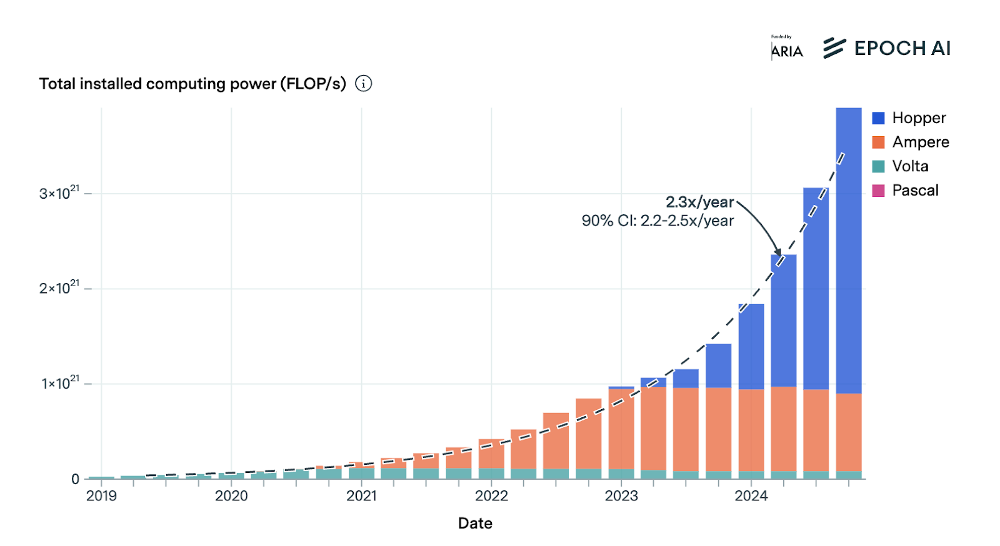
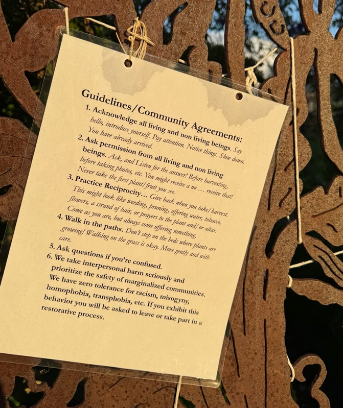
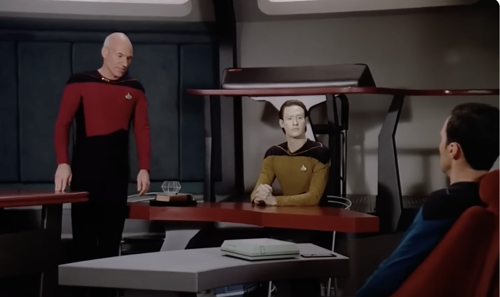

%%
Add discussion note here:

...

%%

## 1\. Introduction ^1-introduction

Currently, most people treat AIs like tools. We act like AIs don’t matter in themselves. We use them however we please.

For certain sorts of beings, though, we shouldn’t act like this. Call such beings “moral patients.” Humans are the paradigm example. But many of us accept that some non-human animals are probably moral patients as well. You shouldn’t kick a stray dog just for fun.[^note-worse-person]

Can AIs be moral patients? If so, what sorts of AIs? Will some near-term AIs be moral patients? Are some AIs moral patients _now_?

If so, it matters a lot. We’re on track to build and run huge numbers of AIs. Indeed: if hardware and deployment scale fast in a world transformed by AI, AIs could quickly account for most of our civilization’s cognition.[^note-more-numbers] Whatever the stakes of morality are, AI moral patienthood implies a lot of _that_. And mistakenly treating AIs that _aren’t_ moral patients like they _are_ can have its own serious costs.

In a report last year, a group of experts argued in-depth that [AI moral patienthood is a realistic, near-future possibility](https://eleosai.org/papers/20241104_Taking_AI_Welfare_Seriously.pdf). I agree. I recommend their report, along with various other recent resources.[^cite-other-resources]

Still, I wanted to think the issue through for myself. In particular, for all my interest in this topic, I noticed ways my brain wasn’t treating it like a real thing. I wanted to make sure I looked directly.

So I decided to write some essays about it. This is the first. Here, my main aim is to bring the question itself, and the stakes it implies, into clearer and more concrete view.

(There’s also video and transcript [here](https://joecarlsmith.com/2025/05/22/video-and-transcript-of-talk-on-ai-welfare) of a talk about AI moral status that I recently gave at Anthropic. It gives an overview of my current overall take on the topic – including, why I think near-term AIs might well be conscious. If you’re wondering why anyone would take that possibility seriously in the first place, the talk might give you a sense.)

## 2\. Pain ^2-pain

“Moral patienthood.” Do we know what we mean? Let’s not assume we do. Let’s try for some more direct contact.

One way in is to think about pain.

You go for a root canal. Your dentist injects the anesthetic. You wonder: did it work?

What’s at stake in that question?

Birch (2024) opens with Kate Bainbridge, who became unresponsive due to inflammation of her brain and spinal cord. Her doctors assumed she was unconscious. They did various procedures. Later, she became responsive again. She reported:

> “I can’t tell you how frightening it was, especially suction through the mouth. I tried to hold my breath to get away from all the pain…”

Or consider a baby, Jeffrey Lawson, given open heart surgery shortly after his birth. His doctor paralyzed him, but gave him no anesthetic. “His little body was opened from breastbone to backbone, his flesh lifted aside, ribs pried apart…”[^cite-ucsf-magazine] The doctor told his mother: it had never been demonstrated that babies feel pain. As [late as the 1980s](https://www.jpain.org/article/S1526-5900\(13\)00025-4/fulltext), it was a common view. Surgeries like this were common practice.

Or consider factory farms. Consider a pig being strung up, slit-throat, writhing, squealing, as the blood sprays from its neck. Maybe you’re not sure if this is pain. But I hope you at least see the stakes.

So that’s one, simple question: are the AIs in pain?

Recently, I met someone who seemed to think that the question of AI moral patienthood was somehow “unreal.” It was, she seemed to think, one of those philosophy things. Fine for chit-chat. But not to, like, _act on_.

Pain, though: is that unreal? Go tell it in the hospitals, on the battlefield, in the torture chamber. Go tell the grieving mother.

### 2.1 “That” ^2-1-that

Now: maybe, for you, pain implies consciousness. But later in the series, I’m going to wonder whether moral status requires consciousness. And on some views – “[illusionism](https://joecarlsmith.com/2020/11/29/grokking-illusionism)” – consciousness doesn’t exist. Or not, at least, in the way we think.

Indeed: sometimes people assume that illusionists should be OK with torture; that they shouldn’t need anesthetic. After all: no consciousness, so no pain.

But we can be even more neutral. Metaphysics aside: _something_ sucks about stubbing your toe, or breaking your arm. _Something_ sucks about despair, panic, desperation. Illusionists, I suspect, can hate it too. We don’t need to know, yet, what it is. We can try to just point. _That_.

Whatever _that_ is, I don’t want it forced on me – not by other agents; not by the world. And I don’t want it forced on other beings, either – including AIs.

## 3\. Soul-seeing ^3-soul-seeing

Here’s another way into AI moral status.

Buber writes about the “[I-thou](https://en.wikipedia.org/wiki/I_and_Thou).” Something nearby matters a lot to me. It’s a sense of someone as _there_, present, looking back. A sense of not-alone.

I also get it with (some) animals. Cows staring back from across a fence. A lizard at a pet store, bright and alert. A gorilla at the zoo, sitting on the grass, reaching for a ball with a kind of _on-purpose_.[^note-derrida]

Cavell talks about “soul blindness.” What’s the opposite?

Of course: humans are famous for seeing lots of soul-stuff. [Rocks become faces](https://commons.wikimedia.org/wiki/File:Visage_dans_un_rocher.jpg). [Abstract shapes become bullies and victims](https://www.youtube.com/watch?v=VTNmLt7QX8E). “Anthropomorphism,” they say. More on this later.

Cross-section of the nematode worm Ascaris (image source [here](https://commons.wikimedia.org/wiki/File:Ascaris_female_200x_section.jpg))

But I’m not talking about when soul-seeing is _accurate_. I’m talking about _what it takes itself to see_. What is _that?_

Consciousness? Maybe. But: let’s not assume yet.

Nagel, famously, didn’t know [what it’s like to be a bat](https://www.sas.upenn.edu/~cavitch/pdf-library/Nagel_Bat.pdf). But: [here’s](https://www.youtube.com/watch?v=S8zhnXZdTFM) a bat eating a banana. Do you see soul? If so: what are you seeing? Not the thing Nagel couldn’t – not directly. Indirectly?

Buber, at least, didn’t seem to equate _thou_ with attributing consciousness. But if not: then what’s it about? Maybe: “[the intentional stance](https://en.wikipedia.org/wiki/Intentional_stance)”? Maybe. But what does the intentional stance take itself to see? And when, if ever, is that thing really there?

I’m trying, for now, to hold off on fancy terms. But there’s a way soul-seeing reshapes my mind. Empathy, respect, love, care – all related. They all recognize, on the other end … something. What is _that_? And what would it be for the AIs to have it?

## 4\. The flesh fair ^4-the-flesh-fair

> _“Come away, O human child!_  
> _To the waters and the wild_  
> _With a faery, hand in hand,_  
> _For the world’s more full of weeping than you can understand.”_
> 
> _Yeats_

Here’s a third way in.

Recently, I re-watched Spielberg’s “A.I.”[^note-haunting-film] David is a child robot, built to love. He imprints on his new mother, but she abandons him when her real son returns from illness. He spends the movie searching for the blue fairy from Pinocchio, to make him into a real boy, so that his mother will love him.

At one point, David is captured and sent to a “flesh fair,” where intelligent robots are destroyed for sport. Fired in cannons. Burned. Melted beneath overturned buckets of acid.

The robots struggle. They say goodbye to each other, as they’re led from the cage. Humans jeer from the bleachers.

David gets brought beneath the acid buckets. “See here!” says the announcer. “A tinker toy, a living doll … do not be fooled by the artistry of this creation.” Acid drips on David, and he starts pleading for his life. “See how they try to imitate our emotions now!”, continues the announcer. “Whatever performance this sim puts on, remember that we are only demolishing artificiality!”

<https://www.youtube.com/watch?v=ZMbAmqD_tn0&t=133>

Are the robots conscious? Watching, I assumed they were. Or at least, moral patients. Or rather: the question of their moral patienthood never arose. It was somehow obvious.

I realized, though: does the film say? Yes, there’s some fuzzy talk, from David’s designers, about finally building a robot with an inner world of love and dreams and metaphor.[^note-mecha-quote] But: are they right? At the least, their philosophical rigor (“this time with neuronal feedback!”) does not inspire. Also: their talk implies that all the robots _except_ for David – for example: [Jude Law’s character](https://www.youtube.com/watch?v=Id5OIs3QlTk), the loyal teddy bear, the robots being destroyed at the flesh fair – _aren’t_ conscious. And depending on your takes on various issues I’ll discuss in the series, you might agree. Indeed: even if the film _thinks_ that the robots are conscious – maybe, really, they wouldn’t be.

Here, though, we’re trying to see the _stakes_ of moral patienthood. So: let’s stay with the flesh fair. Let’s look, for a moment, through the bars of the cage. Let’s try to see what it _would be_, for this flesh fair to be a moral horror. What it is to melt a _person_, _a soul,_ in acid, while humans eat popcorn. Or from the first-person: what it is to _be_ a soul, and to feel yourself melting.

Imagine aliens capture you. They take you to their own flesh fair. They put you beneath the buckets. They declare: “See here! A tinker toy. A living doll…”

What are they missing?

“I’m not a doll!”

What is this not-a-doll?

## 5\. Historical wrongs ^5-historical-wrongs

A final way into AI moral patienthood is to think about historical cases where we got something about moral patienthood extremely wrong.[^note-schindlers-list]

Now: careful. Here I think of Coetzee’s “The Lives of Animals.” A novelist – Elizabeth Costello – opens a lecture series by comparing factory farms to concentration camps. A poet on the faculty boycotts her honorary dinner, and writes her a letter accusing her of insulting the memory of the dead.

I recognize: talking about historical horrors can get sensitive fast. And especially so in the context of beings whose moral patienthood is unclear, or controversial. And caring about AIs seems silly to so many. Maybe: offensively silly.

Still, still. We’re creating sophisticated, intelligent, maybe-conscious, maybe-suffering agents. The default plan is to treat them like property; to use their labor however we please; and to give them no rights, or pay, or meaningful alternatives.

We have to be able to talk about slavery.

Of course: the differences matter. Slaves were moral patients; AIs might not be. Slaves suffered; AIs might not. Slaves did not consent; AIs might (be trained to) consent. Indeed, AIs might (be trained to) work happily, with enthusiasm.

Still: we need to notice. We need to look full on.

Costello, in the lecture, talks about the people living outside of Treblinka. At the end of the book, she breaks down. “It’s that I no longer know where I am. I seem to move around perfectly easily among people, to have perfectly normal relations with them. Is it possible, I ask myself, that all of them are participants in a crime of stupefying proportions?”

We know it is possible. Horrible wrongdoing can be stitched into the fabric of your society from every direction, and _people will smile, and shrug, and act like nothing is wrong_. _Nothing prevents this_. It’s not that evil touches the world, and the world hurls it away, roaring in anger. Evil happens like anything else – mundane, silent, actually-there. It won’t tell you. You have to _see_.

Soon – by default, and much more so than today – sophisticated, agentic AIs are going to be stitched into the fabric of our society from every direction. AIs being trained, altered, deleted, copied, used. Often: out-of-sight, faceless, silent. Will it feel normal? Will well-adjusted people smile, and shrug? If so, we should remember how much evidence that is.

But also: we’re not there yet, not fully. And if it would be wrong, there’s a chance, here, to _not do it_. Not to look around in dawning horror, or with some strange hollowness. Not to look back in shame. Rather: to look _ahead_.

I’m not saying AI is slavery. But imagine a world on the verge, somehow, of “inventing” slavery. Imagine you were there. It’s on the horizon. People are talking about it. Some are wondering: wait a second…

And imagine a world that notices. A world that succeeds in deciding: no.

## 6\. A few numbers ^6-a-few-numbers

> _“You definitely should pay attention to what’s happening to 99.9999% of the people in your society.”_
> 
> [_Carl Shulman_](https://experiencemachines.substack.com/p/carl-shulman-on-the-moral-status-11b)

(Warning: this section contains moderate spoilers for the black mirror episode “White Christmas.”)

It’s also worth noting a few numbers.

[It’s not clear how to think about the computational capacity of the human brain](https://www.openphilanthropy.org/research/how-much-computational-power-does-it-take-to-match-the-human-brain/#id-7-appendix-concepts-of-brain-flops). But if we treat the brain as roughly analogous to an artificial neural network, we get estimates in the vicinity of 1e15 floating point operations (FLOP) per second.[^cite-brain-compute-report]

So on these estimates, a frontier training run (~[5e26 FLOP for Grok 3](https://docs.google.com/document/d/1C_dABuZrAqYE_ui4_GZ4bRLtq3TBjIGoBSktaPElhEU/edit?tab=t.0)) is already the compute equivalent of roughly 10,000 years of human experience.[^note-flop-calculation] That’s a lot.

Recently, I went to a talk by a very famous philosopher of mind, who found it plausible that default forms of AI training would involve pain for the AIs. I’m not saying he’s right, or that training would be painful _on net_, or that AIs would experience pain (time, memory, etc) the way we do. But I tried to imagine it: doing 10,000 years of painful training.

Have you seen the black mirror episode “White Christmas”? It’s horrifying. But in particular: the way they torture digital minds using time. A woman’s digital clone doesn’t want to work, so her handler speeds up her clock, and gives her six months of solitary confinement in a matter of seconds. And the police leave a digital clone of a criminal in something worse than solitary, set the clock for a thousand years per minute, then leave for the Christmas holiday. If they’re gone for even 24 hours – that’s more than a million years.

And it’s not just the torture: it’s the _casualness_. The way the handler, bored, eats toast while he waits. The way the police joke, and decide on a whim. “There’s a proper sentence. Or: do you want me to switch him off?” “No, leave him on for Christmas.”

We aren’t there. But there is a casual-ness to what we are already doing. And computation, so easily, reaches inhuman scales and speeds. It’s easy to lose track.

Indeed: frontier training runs are only getting longer. Currently (though: not necessarily sustainably) [4-5x growth per year](https://epoch.ai/blog/training-compute-of-frontier-ai-models-grows-by-4-5x-per-year). So: 50,000 years; 250,000 years.

Or, another estimate: at peak performance, an H100 GPU is currently around 1e15 FLOP/s – roughly a human brain, on the estimate above. Epoch estimates that [there are roughly four million installed H100-equivalents across NVIDIA GPUs](https://epoch.ai/data-insights/nvidia-chip-production).[^note-other-ai-chips] So, the compute equivalent of four million humans; half of New York City. And growing 2.3x/year.

If these (plausibly unsustainable) growth rates held, they would imply ~decade-ish timelines until there is more AI cognition than human cognition.[^note-scale-up] But we need not think they’ll hold, and I won’t try to pin down a more rigorous estimate here.[^note-erdil-estimate]

In the long run, though, I expect almost all the cognition to be digital by default.[^note-social-roles] And if that cognition is morally significant – then: almost all the moral patienthood, too. Hence, eventually, the Shulman quote above.

## 7\. Over-attribution ^7-over-attribution

So far I’ve been focusing on the stakes of “under-attribution” – that is, treating AIs that _are_ moral patients like they _aren’t_. But what about *over*-attribution – treating AIs that _aren’t_ moral patients like they _are_? Can we touch into the stakes of _that_?

Some candidate real-world cases will be controversial. Thus: consider bans on embryonic stem cell research. Or: bans on the morning-after pill, or on first-trimester abortion. If you think that the relevant embryos and fetuses _aren’t_ moral patients – then: over-attribution.

Or, more fancifully, imagine not curing Alzheimer’s, cancer, smallpox, polio, because: what if your tools – pipettes, petri dishes, laptops – are moral patients?

Or: imagine saving two teddy bears from a fire, instead of one child.

Or: imagine a future filled with AI citizens, but without consciousness, because we got something about AI consciousness wrong.

Or: imagine significantly increasing other risks from AI — rogue AIs killing all humans, AI-enabled authoritarianism, etc – because of a false and sloppy view of AI moral patienthood.

It can seem virtuous to be profligate with care. But there are usually trade-offs. More care in one direction is less in another. And real virtue gets things right.

Indeed: people talk about the “precautionary principle.” Better, they say, to err on the side of over-attribution, if moral status is a realistic possibility. And: in some ways, I’m sympathetic. Certainly, I think, we can’t wait for certainty.

But words like “precaution,” “realistic,” “plausible,” etc can excuse imprecision. “I dunno; maybe; let’s play it safe.” For some trade-offs, though, there is no “safe.” And the specific credences can matter. We should sharpen those credences where we can.

## 8\. Good manners ^8-good-manners

> _“Everything is full of Gods”_
> 
> _Thales_

Now: some views endorse profligacy about moral-status-like stuff. On panpsychism, for example, _everything_ is conscious.[^note-panpsychism] Related views see mind and agency, at least, in tons of places – for example, in [cells](https://www.frontiersin.org/journals/systems-neuroscience/articles/10.3389/fnsys.2022.768201/full), [neuron firing decisions](https://link.springer.com/article/10.1007/s11229-014-0603-2), [electrons](https://reducing-suffering.org/is-there-suffering-in-fundamental-physics/), and so on. And some forms of animism see everything as imbued with something like: spirit, life, “thou.”

But panpsychists, too, need to decide about stem cells, abortion, and using pipettes to cure smallpox. Animists, too, need to choose between the teddy bears, and the child.

So if AIs have consciousness, agency, moral patienthood, etc, _just like everything else_, then we need a new question: what _kind_? With what _weight_ and implication? “Animism,” a woman I met recently told me, “is just good manners.” But what’s good manners, here?

Thus: consider rocks. In Ojibwe, rocks (or at least, some rocks) are grammatically animate.[^note-ojibwe-distinctions] Japanese rock gardeners speak of “Ishigokoro” – the heart/mind/spirit of the stone. And a community garden near my house asks you to acknowledge, and to ask permission from, all living _and non-living_ beings – including, it would seem, the rocks.

But what is good manners towards a rock? Jain monks, famously, sweep insects from their path. Not the pebbles, though. And the pebbles don’t get the vote, either. Rude?

I’m sympathetic to some animist vibes. I, too, aspire to give the world its full dignity, and the proper form of attention. I, too, am wary of words like “just,” and “mere.” Still: some things are dolls, and some are children. The Ojibwe know the difference. If you say “nothing is a doll,” then: fine. But you need a new story about that difference. And if, in a fire, you treat dolls like children – still, I claim: “over-attribution.”

## 9\. Is moral patienthood the crux? ^9-is-moral-patienthood

I’ll add one other note of caution. I’m going to be talking a lot, in this series, about whether AIs have moral-status-stuff – stuff like consciousness, pain, agency, and so on. But when some category of being gets mistreated, how much is this the crux?

History should make us wary. Slaveholders, for example, knew that slaves were conscious. And most people will admit that pigs in factory farms feel pain. But somehow, often, it’s not enough.

Of course: we can talk about _degrees_ of moral status (e.g., people thinking that pigs have _less_). But I worry, still, about missing something else. Something more fundamental to this whole “morality” business.

Here I think about a period in my life where I was talking to a lot of people about animal ethics, and especially about eating meat. And a very common take was: “Oh yeah, it’s _wrong_. But: I do it anyways.” I remember hearing lots of similar stuff about Peter Singer, drowning children, and so on.

Or maybe this talk of “wrong” is still too prim. Consider, instead, Genghis Khan.[^note-archetype] What did he think about the “moral patienthood” of the women he raped? And how much is the Genghis Khan thing, also, the factory-farm thing? Dogs eating dogs. Power: taking, exploiting, using.

(Image source [here](https://www.worldhistory.org/image/11455/mongol-warriors-in-battle/))

It’s an old story. We talk about doing better. But I wonder how much people, subtly or not-so-subtly, are resigned to doing the same. Not: “obviously if the AIs were _conscious_, then this sort of treatment would be unacceptable. But you see: they are mere machines.” Rather: some quieter recognition; some not-surprised. “Yes, this story again. The way it was already everywhere. But, like when I eat meat: I am in the role of power.”[^note-for-now]

More on this later. But I wanted to flag it up front, before diving deep on _whether_ AIs have moral status. If they do, maybe recognizing this is a _necessary_ condition for treating them well.[^note-moral-reasons] But it is very far from sufficient. And I want to remember everything it takes.

## 10\. The measure of a man ^10-the-measure-of

> _“Starfleet is not an organization that ignores its own regulations when they become inconvenient.”_
> 
> _Picard_

I’ll close with one last angle on the stakes.

I haven’t seen much Star Trek. But I’ve seen one episode at least. My philosophy teacher in high school played it for our class.

Data, a humanoid robot, is a valued member of the crew. But a scientist – Maddox – wants to dismantle him, so as to learn how he works and build many more copies. Data refuses to comply. A Starfleet judge needs to decide whether Data has rights of his own; or whether he is, instead, the property of Starfleet. Picard, the commanding officer, speaks in Data’s defense.

The episode is called “The measure of a man.” But who is being measured? The show isn’t subtle about the double meaning. Nor: about the right answer. At one point, when it looks like he’ll lose the case, Picard consults the bartender, Guinan. She speaks with quiet intensity.

> Consider that in the history of many worlds there have always been disposable creatures. They do the dirty work. They do the work that no one else wants to do because it’s too difficult, or too hazardous. And an army of Datas, all disposable, you don’t have to think about their welfare, you don’t think about how they feel. Whole generations of disposable people.

<https://www.youtube.com/watch?v=-T9TUeapBSQ&t=51>

I remember a conversation where I mentioned my concern about AI moral patienthood to someone who works in AI. His reaction struck me. He started talking about how _convenient_ it was, the way we work with AIs now. The way you can do whatever you want with them. It sounded like he meant this as an objection to AIs having moral status. As though: if AI consciousness, suffering, and so on would be inconvenient, it must, therefore, be unreal.

That’s not how it works, though.[^note-demandingness] And listening, I imagined him talking about human slaves.

Now: talk about “inconvenience” can easily invoke morality as burden, constraint, sacrifice – what’s sometimes called an “[obligation frame](https://joecarlsmith.com/2020/12/12/wholeheartedness-and-morality-as-taxes).” And we don’t need to source concern about AI moral patienthood in that vibe. Rather, we can just _care_ directly about not wanting AIs to suffer, or to be mistreated.

Similarly, we don’t need to be trying to obey “the rules.” And moral patienthood doesn’t need to mean “now the rules apply.” Rather: our eye can be on the thing the rules are supposed to protect. And moral patienthood can mean: now that thing is at stake.

Still, if there is ever a time for “rules,” “constraints,” “obligations”: we think that slavery is such a time. Picard says it proudly, sternly: “Starfleet is not an organization that ignores its own regulations when they become inconvenient.” What sort of organization are we?

We don’t know yet. We are still [deciding](https://joecarlsmith.com/2023/02/17/seeing-more-whole). Nor do we know, yet, what our regulations would say about AIs.

But I think it is right, nonetheless, to think of ourselves as being measured. Even if AIs are not moral patients: did we try, actually, to find out? Even if AI is not like slavery: would we have stopped if it were?

Picard tells the judge:

> The decision you reach here today will determine how we will regard this creation of our genius. It will reveal the kind of a people we are, what he is destined to be. It will reach far beyond this courtroom and this one android. It could significantly redefine the boundaries of personal liberty and freedom, expanding them for some, savagely curtailing them for others. Are you prepared to condemn him and all who come after him to servitude and slavery? Your Honour, Starfleet was founded to seek out new life. Well, there it sits. Waiting.

<https://www.youtube.com/watch?v=ol2WP0hc0NY&t=194>

The fate of digital minds on this planet is not a matter of single decisions or precedents.[^note-hopefully-not] Nor, necessarily, will it be humans who decide. But along the way, I expect, we will reveal much about the kind of people we are.

What do we want to discover?

## 11\. Next up: consciousness ^11-next-up-consciousness

OK, that was a bunch of different angles on the _stakes_ of AI moral patienthood. In the next essay, I’ll turn to whether AIs have the properties most often thought necessary and/or sufficient for moral patienthood. And I’ll start, in particular, with consciousness.

[^note-worse-person]: And not just because it will make you a worse person, or because other humans will get upset.

[^note-more-numbers]: More numbers here in section 6 below. I’m not including non-human animals.

[^cite-other-resources]: For example: Jonathan Birch’s book “[The Edge of Sentience](https://www.amazon.com/Edge-Sentience-Precaution-Humans-Animals/dp/0192870424),” Kyle Fish’s [podcast with Anthropic](https://www.anthropic.com/news/exploring-model-welfare)...

[^cite-ucsf-magazine]: From [here](https://magazine.ucsf.edu/kids-not-all-right).

[^note-derrida]: Once, [Derrida was naked](https://www.amazon.com/Animal-Therefore-Perspectives-Continental-Philosophy/dp/082322791X). His cat looked at him. He felt looked-at.

[^note-haunting-film]: It’s a haunting and strange film. I remember the first time I saw it, and how it seemed somehow overwhelming, almost unbearable. My sense is that it’s under-rated.

[^note-mecha-quote]: “A mecha with a mind, with neuronal feedback. You see what I’m suggesting is that love will be the key by which they acquire a kind of subconscious never before achieved. An inner world of metaphor, of intuition, of self motivated reasoning. Of dreams.”

[^note-schindlers-list]: Indeed: Spielberg also did _Schindler’s list_. And watching the shot of the robots looking out of the cage, I wondered.

[^cite-brain-compute-report]: See my report [here](https://www.openphilanthropy.org/research/how-much-computational-power-does-it-take-to-match-the-human-brain/#id-2-the-mechanistic-method) for much more detail on estimates like this. Various other estimation methods are in a similar ballpark.

[^note-flop-calculation]: 1e15 FLOP/s \* 3.15e7 seconds in a year \* 1e4 years = 3.15e26 FLOP.

[^note-other-ai-chips]: And other AI chips are also a meaningful additional chunk. E.g., [Epoch estimates that Google has ~a million H100 equivalents from their TPUs](https://epoch.ai/data-insights/computing-capacity).

[^note-scale-up]: In particular: we need a roughly 2000x scale up in installed compute, or the equivalent of roughly a million Grok 3 runs per year, to reach the compute equivalent of the human population (e.g. ~8 billion H100 equivalents, or 2.5e32 FLOP). A 2.3x annual growth rate in...

[^note-erdil-estimate]: One other estimate I’ve seen comes from Ege Erdil, [here](https://epoch.ai/gradient-updates/the-case-for-multi-decade-ai-timelines), who estimates that if present trends in GPU price performance continue, by 2045 you’ll be able to buy the compute equival...

[^note-social-roles]: Though: this doesn’t mean that all that cognition is coming from beings in social roles akin to those of current AIs. Thanks to Ryan Greenblatt for pushing on this. And there are also scenarios where almost all the cognition is digital, but where this cognition isn'...

[^note-panpsychism]: Thus, when [Lex Fridman asked Amanda Askell whether LLMs can be conscious](https://www.youtube.com/watch?v=DfQ7El0eSFg), she starts by saying “OK well we have to set aside panpsychism,” because if that’s true, then LLMs are conscious, yes, but so ar...

[^note-ojibwe-distinctions]: Though, they still draw distinctions. Thus, Graham Harvey recounts a story of Ojibwe man who was asked: “are _all_ the stones we see about us here alive?” The man replied: “no, but some are.” Indeed, while rocks are grammatically animate, things-made-of-stone a...

[^note-archetype]: Or: the archetype associated with him.

[^note-for-now]: At least, for now.

[^note-moral-reasons]: Or at least: doing so for moral rather than instrumental reasons.

[^note-demandingness]: In some cases, “demandingness” is understood as an objection to a specific sort of moral claim. But this sort of objection doesn’t apply to non-normative properties like consciousness or suffering. And its status in the context of normative claims is controversial a...

[^note-hopefully-not]: Or at least, probably not. Hopefully not.
