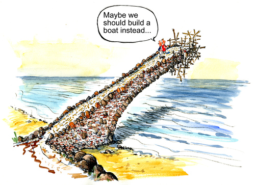
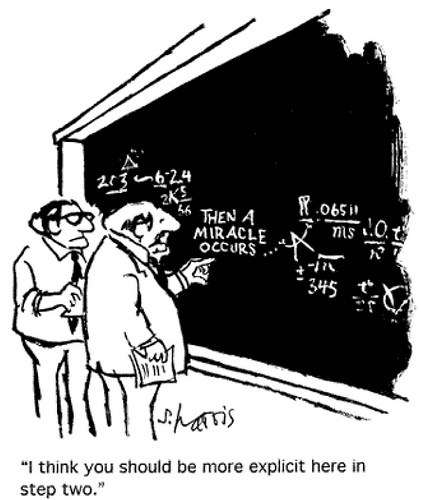

%%
Add discussion note here:

...

%%

Theory of Change is essentially a comprehensive description and illustration of how and why a desired change is expected to happen in a particular context. It is focused in particular on mapping out or “filling in” what has been described as the “missing middle” between what a program or change initiative does (its activities or interventions) and how these lead to desired goals being achieved. It does this by first identifying the desired long-term goals and then works back from these to identify all the conditions (outcomes) that must be in place (and how these related to one another causally) for the goals to occur. These are all mapped out in an Outcomes Framework.

Image credit: Sidney Harris

The Outcomes Framework then provides the basis for identifying what type of activity or intervention will lead to the outcomes identified as preconditions for achieving the long-term goal. Through this approach, the precise link between activities and the achievement of the long-term goals are more fully understood. This leads to better planning, in that activities are linked to a detailed understanding of how change actually happens. It also leads to better evaluation, as it is possible to measure progress towards the achievement of longer-term goals that goes beyond the identification of program outputs.
