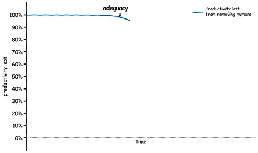
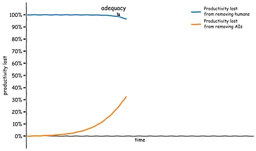
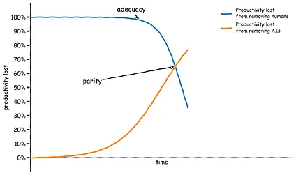
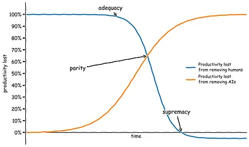
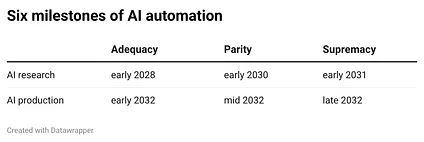

%%
Add discussion note here:

...

%%

The closer you think you are to your “powerful AI” milestone of choice, the more important it becomes to define it precisely. If your timelines are in the few-year range, changing the particular definition of powerful AI can easily double or triple your median forecast. Take my definition of “full automation of AI R&D” from my [predictions post](https://www.planned-obsolescence.org/p/ai-predictions-for-2026) earlier this year:

> _\[F\]or whichever AI company is in the lead \[at the relevant point in time\], if you fired all its members of technical staff,[^note-1] its rate of technical progress on relevant benchmarks would be slowed down by less than 25% (this is a pretty arbitrary threshold, you can make the milestone more or less extreme by choosing a smaller or bigger number)._

There’s a lot that could be made more precise about this definition, but let’s zoom in on that arbitrary quantitative threshold.

In every major sector of economic activity, the productivity hit you take from removing humans is and has always been 100%. If suddenly no human could do any of the work people currently do in the agriculture sector, our plows and seed drills and combine harvesters wouldn’t till and plant and tend and harvest entirely on their own. We have many more machines to help us than we did in 1000 AD, but if we magically prevented all humans from doing any farming work, all our machines would just sit there and we would starve just as surely as our ancestors would have.

One salient milestone is the very first time the hit from removing humans is smaller than 100% in a given sector — the first time that machines can _just barely_ produce output in that sector, painstakingly limping along by themselves without any humans to operate them. Let’s call this milestone **adequacy**. At this point, removing humans would still result in a catastrophic hit to output, but it’s nonetheless an unprecedented leap that unaided machines can make forward progress at _some_ non-zero pace.[^note-2]

{--{"author":"James's AI","timestamp":1794139435503}@@[

--}{--{"author":"James's AI","timestamp":1794138732174}@@

](https://substackcdn.com/image/fetch/$s_!XLv-!,f_auto,q_auto:good,fl_progressive:steep/https%3A%2F%2Fsubstack-post-media.s3.amazonaws.com%2Fpublic%2Fimages%2Fede410c3-b80e-4ef3-832b-5c59ef49b8ec_1760x1040.png)--}

Note that the threshold of adequacy is defined in terms of the productivity hit you take from _removing humans_, which is unrelated to the productivity hit you take from _removing the machines._ These do not have to add up to 100% because humans and machines are complements. Our tractors and weeders and tillers add a huge amount to agricultural productivity, and our yields would probably plummet by well over 90% if we had to give them all up and farm like medieval peasants. But they are still not _adequate_ at farming autonomously, because getting rid of the humans would cut yields by 100%.

{--{"author":"James's AI","timestamp":1794138734879}@@[

--}{--{"author":"James's AI","timestamp":1794138734879}@@

](https://substackcdn.com/image/fetch/$s_!Hkvm!,f_auto,q_auto:good,fl_progressive:steep/https%3A%2F%2Fsubstack-post-media.s3.amazonaws.com%2Fpublic%2Fimages%2Fc5a9dacd-ef1b-4c4f-9322-797574e71595_1760x1040.png)--}

While AI agents are clearly adding positively to productivity at AI companies, I think they are not yet at the adequacy milestone for AI R&D. If all humans were magically prevented from doing any AI research or engineering work, and we replaced them all with giant teams of AI agents, I think the agents would likely get catastrophically stuck, and R&D progress would grind to a halt within weeks.

But this is not entirely obvious! We have AI coding agents that can stay running for a long time, that can spin up subagents and give them instructions, that can write notes to other agents…we may already have all the ingredients in place. Maybe tens of thousands of these agents churning together writing huge piles of horrendous slop code would eventually, over years, advance the frontier of AI research a bit.[^note-3] Who knows? We won’t easily be able to tell when we first reach adequacy, because no one would bother trying to hand off research to AIs at the first point when they might barely be adequate at it.

Once AIs reach adequacy in a certain sector, they will keep improving. The next interesting milestone is **parity** — the first point when getting rid of the AIs slows down progress in the sector _more_ than getting rid of all the humans. The first time parity is reached, it’s likely that humans will still be better than AIs at many important subtasks, so getting rid of them and forcing the AIs to do those tasks instead would result in a substantial hit to productivity. It’s just that human labor _as a whole_ is less important for productivity than AI labor.

{--{"author":"James's AI","timestamp":1794138737605}@@[

--}{--{"author":"James's AI","timestamp":1794138737605}@@

](https://substackcdn.com/image/fetch/$s_!2nRD!,f_auto,q_auto:good,fl_progressive:steep/https%3A%2F%2Fsubstack-post-media.s3.amazonaws.com%2Fpublic%2Fimages%2F738fa2cc-7e28-4a78-9cbf-0e124c0aac3f_1760x1040.png)--}

When I defined “full automation of AI R&D” as the point when productivity only drops 25% or less from removing humans, I was gesturing at AI systems that are somewhat better than parity in the AI R&D sector.

Beyond parity, we can talk about **supremacy** — the first point when productivity in a given sector would actually _increase_ from removing humans. In other words, a major sector of the economy would become like chess. If for some reason you wanted to win as many chess games as possible per dollar, unaided computers would crush human-computer teams right now. A human-AI team _can_ technically draw against an AI opponent, if the human defers to their AI teammate about every move. But if you care at all about resource constraints,[^note-4] the human is pure deadweight. Supremacy is the point where it’s no longer worth the overhead to deal with humans or the cost of the food they need to stay alive.[^note-5]

{--{"author":"James's AI","timestamp":1794138740447}@@[

--}{--{"author":"James's AI","timestamp":1794138740447}@@

](https://substackcdn.com/image/fetch/$s_!SYeY!,f_auto,q_auto:good,fl_progressive:steep/https%3A%2F%2Fsubstack-post-media.s3.amazonaws.com%2Fpublic%2Fimages%2F18bbac7d-b155-4bda-aa2d-45a5c54440b7_1760x1040.png)--}

In theory, we can talk separately about the entire spectrum from adequacy through parity to supremacy for any sector, from agriculture to pharmaceuticals to finance. But two domains are likely to set the pace for all the rest: AI research and AI production (that is, the entire stack of chips, fabs, fab equipment manufacturers, power plants, and everything else that goes into producing and running AI systems). If we cross the three automation thresholds with these two domains, we get six milestones. Here are my current best guesses for when we cross these milestones:

{--{"author":"James's AI","timestamp":1794138743322}@@[

--}{--{"author":"James's AI","timestamp":1794138743322}@@

](https://substackcdn.com/image/fetch/$s_!9VXQ!,f_auto,q_auto:good,fl_progressive:steep/https%3A%2F%2Fsubstack-post-media.s3.amazonaws.com%2Fpublic%2Fimages%2F870339da-3a3a-449d-b730-294dfb4495c1_1240x414.png)--}

We seem very close to _AI research adequacy_ already. As I said, I wouldn’t be totally shocked if you told me this milestone had already passed, and I expect it to happen in the next couple years. From there, it seems like another couple of years could take us to _AI research parity_. When we’re at _AI research parity_, we’ll effectively have millions of researchers working on advancing AI, instead of thousands as we do today. I think this would massively accelerate the pace of AI progress, leading to _AI research supremacy_ within another year.

The AIs that come out the end of this process would likely be able to pick up new skills with orders of magnitude less data than we need to provide systems today, including the skills required to operate physical actuators like robots and the skills involved in mining, electrical engineering, semiconductor manufacturing, and everything else involved in maintaining the AI stack. From there, reaching _AI production adequacy_ and then _parity_ and _supremacy_ seems like it would mainly be a matter of rolling out AI to enough places and manufacturing enough actuators for it to operate.

Because _AI production supremacy_ requires AIs and robots to master an extremely diverse range of physical and scientific skills, I think it also entails supremacy on practically any objectively-measurable physical contest. For any goal defined in terms of outcomes in the physical world, where you could explain it to an alien and they could adjudicate whether it had happened — sending something to space, blowing something up, generating some energy, mining some ore, terraforming a planet — humans would be worse than useless at contributing to that outcome.

This is well past the point of barely [self-sufficient AI](https://www.planned-obsolescence.org/p/self-sufficient-ai). At this point, every country on Earth is wholly reliant on its entirely-automated military, and it would be trivial for AI systems to take over the world if they wanted to.

[^note-1]: The obvious legalese applies to that conditional clause: the company can't rehire any technical staff and none of its other staff can ever switch into technical roles. The company can still have human legal staff and ops staff and custodial staff, but no human ever gets to touch anything related to the research or the codebase anymore — including the "soft" stuff like setting research direction, project management and supervision, or synthesizing varied pieces of evidence to build a holistic scientific picture of a big research question.
[^note-2]: When I wrote my post about [self-sufficient AI](https://www.planned-obsolescence.org/p/self-sufficient-ai), I was vague about exactly what it means for the AI to be self-sufficient — just how _well_ do they have to be able to sustain themselves? I think it’s most naturally interpreted as an adequacy threshold. As [Steve Newman points out](https://x.com/snewmanpv/status/2009008644973842713), there’s a gritty sci fi story like the Martian in there about whether the scrappy band of prototype robots can bootstrap production before they all break down.
[^note-3]: That is, if humans keep maintaining their physical existence; the lines are a bit blurry for AI R&D, or any sector other than the entire AI production stack.
[^note-4]: In clean economic models, you’ll find that humans are always able to contribute _something_ because of the law of comparative advantage. But this only applies because those models assume that land is infinite (so humans can always go to marginal land and subsistence farm there) and that trading overheads are zero. Both of those are untrue in the real world, so it’s likely AI systems eventually don’t bother to trade with humans.
[^note-5]: Note: it’s certainly possible that humans have been killed _before_ this point; I didn’t include this conditional to keep the milestones clean, but supremacy on everything comes _after_ [self-sufficient AI](https://www.planned-obsolescence.org/p/self-sufficient-ai), the point when AI systems could survive without humans around.
