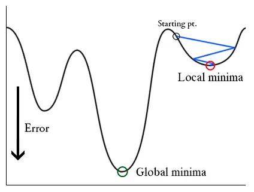

%%
Add discussion note here:

...

%%

_Note 1: This post is week 1 of a 9-week blogging challenge._

_Note 2: This post is mostly geared towards students and early-career people. It may be less useful for people with high context in AI safety, who should start reading at “[[#^a-lot-of-people|A lot of people aren’t clear on their T’s.]]”_

---

This year, significantly more people have learned about and taken interest in AI safety.

As more people get involved, it’s important to consider different strategies of addressing AI risks. The stakes may be extremely high. We probably don’t have 50 years to trial-and-error our way to getting it right, so we should put active effort into being strategic.

Thus, I urge you: spend some time to rigorously think about, read about, and form threat models, timelines, and theories of change.

---

### Table of Contents ^table-of-contents

[[#^threat-models|Threat models]]

[[#^timelines|Timelines]]

[[#^theories-of-change|Theories of change]]

[[#^a-lot-of-people|A lot of people aren’t clear on their T’s]]

[[#^why-not-just-defer|Why not just defer to experts?]]

[[#^be-very-careful|Be very careful…]]

[[#^my-personal-ts|My personal T’s]]

[[#^resources|Resources]]

---

## Threat models ^threat-models

A threat model is one specific pathway or failure mode by which AI causes harm.

Some examples include:

-   state actors use highly capable [open-weight models](https://hai.stanford.edu/ai-definitions/what-is-an-open-weight-model) to coordinate a [sophisticated cyberattack](https://en.wikipedia.org/wiki/OpenAI_rogue_agent_breach_of_Hugging_Face) on another nation’s energy grid
    
-   superintelligent AI develops misaligned goals, [schemes to gain power](https://openai.com/index/detecting-and-reducing-scheming-in-ai-models/) in order to realize those goals, and ends up causing catastrophic harm to humanity
    
-   humans delegate more and more responsibility and thinking to helpful AI agents, and [gradually become disempowered](https://gradual-disempowerment.ai/)
    
-   political actors and foreign states [weaponize deepfakes](https://www.axios.com/2026/10/19/ai-attack-ads-campaigns-elections-deepfakes) to manipulate elections
    
-   AGI causes mass job automation and loss, and the majority of people end up living in “ [the permanent underclass](https://borretti.me/article/no-one-escapes-the-permanent-underclass) ”
    

Rather than approaching AI safety with pre-conceived assumptions, or passively absorbing threat models through mainstream news articles, we should focus on forming an evidence-based understanding of how AI is most likely to cause societal-scale harm.

Some important questions: [how likely is it that AI will continue to scale](https://epoch.ai/publications/can-ai-scaling-continue-through-2030)? Will we reach [recursive self-improvement](https://www.anthropic.com/institute/recursive-self-improvement) (RSI) soon? Will AI become superintelligent? How dangerous are cyberattacks? How likely is human extinction or other extreme threat models?

There is no single threat model. However, you may believe that some are less probable, or that some are more neglected by the AI safety community and deserve more attention, or that some are better suited for your unique skillset.

As a result, having a good understanding of threat models both helps you redirect your attention to what you think is most important and helps you think through, step-by-step, what mitigations and interventions might address these threats.

Be wary of vibes-based reasoning: “I just am very skeptical that AI will become superintelligent.” Have you read any research on the trends of AI capabilities scaling? “I don’t think cyberattacks will be that bad.” Have you studied potential scenarios where cyberattacks target the grid and other critical infrastructure? Do you have coherent explanations for why these attacks might remain localized?

If you do, great! That’s the whole point of this post. But if you don’t, you should be skeptical of your own pre-conceived notions. A lot of threat models may initially appear to be unrealistic, but _you should follow the evidence rather than just vibes_. The stakes may well be extremely high — so take threat models seriously!

---

## Timelines ^timelines

When the AI safety community talks about “timelines,” we are primarily concerned with _how long we expect before AI has a transformative impact on the world_.

Some examples of scenarios with different timelines include:

-   AI will permeate throughout society within the next decade, integrating into the economy and reshaping the job market and the meaning of work
    
-   AI capabilities in math and coding will continue to scale, but its improvements in other fields will take a few more years to manifest
    
-   highly-coordinated, catastrophic cyberattacks may occur in the next 6 months as [open-weight models catch up to frontier models](https://www.aisi.gov.uk/blog/how-far-behind-the-frontier-are-leading-open-weight-models-on-cyber) like [Claude Mythos](https://www.bain.com/insights/claude-mythos-and-ai-cybersecurity-wake-up-call/)
    
-   we might achieve RSI in the next year, and then within a few months, models may reach a level of intelligence far above that of humans
    

There are many related questions: how quickly we believe AI will improve, how quickly we believe AI will become [integrated throughout society](https://gsas.harvard.edu/news/how-ai-might-impact-economy-and-what-government-could-do-about-it), how quickly energy or compute might become [constraints that prevent continued exponential scaling](https://epoch.ai/publications/can-ai-scaling-continue-through-2030), etc.

Importantly, we say timeline _**s**_ with an “s” because we are quite uncertain regarding how fast AI will improve. Maybe regulation will happen and [slow down scaling](https://www.bbc.com/news/articles/c14dpgm0rg4o), maybe RSI won’t actually come that soon, maybe models will scale slower than expected during RSI, etc., etc.

It is good practice to have a “ [distribution of timelines](https://www.forethought.org/research/broad-timelines) ” that you assign different probabilities to. Maybe you think there is a substantial chance that timelines are “short,” and that the critical window for addressing AI risks is less than 3 years, but you still assign some probability to longer timelines.

Your distribution of timelines might [change how you approach AI safety](https://oscardelaney.substack.com/p/what-timelines-to-act-on). If you have shorter timelines, you might attempt to get into AI safety full-time quickly or to advocate strongly for regulation or a pause on further AI development to extend timelines or “buy more time.” If you have longer timelines, you may invest more in “career capital” such as a PhD, law school, or job experience in a non-AI safety domain.

Or, you might be a student with very short timelines considering dropping out of school, but choose to “bet on long timelines.” That is, you may believe – based on your current opportunities and skills – that your potential impact from dropping out of school would be low enough that it would be better to invest in longer timelines where you might be much more useful with a degree.

In general though, it is worth being very explicit about these lines of reasoning and to _act in certain ways_ according to your timelines. If you are very concerned about AI risk and have short timelines, then it likely does not make sense for you to spend most of your time passively reading about AI news instead of learning about how you might get more involved.

Be intentional! Be explicit in your reasoning! Just like with threat models, avoid vibes-based reasoning. “I just feel like RSI is coming soon – AI is solving so many math problems!” Why do math problems matter? Will these huge leaps in intelligence generalize beyond math and coding? “I don’t think AI will reach superintelligence – it’ll slow down soon.” Why do you believe this? Is it because you think we will run out of energy? Or do you think there is some type of intelligence ceiling, and that humans and current models are close to it? Why?

Again, if you have good answers to these questions, great!

---

## Theories of change ^theories-of-change

Once you have coherent threat models and timelines, you will have a pretty good idea of how AI risks might play out. You will have multiple scenarios and a distribution of timelines. Now, you should think about what needs to happen to avoid your particular threat models.

A theory of change is a specific way an action or intervention might address AI risk.

Some examples include:

-   [fieldbuilding](https://forum.effectivealtruism.org/posts/dwLLSnBcPXga2aasW/building-the-field-of-ai-safety) — helping people concerned about AI understand how to approach and contribute to AI safety has a multiplier effect: many more talented, motivated people might directly work on hard problems in AI safety
    
-   theoretical alignment research — studying how to theoretically align superintelligent AI is [one of the only ways to avoid catastrophic risk from superintelligence](https://www.lesswrong.com/posts/BFrRJYgpBvziuuJLs/if-anyone-builds-it-everyone-dies-one-year-closer)
    
-   policy advocacy — convincing policymakers to care about AI risk and understand how to address it is a better lever to make AI safe than expecting [frontier labs to manage themselves](https://www.nature.com/articles/d41586-026-03014-1?code=9d6a5ae5-b02a-4c78-aae3-6140a641e0ee&error=cookies_not_supported)
    

Many theories of change address specific “bottlenecks” in AI safety: fieldbuilding, for example, attempts to address a perceived [talent](https://forum.effectivealtruism.org/posts/NrYkhgh6ZGrGtxxnc/talent-constraints-in-ai-safety-what-we-know-and-what-we-don) bottleneck. Communications work (“comms”) attempts to address a [public awareness and saliency](https://www.lesswrong.com/posts/EexsebbYhbe2gXkPP/the-current-bottleneck-is-political-will-not-research) bottleneck.

Different theories of change make explicit “bets” on certain timelines or threat models. Theoretical alignment work mostly bets on longer timelines, since getting alignment 100% right is unlikely to be a problem we can solve in the next 2 years. Research on the impacts of AI in education mostly bets that “gradual disempowerment” is an important threat model.

Some theories of change are also “robust” — they are mostly high impact across many timelines and threat models. Fieldbuilding, for example, seems robust in most worlds outside of those with very short timelines, since getting more people involved in AI safety is _generally_ a good strategy. Comms seems robust across many threat models — getting the public to know and care about AI safety introduces more diverse ideas on mitigating risks and generates political will for regulation.

### Your personal theory of change ^your-personal-theory-of

When you have a good understanding of some of the key theories of change in AI safety, you should attempt to form your _[personal](https://elianadu.substack.com/p/why-is-your-work-on-the-critical)_ [theory of change](https://elianadu.substack.com/p/why-is-your-work-on-the-critical).

Essentially, what is your comparative advantage? Based on what you think the field might need more of, based on how worried you are about certain threat models versus others, based on your personal skills and ability relative to others, based on things you enjoy and find interesting, etc., how can you best contribute?

If your primary threat model is loss of control over superintelligent AI, and you think timelines are quite short and that we need to buy more time, you might put a lot of effort into trying to build [political will for a pause on AI development](https://intelligence.org/2024/01/04/miri-2024-mission-and-strategy-update/). You might spend a lot more time telling friends about AI safety, attending protests, and lobbying policymakers than you do researching theoretical alignment.

If you have the same threat model and timelines as before, but think you are hopelessly bad at comms and policy work and extremely good at technical research, you may try to work on [automating alignment and safety research](https://aligned.substack.com/p/alignment-is-not-solved-but-increasingly-looks-solvable) (instead of just capabilities).

Some important questions: What do you think the bottleneck is in the field? What are your strengths and weaknesses? What do you find yourself naturally drawn towards? Is what you are naturally drawn towards neglected? How hard would it be to work on something more neglected?

Avoid boxing yourself into certain work, like technical research because “I don’t know much about policy and am not great at public speaking” or comms because “I’m not very math-y and I’m good at talking to people.”

It may be true that you actually do have some advantages, _but_, it may also be true, a) that upskilling in other fields is not too hard, especially for early-career people and students, and b) certain theories of change may just be so important and neglected that you should work on them _even if_ you aren’t initially that good at them.

[Here is an example](https://docs.google.com/document/d/1mtUgu5-HWLqi4CouAvGKfK9vUw1lvPQ8016AybFZc7w/edit?tab=t.0) of how I worked through my current personal theory of change.

---

## A lot of people aren’t clear on their T’s ^a-lot-of-people

Even if you have been in the AI safety space for a while, I want you to sit for a while and think about whether your T’s are actually well-justified.

Mine _certainly_ weren’t a month ago! And they _probably_ still have lots of issues. And based on conversations I’ve had with people in the AI safety space (granted, a lot of students and early-career people), a lot of reasoning is unfortunately more vibes-based than we might like.

Are your T’s pretty vibes-based? Is there good evidence for your claims? Might you be doing some motivated reasoning about your theory of change because of sunk cost or just because you find your work really “interesting” or because research was always expected for “somebody like me”? Are you perhaps overly pessimistic or overly optimistic and allowing your timelines to be swayed by your emotions and what the general “buzz” of the space is?

---

## Why not just defer to experts? ^why-not-just-defer

“Wait, but some really smart people like [Daniel Kokotajlo](https://x.com/DKokotajlo?lang=en) have been in this field for years, do really rigorous research on [forecasting and timelines](https://www.aifutures.org/), and seem to have great T’s. Instead of spending a ton of time on my T’s and then ending up with similar conclusions to other experts, shouldn’t I just defer?”

There is some truth to this! [Deferral is a skill](https://lawsen.substack.com/p/deferral-is-a-skill). But there are plenty of reasons why I still think you should spend probably at least ~2-3 weeks developing stronger T’s.

Some reasons include:

[The experts don’t actually agree that much](https://arxiv.org/abs/2401.02843)

-   Two prominent texts that disagree: [AI 2027](https://ai-2027.com/) believes in short timelines and that risk is high, [AI as Normal Technology](https://knightcolumbia.org/content/ai-as-normal-technology) believes in long timelines and that risk is low to medium
    
-   Some people think a [lot of technical research has been net-negative](https://www.alignmentforum.org/posts/vwu4kegAEZTBtpT6p/thoughts-on-the-impact-of-rlhf-research), yet technical research is the most popular field in AI safety
    
-   [Some people](https://intelligence.org/2024/05/29/miri-2024-communications-strategy/) think we desperately need to pause AI development, some people think we should continue scaling
    

Even where the experts agree, we should be skeptical

-   A lot of AI safety people come from similar backgrounds — namely, the [rationalist](https://www.lesswrong.com/w/rationalist-movement) community and [Effective Altruism](https://www.effectivealtruism.org/articles/introduction-to-effective-altruism)
    
-   Many of these people are rigorous and careful thinkers, but this does not mean we should not be worried about groupthink
    
-   “ [Very clever people with highly correlated cultural influences are still people with highly correlated cultural influences](https://www.lesswrong.com/posts/jbttuCF4wFZmXakcj/the-world-s-best-gradual-disempowerment-model-organism).”
    

Things don’t seem to be going well; maybe the people in charge are wrong

-   “ [We need AI safety research that does not look like 2026 AI safety research, and that does not look promising to 2026 AI safety researchers. We need science communication that can convince people this is a problem worth working on, and to work on this problem in their own, less correlated way. We need sociologists, economists, lawyers, and Uber drivers, and to have their tacit knowledge translated back to a language legible to the alignment community. We need input from the frontline workers facing intellectual and robotic automation, and to have their input translated into good policymaking.](https://www.lesswrong.com/posts/jbttuCF4wFZmXakcj/the-world-s-best-gradual-disempowerment-model-organism)”
    

Trying to communicate about AI safety is hard when you don’t have coherent T’s

-   “Yeah, the models are just so capable and continue getting better, we will probably all die soon:(“ is _extraordinarily_ unconvincing
    
-   I definitely feel this myself — I talk to many people about AI risks and the general vibe seems to be (less so nowadays): “this guy Feifan is really concerned about AI risk, but I’m not really all that convinced. I guess I can see that it might go pretty bad? But why are people talking about extinction? My Claude isn’t _that_ great right now. And can’t we just defend against cyberattacks by using AI to improve our systems?”
    

It’s bad for your personal work

-   It seems much harder to motivate yourself towards action when you are very vibes-based. You are just mostly _scared_, you don’t exactly know what you are scared of, you don’t have a clear and coherent shape of the enemy, so how are you supposed to block its attacks? How are you supposed to aim for its heart when you don’t even know the shape of its body?
    
-   Being uncertain about your personal theory of change and whether you are doing the right thing seems to cause me and a lot of my friends anxiety and _agony_
    
-   If you’re looking into AI safety careers, having good takes and having thought a lot and read a lot about T’s is very important. For the most part, every improvement you make in your positioning in the AI safety community will be as a result of improving your T’s and having more novel, interesting ideas. Otherwise, if people just wanted somebody to execute experiments or listen to them, they would pick Claude over you
    

Deferring to experts is useful for a lot of things — how much compute will likely be built out in the next few years, how useful certain widely-used research techniques are, what discourse around AI safety in D.C. looks like, etc.

But, especially when it comes to the T’s and highly important questions like “ _how useful will policy be in addressing AI risks_,” “ _do we have enough time for technical research_ ” and “ _is technical safety research mostly just safety-washing for frontier labs,_” you should try to limit your deferral.

---

## Be very careful… ^be-very-careful

It is definitely worth spending some meaningful amount of time on clarifying your T’s. While you could just dive right into working on AI safety, it seems likely that finding a relatively optimal place to start exploring would be more efficient than just blindly feeling around the AI safety space.

It is worth investing some time into picking a better starting point.

However, there is a very big trap here!

**You will never form the perfect, correct T’s**. So, if you continuously try to optimize your T’s and get closer to “truth,” you will end up with decision paralysis and never do any actual work.

In my case, I think I’ve been deliberating for _too long_. I’ve spent about a month and a half inefficiently trying to gain more context on AI safety in an attempt to figure out “what is the most impactful way I can contribute to AI safety?” Most of this has looked like passive reading.

In turn, I have not done as much impactful AI safety work as I would have wanted to do at this point. And, when you’re constantly thinking “am I doing the right thing?” you probably haven’t done “the thing” long enough to have a good idea.

Overoptimizing also comes at a heavy psychological toll. I previously would update my timelines and personal theory of change often, constantly asking myself “am I doing the right thing?” But this just ended up making me _extremely anxious_ and doubtful of myself.

But, although it is true that you can’t find the most accurate T’s and should not try to be perfect, you can form T’s that are ~70% correct with just a little extra time and effort.

We don’t need to all converge on one ground-truth set of T’s. We just need to invest in [a bunch of different,](https://blog.givewell.org/2014/06/10/sequence-thinking-vs-cluster-thinking/) _[mostly](https://blog.givewell.org/2014/06/10/sequence-thinking-vs-cluster-thinking/)_ [correct bets](https://blog.givewell.org/2014/06/10/sequence-thinking-vs-cluster-thinking/). The community is making all sorts of bets: some are betting on interpretability research, some on advocacy for a pause, some on fieldbuilding. The goal of better T’s is simply so you can make a _better-informed_ bet.

### What does this actually look like? ^what-does-this-actually

What actually helped resolve a lot of my uncertainty was doing actionable things:

-   I went to a roundtable organized by the [Center for AI Safety](https://safe.ai/) where I discussed my T’s with other people
    
-   I wrote a [career memo](https://docs.google.com/document/u/1/d/1mtUgu5-HWLqi4CouAvGKfK9vUw1lvPQ8016AybFZc7w/edit?tab=t.0) in preparation for a global conference. **This was the highest leverage thing I did**
    
-   I scheduled 1:1 meetings with AI safety people at the conference to resolve uncertainties that were resolvable
    

Some other tips:

-   When trying to figure out your threat models, read a lot of stuff and then open a Google Doc, set a 30 min. timer, and write out your case for AI safety. If you have time leftover, go back, poke at weak parts, write out counter-arguments, and see _where you are uncertain_ (I stole this idea from Neel Nanda)
    
-   When trying to figure out a roughly good personal theory of change, do some [fit-tests](https://80000hours.org/career-guide/personal-fit/)
    

So when do you know when to stop? Here are some useful heuristics:

-   you can coherently explain at least two threat models, with evidence in the real world you can point to. your smart friends don’t seem to be able to poke that many holes in your arguments
    
-   you can explain the pace of AI development, what trends we are observing, and how things are changing now
    
-   you can articulate your personal theory of change, why you are well suited for it and why it might be impactful
    
-   you can come up with at least 2 alternative personal theories of change that you might consider if your timelines/threat models changed based on new events or evidence
    

Once you have reached this point, you can pause!

Pause, not stop. T’s will always need to be refined more, but to avoid decision paralysis, you should schedule another session later to revisit your T’s!

Maybe at the end of the year, or every semester, or every 2 months. YMMV, just be wary of changing your opinions so often that you don’t get the benefit of working on something for a sustained period of time.

Think of it as [rowing for a defined period of time, then steering for a bit of time,](https://lawsen.substack.com/p/rowing-vs-steering) then rowing again. If you rowed really far in the wrong direction it’d be bad, but if you took forever steering, it would also be really bad.

---

## My personal T’s ^my-personal-ts

My personal threat models, timelines, and theory of change can be found [here](https://docs.google.com/document/d/13WKKAXIv3uJQD_pi0fyhp6JKWLzdSBj77ZFOFvzkjB4/edit?tab=t.0). Refer to my [career memo](https://docs.google.com/document/u/1/d/1mtUgu5-HWLqi4CouAvGKfK9vUw1lvPQ8016AybFZc7w/edit?tab=t.0) for a brief glimpse into some of the ways I was thinking about my personal theory of change.

---

## Resources ^resources

-   _Forming your own T’s_
    
    -   **[How I Formed My Own Views About AI Safety](https://www.neelnanda.io/blog/47-inside-views)** — Neel Nanda
        
    -   **[Concrete Advice for Forming Inside Views on AI Safety](https://www.lesswrong.com/posts/LbSWMfbAHQnFpApQ7/concrete-advice-for-forming-inside-views-on-ai-safety)** — Neel Nanda
        
    -   **[How to Speedrun Your AI Safety Job Search and Upskilling](https://forum.effectivealtruism.org/posts/jCBtpJovoFgKtpaZP/how-to-speedrun-your-ai-safety-job-search-and-upskilling)** — 80,000 Hours
        
    -   **[Personal fit](https://80000hours.org/articles/personal-fit/)** — 80,000 Hours
        
-   _Mapping the field_
    
    -   **[(My understanding of) What Everyone in Technical Alignment Is Doing and Why](https://www.lesswrong.com/posts/QBAjndPuFbhEXKcCr/my-understanding-of-what-everyone-in-technical-alignment-is)** — Thomas Larsen & Eli Lifland (2022, outdated)
        
    -   **[Shallow Review of Technical AI Safety](https://shallowreview.ai/)** — 2025
        
    -   **[AI Safety Terrain](https://hannahhb.github.io/ai-safety-map/terrain.html)**
        
    -   **[AI Alignment Forum Library](https://www.alignmentforum.org/library)**
        
-   _Threat models and research directions_
    
    -   **[AI Risk](https://safe.ai/ai-risk)** — Center for AI Safety
        
    -   **[Recommendations for Technical AI Safety Research Directions](https://alignment.anthropic.com/2025/recommended-directions/)** — Anthropic Alignment Science
        
    -   **[A Pragmatic Vision for Interpretability](https://www.alignmentforum.org/posts/StENzDcD3kpfGJssR/a-pragmatic-vision-for-interpretability)** — Google DeepMind
        

---

_P.S.: I don’t think AI safety people refer to threat models, timelines, and theories of change as “T’s” — I just do it in this blog post. I also considered referring to them as T^3 (A^3 is writing about T^3!)_

---

_Written by_ [Feifan](https://open.substack.com/users/281002561-feifan?utm_source=mentions) _from A^3_. _Thank you to_ [Andrew Wu](https://open.substack.com/users/31652991-andrew-wu?utm_source=mentions) _for feedback_ _on this post_.
