%%
Add discussion note here:

...

%%

_In February 2023, I gave an introduction to Compute Governance as part of a series of talks I gave at think tanks. All of the ideas are somewhat evolving, particularly what counts as fundamental properties. However, I think I'm gesturing in the right direction here. The recording is available_ [_here_](https://www.youtube.com/watch?v=jJH8ApqyOOY&ref=blog.heim.xyz).

<https://www.youtube.com/watch?v=jJH8ApqyOOY>

## Outline ^outline

In this talk, I present the idea of using computational resources (short compute) as a node for AI governance. First, I will start by talking about recent events in compute and AI and how they relate to compute governance. I will then discuss the unique properties and state of compute affairs that make it a particularly governable node for AI governance and how this relates to the compute supply chain and other concepts. Subsequently, we will explore the idea of hardware-enabled mechanisms and how they can be used for providing assurances and other AI governance goals. Lastly, I will present our policy work and close with a summary.

## Summary ^summary

This talk gives a broad overview of the state of compute governance. The importance of compute to train AI systems is increasingly recognized, and various governance processes are already on their way, most prominently, the US restrictions on semiconductors and production tools.

Compute has three fundamental properties. First, it is excludable, meaning it can only be used by one actor at a time. Second, due to its physical nature, it’s quantifiable, meaning one can reliably measure the amount of compute an actor possess and uses. And third, it is necessary; one can’t run AI applications without compute.

In addition, I highlight the current state of affairs of compute, which is characterized by the large extent of physical infrastructure required for production and operation, complex supply chains, and the requisite of tacit knowledge to produce it. Together with the fundamental properties, they make compute governable.

Moving forward, I propose three main strategies for compute governance:

1.  Monitoring compute usage: By leveraging the quantifiable nature of compute, we can track usage and identify potentially high-risk systems.
2.  Restricting compute usage: The excludable property of compute allows for the possibility of denying access to certain resources. Recent examples of this include the US's export restrictions on AI chips.
3.  Promoting compute usage: In contrast to restriction, this strategy involves providing subsidized access to resources. The goal here would be to enable responsible use and research into safety measures.

Compute governance is not primarily about restricting access but can also enable hardware-enabled diplomacy, e.g., by making verifiable claims of compute usage. These may require future hardware-based mechanisms that are subject to ongoing research.

I motivate that compute ownership implies responsibility, particularly because of its dual-use nature. The more compute one owns, the more capable the AI systems one could train and the greater the harm one could cause.

Finally, I emphasize that compute governance can’t be a standalone solution but should be seen as a tool for a broad set of AI governance regimes.

## Transcript ^transcript

Hello, everyone. I'm Lennart Heim, and today I'll give an overview of using computational infrastructure (compute) as a node for AI governance.

I work at the [Centre for the Governance of AI](https://governance.ai/?ref=blog.heim.xyz) as a researcher focusing on compute governance. I have a background in computer hardware from my studies and my previous jobs, where I learned how computers work down to the bit level. My current work is split between strategic and technical questions on compute governance.

I’m thinking about questions such as: What is the case for compute governance? What interventions would be possible? Additionally, I’m part of GovAI’s policy team, together with Jonas Schütt and Markus Anderljung, turning our research into policy proposals.

On the side, I’ve recently helped to launch [Epoch](https://epochai.org/?ref=blog.heim.xyz), investigating empirical trends in ML and forecasting advances in AI. There I’m mostly involved with communicating with stakeholders and informing ongoing governance research.

Compute governance is still a nascent field, and I will try to give some early thoughts and concepts on how I’m thinking about compute. My talk will follow these points:

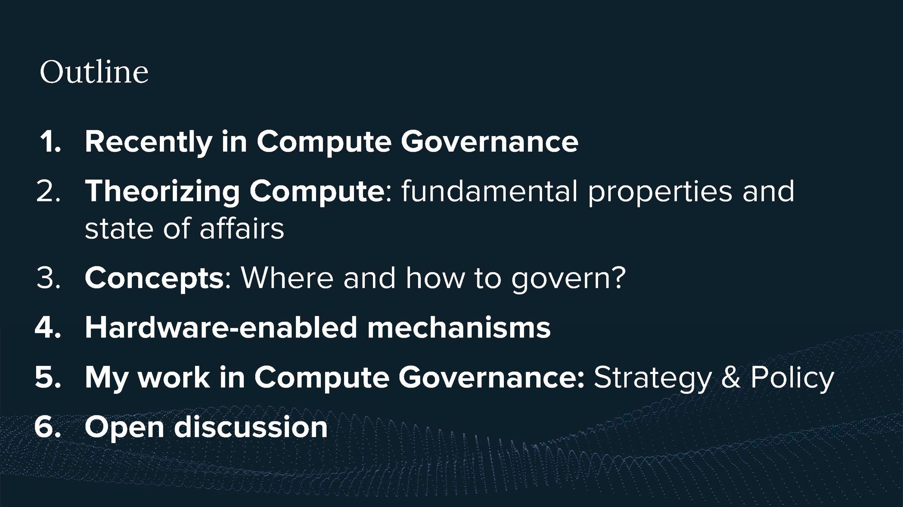

I will:

1.  Discuss recent events related to compute governance.
2.  Explore the fundamental properties and significance of compute as a node for AI governance.
3.  Present concepts for governing compute.
4.  Examine potential mechanisms for compute governance beyond export restrictions.
5.  Share my thoughts on strategy and policy related to compute governance.

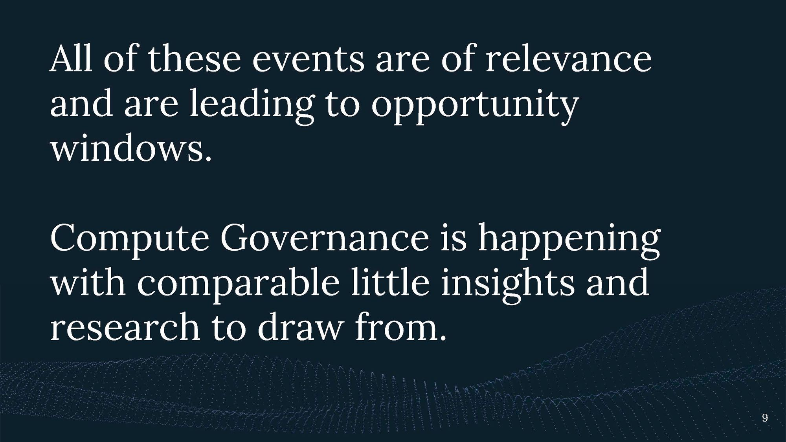

## 1\. Recently, in Compute Governance ^1-recently-in-compute

In September 2022, the US announced new export restrictions on AI chips, chip design software, advanced chip manufacturing, and semiconductor manufacturing equipment. They also restricted US persons from supporting chip development in China.

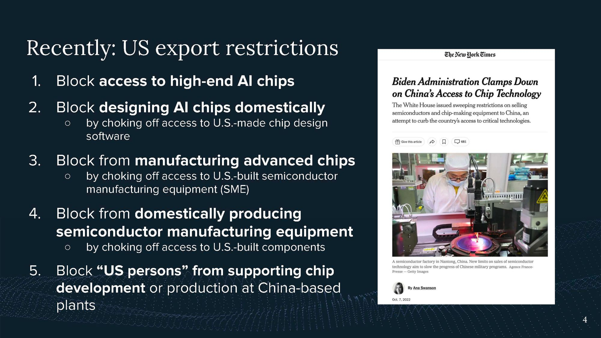

This move aims to limit AI development related to human rights abuses, e.g., the use of computer vision for surveillance, as laid out in the explanation. (More on export controls later)

At the same time, a growing divide in AI compute access is emerging between the public sector, academia, and industry. Notable machine learning models are increasingly developed by industry, potentially due to a lack of computational resources in academia.

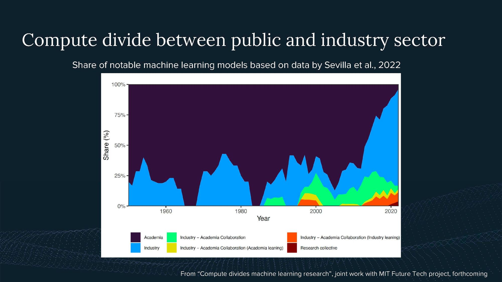

We see the first policy efforts to tackle this compute divide, such as the National AI Research Resource (NAIRR), trying to establish a large compute cluster to enable academic research in the US. The OECD expert group on compute I’m part of also looks at the compute divide between countries.

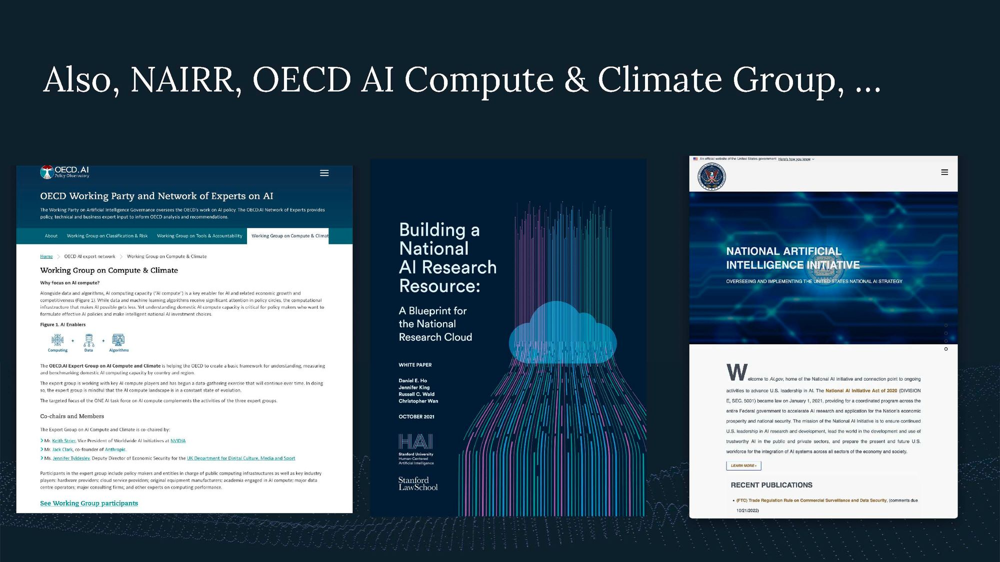

Strategic partnerships between compute providers, such as cloud companies and AI labs, have highlighted the importance of computational infrastructure in AI development. The demand for compute in AI systems has been growing rapidly, with usage doubling every six months.

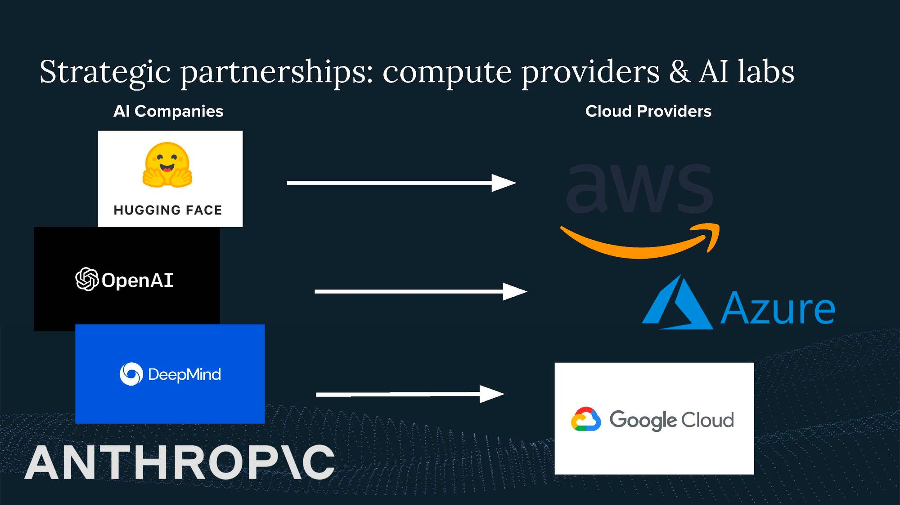

The key trend here is that models continue to get bigger and bigger, as we have shown in a recent analysis.

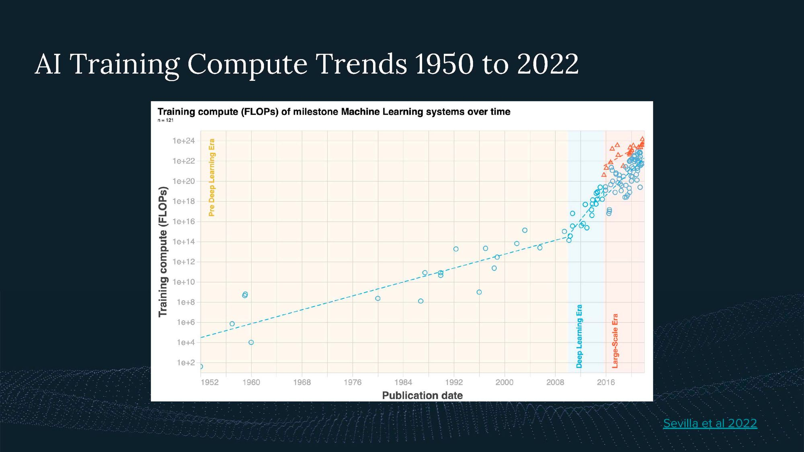

All of this shows there are opportunity windows to influence how compute is used. But despite the increasing relevance of compute governance, there is currently limited research and insight in this area. My goal is to encourage more strategic thinking and better policy decisions to ensure beneficial AI outcomes.

## 2\. Theorizing Compute Governance ^2-theorizing-compute-governance

Now, I want to discuss some concepts for compute governance, focusing on where and how we can govern compute.

The first way to think about compute is as part of the AI triad:

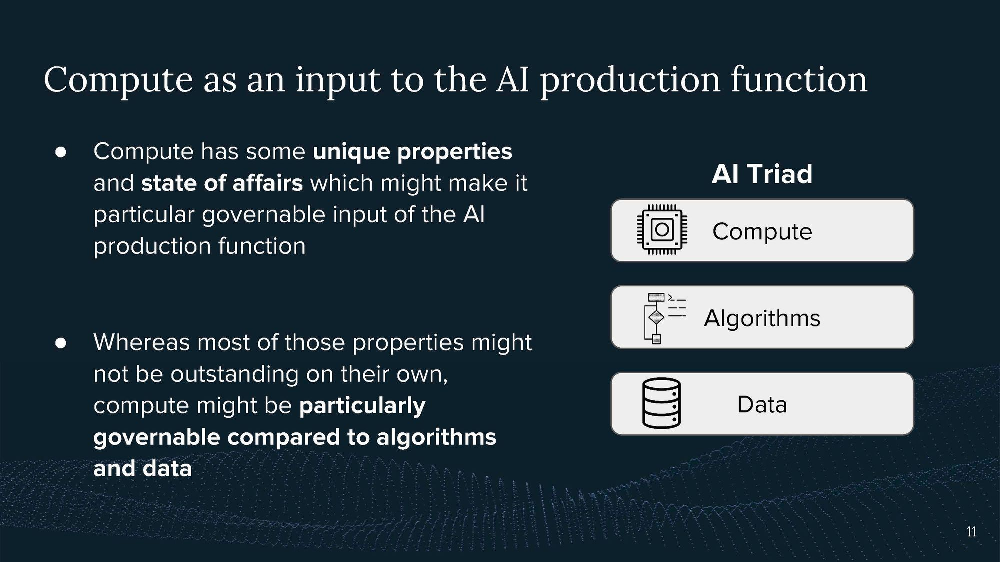

Compute may present a particularly governable input into AI compared to algorithms and data.

This is because of its **_Fundamental Properties_**.

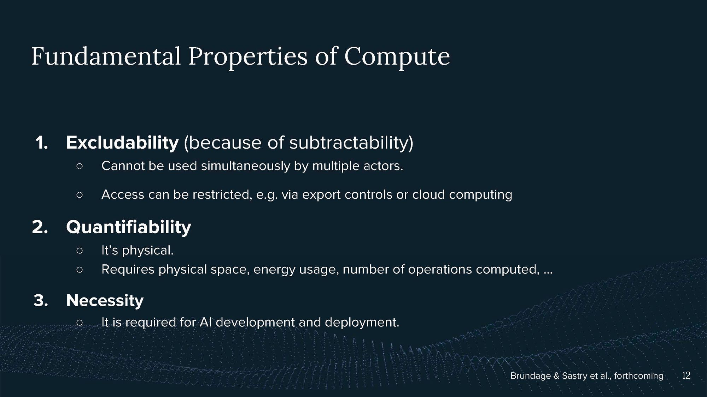

### 1\. Excludability ^1-excludability

Your computer can only run a certain number of programs at a time. On all of the world’s hardware, you can only run so many calculations. This means not everyone can use it simultaneously. Compute is thus an excludable resource. You can restrict it, e.g., via cloud computing or export controls. (This is fundamentally different for algorithms and data, which can just be copied unlimited once they are public.)

### 2\. Quantifiability ^2-quantifiability

Compute has a physical nature, and you can “count” it. You can specify your hardware setup or how much energy you are using.

### 3\. Necessity ^3-necessity

How much you need depends on the application you want to run, but you definitely need _some_ hardware to run your program.

These are the fundamental properties that are very unlikely to change. But these properties themselves don’t yet say much about _how difficult_ it is to govern compute. So let’s have a look at what the compute landscape looks like today. Let’s have a look at the **_State of Compute Affairs._**

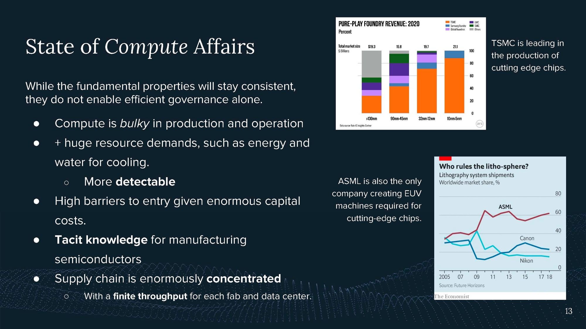

What’s special about compute?

-   It’s bulky; you need large amounts to train AI, and to power it, you need space and a lot of energy.
-   The supply chain is incredibly complex and has several concentrations.
-   There is tacit knowledge: Even if you had all the machines you needed to produce cutting-edge chips, you wouldn’t be able to use them because there is a lot of expertise required to operate them.
-   TSMC and ASML are two leading actors and bottlenecks in the supply chain.

AI chips are the most complex technology humankind has ever created. It takes decades of innovation and a sophisticated global supply chain to produce them.

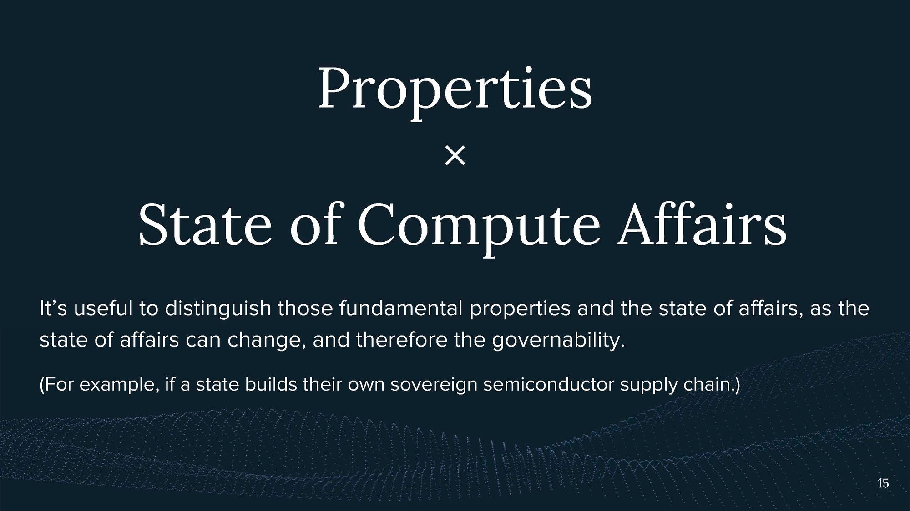

The fundamental properties I introduced, _together_ with the current state of affairs, make compute a governable input into AI. But this could change as the state of affairs changes. E.g., the supply chain could be more distributed in the future, or AI training might require much less hardware.

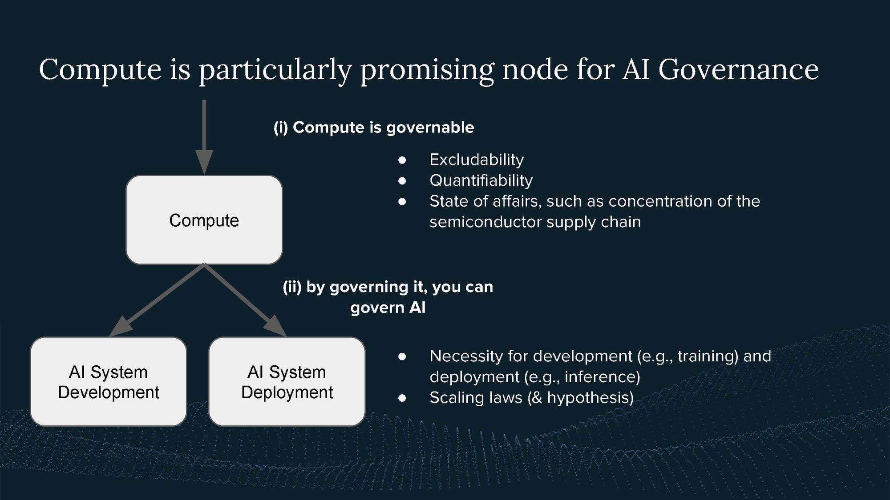

By governing compute, you can govern AI. Both its development as well as its deployment.

## 3\. Concepts for Compute Governance ^3-concepts-for-compute

There are three main actions we can take: monitor, restrict, and promote compute usage.

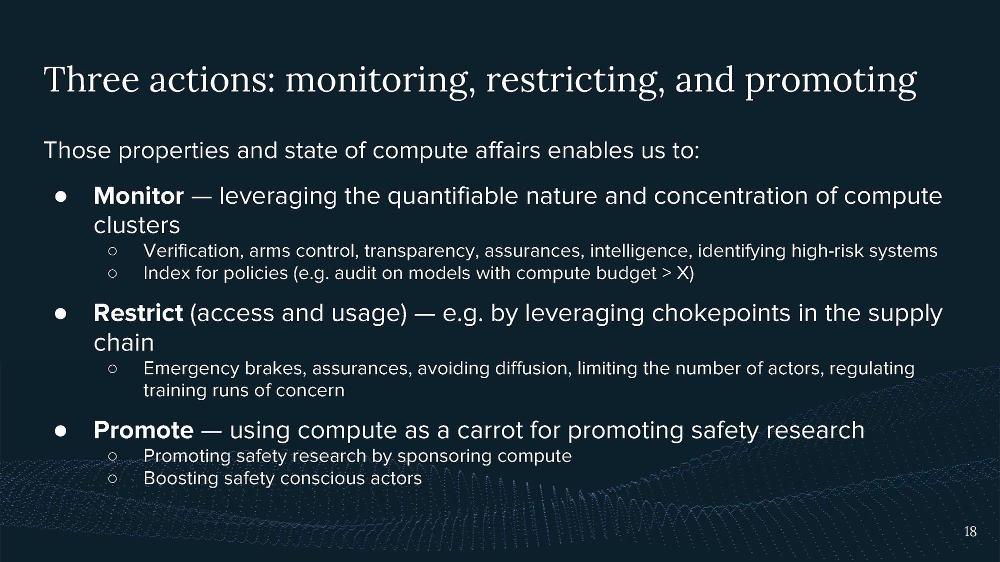

Monitoring leverages the quantifiable nature and concentration of compute for verification, arms control, transparency, and identifying high-risk systems. Restricting compute usage can be done by leveraging choke points in the supply chain, such as denying access to cloud services or withholding access to AI chips, as seen in recent export controls. This could be used to exclude bad actors or potentially pull emergency brakes. On the other hand, promoting compute usage can encourage AI safety research or support academia by providing subsidized access to compute resources. This is what happens with the US national research resource (NAIRR). Ideally, this could differentially enable safety research.

When considering the governance landscape, we can look at it horizontally, across the compute supply chain, and vertically, in terms of the compute tech stack.

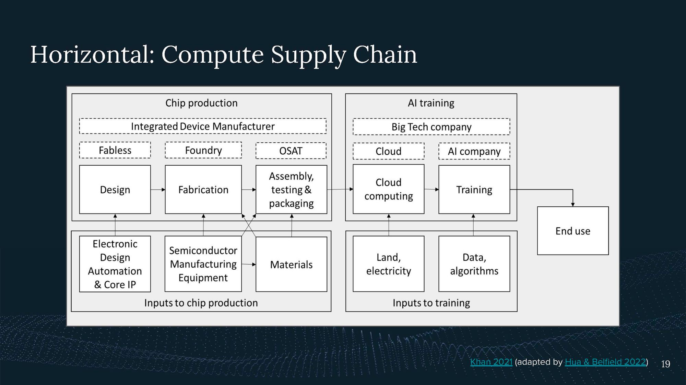

This is from [Khan 2021](https://cset.georgetown.edu/publication/the-semiconductor-supply-chain/?ref=blog.heim.xyz) (adapted by [Hua & Belfield 2022](https://verfassungsblog.de/compute-and-antitrust/?ref=blog.heim.xyz)), and I’m not going to go into the details here.

The supply chain consists of chip production, including design, fabrication, assembly, testing, and packaging, with a handful of prominent actors such as TSMC and ASML. These chips often end up with big tech or cloud computing companies, where there is also significant concentration in actors like Amazon Web Services, Microsoft Azure, and Google Cloud. Cloud computing is then used for training AI systems.

In governing AI systems, we can consider various points across the supply chain, such as tracking chip distribution or working with cloud providers to implement responsible compute usage and Know Your Customer (KYC) regimes.

I'm excited not only about the traditional supply chain and governance mechanisms but also about the compute tech stack.

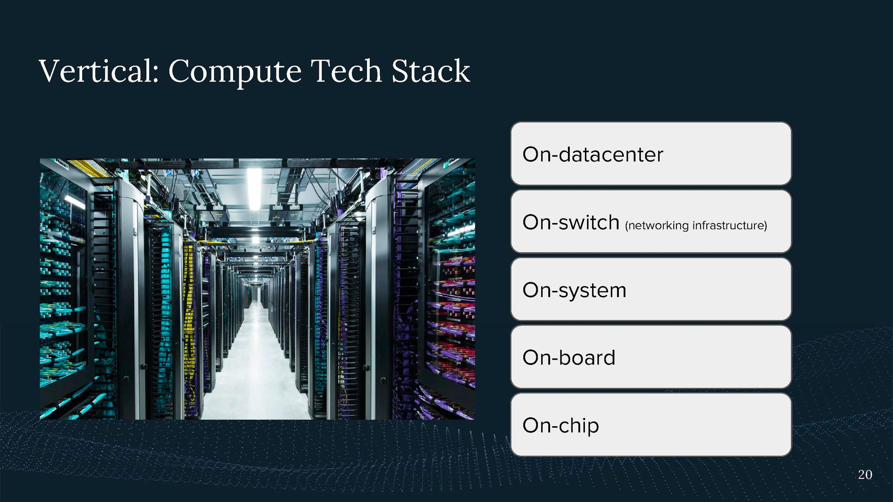

By tech stack I mean the concentrated compute within a data center and the various components that build on top of each other. These components could have hardware-enabled mechanisms that provide assurances or verifications, such as improved data center security to protect against physical and virtual access or implementing limitations on training runs for AI systems at the board or chip level.

Another useful concept to consider is the AI lifecycle, which includes model design, training, and deployment.

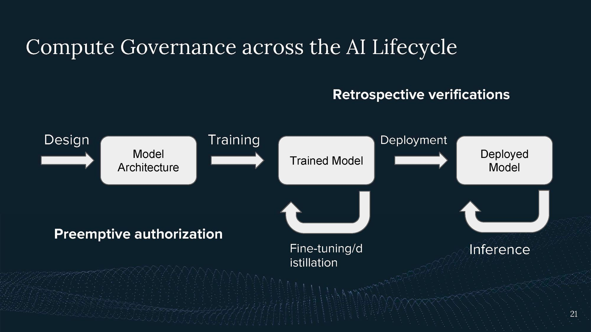

Each step has different compute requirements, with training typically demanding the most. E.g., with the compute I used for training, I can immediately run many instances of my model simultaneously. When regulating large compute users, it's essential to understand which part of the AI lifecycle is being regulated. For instance, pre-emptive authorization may involve limiting the training compute, while retrospective regulation may focus on identifying who has trained and deployed specific systems, which can be useful for post-incident attribution.

### So is my work only about taking hardware away from people? ^so-is-my-work

Compute governance is not limited to harsh export restrictions. It can also include what you refer to as "hardware-enabled diplomacy." There is a spectrum of intervention, with recent export restrictions being on the harsher side.

Let’s have a look at the export restrictions.

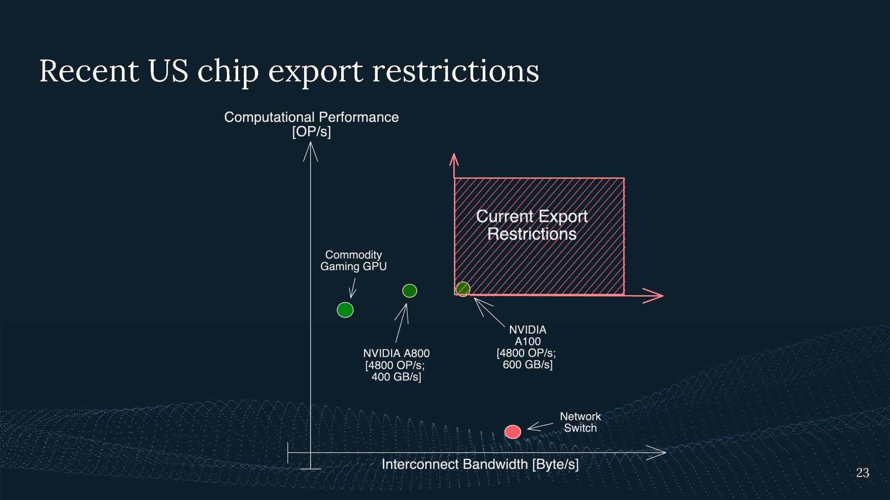

The US government has imposed targeted interventions to restrict the export of chips with specific computational performance and interconnect bandwidth, aiming to limit the development and use of AI systems in certain countries.

Yet, NVIDIA promptly responded to this by developing a new chip that just meets the export requirement, the A800.

So what the US gov tried to do was only restrict specific hardware that is used for AI training, not the GPUs that gamers usually use.

Still, these restrictions have collateral damage.  
What the US gov tries to do is prevent the use of facial recognition to suppress minorities in China and prevent simulations of nuclear weapons. These are services that we are concerned about. But we can’t govern these directly, so we have to regulate further down in the tech stack.

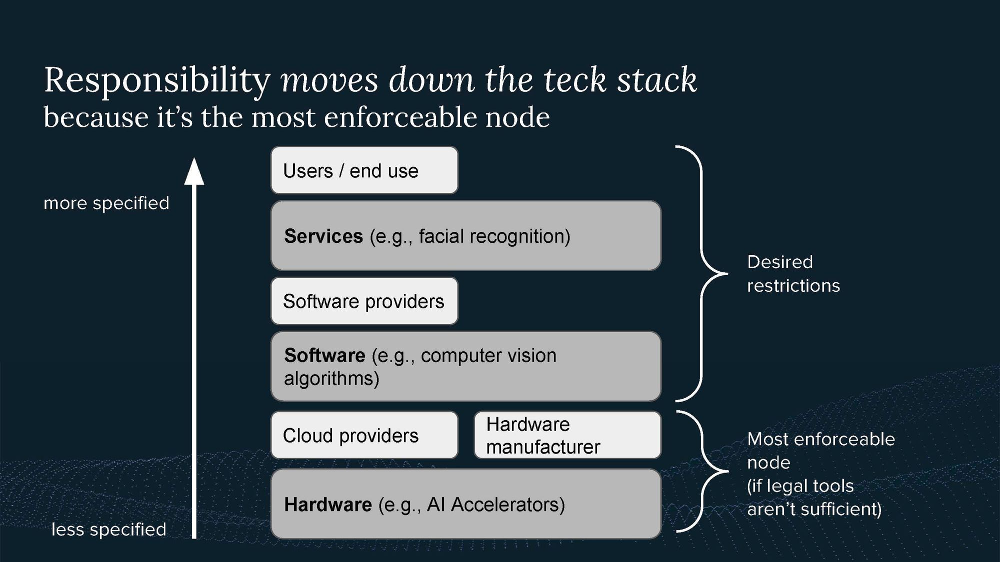

The tech stack, consisting of hardware and software, is responsible for building services, and the responsibility for restrictions moves down the tech stack when legal tools aren't sufficient to enforce regulations. This has been seen in the past, for example, with authorities raiding data centers to shut down illegal websites on the dark web because they couldn’t stop drug-selling websites any other way.

You can think about these different interventions on a spectrum.

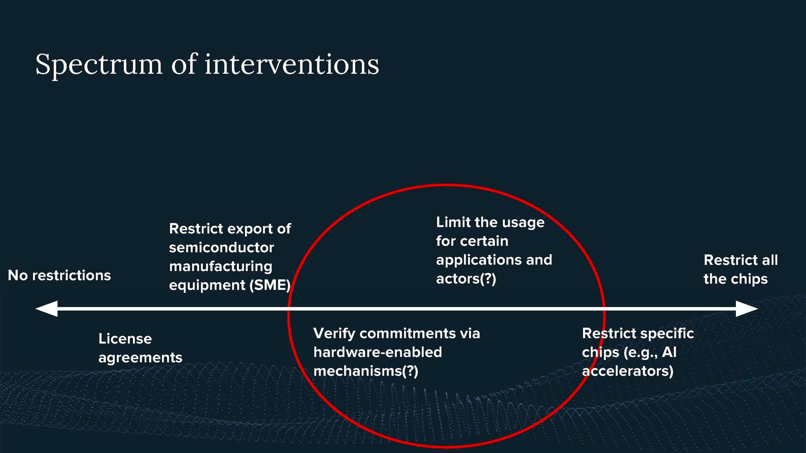

Rather than simply restricting all chips, there is potential for verifying commitments through hardware mechanisms. This could involve visiting a chip's location, using cryptographic challenges to ensure its location remains unchanged, or even limiting its usage for specific applications, such as climate modeling or restricting its use by certain organizations.

Overall, compute governance can take various forms, from export restrictions to hardware-enabled diplomacy, and it is essential to explore a range of options to ensure the responsible use and development of AI systems.

Here I am especially excited about:

## 4\. Hardware-enabled mechanisms ^4-hardware-enabled-mechanisms

Compute governance has the potential to support tech-assisted diplomacy, providing more assurances and verifiable commitments across nations and sectors. Implementing hardware-enabled mechanisms can improve transparency, dampen arms race dynamics, and facilitate cooperation in the development and use of AI systems.

One example of hardware enabled mechanisms that are in place today include the monitors verifying Iran’s nuclear enrichment facilities don’t enrich Uranium above a certain threshold.

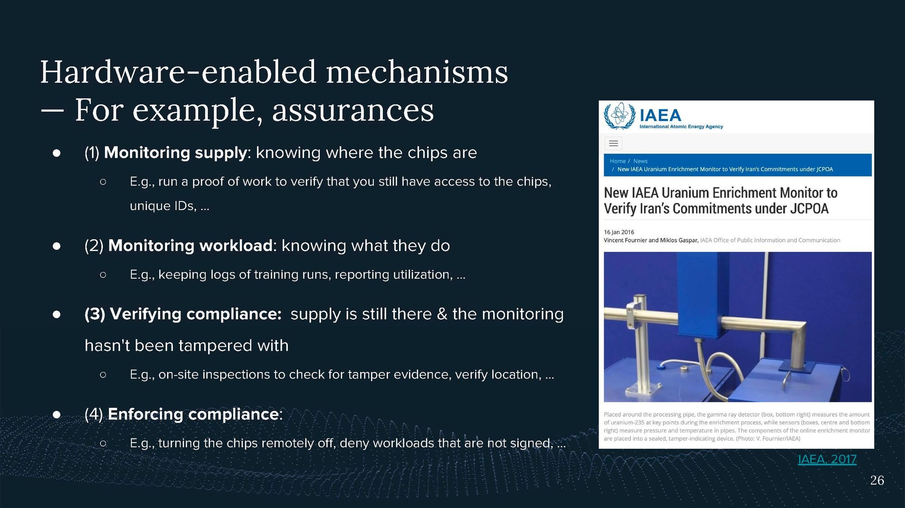

Some potential compute governance goals include:

1.  Monitoring the supply of chips: Verifying that actors have access to a certain number of chips by running proof-of-work challenges or requesting unique IDs of chips. E.g., you could send a request to a data center to calculate some function, and they have to return that in 10 minutes. This way, you know the hardware is still there.
2.  Monitoring workloads: Ensuring that AI systems are only trained up to a certain size or within specific parameters.
3.  Verifying compliance: Ensuring that monitoring has not been tampered with by conducting on-site inspections or using technical tools to verify the location of chips. E.g. this could be done by on-site inspections.
4.  Enforcing compliance: Remotely turning off chips or denying unsigned workloads, which could help prevent the misuse of AI systems.

Achieving these goals will be hard. But I think it could be possible. They could enable:

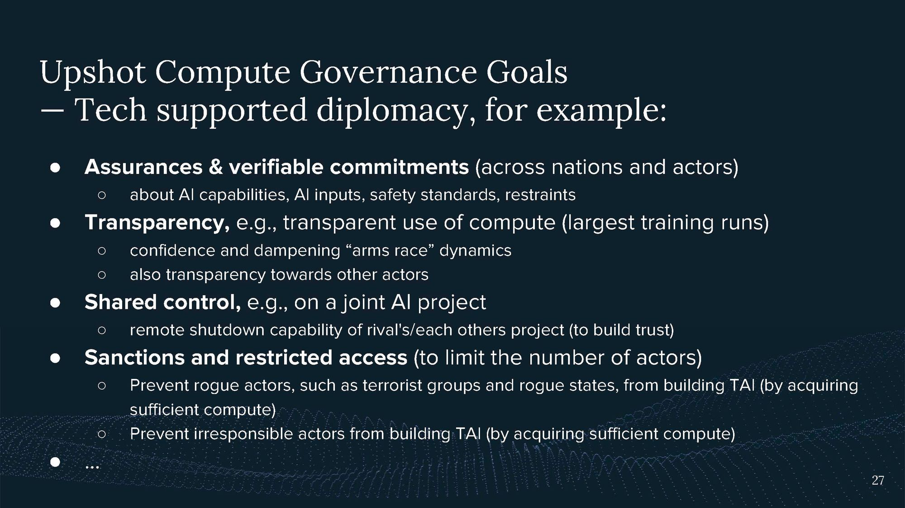

The proposed mechanisms could allow what I call tech-supported diplomacy. They could allow different actors to cooperate by making verifiable commitments. And this is not only about the US and China but many more actors.

In this context, transparency is particularly important. Even non-AI-superpowers have to be considered in scenarios involving transformative technology. They could still use kinetic warfare if they feel threatened by another country’s AI capabilities.

One interesting solution to enable trust could also be giving the other party the capability to shut down your compute. Potentially you could even establish shared compute resources that are used by an international project with shared responsibility.

And finally, you can, of course, exclude bad actors such as terrorists from misusing TAI.

## 5\. Our policy work so far ^5-our-policy-work

I'd like to discuss the policy work our policy team has been engaged in.

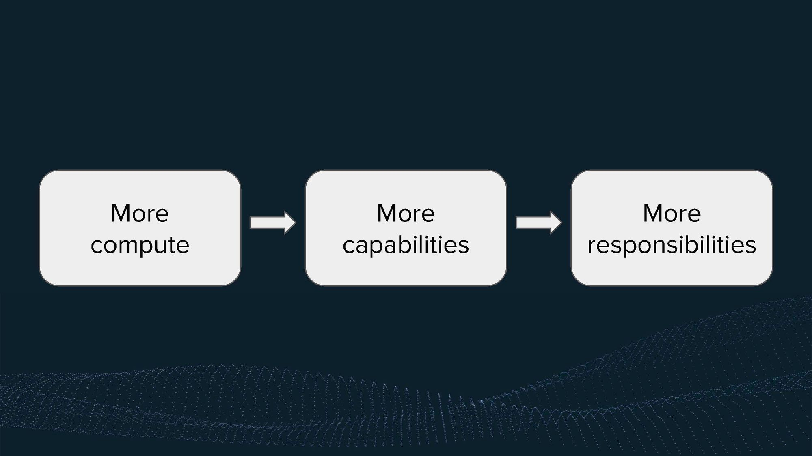

We've been promoting the idea that greater compute power implies greater capabilities and, therefore, greater responsibility. Scaling laws describe that increasing compute power, or scaling up, usually leads to more capable systems. Thus, we argue that if you use more compute, you bear more responsibility. For example, in the context of the National AI Research Resource, if academics request more compute power, they should assume greater responsibility, particularly regarding the publication process and open-sourcing their systems.

We have also been exploring the regulation of large training runs in the UK and the US context.

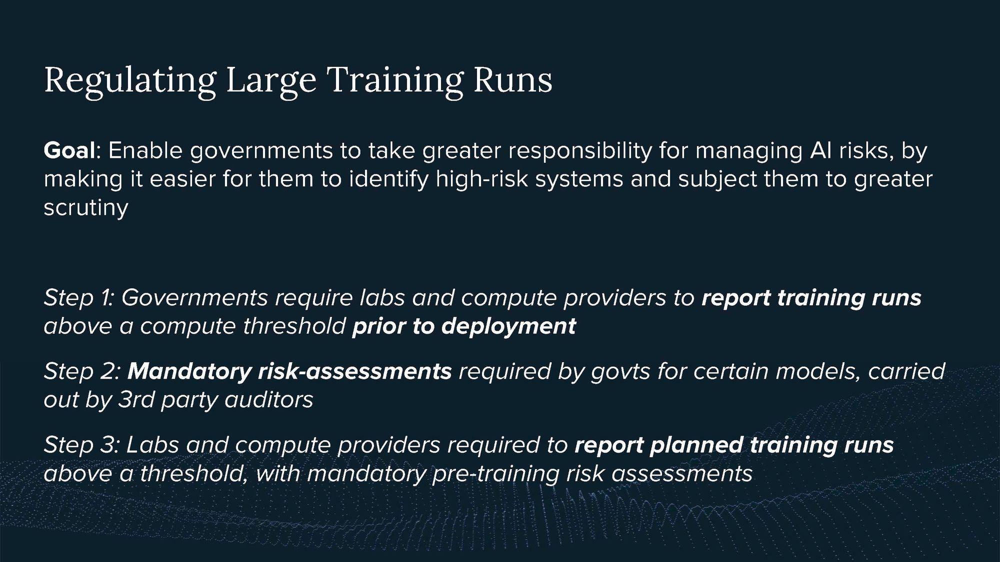

Our goal is to enable governments to take greater responsibility in managing AI risks and identify high-risk systems early on for increased scrutiny. We envision a tiered process that can be scaled up over time if needed. Initially, governments could require reporting of training runs above a certain threshold prior to deployment. Next, mandatory risk assessments for larger models could be conducted by third-party auditors. Finally, labs and compute providers would need to report planned training runs above a specific threshold and seek mandatory pre-training risk assessment and approval.

We have previously discussed compute funds and pre-trained models as examples of our work in this area.

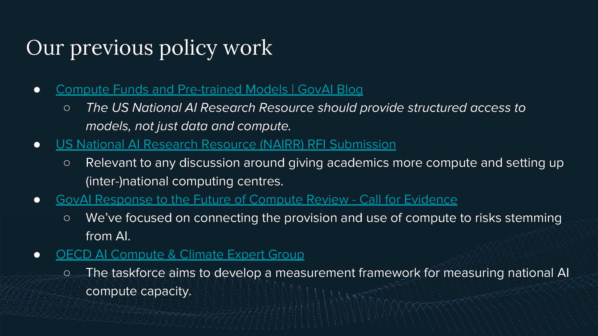

-   [Compute Funds and Pre-trained Models | GovAI Blog](https://www.governance.ai/post/compute-funds-and-pre-trained-models?ref=blog.heim.xyz)
-   [US National AI Research Resource (NAIRR) RFI Submission](https://www.governance.ai/research-paper/submission-nairr-task-force?ref=blog.heim.xyz)
-   [GovAI Response to the Future of Compute Review - Call for Evidence](https://www.governance.ai/research-paper/future-of-compute-review-call-for-evidence?ref=blog.heim.xyz)
-   [OECD AI Compute & Climate Expert Group](https://oecd.ai/en/network-of-experts/working-group/1136?ref=blog.heim.xyz)

## Summary ^summary-2

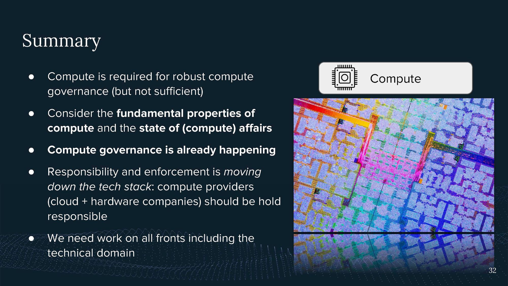

In summary, robust compute governance is necessary but not sufficient on its own; it needs to be part of a broader governance regime. Compute enables international agreements, agreements between labs, and increased governance capacity through government intervention, but additional tools for arbitration are still necessary.

When considering compute, focus on its fundamental properties and be aware of the state of compute affairs, which may change. It's helpful to understand the supply chain and the various actors involved, such as cloud computing providers or hardware companies.

Compute governance is already happening, so it's essential to develop and promote better ideas before making decisions without adequate knowledge. Responsibility is shifting along the tech stack, making compute providers, especially cloud and hardware companies, increasingly responsible for AI capabilities. Access to hardware translates to access to AI capabilities, and enforcement becomes more challenging further down the stack.

To effectively address compute governance, work must be done on all fronts, including the technical domain. This involves learning more about hacking, developing tamper-evident mechanisms, and advocating for their implementation in international agreements.

Thank you for listening!

## About ^about

Lennart Heim is a researcher at the Centre for the Governance of AI in Oxford, focusing on Compute Governance. His research interests include the role of compute in the production of AI, the compute supply chain, forecasting emerging technologies, and the security of AI systems. His time is split into the strategic and technical analysis of the compute governance domain and active policy engagement with GovAI’s policy team.

He’s also a member of the OECD.AI Expert Group on AI Compute and Climate, a steering group member at Tony Blair Institute for Global Change’s National Compute Index, and a Strategy Specialist at Epoch, a new organization focused on researching strategic questions around advanced AI. He has a background in Computer Engineering. Previously Lennart worked as a consultant to the OECD and as a researcher at ETH Zürich.

_Thanks to_ [_Konstantin Pilz_](https://www.konstantinpilz.com/?ref=blog.heim.xyz) _for preparing and editing the transcript._
