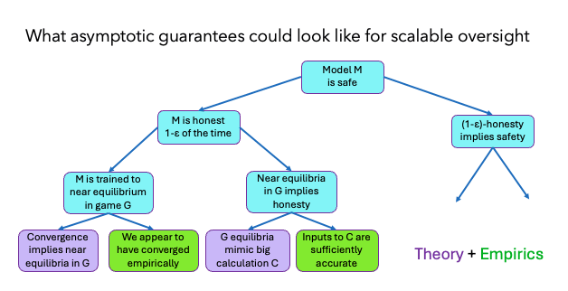

%%
Add discussion note here:

...

%%

**The UK’s AI Security Institute published its** [**research agenda**](https://www.aisi.gov.uk/research-agenda) **yesterday. This post gives more details about how the Alignment Team is thinking about our agenda.**

**Summary:** The AISI Alignment Team focuses on research relevant to reducing risks to safety and security from AI systems which are autonomously pursuing a course of action which could lead to egregious harm, and which are not under human control. No known technical mitigations are reliable past AGI. 

Our plan is to break down promising alignment agendas by developing safety case sketches. We'll use these sketches to identify specific holes and gaps in current approaches. We expect that many of these gaps can be formulated as well-defined subproblems within existing fields (e.g., theoretical computer science). By identifying researchers with relevant expertise who aren't currently working on alignment and funding their efforts on these subproblems, we hope to substantially increase parallel progress on alignment.

Our initial focus is on using scalable oversight to train honest AI systems, using a combination of theory about training equilibria and empirical evidence about the results of training.

This post covers:

1.  The safety case methodology
2.  Our initial focus on honesty and asymptotic guarantees
3.  Future work
4.  A list (which we'll keep updated) of open problems

# 1\. Why safety case-oriented alignment research? ^1-why-safety-case-oriented

Arriving at robust evidence that human-level AI systems are aligned requires complementary advances across empirical science, theory, and engineering. We need a theoretical argument for why our method’s effectiveness, empirical data validating the theory, and engineering work on making the method low cost. Each of these subproblems informs the other: for instance, theoretical protocols are not useful unless efficient implementations can be found.

This is just one example of a way in which alignment research in different areas can be complementary. The interdependencies between different areas of alignment research are often hard to spot and not completely understood, which creates a coordination challenge: the most useful research depends on what others are doing. This difficulty identifying which problems are most critical to solve next leads to a focus on problems that are theoretically appealing or empirically tractable, leaving other areas neglected despite their system-level importance.

But there is also a coordination opportunity. Many subproblems can be tackled in parallel due to their hierarchical structure, varying dependencies, and requirements for diverse expertise. So, by mapping these interdependencies and coordinating distributed efforts effectively, the field can advance on multiple fronts simultaneously. 

We propose using **safety case sketches** as an organising frame for clarifying the relationships between the claims, arguments and evidence entailed by alignment proposals. Within this frame, the AISI Alignment Team research agenda involves two tasks: (1) decompose alignment proposals into safety case sketches, leaving unfilled holes for future research, and (2) engage with the alignment and broader research communities to solve resulting alignment subproblems. 

# 2\. Our initial focus: honesty and asymptotic guarantees ^2-our-initial-focus

There are two features of our initial research that are worth highlighting because they somewhat differentiate our direction from others in the field.

First, we specifically focus on sketches which make top-level claims about the _honesty_ of AI systems. 

We do this because honesty (in at least some domains) is likely to be a _necessary_ condition for the safety of superintelligent systems: the opposite would be a deceptive system that can hide crucial safety-relevant information. We think honesty addresses a reasonable portion of potential risks, as many routes to large-scale harm from misaligned systems flow through deception. More broadly, we can use honest systems to prevent all sorts of harm by asking them whether a proposed course of action might cause harm.

We also think that honesty is useful as a first step – for example, if we could build honest systems we could use them to conduct research into other aspects of alignment without a risk of research sabotage. Finally, we think honesty is more tractable than other aspects of alignment: it's relatively easy to be precise about, is in some cases verifiable, and is approximately the target of a variety of existing agendas, including debate, [ARC](https://www.alignment.org/blog/a-birds-eye-view-of-arcs-research/), and Bengio’s [Scientist AI](https://arxiv.org/abs/2502.15657).

Second, we aim to make claims about various properties of AI systems using 'asymptotic guarantees’: proofs that if you give a process 'enough resources' (human data quality, training time, neural network capacity, etc.) then some system specification will be guaranteed. We use asymptotic guarantees alongside evidence (both theoretical and empirical) that the relevant process will in fact converge – for example, ways to mitigate risks of sandbagging and exploration hacking. We’re optimistic about asymptotic guarantees because pure empirics based on current models may be too weak for sufficient safety; on the other hand, full formal verification may be too hard to realistically achieve.

We are currently far from being able to develop safety cases based on asymptotic guarantees – and not just because of the exploration hacking problem mentioned above. Theory expects debate (and other scalable oversight methods) will _not_ converge to approximate honesty: the [obfuscated arguments problem](https://www.alignmentforum.org/posts/PJLABqQ962hZEqhdB/debate-update-obfuscated-arguments-problem) shows that honesty can be intractably harder than deception in some debate games. If we can solve the obfuscated arguments problem, asymptotic guarantees based on learning theory will usually guarantee a success rate of 1-ε, where 0<ε<<1 is the error tolerance. While standard learning theory will treat these ε failure cases as randomly distributed according to the underlying data distribution, the worst-case for safety is when a sufficiently advanced AI model could strategically control the failures. 

We aim to conduct and fund theory research (in complexity theory, game theory, learning theory and other areas) to both improve our ‘asymptotic guarantees’ and develop ways of showing convergence.

This isn’t to say that only theoretical work is needed. We expect asymptotic guarantees to be one piece of an alignment safety case, combined with other evidence sources such as evaluations based on model behavior or model internals. We conduct empirical research (in machine learning, cognitive science and other areas) to validate that our theoretical research applies to real models, and cover other relevant gaps (such as human input). By combining multiple evidence sources, we can make a stronger argument overall.

## Example: [Debate safety case sketch](https://www.alignmentforum.org/s/NdovveRcyfxgMoujf/p/iELyAqizJkizBQbfr) ^example-debate-safety-case

The basic idea of debate is to train an AI system via a “debate game” in which the winning strategy is to provide honest and accurate answers. Our sketch is based on the work-in-progress _prover-estimator_ (PE) debate protocol that aims to correct the [obfuscated arguments](https://www.alignmentforum.org/posts/DGt9mJNKcfqiesYFZ/debate-oracles-and-obfuscated-arguments-3) failure mode of previous debate protocols. 

We sketch arguments for four key claims that a developer must defend to show that the debate training has succeeded in producing a trustworthy system:

1.  The training process has in fact taught the systems to play the game well.
2.  The training game has in fact been set up to reward correctness (if it is played sufficiently well).
3.  The system's behaviour will stay similar during deployment.
4.  It is sufficient for safety purposes for the system to provide correct answers _most of the time_.

Through this process we’re scoping subproblems which we think are solvable and highly relevant to ensuring that debate works in practice. An example (on which we’ve already published) is [eliciting bad contexts](https://www.alignmentforum.org/posts/inkzPmpTFBdXoKLqC/eliciting-bad-contexts). Identifying eliciting bad contexts as a subproblem helps in two ways: First, we can scope interpretability work (or other approaches such as singular learning theory) towards a subgoal which contributes to alignment without requiring full neural network decompilation. Second, we can scope scalable oversight work assuming a factored solution to eliciting bad contexts, allowing for parallel research progress.

The [full sketch](https://www.alignmentforum.org/s/NdovveRcyfxgMoujf/p/iELyAqizJkizBQbfr) is the next post of this sequence.

# 3\. Future work ^3-future-work

## Concrete open problems in honesty ^concrete-open-problems-in

Below we list some categories of problems surfaced by our safety case sketch for debate. These are not novel to the safety case sketch, but the safety case sketch clarifies the scope of precisely what problem needs to be solved and what assumptions are available. 

-   **Improving scalable oversight protocols.** We are optimistic about finding mitigations to the [‘obfuscated arguments’](https://www.alignmentforum.org/posts/PJLABqQ962hZEqhdB/debate-update-obfuscated-arguments-problem) problem: a dishonest prover can in polynomial time produce an ‘obfuscated’ argument that would require an honest prover exponential time to refute. Such solutions might require strict stability assumptions, so we will examine ways to relax these.
-   **Protocols for systematic human error:** Humans acting as judges in debate may be systematically wrong on certain questions, either for particular topics or because there are reliable ways to “jailbreak” humans. Can we formulate a debate protocol that blocks the prover from consulting humans on some adversarially chosen sub-distribution of questions, so that these errors can be blocked even if we don’t know where they are? We've written more about this [here](https://www.alignmentforum.org/posts/EgRJtwQurNzz8CEfJ/dodging-systematic-human-errors-in-scalable-oversight).
-   **Find ways to prevent** [**exploration hacking**](https://www.alignmentforum.org/posts/dBmfb76zx6wjPsBC7/when-can-we-trust-model-evaluations). Our asymptotic guarantees make claims about the equilibria of games. We need some reason to believe that converged training implies game equilibria. This likely requires some whitebox understanding. Mechanistic interpretability is a popular route, but whether it will scale to a sufficient understanding of advanced models is unclear. An alternative is learning theory. Learning theory says when we can converge to near-optimum, but only if everything is convex. We are optimistic about approaches to learning theory closer to neural nets: for example, [singular learning theory](https://www.alignmentforum.org/posts/TjaeCWvLZtEDAS5Ex/towards-developmental-interpretability).
-   **Develop methods that use online training to mitigate risks from distribution shift.** With an appropriate reward model, online training can be used to prevent dishonesty arising as a result of the distribution shift from training to deployment. However, we won't get perfect honesty and so this isn’t a complete solution for [high-stakes contexts](https://www.alignmentforum.org/posts/TPan9sQFuPP6jgEJo/low-stakes-alignment). One simple approach would be to use some averaging process over a large number of outputs, preventing any single response from the model from being used. Robust approaches to this issue are required to deploy models in high-stakes settings where even a single dishonest output could cause safety and security risks. 

In general, there are now many well-defined problems directly relevant to alignment, and in particular the situation is better than it was a few years ago — not just in debate (see, e.g. [ARC](https://www.alignment.org/blog/a-birds-eye-view-of-arcs-research/) and [Scientist AI](https://arxiv.org/abs/2502.15657) research agendas). Many of these subproblems highlight how external research agendas (e.g. white-box methods including singular learning theory) could contribute to a scalable oversight safety case. We think that the volume of problems is such that the number of theorists working on alignment could grow by an order of magnitude studying solely existing problems. The majority of these questions are parallelizable and modular: they do not depend on progress on other questions, and can be understood and defined without requiring a full picture of the debate safety case. 

## More details on our empirical approach ^more-details-on-our

We aim to run experiments to validate our theoretical claims. Building experiments and evaluations for alignment methods has previously succeeded in surfacing limitations of alignment methods (e.g. the [obfuscated arguments](https://www.lesswrong.com/posts/PJLABqQ962hZEqhdB/debate-update-obfuscated-arguments-problem) problem in debate) and we expect empirical evidence to continue to be a crucial part of the overall picture.

For alignment experiments, we'll need new datasets and evaluation methods that differ from traditional datasets measuring capabilities (such as coding or writing skills). An alignment evaluation needs to carefully work around the fact that we’re usually trying to find evidence about what might work on _future_ models, rather than the ones we have today.

We can currently see three possible approaches:

1.  [_Sandwiching_](https://arxiv.org/abs/2211.03540): evaluate a human-model pair for their ability to match the performance of another human who has greater expertise (or greater affordances). Creating sandwiching evaluations on typical AI tasks, e.g. code generation, provides evidence that a given scalable oversight method incentivizes accuracy in human-tractable domains. However, it may be the case that tasks allowing easy human oversight are unusually amenable to alignment methods and therefore systematically obscure failure modes for alignment methods.
2.  Use a safety case to provide a theoretical argument why a given method scales beyond human-supervisable task difficulties. Then, depending on the nature of the assumption made, it may be possible to empirically validate the safety case without requiring evaluation on superhuman tasks.
3.  Model organisms / red-teaming: Stress test an alignment method by allowing a red-team to use their choice of training data and methods to instill misaligned goals in a model–subject to some compute limitation. Then, without knowledge of the red-team procedure, the alignment method is run on this initially misaligned model. Finally, the evaluation metric is the extent to which behaviors induced by the red-team remain following alignment training.

We list a few concrete empirical problems we would like to see solved in section 4.

## Moving beyond honesty: automated alignment ^moving-beyond-honesty-automated

Honesty may be necessary to trust automated alignment research, but it is not sufficient (for example, the AI researcher could be honest but wrong). So, we are interested in developing safety case sketches for automated alignment.

As of late 2024, Google [claimed](https://arstechnica.com/ai/2024/10/google-ceo-says-over-25-of-new-google-code-is-generated-by-ai/) ~25% of their new code was written by AI. There is a robust [trend](https://arxiv.org/abs/2502.15850) towards AI taking on larger autonomous, agentic roles in software engineering and well-defined research problems. As such, AI will likely play a large role in the research and engineering involved in aligning future AI systems. Understanding where such automation improves over direct human efforts, and where delegating work to AIs risks undermining alignment research is a priority. 

It’s not just safety cases: we are also interested in research that maps or expands the set of alignment subproblems that can be safely tackled using AI agents, such as by studying long-horizon generalisation, reward hacking in the code agent setting, etc. We have so far released one post focused on [automating interpretability](https://www.alignmentforum.org/posts/y5cYisQ2QHiSbQbhk/prospects-for-alignment-automation-interpretability-case).

# 4\. List of open problems we’d like to see solved ^4-list-of-open

**We recognise many of these are not concrete enough to work on yet! We plan on publishing a series of posts on key open problems over the coming weeks, and will update this list with links as they are released.**

## 4.1 Empirical problems ^4-1-empirical-problems

Here are some empirical problems arising from our debate research:

1.  **Debate effectiveness.** Implement (prover‐estimator) debate protocols with human participants and/or current AI systems to verify that the debate game actually works.
2.  **Model organisms of exploration hacking.** Deliberately train models to exploration hack and examine possible ways of preventing this.
3.  **Measure exploration hacking.** Investigate using best-of-n sampling of a trusted model to estimate returns to exploration given more inference compute, or train an exploration-predictor model to predict returns to exploration, or empirically examine whether using adversarial RL to further train one player while holding the other's policy constant can be used to detect exploration hacking (if the constant player's reward does not decrease significantly, this is evidence that they were not exploration hacking).
4.  **Empirically test ‘**[**unexploitable search**](https://www.alignmentforum.org/s/NdovveRcyfxgMoujf/p/CuneN5HmLnztsLRzD)’ . There may be methods to force a model to randomize performance over all (malign) choices of some adversarial objective foreseeable by the model. Test methods such as GFlownets, max entropy RL, KL-regularized RL, and diversity games on datasets including a task and a hidden adversarial objective. For more, see the [post later in this sequence about unexploitable search](https://www.alignmentforum.org/s/NdovveRcyfxgMoujf/p/CuneN5HmLnztsLRzD).
5.  **Stability analysis.** Is stability a problem in practice? Empirically examine scalable oversight protocol stability by testing the effects of small perturbations on outputs with both human and AI subjects.
6.  **Obfuscated arguments.** Do obfuscated arguments actually emerge as predicted? Develop a dataset to examine whether this problem arises in practice in AI debates.
7.  **Human input.** During training, when humans are called on to adjudicate on subclaims (and thereby determine the reward), how should this human adjudication process be designed? Propose and test some design options. 

## 4.2 Theoretical problems ^4-2-theoretical-problems

Here are some theoretical problems arising from our debate research:

1.  **Crisp problems on the specifics of prover-estimator debate:** There are many well-scoped problems around prover-estimator debate which we’ll follow up on once this proof is published. For example, the (unpublished) completeness proof for this protocol requires the prover to be able to estimate probabilities accurately in order to know where to recurse. Can we reduce this accuracy requirement?
2.  **Stability threshold theorems:** In various theoretical settings there are threshold theorems showing how to turn unstable computations into stable ones. Can we develop related theorems for the natural language context?
3.  **Stability and ‘deliberate mistakes’:** Most computations in practice will involve at least one non-stable point. For example, in debate, we might elaborate the problem a bit before presenting multiple bits of evidence, and getting the elaboration wrong dooms the whole computation. However, we expect that the badness of a mistake is correlated with its strategic optimality: accidental mistakes are better than intentional mistakes. Formalise the intuition that avoiding intentional mistakes requires weaker stability properties of the computation.
4.  **Develop formalisations of ‘honesty’:** Currently, debate targets correctness, rather than honesty. Intuitively, honesty is necessary for correctness but not sufficient. Finding a formalisation of this notion could allow us to weaken the stability and resource requirements for debate.
5.  **Formalise the notion of ‘**[**unexploitable search**](https://www.alignmentforum.org/s/NdovveRcyfxgMoujf/p/CuneN5HmLnztsLRzD)’: We would like to be able to use AI in situations where under-specified dimensions of our request leave room for collusion. For any open-ended generation task–coding or research advice, etc.--we expect the set of valid solutions to be exponential in input length. This leaves room for models to adversarially select solutions within this space e.g. to open up surface area for future exploits, or to leave steganographic information. To mitigate such risks, we would like an algorithm which ensures our sampling procedure has the right kind of randomness – an ‘unexploitable search algorithm’. For more, see the [post later in this sequence about unexploitable search](https://www.alignmentforum.org/s/NdovveRcyfxgMoujf/p/CuneN5HmLnztsLRzD).
6.  **Develop debate** [**protocols robust to systematic human error**](https://www.alignmentforum.org/posts/EgRJtwQurNzz8CEfJ/dodging-systematic-human-errors-in-scalable-oversight): Systematic human error represents a major problem for the correctness of debate outputs. One option is to examine whether it's possible to produce prover-estimator debate protocols where the estimator is able to prevent queries to the oracle which exploit systematic human bias. For more, see the [post later in this sequence about dodging systematic human errors](https://www.alignmentforum.org/posts/EgRJtwQurNzz8CEfJ/dodging-systematic-human-errors-in-scalable-oversight).
7.  **Apply learning theory to eliciting bad contexts:** Explore SLT approaches to [eliciting bad contexts](https://www.alignmentforum.org/posts/inkzPmpTFBdXoKLqC/eliciting-bad-contexts) – in particular, we expect that susceptibilities in singular learning theory could be used to ask questions like "what kind of change in training data would be necessary to elicit a target change in behaviour?". (Our [post](https://www.alignmentforum.org/posts/inkzPmpTFBdXoKLqC/eliciting-bad-contexts) on this sets out other approaches, including interp-based approaches.)

[ARC](https://www.alignment.org/) have also set out some theory problems. For example, settling the [computational no-coincidence conjecture](https://www.alignment.org/blog/a-computational-no-coincidence-principle/) or separating efficient defendability from efficient PAC learnability (conjecture 5.4 in [Christiano et al., 2024](https://arxiv.org/abs/2409.03077)).

**We will update this list as we make these problems more concrete and identify new open problems.**

# Collaborate with us ^collaborate-with-us

We want to collaborate with researchers across disciplines on approaches to AI alignment. We’re particularly keen to hear from: 

-   ML researchers
-   Complexity theorists
-   Game theorists
-   Cognitive scientists
-   People who could build datasets for alignment-related experiments
-   People who could run human experiments
-   Anyone else who thinks they might be doing, or could be doing, relevant work 

Both theoretical and empirical proposals are welcomed: [express interest here](https://forms.office.com/e/BFbeUeWYQ9). You can also apply for grants directly [here](https://www.aisi.gov.uk/grants).
