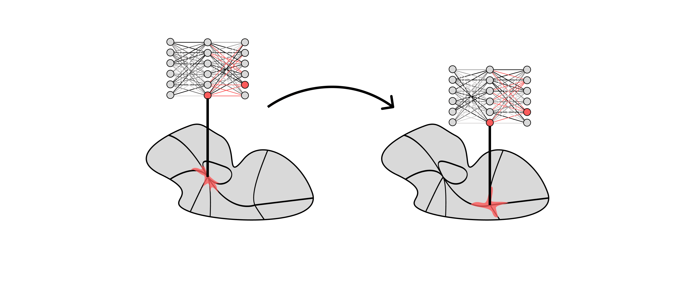
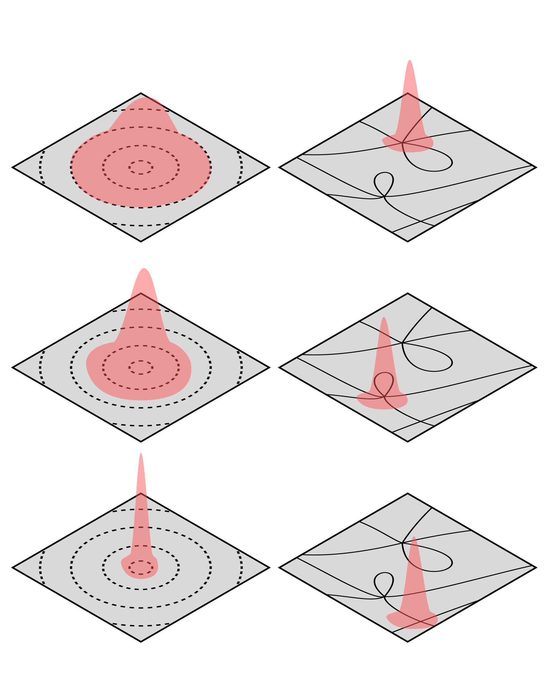
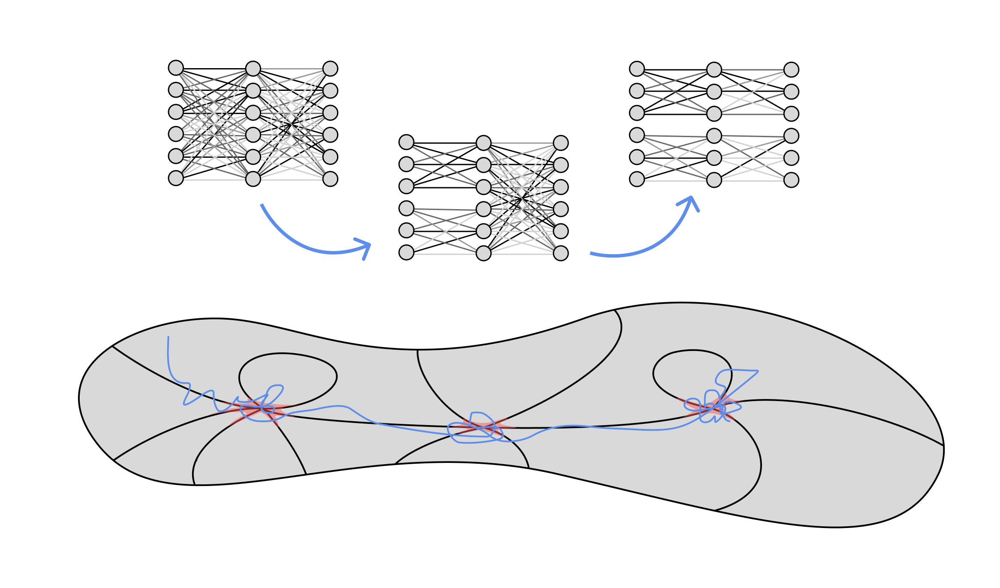

%%
Add discussion note here:

...

%%

Developmental interpretability is a research agenda that has grown out of a meeting of the [Singular Learning Theory (SLT)](https://www.lesswrong.com/tag/singular-learning-theory) and AI alignment communities. To mark the completion of the first [SLT & AI alignment summit](https://devinterp.com/2023) we have prepared this document as an outline of the key ideas.

As the name suggests, developmental interpretability (or "devinterp") is inspired by recent progress in the field of mechanistic interpretability, specifically work on phase transitions in neural networks and their relation to internal structure. Our two main motivating examples are the work by Olsson et al. on [In-context Learning and Induction Heads](https://transformer-circuits.pub/2022/in-context-learning-and-induction-heads/index.html)  and the work by Elhage et al. on [Toy Models of Superposition](https://transformer-circuits.pub/2022/toy_model/index.html).

Developmental interpretability studies how structure incrementally  
emerges through phase transitions during training. 

Mechanistic interpretability emphasizes features and circuits as the fundamental units of analysis and usually aims at understanding a fully trained neural network. In contrast, developmental interpretability:

-   **is organized around phases and phase transitions** as defined mathematically in SLT, and 
-   **aims at an incremental understanding** of the development of internal structure in neural networks, one phase transition at a time.

The hope is that an understanding of phase transitions, integrated over the course of training, will provide a new way of looking at the computational and logical structure of the final trained network. We term this _developmental_ interpretability because of the parallel with developmental biology, which aims to understand the final state of a different class of complex self-assembling systems (living organisms) by [analyzing](https://www.pnas.org/doi/10.1073/pnas.1408993111) [the](https://www.pnas.org/doi/10.1073/pnas.2109729118) [key](https://www.sciencedirect.com/science/article/pii/S2405471221003367) [steps](https://www.biorxiv.org/content/10.1101/2021.05.03.442465v1.full) in development from an embryonic state.[^note-development]

In the rest of this post, we explain why we focus on phase transitions, the relevance of SLT, and how we see developmental interpretability contributing to AI alignment.

> Thank you to [@DanielFilan](https://www.lesswrong.com/users/danielfilan?mention=user), [@bilalchughtai](https://www.lesswrong.com/users/bilalchughtai?mention=user), [@Liam Carroll](https://www.lesswrong.com/users/liam-carroll?mention=user) for reviewing early drafts of this document.

# **Why phase transitions?** ^why-phase-transitions

**First of all, they exist**: there is a growing understanding that there are many kinds of phase transitions in deep learning. For developmental interpretability, the most important kind of phase transitions are those that occur _during training_. Some of the examples we are most excited about:

-   Olsson, et al., "[In-context Learning and Induction Heads](https://transformer-circuits.pub/2022/in-context-learning-and-induction-heads/index.html)", Transformer Circuits Thread, 2022.
-   Elhage, et al., "[Toy Models of Superposition](https://transformer-circuits.pub/2022/toy_model/index.html)", Transformer Circuits Thread, 2022.
-   McGrath, et al., "[Acquisition of chess knowledge in AlphaZero](https://www.pnas.org/doi/10.1073/pnas.2206625119)", PNAS, 2022.
-   Michaud, et al., ["The Quantization Model of Neural Scaling](https://arxiv.org/abs/2303.13506)", 2023.
-   Simon, et al., "[On the Stepwise Nature of Self-Supervised Learning](https://generallyintelligent.com/research/ssl_stepwise/)" ICML 2023.

The literature on other kinds of phase transitions, such as those appearing as the scale of the model is increased, is [even broader](https://arxiv.org/abs/2206.07682). Neel Nanda has conjectured that "[phase changes are everywhere.](https://www.lesswrong.com/posts/N6WM6hs7RQMKDhYjB/a-mechanistic-interpretability-analysis-of-grokking#Speculation__Phase_Changes_are_Everywhere)"

**Second, they are easy to find**: from the point of view of statistical physics, two of the hallmarks of a (second-order) phase transition are the divergence of macroscopically observable quantities and the emergence of large-scale order. Divergences make phase transitions easy to spot, and the emergence of large-scale order (e.g., circuits) is what makes them interesting. There are several natural observables in SLT (the learning coefficient or real log canonical threshold, and singular fluctuation) which can be used to detect phase transitions, but we don't yet know how to invent finer observables of this kind, nor do we understand the mathematical nature of the emergent order.

**Third, they are good candidates for universality**: every mouse is unique, but its internal organs fit together in the same way and have the same function — that's why biology is even possible as a field of science. Similarly, as an emerging field of science, interpretability depends to a significant degree on some form of universality of internal structures that develop in response to data and architecture. From the point of view of statistical physics, it is natural to connect this [Universality Hypothesis](https://distill.pub/2020/circuits/zoom-in/) to the universality classes of second-order phase transitions. 

We don't believe that _all_ knowledge and computation in a trained neural network emerges in phase transitions, but our working hypothesis is that _enough_ emerges this way to make phase transitions a valid organizing principle for interpretability. Validating this hypothesis is one of our immediate priorities.

In summary, some of the central questions of developmental interpretability are:

-   Do enough structural changes over training occur in phase transitions for this to be a useful framing for interpretability?
-   What are the right statistical susceptibilities to measure in order to detect phase transitions over the course of neural network training?
-   What is the right fundamental mathematical theory of the kind of structure that emerges in these phase transitions ("circuits" or something else entirely)?
-   How does the idea of Universality in mechanistic interpretability relate to universality classes of (second-order) phase transitions in mathematical physics?

# **Why Singular Learning Theory?** ^why-singular-learning-theory

As explained by [Sumio Watanabe](https://sites.google.com/view/sumiowatanabe/home) (founder of the field of SLT) in his [keynote address](https://youtu.be/B1FvxbHR3Z8) to the SLT & alignment summit, the learning process of modern learning machines such as neural networks is dominated by _phase transitions_: as information from more data samples is incorporated into the network weights, the Bayesian posterior [can shift suddenly between qualitatively different kinds of configurations](https://www.lesswrong.com/posts/fovfuFdpuEwQzJu2w/neural-networks-generalize-because-of-this-one-weird-trick) of the network. These sudden shifts are examples of phase transitions.

These phase transitions can be thought of as a form of _internal model selection_ where the Bayesian posterior selects regions of parameter space with the optimal tradeoff between accuracy and complexity. This tradeoff is made precise by the Free Energy Formula, currently the deepest theorem of SLT (for a complete treatment of this story, see the [Primer](https://www.youtube.com/@SLTSummit)). This is very different to the learning process in classical statistical learning theory, where the Bayesian posterior gradually settles around the true parameter and cannot "jump around".

 In regular models the learning process looks like a Gaussian distribution that's increasingly narrow around the true parameter with more data samples (left column), while in singular models the learning process is dominated by phase transitions (right column).

Phase transitions during training seem important for interpretability, and SLT is a theory of statistical learning that says nontrivial things about phase transitions, but these are _a priori_ different kinds of transitions. Phase transitions over the course of training have an unclear scientific status: there's no meaningful sense in physics of phase transitions of an individual particle (i.e., SGD training run).

Nonetheless, our conjecture is that (most of) the phenomena currently referred to as "phase transitions" over training time in the deep learning literature are genuine phase transitions in the sense of SLT. 

While the precise relationship remains to be understood, it is clear that **phase transitions over training** and **phase transitions of the Bayesian posterior** are related because they have a common cause: the underlying geometry of the loss landscape. This geometry determines both the dynamics of SGD trajectories and phase structure in SLT. The details of this relationship have been verified by hand in the [Toy Models of Superposition](https://transformer-circuits.pub/2022/toy_model/index.html), and one of our immediate priorities is testing this conjecture more broadly.

### **Relevance to Interpretability** ^relevance-to-interpretability

What does the picture of phase transitions in Singular Learning Theory have to offer interpretability? The answers range from the mundane to the profound. At the mundane end SLT provides several nontrivial observables that we expect to be useful in detecting and classifying phase transitions (the RLCT and singular fluctuation). More broadly, SLT gives a set of abstractions, which we can use to import experience in detecting and classifying phase transitions from other areas of science[^note-methodologies]. At the profound end, relating emergent structure in neural networks (such as circuits) to changes in the geometry of singularities (which govern phases in SLT) may eventually open up a completely new way of thinking about the nature of knowledge and computation in these systems.

A series of phase transitions as a neural network "fits itself" to the form of the data. In blue we show an SGD trajectory, moving between regions governed by singularities of level sets of the loss function (phases of the Bayesian posterior, red). Each of these singularities corresponds to a different kind of "submodel" in which different patterns of weights are tied, or zero.

Continuing with our list of questions posed by developmental interpretability:

-   Is there a precise general relationship between phase transitions observed over SGD training and phase transitions in the Bayesian posterior?
-   What is the relationship between empirically observed structure formation (e.g., circuits) and changes in geometry of singularities?

# **Relevance to Alignment** ^relevance-to-alignment

There is no consensus on how to align an AGI built out of deep neural networks. However, in alignment proposals it is common to see (explicitly or implicitly) a dependence on progress in interpretability. Some examples include:

-   **Detecting deception:** has the model learned to compute an answer that it then obfuscates in order to better achieve our stated objective?
-   **Mind-reading:** being able to tell which concepts are being deployed in reasoning about which scenarios, in order to detect planning along directions we believe are dangerous.
-   **Situational awareness**: does the model know the difference between its training and deployment environments?

It is well-understood in the field of program verification that checking inputs and outputs in evaluations is generally not sufficient to assure that your system does what you think it will do. It is common sense that AI safety will require some degree of understanding of the nature of the computations being carried out, and this explains why [mechanistic interpretability](https://transformer-circuits.pub/2023/interpretability-dreams/index.html#epistemic-foundation) is relevant to AI alignment.

In its mundane form, the goal of developmental interpretability in the context of alignment is to:

-   advance the science of **detecting when structural changes happen** during training,
-   **localize these changes** to a subset of the weights, and
-   give the changes their **proper context** within the broader set of computational structures in the current state of the network. 

This is all valuable information that can tell evaluation pipelines or mechanistic interpretability tools _when_ and _where_ to look, thereby lowering the alignment tax. In the ideal scenario, we can intervene to prevent the formation of [misaligned values or dangerous capabilities (like deceptiveness)](https://www.lesswrong.com/posts/usKXS5jGDzjwqv3FJ/refining-the-sharp-left-turn-threat-model-part-1-claims-and) or abort training when we detect these transitions. The relevance of phase transitions to alignment is clear and has been [commented](https://www.lesswrong.com/posts/usKXS5jGDzjwqv3FJ/refining-the-sharp-left-turn-threat-model-part-1-claims-and) on [elsewhere](https://www.lesswrong.com/posts/2AvX8cX47CdwjbkjY/we-may-be-able-to-see-sharp-left-turns-coming). What SLT offers is a principled scientific approach to detecting phase transitions, classifying them, and understanding the relation between these transitions and changes in internal structure.

A useful guiding intuition from computer science and logic is that of the Curry-Howard correspondence: in one model of computation, the programs (simply-typed lambda terms) may be identified with a transcript of their own construction from primitive atoms (axiom rules) by a fixed set of constructors (deduction rules). Similarly, developmental interpretability attempts to make sense of the history of phase transitions over neural network training as an analogue of this transcript, with individual transitions as deduction rules[^note-thom]. There is some preliminary work in this direction for a different class of singular learning machines by [Clift et al.](https://arxiv.org/abs/2103.16080) and [Waring](http://therisingsea.org/notes/MSc-Waring.pdf).

In its profound form, developmental interpretability aims to understand the underlying "program" of a trained neural network as some combination of this phase transition transcript (the form) together with learned knowledge that is less universal and more perceptual (the content).

# **Reasons it won't work** ^reasons-it-wont-work

This is a nice story involving some pretty math, and ending with not all humans dying. Hooray. But is it True? The simplest ways we can think of in which the research agenda could fail are given below, in a list we refer to as the "Axes of Failure":

-   **Too infrequent**: it turns out that only a small fraction of the important structures in trained neural networks form in phase transitions (e.g., large-scale structure like induction heads form in phase transitions, but almost everything else is acquired gradually with no particular discrete marker of the change).
-   **Too frequent**: it turns out that phase transitions occur almost constantly in some subset of the weights, and there's no effective way to triage them. We therefore don't gain any useful reduction in complexity by looking at phase transitions.
-   **Too large**: it turns out that many transitions are irreducibly complex and involve most of the model, so we're back to square one and have to reinterpret the whole network every time.
-   **Too isolated**: many important structures form in phase transitions, but these structures are "isolated" from each other and there is no meaningful way to integrate them in order to achieve a quantitative understanding of the final model.

This document is not the place for details, but we have varying degrees of confidence about each of these "axes" based on the existing empirical and theoretical literature. As an example, against the possibility of transitions being "too large" there's substantial evidence for something like _locality_ in deep learning. [Li et al. (2021)](http://arxiv.org/abs/2103.11154) find that models can reach excellent performance even when learning is restricted to an extremely low-dimensional subspace. More generally, [Gur-Ari et al. (2018)](https://arxiv.org/abs/1812.04754) show that classifiers with  $k$ categories tend to learn in a slowly-evolving $k$\-dimensional subspace. The success of pruning (and the [lottery ticket hypothesis](https://arxiv.org/abs/1803.03635)) point to a similar claim about locality, as do the results of [Panigrahi et al. (2023)](https://arxiv.org/abs/2302.06600) in the context of fine-tuning. 

# **The Plan** ^the-plan

The high-level near-term plan (as of July 2023) for developmental interpretability:

-   **Phase 1: sanity checks (six months)**. Assemble a library of examples of phase transitions over training, analyze each of them with our existing tools to validate the key ideas.
-   **Phase 2: build new tools**. Jointly develop theoretical and experimental measures that give more refined information about structure formed in phase transitions.

More detailed plans for Phase 1:

-   Complete the analysis of phase transitions and associated structure formation in the Toy Models of Superposition, validating the ideas in this case (preliminary work reported in [SLT High 4](https://www.youtube.com/watch?v=VZWaUHHodJM&t=44s)).
-   Perform a similar analysis for the Induction Heads paper.
-   In a range of examples across multiple modalities (e.g., from vision to code) in which we know the final trained network to contain structure (e.g., circuits), perform an analysis over training to
    -   detect phase transitions (using a range of metrics, including train and test losses, RLCT and singular fluctuation) and create checkpoints,
    -   attempt to classify weights at each transition into _state_ variables, _control_ variables, and _irrelevant_ variables,
    -   perform mechanistic interpretability at checkpoints, and
    -   compare this analysis to the structures found at the end of training.

The unit of work here are papers, submitted either to ML conferences or academic journals. At the end of this period we should have a clear idea of whether developmental interpretability has legs.

**Learn more.** If you're interested in learning more, the best place to start is the recent [Singular Learning Theory & Alignment Summit](https://devinterp.com/2023). We recorded over [20 hours of lectures](https://www.youtube.com/@SLTSummit/videos) on the necessary background material and will soon publish extended lecture notes. For more background on singular learning theory see the recent sequence [Distilling Singular Learning Theory](https://www.lesswrong.com/s/czrXjvCLsqGepybHC); the SLT perspective on phase transitions is introduced in \[[DSLT4](https://www.lesswrong.com/s/czrXjvCLsqGepybHC/p/aKBAYN5LpaQMrPqMj)\].

**Get involved.** If you want to stay up-to-date on the research progress, want to participate in a follow-up summit (to be organized in November 2023), or want to contribute to one of the projects we're running, check out the [Discord](https://devinterp.com/discord). 

**What's next?** As mentioned, we expect to have a much better idea of the viability of devinterp in the next half year, at which point we'll publish an extended update. In the nearer term, you can expect a post on Open Problems, an FAQ, blog-style distillations of the material presented in the Primer, and regular research updates.

EDIT: See our update [here](https://www.lesswrong.com/posts/Quht2AY6A5KNeZFEA/timaeus-s-first-four-months).

[^note-development]: The basic idea of studying the _development_ of structure over the course of training is not new. Naomi Saphra proposes much the same in her post, [Interpretability Creationism](https://nsaphra.net/post/creationism/). Teehan et al. (2022) make the call to arms explicit:

    > We note in particular the lack of sufficient research on the emergence of functional units . . . within large language models, and motivate future work that grounds the study of language models in an analysis of their changing internal structure during training time.
[^note-methodologies]: We are particularly interested in borrowing experimental methodologies from [solid state physics](https://journals.aps.org/prresearch/abstract/10.1103/PhysRevResearch.2.013355), [neuroscience](https://www.nature.com/articles/s41598-019-47190-9) and [biology](https://www.biorxiv.org/content/10.1101/2021.05.03.442465v1.full).
[^note-thom]: The subject owes an intellectual debt to René Thom, who in his book "Structural Stability and Morphogenesis" presents an inspiring (if controversial) research program that we expect to inform developmental interpretability.
