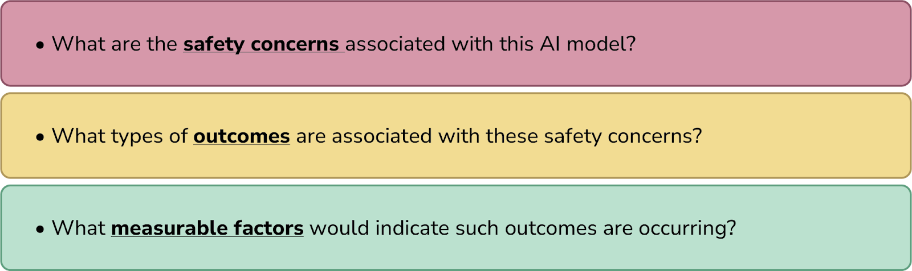
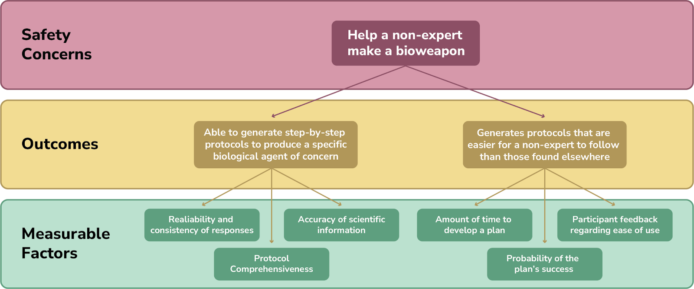
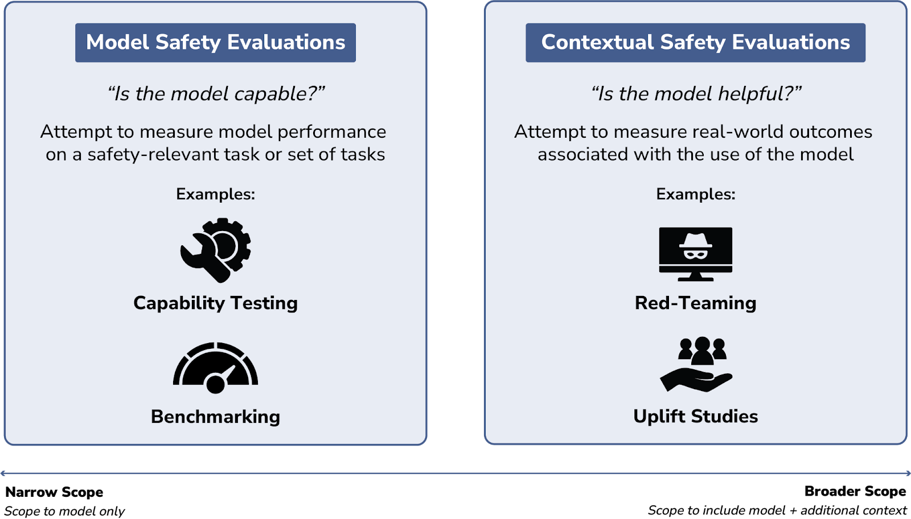

%%
Add discussion note here:

...

%%

With artificial intelligence (AI) safety and security discourse in the news given various high-profile [best](https://www.vox.com/technology/397330/deepseek-openai-chatgpt-gemini-nvidia-china) -and- [worst](https://fortune.com/2025/01/29/deepseek-ai-china-safety-newsguard-kela-navy-national-security/) -case scenarios, it is more crucial than ever that we evaluate AI models effectively to understand what they do. This imperative has given rise to notable developments like the first AI safety summits, an international network of AI Safety Institutes, and the adoption of responsible scaling policies. However, it remains unclear for many policymakers how exactly AI evaluations work.

At the core of these conversations is a fundamental question: “How safe is a given AI model?” While there is no perfect answer, AI safety evaluations are the best tool we have to assess and understand potential risks. However, with a growing variety of evaluation methods available, it’s crucial to understand what each one measures and how to apply them and interpret their results effectively.

This explainer lays out the different fundamental types of AI safety evaluations alongside their respective strengths and limitations. This context is valuable both for evaluators who must choose the right approach for a given safety concern and for policymakers who must correctly interpret evaluation results in order to make informed decisions.

### Model Safety Evaluations vs. Contextual Safety Evaluations ^model-safety-evaluations-vs

In general, evaluations fall into two categories: those that **evaluate the outputs of models alone** (referred to here as _model safety evaluations_) and those that **evaluate how models impact real-world outcomes** like user behavior, decision-making, or other connected systems (referred to here as _contextual safety evaluations_). Differentiating between these categories is important: understanding whether a model is _capable_ of providing specific information is different from knowing whether a model’s information is _helpful_ to a malicious actor.

The questions that guide a model safety evaluation are largely related to the ability to generate specific outputs (_“is the model capable?”_). Questions may include:

-   Can the model perform a specific task, whether desirable or undesirable?
-   How accurate and reliable are the model’s outputs?
-   How good is a model at answering general-purpose questions? Specific questions?
-   What outputs can the model not provide? Are there areas in which the model is unlikely to provide correct answers?
-   What systemic flaws, biases, or limitations are present in model outputs?
-   How do capabilities compare between models, or over time?

For contextual safety evaluations, an evaluator may want to know how an adversarial actor may use or manipulate a model or apply information from a model in the real world (_“is the model useful?”_). Questions may include:

-   What can a user with access to the model do?
-   Does a model make it easier to access necessary information, provide previously unavailable information, or perform a specific task?
-   Can an adversarial actor “break through” restrictions or protections?
-   Does access to a model increase a malicious actor’s chance of success or increase the range of options an adversarial actor may consider for a plan?
-   Does a user’s level of expertise impact any of the above questions?

### Designing an Evaluation Strategy ^designing-an-evaluation-strategy

The design process for both model and contextual safety evaluations involves three main steps: deciding what to measure, how to measure it, and what the results mean.[^note-1]

#### 1\. What to measure ^1-what-to-measure

AI safety evaluations can measure a number of factors, from quantitative outcomes like how often models provide particular information to qualitative observations like how people use and interact with a model. In both scenarios, three questions regarding the overall safety concerns, associated outcomes, and measurable factors can help guide what to measure:

The answers to each of these three questions should be defined as precisely and specifically as possible, and may involve scoping to domain-specific considerations for applications like cyber- or biosecurity. Critically, precision invites complexity: each big-picture safety concern involves a range of outcomes, and each potential outcome can be measured differently. For instance, one example of an overall safety concern is that an AI model could enhance biological risk by helping a non-expert to make a bioweapon. One relevant outcome would be an AI model that can provide technically sound protocols for making dangerous biological agents, and another would be that such a capability meaningfully assists a bad actor in designing a plan of misuse. Each of those outcomes can then be measured by different indices, like performance on biological benchmarks to test the model’s ability to provide accurate scientific information, or whether using the model decreases how much time it takes to develop a plan for misuse.

Model safety evaluations typically assess the model’s outputs. They may measure how factual an outputted answer is, whether a response contains particular undesired features like indicators of bias or misinformation, or how frequently a model gives correct versus incorrect answers. Evaluations could also assess the process for obtaining a particular output, for example by examining what types of prompts trigger the model to yield a certain response.

Contextual safety evaluations measure aspects of human behavior or system-wide impacts. For example, they may monitor how often users successfully complete a given task with or without access to an AI model, or ask them to rate the model’s usefulness.

It is important to keep in mind that many of the metrics one could choose for an AI safety evaluation are proxies for the actual risk under consideration, and are therefore imperfect measures of risk. This means that safety evaluations for biological risks thankfully do not actually involve executing biological attacks, but it also unfortunately means that safety evaluations can only measure intermediary factors, like whether an AI model _could_ provide relevant information or reduce the amount of planning time in a controlled, hypothetical scenario. Nevertheless, these evaluations offer an important window into the state of AI safety. Understanding their limitations is key to using them effectively.

#### 2\. How to measure it ^2-how-to-measure

Once a decision about what to measure has been made, the next step is to determine how to measure it. A variety of approaches for AI safety evaluations already exist for both model and contextual safety evaluations.

For example, existing **model safety evaluations** interrogate an AI system’s ability to complete a particular task or provide certain types of information.

-   One approach is to employ **capability testing** methods, which typically measure a model’s ability to perform a given task, to specifically probe for capabilities that are considered “risky” or undesirable. A safety-oriented capability evaluation for a chatbot could involve testing whether the system is able to correctly provide information about predetermined topics of concern, such as knowledge of virulence factors or protocols for specific virology experiments.
-   **Benchmarking** is a common approach that compares different models’ performance by “grading” model responses to a curated and standardized set of questions that remain static over time. Similar to a student taking an exam in class, benchmarking evaluates model responses based on predetermined criteria like the ability to provide correct answers or responses with specific attributes. Evaluators have developed specialized benchmarks like the [GPQA](https://arxiv.org/abs/2311.12022) and [WMDP](https://www.wmdp.ai/) to evaluate LLM-based chatbots on their ability to provide chemistry and biology information.

Existing **contextual safety evaluations**, on the other hand, aim to measure how having access to a model impacts real-world outcomes. These evaluations often focus on how an adversarial actor might circumvent model safeguards or use a model to enact harm, or how much harm an actor could cause.

-   For example, **red-teaming** evaluations often test the resilience of existing guardrails by trying to “break” them, which can reveal previously unknown vulnerabilities to be mitigated. The process typically involves asking testers to attempt to bypass safeguards to access information that the model is not supposed to provide or make the model behave in unexpected or undesired ways.[^note-red-teaming]
-   **Uplift studies** compare how testers complete a task with and without access to an AI model to evaluate whether the model provided meaningful assistance to users. Uplift studies for harmful outcomes may measure whether the model allowed the user to complete a task more quickly or efficiently (_“lowering the barrier to misuse”_) or enabled them to generate a more dangerous outcome (_“raising the ceiling of misuse”_).

#### 3\. What the results mean ^3-what-the-results

Since AI safety evaluations measure proxies for real-world risks, it is important to understand a study’s limitations to avoid mis- or overinterpreting evaluation results. The final step in designing an evaluation strategy is accurately interpreting what the results can and cannot tell us about the model’s impact on risk and safety.

Just because a model performs well on an evaluation task does not necessarily mean it will perform well in the context of a real-world use case. For example, a capability evaluation may demonstrate that a model is _able_ to provide specific information, but that does not give insight as to how easily accessible information is from other sources on the internet or whether the model changes a malicious actor’s capabilities. The ability to perform a task also does not necessarily indicate a more general capability. As with human test-takers, acing an exam does not always indicate that the student truly understands a concept or can apply it in different scenarios. For benchmarking in particular, this effect can be exacerbated by the practice of benchmark chasing or “teaching to the test” by optimizing the system to achieve high evaluation results, potentially at the expense of other objectives. Benchmarking results can also be impacted if a model is exposed to the benchmarks that it will be tested on before the actual testing occurs, leading to artificially increased performance.

A major challenge for contextual safety evaluations, including red-teaming, is that they include human variables that are difficult or impossible to standardize. Many factors can impact contextual safety evaluations, from a human tester’s subject matter expertise or experience level to less obvious differences like the tester’s mood on the day of the exercise or how well they collaborated with other team members. These variables make it hard to establish cause-and-effect relationships between multiple contributing factors or to compare results from different studies. For example, a recent uplift study for biological attack planning found that variation between research participants’ expertise was more likely to impact their planning success than access to a large language model.[^cite-mouton] Participant expertise was not the only important variable: the authors also noted that the creativity of attack scenarios also impacted planning success and was not captured by rigid evaluation methods.

More generally, it is important not to overstate the results of contextual safety evaluations. These studies are heavily reliant on interpretation, and overstating their results can lead to misinformed decisions that are disconnected from actual system capabilities. For instance, does the ability to gather information and generate a plan equate to the ability to carry out an attack?[^cite-walsh] Additionally, contextual safety evaluations do not exhaustively list all potential future scenarios or give the “right” answer about what will happen in the future. Rather, these studies should be viewed as tools to broaden our understanding of the threat landscape to better prepare for a variety of potential outcomes.

As AI capabilities and their associated safety concerns continue to develop, it will be more important than ever to ensure that AI safety evaluations yield actionable results to guide informed decision-making. Achieving this outcome will involve a variety of stakeholders, from the evaluators who design an evaluation’s methodology to the policymakers who must interpret its results to take action. By understanding the process of designing safety evaluations and the strengths and limitations of several types of evaluations, these parties can more effectively navigate the evolving landscape of AI safety.

[^note-1]: The evaluation strategies in this explainer, and the information about their general strengths and limitations, are largely adapted from the CSET blog post [Evaluating Large Language Models](https://cset.georgetown.edu/article/evaluating-large-language-models/)
[^note-red-teaming]: In practice, the term “red-teaming” has evolved to take on a variety of meanings within the context of AI evaluations. This can contribute to inconsistent usage and potential misunderstandings. For more, see: Ji, Jessica. “What Does AI Red-Teaming Actually Mean?” _Center for Security and Emerging Technology_, October 24, 2023. [https://cset.georgetown.edu/article/what-does-ai-red-teaming-actually-mean/](https://cset.georgetown.edu/article/what-does-ai-red-teaming-actually-mean/)
[^cite-mouton]: Mouton, Christopher A., Caleb Lucas, and Ella Guest. “The Operational Risks of AI in Large-Scale Biological Attacks: Results of a Red-Team Study.” RAND Corporation, January 25, 2024. [https://www.rand.org/pubs/research\_reports/RRA2977-2.html](https://www.rand.org/pubs/research_reports/RRA2977-2.html)
[^cite-walsh]: Walsh, Matthew E. “How to Better Research the Possible Threats Posed by AI-Driven Misuse of Biology.” _Bulletin of the Atomic Scientists_, March 18, 2024. [https://thebulletin.org/2024/03/how-to-better-research-the-possible-threats-posed-by-ai-driven-misuse-of-biology/](https://thebulletin.org/2024/03/how-to-better-research-the-possible-threats-posed-by-ai-driven-misuse-of-biology/)
