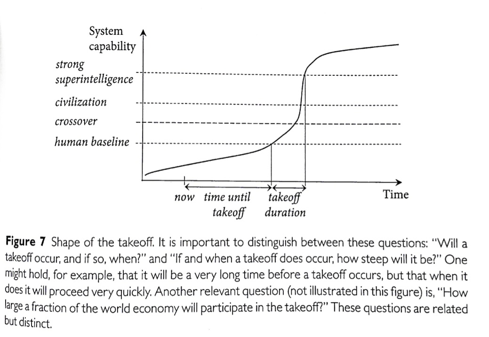
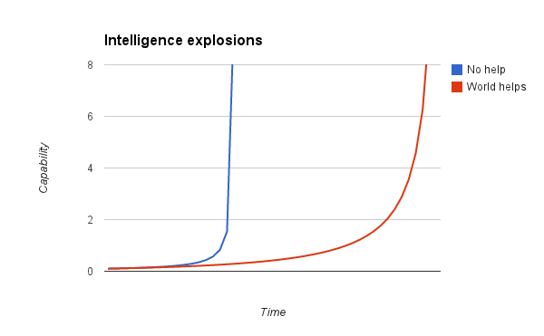
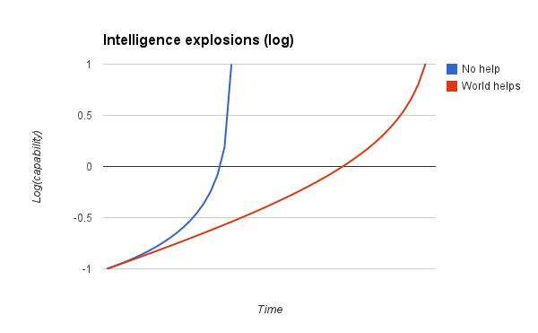
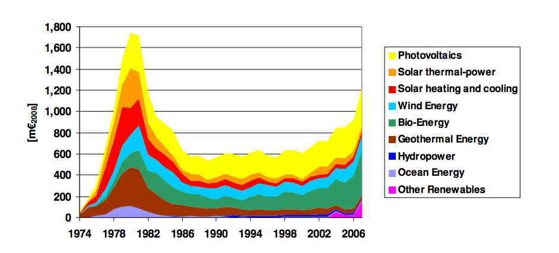
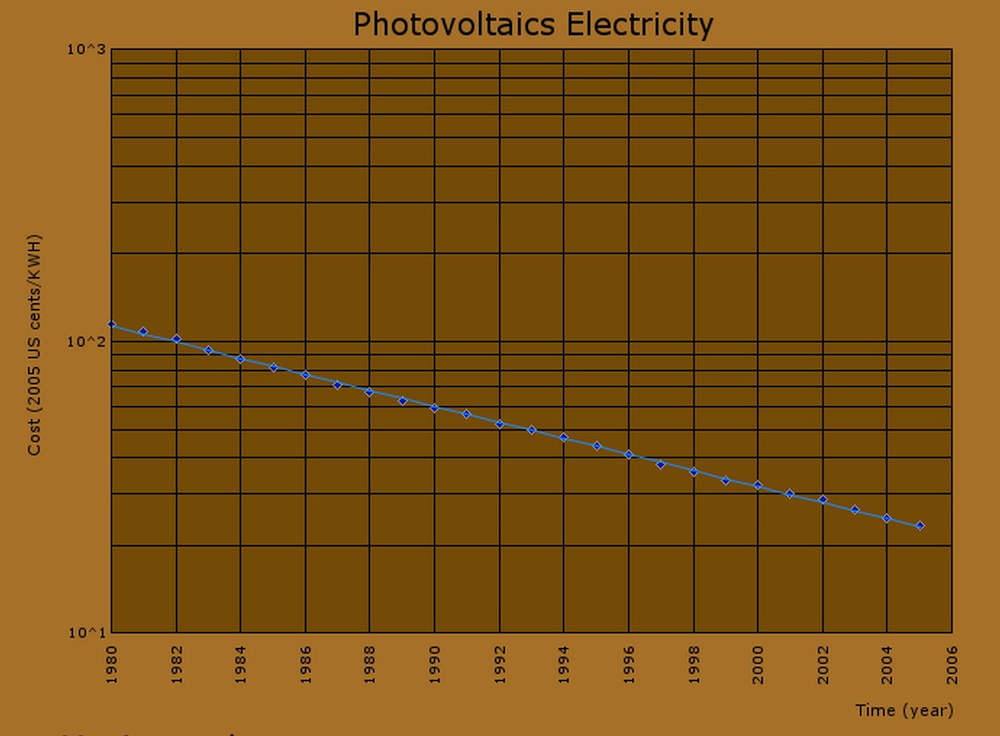
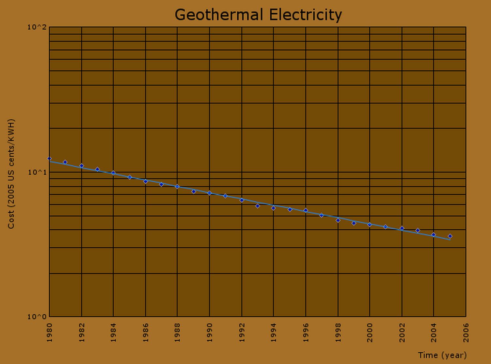
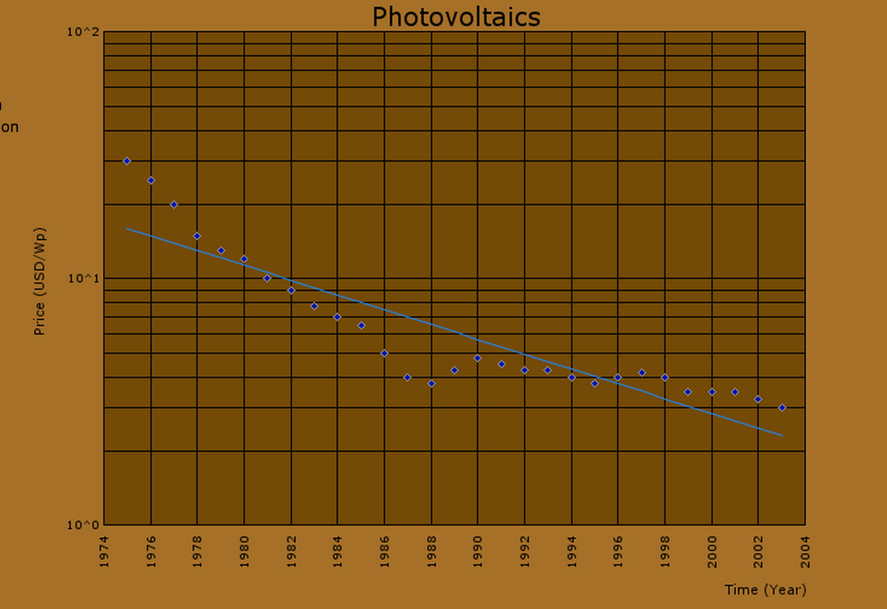
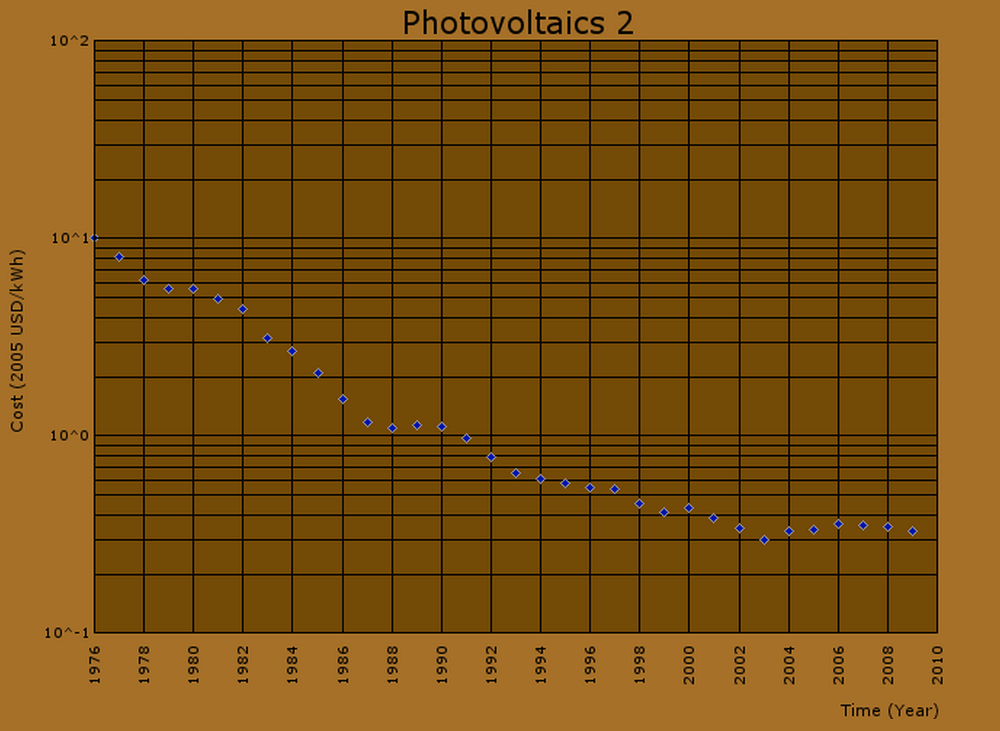
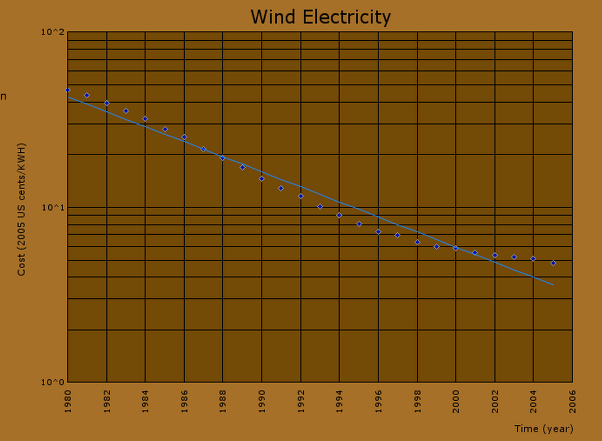

%%
Add discussion note here:

...

%%

_This is part of a weekly reading group on [Nick Bostrom](http://www.nickbostrom.com/)'s book, [Superintelligence](http://www.amazon.com/Superintelligence-Dangers-Strategies-Nick-Bostrom/dp/0199678111). For more information about the group, and an index of posts so far see the [announcement post](https://www.lesswrong.com/lw/kw4/superintelligence_reading_group/). For the schedule of future topics, see [MIRI's reading guide](https://intelligence.org/wp-content/uploads/2014/08/Superintelligence-Readers-Guide-early-version.pdf)._

---

Welcome. This week we discuss the sixth section in the [reading guide](https://intelligence.org/wp-content/uploads/2014/08/Superintelligence-Readers-Guide-early-version.pdf): _**Intelligence explosion kinetics**_. This corresponds to Chapter 4 in the book, of a similar name. This section is about how fast a human-level artificial intelligence might become superintelligent.

This post summarizes the section, and offers a few relevant notes, and ideas for further investigation. Some of my own thoughts and questions for discussion are in the comments.

There is no need to proceed in order through this post, or to look at everything. Feel free to jump straight to the discussion. Where applicable and I remember, page numbers indicate the rough part of the chapter that is most related (not necessarily that the chapter is being cited for the specific claim).

**Reading**: Chapter 4 (p62-77)

---

# Summary ^summary

1.  **Question: If and when a human-level general machine intelligence is developed, how long will it be from then until a machine becomes radically superintelligent?** (p62)
2.  The following figure from p63 illustrates some important features in Bostrom's model of the growth of machine intelligence. He envisages machine intelligence passing **human-level**, then at some point reaching the level where most inputs to further intelligence growth come from the AI itself ('**crossover**'), then passing the level where a single AI system is as capable as all of **human civilization**, then reaching '**strong superintelligence**'. The shape of the curve is probably intended an example rather than a prediction.  
    
3.  A transition from human-level machine intelligence to superintelligence might be categorized into one of three scenarios: '**slow takeoff**' takes decades or centuries, '**moderate takeoff**' takes months or years and '**fast takeoff**' takes minutes to days. Which scenario occurs has implications for the kinds of responses that might be feasible.
4.  We can model improvement in a system's intelligence with this equation:  
      
    _**Rate of change in intelligence = Optimization power/Recalcitrance**_  
      
    where 'optimization power' is effort being applied to the problem, and 'recalcitrance' is how hard it is to make the system smarter by applying effort.
5.  Bostrom's comments on recalcitrance of different methods of increasing kinds of intelligence:
    1.  **Cognitive enhancement via public health and diet**: steeply diminishing returns (i.e. increasing recalcitrance)
    2.  **Pharmacological enhancers**: diminishing returns, but perhaps there are still some easy wins because it hasn't had a lot of attention.
    3.  **Genetic cognitive enhancement**: U-shaped recalcitrance - improvement will become easier as methods improve, but then returns will decline. Overall rates of growth are limited by maturation taking time.
    4.  **Networks and organizations**: for organizations as a whole recalcitrance is high. A vast amount of effort is spent on this, and the world only becomes around a couple of percent more productive per year. The internet may have merely moderate recalcitrance, but this will likely increase as low-hanging fruits are depleted.
    5.  **Whole brain emulation**: recalcitrance is hard to evaluate, but emulation of an insect will make the path much clearer. After human-level emulations arrive, recalcitrance will probably fall, e.g. because software manipulation techniques will replace physical-capital intensive scanning and image interpretation efforts as the primary ways to improve the intelligence of the system. Also there will be new opportunities for organizing the new creatures. Eventually diminishing returns will set in for these things. Restrictive regulations might increase recalcitrance.
    6.  **AI algorithms**: recalcitrance is hard to judge. It could be very low if a single last key insight is discovered when much else is ready. Overall recalcitrance may drop abruptly if a low-recalcitrance system moves out ahead of higher recalcitrance systems as the most effective method for solving certain problems. We might overestimate the recalcitrance of sub-human systems in general if we see them all as just 'stupid'.
    7.  **AI 'content'**: recalcitrance might be very low because of the content already produced by human civilization, e.g. a smart AI might read the whole internet fast, and so become much better.
    8.  **Hardware (for AI or uploads)**: potentially low recalcitrance. A project might be scaled up by orders of magnitude by just purchasing more hardware. In the longer run, hardware tends to improve according to Moore's law, and the installed capacity might grow quickly if prices rise due to a demand spike from AI.
6.  **Optimization power will probably increase after AI reaches human-level**, because its newfound capabilities will attract interest and investment.
7.  **Optimization power would increase more rapidly if AI reaches the 'crossover' point**, when much of the optimization power is coming from the AI itself. Because smarter machines can improve their intelligence more than less smart machines, after the crossover a 'recursive self improvement' feedback loop would kick in.
8.  Thus optimization power is likely to increase during the takeoff, and this alone could produce a fast or medium takeoff. Further, recalcitrance is likely to decline. Bostrom concludes that a **fast or medium takeoff looks likely**, though a slow takeoff cannot be excluded.

# Notes ^notes

1\. The **argument for a relatively** **fast takeoff** is one of the most controversial arguments in the book, so it deserves some thought. Here is my somewhat formalized summary of the argument as it is presented in this chapter. I personally don't think it holds, so tell me if that's because I'm failing to do it justice. The pink bits are not explicitly in the chapter, but are assumptions the argument seems to use.

1.  Growth in intelligence  =  optimization power /  recalcitrance                                                  \[true by definition\]
2.  Recalcitrance of AI research will probably drop or be steady when AI reaches human-level               (p68-73)
3.  Optimization power spent on AI research will increase after AI reaches human level                         (p73-77)
4.  _Optimization/Recalcitrance will stay similarly high for a while prior to crossover_
5.  _A 'high' O/R ratio prior to crossover will produce explosive growth OR crossover is close_
6.  _Within minutes to years, human-level intelligence will reach crossover_                                           \[from 1-5\]
7.  Optimization power will climb ever faster after crossover, in line with the AI's own growing capacity     (p74)
8.  _Recalcitrance will not grow much between crossover and superintelligence_
9.  _Within minutes to years, crossover-level intelligence will reach superintelligence_                           \[from 7 and 8\]
10.  **Within minutes to years, human-level AI will likely transition to superintelligence**           \[from 6 and 9\]

Do you find this compelling? Should I have filled out the assumptions differently?

\*\*\*

2\. **Other takes on the fast takeoff** 

It seems to me that 5 above is the most controversial point. The famous [Foom Debate](http://wiki.lesswrong.com/wiki/The_Hanson-Yudkowsky_AI-Foom_Debate) was a long argument between Eliezer Yudkowsky and Robin Hanson over the plausibility of fast takeoff, among other things. Their arguments were mostly about both arms of 5, as well as the likelihood of an AI taking over the world (to be discussed in a future week). The Foom Debate included a live verbal component at Jane Street Capital: [blog summary](http://www.overcomingbias.com/2011/07/debating-yudkowsky.html), [video](https://docs.google.com/document/pub?id=17yLL7B7yRrhV3J9NuiVuac3hNmjeKTVHnqiEa6UQpJk), [transcript](https://docs.google.com/document/pub?id=17yLL7B7yRrhV3J9NuiVuac3hNmjeKTVHnqiEa6UQpJk). Hanson more recently reviewed _Superintelligence_, again [criticizing](http://www.overcomingbias.com/2014/07/30855.html) the plausibility of a single project quickly matching the capacity of the world.

Kevin Kelly [criticizes](http://kk.org/thetechnium/2008/09/thinkism/) point 5 from a different angle: he thinks that speeding up human thought can't speed up progress all that much, because progress will quickly bottleneck on slower processes.

Others have compiled lists of criticisms and debates [here](https://www.lesswrong.com/lw/8j7/criticisms_of_intelligence_explosion/) and [here](http://wiki.lesswrong.com/wiki/Perspectives_on_intelligence_explosion).

3\. **A closer look at 'crossover'**

Crossover is 'a point beyond which the system's further improvement is mainly driven by the system's own actions rather than by work performed upon it by others'. Another way to put this, avoiding certain ambiguities, is 'a point at which the inputs to a project are mostly its own outputs', such that improvements to its outputs feed back into its inputs. 

The nature and location of such a point seems an interesting and important question. If you think crossover is likely to be very nearby for AI, then you need only worry about the recursive self-improvement part of the story, which kicks in after crossover. If you think it will be very hard for an AI project to produce most of its own inputs, you may want to pay more attention to the arguments about fast progress before that point.

To have a concrete picture of crossover, consider Google. Suppose Google improves their search product such that one can find a thing on the internet a radical 10% faster. This makes Google's own work more effective, because people at Google look for things on the internet sometimes. How much more effective does this make Google overall? Maybe they spend a couple of minutes a day doing Google searches, i.e. 0.5% of their work hours, for an overall saving of .05% of work time. This suggests their next improvements made at Google will be made 1.0005 faster than the last. It will take a while for this positive feedback to take off. If Google coordinated your eating and organized your thoughts and drove your car for you and so on, and then Google improved efficiency using _all of those services_ by 10% in one go, then this might make their employees close to 10% more productive, which might produce more noticeable feedback. Then Google would have reached the crossover. This is perhaps easier to imagine for Google than other projects, yet I think still fairly hard to imagine.

Hanson talks more about this issue when he [asks why](http://www.overcomingbias.com/2008/11/fund-ubertool.html) the explosion argument doesn't apply to other recursive tools. He [points](http://www.overcomingbias.com/2008/11/engelbarts-uber.html) to Douglas Englebart's ambitious [proposal](http://www.dougengelbart.org/pubs/augment-3906.html) to use computer technologies to produce a rapidly self-improving tool set.

Below is a simple model of a project which contributes all of its own inputs, and one which begins mostly being improved by the world. They are both normalized to begin one tenth as large as the world and to grow at the same pace as each other (this is why the one with help grows slower, perhaps counterintuitively). As you can see, the project which is responsible for its own improvement takes far less time to reach its 'singularity', and is more abrupt. It starts out at crossover. The project which is helped by the world doesn't reach crossover until it passes 1. 

**4\. How much difference does attention and funding make to research?**

Interest and investments in AI at around human-level are (naturally) hypothesized to accelerate AI development in this chapter. It would be good to have more empirical evidence on the quantitative size of such an effect. I'll start with one example, because examples are a bit costly to investigate. I selected renewable energy before I knew the results, because they come up early in the [Performance Curves Database](http://pcdb.santafe.edu/), and I thought their funding likely to have been unstable. Indeed, OECD funding since the 70s looks like this apparently:

(from [here](https://www.q-cells.com/uploads/tx_abdownloads/files/17_RESEARCH_AND_DEVELOPMENT_Paper.pdf))

The steep increase in funding in the early 80s was due to President Carter's energy policies, which were related to the [1979 oil crisis](http://en.wikipedia.org/wiki/1979_energy_crisis).

This is what various indicators of progress in renewable energies look like (click on them to see their sources):

 ([source](http://pcdb.santafe.edu/graph.php?curve=182))

  ([source](http://pcdb.santafe.edu/graph.php?curve=176))

  ([source](http://pcdb.santafe.edu/graph.php?curve=14))

 ([source](http://pcdb.santafe.edu/graph.php?curve=88))

 ([source](http://pcdb.santafe.edu/graph.php?curve=256))

  ([source](http://pcdb.santafe.edu/graph.php?curve=174))

There are quite a few more at the [Performance Curves Database](http://pcdb.santafe.edu/index.php). I see surprisingly little relationship between the funding curves and these metrics of progress. Some of them are shockingly straight. What is going on? (I haven't looked into these more than you see here).

**5\. Other writings on recursive self-improvement**

Eliezer Yudkowsky wrote about the idea originally, e.g. [here](https://www.lesswrong.com/lw/we/recursive_selfimprovement/). David Chalmers [investigated](https://web.archive.org/web/20141009013129/http://consc.net/papers/singularity.pdf) the topic in some detail, and Marcus Hutter [did some more](http://www.hutter1.net/publ/singularity.pdf). More pointers [here](https://www.lesswrong.com/lw/we/recursive_selfimprovement/).

In-depth investigations

If you are particularly interested in these topics, and want to do further research, these are a few plausible directions, some inspired by Luke Muehlhauser's [list](http://lukemuehlhauser.com/some-studies-which-could-improve-our-strategic-picture-of-superintelligence/), which contains many suggestions related to parts of _Superintelligence._ These projects could be attempted at various levels of depth.

1.  **Model the intelligence explosion more precisely.** Take inspiration from successful economic models, and evidence from a wide range of empirical areas such as evolutionary biology, technological history, algorithmic progress, and observed technological trends. Eliezer Yudkowsky has [written at length](http://intelligence.org/files/IEM.pdf) about this project.
2.  **Estimate empirically a specific interaction** in the intelligence explosion model. For instance, how much and how quickly does investment increase in technologies that look promising? How much difference does that make to the rate of progress in the technology? How much does scaling up researchers change output in computer science? (Relevant to how much adding extra artificial AI researchers speeds up progress) How much do contemporary organizations contribute to their own inputs? (i.e. how hard would it be for a project to contribute more to its own inputs than the rest of the world put together, such that a substantial positive feedback might ensue?) [Yudkowsky 2013](http://intelligence.org/files/IEM.pdf) again has a few pointers (e.g. starting at p15).
3.  If human thought was sped up substantially, what would be the **main limits to arbitrarily fast technological progress**?

If you are interested in anything like this, you might want to mention it in the comments, and see whether other people have useful thoughts.

# How to proceed ^how-to-proceed

This has been a collection of notes on the chapter.  **The most important part of the reading group though is discussion**, which is in the comments section. I pose some questions for you there, and I invite you to add your own. Please remember that this group contains a variety of levels of expertise: if a line of discussion seems too basic or too incomprehensible, look around for one that suits you better!

Next week, we will talk about 'decisive strategic advantage': the possibility of a single AI project getting huge amounts of power in an AI transition. To prepare, **read** Chapter 5, _Decisive Strategic Advantage_ (p78-90). The discussion will go live at 6pm Pacific time next Monday Oct 27. Sign up to be notified [here](http://intelligence.us5.list-manage.com/subscribe?u=353906382677fa789a483ba9e&id=28cb982f40).
