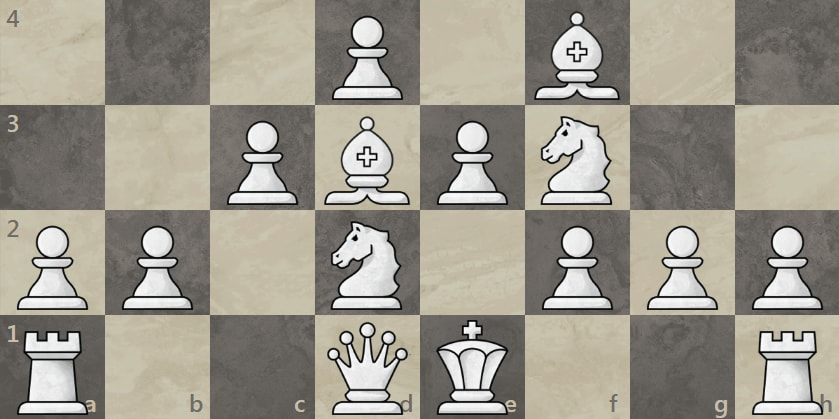
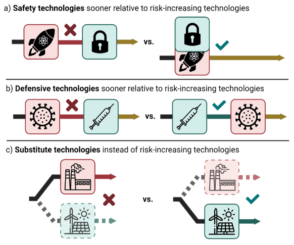

%%
Add discussion note here:

...

%%

[Link post](https://www.convergenceanalysis.org/publications/ai-governance-needs-a-theory-of-victory)

_This post is part of a series by_ [_Convergence Analysis_](https://www.convergenceanalysis.org/)_. An earlier post introduced_ [_scenario planning_](https://forum.effectivealtruism.org/posts/tCq2fi6vhSsCDA5Js/scenario-planning-for-ai-x-risk) _for AI risk. In this post, we argue for the importance of a related concept: theories of victory._

> _In order to improve your game you must study the endgame before everything else; for, whereas the endings can be studied and mastered by themselves, the middlegame and the opening must be studied in relation to the endgame.” — José Raúl Capablanca, Last Lectures, 1966_

# Overview ^overview

The central goal of AI governance should be achieving existential security: a state in which existential risk from AI is negligible either indefinitely or for long enough that humanity can carefully plan its future. We can call such a state an AI governance _endgame_. A positive framing for AI governance (that is, achieving a certain endgame) can provide greater strategic clarity and coherence than a negative framing (or, avoiding certain outcomes).

A _theory of victory_ for AI governance combines an endgame with a _plausible_ and _prescriptive_ strategy to achieve it. It should also be _robust_ across a range of future scenarios, given uncertainty about key strategic parameters.

Nuclear risk provides a relevant case study. Shortly after the development of nuclear weapons, scientists, policymakers, and public figures proposed various theories of victory for nuclear risk, some of which are striking in their similarity to theories of victory for AI risk. Those considered included an international nuclear development moratorium, as well as unilateral enforcement of a monopoly on nuclear weapons.

We discuss three potential theories of victory for AI governance. The first is an AI moratorium, in which international coordination indefinitely prevents AI development beyond a certain threshold. This would require an unprecedented level of global coordination and tight control over access to compute. Key challenges include the strong incentives to develop AI for strategic advantage, and the historical difficulty of achieving this level of global coordination.

The second theory of victory is an “AI Leviathan” — a single well-controlled AI system or AI-enhanced agency that is empowered to enforce existential security. This could arise from either a first-mover unilaterally establishing a moratorium, or voluntary coordination between actors. Challenges include the potential for dystopic lock-in if mistakes are made in its construction, and significant ambiguity on key details of implementation.

The third theory of victory is defensive acceleration. The goal is an endgame where the defensive applications of advanced AI sustainably outpace offensive applications, mitigating existential risk. The strategy is to coordinate differential technology development to preferentially advance defensive and safety-enhancing AI systems. Challenges include misaligned incentives in the private sector and the difficulty of predicting the offensive and defensive applications of future technology.

We do not decide between these theories of victory. Instead, we encourage actors in AI governance to make their preferred theories of victory explicit — and, when appropriate, public. An open discussion and thorough examination of theories of victory for AI governance is crucially important to humanity’s long-term future.

# Introduction ^introduction

## What is the goal of AI governance? ^what-is-the-goal

The goal of AI governance is (or should be) to bring about a state of existential security from AI risks. In such a state, AI existential risk would be indefinitely negligible, allowing humanity to carefully design its long-term relationship with AI.

It might be objected that risk management should be conceived of as a continual process in which risk is never negligible. However, this is not sufficient in the case of existential risk, in which any non-negligible amount is unsustainable. If an existential risk is non-negligible, then, given a sufficient period of time, an existential catastrophe is all but certain.

## Existential security as a positive goal ^existential-security-as-a

AI governance has often framed the problem of existential security negatively. That is, in order to achieve existential security, we must mitigate several risks, each described by a distinct threat model — for example, loss of control, or catastrophic misuse.

However, we can also frame the problem positively: if we can describe a state of existential security, then we can work to bring about that state.[^note-success-stories] This gives us something to work towards, rather than just several outcomes to avoid. However, while we are taking a positive approach to existential security, we are not addressing positive goals _beyond_ existential security: an endgame is not a description of human flourishing — it only preserves optionality to enable flourishing.

So how do we achieve the positive goal of existential security from AI?

In warfare, the role of a positive goal is filled by a _theory of victory_. A theory of victory describes the conditions for victory, as well as a big-picture strategy for achieving those conditions.

This term has also [sometimes been used](https://forum.effectivealtruism.org/posts/tCq2fi6vhSsCDA5Js/scenario-planning-for-ai-x-risk#Theories_of_victory_) in the context of AI governance. An AI governance theory of victory is _a description of and a story about how to bring about AI existential security_.

# Motivation ^motivation

Existential security is a difficult standard to satisfy. Therefore, it’s worthwhile to describe and evaluate the options we have. In other words, if we want to make an informed decision about the long-term future of humanity, we need to identify the scenarios in which humanity has a long-term future.

Framing AI governance in terms of theories of victory might also have some practical benefits. The first benefit is **strategic clarity**: in general, it’s easier to conceptualize how to bring about some particular outcome than it is to avoid several different outcomes.

As an example, consider the opening moves of a chess game. There are several opening traps to which new players often fall victim. Instead of learning how to avoid each trap separately, it’s often easier for new players to learn an opening system: an arrangement of their pieces that they can construct without thinking much about how to respond to each of their opponent’s moves.  
  
Here’s one popular opening system, the [London system](https://www.chess.com/blog/samsajwani123/learn-the-basics-of-the-london-system):

Similarly, it might be easier to pursue a theory of victory for AI governance rather than intervene in each AI threat model separately — and what’s easier might be more likely to succeed.

Forming AI governance in terms of theories of victory might also minimize [**strategic incoherence**](https://forum.effectivealtruism.org/posts/Bzezf2zmgBhtCD3Pb/components-of-strategic-clarity-strategic-perspectives-on#In_search_of_strategic_clarity) among AI governance actors. For example, a strategy intended to intervene in a particular threat model might accidentally undermine strategies for intervening in other threat models. More broadly, different actors in AI governance might be implicitly (or explicitly) pursuing incompatible theories of victory.

# Criteria for a theory of victory ^criteria-for-a-theory

## Endgames and strategies ^endgames-and-strategies

A theory of victory involves two components: some desired outcome (an **endgame**), and a story about how we get there (a **strategy**). Both components can be evaluated according to several criteria.

**Evaluating endgames.** An endgame should reduce existential risk to a negligible level, which is maintained (or further reduced) over a very long time, and should not lead to an obviously undesirable future for humanity. For example, we require that the “expected time to failure” for AI risk to be several hundreds or thousands of years. In other words, an endgame should be **existentially secure.**

To avoid a clearly undesirable future, we also want humanity to be able to “keep its options open.” That is, we don’t want to lock-in a dystopic (or even just a mediocre) future, even if it is existentially secure. Instead, we might want to enable a period of “[long reflection](https://forum.effectivealtruism.org/posts/4xwWDLfMenw48TR8c/long-reflection-reading-list)” in which we spend time figuring out what we want our long-term relationship with AI to be. As Katja Grace has [pointed out](https://blog.aiimpacts.org/cp/144229395), even if AI doesn’t pose an existential risk, the “first” (i.e. the default) future isn’t necessarily the best future. This is also true of the “first” AI safety endgame. So, we also want an endgame to preserve **optionality**.

**Evaluating strategies.** First, a strategy should be **plausible**. For example, a strategy to convince all major AI labs and corporations to immediately and voluntarily stop developing advanced AI isn’t particularly plausible.

A strategy should also sufficiently **prescribe** action. For example, “getting lucky” for some reason (e.g., there happens to be an unforeseen technical barrier that indefinitely halts AI development) isn’t prescriptive.

## Scenario robustness ^scenario-robustness

A theory of victory should satisfy the criteria above across all plausible scenarios. A **scenario** is a particular combination of [**strategic parameters**](https://forum.effectivealtruism.org/posts/tCq2fi6vhSsCDA5Js/scenario-planning-for-ai-x-risk#Strategic_Parameters___Methods) (for example, timeline to TAI, takeoff speed, difficulty of technical safety, etc.) In other words, a theory of victory should be **robust**.

A robust theory of victory likely isn’t just one endgame and strategy pair, but rather a set of conditionals (e.g, if scenario 1 holds, then pursue endgame A with strategy X; if scenario 2 holds, then pursue endgame B with strategy Y).[^note-portfolio]

## Evaluating interventions ^evaluating-interventions

We can evaluate governance **interventions** with respect to how well they support one or more theories of victory (ToVs). Some interventions might support several ToVs. Some might support only one. Some might support some ToVs at the expense of others.

In the absence of a clearly-preferable theory of victory, we might prefer interventions which support several theories of victory. Such interventions would tend to give you more options later on — even though you don’t know exactly what those options are. In the case of AI risk, these might be interventions like raising public awareness of AI risk and expanding the capabilities of AI governance organizations.

If no (or few) such interventions exist, then we might instead prefer to “go all in” on one theory of victory, or a small group of compatible theories of victory.

## Existential risk not from AI ^existential-risk-not-from

Mitigating existential risk from AI is an imperfect proxy for mitigating existential risk in general. There are several plausible sources of existential risk, and the theory of victory which best mitigates existential risk from AI might not be the strategy which best mitigates existential risk overall.

For example, access to advanced AI might help humanity secure itself against nuclear, biological, and climate risks. Therefore, if two theories of victory have effects on AI risk that are equal, we might prefer the one that allows humanity to sooner access the benefits of advanced AI.

# Nuclear risk as a case study ^nuclear-risk-as-a

The richest precedent for an emerging technology presenting existential risk is the development of nuclear weapons.

Scientists, policymakers, and public figures proposed various theories of victory for nuclear risk, several of which are striking in their similarity to theories of victory for AI risk. These theories of victory are informative both in their similarities and differences to AI risk.

Let us first note that the world has not reached a state of existential security from nuclear risk. This is because the current deterrent to nuclear war, mutually-assured destruction (MAD), does not satisfy the criteria for existential security. MAD only sufficiently mitigates nuclear risk if nuclear powers are sufficiently able to be modeled as rational agents.[^note-tai-rational]

## International coordination to prevent nuclear development ^international-coordination-to-prevent

Perhaps the simplest theory of victory for nuclear risk would have been international coordination to refrain from creating nuclear weapons. Had nuclear technology not developed in the context of the second world war, this theory of victory might not have been doomed to fail from the start. One Manhattan Project scientist, Otto Frisch, commented on the pressure the war exerted:

> “Why start on a project which, if it was successful, would end with the production of a weapon of unparalleled violence, a weapon of mass destruction, such as the world had never seen? The answer was very simple. We were at war, and the idea was reasonably obvious; very probably some German scientists had had the same idea and were working on it.” (Rhodes 1986, p. 325)

However, at the end of the second world war in 1945, only a single actor — the United States — had the ability to produce nuclear weapons. It wasn’t until 1949 that the Soviet Union would successfully test its first nuclear weapon. It wouldn’t be until the development of the hydrogen bomb and the dramatic expansion of both countries’ arsenals that nuclear weapons would present a genuine existential risk.

Therefore, it’s possible that existential risk could have been averted by preventing the expansion of nuclear arsenals even after the initial development of nuclear weapons. This would have required strong international coordination — and, in the extreme, the establishment of world government. Even Edward Teller — the “father of the hydrogen bomb” — at one point advocated for world government:

> “We must now work for world law and world government. . . . Even if Russia should not join immediately, a successful, powerful, and patient world government may secure their cooperation in the long run. . . . We \[scientists\] have two clear-cut duties: to work on atomic energy and to work for world government which alone can give us freedom and peace.” (Rhodes 1986, p. 766)

Albert Einstein also advocated for world government, arguing that the other available options — preventative war and nuclear armed states — were intolerable. He [wrote](https://thebulletin.org/archive/a-policy-for-survival-a-statement-by-the-emergency-committee-of-atomic-scientists/) that:

> _“The first two suggested policies lead inevitably to a war which would end with the total collapse of our traditional civilization. The third indicated policy may bring about the acceptance by the Soviet bloc of the offer of federation. If they will not accept federation, we lose nothing not already lost. If as seems probable, the world has a period of an armed peace, time and events may bring about a change in their policy._
> 
> _We have then the choice of acceptance, in the first two cases, of the inevitability of war or, in the latter case, of the possibility of peace. Confronted by such alternatives we believe that all constructive lines of action must be in keeping with the need of establishing a Federal World Government.”_

Neils Bohr, another eminent physicist, attempted to facilitate coordination between the US and the USSR in order to avoid a nuclear arms race. He initially succeeded in [interesting](https://www.atomicarchive.com/resources/documents/manhattan-project/bohr-memo.html) the US president, FDR, of the merits of his approach, but ultimately failed after an ill-fated meeting with Winston Churchill, to whom FDR deferred.

In principle, however, nuclear risk exhibits some features that would have made preventing nuclear development through international coordination a promising theory of victory. These features probably account for why nuclear disarmament remains a leading theory of victory for nuclear risk organizations.

**Nuclear weapons are a single-use technology.** In contrast to dual-use technologies like AI, much (though not all) of the technological development that went into the creation of nuclear weapons was only of a singular, destructive use. Accordingly, many scientists would likely have reservations working on nuclear weapon development during peacetime. State actors might have also faced significant resistance, both internally and externally, to devoting significant resources to nuclear weapon development.

**The proliferation of nuclear weapons is limited.** Even today, nuclear weapon development is restricted to well-resourced state actors, which limits the number of possible developers. Nuclear weapons development is also a relatively visible (albeit imperfect and fragile) process in peacetime, for example, to satellite imagery and external inspectors.

## A unilateral monopoly on nuclear weapons ^a-unilateral-monopoly-on

During the four years in which it was the only nuclear power, the United States possessed (at least the threat of) a decisive strategic advantage over the rest of the world, and might have been able to leverage that advantage to prevent other actors from developing nuclear weapons.

Shortly after the bombings of Hiroshima and Nagasaki, Bertrand Russell proposed unilateral action as a possible theory of victory in an essay titled [_The Bomb and Civilization._](https://russell.humanities.mcmaster.ca/wp-content/uploads/2019/05/24-58.pdf) The **endgame** of this theory of victory is the same as for international coordination as a theory of victory; that is, centralized control of nuclear weapon technology:

> Either war or civilization must end, and if it is to be war that ends, there must be an international authority with the sole power to make the new bombs. All supplies of uranium must be placed under the control of the international authority, which shall have the right to safeguard the ore by armed forces. As soon as such an authority has been created, all existing atomic bombs, and all plants for their manufacture, must be handed over. And of course the international authority must have sufficient armed forces to protect whatever has been handed over to it. If this system were once established, the international authority would be irresistible, and wars would cease.

However, the strategy Russell proposes for achieving this endgame is not international coordination, but rather unilateral action by the United states:

> The power of the United States in international affairs is, for the time being, immeasurably increased; a month ago, Russia and the United States seemed about equal in warlike strength, but now this is no longer the case. This situation, however, will not last long, for it must be assumed that before long Russia and the British Empire will set to work to make these bombs for themselves. \[...\]

It would be possible for Americans to use their position of temporary superiority to insist upon disarmament, not only in Germany and Japan, but everywhere except in the United States, or at any rate in every country not prepared to enter into a close military alliance with the United States, involving compulsory sharing of military secrets. During the next few years, this policy could be enforced; if one or two wars were necessary, they would be brief, and would soon end in decisive American victory. In this way a new League of Nations could be formed under American leadership, and the peace of the world could be securely established.

Einstein, while ultimately rejecting this option, [describes](https://thebulletin.org/archive/a-policy-for-survival-a-statement-by-the-emergency-committee-of-atomic-scientists/) it as “preventive war:”

> The first policy is that of the preventive war. It calls for an attack upon the potential enemy at a time and place of our own choosing while the United States retains the monopoly of the atomic bomb.

He also lays out the (rather compelling) reasons why such a war should, at best, be a last resort:

> No military leader has suggested that we could force a Russian surrender without a costly ground force invasion of Europe and Asia. Even if victory were finally achieved after colossal sacrifices in blood and treasure, we would find Western Europe in a condition of ruin far worse than that which exists in Germany today, its population decimated and overrun with disease. We would have for generations the task of rebuilding Western Europe and of policing the Soviet Union. This would be the result of the cheapest victory we could achieve. Few responsible persons believe in even so cheap a victory.

## Comparing nuclear risk and AI risk ^comparing-nuclear-risk-and

**Decisive strategic advantage.** One of the most important similarities between nuclear weapons and transformative AI is that both offer a decisive strategic advantage to those who control it over those who don’t. The effect of this similarity is that development of both nuclear weaponry and TAI both can create racing dynamics.

**Threat models.** The only plausible threat model for existential risk from nuclear weapons is intentional use, whether maliciously or by prior commitment for the sake of deterrence. This threat model is exacerbated by structural pressures such as arms races and imperfect information about adversaries’ intentions and capabilities.

Nuclear weapons do not pose an intrinsic risk of existential accident — in other words, they are well-controlled. While Manhattan Project scientists speculated that a nuclear detonation could ignite the atmosphere in a self-sustaining reaction, this worry proved to be unfounded. Prospective nuclear powers do not need to worry about existential risk resulting from loss of control during the development of nuclear weapons.

In contrast, a major threat model for AI risk involves loss of control over a superintelligent system. Depending on the likelihood of such loss of control, it may not be in the best interest of any particular actor to develop transformative AI, even though it might grant them a decisive strategic advantage.

**Single use, dual use, and general purpose.** Nuclear weaponry is a “single use” technology — which means it has one purpose (and not that nuclear weapons can’t be reused, although that’s also true). In contrast, transformative AI is “dual use” — it can be used for both creative and destructive ends — and trivially so. That’s because transformative AI will likely be general purpose: whatever you want to do, transformative AI can help you do it better.

One implication of this difference is that there exists reason to develop transformative AI outside of its effects on strategic balance — for example, advances in medical technology, or economic productivity. All else being equal, then, it would be more difficult to make a case against the development of transformative AI than it would have been to make a case against the development of nuclear weapons.

Another implication is that transformative AI might offer defensive capabilities unavailable to nuclear weaponry. A nuclear weapon can’t defend against another that has already been deployed — it can only deter it from being deployed by way of MAD.[^note-mad] In contrast, transformative AI can enhance defensive as well as offensive capabilities.

**Distribution.** Like nuclear weapons, the development of the first transformative AI systems will likely be limited to well-resourced actors like large corporations and nations. Current frontier AI models cost in the hundreds of millions to train, and that cost is projected to increase.

Unlike nuclear weapons, however, AI models can be copied and distributed after being trained. The first transformative AI systems will potentially be the target of cyber-theft — if the developer doesn’t open-source the model to begin with. Transformative AI systems therefore have the potential to proliferate much faster than nuclear weapons.

# Theories of victory for AI governance ^theories-of-victory-for

## AI development moratorium ^ai-development-moratorium

### Description ^description

The first theory of victory for AI risk we’ll discuss is an **AI development moratorium**, which would leverage international coordination and technical governance to indefinitely prevent AI development beyond a specified threshold or of particular kinds.

Anthony Aguirre lays out the case for an AI development moratorium in his essay, “[Close the Gates to an Inhuman Future: How and why we should choose to not develop superhuman general-purpose artificial intelligence](https://arxiv.org/pdf/2311.09452)”:

> 1\. We are at the threshold of creating expert-competitive and superhuman GPAI[^note-sgpai] systems in a time that could be as short as a few years.
> 
> 2\. Such “outside the Gate” systems pose profound risks to humanity, ranging from at minimum huge disruption of society, to at maximum permanent human disempowerment or extinction.
> 
> 3\. AI has enormous potential benefits. However, humanity can reap nearly all of the benefits we really want from AI with systems inside the Gate, and we can do so with safer and more transparent architectures.
> 
> 4\. Many of the purported benefits of SGPAI are also double-edged technologies with large risk. If there are benefits that can only be realized with superhuman systems, we can always choose, as a species, to develop them later once we judge them to be sufficiently – and preferably provably – safe. Once we develop them there is very unlikely to be any going back.
> 
> 5\. Systems inside the Gate will still be very disruptive and pose a large array of risks – but these risks are potentially manageable with good governance.
> 
> 6\. Finally, we not only should but can implement a “Gate closure”: although the required effort and global coordination will be difficult, there are dynamics and technical solutions that make this much more viable than it might seem.”

Similarly, in an [essay for Time](https://time.com/6266923/ai-eliezer-yudkowsky-open-letter-not-enough/), Eliezer Yudkowsky describes what an AI development moratorium might require:

> The moratorium on new large training runs needs to be indefinite and worldwide. There can be no exceptions, including for governments or militaries. If the policy starts with the U.S., then China needs to see that the U.S. is not seeking an advantage but rather trying to prevent a horrifically dangerous technology which can have no true owner and which will kill everyone in the U.S. and in China and on Earth. \[...\]

> Shut down all the large GPU clusters (the large computer farms where the most powerful AIs are refined). Shut down all the large training runs. Put a ceiling on how much computing power anyone is allowed to use in training an AI system, and move it downward over the coming years to compensate for more efficient training algorithms. No exceptions for governments and militaries. Make immediate multinational agreements to prevent the prohibited activities from moving elsewhere. Track all GPUs sold. If intelligence says that a country outside the agreement is building a GPU cluster, be less scared of a shooting conflict between nations than of the moratorium being violated; be willing to destroy a rogue datacenter by airstrike.

### Discussion ^discussion

Like a nuclear development moratorium, the case for an AI development moratorium is clear: don’t build the technology that presents existential risk. As long as it’s successful, a moratorium would guarantee existential security from AI risk.

It would also preserve optionality. Limiting the development of AI that presents existential risk would still admit the vast and unrealized benefits of less powerful systems. At some point, humanity might also decide to lift the moratorium if robust safeguards have been established.

The challenge, however, is successfully establishing and indefinitely enforcing a moratorium. Potential developers have strong reason to develop advanced AI in order to prevent adversaries from gaining a decisive strategic advantage. Even if they didn’t, advanced AI has enormous positive potential, making a moratorium less appealing.

Assuring that every actor with the capability to continue to develop AI does not do so would require an unprecedented level of global coordination. At a minimum, it would require establishing strong international institutions with effective control over the access to and use of compute.

The historical record is mixed on the likelihood of successful international coordination. For example, nuclear nonproliferation has been largely successful since the end of the Cold War (with the exception of North Korea), but disarmament has been less successful. Similarly, we might take fossil fuels to be an analogue to compute insofar as it is a resource whose unrestricted use poses catastrophic risk. This would make the failure of global coordination on climate change particularly relevant.

In both of these cases there are also reasons for some optimism. For example, at some point humanity did stop testing increasingly destructive bombs and has collectively reduced its global arsenal since. Additionally, investment in renewable resources has eventually led to a decline in CO2 emissions.

However, these successes are arguably due to features of nuclear and climate risk not shared by AI risk. The use of individual weapons did not present existential risk, and the horror of Hiroshima and Nagasaki turned global opinion against their use. Likewise, the gradual buildup of climate risk has allowed enough time for the development of expert consensus and renewable forms of energy.

As a strategy, an AI development moratorium faces some significant practical challenges. However, it remains plausible and prescriptive.

## AI leviathan ^ai-leviathan

### Description ^description-2

The second theory of victory we’ll discuss is an **AI leviathan**. This theory of victory describes an endgame in which TAI itself is used to enforce a monopoly on TAI development. The AI leviathan might be created by the first actor to develop TAI, analogous to Bertrand Russell’s suggestion that the US could have established a monopoly on nuclear weapons development during the period in which it was the sole nuclear power. Or, several actors might establish an AI leviathan voluntarily in order to avoid the perils of a multipolar scenario.

The idea of an “AI leviathan” is explored by Samuel Hammond in a 3-part series, [AI and Leviathan](https://www.secondbest.ca/p/ai-and-leviathan-part-i). In Part I he writes that:

> \[...\] the coming [intelligence explosion](https://www.dwarkeshpatel.com/p/carl-shulman#details) puts liberal democracy on a knife edge. On one side is an AI Leviathan; a global singleton that restores order through a Chinese-style panopticon and social credit system. On the other is state collapse and political fragmentation \[...\]

Nick Bostrom explores the idea of an AI Leviathan as a global enforcement agency in the book _Superintelligence_. He writes that:

> In order to be able to enforce treaties concerning the vital security interests of rival states, the external enforcement agency would in effect need to constitute a singleton: a global superintelligent Leviathan. One difference, however, is that we are now considering a post-transition situation, in which the agents that would have to create this Leviathan would have greater competence than we humans currently do. These Leviathan-creators may themselves already be superintelligent. This would greatly improve the odds that they could solve the control problem and design an enforcement agency that would serve the interests of all the parties that have a say in its construction.

### Discussion ^discussion-2

An AI leviathan could solve enforcement challenges of AI development moratorium. An actor with access to TAI would have a decisive strategic advantage over actors without TAI, and would presumably be able to effectively and indefinitely enforce such a moratorium.

The first actor to develop TAI could also circumvent coordination challenges by unilaterally establishing a moratorium (by force or through superintelligent diplomacy).

However, the relative merit of an AI Leviathan depends on the likelihood of the [agentic threat model](https://forum.effectivealtruism.org/posts/vGxA3iZ9khqzigfBp/investigating-the-role-of-agency-in-ai-x-risk). If the likelihood that the first TAI system pursues problematic goals is greater than the likelihood that an AI development moratorium succeeds without an AI Leviathan, then an AI Leviathan isn’t worth it.

Another challenge of an AI Leviathan is the potential for lock-in. That is, once an AI Leviathan has been empowered, if humanity did make mistakes in its construction, it might be impossible to change course — eliminating optionality. Hammond argues for a “bounded leviathan” that would allow humanity to retain control over such an entity — but this limitation might trade off against effective enforcement of a moratorium. Control over a moratorium-enforcing leviathan would introduce a point of failure that could be gamed by malicious (or unwise) actors.

Nonetheless, creating an AI leviathan is plausible, at least in scenarios in which the problem of technical control is accomplished. A carefully created AI leviathan could resolve coordination challenges across individual humans and groups of humans if properly empowered to do so.

It is also a prescriptive strategy — the prescription being that a single actor develop well-controlled TAI and leverage it to enforce AI governance mechanisms. However, such a plan is clearly underspecified. How would we ensure that a TAI-empowered enforcement agency represented humanity’s collective interests? What are our collective interests? Who should build it? When and how should it be empowered?

## Defensive acceleration ^defensive-acceleration

### Description ^description-3

The final theory of victory for AI risk we’ll examine is **defensive acceleration**. The strategy proposed by defensive acceleration is to leverage advanced AI to develop defensive technologies (for example, AI-empowered technical safety research, cybersecurity, or biosecurity), leading to an endgame in which the defensive applications of TAI outpace its offensive applications.

The term “defensive acceleration” (or, d/acc) was introduced by Vitalik Buterin, the founder of Ethereum, in [an essay](https://vitalik.eth.limo/general/2023/11/27/techno_optimism.html) last year. However, defensive acceleration takes inspiration from _differential technological development_, an argument [proposed](https://nickbostrom.com/existential/risks) by Nick Bostrom in 2002, and more recently taken up by Jonas Sandbrink, Hamish Hobbs, Jacob Swett, Allan Dafoe, and Anders Sandberg in a 2022 [paper](https://papers.ssrn.com/sol3/papers.cfm?abstract_id=4213670).

The basic idea of differential technology development (DTD) is to use a specific pathway of technological development to ensure a desirable endgame. The authors of the paper write that the approach:

> involves considering opportunities to affect the relative timing of new innovations to reduce a specific risk across a technology portfolio. For instance, it may be beneficial to delay or halt risk-increasing technologies and preferentially advance risk-reducing defensive, safety, or substitute technologies.

As Buterin notes, the core idea across DTD and d/acc is “that some technologies are defense-favoring and are worth promoting, while other technologies are offense-favoring and should be discouraged.” To make this point, Buterin shares Figure 1 from the DTD paper:

  

### Discussion ^discussion-3

As an endgame, successful defensive acceleration is existentially secure. If our AI development pipeline assures that the offense vs. defense balance indefinitely favors the latter, then existential risk from AI might be made negligible. It also preserves optionality. Some offensive technologies would need to be deferred until the appropriate defensive technological infrastructure is developed — but no technology is ultimately off-limits.

As a strategy, however, defensive acceleration faces challenges to its plausibility. While it is certainly possible that technologists and governments could successfully coordinate to favor defensive technologies indefinitely, it is neither the default nor an easily achievable outcome. For example, if defensive acceleration requires international coordination to slow down offensive AI development, then it faces the same game-theoretic challenges as an AI development moratorium.

It’s possible that an actor with a significant technological lead could unilaterally develop and proliferate defensive technologies to assure a defensive balance. However, that’s not the default outcome, since several private companies currently play the largest role in advancing AI capabilities. Private companies left to profit-seeking incentives should not be expected to carefully develop a technological development pipeline that favors robustly good defensive technologies.

Fortunately, there are fairly straightforward prescriptive elements to defensive acceleration, which if applied could mitigate this concern over the incentives of technological development in the marketplace. The prescription is for governments to intervene to incentivize developing defensive technologies. This might include large investments in R&D of defensive technologies, financial incentives for companies to pursue similar lines of R&D, and the outright prohibition of offensive technologies.

Unfortunately, it isn’t always clear which defensive technologies should be prioritized. What’s more, sometimes it isn’t even clear in advance whether a technology will be primarily offensive or defensive.

Overall, defensive acceleration is plausible, but challenging. It might also be a better complement to another theory of victory (for example, an AI development moratorium) than a stand-alone theory of victory.

# Conclusion ^conclusion

We’ve argued that theories of victory can be important concepts for AI governance. Thinking in terms of theories of victory could aid strategic clarity and minimize strategic incoherence. A theory of victory for existential security should include two features: a state of existential security that preserves optionality, and a plausible and prescriptive story for how we get there.

The history of nuclear weapons development provides two examples of theories of victory in a domain of existential risk. First, international coordination might have been able to prevent the development of nuclear weapons, or intervene in the expansion of nuclear arsenals before they presented existential risk. Second, the US could have established a monopoly on nuclear weapons development during the period during which it was the sole nuclear power.

We discuss three possible theories of victory for AI governance: an _AI development moratorium_, an _AI leviathan_, and _defensive acceleration_. The first two of these are analogous, respectively, to the two theories of victory for nuclear risk above. The third relies on the distinction between AI and nuclear weapons that the former can be used to expand defensive as well as offensive capabilities.

Perhaps the most important takeaway is that we encourage actors in AI governance to make their preferred theories of victory explicit — and, when appropriate, public. An open discussion and thorough examination of theories of victory for AI governance is crucially important. In particular, we’d be excited about follow-up work that:

-   Proposes novel theories of victory.
    
-   Thoroughly describes and evaluates a particular proposed theory of victory.
    
-   Identifies strategic compatibilities and incompatibilities between theories of victory.
    
-   Maps the explicit or implicit theories of victories of different actors in AI governance.
    

_Acknowledgements: thank you to Elliot McKernon, Zershaaneh Qureshi, Deric Cheng, and David Kristoffersson for feedback_

[^note-success-stories]: A related (though distinct) concept is that of “success stories.” For example, see [here](https://www.lesswrong.com/posts/bnY3L48TtDrKTzGRb/[Error%20communicating%20with%20LW2%20server]) and [here](https://forum.effectivealtruism.org/posts/AuRBKFnjABa6c6GzC/what-success-looks-like).

[^note-portfolio]: We could also say that we should have a robust _portfolio_ of theories of victory. The distinction isn’t important.

[^note-tai-rational]: Though perhaps nations with access to TAI would be able to be sufficiently modeled as rational agents.

[^note-mad]: That being said, MAD has resulted in a lack of wide destruction by nuclear weapons with no nuclear weapons deployed for destructive purposes since 1945.

[^note-sgpai]: Aguirre uses the term superhuman general purpose AI (SGPAI) as a synonym for what the AI safety community usually means when they say AGI or ASI.
