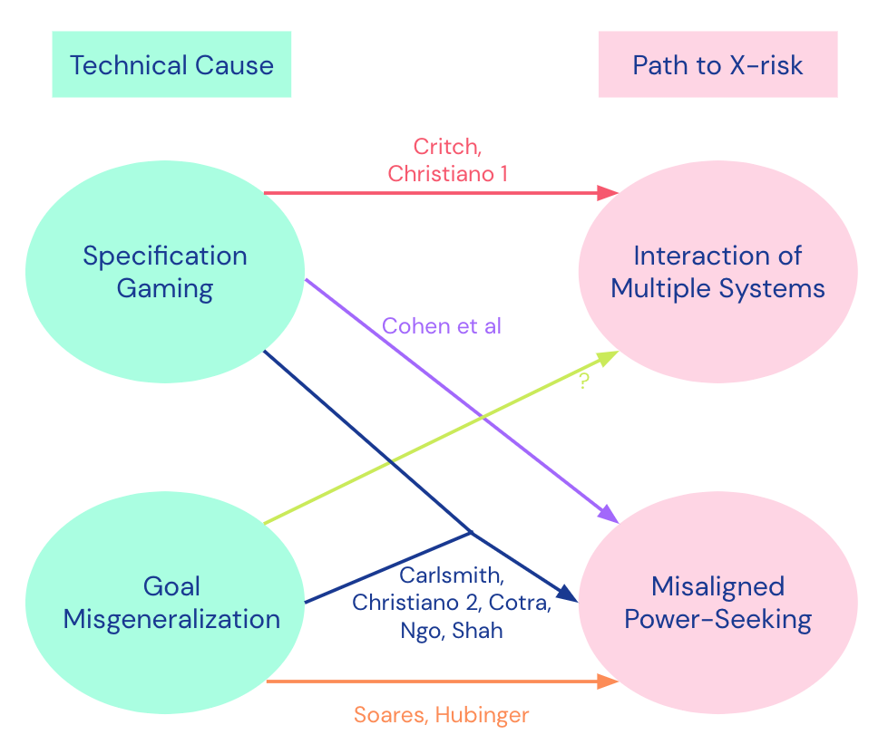

%%
Add discussion note here:

...

%%

_TL;DR: We give a threat model literature review, propose a categorization and describe a consensus threat model from some of DeepMind's AGI safety team. See our_ [_post_](https://www.alignmentforum.org/posts/wnnkD6P2k2TfHnNmt/threat-model-literature-review) _for the detailed literature review._

The DeepMind AGI Safety team has been working to understand the space of threat models for existential risk (X-risk) from misaligned AI. This post summarizes our findings. Our aim was to clarify the case for X-risk to enable better research project generation and prioritization. 

First, we conducted a [literature review](https://www.alignmentforum.org/posts/wnnkD6P2k2TfHnNmt/threat-model-literature-review) of existing threat models, discussed their strengths/weaknesses and then formed a categorization based on the technical cause of X-risk and the path that leads to X-risk. Next we tried to find consensus within our group on a threat model that we all find plausible.

Our overall take is that there may be more agreement between alignment researchers than their [disagreements](https://intelligence.org/late-2021-miri-conversations/) might suggest, with many of the threat models, including our own consensus one, making similar arguments for the source of risk. Disagreements remain over the difficulty of the alignment problem, and what counts as a solution.

# Categorization ^categorization

Here we present our categorization of threat models from our [literature review](https://www.alignmentforum.org/posts/wnnkD6P2k2TfHnNmt/threat-model-literature-review), based on the technical cause and the path leading to X-risk. It is summarized in the diagram below. 

In green on the left we have the technical cause of the risk, either specification gaming (SG) or goal misgeneralization (GMG). In red on the right we have the path that leads to X-risk, either through the interaction of multiple systems, or through a misaligned power-seeking (MAPS) system. The threat models appear as arrows from technical cause towards path to X-risk.

The technical causes (SG and GMG) are not mutually exclusive, both can occur within the same threat model. The distinction between them is motivated by the common distinction in machine learning between failures on the training distribution, and when out of distribution. 

To classify as **specification gaming**, there needs to be _bad_ feedback provided on the actual training data. There are many ways to operationalize _good/bad_ feedback. The choice we make here is that the training data feedback is good if it rewards exactly those outputs that would be chosen by a competent, well-motivated AI[^note-1]. We note that the main downside to this operationalisation is that even if just one out of a huge number of training data points gets bad feedback, then we would classify the failure as specification gaming, even though that one datapoint likely made no difference.

To classify as **goal misgeneralization**, the behavior when out-of-distribution (i.e. not using input from the training data), _generalizes poorly about its goal_, while its capabilities generalize well, leading to undesired behavior. This means the AI system doesn’t just break entirely, it still competently pursues some goal, but it’s not the goal we intended.

The path leading to X-risk is classified as follows. When the path to X-risk is from the **interaction of multiple systems**, the defining feature here is not just that there are multiple AI systems (we think this will be the case in all realistic threat models), it’s more that the risk is caused by complicated _interactions_ between systems that we heavily depend on and can’t easily stop or transition away from. (Note that we haven't analyzed the multiple-systems case very much, and there are also other technical causes for those kinds of scenarios.)

When the path to X-risk is through **Misaligned Power-Seeking** (MAPS), the AI system seeks power in unintended ways due to problems with its goals. Here, _power-seeking_ means the AI system seeks power as an instrumental subgoal, because having more power increases the options available to the system allowing it to do better at achieving its goals. _Misaligned_ here means that the goal that the AI system pursues is not what its designers intended[^note-2].

There are other plausible paths to X-risk (see e.g. this [list](https://www.alignmentforum.org/posts/WXvt8bxYnwBYpy9oT/the-main-sources-of-ai-risk)), though our focus here was on the most popular writings on threat models in which the main source of risk is technical, rather than through poor decisions made by humans in how to use AI.

For a summary on the properties of the threat models, see the table below.

|  |  | Source of misalignment |  |  |
| --- | --- | --- | --- | --- |
|  |  | Specification gaming (SG) | SG + GMG | Goal mis-generalization (GMG) |
| Path to X-risk | Misaligned power seeking (MAPS) | [Cohen et al](https://onlinelibrary.wiley.com/doi/10.1002/aaai.12064) | [Carlsmith](https://arxiv.org/abs/2206.13353), [Christiano2](https://www.alignmentforum.org/posts/HBxe6wdjxK239zajf/more-realistic-tales-of-doom#Part_II__influence_seeking_behavior_is_scary), [Cotra](https://www.alignmentforum.org/posts/pRkFkzwKZ2zfa3R6H/without-specific-countermeasures-the-easiest-path-to), [Ngo](https://www.alignmentforum.org/posts/KbyRPCAsWv5GtfrbG/what-misalignment-looks-like-as-capabilities-scale), [Shah](https://www.alignmentforum.org/posts/wnnkD6P2k2TfHnNmt/threat-model-literature-review#AI_Risk_from_Program_Search__Shah_) | [Soares](https://www.lesswrong.com/posts/GNhMPAWcfBCASy8e6/a-central-ai-alignment-problem-capabilities-generalization), [Hubinger](https://www.lesswrong.com/posts/A9NxPTwbw6r6Awuwt/how-likely-is-deceptive-alignment) |
|  | Interaction of multiple systems | [Critch](https://www.lesswrong.com/posts/LpM3EAakwYdS6aRKf/what-multipolar-failure-looks-like-and-robust-agent-agnostic), [Christiano1](https://www.alignmentforum.org/posts/HBxe6wdjxK239zajf/more-realistic-tales-of-doom) | ? | ? |

We can see that five of the threat models we considered substantially involve _both_ specification gaming and goal misgeneralization (note that these threat models would still hold if one of the risk sources was absent) as the source of misalignment, and MAPS as the path to X-risk. This seems like an area where multiple researchers agree on the bare bones of the threat model - indeed our group’s consensus threat model was in this category too.

One aspect that our categorization has highlighted is that there are potential gaps in the literature, as emphasized by the question marks in the table above for paths to X-risk via the interaction of multiple systems, where the source of misalignment involves goal misgeneralization. It would be interesting to see some threat models that fill this gap.

For other overviews of different threat models, see [here](https://www.alignmentforum.org/posts/qYzqDtoQaZ3eDDyxa/distinguishing-ai-takeover-scenarios) and [here](https://www.alignmentforum.org/posts/3DFBbPFZyscrAiTKS/my-overview-of-the-ai-alignment-landscape-threat-models).

# Consensus Threat Model ^consensus-threat-model

Building on this literature review we looked for consensus among our group of AGI safety researchers. We asked ourselves the question: conditional on there being an existential catastrophe from misaligned AI, what is the most likely threat model that brought this about. This is independent of the probability of an occurrence of an existential catastrophe from misaligned AI. Our resulting threat model is as follows (black bullets indicate agreement, white indicates some variability among the group):

**Development model:** 

-   Scaled up deep learning **foundation models** with RL from human feedback (**RLHF**) fine-tuning.
-   Not many more fundamental innovations needed for AGI.

**Risk model:** 

-   Main source of risk is a mix of specification gaming and (a bit more from) **goal misgeneralization**.
-   A **misaligned consequentialist** arises and **seeks power** (**misaligned mostly because of goal misgeneralization**).
    -   Perhaps this arises mainly during RLHF rather than in the pretrained foundation model because the tasks for which we use RLHF will benefit much more from consequentialist planning than the pretraining task.
-   We don’t catch this because **deceptive alignment** occurs (a consequence of power-seeking)
    -   Perhaps certain architectural components such as a tape/scratchpad for memory and planning would accelerate this.
-   **Important people won’t understand**: inadequate societal response to warning shots on consequentialist planning, strategic awareness and deceptive alignment. 
    -   Perhaps it’s unclear who actually controls AI development.
-   **Interpretability will be hard.**

By _misaligned consequentialist_ we mean 

-   It uses consequentialist reasoning: a system that evaluates the _outcomes_ of various possible plans against some metric, and chooses the plan that does best on that metric
-   Is misaligned - the metric it uses is not a goal that we intended the system to have

Overall we hope our threat model strikes the right balance of giving detail where we think it’s useful, without being too specific (which carries a higher risk of distracting from the essential points, and higher chance of being wrong).

# Takeaway ^takeaway

Overall we thought that alignment researchers agree on quite a lot regarding the sources of risk (the collection of threat models in blue in the diagram). Our group’s consensus threat model is also in this part of threat model space (the closest existing threat model is [Cotra](https://www.alignmentforum.org/posts/pRkFkzwKZ2zfa3R6H/without-specific-countermeasures-the-easiest-path-to)).   
 

[^note-1]: In this definition, whether the feedback is good/bad does not depend on the reasoning used by the AI system, so e.g. rewarding an action that was chosen by a misaligned AI system that is trying to hide its misaligned intentions would still count as good feedback under this definition.
[^note-2]: There are other possible formulations of misaligned, for example the system’s goal may not match what its _users_ want it to do.
