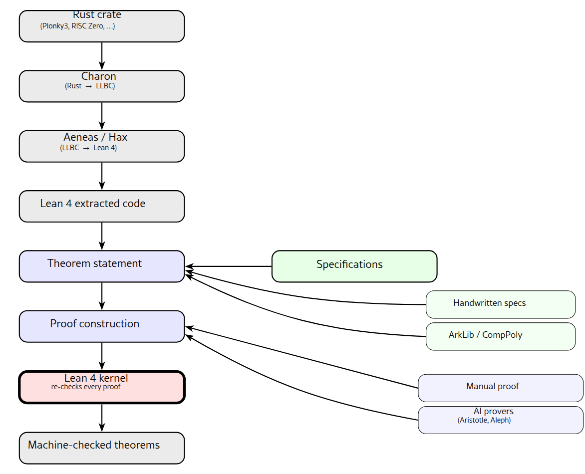

%%
Add discussion note here:

...

%%

## Abstract ^abstract

We describe a verification pipeline that takes production Rust cryptographic code and produces machine-checked correctness proofs in Lean 4. The pipeline combines three components: symbolic extraction tools (Charon and Aeneas, or Hax) that lift Rust into Lean 4; formal cryptographic specification libraries (ArkLib and CompPoly, from the Verified zkEVM project) that provide the mathematical targets; and AI provers (Aristotle from Harmonic AI and Aleph from Logical Intelligence) that close the resulting proof obligations. Every proof is checked by the Lean kernel, so AI output cannot compromise soundness.

Within the scope of the Ethereum Foundation’s zkEVM Verification Project, we applied the pipeline to cryptographic primitives in Plonky3 (Polygon Zero 2024) (FRI folding, Mersenne31 and KoalaBear field arithmetic, Horner polynomial evaluation) and RISC Zero (Merkle inclusion verification). In addition, Aleph authored proofs of two bounds-style theorems in Plonky3’s `compute_log_arity_for_round` that previously stood as `sorry`.

The paper describes the architecture, walks through a running example based on Aleph’s two proofs, reports which classes of proof obligations AI closed and which required manual work, and discusses the engineering gaps we encountered: Lean 4 toolchain drift across tools and specific Aeneas/Hax extraction limits. We also document concrete missing lemmas, tactic gaps, and code-generation friction points discovered during proof development. We hope this contribution lowers the barrier to adoption of formal verification and facilitates more effective use of AI in this pipeline. The result is a working pipeline for formal verification of Rust, with kernel-checked proofs and reproducible artefacts.

## Introduction ^introduction

Cryptographic code that runs inside production protocol stacks tolerates very few mistakes. A bug in one round of FRI folding silently corrupts every proof a zero-knowledge virtual machine (zkVM) emits. A bug in a Merkle inclusion check breaks every fraud proof that depends on it. Code review, fuzzing, and property-based testing each catch a different slice of the bug distribution, but each has structural limits. Code review and property-based testing depend on the auditor or generator anticipating the right patterns. Fuzzing explores inputs more broadly, but it runs on a finite input budget and detects only observable failures such as crashes, hangs, or sanitizer trips. Silent semantic divergences that satisfy these signals can pass through unnoticed. Formal verification produces a machine-checked proof covering every input, but only against the property the engineer has specified. Specification design therefore becomes a central engineering activity, and one we discuss in Section [[#^pipeline-architecture|3]].

The cost of formal verification has historically been the obstacle. Landmark systems such as seL4 (Klein et al. 2009) and CompCert (Leroy 2009) demonstrated that production-quality software can be fully verified, but each represents many person-years of effort in Isabelle/HOL or Rocq, with proofs developed in close coupling to the implementation. For Rust specifically, recent verifiers such as Verus (Lattuada et al. 2023), Prusti (Astrauskas et al. 2022), Kani (The Kani Team 2024), and Creusot (Denis et al. 2022) have lowered the entry barrier by embedding specifications directly in Rust source code and automating common proof obligations through SMT solvers and model checking. However, they target different fragments of the language and address different correctness questions, and none of them connects production Rust to the kind of abstract mathematical specifications that cryptographic protocols are usually defined against.

Three recent developments together lower the cost of industrial formal verification substantially. The first is a set of Rust-to-proof-assistant translation tools that preserve enough of the source semantics to support real verification: Aeneas (Ho and Protzenko 2022) lowers safe Rust into pure functional Lean 4 via a typed intermediate representation; Hax (Cryspen 2024) (Cryspen) is an annotation-driven alternative targeting Lean 4, F$^\star$, and Rocq; and rocq-of-rust (Formal Land 2024) translates Rust into Rocq via THIR.

The second is the emergence of AI provers that can close non-trivial proof obligations in interactive theorem provers: Aristotle (Achim et al. 2025) from Harmonic AI reports gold-medal-equivalent performance on the 2025 International Mathematical Olympiad, and Aleph from Logical Intelligence reports 99.4% on the PutnamBench benchmark (Isenbaev and Hanin 2026). Both produce Lean proofs that the kernel re-checks, so soundness does not depend on whether the AI guessed correctly.

The third is the appearance of formal libraries in Lean 4 that make production verification practical. The foundation is Mathlib4, the community-maintained mathematical library (The mathlib Community 2024), and CSLib (Barrett et al. 2026), a recent effort to do for computer science what Mathlib does for mathematics. Building on these foundations, specialised libraries provide the abstract targets for individual verification domains. The two most relevant to this work are ArkLib (The ArkLib Team 2025), a library for formally verifying SNARK protocols built on the theory of Interactive Oracle Reductions (with formalisations of Sum-Check, FRI, WHIR, and others), and CompPoly (The CompPoly Team 2025), a library for computational polynomial and finite-field theory. Together, these libraries provide the abstract mathematical targets that production Rust can be proved equivalent to.

To the best of our knowledge, this paper documents the first attempt to combine these three threads in a single pipeline and apply it to real-world cryptographic Rust. We built and operated such a pipeline under the Ethereum Foundation’s zkEVM Verification Project, applying it to cryptographic primitives in Plonky3 (Polygon Zero 2024) and RISC Zero (RISC Zero, Inc. 2024).

This paper makes four contributions:

-   _A pipeline._ We integrate symbolic Rust-to-Lean extraction (Aeneas, Hax), formal cryptographic specification libraries (ArkLib, CompPoly), and AI provers (Aristotle, Aleph) into a single workflow.
    
-   _Application to cryptographic primitives._ We apply the pipeline to eight consensus-critical targets across Plonky3 (Polygon Zero 2024) and RISC Zero (RISC Zero, Inc. 2024), spanning finite-field arithmetic, FRI folding and round-scheduling, Horner polynomial evaluation, Merkle inclusion verification, and a 32-bit ADC at the bit-vector level. All code, specifications, and proofs are public; the main repository is [https://github.com/Verified-zkEVM/rust-lean](https://github.com/Verified-zkEVM/rust-lean).
    
-   _An empirical account of AI-closed proofs._ We report at the lemma level which obligations Aleph closed automatically (two bounds theorems in `compute_log_arity_for_round`) and the proof strategy each used.
    
-   _Engineering gaps._ We document the gaps we encountered: Lean 4 toolchain drift across tools, and specific extraction limits in Aeneas and Hax. We describe two reliable workarounds we used in practice (fixing the gap upstream and rewriting the function as an extraction-friendly model) and briefly discuss layered tooling as a direction for unsafe Rust, which our pipeline does not currently cover.
    

## Background ^background

This section introduces the components we compose into the pipeline. Readers familiar with Aeneas, Hax, Lean 4, ArkLib, or the AI provers can skip the corresponding paragraphs.

### Charon and Aeneas ^charon-and-aeneas

Charon (The Aeneas Project 2024) translates safe Rust into LLBC (Ho and Protzenko 2022), a typed intermediate representation derived from Rust’s MIR. Aeneas (Ho and Protzenko 2022) takes LLBC and produces pure functional Lean 4 code. Each Rust function becomes a Lean function in the `Result` $\alpha$ monad, whose three constructors `ok`, `fail`, `div` distinguish successful return, panic, and non-termination.

Aeneas relieves the proof engineer of memory-based reasoning (Ho and Protzenko 2022): it treats Rust’s borrow-checker guarantees as a semantic input. The extracted Lean code stays small and focused on functional properties, provable with Mathlib4 and Aeneas-specific tactics such as `progress` and `scalar_tac`.

### Hax ^hax

Hax (Cryspen 2024) is a Rust verification tool maintained by Cryspen that translates Rust into F$^\star$, Rocq, Lean, and other backends. Its frontend hooks into the Rust compiler and exports the THIR (Typed High-level Intermediate Representation) as JSON; the engine then lowers this through an annotation-driven simplification pipeline. The Lean 4 backend is currently under active development, while the F$^\star$ backend is more mature.

Recent independent analysis (Symbolic Software 2026) has identified semantic gaps between Hax extractions and the original Rust semantics for certain Rust patterns; the verification work reported here stays within the fragment of pure, bounded-loop functions where Hax’s translation is reliable.

### Lean 4 and the spec libraries ^lean-4-and-the

The target prover is Lean 4 with Mathlib4 as its mathematical library. Two further libraries provide the cryptographic specifications we verify against:

ArkLib (The ArkLib Team 2025) formalises succinct non-interactive arguments of knowledge (SNARKs), cryptographic proof systems that allow a prover to convince a verifier that a computation was performed correctly without the verifier re-executing it. ArkLib builds on the theory of Interactive Oracle Reductions (IORs), a compositional framework in which a complex proof system is decomposed into a sequence of simpler interactive protocols, each reducing one relation to another (Chiesa et al. 2019). The library includes formalisations of Sum-Check, FRI, WHIR, and other protocols at the abstract level, together with the polynomial machinery (folding, evaluation domains) they depend on.

CompPoly (The CompPoly Team 2025) provides computational polynomial and finite-field theory, including univariate, multivariate, and multilinear polynomial representations with equivalences to Mathlib’s algebraic types, used both directly and as a foundation under ArkLib.

Both libraries are open-source and part of the Verified zkEVM project. As part of this work, we have contributed upstream improvements to both libraries.

### AI provers ^ai-provers

We use two AI provers as external proof-search engines for Lean 4. Aristotle (Harmonic AI) (Achim et al. 2025) combines a Lean proof-search system with an informal reasoning component that generates and formalises candidate lemmas. Aleph (Logical Intelligence) (Logical Intelligence 2025) is an agentic orchestration layer for theorem proving: it decomposes a proof obligation into subproblems (“planning”), generates Lean proofs for each (“proving”), and refines its strategy based on which subparts succeed (“refining”). Aleph can be paired with different underlying reasoning models depending on the task and resource budget. The Lean kernel re-checks every proof both provers emit.

### zkVMs and Plonky3 ^zkvms-and-plonky3

Zero-knowledge virtual machines (zkVMs) execute programs inside a cryptographic proof system: the VM produces a succinct proof that the execution was correct, which any third party can verify without re-executing the program. RISC Zero (RISC Zero, Inc. 2024) and SP1 (Succinct Labs 2024) are two production zkVMs built on the RISC-V instruction set. Both rely on STARK proof systems (Ben-Sasson et al. 2018) whose arithmetic backbone is implemented in Plonky3 (Polygon Zero 2024).

Plonky3 (Polygon Zero 2024) is an open-source Rust toolkit for building STARK proof systems. It provides finite field implementations (Mersenne31, BabyBear, KoalaBear), the Fast Reed-Solomon Interactive Oracle Proof of Proximity (FRI) protocol (Ben-Sasson et al. 2018), and the polynomial commitment infrastructure that zkVMs build on. FRI is a low-degree test that lets a verifier check whether a function evaluated over a finite field is close to a low-degree polynomial. It does so through a logarithmic number of folding rounds, each reducing the problem size by half. A bug in any of these components, such as a wrong field multiplication, an incorrect FRI folding step, or a flawed Merkle inclusion check, silently invalidates every proof the zkVM emits.

The Verified zkEVM project (Ethereum Foundation 2025) is a multi-team effort to formally verify components across this stack. ArkLib and CompPoly (Section [[#^lean-4-and-the|2.3]]) were developed as part of this project. The verification work reported in this paper was carried out under the same project, targeting Plonky3 and RISC Zero primitives as verification subjects.

## Pipeline Architecture ^pipeline-architecture

Figure 1 shows the data flow. The pipeline runs in four stages.



Pipeline data flow. Extraction (grey) lifts Rust into Lean 4; specifications (green) define the verification targets; proofs (blue) are constructed manually and with AI assistance; the Lean kernel (red) re-checks every proof, constituting the trust boundary.

##### Stage 1: Rust to Lean 4. ^stage-1-rust-to

For projects using Aeneas, we run Charon on the Cargo crate to produce an LLBC file, then run Aeneas to translate LLBC into a pair of Lean files (`Types.lean` and `Funs.lean`). For projects using Hax, we annotate Rust items with `#[hax::contract]` and related attributes, then run `cargo hax into lean`.

In both cases, the output is pure functional Lean 4. Rust loops become recursive functions with termination obligations. Arithmetic operations are wrapped in monads (`Result` $\alpha$ for Aeneas, `RustM` for Hax) that expose overflow and panic paths as explicit failure cases.

##### Stage 2: Specification. ^stage-2-specification

Specifications come from two sources. For simple targets, we write them by hand against the extracted code: a pure function (over $\mathbb{N}$ or $\mathbb{Z}/p\mathbb{Z}$) that mirrors the Rust computation, together with preconditions on the inputs (for example, $p^2 \leq 2^{64}-1$, or “all inputs are less than $p$”). For targets that match an existing cryptographic abstraction, we import the relevant definition from ArkLib or CompPoly and state the spec as equivalence to that definition. The FRI fold example in Section [[#^running-example-computelogarityforround|4]] takes this second route: the Rust output is proved equal to one evaluation of ArkLib’s `foldNth 2 f` $\beta$ polynomial fold.

The main theorem of each verification target then states: under the precondition structure, the extracted Rust function returns a value matching the specification.

##### Stage 3: Proof. ^stage-3-proof

Proofs are constructed either manually or with the help of AI provers, and typically combine both. The available automation includes:

-   Aeneas-specific tactics (when extraction goes through Aeneas): `progress` steps through monadic `let x` $\leftarrow$ `e` bindings and closes “operation succeeds” obligations using preconditions in context; `scalar_tac` discharges integer-bound side conditions.
    
-   General Lean 4 tactics: `omega` (linear arithmetic), `nlinarith` (nonlinear bounds), `ring` (algebraic identities), `simp` (rewriting), and `decide` (decidable propositions). These come from Lean 4 core and Mathlib4.
    
-   AI provers: Aristotle and Aleph can be invoked to close individual lemmas or whole theorems. Section [[#^ai-driven-proof-automation-empirical|5]] gives an empirical account of which classes of obligation they handle well.
    

Manual and AI-driven proofs coexist in the same Lean file. There is no semantic distinction between them at the kernel level.

##### Stage 4: Re-check. ^stage-4-re-check

The Lean kernel re-checks every proof, constituting the trust boundary of the described pipeline: regardless of whether a proof was written by a human, generated by an AI prover, or assembled from automated tactics, the kernel accepts it only if it typechecks.

## Running Example: `compute_log_arity_for_round` ^running-example-computelogarityforround

We use Plonky3’s `compute_log_arity_for_round`, an FRI (Ben-Sasson et al. 2018) round-scheduling function from `fri/src/config.rs`, as the running example. The function decides how aggressively a given FRI round folds, subject to three constraints: a maximum allowed arity, the distance to the final target height, and the distance to the next input commitment.

The Plonky3 source, lightly elided:

```
pub fn compute_log_arity_for_round(
    log_current_height: usize,
    next_input_log_height: Option<usize>,
    log_final_height: usize,
    max_log_arity: usize,
) -> RustM<usize> {
    let max_fold_to_target = log_current_height - log_final_height;
    let max_fold = match next_input_log_height {
        None => max_fold_to_target,
        Some(next) => {
            let to_next = log_current_height - next;
            if to_next < max_fold_to_target { to_next } else { max_fold_to_target }
        }
    };
    if max_fold < max_log_arity { max_fold } else { max_log_arity }
}
```

Hax extracts this into Lean 4, wrapping each checked subtraction in a `RustM` monad and representing each conditional as a Lean `if/then/else`. We can formulate two theorems: the result must not exceed the maximum allowed arity (`arity_respects_max_bound`), and the result must not exceed the distance to the final height (`arity_respects_target_distance`). Both bounds are necessary for the soundness of every subsequent FRI round. Both initially stood as `sorry` in `lean/P3FriProofs/Proofs/FoldingCorrectness.lean`. Both were closed in February 2026 by the `aleph-prover[bot]` GitHub account, running Aleph against the Lean files.

### Aleph’s proof of `arity_respects_max_bound` ^alephs-proof-of-arityrespectsmaxbound

PR #1 to `p3-hax-lean-fri-pipeline` (Aleph Prover Bot 2026) was merged on 23 February 2026. The PR description, generated by Aleph, identifies the following proof strategy: decompose into two reusable helper lemmas about the Hax-extracted `RustM` monad, peel the monadic binds of `compute_log_arity_for_round` one by one, and reduce to the final “min with cap” `if`.

The first helper inverts a successful monadic bind: if `x >>= f = ok r`, then there exists some `a` with `x = ok a` and `f a = ok r`.

```
theorem RustM_bind_eq_ok {α β : Type} (x : RustM α) (f : α → RustM β) (r : β) :
    RustM.bind x f = .ok r → ∃ a, x = .ok a ∧ f a = .ok r := by
  cases x with
  | ok a =>
    intro hx; refine ⟨a, rfl, ?_⟩
    simpa [RustM.bind] using hx
  | fail e => intro hx; simp [RustM.bind] at hx
  | div => intro hx; simp [RustM.bind] at hx
```

The second helper derives a bound from the “min” if-expression: if `(if a < b then ok a else ok b) = ok r`, then `r` $\leq$ `b`.

```
theorem RustM_ok_ite_decide_lt_le_right (a b r : USize64) :
    (if decide (a < b) then (RustM.ok a : RustM USize64) else RustM.ok b) =
      RustM.ok r → r ≤ b := by
  intro h
  by_cases hlt : a < b
  · simp [hlt] at h; cases h
    have hnat : a.toNat < b.toNat := by simpa using hlt
    change a.toNat ≤ b.toNat
    exact Nat.le_of_lt hnat
  · simp [hlt] at h; cases h; change b.toNat ≤ b.toNat; exact le_rfl
```

The main theorem unfolds `compute_log_arity_for_round` and uses `RustM_bind_eq_ok` to peel off the first checked subtraction. It then case-splits on `next_input_log_height`, peels the second bind in the `Some` branch, and case-splits on the inner `<` comparison. Finally, it applies `RustM_ok_ite_decide_lt_le_right` to the “min-with-cap” `if`, bounding the result by `max_log_arity`. Aleph observes that the arithmetic precondition `h_gt` is unnecessary for this bound; this observation avoids any checked-subtraction reasoning.

### Aleph’s proof of `arity_respects_target_distance` ^alephs-proof-of-arityrespectstargetdista

PR #3 (Aleph Prover Bot 2026) was merged the following day, on 24 February 2026, with a symmetric strategy. A single helper derives that `(if a < b then ok a else ok b) = ok r` implies `r` $\leq$ `a`:

```
theorem RustM_ok_ite_decide_lt_le_left (a b r : USize64) :
    (if decide (a < b) then (RustM.ok a : RustM USize64) else RustM.ok b) =
      RustM.ok r → r ≤ a := by
  intro h
  by_cases hlt : a < b
  · simp [hlt] at h; cases h; change a.toNat ≤ a.toNat; exact le_rfl
  · simp [hlt] at h; cases h
    change b.toNat ≤ a.toNat
    apply Nat.le_of_not_gt; simpa using hlt
```

The main theorem is more involved than in Section [[#^alephs-proof-of-arityrespectsmaxbound|4.1]]. The conclusion 

$$
\mathtt{result.toNat}
    \leq
  \mathtt{log\_current\_height.toNat}
    -
  \mathtt{log\_final\_height.toNat}
$$

 involves checked subtraction on `USize64`: at the Rust level the subtraction would have underflowed if `log_final_height` $\geq$ `log_current_height`, and the proof must discharge that case using the height-inequality hypothesis `h_gt`.

```
theorem arity_respects_target_distance
    (log_current_height log_final_height max_log_arity result : USize64)
    (h_gt : log_current_height.toNat > log_final_height.toNat)
    (h_result : P3_fri_kernel.compute_log_arity_for_round
        log_current_height Core_models.Option.Option.None
        log_final_height max_log_arity = .ok result)
    : result.toNat ≤ log_current_height.toNat - log_final_height.toNat := by
  classical
  have hgt' : log_final_height.toNat < log_current_height.toNat := by simpa using h_gt
  have hnot : ¬ (log_current_height.toNat < log_final_height.toNat) :=
    Nat.not_lt_of_ge (Nat.le_of_lt hgt')
  unfold P3_fri_kernel.compute_log_arity_for_round at h_result
  simp [RustM.bind, Core_models.Ops.Arith.Sub.sub, instSubUSize64_1,
        BitVec.usubOverflow, hnot] at h_result
  have hle : result ≤ log_current_height - log_final_height := by
    apply RustM_ok_ite_decide_lt_le_left
      (a := log_current_height - log_final_height) (b := max_log_arity) (r := result)
    by_cases hlt : log_current_height - log_final_height < max_log_arity <;>
      simpa [hlt] using h_result
  have hleNat : result.toNat ≤ (log_current_height - log_final_height).toNat :=
    (USize64.le_iff_toNat_le).1 hle
  have hsub : (log_current_height - log_final_height).toNat =
              log_current_height.toNat - log_final_height.toNat :=
    USize64.toNat_sub_of_le' (Nat.le_of_lt hgt')
  simpa [hsub] using hleNat
```

Both PRs are notable for how Aleph closed the theorems: by identifying and proving small reusable helper lemmas, then composing them in a structurally clean main proof. The proof-plan blueprints in the PR descriptions read like a proof engineer’s notes; for example, “decomposition into a key helper lemma and the main bound… the proof must use `h_gt` to justify that the subtraction behaves like ordinary $\mathbb{N}$ subtraction on `toNat`… the min/if structure is handled cleanly by a `by_cases` split and `simp`.”

## AI-Driven Proof Automation: Empirical Notes ^ai-driven-proof-automation-empirical

This section reports what we observed when running Aristotle and Aleph against the proof obligations that arose in our verification work. We recognise the small size of our data set: two theorems that Aleph closed (PR #1 and PR #3), plus informal experiments on neighbouring lemmas during development. Even so, we observed a consistent pattern throughout all our experiments.

##### What AI provers handled well. ^what-ai-provers-handled

Three categories of obligation closed reliably:

-   _Control-flow and structural lemmas:_ monad inversions, if-conditional bounds, case-splits on enums. The two PRs of Section [[#^running-example-computelogarityforround|4]] fall here. The reusable helper lemmas Aleph produced (`RustM_bind_eq_ok`, `RustM_ok_ite_decide_lt_le_left/right`) are typical of this category.
    
-   _Linear arithmetic with mild side conditions,_ particularly where `omega` or `nlinarith` closes the goal once the right hypothesis is named.
    
-   _`simp`\-closeable boilerplate_ around extracted code: unfolding monadic bind, distributing over conditionals, normalising checked-arithmetic guards.
    

##### What required manual work. ^what-required-manual-work

Three categories required either substantial manual proof or full hand-construction:

-   _Domain-specific algebraic identities_ that require carefully selecting Mathlib4 lemmas. A clear example is the equivalence between the Aeneas-extracted `fold_step` and ArkLib’s `foldNth 2 f` $\beta$ on $\mathbb{Z}/p\mathbb{Z}$ polynomials. The obligation is true, but no off-the-shelf Mathlib lemma closes it without human direction.
    
-   _Loop invariants on Aeneas-extracted recursive functions._ We did not observe AI provers bypassing the inherent difficulty of finding the right invariant, so this remained a manual task in our work.
    
-   _Obligations that require axiomatising an external interface,_ where the choice of axioms is itself a design decision rather than a proof-search problem.
    

##### Implication for the workflow. ^implication-for-the-workflow

In the work reported here, AI provers operated as a productivity multiplier on the obligations in the first category, but did not change the fundamental shape of the verification effort. Specification design, invariant discovery, and the selection of mathematical abstractions remained the work of human proof engineers. We expect this division to shift as AI provers mature, and Section [[#^conclusion-and-future-work|9]] outlines two directions where we plan to push that line.

## Case Studies ^case-studies

This section lists the cryptographic targets we verified under the zkEVM Verification Project. All artefacts are public:

-   Main verification repository (Aeneas-based work): [https://github.com/Verified-zkEVM/rust-lean](https://github.com/Verified-zkEVM/rust-lean)
    
-   Plonky3 FRI pipeline (Hax-based, with AI-prover contributions): [https://github.com/runtimeverification/p3-hax-lean-fri-pipeline](https://github.com/runtimeverification/p3-hax-lean-fri-pipeline)
    
-   Plonky3 FRI fold arity (Aeneas-based): [https://github.com/runtimeverification/aeneas\_fri\_fold\_arity\_verification](https://github.com/runtimeverification/aeneas_fri_fold_arity_verification)
    
-   Plonky3 field arithmetic (Aeneas-based): [https://github.com/runtimeverification/aeneas-field-arithmetic](https://github.com/runtimeverification/aeneas-field-arithmetic)
    
-   32-bit ADC (Hax-based): [https://github.com/runtimeverification/hax-annotations-adc-verification](https://github.com/runtimeverification/hax-annotations-adc-verification)
    
-   RISC Zero Merkle inclusion: [https://github.com/runtimeverification/zkvm-merkle-lean](https://github.com/runtimeverification/zkvm-merkle-lean)
    
-   Plonky3 Horner evaluation (Hax + CompPoly): [https://github.com/runtimeverification/horner\_hax\_comppoly\_poc](https://github.com/runtimeverification/horner_hax_comppoly_poc)
    

Verification targets under the zkEVM Verification Project.

| **Target** | **Pipeline** | **What was proved** |
| --- | --- | --- |
| Plonky3 FRI round-scheduling (`compute_log_arity_for_round`) | Aeneas + Hax | 6 theorems incl. bounds, monotonicity, boundary cases; 2 closed by Aleph (PR #1, PR #3) |
| Plonky3 arity-2 FRI fold (`fold_step`) | Aeneas + ArkLib | Rust implementation matches abstract `foldNth 2 f` $\beta$; no overflow across 13 checked operations |
| Plonky3 Mersenne31 field arithmetic | Aeneas | Addition and multiplication of the Rust model |
| Plonky3 Mersenne31 / KoalaBear fields | Hax | Extraction of the Rust field implementations |
| Plonky3 Horner polynomial evaluation | Hax + CompPoly | Evaluation correctness against the polynomial spec |
| Plonky3 one-step FRI folding | Hax | End-to-end FRI round correctness |
| RISC Zero Merkle inclusion | Hax | Root recomputation and inclusion-proof verification |
| 32-bit ADC (addition with carry) | Hax + `bv_decide` | Bit-level correctness via automated bit-vector reasoning |

##### Case study 1: `fold_step` $\leftrightarrow$ ArkLib. ^case-study-1-foldstep

The arity-2 FRI folding step takes evaluations $lo = f(x)$ and $hi = f(-x)$ of a polynomial $f$ over a prime field $F_p$, together with a challenge $\beta$ and precomputed inverses $x^{-1}, 2^{-1}$, and computes $\mathit{fold\_step} = (lo + hi + \beta \cdot (lo - hi) \cdot x^{-1}) \cdot 2^{-1} \bmod p$. This equals $(\mathsf{foldNth}\,2\,f\,\beta).\mathsf{eval}(x^2)$: one evaluation of the folded polynomial in ArkLib’s definition. The Aeneas extraction unfolds the Rust into a sequence of 13 checked arithmetic operations on `u64`, each returning `Result`. We proved, in Lean, that under explicit preconditions on $p$ ($p^2 \leq 2^{64}-1$, all inputs strictly less than $p$) no operation overflows, the final result is in $[0, p)$, and the algebraic expression matches the closed-form above in $\mathbb{Z}/p\mathbb{Z}$ (verified by the `ring` tactic). This is the project’s tightest connection from Aeneas-extracted production Rust to a formal cryptographic specification: the verifier checks not only that the arithmetic is overflow-free, but that the Rust implementation computes exactly the function ArkLib defines.

##### Case study 2: the running example revisited. ^case-study-2-the

This case study revisits the function `compute_log_arity_for_round` and its correspondence to Aleph’s proofs. It is the running example of Section [[#^running-example-computelogarityforround|4]]. The Hax extraction produces a Lean 4 function over the Hax `RustM` monad with two checked subtractions, an `Option` match, and two if-conditional “min” selections. Six bounds-style and boundary-case theorems were stated. Two were closed automatically by Aleph in PRs #1 and #3, each producing a small reusable helper lemma in addition to the main theorem. The remaining four (`arity_respects_next_input`, `folding_respects_final_height`, `round_consistency_preserved`, and one more) currently remain at `sorry` in the public repository, awaiting either a follow-up Aleph run or manual completion.

##### Repositories and reproducibility. ^repositories-and-reproducibility

All code, specifications, and proofs in this paper are public:

-   Aeneas-based verification of Plonky3 FRI primitives: [https://github.com/Verified-zkEVM/rust-lean](https://github.com/Verified-zkEVM/rust-lean)
    
-   Hax-based verification with AI-prover contributions: [https://github.com/runtimeverification/p3-hax-lean-fri-pipeline](https://github.com/runtimeverification/p3-hax-lean-fri-pipeline)
    
-   Aleph PRs #1 (Aleph Prover Bot 2026) and #3 (Aleph Prover Bot 2026) (running example).
    

A complete list of per-target repositories appears in the bullet list at the start of this section.

## Engineering Challenges and Solutions ^engineering-challenges-and-solutions

##### Lean 4 version drift. ^lean-4-version-drift

Aeneas, Hax, ArkLib, CompPoly, and Mathlib4 evolve on independent Lean 4 release tracks. Early in the project we could not build a single Lake project that imported tools from more than one source, because each was pinned to a different Lean toolchain. We raised the issue in the affected repositories; after coordination across the maintainer teams, the libraries were aligned on a common Lean 4 version (4.26.0 for the Hax-based work; 4.28.0 for the Aeneas-based work).

##### Aeneas/Hax extraction gaps. ^aeneas-hax-extraction-gaps

The supported subset of safe Rust that Aeneas and Hax can extract to pure Lean is finite. We have identified the following gaps in practice:

-   A name collision (`BitVec.toNat_pow`) between Aeneas’s bit-vector lemmas and Batteries / Mathlib4 prevented importing both libraries in a single Lean file. We patched this upstream in `AeneasVerif/aeneas#832`.
    
-   Casts to wider integer types (`u128`) inside modular arithmetic require careful proof engineering: `progress` introduces a side condition that `omega` cannot close on its own and that needs `nlinarith`.
    
-   Generic functions with trait bounds (e.g., `F: Field + TwoAdicField`) cannot be extracted directly: Aeneas needs concrete monomorphised types. We worked around this by writing a monomorphic model of the function in question (Plonky3’s `fold_matrix` rewritten as a `u64`\-only `fold_step`); the model is semantically equivalent to the production code and extracts cleanly.
    
-   External-crate calls (e.g., `byteorder`, `std::io::Read`/`Write`) are not extractable because Charon does not see the MIR of crates beyond the workspace.
    
-   Rust `while` loops become recursive functions in Lean and require explicit termination measures.
    

##### Three reliable workarounds. ^three-reliable-workarounds

We converged on three strategies, applied in this order of preference:

1.  _Fix it upstream._ When a gap corresponds to a missing feature or lemma that we are able to contribute, we submit the fix to the upstream repository. The `BitVec.toNat_pow` fix and several CompPoly contributions originated this way.
    
2.  _Extract a model._ When the production Rust code uses patterns Aeneas cannot handle (parallel iterators, deep generics, external-crate calls), we rewrite the mathematical core as a standalone, non-generic Rust crate. The model is semantically equivalent, extracts cleanly, and can be verified end-to-end. This is the strategy that produced `fold_step` from Plonky3’s `fold_matrix`.
    
3.  _Layered tools for `unsafe` code._ The pipeline as described handles safe Rust. For codebases with `unsafe` blocks, the verification story is layered: prove the safe core with Aeneas or Hax, and bring in complementary tools (`cargo-anneal` (The zerocopy Authors 2026)) for the `unsafe` parts.
    

## Related Work ^related-work

##### Rust formal verification. ^rust-formal-verification

Aeneas and Hax are the two extraction-based approaches we use directly. The other major points in the verification space are Verus (Lattuada et al. 2023) (ghost types and an SMT backend, tightly integrated with the Rust toolchain), Prusti (Astrauskas et al. 2022) (specification annotations and the Viper verifier), Kani (The Kani Team 2024) (bounded model checking, complementary to formal proof), and Creusot (Denis et al. 2022) (Why3-based deductive verification of annotated Rust). These tools target different fragments of Rust and rely on different proof backends (SMT solvers, Viper, Why3, model checking). Our work instead focuses on connecting production Rust to Mathlib4-level formal cryptographic specifications, and on integrating AI provers to close the resulting proof obligations.

##### Foundational verified systems. ^foundational-verified-systems

seL4 and CompCert are landmark projects that demonstrate that complete formal verification of production-quality software is achievable, but each represents many person-years of effort in tightly coupled implementation and proof pairs in Isabelle/HOL and Rocq. The pipeline described here requires substantially smaller per-engagement effort, in exchange for verifying specific critical-core components rather than whole systems.

##### AI provers for Lean. ^ai-provers-for-lean

LeanDojo (Yang et al. 2023) provides infrastructure for training and evaluating LLM-based provers in Lean. Lean Copilot (Song et al. 2024) explores LLMs as interactive proof assistants inside the editor. The AlphaProof and AlphaGeometry (Trinh et al. 2024) effort from DeepMind demonstrated silver-medal-equivalent performance on IMO 2024 using reinforcement-learning-trained Lean provers. Our work uses Aristotle (Achim et al. 2025) and Aleph (Isenbaev and Hanin 2026) not as benchmarks on synthetic problems but as black-box proof-search engines on the proof obligations our extraction pipeline emits. This is, to our knowledge, among the first publicly visible neurosymbolic deployments on production zkVM cryptographic code.

##### Cryptographic specification libraries. ^cryptographic-specification-libraries

ArkLib and CompPoly are the spec libraries this work targets. Both are public and we contribute upstream to them. The closest comparable project is HACL$^\star$ for verified cryptographic implementations in F$^\star$, but its target language and specification style differ.

## Conclusion and Future Work ^conclusion-and-future-work

We described an end-to-end neurosymbolic pipeline from production Rust to Lean 4 proofs, applied it to cryptographic primitives in Plonky3 and RISC Zero under the Ethereum Foundation zkEVM Verification Project, and gave an empirical account of where AI provers were and were not effective. The two-PR running example (Aleph proving `arity_respects_max_bound` and `arity_respects_target_distance` in `p3-hax-lean-fri-pipeline`) shows that current AI provers can close non-trivial structural lemmas about Hax-extracted Rust monadic code, with proof plans that are themselves auditable.

Two directions of follow-up are immediate. First, we plan to participate in the Beneficial AI Foundation’s Signal Shot programme (Beneficial AI Foundation 2026), which targets end-to-end machine-checked verification of the Signal messaging stack in Lean 4. The Signal codebase is a natural next target for the same pipeline. Second, we plan to integrate AI provers more tightly into the verification CI/CD loop. Instead of invoking them per pull request, we would run them automatically on every freshly introduced `sorry` and let human reviewers see which obligations are now closed before they look at the code.

:::hide
##### Acknowledgements. ^acknowledgements

This work was funded by the Ethereum Foundation under the zkEVM Verification Project. We are grateful to Alexander Hicks and Derek Sorensen for initiating and guiding this engagement, providing feedback on specifications and proofs, and facilitating the collaboration across teams. We also thank the maintainers of Aeneas, Charon, Hax, Mathlib4, ArkLib, CompPoly, Aristotle, and Aleph for their open-source work and for cross-repository coordination on Lean toolchain alignment.
:::

## References ^references

- T. Achim, A. Best, A. Bietti, K. Der, et al. (2025). Aristotle: IMO-level automated theorem proving. <https://arxiv.org/abs/2510.01346>
- Aleph Prover Bot (2026). Proof for arity_respects_max_bound, PR #1. <https://github.com/runtimeverification/p3-hax-lean-fri-pipeline/pull/1>
- Aleph Prover Bot (2026). Proof for arity_respects_target_distance, PR #3. <https://github.com/runtimeverification/p3-hax-lean-fri-pipeline/pull/3>
- V. Astrauskas, A. Bílý, J. Fiala, Z. Grannan, C. Matheja, P. Müller, F. Poli, and A. J. Summers (2022). The Prusti Project: Formal verification for Rust. In NASA Formal Methods (NFM), pp. 88–108.
- C. Barrett, S. Chaudhuri, F. Montesi, J. Grundy, P. Kohli, L. de Moura, A. Rademaker, and S. Yingchareonthawornchai (2026). CSLib: The Lean Computer Science Library. <https://arxiv.org/abs/2602.04846>
- E. Ben-Sasson, I. Bentov, Y. Horesh, and M. Riabzev (2018). Scalable, transparent, and post-quantum secure computational integrity. IACR Cryptology ePrint Archive, 2018/046 <https://eprint.iacr.org/2018/046>
- Beneficial AI Foundation (2026). Signal Shot: end-to-end formal verification of the Signal protocol. <https://www.beneficialaifoundation.org/blog/signal-shot>
- A. Chiesa, Y. Hu, M. Maller, P. Mishra, N. Vesely, and N. P. Ward (2019). Marlin: Preprocessing zkSNARKs with universal and updatable SRS. IACR Cryptology ePrint Archive, 2019/1047
- Cryspen (2024). Hax: Verification-friendly Rust subset. <https://github.com/cryspen/hax>
- X. Denis, J. Jourdan, and C. Marché (2022). Creusot: A foundry for the deductive verification of Rust programs. In International Conference on Formal Engineering Methods (ICFEM),
- Ethereum Foundation (2025). zkEVM Verification Project. <https://github.com/Verified-zkEVM/>
- Formal Land (2024). Rocq-of-rust. <https://github.com/formal-land/rocq-of-rust>
- S. Ho and J. Protzenko (2022). Aeneas: Rust verification by functional translation. Proceedings of the ACM on Programming Languages 6 (ICFP), pp. 711–741. <https://dx.doi.org/10.1145/3547647>
- V. Isenbaev and B. Hanin (2026). Logical Intelligence’s Aleph Solves PutnamBench. Logical Intelligence Blog <https://logicalintelligence.com/blog/aleph-solves-putnambench>
- G. Klein, K. Elphinstone, G. Heiser, J. Andronick, D. Cock, P. Derrin, D. Elkaduwe, K. Engelhardt, R. Kolanski, M. Norrish, T. Sewell, H. Tuch, and S. Winwood (2009). seL4: Formal verification of an OS kernel. In Proceedings of the 22nd ACM SIGOPS Symposium on Operating Systems Principles (SOSP), pp. 207–220. <https://dx.doi.org/10.1145/1629575.1629596>
- A. Lattuada, T. Hance, C. Cho, M. Brun, I. Subasinghe, Y. Zhou, J. Howell, B. Parno, and C. Hawblitzel (2023). Verus: Verifying Rust programs using linear ghost types. In Proceedings of the ACM on Programming Languages, OOPSLA,
- X. Leroy (2009). Formal verification of a realistic compiler. Communications of the ACM 52 (7), pp. 107–115.
- Logical Intelligence (2025). Aleph Prover. <https://logicalintelligence.com/aleph-prover.html> Accessed 2026-05-22
- Polygon Zero (2024). Plonky3: High-performance polynomial commitment and proof system. <https://github.com/Plonky3/Plonky3>
- RISC Zero, Inc. (2024). RISC Zero: zero-knowledge virtual machine for general Rust programs. <https://github.com/risc0/risc0>
- P. Song, K. Yang, and A. Anandkumar (2024). Towards large language models as copilots for theorem proving in Lean.
- Succinct Labs (2024). SP1: zkVM. <https://github.com/succinctlabs/sp1>
- Symbolic Software (2026). The Verification Facade: Structural Gaps in Cryspen’s Hax Pipeline. Symbolic Software Blog <https://symbolic.software/blog/2026-04-07-cryspen-hax/>
- The Aeneas Project (2024). Charon: Rust to LLBC translator. <https://github.com/AeneasVerif/charon>
- The ArkLib Team (2025). ArkLib: Formal verification of cryptographic protocols in Lean 4. <https://github.com/Verified-zkEVM/ArkLib>
- The CompPoly Team (2025). CompPoly: Computational polynomial theory in Lean 4. <https://github.com/Verified-zkEVM/CompPoly>
- The Kani Team (2024). Kani Rust Verifier. <https://github.com/model-checking/kani>
- The mathlib Community (2024). Mathlib4. <https://github.com/leanprover-community/mathlib4>
- The zerocopy Authors (2026). cargo-anneal: Specifications and soundness proofs for unsafe Rust. <https://crates.io/crates/cargo-anneal>
- T. H. Trinh, Y. Wu, Q. V. Le, H. He, and T. Luong (2024). Solving olympiad geometry without human demonstrations. DeepMind blog and Nature publication <https://deepmind.google/discover/blog/ai-solves-imo-problems-at-silver-medal-level/>
- K. Yang, A. M. Swope, A. Gu, R. Chalamala, P. Song, S. Yu, S. Godil, R. Prenger, and A. Anandkumar (2023). LeanDojo: Theorem proving with retrieval-augmented language models. In NeurIPS,
