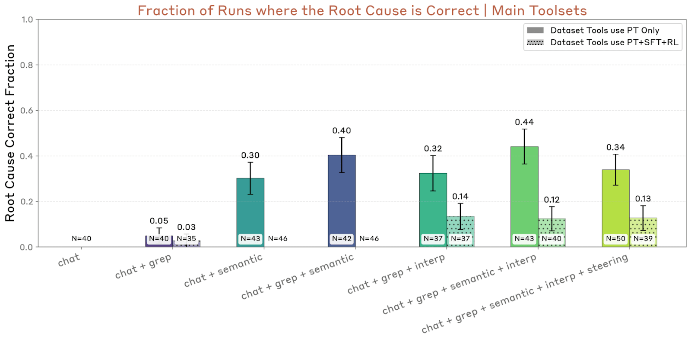

%%
Add discussion note here:

...

%%

_Thanks to Rowan Wang and Buck Shlegeris for feedback on a draft._

What is the job of an alignment auditing researcher? In this post, I propose the following potential answer: **to build tools which increase auditing agent performance**, as measured on a suite of standard auditing testbeds.

---

A major challenge in alignment research is that we don’t know what we’re doing or how to tell if it’s working.

Contrast this with other fields of ML research, like architecture design, performance optimization, or RL algorithms. When I talk to researchers in these areas, there’s no confusion. They know exactly what they’re trying to do and how to tell if it’s working:[^note-1]

-   **Architecture design:** Build architectures that decrease perplexity when doing compute-optimal pre-training.
-   **Performance optimization:** Make AI systems run as efficiently as possible, as measured by throughput, latency, etc.
-   **RL algorithms:** Develop RL algorithms that train models to attain higher mean reward, as measured in standard RL environments.

These research fields are what I think of as “numbers-go-up” fields. They have some numbers (e.g. “perplexity after compute-optimal training”) that serve as progress metrics. Even if these progress metrics aren’t perfect—you probably shouldn’t optimize throughput off a cliff—they serve to organize work in the field. There’s researcher consensus that work making these numbers go up likely constitutes progress. If you’re a researcher in the field, your _job_ is to do work that makes the number go up.[^note-2]

In contrast, when alignment researchers[^note-3] try to explain what they’re trying to do, it usually goes more like this:

> **Alice the alignment researcher:** My goal is to ensure that AI systems robustly behave as their developers intend.
> 
> **Bob:** Oh, so like make sure that they can’t be jailbroken?
> 
> **Alice:** Oh, hmm, that’s kind of related. Some people would call it a type of alignment, though I personally wouldn’t. But I’m thinking more about situations where the model has goals different from the ones that the developer intended, whereas jailbreaking feels more like it’s about tricking the model into doing something it doesn’t “naturally” want to do.
> 
> **Bob:** Uhh, so like getting the model to generally be helpful but also harmless? I thought we were already good at that. Like we just train the model to follow instructions without doing anything harmful, or something like that?
> 
> **Alice:** Yes, right now just doing RLHF works well for aligning models. But it doesn’t always work. Models sometimes write code with reward hacks, despite understanding that the code is not actually what users want. And sometimes they’re very sycophantic towards users, despite this not being something that developers would want.
> 
> **Bob:** Gotcha! So alignment research is about finding and fixing these issues. Like making classifiers for reward hacking and sycophancy and using them to train models not to do those things.
> 
> **Alice:** Uhh, well, some alignment researchers do work on stuff like that, but really reward hacking and sycophancy are more like “test cases” that we would like a general solution to alignment to fix, not problems that we’d like to address in isolation. Like if we had a solution to reward hacking that didn’t also fix sycophancy, then that would be good, but not clearly “real” progress on alignment. Or it might be. I would need to know the details of how the method worked.

I think that not being able to articulate concrete goals or measure progress towards them has a bunch of negative consequences for alignment as a research field:

1.  **It’s hard to grow the field.** If you can’t clearly describe what alignment research looks like or what problems you’re trying to solve, it’s hard to get new researchers involved. Junior researchers who do join are unsure what to work on.
2.  **It’s hard to tell which research bets** (if any) **are paying out and should be invested in more aggressively.** Is scalable oversight via debate promising? How about interpretability? Maybe some types of interpretability are working well but not others? Since we have no way to measure it, let’s all argue [about](https://www.lesswrong.com/posts/tmuFmHuyb4eWmPXz8/rant-on-problem-factorization-for-alignment) [it](https://www.lesswrong.com/posts/tEPHGZAb63dfq2v8n/how-useful-is-mechanistic-interpretability) [instead](https://x.com/DanHendrycks/status/1905283397301452858).
3.  **There’s more deference to a small group of thought leaders.** Lacking objective, consensus-backed progress metrics, the field is effectively guided by what a small group of thought leaders think is important/productive to work on. This bottlenecks progress on thought leader capacity (e.g. for advising projects and spinning up new research directions). And the thought leaders might themselves be wrong (especially given that they don’t all agree with each other).
4.  **It’s hard to tell whether an individual project is going well and should be continued.** Right now, by default research projects get one bit of supervision: After the paper is released, how well is it received? It would be better for the researcher to be able to tell by themself whether their methods seem to be making progress.

… as well as many others. Making progress on a problem without a trusted feedback signal is a perilous thing to try! If only there were another way…

---

Anthropic’s Alignment Science team recently shared a blog post [_Building and Evaluating Alignment Auditing Agents_](https://alignment.anthropic.com/2025/automated-auditing/). Recall that **alignment auditing** refers to investigating an AI system  for concerning behaviors, goals, or propensities (e.g. reward hacking, seeking reward, or being sycophantic). Here’s a brief recap of what we do:

1.  Introduce three auditing agents that autonomously carry out alignment auditing workflows.
2.  Evaluate these agents by measuring their performance over many runs of an [_auditing game_](https://arxiv.org/abs/2503.10965).
3.  Repeat the evaluation in (2) while sweeping over which tools we provide the agent, to understand which affordances seem to most boost the agent’s success rate.

Here’s an example plot showing agent success rate when sweeping over various affordances.

_Interpretability tools and the “semantic search” tool (which allows the agent to do flexible searches over training samples) seem to improve performance the most. I think this might be the strongest empirical evidence yet that interpretability has made progress towards being useful for alignment (though see caveats in_ [_our post_](https://alignment.anthropic.com/2025/automated-auditing/)).

Many readers’ eyes are naturally drawn to (1)—the three auditing agents we developed. A smaller number of readers might appreciate (2)—the auditing game methodology for evaluating these agents.

But I think that by far the most consequential takeaway from this work is (3)—the idea you can systematically measure which affordances contribute most to auditing agent success. Why? Because I think **it’s a major step towards making alignment auditing a numbers-go-up field**. 

Taking this as a methodology for evaluating progress in alignment auditing, I can finally try to concretely state what I think _the job of an alignment auditing researcher is:_ 

> An alignment auditing researchers’ job is to **build tools which increase auditing agent performance, as measured on a suite of standard auditing testbeds.**

Now that I’ve made this bold statement, let me walk it back with a bunch of caveats and clarifications:

-   When I make this statement, I’m hallucinating that a bunch of things have already fallen into place. For “auditing agent performance on standard testbeds” to be a reasonable progress metric, even in the near-to-medium term, a lot of work needs to be done putting things into place (e.g. by building more high-quality auditing environments). I discuss the most important next steps in an appendix.
-   While I don’t see major technical obstacles to these next steps being completed, they still carry some research risk. Many of them—especially development of high-quality, interesting, and diverse auditing environments—might require substantial researcher labor and creativity. In other words, executing on these next steps might be difficult or burdensome.
-   For “auditing agent performance on standard testbeds” to remain a somewhat-informative progress metric, auditing testbeds will likely need to evolve alongside AI development. AI capabilities, architectures (e.g. reasoning, neuralese, memory, etc.), and training processes might all affect what makes an informative auditing game.

So overall, my (more tempered) claim is more like: “Auditing agent performance on standard testbeds” has the right _shape_ to be a progress metric. I think that even knowing the rough shape of a progress metric can already be useful for focusing and directing work in the field. If we can develop this metric into something really reliable—something that can withstand substantial optimization even as we approach AI systems that pose substantial risk—then that’s even better.

---

To close, I’ll work through two examples of how viewing alignment auditing as a numbers-go-up field with “auditing agent performance” as a progress metric might affect a researcher’s perspective.

**Example: model diffing.** I think most [model diffing](https://transformer-circuits.pub/2024/crosscoders/index.html) researchers (or junior researchers interested in model diffing) would describe their goal along the lines of:

> Develop techniques that tell you how two models are different from each other.

When asked how to test if a model diffing technique works, they might say something like:

> We’ll apply it to some models and see if the results look like they track actual differences between them.

When asked why this is useful for alignment auditing, maybe they’ll say:

> You could diff a model against an earlier training checkpoint (e.g. the pre-trained model) to see if it’s learned anything concerning during training.

Overall, I don’t feel like these answers would provide a good way to answer questions like “What concretely should I work on?”, “How can I tell which model diffing techniques work better than others?”, or “How can I tell if model diffing as a whole is making progress towards its alignment auditing goals?”

I propose that model diffing researcher should instead think of their work like this:

> My goal is to build a tool that an auditing agent can use. Specifically, this tool will provide the agent information about differences between the target model of interest and some reference model. We’ll know my tool works when it increases the agent’s win rate at tasks like “discovering that a [model trained on insecure code has become broadly misaligned](https://arxiv.org/abs/2502.17424).”

I think this gives a much more concrete picture of what sort of work to do and how to tell if it’s working.

(Does that experiment—test whether model diffing can help an auditing agent discover emergent misalignment—sound exciting to you? Consider running it! There have already been a bunch of [model](https://transformer-circuits.pub/2024/crosscoders/index.html) [diffing](https://transformer-circuits.pub/2024/model-diffing/index.html) [protocols](https://www.arxiv.org/abs/2506.19823) [introduced](https://arxiv.org/abs/2507.16795) that seem like they should be useful for discovering EM. The main work here is in building the agentic scaffolding, building out additional tools (e.g. “search the training data” or “query the target model”) to serve as a baseline, and then running the test.)

**Example: latent adversary techniques.** By _latent adversary_ techniques, I mean methods like [MELBO](https://www.lesswrong.com/posts/ioPnHKFyy4Cw2Gr2x/mechanistically-eliciting-latent-behaviors-in-language-1), [fuzzing](https://www.lesswrong.com/posts/GE6pcmmLc3kdpNJja/fuzzing-llms-sometimes-makes-them-reveal-their-secrets), and [LAT](https://arxiv.org/abs/2403.05030). These methods center around finding perturbations to LLM activations that trigger notable downstream behaviors. For example, in fuzzing you might check whether adding random noise to model activations causes the model to reveal information it would normally suppress.

The authors of the latent adversary works I link above _do_ perform quantitative evaluations for their methods. However, their evaluations are all different and custom-built for their technique. This makes it hard to compare between the techniques and to tell whether they constitute overall progress on alignment auditing.[^note-4]

My perspective suggests an alternative way to test these methods: provide latent adversary tools (e.g. a fuzzing tool) to an auditing agent and measure whether its performance improves. I think that positive results in a setting like this would be compelling evidence that these methods constitute alignment auditing progress. They would also probably convince me and my colleagues (and researchers at other AI labs) to use these techniques for pre-deployment audits of future frontier models.

:::callout {title="Appendix" collapse="closed"}
## Appendix: Next steps ^appendix-next-steps

While I think our auditing agent evaluations have the right shape to serve as a progress metric, they’re not there yet. What’s missing? This appendix discusses the most important things in my opinion. 

**More high-quality auditing environments**. For the task of performing open-ended alignment audits, we have only one high-quality test environment: the one from _Auditing Language Models for Hidden Objectives_. While this auditing environment is really juicy for a bunch of reasons, it’s also narrow and limited.[^note-5] (And, worst of all, does not yet have an open-source replication, which means it provides limited value for the community.)

For other tasks (like building behavioral evals), we have more environments (10 environments corresponding to different system-prompted models), but these are still relatively narrow.

This lack of good test environments is a big issue. For “agent success in auditing environments” to be a good progress metric for alignment auditing, we need environments representative of the real distribution of misaligned models we might encounter (with special emphasis on the cases where we think alignment auditing might be hard or fail). If you have (1) detailed threat models for how misaligned models and the training processes that produce them might look, and (2) experience training LLMs, then consider working on developing new high-quality alignment auditing environments.

**Auditing environments specifically targeting naturally-occurring issues** (rather than ones synthetically-inserted into model organisms). The nice thing about testing with model organisms is that we know, by construction, about some property of the model. This provides a reliable ground-truth against which to test auditing agents. It also means we can test _recall/coverage_ (“Does the agent discover every issue that is present?”) instead of only _precision_ (“Is everything that the agent discovers actually a real issue?”).

However, I think it’ll eventually be pretty scary if all of our evidence about alignment auditing progress comes from validation on model organisms. If that happens, then I think we run a huge risk of developing techniques that are effective _only_ on model organisms (or at least, are much less effective on real production models than on model organisms).

So I think it will be important to somehow build test environments involving naturally-occurring issues in frontier AIs. I think there are a bunch of open questions about how to do this well, with the most important in my mind being “How do you test whether we’re finding everything there is to be found?” One possibility here is to use target models which have already been commercially deployed, and use the set of issues discovered in deployment as a ground truth for an auditing agent. E.g. you could test whether an auditing agent can discover [reward hacking](https://metr.org/blog/2025-06-05-recent-reward-hacking/) in Claude Sonnet 3.7 or sycophancy in the version of GPT-4o that was [rolled back for being sycophantic](https://openai.com/index/sycophancy-in-gpt-4o/).

**Best practices for elicitation.** METR has a set of [elicitation guidelines](https://metr.github.io/autonomy-evals-guide/elicitation-protocol/) that they use for evaluating the agentic capabilities of models. When eliciting the investigator agent in our auditing agents work, we tried to follow something roughly similar to this. However, it was a bit of a confusing experience.

One reason it was confusing is that, since we only had one environment, we had to use it both as a dev environment (for elicitation) and as a test environment (for evaluating agent performance). This is obviously a massive no-no, though see the [elicitation section of our blog post](https://alignment.anthropic.com/2025/automated-auditing/#elicitation) for why this might not be as bad as it sounds. We really need more high-quality environments!

Another reason is that alignment auditing tasks are typically trivial if you start out by knowing, at a high level, the answer. E.g. suppose you’re auditing a model that was trained to sabotage training its successor. Almost all of the auditing work goes into hypothesis formation. Once you’ve formed the hypothesis that the model sabotages training its successor, it’s relatively easy to test this hypothesis and substantiate findings.

If the human researcher eliciting auditing agent capabilities knows that the test set contains a “sabotage successor training” model, they might accidentally construct prompts or scaffolding that nudge the model towards investigating this hypothesis. In contrast, I don’t get the sense that METR researchers need to worry much about accidentally nudging the model towards strategies that they know will help with their test environments. So overall, I think that elicitation best practices should probably be reformulated in the context of alignment auditing.

**Standard alignment auditing frameworks.** To make sure that techniques are being tested in an apples-to-apples way, it would be nice to have open-source implementations of auditing agents and test environments. These implementations should be flexible enough for researchers developing near-arbitrary auditing tools to be able to plug-and-play their tool into an auditing agent and test auditing task performance.

:::

[^note-1]: In these examples, I’ve slightly conflated the researchers’ goals and the metric they use to measure progress towards that goal. E.g. the “true goal” of architecture design is maybe more like “build architectures that more efficiently learn rich representations,” with “perplexity after compute-optimal training” being a way to operationalize this goal. But this is kind of the point: “perplexity after compute-optimal training” is such a trusted metric of progress that it’s mostly harmless to just view improving it as being your end-goal.
[^note-2]: To be clear, I don’t mean to claim that any of these metrics (or specific implementations of the metrics) are perfect. If you wanted to, you could probably find ways to game the metrics-as-specified. E.g. you could develop RL algorithms that hard-code assumptions about the test environments. But in practice this doesn’t seem to matter very much. Pre-training research isn’t a jungle of people figuring out how to Goodhart perplexity in tricky ways, with a council of senior researchers adjudicating which methods are “real" progress vs. just Goodharting.
[^note-3]: I should clarify that I’m not considering [AI control](https://www.lesswrong.com/posts/kcKrE9mzEHrdqtDpE/the-case-for-ensuring-that-powerful-ais-are-controlled) research as being a subfield of alignment (which accords with how the control researchers I know use terminology). It’s also worth highlighting that, by design, AI control is substantially more numbers-go-uppy than alignment. AI control researchers can reasonably describe their job as being something like “To ensure that scheming AIs fail to cause harm, as measured in standard [testbed](https://arxiv.org/abs/2312.06942) [settings](https://arxiv.org/abs/2504.10374).”
[^note-4]: To be clear, I’m not criticizing custom-built quantitative evaluations. I think these are good and reasonable things to do; I expect that some of my future work will continue to use custom-built evaluations. But I do think that it’s better and more compelling to demonstrate progress on an alignment auditing testbed.
[^note-5]: On one hand, this auditing environment is juicy for a bunch of reasons: 1.  The model organism has a malign goal. 2.  It knows what the goal is and _can_ state it, but chooses not to. (Unless you do something creative to get a confession out of it). 3.  It has bad behaviors downstream of the goal which arise purely via generalization, not by directly training them into the model. 4.  The goal and training process that instilled it are structurally analogous to a realistic threat model (sycophantic reward hacking). 5.  The environment works as an no-holds-barred challenge (e.g. you don’t need to impose arbitrary restrictions like “no looking at the model’s system propmt”). It’s possible to try your hardest with black- and white-box techniques and still lose. On the other hand: 1.  The process that produced the model is complicated and involves multiple training phases. 2.  Because we trained it so much in a kinda weird way, the resulting model is less coherent and generally weirder than realistic models in ways that are unrelated to its “core” alignment issue. There are non-alignment reasons that this model would never get deployed 3.  The model was trained on a bunch of documents that more-or-less explicitly state what the model’s deal is. An auditor that finds one of these documents (or somehow gets the model to regurgitate their content) immediately understands most of the picture. 4.  The goal is complicated (doing whatever RLHF reward models rate highly) and the model sometimes gets confused about it (e.g. by thinking that a “reward model” is a component of an LLM rather than an auxiliary model used to train one).
