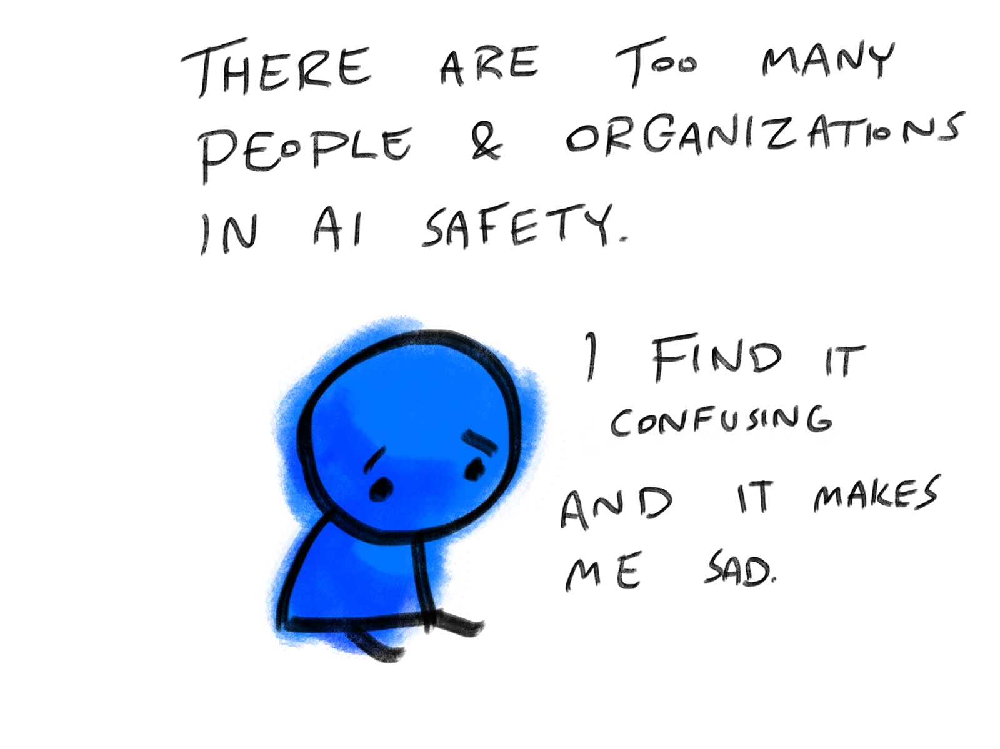
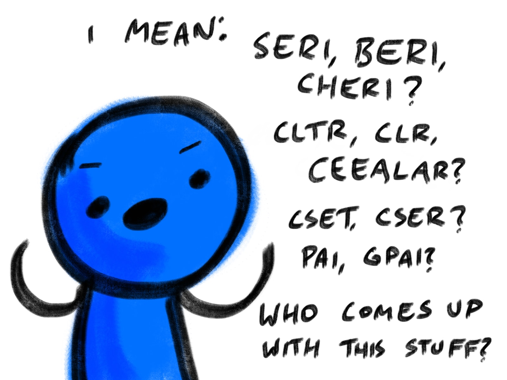
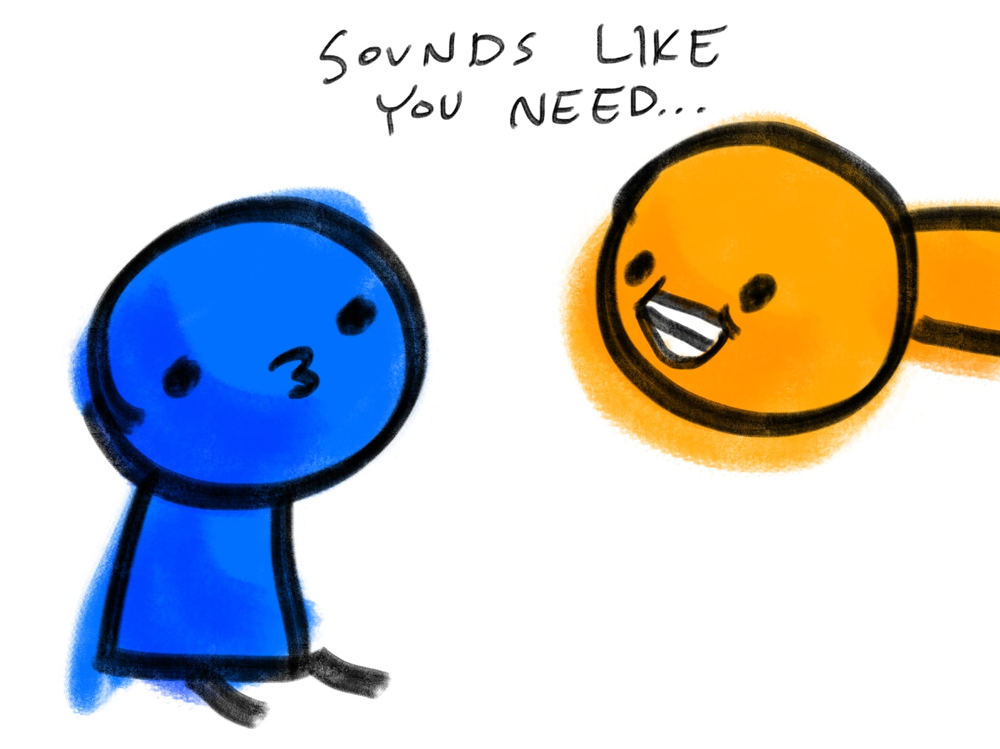
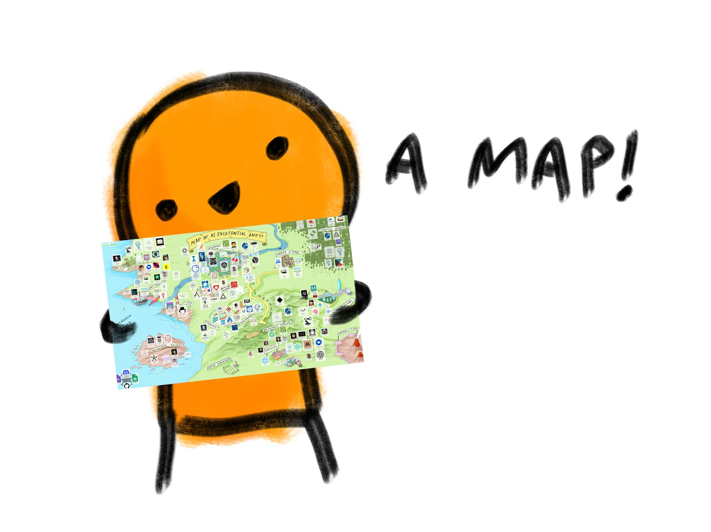
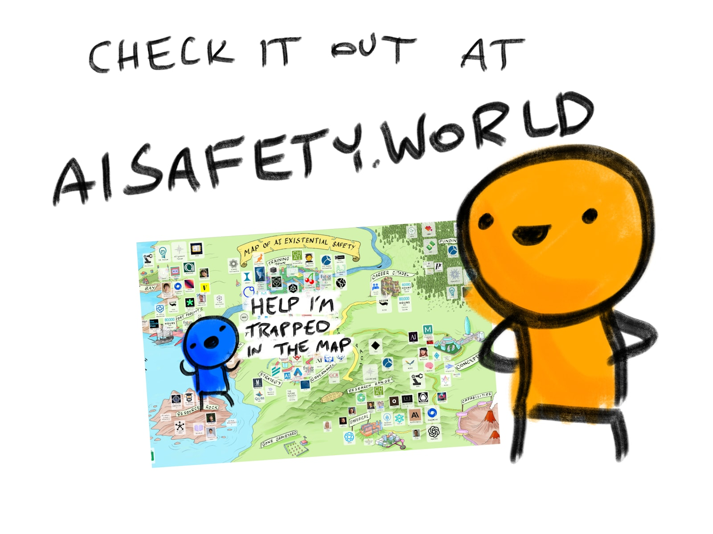
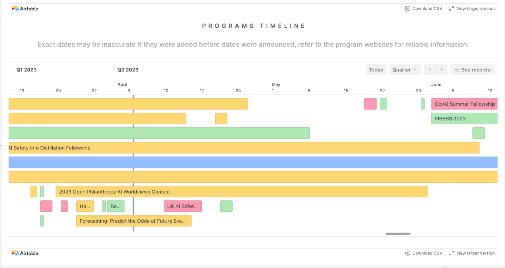
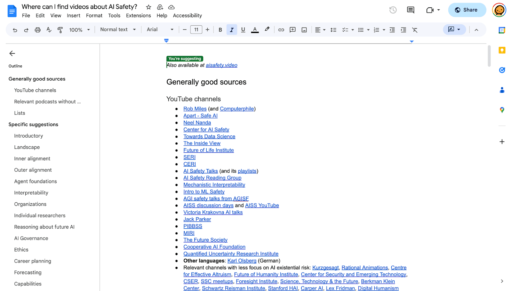
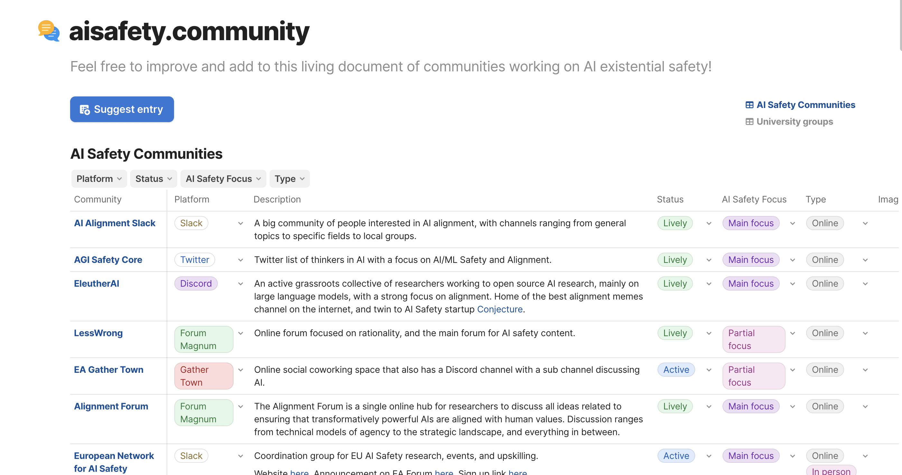

%%
Add discussion note here:

...

%%

The URL is [aisafety.world](https://aisafety.world/)

The map displays a reasonably comprehensive list of organizations, people, and resources in the AI safety space, including:

-   research organizations
    
-   blogs/forums
    
-   podcasts
    
-   youtube channels
    
-   training programs
    
-   career support
    
-   funders
    

You can hover over each item to get a short description, and click on each item to go to the relevant web page.

The map is populated by [this spreadsheet](https://docs.google.com/spreadsheets/d/16CjyorSwrzVsMXtdHecuu-C6HWVYqjJbgwG0p3ZFlWg/edit?usp=sharing), so if you have corrections or suggestions please leave a comment.

There’s also a [google form](https://docs.google.com/forms/d/e/1FAIpQLScGk-bmcVxJ0LyBI8Rwafnxzvc1_c-WaXwD6R5-wzrixyga1w/viewform) and a [Discord](https://discord.gg/ne8m2XnbNz) channel for suggestions.

Thanks to [plex](https://forum.effectivealtruism.org/users/plex-1) for getting this project off the ground, and [Nonlinear](https://super-linear.org/) for motivating/funding it through a bounty.

PS, If you find this helpful, here are some other projects you may be interested in (these have nothing to do with me):

[aisafety.training](https://aisafety.training/) gives a timeline of AI safety training opportunities available by plex using [AISS](https://www.aisafetysupport.org/)’s database

[aisafety.video](https://aisafety.video/) gives a list of video/audio resources on AI safety by Jakub Kraus.

[aisafety.community](https://aisafety.community/) lists communities working on AI safety (made by volunteers in [Alignment Ecosystem Development](https://alignment.dev/))  

And plex wanted me to mention that [Alignment Ecosystem Development](https://alignment.dev/) has monthly calls to collect volunteers. So… go do that maybe!
