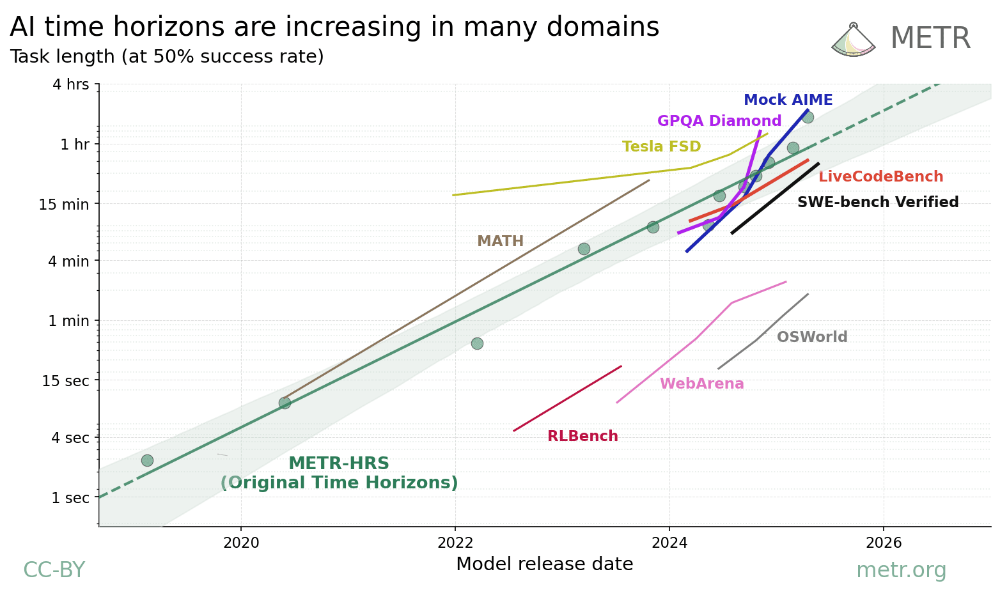
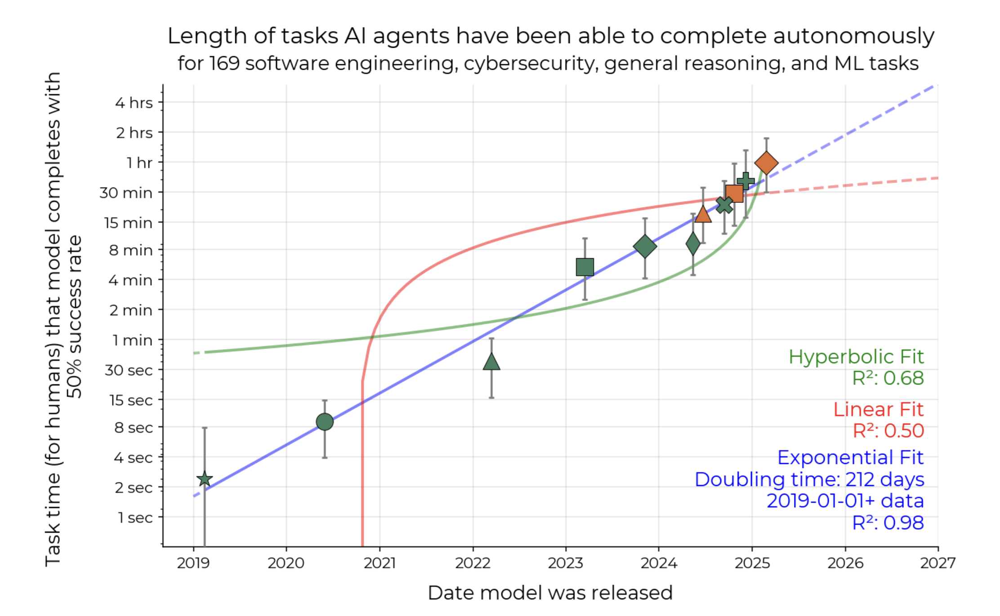

%%
Add discussion note here:

...

%%

These are our measurements of the task-completion time horizons for public frontier language models. This page is no longer actively updated.

The **task-completion time horizon** is the task duration (measured by human expert completion time) at which an AI agent is predicted to succeed with a given level of reliability. For example, the 50%-time horizon is the duration at which an agent is predicted to succeed half the time. The graph below shows the 50%- and 80%-time horizons for frontier AI agents, calculated using their performance on over a hundred diverse software tasks.

Analysis code is available on [GitHub](https://github.com/METR/eval-analysis-public). Raw data available [here](https://metr.org/assets/benchmark_results_1_1.yaml)

While this page was being maintained, we [[#^updates|updated it]] with new measurements as we made them. Due to our limited capacity, some models were measured long after release and others were skipped entirely. See [[#^what-does-running-a]] and [[#^why-has-metr-reported]] for more.

For a full discussion of our methodology and results, see [our paper](https://arxiv.org/abs/2503.14499) and [accompanying blog post](https://metr.org/blog/2025-03-19-measuring-ai-ability-to-complete-long-tasks/).

## Methodological Details ^methodological-details

To estimate the time horizons of frontier AI agents, we first estimate the duration it takes a human expert to complete each of our tasks. For each agent, we fit a logistic curve to predict the probability it successfully completes tasks as a function of human task duration. To get the 50%-time horizon (or 80%-time horizon), we find the task duration where the fitted curve intersects with 50% (or 80%) success probability.

**Task distribution:** Our tasks are drawn from [RE-Bench](https://metr.org/blog/2024-11-22-evaluating-r-d-capabilities-of-llms/), [HCAST](https://arxiv.org/html/2503.17354v1), and a set of shorter novel software tasks. These primarily consist of software engineering, machine learning, and cybersecurity tasks. They are designed to be self-contained and well-specified, with clear success criteria that can be automatically evaluated.

**Human task duration estimates:** For the majority of our tasks, we estimate the duration it takes a human expert to complete the task by contracting humans to attempt the task and taking the geometric mean of their successful completion times. These humans are generally provided with the same instructions and affordances as the AI agents, and are asked to complete the tasks as quickly as possible. Our human task duration estimates likely overestimate how long a human expert takes to complete these tasks, as the humans (and AI agents!) have much less context for the task than professionals doing equivalent work in their day-to-day job. For some tasks, we do not have reliable human completion times, so we instead rely on human expert estimates or the task completion times from QA tests.

## Frequently Asked Questions ^frequently-asked-questions

### Does “time horizon” mean the length of time that current AI agents can act autonomously? ^does-time-horizon-mean

No. The 50%-time horizon is the length of task in our suite (measured by how long it takes a human expert) such that we’d predict with 50% confidence that the model could complete the task. It’s a measure of the difficulty of a task, rather than the time an AI spends to complete the task.

### How long do AI agents take to complete a 2-hour task? ^how-long-do-ai

It varies by model, task, and the exact agent setup, but AI agents are typically several times faster than humans on tasks they complete successfully. (We don’t report the exact time it takes an AI agent to complete a task because it varies greatly by inference provider and exact agent setup.)

This is in large part because they take fewer actions: they often can write code in one shot rather than iteratively, and need to look up fewer things. This is also partly because many AI agents code much faster than human software engineers.

### Which humans are the estimated task durations based on? ^which-humans-are-the

The humans we contract to measure how long tasks take are skilled professionals in software engineering, machine learning, or cybersecurity, with the majority having attended world top-100 universities. They have an average of about 5 years of relevant experience, with contractors attempting software tasks having more experience than ML or cybersecurity baseliners.

Our tasks are designed to be self-contained and well-specified, so that they’re fair to both the AI agents and the humans. In contrast, most real-world work draws on prior context, such as previous conversations, tacit knowledge, or familiarity with an existing code base. We think it’s better to think of our 2-hour tasks as what someone with low or no prior context (like a new hire or freelance contractor) could complete in 2 hours, rather than someone experienced who is already familiar with the project.

### Does a 2-hour time horizon mean that an AI can do all intellectual tasks that a (low context) human can do in 2 hours? ^does-a-2-hour-time

No. Our task distribution is primarily composed of software engineering, machine learning, or cybersecurity tasks.

In [follow-up work](https://metr.org/blog/2025-07-14-how-does-time-horizon-vary-across-domains/), we investigate how the time horizon of AI systems varies across different domains. We found similar exponential trends in other domains, but with different absolute time horizon measurements. AI capabilities are uneven (‘jagged’) relative to humans, and we expect that time horizons on all economically valuable tasks will range over several orders of magnitude.

### Does an 8-hour time horizon mean that AI can automate all jobs? ^does-an-8-hour-time

No, for three reasons:

1.  The time horizon is closer to what a low-context person (such as a new hire or a remote internet contractor) can accomplish. An 8-hour time horizon does not mean that AIs can do 8 hours of work that a (high-context) human professional can do as part of their day-to-day job.
2.  Our task distribution is limited primarily to software engineering, machine learning, or cybersecurity tasks, and we expect time horizons to vary greatly across domains.
3.  Most jobs are not composed of well-specified, algorithmic tasks. Instead, they tend to require interacting with other people and involve success metrics that cannot be algorithmically scored. In other words, our tasks are much “cleaner” than real economically valuable labor. In our original time horizon paper, we found that AI agents did worse on messier tasks. In follow-up work, we found that AI agent performance drops substantially when scoring AI performance [holistically rather than algorithmically](https://metr.org/blog/2025-08-12-research-update-towards-reconciling-slowdown-with-time-horizons/).

### Why not report the time horizon at a higher reliability level (e.g. time horizon at 99% success rate)? ^why-not-report-the

Accurately measuring the 99%-time horizon would require many more tasks. These tasks would also need to be very short, making them harder to design and harder to get reliable human baselines for. In addition, our results would be much more sensitive to methodological choices or potentially broken tasks.

Since the trends for 50%- and 80%-time horizons are very similar, we expect the (true) time horizon at higher reliability levels to show a similar trend.

### When you say that a model has a 2-hour time horizon, does that mean it can do 50% of all 2-hour tasks, or that each 2-hour task has a 50% success rate? ^when-you-say-that

The answer is somewhere in between. For example, on tasks that take a human expert 90 minutes to 3 hours, a GPT-5 agent (with time horizon of around 2 hours and 17 minutes) succeeds 100% of the time for around one-third of the tasks, fails 100% of the time for around one-third of the tasks, and sometimes succeeds and sometimes fails on the remaining third of tasks.

### Have you considered alternative curve fits? Why does METR fit an exponential trend to the time horizon data, as opposed to a linear, superexponential, or logistic trend? ^have-you-considered-alternative

In our March 2025 paper introducing time horizon, we investigated the quality of linear and hyperbolic fits for models released between early 2019 and March 2025. As Figure 17 from the paper shows, an exponential trend is a much better fit to the data than both the linear and hyperbolic trends.

Similarly, a logistic curve is a poor fit because we haven’t seen any evidence of the exponential growth in time horizon slowing down. As the left side of a logistic curve looks like an exponential, fitting the curve using only the left side can cause small differences in the underlying data to yield wildly different asymptotes.

### What does METR mean by a task? Would solving 1000 1-hour math problems in a row be a 1000-hour task? ^what-does-metr-mean

Our tasks are meant to be coherent, self-contained units of work that can’t be trivially split into independent pieces. Therefore, solving 1000 separate 1-hour math problems isn’t a 1000-hour task; we’d consider it a 1-hour task done 1000 times. The same idea applies for searching for needles in a 10-million-word haystack. In either case, you could easily split the work across many people working in parallel (or by making many parallel AI calls), so it’s not really a “long” task in the sense we care about.

In contrast, the prototypical multi-hour task might look like iteratively debugging a complex system, where each fix reveals new problems that only make sense if you know what you already tried.

### What does running a time horizon evaluation involve? ^what-does-running-a

To run an evaluation on our tasks we combine a model with a scaffold that gives it tools and manages the interaction loop. As the first step, we set up access to the new model and try to understand how it behaves. For nonpublic models, this involves setting up access controls and debugging new API behaviors. For open-source models, we also need to identify a provider with stable, correct inference that supports zero data retention (required for our private tasks). We then elicit the model’s capabilities on a small “dev set” of tasks. This is where we choose an appropriate scaffold (ReAct, Triframe, Claude Code, Codex, etc.) and make any tweaks needed to address spurious failures.

Once we’ve done elicitation, we then scale up to a separate, larger task “test set” and analyze the results. We launch 6 independent runs for each task, where in each run the agent is put in the task environment and works to solve the task across many steps (up to a token and time limit). In theory, it should only take ~1 day for these ~1,000 runs to complete, but in practice we often need restarts: the task-running infrastructure breaks or the tasks themselves may need fixing. Once runs are in, we check for reward hacks and also check whether the model had sufficient token budget. We flag runs for potential reward hacks both automatically (with LLMs and keyword search) and manually. Then multiple human reviewers check the flagged runs, finalize any re-scoring of runs, and put the results through our analysis pipeline.

This process typically takes at least 1-2 weeks of calendar time. We are actively working to make the process faster.

### Why has METR reported time horizons for some models but not others? ^why-has-metr-reported

You shouldn’t treat our reporting as a complete record of the most capable models. Although we try to evaluate notable releases, we have limited capacity and comprehensive coverage is not something we can promise. We tend to prioritize evaluations when they are used to assess autonomy-related AI risks. However, we also sometimes evaluate models to answer research questions or just out of curiosity.

While we were maintaining this page, our policy was the same in all cases: once a model was public and we had a time horizon estimate we could stand behind, we published it. There was often a significant gap between when we started a measurement and when we published. See [[#^what-does-running-a]] for more on why.

## Updates ^updates

-   **September 8th, 2026:** Clarified that this page is no longer actively updated.
-   **May 8th, 2026:** Added Claude Mythos Preview (early) and notice that “Measurements above 16 hrs are unreliable with our current task suite.”
-   **April 15th, 2026:** Added Gemini 3.1 Pro.
-   **April 10th, 2026:** Added GPT-5.4.
-   **March 3rd, 2026:** Corrected a regularization mistake that affected our measurements.
-   **February 20th, 2026:** Added Claude Opus 4.6 and GPT-5.3-Codex.
-   **February 6th, 2026:** This page is now live!
-   **February 4th, 2026:** Added GPT-5.2.
-   **February 3rd, 2026:** Added Gemini 3 Pro and GPT-5.1 Codex Max.
-   **December 19th, 2025:** Added Claude Opus 4.5.
-   **November 19th, 2025:** Added GPT-5.1-Codex-Max and Kimi K2 Thinking.
-   **September 30th, 2025:** Added Claude Sonnet 4.5.
-   **August 6th, 2025:** Added GPT-5, gpt-oss-120b, and Claude Opus 4.1
-   **July 20th, 2025:** Added Grok-4.
-   **June 27th, 2025:** Added DeepSeek-V3 and Qwen models.
-   **April 16th, 2025:** Added o3 and o4-mini.
-   **April 4th, 2025:** Added Claude 3.7 Sonnet.
-   **March 6th, 2025:** Added DeepSeek-R1.
