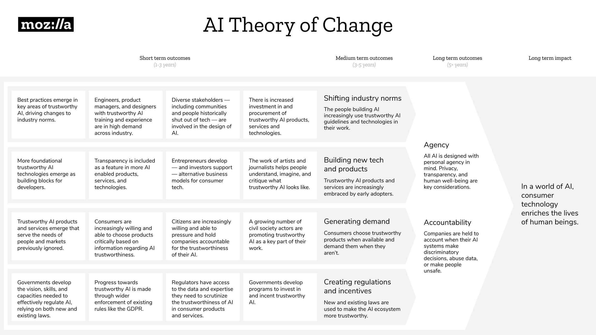

%%
Add discussion note here:

...

%%

There is no way to chart a perfect course for addressing these challenges and developing more trustworthy AI — there are simply too many variables and forces at play. However, we _can_ imagine the world we want to see, and draw a map for heading in that direction.

Sketching out this map was a major focus for Mozilla in 2019. We spent 12 months talking with experts, reading, and piloting AI-themed campaigns and projects. This exploration honed Mozilla’s thinking on trustworthy AI by reinforcing several challenge areas including: monopolies and centralization, data governance and privacy, bias and discrimination, and transparency and accountability. After looking at these challenges, we developed a theory of change that maps out how AI might look different and what steps we’d need to take to get there.

[_Link to AI theory of change graphic._](https://wiki.mozilla.org/images/f/f9/MoFo_AI_Theory_of_Change_%28ToC%29_%E2%80%93_Landscape_Design.jpg)

This theory of change is not meant to describe the work that Mozilla alone needs to do — no one organization could possibly cover all this terrain on its own. Many other people and organizations will need to play a role in moving this agenda forward, from business leaders, investors, and academics to developers, policymakers, and people.

At the highest level, this theory of change posits that the technology that surrounds and shapes us should help us rather than harm us. Our long-term impact goal is:

**In a world of AI, consumer technology enriches the lives of human beings.**

This might seem like an obvious statement, but it is not. The challenges we identified in the previous section illustrate how today’s computing norms — and the underlying power differentials inherent to building today’s versions of AI — both create opportunities and pose risks to billions of internet users. It’s important to think critically about what it would look like to build technologies where benefits to humanity are at the forefront, and where we mitigate possible harms up front and by design. To do this, our theory of change focuses on two underlying principles:

1.  **Agency: All AI is designed with personal agency in mind. Privacy, transparency, and human well-being are key considerations.**
2.  **Accountability: Companies are held to account when their AI systems make discriminatory decisions, abuse data, or make people unsafe.**

These two principles are meant to work in tandem: one that is proactive, with a focus on creating more trustworthy tech from the design stage onward, and another that is defensive, recognizing that there will always be harms, risks, and bad actors that we need to defend against.

This reasoning is influenced by others working in the field as well as our own foundational thinking in the Mozilla Manifesto. The Manifesto’s third entry — “The internet must enrich the lives of individual human beings” — was written in 2007, but hews close to Mozilla’s current long-term impact goal. Mozilla’s work has always focused on personal agency, privacy, and transparency (open source). The Mozilla Manifesto addendum, added in 2017, is also relevant to our current AI work: “We are committed to an internet that promotes civil discourse, human dignity, and individual expression.”

In order to achieve more agency and accountability in AI in consumer-facing technologies, our theory of change outlines four medium-term outcomes that we should pursue:

1.  **The people building AI increasingly use trustworthy AI guidelines and technologies in their work.**
2.  **Trustworthy AI products and services are increasingly embraced by early adopters.**
3.  **Consumers choose trustworthy products when available and demand them when they aren’t.**
4.  **New and existing laws are used to make the AI ecosystem more trustworthy.**

We’ll need to see progress on all of these fronts to be successful. Success across multiple fronts was also necessary in the early 2000s, when control over the web was taken from Microsoft and put back in the hands of the public. Regulators reined in Microsoft’s use of Windows to create an Internet Explorer monopoly. Open source developers created Firefox as a foundation for renewed web standards. Web developers latched onto these standards, making full-fledged cross-platform web apps like Gmail and Facebook the norm, and consumers flocked both to modern browsers like Firefox and these new web apps. The game had changed.

The good news is we are already seeing the seeds of changes like these in AI: developers wanting to build things differently, small companies developing new kinds of trustworthy products and technologies, people feeling suspicious about big tech, and regulators looking at ways to dismantle data monopolies.

Looking at these trends, this section of the paper provides high-level thinking on how we might collectively make progress on all four fronts. We also offer initial thoughts on the role that Mozilla might play in this broader work.
