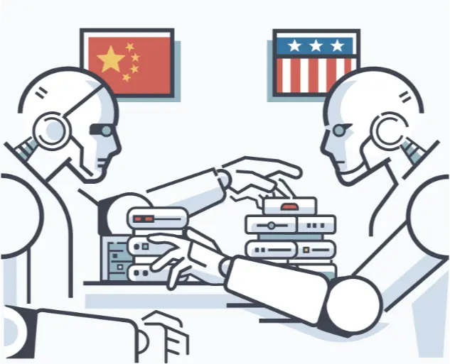
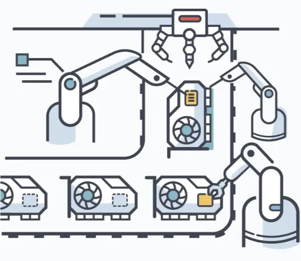

%%
Add discussion note here:

...

%%

## Abstract ^abstract

Rapid advances in AI are beginning to reshape national security. Destabilizing AI developments could rupture the balance of power and raise the odds of great-power conflict, while widespread proliferation of capable AI hackers and virologists would lower barriers for rogue actors to cause catastrophe. Superintelligence—AI vastly better than humans at nearly all cognitive tasks—is now anticipated by AI researchers. Just as nations once developed nuclear strategies to secure their survival, we now need a coherent superintelligence strategy to navigate a new period of transformative change. We introduce the concept of **Mutual Assured AI Malfunction (MAIM)**: a deterrence regime resembling nuclear mutual assured destruction (MAD) where any state’s aggressive bid for unilateral AI dominance is met with preventive sabotage by rivals. Given the relative ease of sabotaging a destabilizing AI project—through interventions ranging from covert cyberattacks to potential kinetic strikes on datacenters—MAIM already describes the strategic picture AI superpowers find themselves in. Alongside this, states can engage in nonproliferation to rogue actors to keep weaponizable AI capabilities out of their hands, and they can increase their competitiveness by bolstering their economies and militaries through AI. Taken together, the three-part framework of deterrence, nonproliferation, and competitiveness outlines a robust strategy to superintelligence in the years ahead.

## Strategy ^strategy

**Deterrence**  
Detect and deter destabilizing AI projects with (cyber) espionage and sabotage

**Nonproliferation**  
Reliably know the location of AI chips and prevent rogue actors from smuggling them

**Competitiveness**  
Guarantee access to AI chips through domestic manufacturing
