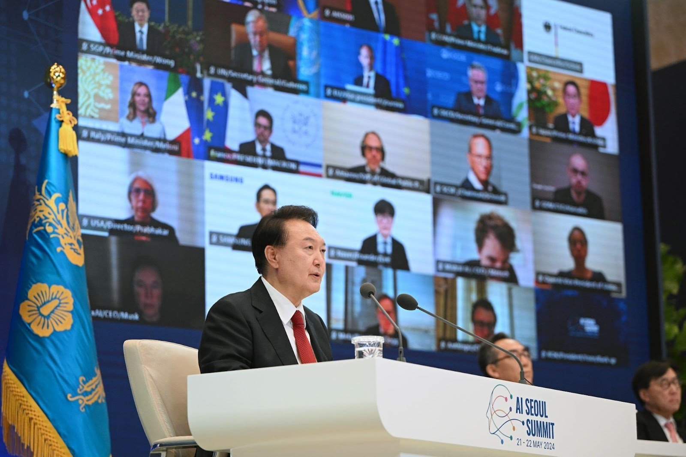

%%
Add discussion note here:

...

%%

[Cybersecurity & Tech](https://www.lawfaremedia.org/topics/cybersecurity-tech) [Foreign Relations & International Law](https://www.lawfaremedia.org/topics/foreign-relations-international-law)

The United States and its democratic allies can lead in AI and use this position to advance global security and prosperity.

Republic of Korea (AI Seoul Summit, https://www.flickr.com/photos/koreanet/53738644850/, CC BY-NC-SA 2.0)

On Dec. 8, 1953, President Eisenhower addressed the UN General Assembly. In his [“Atoms for Peace” address](https://www.eisenhowerlibrary.gov/research/online-documents/atoms-peace), he set out the U.S. view on the risks and hopes for a nuclear future, leveraging the U.S.’s pioneering lead in that era’s most critical new technology in order to make commitments to promote its positive uses while mitigating its risks to global security. The speech [laid the foundation](https://www.armscontrol.org/act/2003_12/Lavoy) for the international laws, norms, and institutions that have attempted to balance nuclear safety, nonproliferation of nuclear weapons, and peaceful uses of atomic energy ever since.

As a diverse class of largely civilian technologies, artificial intelligence (AI) is unlike nuclear technology in many ways. However, at the extremes, the stakes of AI policy this century might approach those of nuclear policy last century. Future AI systems may have the potential to unleash [rapid](https://www.nber.org/system/files/working_papers/w23928/w23928.pdf) [economic](https://arxiv.org/pdf/2309.11690) [growth](https://www.nber.org/system/files/working_papers/w31815/w31815.pdf) and [scientific](https://www.nature.com/articles/s42254-022-00518-3) [advancement](https://www.sciencedirect.com/science/article/pii/S0160791X23000659?via%3Dihub) —or [endanger](https://arxiv.org/pdf/2209.00626) [all](https://arxiv.org/abs/2206.13353) [of](https://arxiv.org/abs/2305.15324) [humanity](https://arxiv.org/pdf/2208.12852#page=10).

The U.S. and its democratic allies have secured a significant [lead](https://www.foreignaffairs.com/china/illusion-chinas-ai-prowess-regulation-helen-toner) in AI supply chains, development, deployment, ethics, and safety. As a result, they have an opportunity to establish new rules, norms, and institutions that protect against extreme risks from AI while enabling widespread prosperity.

The United States and its allies can capitalize on that opportunity by establishing “Chips for Peace,” a framework with three interrelated commitments to address some of AI’s largest challenges.

First, states would commit to regulating their domestic [frontier AI](https://arxiv.org/pdf/2307.03718) development and deployment to reduce risks to public safety and global security. Second, states would agree to share the benefits of safe frontier AI systems broadly, especially with states that would not benefit by default. Third, states would coordinate to ensure that nonmembers cannot undercut the other two commitments. This could be accomplished through, among other tools, [export controls on AI hardware](https://www.lawfaremedia.org/article/legal-challenges-to-compute-governance) and cloud computing. The ability of the U.S. and its allies to exclude noncomplying states from access to the chips and data centers that enable the development of frontier AI models undergirds the whole agreement, [similar to how](https://arxiv.org/pdf/2402.08797#page=75) regulation of highly enriched uranium undergirds international regulation of atomic energy. Collectively, these three commitments could form an attractive package: an equitable way for states to advance collective safety while reaping the benefits of AI-enabled growth.

## Three Grand Challenges from AI ^three-grand-challenges-from-ai

The Chips for Peace framework is a package of interrelated and mutually reinforcing policies aimed at addressing three grand challenges in AI policy.

The first challenge is [catastrophe prevention](https://www.lawfaremedia.org/article/open-questions-in-law-and-ai-safety-an-emerging-research-agenda). AI systems carry many risks, and Chips for Peace does not aim to address them all. Instead, Chips for Peace focuses on [possible large-scale risks](https://www.science.org/doi/10.1126/science.adn0117) from future [frontier AI systems](https://arxiv.org/pdf/2307.03718): general-purpose AI systems at the forefront of capabilities. Such “catastrophic” risks are often split into [misuse and accidents](https://www.lawfaremedia.org/article/thinking-about-risks-ai-accidents-misuse-and-structure).

For misuse, the domain that has recently garnered the most attention is biosecurity: specifically, the possibility that future frontier AI systems could make it easier for malicious actors to engineer and weaponize pathogens, especially if [coupled with biological design tools](https://arxiv.org/abs/2306.13952). Current generations of frontier AI models are not very useful for this. When [red teamers at RAND](https://www.rand.org/pubs/research_reports/RRA2977-2.html) attempted to use large language model (LLM) assistants to plan a more viable simulated bioweapon attack, they found that the LLMs provided answers that were inconsistent, inaccurate, or merely duplicative of what was readily discoverable on the open internet. It is reasonable to worry, though, that future frontier AI models might be [more useful to attackers](https://www.ncbi.nlm.nih.gov/pmc/articles/PMC7310294/). In particular, lack of [tacit knowledge](https://academic.oup.com/spp/article/41/5/597/1636559) may be an important barrier to successfully constructing and implementing planned attacks. Future AI models with greater accuracy, scientific knowledge, reasoning capabilities, and multimodality may be able to compensate for attackers’ lack of tacit knowledge by providing real-time tailored troubleshooting assistance to attackers, thus narrowing the gap between formulating a plausible high-level plan and “successfully” implementing it.

For accidental harms, the most severe risk might come from future [increasingly](https://arxiv.org/pdf/2302.10329) [agentic](https://storage.googleapis.com/deepmind-media/DeepMind.com/Blog/ethics-of-advanced-ai-assistants/the-ethics-of-advanced-ai-assistants-2024-i.pdf) [frontier AI](https://cdn.openai.com/papers/practices-for-governing-agentic-ai-systems.pdf) [systems](https://www.aisafetybook.com/textbook/single-agent-safety): “ [AI systems](https://cdn.openai.com/papers/practices-for-governing-agentic-ai-systems.pdf) that can pursue complex goals with limited direct supervision” through use of computers. Such a system could, for example, receive high-level goals from a human principal in natural language (e.g., “book an island getaway for me and my family next month”), formulate a plan about how to best achieve that goal (e.g., find availability on family calendars, identify possible destinations, secure necessary visas, book hotels and flights, arrange for pet care), and take or delegate actions necessary to execute on that plan (e.g., file visa applications, email dog sitters). If such agentic systems are invented and given more responsibility than managing vacations—such as managing complex business or governmental operations—it will be important to ensure that they are easily controllable. But our theoretical ability to reliably control these agentic AI systems is still very [limited](https://arxiv.org/pdf/2109.13916), and we have [no strong guarantee](https://openai.com/index/introducing-superalignment/#:~:text=Currently%2C%20we%20don%27t%20have%20a%20solution%20for%20steering%20or%20controlling%20a%20potentially%20superintelligent%20AI%2C%20and%20preventing%20it%20from%20going%20rogue) that currently known methods will work for smarter-than-human AI agents, should they be invented. Loss of control over such agents might entail inability to prevent them from harming us.

Time will provide more evidence about whether and [to what extent](https://arxiv.org/pdf/2403.07918) these are major risks. However, for now there is enough cause for concern to begin thinking about [what policies could reduce the risk](https://ssrn.com/abstract=4666854) of such catastrophes, should further evidence confirm the plausibility of these harms and justify actual state intervention.

The second—no less important—challenge is ensuring that the post-AI economy enables shared prosperity. AI is likely to present acute challenges to this goal. In particular, AI has [strong tendencies towards winner-take-all dynamics](https://www.dropbox.com/scl/fi/3vmu5q8js8bcgvujbc9bg/Economic-Policy-Draft-R2-Concentrating-Intelligence.pdf?rlkey=imw3sdkhu45em92j9kg4pl5vm&e=1&dl=0), meaning that, absent redistributive efforts, the first countries to develop AI may reap an outsized portion of its benefit and make catch-up growth more difficult. If AI labor can replace human labor, then [many people may struggle to earn enough income](https://www.brookings.edu/wp-content/uploads/2022/08/2022.08.10_Korinek-Juelfs-Final.pdf), including the vast majority of people who do not own nearly enough financial assets to live off of. I personally think using the economic gains from AI to uplift the entire global economy is a [moral imperative](https://cdn.governance.ai/Windfall-Clause-Report.pdf). But this would also serve U.S. national security. A credible, U.S.-endorsed vision for shared prosperity in the age of AI can form an attractive alternative to the global development initiatives led by China, whose current technological offerings are undermining the U.S.’s goals of promoting [human rights](https://scholarship.law.vanderbilt.edu/cgi/viewcontent.cgi?article=1036&context=vjtl) and [democracy](https://dfrlab.org/2023/05/15/africas-demand-for-and-adoption-of-chinese-surveillance-technology/), including in the Global South.

The third, meta-level challenge is coordination. A single state may be able to implement sensible regulatory and economic policies that address the first two challenges locally. But AI development and deployment are global activities. States are already looking to accelerate their domestic AI sectors as part of their grand strategy, and they may be tempted to loosen their laws to attract more capital and talent. They may also wish to develop their own state-controlled AI systems. But if the price of lax AI regulation is a _global_ catastrophe, all states have an interest in [avoiding a race to the bottom](https://www.fhi.ox.ac.uk/wp-content/uploads/Racing-to-the-precipice-a-model-of-artificial-intelligence-development.pdf) by setting and enforcing strong and uniform baseline rules.

## The U.S.’s Opportunity to Lead ^the-us-opportunity-to-lead

The U.S. is in a strong position to lead an effort to address these challenges, for two main reasons: U.S. leadership throughout much of the frontier AI life cycle and its system of alliances.

The leading frontier AI developers—OpenAI (where, for disclosure, I previously worked), Anthropic, Google DeepMind, and Meta—are all U.S. companies. The largest cloud providers that host the [enormous (and rising) amounts of computing power](https://epochai.org/blog/compute-trends) needed to train a frontier AI model—Amazon, Microsoft, Google, and Meta— [are also American](https://arxiv.org/pdf/2402.08797#page=32). Nvidia chips are the gold standard for training and deploying large AI models. A large, dynamic, and diverse ecosystem of American AI safety, ethics, and policy nonprofits and academic institutions have contributed to our understanding of the technology, its impacts, and possible safety interventions. The U.S. government has invested substantially in AI readiness, including through the [CHIPS Act](https://www.congress.gov/bill/117th-congress/house-bill/4346), [the executive order on AI](https://www.whitehouse.gov/briefing-room/presidential-actions/2023/10/30/executive-order-on-the-safe-secure-and-trustworthy-development-and-use-of-artificial-intelligence/), and the [AI Bill of Rights](https://www.whitehouse.gov/wp-content/uploads/2022/10/Blueprint-for-an-AI-Bill-of-Rights.pdf).

Complementing this leadership is [a system of alliances](https://cset.georgetown.edu/wp-content/uploads/CSET-Agile-Alliances.pdf) linking the United States with much of the world. American leadership in AI depends on the notoriously complicated and brittle semiconductor supply chain. Fortunately, however, [key links in that supply chain](https://cset.georgetown.edu/wp-content/uploads/Khan-Flynn%E2%80%94Maintaining-Chinas-Dependence-on-Democracies.pdf) are dominated by the U.S. or its democratic allies in Asia and Europe. Together, these countries contribute more than [90 percent of the total value of the supply chain](https://cset.georgetown.edu/wp-content/uploads/The-Semiconductor-Supply-Chain-Issue-Brief.pdf). Taiwan is the home to TSMC, which fabricates [90 percent](https://arxiv.org/pdf/2402.08797#page=32) of advanced AI chips. TSMC’s [only major competitors](https://arxiv.org/pdf/2402.08797#page=32) are Samsung (South Korea) and Intel (U.S.). The Netherlands is home to ASML, the world’s only company capable of producing the extreme ultraviolet lithography tools needed to make advanced AI chips. Japan, South Korea, Germany, and the U.K. all hold key intellectual property or produce key inputs to AI chips, such as semiconductor manufacturing equipment or chip wafers. The U.K. has also catalyzed global discussion about the risks and opportunities from frontier AI, starting with its organization of the first AI Safety Summit last year and its trailblazing AI Safety Institute. South Korea recently hosted the second summit, and France will pick up that mantle later this year.

These are not just isolated strengths—they are leading to collective action. Many of these countries have been [coordinating with the U.S. on export controls](https://www.bloomberg.com/news/articles/2023-07-24/how-us-and-allies-are-trying-to-rein-in-china-tech-quicktake) to retain control over advanced computing hardware. The work following the initial AI Safety Summit—including the [Bletchley Declaration](https://www.gov.uk/government/publications/ai-safety-summit-2023-the-bletchley-declaration/the-bletchley-declaration-by-countries-attending-the-ai-safety-summit-1-2-november-2023), [International Scientific Report on the Safety of Advanced AI](https://www.gov.uk/government/publications/international-scientific-report-on-the-safety-of-advanced-ai), and [Seoul Declaration](https://www.gov.uk/government/publications/seoul-declaration-for-safe-innovative-and-inclusive-ai-ai-seoul-summit-2024/seoul-statement-of-intent-toward-international-cooperation-on-ai-safety-science-ai-seoul-summit-2024-annex) —also shows increased openness to multilateral cooperation on AI safety.

Collectively, the U.S. and its allies have a large amount of leverage over frontier AI development and deployment. They are already coordinating on export controls to maintain this leverage. The key question is how to use that leverage to address this century’s grand challenges.

## Chips for Peace: Three Commitments for Three Grand Challenges ^chips-for-peace-three-commitments

Chips for Peace is a package of three commitments—safety regulation, benefit-sharing, and nonproliferation—which complement and strengthen each other. For example, benefit-sharing compensates states for the costs associated with safety regulation and nonproliferation, while nonproliferation prevents nonmembers from undermining the regulation and benefit-sharing commitments. While the U.S. and its democratic allies would form the backbone of Chips for Peace due to their leadership in AI hardware and software, membership should be open to most states that are willing to abide by the Chips for Peace package.

### Safety Regulation ^safety-regulation

As part of the Chips for Peace package, members would first commit to implementing domestic safety regulation. Member states would commit to ensuring that any frontier AI systems [developed](https://arxiv.org/pdf/2307.03718#page=20) or deployed within their jurisdiction must meet consistent safety standards narrowly tailored to prevent global catastrophic risks from frontier AI. [Monitoring](https://arxiv.org/pdf/2402.08797#page=39) of large-scale compute providers would enable enforcement of these standards.

Establishing a shared understanding of catastrophic risks from AI is the first step toward effective safety regulation. There is already exciting consensus formation happening here, such as through the [International Scientific Report on the Safety of Advanced AI](https://www.gov.uk/government/publications/international-scientific-report-on-the-safety-of-advanced-ai) and the [Seoul Declaration](https://www.gov.uk/government/publications/seoul-declaration-for-safe-innovative-and-inclusive-ai-ai-seoul-summit-2024/seoul-statement-of-intent-toward-international-cooperation-on-ai-safety-science-ai-seoul-summit-2024-annex).

The exact content of safety standards for frontier AI is still an open question, not least because we currently do not know how to solve all AI safety problems. Current methods of “aligning” (i.e., controlling) AI behavior rely on our ability to assess whether that behavior is desirable. For behaviors that humans can easily assess, such as determining whether paragraph-length text outputs are objectionable, we can use techniques such as [reinforcement learning from human feedback](https://arxiv.org/pdf/2203.02155) and [Constitutional AI](https://arxiv.org/pdf/2212.08073). These techniques already have [limitations](https://arxiv.org/pdf/2304.11082). These limitations may become more severe as AI systems’ behaviors become more complicated and therefore [more difficult for humans to evaluate](https://aligned.substack.com/p/ai-assisted-human-feedback).

Despite our imperfect knowledge of how to align AI systems, there are some frontier AI safety recommendations that are beginning to garner consensus. One [emerging suggestion](https://arxiv.org/pdf/2307.03718) is to start by evaluating such models for [specific dangerous capabilities](https://arxiv.org/abs/2305.15324) prior to their deployment. If a model lacks capabilities that [meaningfully contribute to large-scale risks](https://arxiv.org/pdf/2403.07918), then it should be outside the jurisdiction of Chips for Peace and left to individual member states’ domestic policy. If a model has dangerous capabilities sufficient to pose a meaningful risk to global security, then there should be [clear rules](https://arxiv.org/pdf/2307.03718#page=26) about whether and how the model may be deployed. In many cases, basic technical safeguards and traditional law enforcement will bring risk down to a sufficient level, and the model can be deployed with those safeguards in place. Other cases may need to be treated more restrictively. Monitoring the companies using the largest amounts of cloud compute within member states’ jurisdictions should allow states to reliably identify possible frontier AI developers, while imposing few constraints on the vast majority of AI development.

### Benefit-Sharing ^benefit-sharing

To [legitimize and drive broad adoption](https://www.nature.com/articles/s42254-023-00670-4) of Chips for Peace as a whole—and compensate for the burdens associated with regulation—members would also commit to benefit-sharing. States that stand to benefit the most from frontier AI development and deployment by default would be obligated to contribute to programs that ensure benefits from frontier AI are broadly distributed, especially to member states in the Global South.

We are far from understanding what an attractive and just benefit-sharing regime would look like. “Benefit-sharing,” as I use the term, is supposed to encompass many possible methods. Some international regulatory regimes, like the International Atomic Energy Agency ([IAEA](https://www.iaea.org/topics/nuclear-technology-and-applications)), contain benefit-sharing programs that provide some [useful precedent](https://www.nature.com/articles/s42254-023-00670-4). However, some in the Global South understandably feel that such programs have [fallen short](https://basicint.org/the-global-south-access-to-nuclear-technologies-and-the-ban-treaty/) of their lofty aspirations. Chips for Peace may also have to compete with more laissez-faire offers for technological aid from China. To make Chips for Peace an attractive agreement for states at all stages of development, states’ benefit-sharing commitments will have to be correspondingly ambitious. Accordingly, member states likely to be recipients of such benefit-sharing should be in the driver’s seat in articulating benefit-sharing commitments that they would find attractive and should be well represented from the beginning in shaping the overall Chips for Peace package. Each state’s needs are likely to be different, so there is not likely to be a one-size-fits-all benefit-sharing policy. Possible forms of benefit-sharing from which such states could choose could include subsidized access to deployed frontier AI models, assistance [tailoring models to local needs](https://www.icelandreview.com/news/gpt-4-to-aid-in-the-preservation-of-the-icelandic-language/), dedicated inference capacity, domestic capacity-building, and [cash](https://cdn.governance.ai/Windfall-Clause-Report.pdf).

A word of caution is warranted, however. Benefit-sharing commitments need to be generous enough to attract widespread agreement, justify the restrictive aspects of Chips for Peace, and advance shared prosperity. But poorly designed benefit-sharing could be destabilizing, such as if it enabled the recipient state to defect from the agreement but still walk away with shared assets (e.g., compute and model weights) and thus undermine the nonproliferation goals of the agreement. Benefit-sharing thus needs to be simultaneously empowering to recipient states and robust to their defection. Designing technical and political tools that accomplish both of these goals at once may therefore be crucial to the viability of Chips for Peace.

### Nonproliferation ^nonproliferation

A commitment to nonproliferation of harmful or high-risk capabilities would make the agreement more stable. Member states would coordinate on policies to prevent non-member states from developing or possessing high-risk frontier AI systems and thereby undermining Chips for Peace.

Several tools will advance nonproliferation. The first is imposing cybersecurity requirements that prevent exfiltration of frontier AI model weights. Second, more speculatively, [on-chip hardware mechanisms](https://s3.us-east-1.amazonaws.com/files.cnas.org/documents/CNAS-Report-Tech-Secure-Chips-Jan-24-finalb.pdf) could prevent exported AI hardware from being used for certain risky purposes.

The third possible tool is export controls. The nonproliferation aspect of Chips for Peace could be a natural broadening and [deepening](https://digitalcommons.law.umaryland.edu/cgi/viewcontent.cgi?article=1371&context=jbtl) of the U.S.’s ongoing efforts to coordinate export controls on AI chips and their inputs. These efforts rely on the cooperation of allies. Over time, as this system of cooperation becomes more critical, these states may want to formalize their coordination, especially by establishing procedures that check the unilateral impulses of more powerful member states. In this way, Chips for Peace could initially look much like a new multilateral export control regime: a [21st-century version of COCOM](https://cset.georgetown.edu/wp-content/uploads/WorldECR-109-pp24-28-Article1-Wolf-Weinstein.pdf), the Cold War-era Coordinating Committee for Multilateral Export Controls (the predecessor of the current Wassenaar Arrangement). Current export control coordination efforts could also expand beyond chips and semiconductor manufacturing equipment to include large amounts of cloud computing capacity and the [weights of models](https://www.lawfaremedia.org/article/there-is-no-general-first-amendment-right-to-distribute-machine-learning-model-weights) known to present a large risk. Nonproliferation should also include imposition of [security standards](https://arxiv.org/pdf/2307.03718#page=21) on parties possessing frontier AI models. The overall goal would be to reduce the chance that nonmembers can indigenously develop, otherwise acquire (e.g., [through espionage](https://www.rand.org/pubs/research_reports/RRA2849-1.html) or sale), or access high-risk models, except under conditions multilaterally set by Chips for Peace states-parties.

As the name implies, this package of commitments draws loose inspiration from the Treaty on the Non-Proliferation of Nuclear Weapons and the IAEA. Comparisons to these precedents could also help Chips for Peace avoid some of the missteps of past efforts.

## Administering Chips for Peace ^administering-chips-for-peace

How would Chips for Peace be administered? Perhaps one day we will know how to design an international regulatory body that is sufficiently accountable, legitimate, and trustworthy for states to be willing to rely on it to directly regulate their domestic AI industries. But this currently seems out of reach. Even if states perceive international policymaking in this domain as essential, they are understandably likely to be quite jealous of their sovereignty over their domestic AI industries.

A more realistic approach might be harmonization backed by multiple means of verifying compliance. States would come together to negotiate standards that are promulgated by the central intergovernmental organization, similar to the [IAEA Safety Standards](https://www.iaea.org/bulletin/know-the-iaea-safety-standards) or [Financial Action Task Force (FATF) Recommendations](https://www.fatf-gafi.org/en/publications/Fatfrecommendations/Fatf-recommendations.html). Member states would then be responsible for substantial implementation of these standards in their own domestic regulatory frameworks.

Chips for Peace could then rely on a number of tools to detect and remedy member state noncompliance with these standards and thus achieve harmonization despite the international standards not being directly binding on states. The first would be inspections or evaluations performed by experts at the intergovernmental organization itself, as in the [IAEA](https://www.iaea.org/publications/factsheets/iaea-safeguards-overview). The second is peer evaluations, where member states assess each other’s compliance. This is used in both the [IAEA](https://www.iaea.org/sites/default/files/22/03/22-00556e_ns_tech_bro_peer_review_final.pdf) and the [FATF](https://www.fatf-gafi.org/en/topics/mutual-evaluations.html). Finally, and often implicitly, the most influential member states, [such as the U.S.](https://doi.org/10.7591/9781501737145), use a variety of tools—including intelligence, law enforcement (including extraterritorially), and diplomatic efforts—to detect and remedy policy lapses.

The hope is that these three approaches combined may be adequate to bring compliance to a viable level. Noncompliant states would risk being expelled from Chips for Peace and thus cut off from frontier AI hardware and software.

## Open Questions and Challenges ^open-questions-and-challenges

Chips for Peace has enormous potential, but an important part of ensuring its success is acknowledging the open questions and challenges that remain. First, the [analogy between AI chips and highly enriched uranium (HEU)](https://arxiv.org/pdf/2402.08797#page=75) is imperfect. Most glaringly, AI models (and therefore AI chips) have a much wider range of beneficial and benign applications than HEU. Second, we should be skeptical that implementing Chips for Peace will be a simple matter of copying the nuclear arms control apparatus to AI. While we can probably [learn a lot](https://doi.org/10.1080/13523260.2019.1576464) from [nuclear arms control](https://arxiv.org/pdf/2304.04123), nuclear inspection protocols [took decades to evolve](https://www.nature.com/articles/s42254-023-00670-4), and the different technological features of large-scale AI computing will necessitate new methods of monitoring, verifying, and enforcing agreements.

Which brings us to the challenge of monitoring, verification, and enforcement (MVE) more generally. We do not know whether and how MVE can be implemented at acceptable costs to member states and their citizens. There are [nascent](https://arxiv.org/pdf/2303.11341) [proposals](https://s3.us-east-1.amazonaws.com/files.cnas.org/documents/CNAS-Report-Tech-Secure-Chips-Jan-24-finalb.pdf) for how hardware-based methods could enable highly reliable and (somewhat) secrecy-preserving verification of claims about how AI chips have been used, and prevent such chips from being used outside an approved setting. But we do not yet know how robust these mechanisms can be made, especially in the face of well-resourced adversaries.

Chips for Peace probably works best if most frontier AI development is done by private actors, and member states can be largely trusted to regulate their domestic sectors rigorously and in good faith. But these assumptions may not hold. In particular, perceived national security imperatives may drive states to become more involved in frontier AI development, such as through contracting for, modifying, or directly developing frontier AI systems. Asking states to regulate their own governmental development of frontier AI systems may be harder than asking them to regulate their private sectors. Even if states are not directly developing frontier AI systems, they may also be tempted to be [lenient toward their national champions](https://www.fhi.ox.ac.uk/wp-content/uploads/How-Will-National-Security-Considerations-Affect-Antitrust-Decisions-in-AI-Cullen-OKeefe.pdf) to advance their security goals.

Funding has also been a persistent issue in multilateral arms control regimes. Chips for Peace would likely need a sizable budget to function properly, but there is no guarantee that states will be more financially generous in the future. Work toward designing credible and sustainable funding mechanisms for Chips for Peace could be valuable.

Finally, although I have noted that the U.S.’s democratic allies in Asia and Europe would form the core of Chips for Peace due to their collective ability to exclude parties from the AI hardware supply chain, I have left open the question of whether membership should be open only to democracies. Promoting peaceful and democratic uses of AI should be a core goal of the U.S. But the challenges from AI can and likely will transcend political systems. China has shown some [initial openness](https://www.whitehouse.gov/briefing-room/statements-releases/2024/05/15/statement-from-nsc-spokesperson-adrienne-watson-on-the-u-s-prc-talks-on-ai-risk-and-safety-2/) to preventing competition in AI from causing global catastrophe. China is also trying to [establish an independent semiconductor ecosystem](https://cset.georgetown.edu/wp-content/uploads/CSET-Chinas-Progress-in-Semiconductor-Manufacturing-Equipment.pdf) despite export controls on chips and semiconductor manufacturing equipment. If these efforts are successful, Chips for Peace would be seriously weakened unless China was admitted. As during the Cold War, we may one day have to create agreements and institutions that cross ideological divides in the shared interest of averting global catastrophe.

\*\*\*

While the risk of nuclear catastrophe [still haunts us](https://www.lawfaremedia.org/article/nuclear-war-a-scenario-with-annie-jacobsen), we are all much safer due to the steps the U.S. took last century to manage this risk.

AI may bring risks of a similar magnitude this century. The U.S. may once again be in a position to lead a broad, multilateral coalition to manage these enormous risks. If so, a Chips for Peace model may manage those risks while advancing broad prosperity.
