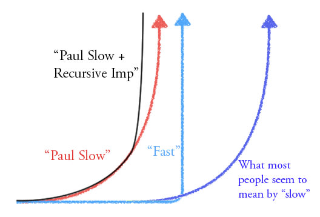

%%
Add discussion note here:

...

%%

For a long time, when I heard "slow takeoff", I assumed it meant "takeoff that takes longer calendar time than fast takeoff." (i.e. what is now referred to more often as "short timelines" vs "long timelines."). I think Paul Christiano popularized the term, and it so happened he both expected to see longer timelines and smoother/continuous takeoff.

I think it's at least somewhat confusing to use the term "slow" to mean "smooth/continuous", because that's not what "slow" particularly means most of the time.

I think it's even more actively confusing because "smooth/continuous" takeoff not only _could_ be faster in calendar time, but, I'd weakly expect this on average, since smooth takeoff means that AI resources at a given time are feeding into more AI resources, whereas sharp/discontinuous takeoff would tend to mean "AI tech doesn't get seriously applied towards AI development until towards the end."

I don't think this is academic[^note-1].

I think this has wasted a ton of time arguing past each other on LessWrong, and if "slow/fast" is the terminology that policy makers are hearing as they start to tune into the AI situation, it is predictably going to cause them confusion, at least waste their time, and quite likely lead many of them to approach the situation through misleading strategic frames that conflate smoothness and timelines.

Way back in [Arguments about fast takeoff](https://www.lesswrong.com/posts/AfGmsjGPXN97kNp57/arguments-about-fast-takeoff?commentId=phQ3sZj7RmCDTjfvn), I argued that this was a bad term, and proposed "smooth" and "sharp" takeoff were better terms. I'd also be fine with "hard" and soft" takeoff. I think "Hard/Soft" have somewhat more historical use, and maybe are less likely to get misheard as "short", so maybe use those.[^note-2]

I am annoyed that 7 years later people are still using "slow" to mean "maybe faster than 'fast'." This is stupid. Please stop. I think smooth/sharp and hard/soft are both fairly intuitive (at the very least, more intuitive than slow/fast, and people who are already familiar with the technical meaning of slow/fast will figure it out).

I would be fine with "continuous" and "discontinuous", but, realistically, I do not expect people to stick to those because they are too many syllables. 

Please, for the love of god, do not keep using a term that people will predictably misread as implying longer timelines. I expect this to have real-world consequences. If someone wants to operationalize a bet about it having significant real-world consequences I would bet money on it.

The graph I posted in response to [Arguments about fast takeoff](https://www.lesswrong.com/posts/AfGmsjGPXN97kNp57/arguments-about-fast-takeoff) 

[^note-1]: a term that ironically means "pointlessly pedantic."
[^note-2]: the last time I tried to write this post, 3 years ago, I got stuck on whether to argue for smooth/sharp or hard/soft and then I didn't end up posting it at all and I regret that.
