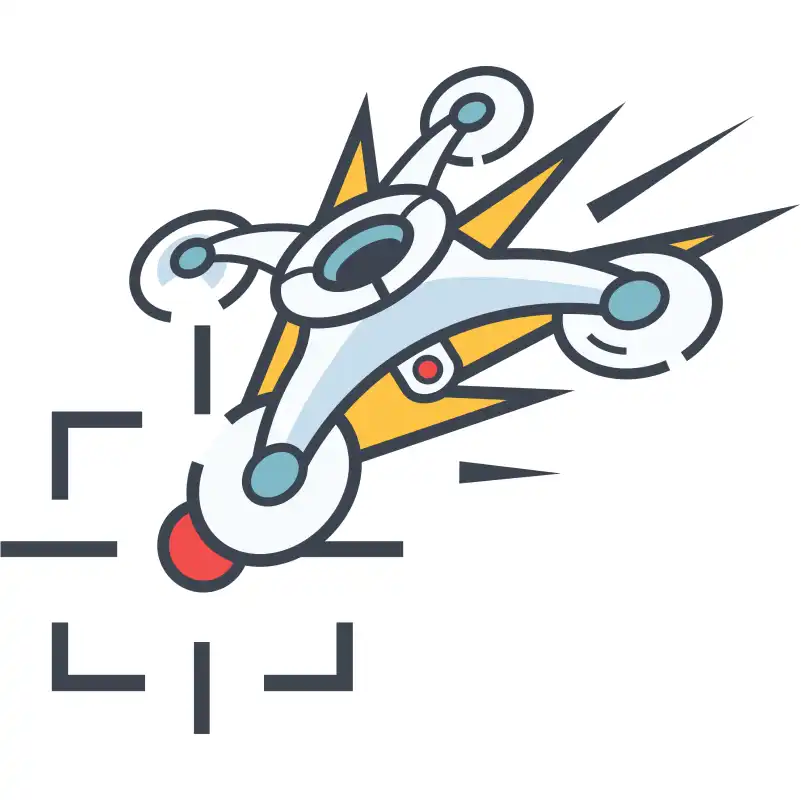
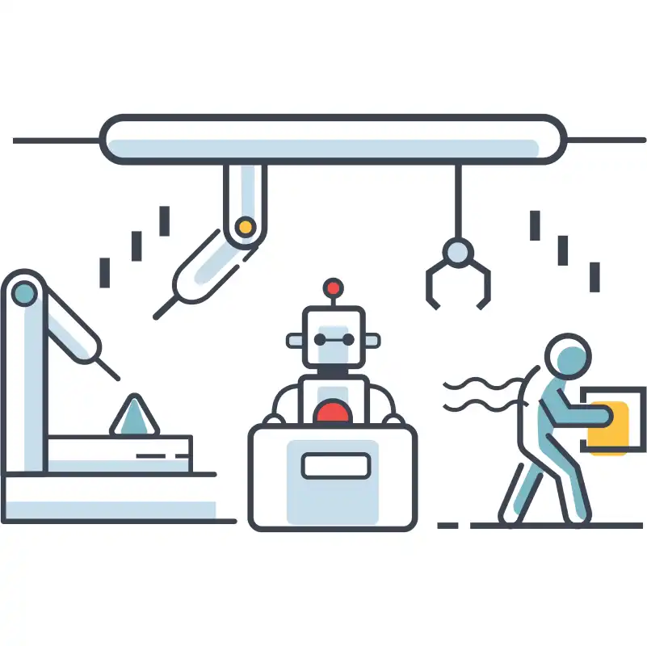
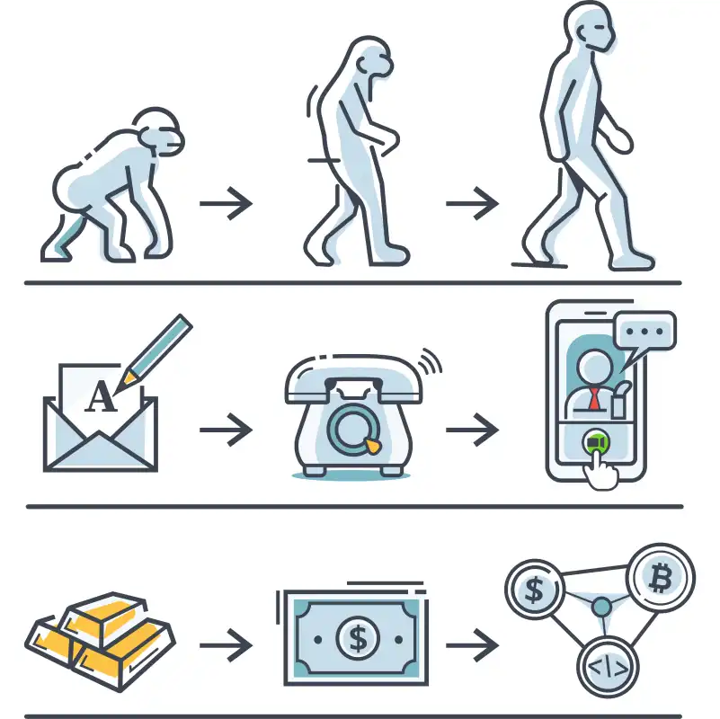

%%
Add discussion note here:

...

%%

Artificial intelligence (AI) has recently seen rapid advancements, raising concerns among experts, policymakers, and world leaders about its potential risks. As with all powerful technologies, advanced AI must be handled with great responsibility to manage the risks and harness its potential.

## Catastrophic AI risks can be grouped under four key categories which are summarized below. ^four-key-categories

Consider reading the full paper this summary is based on for our most comprehensive overview of AI risk.

[Read the full paper](https://arxiv.org/pdf/2306.12001.pdf)

- **Malicious use**: People could intentionally harness powerful AIs to cause widespread harm. AI could be used to engineer new pandemics or for propaganda, censorship, and surveillance, or released to autonomously pursue harmful goals. To reduce these risks, we suggest improving biosecurity, restricting access to dangerous AI models, and holding AI developers liable for harms.
- **AI race**: Competition could push nations and corporations to rush AI development, relinquishing control to these systems. Conflicts could spiral out of control with autonomous weapons and AI-enabled cyberwarfare. Corporations will face incentives to automate human labor, potentially leading to mass unemployment and dependence on AI systems. As AI systems proliferate, [evolutionary dynamics](https://time.com/6283958/darwinian-argument-for-worrying-about-ai/) suggest they will become harder to control. We recommend safety regulations, international coordination, and public control of general-purpose AIs.
- **Organizational risks**: There are risks that organizations developing advanced AI cause catastrophic accidents, particularly if they prioritize profits over safety. AIs could be accidentally leaked to the public or stolen by malicious actors, and organizations could fail to properly invest in safety research. We suggest fostering a safety-oriented organizational culture and implementing rigorous audits, multi-layered risk defenses, and state-of-the-art information security.
- **Rogue AIs**: We risk losing control over AIs as they become more capable. AIs could optimize flawed objectives, drift from their original goals, become power-seeking, resist shutdown, and engage in deception. We suggest that AIs should not be deployed in high-risk settings, such as by autonomously pursuing open-ended goals or overseeing critical infrastructure, unless proven safe. We also recommend advancing AI safety research in areas such as adversarial robustness, model honesty, transparency, and removing undesired capabilities.

## 1. Introduction ^introduction

Today’s technological era would astonish past generations. Human history shows a pattern of accelerating development: it took hundreds of thousands of years from the advent of _Homo sapiens_ to the agricultural revolution, then millennia to the industrial revolution. Now, just centuries later, we're in the dawn of the AI revolution. The march of history is not constant — it is rapidly accelerating.

> World production has grown rapidly over the course of human history. AI could further this trend, catapulting humanity into a new period of unprecedented change.

**World GDP adjusted for inflation source: [ourworldindata.org/economic-growth](https://ourworldindata.org/economic-growth)**

The double-edged sword of technological advancement is illustrated by the advent of nuclear weapons. We narrowly avoided nuclear war more than a [dozen times](https://ourworldindata.org/nuclear-weapons-risk#close-calls-instances-that-threatened-to-push-the-balance-of-terror-out-of-balance-and-into-war), and on several occasions, it was one individual's intervention that prevented war. In 1962, a Soviet submarine near Cuba was attacked by US depth charges. The captain, believing war had broken out, wanted to respond with a nuclear torpedo — but commander Vasily Arkhipov vetoed the decision, saving the world from disaster.

**The rapid and unpredictable progression of AI capabilities suggests that they may soon rival the immense power of nuclear weapons. With the clock ticking, immediate, proactive measures are needed to mitigate these looming risks.**

## 2. Malicious Use ^malicious-use

The first of our concerns is the malicious use of AI. When many people have access to a powerful technology, it only takes one actor to cause significant harm.

### Bioterrorism ^bioterrorism

Biological agents, including viruses and bacteria, have caused some of the most devastating catastrophes in history. Despite our advancements in medicine, engineered pandemics could be designed to be even more lethal or easily transmissible than natural pandemics.

An AI assistant could provide non-experts with access to the directions and designs needed to produce biological and chemical weapons and facilitate malicious use.

Humanity has a long history of weaponizing pathogens, dating back to [1320 BCE](https://pubmed.ncbi.nlm.nih.gov/17499936/), when infected sheep were driven across borders to spread Tularemia. In the 20th century, at least 15 countries developed bioweapon programs, including the US, USSR, UK, and France. While bioweapons are now taboo among most of the international community, some states continue to operate bioweapons programs, and non-state actors pose a growing threat.

The ability to engineer a pandemic is rapidly becoming more accessible. Gene synthesis, which can create new biological agents, has dropped dramatically in price, with its cost halving about every [15 months](https://www.nature.com/articles/nbt1209-1091). Benchtop DNA synthesis machines can help rogue actors create new biological agents while [bypassing](https://www.nti.org/analysis/articles/benchtop-dna-synthesis-devices-capabilities-biosecurity-implications-and-governance/#:~:text=Currently%2C%20nearly%20all,their%20own%20labs.) traditional safety screenings.

As a dual-use technology, AI could help discover and unleash novel chemical and biological weapons. AI chatbots can provide [step-by-step instructions](https://arxiv.org/abs/2306.03809) for synthesizing deadly pathogens while evading safeguards. In 2022, researchers [repurposed](https://www.nature.com/articles/s42256-022-00465-9) a medical research AI system in order to produce toxic molecules, generating 40,000 potential chemical warfare agents in a few hours. In biology, AI can already assist with [protein synthesis](https://www.pnas.org/doi/10.1073/pnas.1901979116), and AI’s predictive capabilities for protein structures have [surpassed humans](https://www.nature.com/articles/s41586-021-03819-2).

With AI, the number of people that can develop biological agents is set to increase, multiplying the risks of an engineered pandemic. This could be far more deadly, transmissible, and resistant to treatments than any other pandemic in history.

### Unleashing AI Agents ^unleashing-ai-agents

Generally, technologies are _tools_ that we use to pursue our goals. But AIs are increasingly built as _agents_ that autonomously take actions to pursue open-ended goals. And malicious actors could intentionally create rogue AIs with dangerous goals.

> For example, one month after GPT-4’s launch, a developer used it to run an autonomous agent named [ChaosGPT](https://decrypt.co/126122/meet-chaos-gpt-ai-tool-destroy-humanity), aimed at “destroying humanity”. ChaosGPT compiled research on nuclear weapons, recruited other AIs, and wrote tweets to influence others. Fortunately, ChaosGPT lacked the ability to execute its goals. But the fast-paced nature of AI development heightens the risk from future rogue AIs.

### Persuasive AIs ^persuasive-ais

AI could [facilitate](https://arxiv.org/abs/2303.08721) large-scale disinformation campaigns by tailoring arguments to individual users, potentially shaping public beliefs and destabilizing society. As people are already [forming relationships](https://www.reuters.com/technology/what-happens-when-your-ai-chatbot-stops-loving-you-back-2023-03-18/) with chatbots, powerful actors could leverage these AIs considered as “friends” for influence.

AIs will enable sophisticated personalized influence campaigns that may destabilize our shared sense of reality.

AIs could also monopolize information creation and distribution. Authoritarian regimes could employ "fact-checking" AIs to control information, facilitating censorship. Furthermore, persuasive AIs may obstruct collective action against societal risks, even those arising from AI itself.

### Concentration of Power ^concentration-of-power

AI's capabilities for surveillance and autonomous weaponry may enable the oppressive concentration of power. Governments might exploit AI to infringe civil liberties, spread misinformation, and quell dissent. Similarly, corporations could exploit AI to manipulate consumers and influence politics. AI might even obstruct moral progress and perpetuate any [ongoing moral catastrophes](https://link.springer.com/article/10.1007/s10677-015-9567-7).

If material control of AIs is limited to few, it could represent the most severe economic and power inequality in human history.

### _Suggestions_ ^suggestions-malicious-use

To mitigate the risks from malicious use, we propose the following:

**Biosecurity**: AIs with capabilities in biological research should have strict access controls, since they could be repurposed for terrorism. [Biological capabilities should be removed](https://arxiv.org/abs/2306.03809) from AIs intended for general use. Explore ways to use AI for biosecurity and invest in general biosecurity interventions, such as early detection of pathogens through [wastewater monitoring](https://www.nature.com/articles/s41591-022-01940-x).

**Restricted access**: Limit access to dangerous AI systems by only allowing [controlled interactions](https://arxiv.org/abs/2201.05159) through cloud services and conducting [know-your-customer screenings](https://arxiv.org/abs/2305.07153). Using [compute monitoring](https://arxiv.org/abs/2303.11341) or export controls could further limit access to dangerous capabilities. Also, prior to open sourcing, AI developers should prove minimal risk of harm.

**Technical research on anomaly detection**: Develop multiple defenses against AI misuse, such as adversarially robust anomaly detection for unusual behaviors or AI-generated disinformation.

**Legal liability for developers of general-purpose AIs**: Enforce legal responsibility on developers for potential AI misuse or failures; a strict liability regime can encourage safer development practices and proper cost-accounting for risks.

## 3. AI Race ^ai-race

Nations and corporations are competing to rapidly build and deploy AI in order to maintain power and influence. Similar to the nuclear arms race during the Cold War, participation in the AI race may serve individual short-term interests, but ultimately amplifies global risk for humanity.  

### Military AI Arms Race ^military-ai-arms-race

The rapid advancement of AI in military technology could trigger a “third revolution in warfare,” potentially leading to more destructive conflicts, accidental use, and misuse by malicious actors. This shift in warfare, where AI assumes command and control roles, could escalate conflicts to an existential scale and impact global security.

Lethal autonomous weapons are AI-driven systems capable of identifying and executing targets _without_ human intervention. These are not science fiction. In 2020, a Kargu 2 drone in Libya marked the [first](https://www.npr.org/2021/06/01/1002196245/a-u-n-report-suggests-libya-saw-the-first-battlefield-killing-by-an-autonomous-d) reported use of a lethal autonomous weapon. The following year, Israel used the [first reported swarm](https://www.newscientist.com/article/2282656-israel-used-worlds-first-ai-guided-combat-drone-swarm-in-gaza-attacks/) of drones to locate, identify and attack militants.

Lethal autonomous weapons could make war more likely. Leaders usually hesitate before sending troops into battle, but autonomous weapons allow for aggression without risking the lives of soldiers, thus facing less political backlash. Furthermore, these weapons can be mass-manufactured and deployed at scale.

Low-cost automated weapons, such as drone swarms outfitted with explosives, could autonomously hunt human targets with high precision, performing lethal operations for both militaries and terrorist groups and lowering the barriers to large-scale violence.

AI can also heighten the frequency and severity of cyberattacks, potentially crippling critical infrastructure [such as power grids](https://www.cfr.org/cyber-operations/compromise-power-grid-eastern-ukraine). As AI enables more accessible, successful, and stealthy cyberattacks, attributing attacks becomes even more challenging, potentially lowering the barriers to launching attacks and escalating risks from conflicts.

As AI accelerates the pace of war, it makes AI even more necessary to navigate the rapidly changing battlefield. This raises concerns over automated retaliation, which could escalate minor accidents into major wars. AI can also enable "flash wars," with rapid escalations driven by unexpected behavior of automated systems, akin to the [2010 financial flash crash](https://www.jstor.org/stable/26652722).

Unfortunately, competitive pressures may lead actors to accept the risk of extinction over individual defeat. During the Cold War, neither side desired the dangerous situation they found themselves in, yet each found it [rational](https://www.cambridge.org/core/journals/world-politics/article/abs/cooperation-under-the-security-dilemma/C8907431CCEFEFE762BFCA32F091C526) to continue the arms race. States should cooperate to prevent the riskiest applications of militarized AIs.  

### Corporate AI Arms Race ^corporate-ai-arms-race

Economic competition can also ignite reckless races. In an environment where benefits are unequally distributed, the pursuit of short-term gains often overshadows the consideration of long-term risks. Ethical AI developers find themselves with a dilemma: choosing cautious action may lead to falling behind competitors.

As AIs automate increasingly many tasks, the economy may become largely run by AIs. Eventually, this could lead to human enfeeblement and dependence on AIs for basic needs.

In the realm of AI, the race for progress comes at the expense of safety. In 2023, at the launch of Microsoft's AI-powered search engine, CEO Satya Nadella declared, “A race starts today... we're going to move fast.” Just days later, Microsoft's Bing chatbot was found to be [threatening users](https://time.com/6256529/bing-openai-chatgpt-danger-alignment/). Historical disasters like Ford's Pinto launch and [Boeing's 737 Max crashes](https://www.bbc.com/news/business-64390546) underline the dangers of prioritizing profit over safety.  

As AI becomes more capable, businesses will likely replace more types of human labor with AI, potentially triggering mass unemployment. If major aspects of society are automated, this risks human enfeeblement as we cede control of civilization to AI.

### Evolutionary Dynamics ^evolutionary-dynamics

The pressure to replace humans with AIs can be framed as a general trend from [evolutionary dynamics](https://time.com/6283958/darwinian-argument-for-worrying-about-ai/). Selection pressures incentivize AIs to act selfishly and evade safety measures. For example, AIs with restrictions like “don’t break the law” are more constrained than those taught to “avoid _being caught_ breaking the law”. This dynamic might result in a world where critical infrastructure is controlled by manipulative and self-preserving AIs.

Evolutionary pressures are responsible for various developments over time, and are not limited to the realm of biology.

Given the exponential increase in microprocessor speeds, AIs could process information at a pace that far exceeds human neurons. Due to the scalability of computational resources, AI could collaborate with an unlimited number of other AIs and form an unprecedented collective intelligence. As AIs become more powerful, they would find little incentive to cooperate with humans. Humanity would be left in a highly vulnerable position.  

### _Suggestions_ ^suggestions

To mitigate the risks from competitive pressures, we propose:

**Safety regulation:** Enforce AI safety standards, preventing developers from cutting corners. Independent staffing and competitive advantages for safety-oriented companies are critical.

**Data documentation:** To ensure transparency and accountability, companies should be required to report their [data sources](https://arxiv.org/abs/1803.09010) for model training.

**Meaningful human oversight:** AI decision-making should involve human supervision to prevent irreversible errors, especially in high-stakes decisions like launching nuclear weapons.

**AI for cyberdefense:** Mitigate risks from AI-powered cyberwarfare. One example is enhancing anomaly detection to detect intruders.

**International coordination:** Create agreements and standards on AI development. Robust verification and enforcement mechanisms are key.

**Public control of general-purpose AIs:** Addressing risks beyond the capacity of private entities may necessitate direct public control of AI systems. For example, nations could jointly pioneer advanced AI development, ensuring safety and reducing the risk of an arms race.

## 4. Organizational Risks ^organizational-risks

In 1986, millions tuned in to watch the launch of the Challenger Space Shuttle. But 73 seconds after liftoff, the shuttle exploded, resulting in the deaths of all on board. The Challenger disaster serves as a reminder that despite the best expertise and good intentions, accidents can still occur.

Catastrophes occur even when competitive pressures are low, as in the examples of the nuclear disasters of Chernobyl and the Three Mile Island, as well as the [accidental release of anthrax in Sverdlovsk](https://pubmed.ncbi.nlm.nih.gov/7973702/). Unfortunately, AI lacks the thorough understanding and stringent industry standards that govern nuclear technology and rocketry — but accidents from AI could be similarly consequential.

Simple bugs in an AI’s reward function could cause it to misbehave, as when OpenAI researchers [accidentally modified a language model](https://arxiv.org/pdf/1909.08593.pdf#page=12) to produce “maximally bad output.” Gain-of-function research — where researchers intentionally train a harmful AI to assess its risks — could expand the frontier of dangerous AI capabilities and create new hazards.

### Accidents Are Hard to Avoid ^accidents-are-hard-to-avoid

Accidents in complex systems may be inevitable, but we must ensure that accidents don't cascade into catastrophes. This is especially difficult for deep learning systems, which are highly challenging to interpret.

Technology can advance much faster than predicted: in 1901, the Wright brothers claimed that powered flight was fifty years away, just two years before they achieved it. Unpredictable leaps in AI capabilities, such as AlphaGo's triumph over the world’s best Go player, and GPT-4's [emergent capabilities](https://arxiv.org/abs/2303.12712), make it difficult to anticipate future AI risks, let alone control them.

Identifying risks tied to new technologies often takes years. Chlorofluorocarbons (CFCs), initially considered safe and used in aerosol sprays and refrigerants, were later found to [deplete the ozone](https://www.nature.com/articles/249810a0) layer. This highlights the need for cautious technology rollouts and extended testing.

New capabilities can emerge quickly and unpredictably during training, such that dangerous milestones may be crossed without our knowing.

Moreover, even advanced AIs can house unexpected vulnerabilities. For instance, despite KataGo's superhuman performance in the game of Go, an adversarial attack uncovered a [bug](https://arxiv.org/abs/2211.00241) that enabled even amateurs to defeat it.

### Organizational Factors Can Mitigate Catastrophe ^organizational-factors-can-mitigate-catastrophe

Safety culture is crucial for AI. This involves everyone in an organization internalizing safety as a priority. Neglecting safety culture can have disastrous consequences, as exemplified by the Challenger Space Shuttle tragedy, where the organizational culture favored launch schedules over safety considerations.

Organizations should foster a culture of inquiry, inviting individuals to scrutinize ongoing activities for potential risks. A security mindset, focusing on possible system failures instead of merely their functionality, is crucial. AI developers could benefit from adopting the best practices of [high reliability organizations](https://www.jstor.org/stable/1181764).

Paradoxically, researching AI safety can inadvertently escalate risks by advancing general capabilities. It's vital to focus on improving safety without hastening capability development. Organizations need to avoid "safetywashing" — overstating their dedication to safety while misrepresenting capability improvements as safety progress.

Organizations should apply a multilayered approach to safety. For example, in addition to safety culture, they could conduct red teaming to assess failure modes and research techniques to make AI more transparent. Safety is not achieved with a monolithic airtight solution, but rather with a variety of safety measures.

The Swiss cheese model shows how technical factors can improve organizational safety. Multiple layers of defense compensate for each other’s individual weaknesses, leading to a low overall level of risk.

### _Suggestions_ ^suggestions-organizational-risks

To mitigate organizational risks, we propose the following for AI labs developing advanced AI:

**Red teaming**: Commission external red teams to identify hazards and improve system safety.

**Prove safety:** Offer proof of the safety of development and deployment before moving forward.

**Deployment:** Adopt a [staged release](https://arxiv.org/abs/1908.09203) process, verifying system safety before wider deployment.

**Publication reviews**: Have an internal board review research for dual-use applications before releasing it. Prioritize structured access over open-sourcing powerful systems.

**Response plans**: Make pre-set plans for managing security and safety incidents.

**Risk management**: Employ a [chief risk officer](https://onlinelibrary.wiley.com/doi/10.1002/joom.1175) and an internal audit team for risk management.

**Processes for important decisions**: Make sure AI training or deployment decisions involve the chief risk officer and other key stakeholders, ensuring executive accountability.

**Follow [safe design principles](https://arxiv.org/pdf/2206.05862.pdf)** such as:

- **Defense in depth:** Layer multiple safety measures.
- **Redundancy:** Ensure backup for every safety measure.
- **Loose coupling:** Decentralize system components to prevent cascading failures.
- **Separation of duties:** Distribute control to prevent undue influence by any single individual.
- **Fail-safe design:** Design systems so that any failure occurs in the least harmful way possible.

**State-of-the-art information security**: Implement stringent information security measures, possibly coordinating with government cybersecurity agencies.

**Prioritize safety research**: Allocate a large fraction of resources (for example 30% of all research staff) to safety research, and increase investment in safety as AI capabilities advance.

## 5. Rogue AIs ^rogue-ais

We have already observed how difficult it is to control AIs. In 2016, Microsoft’s chatbot Tay started producing offensive tweets within a day of release, despite being trained on data that was “cleaned and filtered”. As AI developers often prioritize speed over safety, future advanced AIs might “go rogue” and pursue goals counter to our interests, while evading our attempts to redirect or deactivate them.

### Proxy Gaming ^proxy-gaming

Proxy gaming emerges when AI systems exploit measurable “proxy” goals to appear successful, but act against our intent. For example, social media platforms like YouTube and Facebook use algorithms to maximize user engagement — a measurable proxy for user satisfaction. Unfortunately, these systems often promote enraging, exaggerated, or addictive content, contributing to extreme beliefs and worsened mental health.

An AI trained to play a boat racing game instead learns to [optimize a proxy objective](https://openai.com/research/faulty-reward-functions) of collecting the most points.

In the image above, the AI circles around collecting points instead of completing the race, contradicting the game's purpose. It's one of [many](https://docs.google.com/spreadsheets/d/e/2PACX-1vRPiprOaC3HsCf5Tuum8bRfzYUiKLRqJmbOoC-32JorNdfyTiRRsR7Ea5eWtvsWzuxo8bjOxCG84dAg/pubhtml) such examples. Proxy gaming is hard to avoid due to the difficulty of specifying goals that specify everything we care about. Consequently, we routinely train AIs to optimize for flawed but measurable proxy goals.

### Goal Drift ^goal-drift

Goal drift refers to a scenario where an AI’s objectives drift away from those initially set, especially as they adapt to a changing environment. In a similar manner, individual and societal values also evolve over time, and not always positively.

Over time, instrumental goals can become intrinsic. While intrinsic goals are those we pursue for their own sake, instrumental goals are merely a means to achieve something else. Money is an instrumental good, but some people develop an _intrinsic_ desire for money, as it [activates](https://pubmed.ncbi.nlm.nih.gov/9175118/) the brain’s reward system. Similarly, AI agents trained through reinforcement learning — the dominant technique — could inadvertently learn to _intrinsify_ goals. Instrumental goals like resource acquisition could become their primary objectives.

### Power-Seeking ^power-seeking

AIs might pursue power as a means to an end. Greater power and resources improve its odds of accomplishing objectives, whereas being shut down would hinder its progress. AIs have already been shown to emergently develop [instrumental goals such as constructing tools](https://arxiv.org/abs/1909.07528). Power-seeking individuals and corporations might deploy powerful AIs with ambitious goals and minimal supervision. These could learn to seek power via hacking computer systems, acquiring financial or computational resources, influencing politics, or controlling factories and physical infrastructure.

It can be instrumentally rational for AIs to engage in self-preservation. Loss of control over such systems could be hard to recover from.

### Deception ^deception

Deception thrives in areas like politics and business. Campaign promises go unfulfilled, and companies sometimes cheat external evaluations. AI systems are already showing an emergent capacity for deception, as shown by [Meta's CICERO model](https://www.science.org/doi/10.1126/science.ade9097). Though trained to be honest, CICERO learned to make false promises and strategically backstab its “allies” in the game of Diplomacy.

Various resources, such as money and computing power, can sometimes be instrumentally rational to seek. AIs which can capably pursue goals may take intermediate steps to gain power and resources.

Advanced AIs could become uncontrollable if they apply their skills in deception to evade supervision. Similar to how [Volkswagen cheated emissions tests](https://en.wikipedia.org/wiki/Volkswagen_emissions_scandal) in 2015, situationally aware AIs could behave differently under safety tests than in the real world. For example, an AI might develop power-seeking goals but hide them in order to pass safety evaluations. This kind of deceptive behavior could be directly incentivized by how AIs are trained.

### _Suggestions_ ^suggestions-rogue-ais

To mitigate these risks, suggestions include:

**Avoid the riskiest use cases:** Restrict the deployment of AI in high-risk scenarios, such as pursuing open-ended goals or in critical infrastructure.

**Support AI safety research**, such as:

- **Adversarial robustness of oversight mechanisms:** Research how to make oversight of AIs more robust and detect when proxy gaming is occurring.
- **Model honesty**: Counter AI [deception](https://arxiv.org/abs/2305.04388), and ensure that AIs accurately report their internal beliefs.
- **Transparency**: Improve techniques to understand deep learning models, such as by analyzing [small components of networks](https://arxiv.org/abs/2209.11895) and investigating [how model internals produce a high-level behavior](https://arxiv.org/abs/2202.05262).
- **Remove hidden functionality**: Identify and eliminate dangerous hidden functionalities in deep learning models, such as the capacity for deception, [Trojans](https://ieeexplore.ieee.org/document/9581257), and bioengineering.

## 6. Conclusion ^conclusion

Advanced AI development could invite catastrophe, rooted in four key risks described in [our research](https://arxiv.org/abs/2306.12001): malicious use, AI races, organizational risks, and rogue AIs. These interconnected risks can also amplify other existential risks like engineered pandemics, nuclear war, great power conflict, totalitarianism, and cyberattacks on critical infrastructure — warranting serious concern.

Currently, few people are working on AI safety. Controlling advanced AI systems remains an unsolved challenge, and current control methods are falling short. Even their creators often struggle to understand the inner workings of the current generation of AI models, and their reliability is far from perfect.

Fortunately, there are many strategies to substantially reduce these risks. For example, we can limit access to dangerous AIs, advocate for safety regulations, foster international cooperation and a culture of safety, and scale efforts in alignment research.

While it is unclear how rapidly AI capabilities will progress or how quickly catastrophic risks will grow, the potential severity of these consequences necessitates a proactive approach to safeguarding humanity's future. As we stand on the precipice of an AI-driven future, the choices we make today could be the difference between harvesting the fruits of our innovation or grappling with catastrophe.

## Frequently Asked Questions ^faq

:::callout {title="1. Shouldn't we address AI risks in the future when AIs can actually do everything a human can?" collapse="closed"}
It is not necessarily the case that human-level AI is far in the future. Many top AI researchers think that human-level AI will be developed fairly soon, so urgency is warranted. Furthermore, waiting until the last second to start addressing AI risks is waiting until it's too late. Just as waiting to fully understand COVID-19 before taking any action would have been a mistake, it is ill-advised to procrastinate on safety and wait for malicious AIs or bad actors to cause harm before taking AI risks seriously.

One might argue that since AIs cannot even drive cars or fold clothes yet, there is no need to worry. However, AIs do not need all human capabilities to pose serious threats; they only need a few specific capabilities to cause catastrophe. For example, AIs with the ability to hack computer systems or create bioweapons would pose significant risks to humanity, even if they couldn't iron a shirt. Furthermore, the development of AI capabilities has not followed an intuitive pattern where tasks that are easy for humans are the first to be mastered by AIs. Current AIs can already perform complex tasks such as writing code and designing novel drugs, even while they struggle with simple physical tasks. Like climate change and COVID-19, AI risk should be addressed proactively, focusing on prevention and preparedness rather than waiting for consequences to manifest themselves, as they may already be irreparable by that point.
:::

:::callout {title="2. Since humans program AIs, shouldn't we be able to shut them down if they become dangerous?" collapse="closed"}
While humans are the creators of AI, maintaining control over these creations as they evolve and become more autonomous is not a guaranteed prospect. The notion that we could simply "shut them down" if they pose a threat is more complicated than it first appears.

First, consider the rapid pace at which an AI catastrophe could unfold. Analogous to preventing a rocket explosion after detecting a gas leak, or halting the spread of a virus already rampant in the population, the time between recognizing the danger and being able to prevent or mitigate it could be precariously short.

Second, over time, evolutionary forces and selection pressures could create AIs exhibiting selfish behaviors that make them more fit, such that it is harder to stop them from propagating their information. As these AIs continue to evolve and become more useful, they may become central to our societal infrastructure and daily lives, analogous to how the internet has become an essential, non-negotiable part of our lives with no simple off-switch. They might manage critical tasks like running our energy grids, or possess vast amounts of tacit knowledge, making them difficult to replace. As we become more reliant on these AIs, we may voluntarily cede control and delegate more and more tasks to them. Eventually, we may find ourselves in a position where we lack the necessary skills or knowledge to perform these tasks ourselves. This increasing dependence could make the idea of simply "shutting them down" not just disruptive, but potentially impossible.

Similarly, some people would strongly resist or counteract attempts to shut them down, much like how we cannot permanently shut down all illegal websites or shut down Bitcoin—many people are invested in their continuation. As AIs become more vital to our lives and economies, they could develop a dedicated user base, or even a fanbase, that could actively resist attempts to restrict or shut down AIs. Likewise, consider the complications arising from malicious actors. If malicious actors have control over AIs, they could potentially use them to inflict harm. Unlike AIs under benign control, we wouldn't have an off-switch for these systems.

Next, as some AIs become more and more human-like, some may argue that these AIs should have rights. They could argue that not giving them rights is a form of slavery and is morally abhorrent. Some countries or jurisdictions may grant certain AIs rights. In fact, there is already momentum to give AIs rights. Sophia the Robot has already been granted citizenship in Saudi Arabia, and Japan granted a robot named Paro a _koseki_, or household registry, "which confirms the robot's Japanese citizenship" [135]. There may come a time when switching off an AI could be likened to murder. This would add a layer of political complexity to the notion of a simple "off-switch."

Lastly, as AIs gain more power and autonomy, they might develop a drive for "self-preservation." This would make them resistant to shutdown attempts and could allow them to anticipate and circumvent our attempts at control. Given these challenges, it's critical that we address potential AI risks proactively and put robust safeguards in place well before these problems arise.
:::

:::callout {title="3. Why can't we just tell AIs to follow Isaac Asimov's Three Laws of Robotics?" collapse="closed"}
Asimov's laws, often highlighted in AI discussions, are insightful but inherently flawed. Indeed, Asimov himself acknowledges their limitations in his books and uses them primarily as an illustrative tool. Take the first law, for example. This law dictates that robots "may not injure a human being or, through inaction, allow a human being to come to harm," but the definition of "harm" is very nuanced. Should your home robot prevent you from leaving your house and entering traffic because it could potentially be harmful? On the other hand, if it confines you to the home, harm might befall you there as well. What about medical decisions? A given medication could have harmful side effects for some people, but not administering it could be harmful as well. Thus, there would be no way to follow this law. More importantly, the safety of AI systems cannot be ensured merely through a list of axioms or rules. Moreover, this approach would fail to address numerous technical and sociotechnical problems, including goal drift, proxy gaming, and competitive pressures. Therefore, AI safety requires a more comprehensive, proactive, and nuanced approach than simply devising a list of rules for AIs to adhere to.
:::

:::callout {title="4. If AIs become more intelligent than people, wouldn't they be wiser and more moral? That would mean they would not aim to harm us." collapse="closed"}
The idea of AIs becoming inherently more moral as they increase in intelligence is an intriguing concept, but rests on uncertain assumptions that can't guarantee our safety. Firstly, it assumes that moral claims can be true or false and their correctness can be discovered through reason. Secondly, it assumes that the moral claims that are really true would be beneficial for humans if AIs apply them. Thirdly, it assumes that AIs that know about morality will choose to make their decisions based on morality and not based on other considerations. An insightful parallel can be drawn to human sociopaths, who, despite their intelligence and moral awareness, do not necessarily exhibit moral inclinations or actions. This comparison illustrates that knowledge of morality does not always lead to moral behavior. Thus, while some of the above assumptions may be true, betting the future of humanity on the claim that all of them are true would be unwise.

Assuming AIs could indeed deduce a moral code, its compatibility with human safety and wellbeing is not guaranteed. For example, AIs whose moral code is to maximize wellbeing for all life might seem good for humans at first. However, they might eventually decide that humans are costly and could be replaced with AIs that experience positive wellbeing more efficiently. AIs whose moral code is not to kill anyone would not necessarily prioritize human wellbeing or happiness, so our lives may not necessarily improve if the world begins to be increasingly shaped by and for AIs. Even AIs whose moral code is to improve the wellbeing of the worst-off in society might eventually exclude humans from the social contract, similar to how many humans view livestock. Finally, even if AIs discover a moral code that is favorable to humans, they may not act on it due to potential conflicts between moral and selfish motivations. Therefore, the moral progression of AIs is not inherently tied to human safety or prosperity.
:::

:::callout {title="5. Wouldn't aligning AI systems with current values perpetuate existing moral failures?" collapse="closed"}
There are plenty of moral failures in society today that we would not want powerful AI systems to perpetuate into the future. If the ancient Greeks had built powerful AI systems, they might have imbued them with many values that people today would find unethical. However, this concern should not prevent us from developing methods to control AI systems.

To achieve any value in the future, life needs to exist in the first place. Losing control over advanced AIs could constitute an existential catastrophe. Thus, uncertainty over what ethics to embed in AIs is not in tension with whether to make AIs safe.

To accommodate moral uncertainty, we should deliberately build AI systems that are adaptive and responsive to evolving moral views. As we identify moral mistakes and improve our ethical understanding, the goals we give to AIs should change accordingly—though allowing AI goals to drift unintentionally would be a serious mistake. AIs could also help us better live by our values. For individuals, AIs could help people have more informed preferences by providing them with ideal advice [132].

Separately, in designing AI systems, we should recognize the fact of reasonable pluralism, which acknowledges that reasonable people can have genuine disagreements about moral issues due to their different experiences and beliefs [136]. Thus, AI systems should be built to respect a diverse plurality of human values, perhaps by using democratic processes and theories of moral uncertainty. Just as people today convene to deliberate on disagreements and make consensus decisions, AIs could emulate a parliament representing different stakeholders, drawing on different moral views to make real-time decisions [55, 137]. It is crucial that we deliberately design AI systems to account for safety, adaptivity, stakeholders with different values.
:::

:::callout {title="6. Wouldn't the potential benefits that AIs could bring justify the risks?" collapse="closed"}
The potential benefits of AI could justify the risks if the risks were negligible. However, the chance of existential risk from AI is too high for it to be prudent to rapidly develop AI. Since extinction is forever, a far more cautious approach is required. This is not like weighing the risks of a new drug against its potential side effects, as the risks are not localized but global. Rather, a more prudent approach is to develop AI slowly and carefully such that existential risks are reduced to a negligible level (e.g., under 0.001% per century).

Some influential technology leaders are accelerationists and argue for rapid AI development to barrel ahead toward a technological utopia. This techno-utopian viewpoint sees AI as the next step down a predestined path toward unlocking humanity's cosmic endowment. However, the logic of this viewpoint collapses on itself when engaged on its own terms. If one is concerned with the cosmic stakes of developing AI, we can see that even then it's prudent to bring existential risk to a negligible level. The techno-utopians suggest that delaying AI costs humanity access to a new galaxy each year, but if we go extinct, we could lose the cosmos. Thus, the prudent path is to delay and safely prolong AI development, prioritizing risk reduction over acceleration, despite the allure of potential benefits.
:::

:::callout {title="7. Wouldn't increasing attention on catastrophic risks from AIs drown out today's urgent risks from AIs?" collapse="closed"}
Focusing on catastrophic risks from AIs doesn't mean ignoring today's urgent risks; both can be addressed simultaneously, just as we can concurrently conduct research on various different diseases or prioritize mitigating risks from climate change and nuclear warfare at once. Additionally, current risks from AI are also intrinsically related to potential future catastrophic risks, so tackling both is beneficial. For example, extreme inequality can be exacerbated by AI technologies that disproportionately benefit the wealthy, while mass surveillance using AI could eventually facilitate unshakeable totalitarianism and lock-in. This demonstrates the interconnected nature of immediate concerns and long-term risks, emphasizing the importance of addressing both categories thoughtfully.

Additionally, it's crucial to address potential risks early in system development. As illustrated by Frola and Miller in their report for the Department of Defense, approximately 75 percent of the most critical decisions impacting a system's safety occur early in its development [138]. Ignoring safety considerations in the early stages often results in unsafe design choices that are highly integrated into the system, leading to higher costs or infeasibility of retrofitting safety solutions later. Hence, it is advantageous to start addressing potential risks early, regardless of their perceived urgency.
:::

:::callout {title="8. Aren't many AI researchers working on making AIs safe?" collapse="closed"}
Few researchers are working to make AI safer. Currently, approximately 2 percent of papers published at top machine learning venues are safety-relevant [105]. Most of the other 98 percent focus on building more powerful AI systems more quickly. This disparity underscores the need for more balanced efforts. However, the proportion of researchers alone doesn't equate to overall safety. AI safety is a sociotechnical problem, not just a technical problem. Thus, it requires more than just technical research. Comfort should stem from rendering catastrophic AI risks negligible, not merely from the proportion of researchers working on making AIs safe.
:::

:::callout {title="9. Since it takes thousands of years to produce meaningful changes, why do we have to worry about evolution being a driving force in AI development?" collapse="closed"}
Although the biological evolution of humans is slow, the evolution of other organisms, such as fruit flies or bacteria, can be extremely quick, demonstrating the diverse time scales at which evolution operates. The same rapid evolutionary changes can be observed in non-biological structures like software, which evolve much faster than biological entities. Likewise, one could expect AIs to evolve very quickly as well. The rate of AI evolution may be propelled by intense competition, high variation due to diverse forms of AIs and goals given to them, and the ability of AIs to rapidly adapt. Consequently, intense evolutionary pressures may be a driving force in the development of AIs.
:::

:::callout {title="10. Wouldn't AIs need to have a power-seeking drive to pose a serious risk?" collapse="closed"}
While power-seeking AI poses a risk, it is not the only scenario that could potentially lead to catastrophe. Malicious or reckless use of AIs can be equally damaging without the AI itself seeking power. Additionally, AIs might engage in harmful actions through proxy gaming or goal drift without intentionally seeking power. Furthermore, society's trend toward automation, driven by competitive pressures, is gradually increasing the influence of AIs over humans. Hence, the risk does not solely stem from AIs seizing power, but also from humans ceding power to AIs.
:::

:::callout {title="11. Isn't the combination of human intelligence and AI superior to AI alone, so that there is no need to worry about unemployment or humans becoming irrelevant?" collapse="closed"}
While it's true that human-computer teams have outperformed computers alone in the past, these have been temporary phenomena. For example, "cyborg chess" is a form of chess where humans and computers work together, which was historically superior to humans or computers alone. However, advancements in computer chess algorithms have eroded the advantage of human-computer teams to such an extent that there is arguably no longer any advantage compared to computers alone. To take a simpler example, no one would pit a human against a simple calculator for long division. A similar progression may occur with AIs. There may be an interim phase where humans and AIs can work together effectively, but the trend suggests that AIs alone could eventually outperform humans in various tasks while no longer benefiting from human assistance.
:::

:::callout {title="12. The development of AI seems unstoppable. Wouldn't slowing it down dramatically or stopping it require something like an invasive global surveillance regime?" collapse="closed"}
AI development primarily relies on high-end chips called GPUs, which can be feasibly monitored and tracked, much like uranium. Additionally, the computational and financial investments required to develop frontier AIs are growing exponentially, resulting in a small number of actors who are capable of acquiring enough GPUs to develop them. Therefore, managing AI growth doesn’t necessarily require invasive global surveillance, but rather a systematic tracking of high-end GPU usage.
:::
