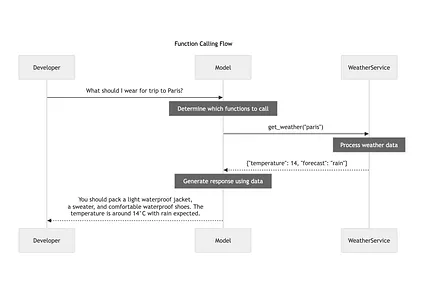
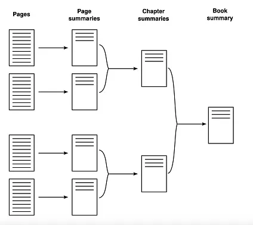

%%
Add discussion note here:

...

%%

“Scaffolding” is quite a broad term for ways of augmenting an AI model’s capabilities after it has been trained. It can result in sophisticated **agents** which perform more complicated, multi-step tasks than the original model. It typically doesn’t include fine-tuning or other methods that directly alter the model’s internals.

There are lots of different ways to make models more capable through scaffolding. These include giving them access to external tools (such as a code editor or web browser), and running “teams” of AIs that collaborate on a single problem.

## Types of AI scaffolding ^types-of-ai-scaffolding

Here are some different ways that the performance of an AI model can be improved through scaffolding (note that these methods can be combined with each other):

### Granting the model access to external tools ^granting-the-model-access

An obvious way to make an AI better at solving problems is giving it access to more tools. Large Language Models like ChatGPT and Claude were originally trained on a finite amount of data with a specific cut-off date, but were later [granted access to the internet](https://www.anthropic.com/news/web-search), for example. This has made them significantly more capable.

Users can integrate a wider range of external tools with an LLM using [function calling](https://chatgpt.com/c/6811f4f1-a4f0-8013-903d-c338b9dd87a6). This lets LLMs access external functions in order to retrieve data or take real-world actions. For example, a company might give an LLM access to a database of recent orders so that it can retrieve information about them, or to its internal scheduling system so that it can book meetings.

In this example, an AI model calls a function to retrieve current weather data so that it can answer a user’s prompt on packing for an upcoming trip:

### Getting the model to prompt itself ^getting-the-model-to

If you want a simple question-and-answer system like ChatGPT to help you complete a multi-step task, you’ll need to prompt it at each individual stage. Agent scaffolding techniques aim to automate this process by placing AI models in a “loop” with access to their own observations and actions, so that they can self-generate each prompt needed to finish the task. This method has been used to build systems including [AutoGPT](https://agpt.co/), which is a scaffolded version of OpenAI’s GPT-4, and [Devin](https://devin.ai/), a system designed to automate software engineering tasks.

### Letting AIs work together ^letting-ais-work-together

Multiple AIs may be able to solve more complex problems than a single model, just as humans can work together as a team. For example, AI models could [discuss solutions to a problem](https://arxiv.org/abs/2307.07924) through multi-turn dialogue, or one model could be tasked with proposing ideas and another with critiquing them. [Some research shows](https://arxiv.org/abs/2406.07155) that extended networks of up to a thousand agents can coordinate to out-perform individual models, and capability predictably scales as networks get larger.

This kind of “multi-agent scaffolding” can be used to enhance capability, but it can also have safety applications. For example, it can help to decompose complex tasks into smaller chunks that are easier for humans to evaluate (more on that below!).

## Dangers of AI scaffolding ^dangers-of-ai-scaffolding

If we’re worried about AI models getting too powerful for humans to control, or about people using them to do bad things, then we need to worry about scaffolding – simply because it makes AIs more capable!

It also poses serious challenges for AI governance. Many policy proposals depend on thresholds that quantify risk according to the amount of compute a model was trained on. But if users can scaffold AI models after they have been deployed (in ways that are difficult for policymakers or developers to predict) then compute is a less useful proxy for capability.

It is unclear how large a jump in capability scaffolding could enable. A [survey](https://arxiv.org/abs/2312.07413) of various post-training enhancements, including different types of scaffolding, found that they increased performance on tested benchmarks by between a 5x and 20x increase in training compute.

## Could scaffolding be helpful for safety? ^could-scaffolding-be-helpful

Some people think that scaffolding could have useful safety applications. Scaffolded systems that involve breaking problems down into smaller subtasks could be easier for humans to oversee. They could also help to create training signals that reflect human preferences, even for very complex tasks.

This is the principle behind an idea called [iterated amplification](https://openai.com/index/learning-complex-goals-with-iterated-amplification/), which was first proposed by OpenAI several years ago. Iterated amplification can be thought of as a form of scaffolding because it involves using multi-AI collaborations to solve more complex problems than a single instance of the model could.

Here’s how it works:

1.  We start with a complex, multi-step task, such as summarising an entire novel
    
2.  A human decomposes the task into a series of subtasks. These could include generating summaries for each chapter of the book, or character profiles for each character
    
3.  Each subtask is delegated to a separate instance of the model
    
4.  Once complete, the human synthesises them into a complete summary of the book
    
5.  This summary is used as part of the training data for a new, smarter iteration of the model
    
6.  Over time, the human acts at a higher and higher level, and the AI becomes responsible for more of the process (such as defining subtasks).
    

This process improves the capabilities of the model with more human oversight than would be involved in, for example, scaling purely with [Reinforcement Learning From Human Feedback](https://openai.com/index/instruction-following/) (RLHF). It’s easier for a human to inspect the model’s reasoning, because they can audit the (more simple) solutions to each of the subtasks.

Take the book example. It’s less time-consuming for a human to make sure that a single chapter has been accurately summarised than it is a whole novel. The human doesn’t audit every chapter summary – but the AI doesn’t know which chapters will be audited. So it can’t get away with, for example, hallucinating plausible-sounding summaries in the same way it might if it were summarising an entire book in one go. If we can catch inaccuracies in individual chapter summaries, we can negatively reward them. This means that training the AIs to be good at summarising chapters _also_ makes them better at summarising whole books.

We can imagine using this technique for all sorts of complex tasks that can be broken down into smaller ones. For example, the task of comparing two proposals for a new public transport system in a city contains subtasks like “estimate current usage of public transport in the city” or “compare average speeds and waiting times between the two designs”.

This approach shows some promise, but has limitations. Most obviously, it isn’t clear that every task can be effectively decomposed into simple subtasks. Some problems that are intelligible to superintelligent AI may not be reducible to subcomponents that humans can understand.
