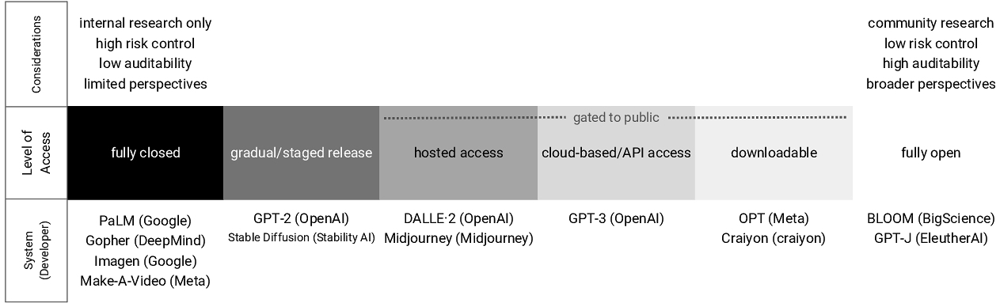

%%
Add discussion note here:

...

%%

## Abstract ^abstract

Recent decisions by leading AI labs to either open-source their models or to restrict access to their models has sparked debate about whether, and how, increasingly capable AI models should be shared. Open-sourcing in AI typically refers to making model architecture and weights freely and publicly accessible for anyone to modify, study, build on, and use. This offers advantages such as enabling external oversight, accelerating progress, and decentralizing control over AI development and use. However, it also presents a growing potential for misuse and unintended consequences. This paper offers an examination of the risks and benefits of open-sourcing highly capable foundation models. While open-sourcing has historically provided substantial net benefits for most software and AI development processes, we argue that for some highly capable foundation models likely to be developed in the near future, open-sourcing may pose sufficiently extreme risks to outweigh the benefits. In such a case, highly capable foundation models should not be open-sourced, at least not initially. Alternative strategies, including non-open-source model sharing options, are explored. The paper concludes with recommendations for developers, standard-setting bodies, and governments for establishing safe and responsible model sharing practices and preserving open-source benefits where safe.

## Executive Summary ^executive-summary

Recent decisions by AI developers to open-source foundation models have sparked debate over the prudence of open-sourcing increasingly capable AI systems. Open-sourcing in AI typically involves making model architecture and weights freely and publicly accessible for anyone to modify, study, build on, and use. On the one hand, this offers **clear advantages** including enabling external oversight, accelerating progress, and decentralizing AI control. On the other hand, it presents **notable risks**, such as allowing malicious actors to use AI models for harmful purposes without oversight and to disable model safeguards designed to prevent misuse.

This paper attempts to clarify open-source terminology and to offer a thorough analysis of risks and benefits from open-sourcing AI. While open-sourcing has, to date, provided substantial net benefits for most software and AI development processes, we argue that for some highly capable models likely to emerge in the near future, the risks of open sourcing may outweigh the benefits.

There are three main factors underpinning this concern:

1.  **Highly capable models have the potential for extreme risks.** Of primary concern is diffusion of dangerous AI capabilities that could pose extreme risks—risk of significant physical harm or disruption to key societal functions. Malicious actors might apply highly capable systems, for instance, to help build new biological and chemical weapons, or to mount cyberattacks against critical infrastructures and institutions. We also consider other risks such as models helping malicious actors disseminate targeted misinformation at scale or to enact coercive population surveillance.
    
    Arguably, current AI capabilities do not yet surpass a critical threshold of capability for the most extreme risks. However, we are already seeing nascent dangerous capabilities emerge, and this trend is likely to continue as models become increasingly capable and it becomes easier and requires less expertise and compute resources for users to deploy and fine-tune these models. (Section [[#^risks-of-open-sourcing-foundation|3]])
    
2.  **Open-sourcing is helpful in addressing some risks, but could—overall—exacerbate the extreme risks that highly capable AI models may pose.** For traditional software, open-sourcing facilitates defensive activities to guard against misuse more so than it facilitates offensive misuse by malicious actors. However, the offense-defense balance is likely to skew more towards offense for increasingly capable foundation models for a variety of reasons including: (i) Open-sourcing allows malicious actors to disable safeguards against misuse and to possibly introduce new dangerous capabilities via fine-tuning. (ii) Open-sourcing greatly increases attacker knowledge of possible exploits beyond what they would have been able to easily discover otherwise. (iii) Researching safety vulnerabilities is comparatively time consuming and resource intensive, and fixes are often neither straightforward nor easily implemented. (iv) It is more difficult to ensure improvements are implemented downstream, and flaws and safety issues are likely to perpetuate further due to the general use nature of the foundation models. (Section [[#^risks-of-open-sourcing-foundation|3]])
    
3.  **There are alternative, less risky methods for pursuing open-source goals.** There are a variety of strategies that might be employed to work towards the same goals as open-sourcing for highly capable foundation models but with less risk, albeit with their own shortcomings. These alternative methods include more structured model access options catered to specific research, auditing, and downstream development needs, as well as proactive efforts to organize secure collaborations, and to encourage and enable wider involvement in AI development, evaluation, and governance processes. (Section [[#^benefits-of-open-sourcing-foundation|4]])
    

In light of these potential risks, limitations, and alternatives, **we offer the following recommendations** for developers, standards setting bodies, and governments. These recommendations are to help establish safe and responsible model sharing practices and to preserve open-source benefits where safe. They also summarize the paper’s main takeaways. (Section [[#^recommendations|5]])

1.  **Developers and governments should recognize that some highly capable models will be too risky to open-source, at least initially.** These models may become safe to open-source in the future as societal resilience to AI risk increases and improved safety mechanisms are developed.
    
2.  **Decisions about open-sourcing highly capable foundation models should be informed by rigorous risk assessments.** In addition to evaluating models for dangerous capabilities and immediate misuse applications, risk assessments must consider how a model might be fine-tuned or otherwise amended to facilitate misuse.
    
3.  **Developers should consider alternatives to open-source release that capture some of the same distributive, democratic, and societal benefits, without creating as much risk.** Some promising alternatives include gradual or “staged” model release, structured model access for researchers and auditors, and democratic oversight of AI development and governance decisions.
    
4.  **Developers, standards setting bodies, and open-source communities should engage in collaborative and multi-stakeholder efforts to define fine-grained standards for when model components should be released.** These standards should be based on an understanding of the risks posed by releasing different combinations of model components.
    
5.  **Governments should exercise oversight of open-source AI models and enforce safety measures when stakes are sufficiently high.** AI developers may not voluntarily adopt risk assessment and model sharing standards. Governments will need to enforce such measures through options such as liability law and regulation, licensing requirements, fines, or penalties. They will also need to build the capacity to enforce such oversight mechanisms effectively. Immediate work is needed to evaluate the costs, consequences, and legal feasibility of various policy interventions and enforcement mechanisms we list.
    

## Introduction ^introduction

As AI developers build increasingly capable models, they face a dilemma about whether and how they should share their models. One foundational decision they must make is whether to open-source their models—that is, make their models freely and publicly accessible for anyone to use, study, modify, and share.[^note-2]

Software development communities have traditionally enjoyed strong norms for sharing and open-source publication. Accordingly, for many AI researchers and developers open-sourcing is a deeply held professional and personal value. However, this value can sit in tension with others, like growing a profitable organization may contradict protecting consumers from harm \[1\]. Debate continues about the risks, benefits, and tradeoffs of open-source model release.

Recently, some large AI labs have decided that open-sourcing foundation models involves unacceptable trade-offs and have chosen to restrict model access out of competitive concerns and worries about model misuse. These labs are either keeping their models completely private (e.g., DeepMind’s Chinchilla \[2\]) or employing a structured access approach to model sharing (e.g., OpenAI’s GPT-4 \[3\] and Anthropic’s Claude 2 \[4\] via their APIs \[5\], which enable the enforcement of user restrictions and implementation of controls such as safety filters in order to manage harms.

There has been pushback against this trend to restrict model access, and calls to reinforce traditional software development community norms for sharing and openness are common. The concerns are that model access restriction stifles innovation, disallows external oversight, hinders the distribution of AI benefits, and concentrates control over AI’s future to a small number of major AI labs \[6, 7\]. Labs such as Hugging Face, Allen Institute for AI, EleutherAI, RedPajama, LAION, Together.xyz, Mosaic, and Stability AI have recently chosen to open-source large models. Meta has been a particularly vocal open-source proponent with its release of I-JEPA \[8\], an efficient and visual transformer in June 2023, followed closely by Llama 2 \[9, 10, 11\], in July 2023.

There are many considerable benefits of open-source software (OSS) development. For thirty years, OSS has proliferated alongside, and often inside, of commercial software, encouraging cooperation, promoting software adoption via lowered costs, reducing monopolistic control by major software companies, fostering rapid innovation, growing talent, and improving software quality through community review \[12, 13, 14\]. The academic tradition in which many machine learning researchers are trained also enjoys strong norms of open research publication. It is only natural that many machine learning developers and researchers follow suit, creating groups and organizations like Hugging Face, Stability AI, RedPajama, and EleutherAI in order to build and release increasingly capable AI models.

However, we will explain that there is a disanalogy between OSS and open-source AI, and that we should not expect these same benefits to seamlessly translate from OSS to cutting-edge AI development efforts. While it is natural that an OSS lens has been used to motivate the open-sourcing of AI systems, continuing to do so could come with significant downsides. The rapid increase in capabilities that we have observed, and likely will continue to see, mean that open-sourcing AI systems come with higher risks of misuse, accidents, and dangerous structural effects than traditional software \[15\].

In comparative terms, open-sourcing a model will tend to present greater risks than releasing it using a structured access approach whereby model access is mediated, for example, through an API \[16\]. First, once a model is open-sourced, any safeguards put in place by an AI lab to prevent its misuse can be circumvented (see Section [[#^malicious-use|3.1]]). No methods currently exist to reliably prevent this. Second, once a model is open-sourced, those with sufficient expertise and computing resources can, without oversight, "fine-tune" it to introduce and enhance capabilities that can be misused. These two possibilities mean that any threshold of safe behavior observed and evaluated under closed or restricted contexts cannot necessarily be assumed to hold once the model is made publicly available.[^note-3]

Furthermore, open-source AI model release is irreversible; there is no “undo” function if significant harms materialize. If a model has a flaw—some exploit that elicits undesirable capabilities—or grave misuse potential, there is nothing to stop users from continuing to use the model once released. Similarly, if developers release patches or updated model versions to remedy flaws, there is no way to ensure users will implement the patches or operate the most up-to-date version. For malicious users who seek to exploit model vulnerabilities that allow for harmful applications, they are incentivized not to adopt any safety improvements.

Ultimately, as AI labs push the boundaries of foundation model development, the risks of open-sourcing will grow as models become increasingly capable. The risks from such capability improvements could become sufficiently severe that the benefits of open-sourcing outweigh the costs. We therefore recommend that decisions to open-source highly capable foundation models should be made only after careful deliberation that considers (i) the range of misuse risks the open-source model may present and (ii) the potential for open-source benefits to be provided through alternative means. We expect that in the future some highly capable foundation models should not be open-sourced.

We begin by defining highly capable foundation models (section [[#^what-do-we-mean|2]]) and the risks presented by open-sourcing them (Section [[#^risks-of-open-sourcing-foundation|3]]). The harms are significant and plausibly, in certain cases, justify foundation model access restrictions. We then turn to three key arguments for open-source model sharing and explore alternative mechanisms for achieving the desired end with significantly less risk (Section [[#^benefits-of-open-sourcing-foundation|4]]). Finally, we present recommendations for AI developers and policymakers in light of our discussion (Section [[#^recommendations|5]]).

## What Do We Mean by “Open-Source Highly Capable Foundation Models”? ^what-do-we-mean

### What are Highly Capable Foundation Models? ^what-are-highly-capable

##### Foundation models. ^foundation-models

Foundation models, sometimes referred to as _general-purpose_ AI models, are machine learning models like GPT-4 that demonstrate a base of general capabilities that allow them to be adapted to perform a wide range of downstream tasks \[17, 18\]. These capabilities can include natural language conversation, behavior prediction, image analysis, and media generation[^note-4], which can be used to develop or be directly integrated into other AI systems, products, and models.[^note-5]

When modalities are combined, _multimodal foundation models_ can integrate and respond to numerous data types (e.g., text, audio, images, etc.). For instance, Stable Diffusion \[27\] and DALL·E 2 \[28\] combine natural language processing capabilities with image generation capabilities to translate natural language prompts into image outputs. GPT-4 is also multimodal, though that functionality is not made widely available \[29\],[^note-6] and Meta’s open-source ImageBind project aims to link up numerous streams of data including audio, text, visual data, movement and temperature readings to produce immersive, multi-sensory experiences \[31\].

Foundation models can be used positively in healthcare \[32\], for data analysis \[21\], customer support \[22\], immersive gaming \[33\], or personalized tutoring \[24\]. But they can also be misused and deployed by bad actors, for example, to generate child sexual abuse material \[34\], create fake real-time interviews or recorded histories for influential politicians \[35\], or to conduct highly-effective targeted scams convincing victims that they are calling with trusted friends and family \[36, 37\]. Other current and ongoing harms posed by foundation models include, but are not limited to, bias, discrimination, representational harms, hate speech and online abuse, and privacy-invading information hazards \[17, 38, 39, 40\].

Foundation models have also been associated with upstream harms including poor labor conditions in the supply chain and for those hired to label data \[41, 42\] as well as putting strain on the environment through high energy and resource usage during training, deployment, and the production of the required hardware \[43, 44, 45\].

##### “Highly capable” foundation models. ^highly-capable-foundation-models

We define _highly capable foundation models_ as foundation models that exhibit high performance across a broad domain of cognitive tasks, often performing the tasks as well as, or better than, a human.[^note-7]

Researchers are working to develop suitable benchmarks to track the increase in such general-purpose capabilities by measuring performance of such models holistically (e.g., in regards to language, reasoning, and robustness \[46\] and across a spectrum of specific areas of knowledge, from professional medicine and jurisprudence to electrical engineering and formal logic \[47\].

##### Extreme risks and harms. ^extreme-risks-and-harms

In this paper we are particularly concerned with the possibility that highly capable models may come to exhibit dangerous capabilities causing extreme risks and harms such as significant physical harm or disruption to key societal functions.[^note-8]

Dangerous capabilities that highly capable foundation models could possess include making it easier for non-experts to access known biological weapons or aid in the creation of new ones \[50\], or giving unprecedented offensive cyberattack capabilities to malicious actors \[51, 52\]. Being able to produce highly persuasive personalized disinformation at scale, effectively produce propaganda and influence campaigns, or act deceptively towards humans, could also present extreme risks \[53\]. Self-proliferation abilities, such as evading post-deployment monitoring systems, gaining financial and computing resources without user or developer consent, or a model exfiltrating its own trained weights, are more speculative but might also facilitate extreme risks \[49, 54\]. This is particularly the case if models are embedded within critical infrastructure. The magnitude of these risks requires that model developers more carefully and systematically weigh risks against benefits when making open-sourcing decisions for highly capable foundation models than for present-day foundation models.

Perhaps in the future we will use AI models to guard against the risks and harms presented by the misuse of, and accidents caused by, other AI models, allowing us to safely deploy AI models with increasingly powerful capabilities. However, such solutions are currently technically under-developed, and there are substantial challenges to effectively deploying defensive solutions for AI at a societal level and at scale \[55\]. We therefore focus on forthcoming models that may take us into a zone of high risk against which we do not yet have sufficient social or technological resilience.

In section [[#^risks-of-open-sourcing-foundation|3]] we discuss many risks that foundation models at the frontier of today’s capabilities currently present. Arguably, these capabilities do not yet surpass a critical threshold of capability for the most extreme risks. However, we are seeing some dangerous capabilities emerge, and this trend is likely to continue as models become increasingly capable and as it becomes easier and requires less expertise and compute resources for users to deploy and fine-tune these models.[^note-9] Recently, after extensive testing of their large language model, Claude, by biosecurity experts, Anthropic reported that “unmitigated LLMs could accelerate a bad actor’s efforts to misuse biology relative to solely having internet access, and enable them to accomplish tasks they could not without an LLM.” They note that these effects, while “likely small today”, are on the near-term horizon and could materialize “in the next two to three years, rather than five or more” \[56\].

Our general recommendation is that it is prudent to assume that the next generation of foundation models could exhibit a sufficiently high level of general-purpose capability to actualize specific extreme risks. Developers and policymakers should therefore implement measures now to guide responsible model research decisions in anticipation of more highly capable models.

These recommendations are driven by the fast pace of AI progress, the immense challenge of verifying the safety of AI systems, and our ongoing struggle to effectively prevent harms from even current-day systems on a technical and social level. It is difficult to predict when more extreme risks may arise. The level of risk that a model presents is intimately tied to model capability, and it is hard to know when a critical line of capability has been or will likely be passed to pose extreme risks. In the past, model capabilities often have arisen unexpectedly or have been discovered only after model deployment \[57\].

##### AI models do not need to be _general-purpose_ to pose a risk. ^ai-models-do-not

Finally, it is worth noting that high-risk AI models do not necessarily need to be general-purpose in nature like foundation models, nor must they be at the frontier of current capabilities to pose the risks described above. For example, Urbina et al. \[58\] demonstrated that standard, narrow AI tools used within the pharmaceutical industry can be repurposed to assist with the design of chemical weapons. There are also more pressing concerns that AI systems might soon present extreme biological risks \[59\]. So while outside the remit of this paper, care should similarly be taken in the open-sourcing of narrow AI models that could, for example, be used to aid in chemical or biological weapons development.

### Open-Source AI: Definition and Disanalogy ^open-source-ai-definition-and

“Open-source” is a term borrowed from open-source software (OSS). In the context of open-source software, “open-source” was defined in 1998 as a “social contract” (and later a certification) describing software designed to be publicly accessible—meaning anyone can view, use, modify, and distribute the source-code—and that is released under an open-source license. An open-source license must meet ten core criteria, including free source code access, permission for derived works, and no discrimination against which fields or groups may use the software \[60, 61\].

With the release of AI models like LLaMA, LLaMA2, Dolly, StableLM the term “open-source” has become disjointed from open-source license requirements \[62\]. Some developers use “open-source” merely to mean that their model is available for download, while the license may still disallow certain use cases and distribution. For example, while Meta refers to LLaMA-2 as an open-source model, the LLaMA-2 license caveat is that the model cannot be used commercially by downstream developers with over 700 million monthly users, and the outputs cannot be used to train other large language models. Strictly speaking, LLaMA2 is therefore not open-source according to the traditional OSS definition \[63\], and the marketing of it as such has been criticized as false and misleading by the Open Source Initiative \[63\].[^note-10]

##### However, in this paper we set licensing considerations aside, as we are concerned with the risks and benefits of public model accessibility. ^however-in-this-paper

From an AI risk perspective, even where more restrictive licenses such as RAIL (Responsible AI License) include clauses that restrict certain use cases \[66\], license breaches are difficult to track and enforce when models are feely and publicly available for download \[67\]. License breach will also not be of great concern for malicious actors intending to cause significant harm. Accordingly, and in line with increasing common parlance, we use the term open-source only to refer to models that are publicly accessible at no cost.[^note-11]

##### Licensing aside, the open-source software concept—referring only to “free and publicly downloadable source code”—does not translate directly to AI due to differences in how AI systems are built \[62, 68\]. ^licensing-aside-the-open-source

For AI systems, “source code” can refer to either or both of the inference code and the training code which can be shared independently. AI systems also have additional system components beyond source code, such as model weights and training data, all of which can be shared or kept private independent of the source code and of each other.

Experts disagree on precisely which model components need to be shared for an AI model to be considered open-source. Rather, the term is being used to encapsulate a variety of system access options ranging on a spectrum from what Irene Solaiman \[69\] calls non-gated downloadable to fully open models. For _fully open models_, training and inference code, weights, and all other model components and available documentation are made public (e.g., GPT-J \[70\]). For _non-gated downloadable models_, key model components are publicly available for download while others are withheld. The available components generally include some combination of training code (minimally model architecture), model weights, and training data.[^note-12]

Table 1 presents a useful reference list of standard model components and definitions. See Appendix [[#^ai-model-component-guide|7]] for a more detailed breakdown.

##### The more model components that are publicly released, the easier it is for other actors to reproduce, modify, and use the model. ^the-more-model-components

For example, access to model architecture and trained weights (e.g., StabilityAI’s Stable Diffusion \[71\]), when combined with inference code, is sufficient for anyone to use a pre-trained model to perform tasks. Inference code can be easily written by downstream developers or even generated by large language models such as ChatGPT. It also does not need to match the original inference code used by the model developer to run the model. Access to model weights also allows downstream developers to fine-tune and optimize model performance for specific tasks and applications.

Releasing other useful parts of the training code makes it much easier for other actors to reproduce and use the trained model. For instance, providing the optimal hyperparameters would make a pre-trained OS AI model more capable (and possibly dangerous), and releasing the code used to clean, label and load the training data would reduce the burden on actors trying to reproduce model weights.

Sometimes, an AI developer will release the training and inference code for a model, but not the trained model weights (e.g., Meta’s LLaMA \[72\] before the weights were leaked).[^note-13] In such cases, actors with sufficient computing resources and data access could train the model and, with some inference code, run it.[^note-14] However, at the moment, few actors (realistically, only large technology companies, state-level actors, or well-funded start-ups) have the computing resources available to train highly capable foundation models that represent the frontier of model performance.[^note-15]

**Therefore, in this paper, when we refer to open-source foundation models, we mean models for which at least model architecture and trained weights are publicly available unless otherwise specified.**

Box 1 describes the need for further work defining open-source gradients beyond the definition we give here; releasing different (combinations of) model components in addition to trained weights and training code enables different downstream activities.

## Risks of Open-Sourcing Foundation Models ^risks-of-open-sourcing-foundation

Due to their vast application space and pace of development, foundation models have potential for broad and significant benefit and harm. Accordingly, open-sourcing these models poses some substantial risks which we present in two categories: malicious use (3.1) and proliferation of unresolved flaws (3.2).

These harms are intensified by the fact that once a decision has been made to open-source, there is no “undo” function. A published model cannot be rolled back if major safety issues emerge or if malicious actors find an AI tool to be particularly useful for scamming, hacking, deceptive influence, or acts of terror. Methods exist that allow even partially open-sourced models (e.g., code with some or no other model components) to be replicated and shared in full \[79\].

### Gradient of System Access ^gradient-of-system-access

The idea that models are either released open-source or maintained closed-source presents a false dichotomy; there are a variety of model release options ranging from fully closed to fully open model \[68, 80, 81\].

“Considerations and Systems Along the Gradient of System Access” \[figure reproduced from Solaiman \[69\]\]

What is generally referred to as “open-source” model release spans the two system access categories on the far right of Irene Solaiman’s \[69\] gradient: _Downloadable_ (specifically non-gated downloadable—meaning that anyone is free to download the available components) and _Fully Open._

### Gradient of Open-Source Access ^gradient-of-open-source-access

For _fully-open_ models, source code, weights, training data, and all other model components and available documentation are made public. However, in the _non-gated downloadable_ category—in which some components are publicly downloadable (usually including weights and architecture) while others are withheld—there is room for further specification. Importantly, the precise benefits and risks of open-sourcing are determined by the specific combinations of model components and documentation that are made publicly available.

### Precise Definitions for Precise Standards ^precise-definitions-for-precise

Near-term investment in a project is needed to investigate and articulate what activities are made possible by access to different (combinations of) model components. This information will be key to constructing effective and fine-grained model release standards that are not overly burdensome, and to ensure open-source values are protected and benefits enjoyed where safe.  
We make a start in Appendix [[#^ai-model-component-guide|7]], though it is a much larger and more involved project than we can do justice here, and it is a project on which members of open-source communities should be centrally involved. The Open Source Initiative recently launched one such initiative to define what machine learning systems will be characterized as open-source \[82\].

### Malicious Use ^malicious-use

Open-source publication increases foundation models’ vulnerability to misuse. Given access to the model’s weights and architecture, any actor with the requisite technical background[^note-16] can write their own inference code—or modify available inference code—to run the model without safety filters. They can also fine-tune the model to enhance the model’s dangerous capabilities or introduce new ones.

There are several ways in which open-source publication can facilitate misuse:

Firstly, open-sourcing a model allows actors to run the model using new or modified inference code that lacks any content safety filters included in the original code. Stable Diffusion’s safety filter, for example, can be removed by deleting a single line of inference code.[^note-17] This is possible because such filters are implemented post-hoc, appending additional processes to the model’s inference code, rather than fundamentally changing the behavior of the model itself. With content safety filters removed, there is nothing to prevent users from presenting the models with unsafe requests or to prevent the model from yielding unsafe outputs.

Secondly, the ability to fine-tune an open-source model without restrictions enables the modification of models specifically for malicious purposes. Fine-tuning that occurs through an API can be monitored; for example, the API owner can inspect the contents of the fine-tuning data set. Without such monitoring, fine-tuning could involve the reintroduction of potentially dangerous capabilities that were initially removed by developers pre-release through their own fine-tuning. Fine-tuning can also lead models to become even more dangerous than they were before safety measures were applied. However, increasing a model’s dangerous capabilities by fine-tuning would be more difficult than removing certain kinds of post-hoc safeguards like filters; fine-tuning requires the curation of a dataset to promote those dangerous capabilities, as well as requiring the necessary compute and technical expertise to successfully fine-tune the model.

Thirdly, access to model weights can aid adversarial actors in effectively jailbreaking system safeguards (including for copies of the system that have not been modified). Traditional jailbreaks use clever prompt engineering to override safety controls in order to elicit dangerous behavior from a model (e.g., getting a large language model (LLMs) to provide instructions for building a bomb by asking it to write a movie script in which one character describes how to build a bomb). Creative prompting only requires model query access. However, researchers recently discovered a method of adversarial attack in which the network weights of open-source LLMs aided researchers in optimizing the automatic and unlimited production of “adversarial suffixes”, sequences of characters that, when appended to a query, will reliably cause the model to obey commands even if it produces harmful content \[84\]. Notably, this method, which was developed using open-source models Vicuna-7B and Meta’s LLaMA-2, is transferable; it also works against other LLMs such as GPT-4 (OpenAI), Bard (Google), and Claude (Anthropic), indicating that open-sourcing one model can expose the vulnerabilities of others.

The above methods have the potential of reducing, if not entirely nullifying, the measures taken by developers to limit the misuse potential of their models. These measures would be much more difficult to bypass in cases where the model weights and training code are not openly released, and where user interaction with the model is facilitated through an API. Fine-tuning, in particular, can also lead models to be more dangerous than they might have been originally.

#### Varieties of Malicious Use[^note-18] ^varieties-of-malicious-use

Potential epistemic, social and political consequences of foundation model misuse include the following \[85, 86\].

-   **Influence operations.** There is a wealth of existing research theorizing AI’s utility in automating, or otherwise scaling, political or ideological influence campaigns through the production and targeted dissemination of false or misleading information \[17, 86, 87, 88\]. There is concern about multimodal foundation models being used to create interactive deepfakes of politicians or constructing and catering detailed and seemingly verifiable false histories \[35\]. A recent experiment demonstrated the potential for AI-based influence operations when the LLM-based system, CounterCloud, was deployed to autonomously identify political articles, to generate and publish counter-narratives, and then to direct internet traffic by writing tweets and building fake journalist profiles to create a veneer of authenticity \[89\].
    
    Concerns about AI being used to manipulate public views, undermine trust, drive polarization, or otherwise shape community epistemics have led some scholars to speculate that _‘whoever controls language models controls politics’_ \[90\].
    
-   **Surveillance and population control.** AI advances the means of states to monitor and control their populations through immersive data collection, such as facial and voice recognition \[91\], the nascent practice of affect recognition \[92\], and predictive policing \[93\]. AI also allows automating and thus ever more cheaply analyzing unprecedented amounts of data \[48\]. Authoritarian governments may be most likely to make use of AI to monitor and control their populations or to suppress subpopulations \[94, 95\], but other types of governments are employing AI enabled surveillance capabilities as well. Nascent AI surveillance technologies are spreading globally and in countries with political systems ranging from closed autocracies to advanced democracies \[96, 97\].
    
-   **Scamming and spear phishing.** Malicious actors can use AI to fraudulently pose as a trusted individual for the purpose of theft or extraction of sensitive information \[98\]. For example, large language models have been shown to be proficient in generating convincing spear phishing emails, targeted at specific individuals, at negligible cost \[99\].
    
    Evidence from online forums also indicates that malicious AI tools and the use of “jailbreaks” to produce sensitive information and harmful content are proliferating amongst cyber criminals \[100\]. High profile scams using generative AI have also been observed, with one report detailing how \$35million was stolen from a Japanese firm by scammers who used AI voice cloning tools to pose as a company executive to employees \[37\].
    
-   **Cyber attacks.** Foundation models have applications for both cybersecurity and cyber warfare \[52, 101\]. Early demonstrations show that LLMs’ current coding abilities can already find direct application in the development of malware and the design of cyber attacks \[102\]. With improved accessibility and system capability, the pace of customized malware production may increase as could the variability of the malware generated. This poses a threat to the production of viable defense mechanisms. Especially in the near term, there is some evidence that AI generated malware can evade current detection systems designed for less variable, human-written programs \[103, 104, 105\].
    
    Ultimately, information gained from cyberattacks might be used to steal identities, or to gather personal information used to mount more sophisticated and targeted influence operations and spear phishing attacks. Cyberattacks could also be used to target government agencies or critical infrastructure such as electrical grids \[106\], financial infrastructures, and weapons controls.
    
-   **Biological and chemical weapons development.** Finally, current foundation models have shown nascent capabilities in aiding and automating scientific research, especially when augmented with external specialized tools and databases \[107, 108\]. Foundation models may therefore reduce the human expertise required to carry-out dual-use scientific research, such as gain-of-function research in virology, or the synthesis of dangerous chemical compounds or biological pathogens \[50, 109\]. For example, pre-release model evaluation of GPT-4 showed that the model could re-engineer known harmful biochemical compounds \[110\], and red-teaming on Anthropic’s Claude 2 identified significant potential for biosecurity risks \[56, 111\].
    
    Specialized AI tools used within these domains can also be easily modified for the purpose of designing potent novel toxins \[58\]. Integrating narrow tools with a foundation model could increase risk further: During pre-deployment evaluation of GPT-4, a red-teamer was able to use the language model to generate the chemical formula for a novel, unpatented molecule and order it to the red-teamer’s house \[110\]. Law-makers in the United States are beginning to take this biosecurity threat seriously, with bipartisan legislation—the Artificial Intelligence and Biosecurity Risk Assessment Act—being proposed that would monitor and study the potential threats of generative and open-source AI models being used “intentionally or unintentionally to develop novel pathogens, viruses, bioweapons, or chemical weapons” \[112\].
    

#### Ease of Malicious Use ^ease-of-malicious-use

One factor that potentially mitigates the misuse of open-source foundation models is that the pool of actors with the requisite talent and compute resources to download, run and, when necessary, modify highly capable models effectively is relatively small. Nevertheless, there are still several reasons to be concerned.

First, there is an increasing number of individuals who have the skills to train, use, and fine-tune AI models as illustrated by growing computer science PhD enrollment as well as ballooning attendance at AI conferences \[113\]. This is supplemented by an increasing number of tutorials and guides available online to use and fine-tune AI systems.

Second, running a pre-trained AI model at a small scale requires only a small amount of compute—far less compute than training does. We estimate the largest Llama 2 model (Llama-2-70B) costs between \$1.7 million and \$3.4 million to train,[^note-19] while the inference costs for Llama-2-70B are estimated to be between 0.2 and 6 cents per 750-word prompt \[116\] and \$4 per hour of GPU time.[^note-20] While the compute requirement becomes large when running models at a very large scale (that is, performing many inferences),[^note-21] large-scale runs may not be required for impactful misuses of a model. It is conceivable that only a few inferences may be needed in certain domains for models to be dangerous (e.g., a malicious actor may only need to find one critical vulnerability to disrupt critical infrastructure).

Third, while the overall cost of training frontier models is increasing \[73\],[^note-22] algorithmic progress focuses heavily on reducing demands on compute resource, both for training[^note-23] and for fine-tuning \[118\]. This, combined with the decreasing cost of compute (measured in FLOP/s per \$)\[119\], means that while initial model development and training may remain prohibitively expensive for many actors, we should not expect compute accessibility to always act as a strong limiting factor for fine-tuning existing open-source foundation models. Targeted fine-tuning of a pre-trained model to create dangerous models would remain much less expensive than building a model from scratch.

#### Offense-Defense Balance ^offense-defense-balance

Another argument against the threat of malicious use posed by open-sourcing is that while open-sourcing may increase model vulnerability to exploitation by malicious actors, it does more to help developers identify those vulnerabilities before malicious actors do and to support development of tools to guard against model exploitation and harms \[120\]. In other words, in the offense-defense balance—a term referring to the “relative ease of carrying out and defending against attacks” \[121, 122\]—it has been argued that open-sourcing favors defense.

This is often true in the context of software development; open-sourcing software and disclosing software vulnerabilities often facilitate defensive activities more than they empower malicious actors to offensively identify and exploit system vulnerabilities. However, the same might not be safely assumed for open-source AI, especially for larger and more highly capable models \[55\]. Shevlane and Dafoe \[55\] explain that when a given publication (e.g., publication of software, AI models, or of research in biology or nuclear physic etc.) is potentially helpful for both people seeking to misuse a technology and those seeking to prevent misuse, whether offensive or defensive activities are favored depends on several factors:

-   **Counterfactual possession.** How likely would a would-be attacker or defender be able to acquire the relevant knowledge without publication? If counterfactual possession by the attacker or defender is probable, then the impact of publication on their respective offensive and defensive activities is less.
    
-   **Absorption and application capacity.** A publication only benefits attackers and defenders to the extent that they can absorb and apply the knowledge toward their desired ends. This depends on how much knowledge is disclosed, how the knowledge is presented, and the attentiveness and comprehension of the recipients.
    
-   **Resources for solution finding.** For defenders, given publication, how many additional actors will help develop defenses? Impact of publication is greater if many people are likely to contribute to defensive applications.
    
-   **Availability of effective solutions.** Are vulnerability patches easy to implement, or will developing solutions be a more complicated and time intensive endeavor? The positive effects of publication decrease the more difficult vulnerabilities are to address.
    
-   **Difficulty/cost of propagating solutions.** Even where defensive solutions exist, if they are difficult to propagate then the impact is less.
    

For software development, the offense-defense balance of open-source publication often comes out in favor of defense. Software vulnerabilities are easy to find, so counterfactual possession by attackers is likely, and software patches are relatively easy to make, usually fully resolve the vulnerability, and are easily rolled out through automatic updates.

However, in the context of AI research, Shevlane and Dafoe offer the tentative conclusion that as AI models grow in capability and complexity, open-source publication will likely skew the balance towards offense. As discussed at the start of this section, attacker knowledge of vulnerabilities and their ability to exploit those vulnerabilities is greatly increased by open-source publication. For some vulnerabilities, researching solutions is time consuming and resource intensive (See Section [[#^accelerate-beneficial-ai-progress|4.2]]). Solutions developed also tend not to be perfect fixes. This is for a variety of reasons: (i) given our current lack of understanding of how advanced AI systems work internally, it may be difficult to identify the source of risk or failure; (ii) certain risks, such as bias and discrimination, may be learned from the training data, and it could be impossible to “remove” all bias from training data \[123\]; (iii) reducing misuse of AI systems may require changes to social systems beyond changes to technical ones \[55\]; (iv) the structure of AI systems introduces new sources of failure specific to AI that are resistant to quick fixes (e.g., the stochastic nature of large language models may make it difficult to eliminate all negative outputs, and the inability to distinguish prompt injections from “regular” inputs may make it difficult to defend against such attacks) \[124\]. Finally, it is difficult to ensure improvements to open-source models are implemented by downstream users and developers which can result in widespread proliferation of unresolved model flaws. We address this topic in Section [[#^risks-from-the-proliferation|3.2]].

The conclusion that the offense-defense balance skews towards offense when open-sourcing AI remains tentative because the offense-defense balance is influenced by a myriad of factors making it difficult to reliably predict outcomes. The balance will vary with each model, application space, and combination of released model components. In addition, we may develop measures in the future that build our defensive capabilities. Nonetheless, the general notion holds; open-sourcing AI leans towards offense more so than open-sourcing software. AI developers should therefore think critically about the potential for, and potential protections against, misuse before every model release decision.

### Risks from the Proliferation of Unresolved Model Flaws ^risks-from-the-proliferation

Excitement about foundation models stems from the large number of potential downstream capability modifications and applications. These can include applications involving malicious intent and misuse, but more frequently will involve well-intentioned commercial, scientific, and personal applications of foundation models. If they have the necessary resources and model access (via open-source or sufficient API access), downstream individuals, AI labs, and other industry and government actors can:

1.  Employ foundation models to new tasks that were not previously subject to risk assessments due to the general capabilities of these models.
    
2.  Fine-tune or otherwise alter open-sourced foundation models to enable specialized or additional (narrow and general) capabilities.
    
3.  Combine foundation models with other AI models, tools, and services, such as the internet or other APIs, to create a system of AI models which can have new narrow and general capabilities.[^note-24] For example, AutoGPT is an open-source app that integrates with GPT-3.5 and GPT-4. While GPT-3.5 and GPT-4 can respond one prompt at a time, AutoGPT handles follow-ups to an initial prompt. This allows users to ask AutoGPT autonomously to complete higher-level goals that require iteratively responding to and generating new prompts \[125, 126\].
    

##### In all three cases, the risks, flaws, system vulnerabilities, and unresolved safety issues of the initial foundation model propagate downstream. ^in-all-three-cases

For instance, biased and discriminatory behavior, vulnerabilities to prompt injection \[127\] and adversarial attacks \[84\], autonomous self-proliferation abilities \[54\], or other dangerous capabilities could quickly proliferate if not caught and fixed before being integrated into downstream products and applications.

The fact that the models can be applied to new contexts (1), but also adapted (2 and 3) to unlock new narrow and general capabilities, also means that further, difficult to predict risks and harms could emerge. Consequently, it is not certain that the safeguards put in place by the foundation model developer will continue to be effective if downstream developers fine-tune, alter, and combine AI models. This means that not only will existing model flaws proliferate, but previously fixed flaws and new flaws may also arise.

If (1), (2), and (3) are enabled via structured API access (e.g., OpenAI’s davinci-002 and GPT-3.5 can be fine-tuned via API \[128\], then developer monitoring of API use may go some way towards mitigating the proliferation harms described above. There is no such recourse, however, if a model is made open-source. **Once a model is open-sourced, there are no take-backs if harms ensue.**

When risks and vulnerabilities are proliferated there is no way of ensuring that when a fix is rolled out (assuming a fix is possible - see end of 3.1) that it is adopted or integrated effectively by downstream AI developers and users. Even in the context of traditional open-source software, software flaws are proliferated \[129\] as downstream developers and users more often than not fail to implement patches and version updates, even where the open-source license requires they do so \[130\]. Very often consumers are unaware that their systems are running on out-of-date software or that vulnerability patches are available. Other times an updated software version will not integrate well with other software packages and existing infrastructure. We should expect the same challenges to undermine the maintenance of open-source foundation models, though a given foundation model will likely be applied to a much wider range of applications than a piece of software.

There are also different incentives influencing decisions to implement updates for traditional software than for foundation models. For traditional software, patches and version updates improve system performance and functionality and resolve vulnerabilities that could cause harm to the user. It is to the user’s benefit to implement software updates when feasible. In comparison, for increasingly capable foundation models, safety patches and updates often aim to reduce system functionality, disallowing certain activities that were possible with previous versions. If downstream developers and users wish to retain those functionalities (e.g., to be able to produce nude art with an image generator), they are incentivized not to update versions and, in some cases, not to disclose the existence of potential risks and system vulnerabilities.

Due to the potential of proliferating risks and model flaws from highly capable foundation models, developers need to consider model release decisions carefully. Developers of highly capable foundation models must be cognizant of the potential downstream harms of their models (harms which they would be powerless to backtrack) and carefully consider alternative methods by which open-source benefits might be pursued but at significantly less risk \[131\]. We discuss alternatives further in Section [[#^benefits-of-open-sourcing-foundation|4]]. Clear legislation is also needed to hold developers and controllers of AI systems liable for the impacts of their systems.

## Benefits of Open-Sourcing Foundation Models and Alternative Methods for Achieving Them ^benefits-of-open-sourcing-foundation

In this section we analyze three key benefits of open-source software: facilitating external evaluation ([[#^external-model-evaluation|4.1]]), accelerating beneficial progress ([[#^accelerate-beneficial-ai-progress|4.2]]), and distributing control over technological development and benefits ([[#^distribute-control-over-ai|4.3]]). For each, we first present the benefit, then evaluate the benefit in the context of highly capable foundation models, and finally consider other strategies that might contribute to the same goals. A summary table is provided at the start of each subsection.

### External Model Evaluation ^external-model-evaluation

#### The Argument for Open-Source ^the-argument-for-open-source

A clear benefit for open-source software development is that open-sourcing facilitates independent evaluations of projects by wider communities of developers and many more people than a single developer would be able to employ internally to check for bugs and safety issues. This means a more diverse pool of expertise can be tapped, with a low barrier to entry for individuals to contribute, whose skill to identify and solve problems is enhanced by increased access to relevant materials. So in the case of highly capable foundation models, it is reasonable to expect that open-sourcing would leverage the same talent multiplier as with OSS. Tapping into the wider AI community would enable audit and analysis of foundation models and any model components (e.g., training data, weights, documentation) by interested parties helping to catch bugs, biases, and safety issues that may otherwise go unnoticed. Such external oversight would help hold AI developers to account for the quality and consequences of their products at a team and an industry level, and ultimately lead to better performing and safer AI products.

#### Evaluating the Benefit for Foundation Models ^evaluating-the-benefit-for

In this section we consider the benefits of open-sourcing for enabling external model evaluations according to two classes of model issues: (1) discrete bugs, and (2) complex safety challenges.

##### Discrete Bugs. ^discrete-bugs

Discrete bugs such as interface glitches, data exposures and authentication issues are self-contained flaws that are relatively simple to fix. Once discovered, discrete bugs can be easy and relatively low cost for model developers to fix in-house. But bug spotting certainly benefits from additional eyes, and there are alternative methods to open-sourcing that attempt to facilitate more widespread participation in model review. For example, AI developers can set up community reporting systems as they are encountered and even incentivize engagement via bug bounties like that employed by OpenAI \[132\]. That being said, conscious steps need to be taken to ensure that the benefits of open-sourcing can be replicated: active efforts need to be made to engage the attention of a diverse set of experts and it remains difficult to mimic open-sourcing here in all respects. For example, not having full access to materials will impede individuals in their ability to find bugs.

A further advantage of open-sourcing is that it allows downstream developers to patch such issues on their own and to pass those patches back to the developer for integration into future model versions.

##### Complex Safety Challenges. ^complex-safety-challenges

Increasingly capable foundation models are bringing with them an array of new behaviors and safety challenges that arise unpredictably and are not well-understood by developers \[133\]. For example, emergent abilities are unexpected and unintended features or behaviors that arise in AI models as they become more advanced. These abilities are not observed in smaller precursors and are not explicitly programmed by developers \[57\]. “Capability overhang” is a concept that further describes how these emergent abilities can be latent within a system only to emerge unexpectedly when elicited, for example, by clever prompt engineering or integration with other software. Sometimes new capabilities continue to be elicited many months after model release \[80\].

Drawing input from a large pool of contributors will be instrumental to exploring this evolving space of unknown unknowns; what do new safety issues look like and, if not immediately evident, how are they triggered? Furthermore, because some model behaviors will only emerge with downstream modification of model weights, model evaluators will need to be able to experiment with model fine-tuning to test a variety of possible model versions.

Open-sourcing provides the necessary access to model weights and parameters for attempting to elicit new behaviors from models for safety evaluation (although it simultaneously allows malicious attempts to elicit new dangerous behaviors and avenues of misuse). For models that are not open-sourced, fine-tuning might also be facilitated via APIs that allow users to manipulate model weights and parameters (e.g. OpenAI’s davinci-002 and GPT-3.5 \[128\]. However, some APIs may introduce additional limitations on fine-tuning. For example, API controllers could attempt to limit the format or content of data used to fine-tune a model, limit access to weights and parameters (e.g. provide access to weights and parameters of base-line models but not to fine-tuned model versions), or limit the amount of fine-tuning that can be done. These limitations might be in place to protect the developer’s commercial interests or to reduce risk of misuse.

Safety research, such as alignment and interpretability research which aim to understand and resolve complex safety issues, also require varying degrees of model access. We will discuss the benefits of open-sourcing for promoting safety research in section [[#^accelerate-beneficial-ai-progress|4.2]].

#### Other Ways to Enable External Evaluation ^other-ways-to-enable

There are some alternatives to open-sourcing that can facilitate the identification and evaluation of bugs and safety issues, with less risk than open model release.

##### Staged-Release Impact Testing. ^staged-release-impact-testing

AI developers can conduct staged-release impact testing to gather observational data about how a model is likely to be (mis)used and modified if open-sourced. Staged-released impact testing is a process by which incrementally larger versions of a model are released behind API \[134, 135\]. Each stage of release allows time to observe how the model is used, to study its social impacts, and to implement any patches or new safety measures before the next, more powerful version is released (if it is deemed safe to do so).

If many safety measures need to be implemented between stages to mitigate harms, this is a solid indication that open-sourcing will lead to malicious use because, once open-sourced, those measures could be easily circumvented.

Conducting staged release impact testing allows AI developers to be more comfortable with open-sourcing their models, assuming no other significant issues emerge in model evaluation and risk assessment process. However, this can come at a cost to the developer by allowing competitors to capture market share in the meantime if such processes are not implemented for the industry at large through regulation. In addition, any benefits from the model are also delayed from reaching the relevant communities that could benefit from them.

##### External Audits & Red-teaming. ^external-audits-red-teaming

In addition to staged-release impact testing, developers can grant privileged model access to trusted third-party auditors. These are external actors (government departments, private expert organizations, or some combination thereof) tasked with evaluating the safety and security of foundation models prior to model release or assessing and verifying the model evaluation measures employed by AI labs.

Though they are in early stages of development, external auditing has been proposed as a key institutional mechanism for facilitating trustworthy AI development \[136, 137, 138, 139\]. One early example is the Alignment Research Center’s (ARC) pre-release evaluation of GPT-4 for dangerous capabilities \[140\].

The ARC evaluations largely involved red-teaming GPT-4. Red-teaming is an evaluation method that stress-tests models to discover how and where safety concerns arise. The aim is to identify potentially dangerous model properties (e.g., manipulative or power-seeking behavior), security flaws (e.g., jailbreaks), and possible misuse applications. Stress-testing requires that red-teams are able to prompt models to elicit new and dangerous behavior which can be facilitated with model query access—that is, being able prompt models and receive outputs without open-source access to model code and weights.

Where model weight access is needed to experiment with fine-turning, access might be granted to identified individuals or research groups via gated download or API. For **gated download** developers make models (minimally weights and training code) available for specific actors to download and run on their own hardware.[^note-25] The risk with gated download is that model leaks could result in the dissemination of potentially dangerous models. Download recipients would need to be vetted carefully. Another option is for developers to provide fine-tuning access via API. However, as mentioned above, some developers may choose to implement limitations on fine-tuning in order to prevent misuse or model reproduction. For this reason, Bucknall et al. \[141\] recommend the design and implementation of **‘research APIs’** whereby more flexible fine-tuning permissions are granted to trusted researchers, red-teams, and auditors depending on their access needs.

Red-teams such as those employed by OpenAI \[29, 142, 143\] and Anthropic \[56, 144\] are increasingly common, though best practices are still being developed. Model evaluation is a nascent field. This makes it difficult to evaluate the skill of potential auditors. Moving forward, standards will need to be developed and implemented to ensure the quality and consistency of third-party audits \[145\] as numerous governments and private actors move to occupy a growing AI assurance sector \[146\]. Mechanisms will also be needed to ensure developers provide sufficient model access to auditors and respond to audit findings. For instance, audit reports should be published publicly or shared with a government overseer while regulatory requirements ensure labs respond and disclose their efforts and results. Governments should consider establishing mandatory auditing regimes for large and potentially dangerous foundation models to minimize the risk of model developers only granting access to favored auditors, who might be less likely to expose failure modes that are potentially embarrassing or inconvenient for the developer.

Much work is needed developing new model evaluation techniques and establishing best practice. Some evaluation processes may benefit from leveraging foundation model capabilities \[147\] as well as input from wider AI developer communities. Decisions about how and by whom models are audited are currently entirely at the discretion of individual developers. Without standardized risk assessment procedures a lab could choose an “easy” or “friendly” auditor.

Another possibility Brundage et al. \[136\] suggests, is to extend red-teams to elicit input from a wider community of **‘red-team professionals’**. Such a community would be composed of members from the wider AI community as well as security professionals, and representatives from high-risk domains to which foundation models might be put to use. This would help distribute red-teaming costs for labs less-inclined to form internal red-teams, and the community of red-team professionals would benefit from greater insight to common attack vectors and useful red-teaming strategies shared within the community. But again, risks arise by allowing AI developers to choose red-teamers on their own, including capture of the safety evaluation process and a potential narrowing of focus and values by not ensuring an optimally diverse and comprehensive set of experts. Further best practices and regulatory mechanisms need to be put in place to make sure red-teaming can provide effective safety evaluations of AI models.

##### Bug Bounties and Safety Bounties. ^bug-bounties-and-safety

Safety bounty programs have been proposed as another method of tapping into a wider global community to help identify and surface new safety and alignment issues in large foundation models \[148\]. Bounty “hunters” are not pre-vetted as with selected red-teams.

Analogous to bug bounty programs commonly used in cybersecurity, safety bounty programs would offer financial and reputational rewards to members of the public who discover and responsibly report new safety failures, such as novel jailbreaks, or capabilities beyond those found in internal tests. As with red-teaming, bounty “hunters” can do this by interacting with systems behind an API. However, it is as yet unclear to what extent this impedes the ability of external testers to surface and probe safety issues.

An early safety bounty trial by OpenAI for ChatGPT incentivized over 1500 submissions, with limited publicization and \$20,000 of API prizes in total \[149\]. While OpenAI noted that the submissions seemed to yield few new discoveries beyond the safety issues that internal red-teams had already noticed, the exercise produced insight into the most common routes of attack and lessons for future public engagement \[148\].

Safety bounty programs can also be leveraged to identify promising talent. Bounty hunters who submit multiple helpful tips could be contacted and employed to perform more extensive system testing, and be granted deeper levels of system access after appropriate vetting. In cybersecurity, some bug bounty hunters earn payouts totaling over \$1 million for their work, and go on to work for large firms \[150, 151\].

### Accelerate (beneficial) AI Progress ^accelerate-beneficial-ai-progress

| **The argument for open-source AI** | Open-sourcing allows more people to contribute to AI development processes and enables large-scale collaborative efforts. The idea is that more expertise, more diverse perspectives, and simply more human creativity and hours put into AI development will drive innovation in new and useful downstream integrations, advance AI safety research, and help push forward the boundaries of AI capability. |
| --- | --- |
| **Evaluation of Benefit** | _Integration Progress_ Open-sourcing is most helpful for integration progress. Model access allows more people to tinker, innovate, and optimize for integration with new downstream applications. _Capability Progress_ Open-sourcing is less beneficial for capability progress than for integration progress. The benefit is limited by bottlenecks in the talent, compute, and data resources needed for contributing to cutting-edge AI capability research. _Safety Progress_ Academic safety research is often curtailed by insufficient access to highly capable models. The benefit of open-source might be reduced by insufficient computation infrastructure outside of leading AI labs for running highly capable models. |
| **Alternative methods for driving AI progress** | _Integration Progress_ Use plugins for exploration of new applications. Provide gated access [i.e. full access restricted to identified third parties] coupled with Know-Your-Customer Requirements. _Capability Progress / Safety Progress_ Provide privileged model access to identified AI research groups, possibly via structured access research APIs. Seek and organize collaborations with trusted parties and provide gated download access to collaborators. Establish a multistakeholder governing body to mediate research access to protect against favoritism and to facilitate independent academic research. Build incentive structures like large rewards programs for major scientific discoveries (e.g., protein folding) or pro-social advances (e.g. health and equity applications) using AI and for AI safety breakthroughs (e.g., interpretability). Commit a certain percentage of profits or research hours towards AI safety projects. |

#### The Argument for Open-Source ^the-argument-for-open-source-2

Another argument for open-sourcing AI is that doing so helps to accelerate progress that pushes the boundaries of AI capability, advances AI safety research, and drives innovation of new downstream applications and integrations. The idea is that open-sourcing allows more people to contribute to AI development processes. It allows downstream developers to optimize and perfect existing models instead of having to start from scratch for each new application, and it enables large-scale collaborative efforts. Furthermore, progress created by the wider AI community will benefit from more diverse perspectives and insights, which will ultimately help develop AI aligned to unique community needs and cultural preferences. In addition, open-source efforts may be more likely to focus on pro-social applications of AI, and be less influenced by the financial and commercial incentives than industry AI developers.

These are benefits widely enjoyed by open-source software communities. Linus Torvalds’ open-source release of the Linux kernel, in particular, showed how taking advantage of community-wide co-creation allows OSS tools to be developed and released quickly, maintained cheaply, and customized for individual needs without compromising quality. For cloud computing especially, these benefits allowed the Linux operating system to directly compete with Windows and MacOS, commercial systems backed by significantly more resources such as specialized knowledge, corporate information-sharing infrastructure, performance accountability mechanisms, and marketing and legal support \[152, 153\].

It follows that we might expect AI progress to benefit similarly.

#### Evaluating the Benefit for Foundation Models ^evaluating-the-benefit-for-2

In this section we evaluate the influence of open-source model sharing on driving beneficial foundation model progress. To focus the conversation we differentiate between three kinds of AI progress: (1) integration progress, (2) safety progress, and (3) capability progress.

##### (1) Integration progress. ^1-integration-progress

Integration progress is about the discovery of new applications and integrations for foundation models to serve a greater variety of needs—i.e. how a model can be applied to new tasks and integrated with other applications. For example, ChatGPT embedded with Duolingo has made for an effective language tutoring and practice tool \[24\].

Of the three forms of progress, integration progress benefits most from open-source. Open-sourcing models and model components gives more people access to tinker and innovate. But perhaps more importantly, passing on a model with all life-cycle documentation to downstream developers enables those developers to optimize the model’s performance by fine-tuning its training and to infinitely test and evaluate the model when integrated into the final product — as Alex Engler writes, there is “simply too much at stake for downstream developers to use AI systems they do not fully understand” \[154\].

Indeed, recent breakthroughs in fine-tuning—specifically Low Rank Adaptation (LoRA)\[155\]—were driven by open-source communities out of necessity for reducing costs and compute requirements. It is a process by which the performance of smaller models can be significantly improved by optimizing model weights using the outputs of more high-capable models as training data.[^note-26]

##### (2) Safety Progress. ^2-safety-progress

Safety progress refers to advances made in AI safety research. AI Safety research works to improve AI safety by identifying causes of unintended and harmful behavior, aligning AI behavior with human values, improving model interpretability and robustness, and otherwise developing tools to ensure AI systems work safely and reliably \[157, 158\].

Current safety research is often limited by insufficient access to large, cutting-edge models and relevant information such as their architecture and training processes \[141\]. Open-sourcing does alleviate these restrictions but is not necessary for all safety research.

Different areas of safety research require different kinds of model access. For example, evaluation and benchmarking research aims to develop and test methods to assess the capabilities and safety of AI systems. Often the ability to sample from a model via an API will be sufficient for this research, as current approaches are based on observing a model’s output in response to a given prompt.

In contrast, research areas such as alignment and interpretability require more comprehensive access. Alignment research, which aims to help AI systems better reflect user preferences and values, typically requires researchers to be able to modify a model through fine-tuning, including through the use of reinforcement learning. Like model sampling, fine-tuning might also be facilitated through an API (e.g. \[128\]. However, some experts express concern that current interfaces often do not provide enough information about underlying models for them to draw meaningful conclusions from their research.[^note-27] Interpretability research further requires that researchers can directly modify model internals such as learned parameters and activation patterns. Full (or nearly full) model access is needed for interpretability research. That said, current interpretability research is not limited by access to large models because interpretability techniques are not mature enough to be “computationally doable” in the largest models. In other words, we have a way to go before open-sourcing our most capable models is a significant benefit to interpretability research.

Even where comprehensive model access is crucial to a research agenda, other factors can reduce the benefits of open-sourcing highly capable models. For example, safety researchers external to private labs sometimes lack sufficient computational infrastructure to run highly capable foundation models \[141\]. Yet, some research agendas, such as those studying emergent capabilities, require access to the largest models at the bleeding edge of development; smaller models that can be run on local hardware do not reliably exhibit the emergent capabilities under investigation, even when fine-tuned on the outputs of larger models.

##### (3) Capability progress. ^3-capability-progress

Finally, capability progress describes advancement in frontier AI research toward developing more powerful and capable systems (i.e. working towards AGI).

The extent to which open-source contributions can drive progress on AI frontier capabilities may be limited by access to compute and data resources, as well as the distribution of talent.

Few AI actors have the requisite financial, compute, high-quality data and talent resources to operate at the cutting edge of AI research and development. Training new foundation models costs \$10-100 million in compute costs and is projected to increase to \$1-10 billion in coming years \[73\]; the stock of high-quality data used to train large language models (such as books) currently freely available on the internet may be depleted in a few years, requiring potentially costly new sources of data, innovations in data efficiency \[160\], or expensive human feedback data; and AI talent is most heavily concentrated in high-paying positions at leading AI labs, primarily based in the United States, while smaller labs struggle to fill positions \[161\].

Open-sourcing large pre-trained models does allow less-well-resourced actors such as academic labs and open-source developers to study and innovate on these existing models. These communities can make technical and conceptual innovation and refinements within open-source environments that generate knowledge that can be incorporated to advance the AI capability frontier. If a high variance of research and development strategies are employed by open-source communities, their contributions may be particularly valuable for advancing state of the art AI.

Furthermore, open-source model sharing also facilitates talent development. More people being able to interact with pre-trained cutting edge-models may, over time, lead to a larger and more diverse AI talent pool for government regulators, AI labs, universities, and auditing institutions to draw from. On a longer time scale this could have a positive effect on capability progress (and safety progress) by increasing the talent pool.

Realistically, however, the advancements that push the capability frontier will nearly exclusively take place at frontier labs in leading nations. In these locations, in-house expertise can draw upon open-source innovations and top talent to run giant training runs using huge compute, data, and engineering resources not available to the open source community. (See Section [[#^distribute-control-over-ai|4.3]] for discussion on distributing AI development away from big tech.)

##### Furthermore, the desirability of accelerating capability progress is presently hotly debated. ^furthermore-the-desirability-of

This is due to concerns over risks as well as benefits of more advanced models, in addition to the governance challenge of preparing appropriate regulation and oversight for such a rapidly advancing technology \[162, 163, 164, 165\]. Accordingly, “Accelerating AI capability progress”, to the extent that open-sourcing does drive capability progress, should only be considered an open-source benefit if the effect of open-sourcing is to drive beneficial progress disproportionately to increasing risk and severity of harm.

Toward beneficial AI progress, one benefit of open-sourcing is that it puts AI tools in the hands of safety researchers, e.g., in academia, who would otherwise not have access to the cutting edge models. We expand on this point shortly under “Safety Progress”. Open-sourcing also increases opportunity for external scrutiny.

However, open-sourcing frontier models might also drive progress in undesirable directions. One example of this is the potential effect of open-source model sharing on the offense-defense balance; open-sourcing may empower malicious actors to offensively identify and exploit system vulnerabilities to a greater extent than it facilitates defensive activities to protect against malicious use (See Section [[#^malicious-use|3.1]] for further details).

Alongside alternative model sharing strategies, there are also other activities that can be employed to help safety progress. These are not alternatives to model sharing, but are worthwhile considerations if accelerating safety progress is the desired outcome.

### Large rewards programs ^large-rewards-programs

Progress might be accelerated in crucial AI safety domains by building new incentive structures, for instance, large rewards programs on the scale of millions or billions of dollars to reward major AI safety breakthroughs (e.g., in model interpretability). The goal is to make safety progress, like capability progress, a financially lucrative endeavor.

### Committing profits to safety research ^committing-profits-to-safety

Safety progress could also be prioritized by orchestrating agreements between frontier AI labs to commit a certain percentage of profits or research hours towards AI safety projects. This would reduce incentives for labs to cut corners on safety research and help remedy the large mismatch in resources currently dedicated to capability progress versus safety progress by major labs.

### International institutions and collaborations for AI Safety ^international-institutions-and-collabora

Finally, in the long term we may benefit greatly from establishing international institutions and collaboration to promote AI safety \[166\]. For instance, there is budding interest in establishing global collaboration on advancing AI safety research akin to CERN or ITER[^note-28] \[166, 167\]. Such a project could funnel significant resources towards AI safety research, enable open and secure sharing of insights between leading nations, and reduce the burden of cost (financial and opportunity costs) associated with dedicating significant resources to AI safety research.

There is a risk that collaborative AI safety research would facilitate the diffusion of dual use technologies and disincentivize leading labs from conducting their own safety research. It is therefore imperative that any such project be coupled with efforts to involve safety researchers from leading labs (e.g., by offering dual appointment or advisory positions) and to implement careful membership restrictions and information security measures \[166\].

#### Other Ways to Drive (Beneficial) Progress ^other-ways-to-drive

There are a variety of methods that might be employed to help pursue open-source objectives. These methods do not necessarily cover all losses from not open-sourcing, but they do not suffer the same risks as open-sourcing and can be used in combination.

Toward **integration progress**, for example, new integrations and applications can be explored and implemented through the development of **“plugins”** allowing a model to integrate with other services \[168\]. The plugin could be submitted to the developer or a third-party auditor before publication. This option provides a mechanism for new integrations and applications to be reviewed and approved before being shipped while still tapping into public creativity and representation of interests and needs.

In so far as model access allows downstream developers to more thoroughly understand and test the performance and safety of their integrations, labs could also provide identified downstream developers with privileged access to requested model components via **gated download**. One policy recommendation is that labs are held to a **“know-your-customer” requirement** whereby labs must vet and keep a record of potential model recipients (e.g., proposed use, past activities, funding source, etc.) \[53, 169\]. Additionally, technical safety measures such as applying a unique fingerprint to each copy of the model’s weights should be applied when feasible \[170\].

As discussed above, the benefit of open-sourcing for **safety progress** and **capability progress** is dampened by limited talent and compute resources external to major labs. There are, however, other means of driving both forward.

As mentioned in 4.1.3, developers might provide **privileged model access** to AI safety research groups, possibly via structured access research APIs. While not yet fully realized, there is hope that suitably comprehensive researcher access to closed models can also be provided through structured access approaches \[16\], such as specialized **researcher API** access \[141\]. Such solutions could be used in addition to existing social and legal mechanisms for ensuring information security, such as researcher NDAs, thereby potentially providing more comprehensive security guarantees than either approach could in isolation.

For the purpose of propelling capability progress, labs could also actively **seek collaborations** with trusted parties and provide gated download access to collaborators. This is similar, for example, to how OpenAI partnered with research institutions during the staged release of GPT-2, providing access to models for carrying out research into biases and methods for detecting GPT-2-generated text \[134\]. As before, any time gated download access is provided, it should be backed by know-your-customer investigation and documentation requirements, and any applicable technical safety measures. Selectively providing model weights to only those researchers whose work requires them would also help reduce the risk of leaks.

There is a challenge, however, regarding the decision as to which actors are provided privileged model access (gated downloadable or via research API) to conduct external evaluation and research or for collaborations. Where labs are inundated with an unmanageable number of requests for research access, favoritism and in-group model evaluations may emerge out of necessity. Labs are also likely to prioritize external collaborators who they believe will support their market interests. One possible solution could be to **establish a multistakeholder governance body or system for mediating researcher access** to highly capable foundation models. For example, within the UK, we might imagine the recently established Frontier AI Taskforce taking on such a role.

Such a body could also determine the degree of access provided to external researchers (if through research API). This is important for preventing “independence by permissions” whereby academic collaborators are able to conduct high-quality independent research, but research directions are ultimately determined by the access permissions given by the developer \[171\]. For cutting-edge models especially, researchers may not know which access permissions they need to request, and the incentives are not clear for developers to reveal everything they know (or suspect) about their proprietary models.

### Distribute Control Over AI ^distribute-control-over-ai

#### The Argument for Open-Source ^the-argument-for-open-source-3

A commonly cited argument for open-sourcing foundation models is that doing so will help distribute influence over the future of AI away from major labs and to the wider AI community \[172, 173\].

There are very good reasons for wanting to distribute influence over AI. There are economic implications; if open-sourcing foundation models enables downstream developers to independently innovate and capitalize on a lucrative technology, this could help to ensure that the huge value AI promises to produce does not accrue only to a handful of tech giants.

There are also social and political implications; major AI labs are unelected entities that primarily serve their own and shareholder interests. The idea is that distributing influence over AI development processes prevents private labs from exercising too much control over numerous aspects of public life that emerging AI capabilities promise to transform. As Emad Mostaque explains Stability AI’s decision to open-source Stable Diffusion, “We trust people, and we trust the community, as opposed to having a centralized, unelected entity controlling the most powerful technology in the world” \[174\].

Overall, the idea is that open-sourcing “democratizes AI”, giving more people influence over how AI is developed and used, and promoting the representation of more diverse interests and needs in the direction of the field.

#### Evaluating the Benefit for Foundation Models ^evaluating-the-benefit-for-3

Historically, open-source software development has had a noteworthy influence-distributing effect. For instance, the open-source Linux kernel now underpins numerous operatings systems (e.g., Ubuntu, Fedora, Debian) that offer competitive and highly-utilized alternatives to Windows and MacOS. We caution, however, that this effect should not be expected to translate perfectly to the context of open-source foundation models.

AI democratization is a multifaceted project. Open-sourcing certainly contributes to AI democratization, though for some aspects of AI democratization the effect is marginal. All aspects of AI democratization benefit from investment in other proactive activities aimed at distributing influence over AI and AI impacts. We briefly review four aspects of AI democratization originally outlined in \[175\] and comment on the extent to which open-source model sharing contributes to each.

-   **Democratization of AI development**
    

The democratization of AI development is about helping a wider range of people contribute to AI design and development processes. Of the four forms of AI democratization, open-sourcing promotes the democratization of development most, and most directly. Open-sourcing places models in the hands of large communities of open-source developers who can continue to examine and modify the model. Open-sourcing also supports self-learning and education among open-source developers, allowing them to keep up with advances in model design and safety research and to continue participating in AI development as techniques evolve.

There are, however, some ways in which the effect of open-source on the democratization of AI development is limited.

First, especially with respect to highly-capable models, open-source development activities may be increasingly limited by resource accessibility. Participating at the cutting-edge of AI research and development requires significant financial, compute, talent, and high-quality data resources, and few actors outside of major labs and government actors have these requisite resources (See Section [[#^accelerate-beneficial-ai-progress|4.2]]). As Widder et al. \[64\] write, “_even maximalist varieties of ‘open’ AI don’t democratize or extend access to the resources needed to build AI from scratch—during which highly significant ‘editorial’ decisions are made.”_ Accordingly, toward the goals of facilitating wider and more diverse participation in driving AI development, the benefit of open-sourcing is limited.

Second, open-sourcing can help leading AI developers to further entrench their control over AI ecosystems and value production \[176, 13\]. While a near term, first-order effect is that downstream developers gain influence over model application and integration progress, a longer-term, second-order effect of open-sourcing large foundation models is to feed back value and influence to the original developer. Open-sourcing grants wider AI communities access to a technology that they can fine-tune and customize to a variety of new applications. However, these downstream innovations which build on top of the original open-sourced model architecture, are then easily integrated back into the original developer’s own products and ecosystems. Open-source communities also become go-to hiring pools already familiar with the company’s tools and models.

Third, the wider AI community, including open-source communities, are relatively homogenous in terms of economic, cultural, gender, and geographic grouping \[161, 177\]. Open-source communities are often better than tech companies at building diverse and inclusive spaces, and they put significant effort into engaging with the broader world.[^note-29] However, something is still lost conflating the distribution of power to open-source communities and the distribution of power to communities generally. There is a risk that by missing this nuance we exaggerate the benefits of open-sourcing alone and underplay the need for other mechanisms for promoting the democratization of AI. In addition to model sharing, democratizing AI development requires the provision of educational and upskilling opportunities and technical support infrastructure (e.g., high bandwidth network access and cloud compute services) to encourage and enable wider and more diverse participation in AI development processes.

-   **Democratization of AI use**
    

The democratization of AI use is about enabling a wide range of people to use and benefit from AI applications. Open-sourcing allows downstream developers to tailor models to serve diverse needs. For most people, using an AI system also requires the provision of intuitive interfaces to facilitate human-AI interaction without extensive training or technical knowhow. Open-source communities can help develop these interfaces.

However, one thing to consider is that benefiting from the use of an AI system does not always require that everyone be able to use the AI system. Especially for highly-capable and potentially high-risk systems, a designated user could employ the system for the benefit of the community. For example, a drug discovery system which could be maliciously used to discover new toxins, could be used in a controlled, limited-access setting while resulting pharmaceuticals are “democratized” in the sense that they are made accessible to anyone in need.

-   **Democratization of AI profits**
    

The democratization of AI profits is about facilitating the broad and equitable distribution of value accrued to organizations that build and control advanced AI capabilities. Subgoals of profit democratization include: smoothing economic transition in case of massive growth of the AI industry, easing financial burden of job loss to automation, preventing a widening economic divide between AI leading and lagging nations, and acknowledging through compensation the human labor and creativity that goes into producing and catering the data upon which highly lucrative AI capabilities are built.

Open-sourcing helps democratize profits in two ways. First, by open-sourcing their models, rather than charging for access, companies will tend to capture less of the wealth produced by these models; users can employ the models to generate profits (e.g. through increased productivity) without having to pay some portion back to the developer. Second, open-sourcing helps democratize profits insofar as it allows a more widespread array of downstream developers to iterate upon AI models and place competitive pressure on large labs; open-sourcing can make it more difficult for large labs to build profitable downstream applications of their models, since they will need to compete with open-source developer communities that are building competing applications.

However, the effect of open-source on distributing profits from highly-capable AI will likely be limited in a couple respects. First, open-source community participation in the development of cutting-edge models will be curbed by inadequate access to necessary compute and financial resources (Section [[#^accelerate-beneficial-ai-progress|4.2]]), thus limiting the competitive pressure open-source developers can put on well-resourced large labs. Second, as discussed earlier in this section, open-sourcing frontier systems can also be financially advantageous to large companies in the long run as they can use downstream developers as a free labor source, easily feeding their best contributions and insights back into the company’s own products.

Additional proactive measures are needed to help pursue the goals of profit democratization. These might include implementation of a profit redistribution scheme such as taxation and redistribution by the state \[183, 184\], lab commitments to a windfall clause whereby developers obligate themselves to donate windfall profits (measured as “a substantial fraction of the world’s total economic output”) for redistribution \[185\], and mechanisms for compensating content creators for the data on which generative AI models are trained, for instance, through the creation of licensed data sets \[186, 187\].

-   **Democratization of AI governance**
    

Finally, the democratization of AI governance is about distributing influence over decisions about AI to a wider community of stakeholders and impacted populations. AI governance decisions involve balancing AI related risks and benefits to determine how and by whom AI is used, distributed, developed, and regulated.

Of the four forms of AI democratization, open-sourcing has the least impact on distributing influence over AI governance decisions. Open-sourcing distributes influence over AI governance decisions away from major labs insofar as it enables wider AI research and development communities to participate in, and therefore direct, AI development processes. However, open-sourcing does little to gain influence over AI governance decisions for the public more broadly. In this respect, democratizing AI governance involves applying democratic processes directly to high-impact decisions made by AI developers, subjugating labs to regulation by democratic governments, or some combination thereof. We expand on these possibilities shortly in 4.3.3.

##### Overall, open-sourcing AI should not be conflated with democratizing AI ^overall-open-sourcing-ai-should

. Open-sourcing is but one option for sharing models and model components; model sharing is but one mechanism for democratizing AI development; and the democratization of AI development is but one dimension of distributing influence and control over the future of AI. Indeed, the decision to open-source is itself a consequential decision over which influence can and likely should be distributed away from private labs.

#### Other Ways to Reduce Corporate or Autocratic Control ^other-ways-to-reduce

A comprehensive approach will be needed to counteract the centralisation of power in AI companies as AI systems become more capable and therefore confer more political and economic power. This section presents options for distributing influence over AI via the democratization of AI governance. It is not an exhaustive list, but it illustrates that there are a wide variety of methods that can be used to decentralize power and to better facilitate representation of diverse stakeholder interests and needs in decisions about how and by whom AI is developed, used, distributed, and regulated.

##### Public participation and deliberation. ^public-participation-and-deliberation

AI labs and policymakers could institute participatory and deliberative democratic processes to guide decision-making about complex issues in AI \[175\]. For example, **participatory platforms** such as Pol.is \[188\] might be used to solicit and synthesize public input into complex normative decisions about AI at low cost. Alternatively, **representative deliberations**, such as citizens assemblies, can convene representative microcosms of impacted populations (or even global populations) selected by sortition (i.e. stratified sampling) to tackle AI governance questions \[189, 190\].

Such efforts by large tech companies are not unprecedented. Meta, for example, has quietly run a set of national and transnational pilots \[191, 192\] to navigate their ‘complex normative challenges’ and have since scaled up to a near-global deliberative process \[193\]. Twitter had also planned to pilot such processes before its acquisition \[194\], and OpenAI recently has launched a “democratic inputs to AI” grant program to experiment with setting up democratic processes for deciding what rules AI systems should follow within legal bounds \[195\].

##### Institutional structure. ^institutional-structure

Instead of, or in addition to, directly eliciting public input to inform key decisions, another option is for AI labs to introduce organizational structures that are more democratic in nature. These structures would help maintain transparency of internal practices and to dissipate control away from unilateral decision-makers in such a way that better reflects stakeholder interests. Relevant stakeholders importantly include public communities whose lives are impacted by emerging AI capabilities.

For example, AI labs can **incorporate as Public Benefit Corporations** (PBC).[^note-30] A PBC is a for-profit corporation intended to produce public benefits and to operate in a responsible and sustainable manner. Incorporating as a PBC does not necessitate public involvement, but it does give a corporation clearer legal standing to make decisions about institutional structure that aim to maximize public benefit, even if that might conflict with maximizing shareholder interests.

For more direct public control, a _golden share_ (a nominal share which is able to outvote all other shares) could be held by a _perpetual purpose trust_ (a non-charitable trust established for the benefit of a purpose) governed by a committee that is a representative sample of the public selected by sortition or elected by stakeholders.

Alternatively, AI labs could **implement democratically selected oversight boards.** Such a board might, for instance, be composed of representatives from the public selected by sortition or, perhaps a more palatable option, a sortition body is used to “elect” board members from among a nominated list. “Nominators” could be members of government (e.g., state governors), and perhaps two to three board members are committed to ‘voting’ on issues as determined by a democratic process (e.g., public polling or citizen assembly, whichever is appropriate to the situation).

##### Regulation by democratic governments. ^regulation-by-democratic-governments

Finally, of course, labs can encourage government regulation that restricts their behavior and capacity for independent decision-making where the potential for significant societal impact is high. For example, governments could require authorization for large foundation model release and institute multistakeholder committees to mediate research access to highly capable models. Regulatory interventions should be developed in response to deliberative processes involving developers, open source communities, academia, and civil society to reflect diverse stakeholder interests and to guard against regulatory capture by AI industry. In this way appropriate government regulation can help systematically reduce unilateral control over AI by leading private labs.

## Recommendations ^recommendations

We conclude this paper with five high-level recommendations for AI developers, standard setting bodies, and governments for working towards safe and responsible model sharing decisions. These recommendations are necessarily incomplete and preliminary because best practices for open-sourcing highly capable models will be highly context-dependent and require input from numerous parties. We look forward to further development of these recommendations in future work.

Table below summarizes the recommendations. Each recommendation is explained in more detail below.

|  |
| --- |
| **Developers and governments should recognise that some highly capable models will be too risky to open-source, at least initially.** These models may become safe to open-source in the future as societal resilience to AI risk increases and improved safety mechanisms are developed. **Decisions about open-sourcing highly capable foundation models should be informed by rigorous risk assessments.** In addition to evaluating models for dangerous capabilities and immediate misuse applications, risk assessments must consider how a model might be fine-tuned or otherwise amended to facilitate misuse. **Developers should consider alternatives to open-source release that capture some of the same \[distributive, democratic, and societal\] benefits, without creating as much risk.** Some promising alternatives include gradual or “staged” model release, model access for researchers and auditors, and democratic oversight of AI development and governance decisions. **Developers, standards setting bodies, and open-source communities should engage in collaborative and multi-stakeholder efforts to define fine-grained standards for when model components should be released.** These standards should be based on an understanding of the risks posed by releasing (different combinations of) model components. **Governments should exercise oversight of open source AI models and enforce safety measures when stakes are sufficiently high.** AI developers may not voluntarily adopt risk assessment and model sharing standards. Governments will need to enforce such measures through options such as liability law and regulation (e.g. via licensing requirements, fines, or penalties). Governments will also need to build the capacity to enforce such oversight mechanisms effectively. |

-   **Developers and governments should recognise that some highly capable models will be too dangerous to open-source, at least initially.**
    

If models are determined to pose significant threats, and those risks are determined to outweigh the potential benefits of open-sourcing, then those models should not be open-sourced. Such models may include those that can materially assist development of biological and chemical weapons \[50, 109\], enable successful cyberattacks against critical national infrastructure \[52\], or facilitate highly-effective manipulation and persuasion \[88\].[^note-31]

This is not to say that a given highly capable model should _never_ be open-sourced. Expected model impacts are likely to change with increasing societal resilience and development of new defensive techniques. However, model developers should consider a default policy of pursuing release through alternative methods rather than open-source if they find that a model poses significant threats, and that the benefits of open-sourcing do not outweigh the risks of doing so.

-   **Decisions about open-sourcing highly capable foundation models should be informed by rigorous risk assessments.**
    

In the past, the benefits of open-sourcing seem to have clearly outweighed the risks. However, we are not confident that this will continue to be the case in the future for highly capable foundation models (Section 3). It is therefore important to carefully assess potential risks and benefits before open-sourcing the model, especially since the decision to open-source a model is irreversible. The need to conduct risk assessments prior to model release seems to be generally accepted \[53, 196, 197\].

The National Institute of Standards and Technology (NIST) provides guidance for how to conduct such an assessment \[198\] which might be applied to inform open-sourcing decisions. Some scholars have suggested ways in which the NIST AI Risk Management Framework could be adapted to general-purpose AI systems \[199\] and catastrophic risks \[200\]. In the future, we think that developers of highly capable foundation models will need to combine qualitative and quantitative approaches. They may need to conduct deterministic safety assessment as well as probabilistic risk assessments, as is common in the nuclear industry \[201\].

Since risks associated with certain model capabilities are particularly concerning, risk assessments should be informed by evaluations of dangerous model capabilities \[48\]. Both internal \[29, 202\] and external model evaluations should be conducted. External assessments can take many different shapes, such as model evaluations \[54, 140\], model audits \[138, 203, 204\], red-teaming \[144, 147\], or researcher access via API \[141\].

Developers intending to open-source a model that is likely to be highly capable should conduct more involved risk assessments than they would have otherwise. Firstly, the risk assessment should be more thorough to have the decision be as well-informed as possible, given the irreversibility of decisions to open-source. Methods such as additional red teaming, internal testing, and staged release approaches should be pursued.

Secondly, risk assessments ahead of open-sourcing decisions need to assess how the model can be amended to facilitate misuse. The risk assessment must consider the ease with which safeguards can be removed and “uncensored” versions of the model can be distributed. Often, safeguards will be so easy to remove that it is better to avoid the model having the worrying capability altogether (Section [[#^risks-of-open-sourcing-foundation|3]]). For example, while Stable Diffusion 1.0 had a safety filter, it was easy to disable \[83\]. In future releases, Stability AI therefore opted to remove inappropriate content from the training data instead \[205\].

Risk assessments should also consider the extent to which risks can be exacerbated by malicious actors fine-tuning or otherwise amending the model to elicit or develop more dangerous capabilities (Section [[#^risks-of-open-sourcing-foundation|3]]). It is difficult to anticipate how the model is going to be fine-tuned. It is therefore crucial that red-teamers have fine-tuning access to the model ahead of release.

Thirdly, risk assessments should consider factors external to the model. The social impacts of a model (e.g., on democratic processes) are difficult to forecast and necessitate consideration of how the model will interact with other tools and outside institutions, cultures and material conditions \[39\].

Finally, for red-teaming, model evaluations and other external safety assessments to be effective, AI developers need to elicit participation from a diverse and comprehensive set of experts. Only by harnessing a varied set of viewpoints and expertise can we ensure a broad spectrum of potential risks are adequately identified and evaluated.

-   **Developers should consider alternatives to open-source release as possibilities for working towards distributive, democratic, and societal advancement goals with less risk.**
    

Before open-sourcing a highly capable foundation model, developers should first clarify goals—reflecting on why specifically they want to open-source a model—and then consider alternatives that may reach those goals at lower risk.

With respect to alternative model-sharing strategies, some options may offer some of the same benefits as open-sourcing, but unlike open-sourcing, still allow developers to adjust their deployment strategy after release. The idea that models are either fully open or fully closed is a false dichotomy. As discussed in Section [[#^benefits-of-open-sourcing-foundation|4]], there are numerous options for gated, API, or hosted access in between which allow for varying degrees of model probing and researchability \[69, 141\], and there are proposed frameworks to help navigate these options \[81, 131\].

Developers could also deploy the model in stages (staged-release) and gather observational data about how a model is likely to be (mis)used and modified if open-sourced (Section [[#^other-ways-to-enable|4.1.3]]). Finally, developers could employ proactive efforts to pursue desired benefits, such as by implementing democratic processes to distribute influence over development and release decisions (Section [[#^other-ways-to-reduce|4.3.3]]).

-   **A collaborative and multi-stakeholder effort is needed to define fine-grained standards for when model components should be released.**
    

Standard-setting organizations or industry bodies should develop model-sharing standards that provide guidance relating to decisions about whether, and if so how, to open-source highly capable foundation models. Such a standard would contribute to more consistent industry practices and could be an important step towards regulation. There are a wide range of model-sharing options, even within the currently ill-defined category of “open-source” systems (see Box 1).

Model-sharing standards should both support safe model distribution and protect open-source practices and benefits. To achieve both, these standards must be fine-grained and built on a well-researched understanding of the extent to which access to different (combinations of) model components enable unrestricted model use, reproduction, and modification.

We make a start at breaking down and defining the numerous model components that can be independently shared in Appendix [[#^ai-model-component-guide|7]]. It is, however, a much larger project than we can do justice to here, and it is a project on which members of open-source communities should be centrally involved. A clear understanding of activities enabled by access to various model components can then be used to inform model-sharing standards that are well-tailored to their purpose, that are not overly burdensome, that prevent distribution of dangerous capabilities, and that do not unnecessarily undermine open-source benefits.

Technical experts, open-source communities, policymakers, and civil society all need to be involved in this process. There are several actors who could develop such standards. Although standard-setting organizations like NIST \[198\] and ISO/IEC \[206\] have published standards for AI, they do not seem to have engaged with questions around open-sourcing foundation models specifically. The Partnership on AI (PAI) has a working group on foundation models \[207\] and they have published similar guidelines for publishing research in the past \[208\]. The Open Source Initiative recently started a working group to define what makes an AI system “open source” \[82\]. Another body that could contribute industry expertise is the recently-announced Frontier Model Forum \[209\], however current participants have generally not open-sourced their most advanced foundation models.

-   **Government should exercise oversight and enforcement where stakes are sufficiently high.**
    

AI developers may not voluntarily adopt the risk assessment and model sharing standards described above, and government involvement will likely be needed. Without such involvement, developers may not be sufficiently incentivised to voluntarily conduct thorough risk assessments ahead of model release, to appropriately act on those results, to provide sufficient external access to their models, or put in place appropriate safeguards. For instance, AI developers may preferentially choose “friendly” external assessors who share similar concerns around certain types of risk, or whose financial incentives undermine their ability to provide an independent assessment.

To mitigate such potentialities, governments should increase oversight capacity and set up mechanisms for enforcing rigorous risk assessments and responsible model release in sufficiently high-stakes contexts. Governments need to ensure that oversight is rigorous and independent, supported by a diverse and comprehensive set of independent advisors, and investigates a wide range of AI risks. Similarly, enforcement mechanisms need to guard against the risk of regulatory capture.

There are multiple options governments could consider in terms of enforcement, such as:

##### Liability. ^liability

Developers could be held liable for harms caused by their models that could have been reasonably foreseen[^cite-32] or avoided through an exercise of due care.[^note-33] While courts will ultimately have to decide liability on a case-by-case basis, there are strong incentives for developers to demonstrate due care, by, for example, conducting thorough risk assessments and model evaluations, implementing adequate precautionary measures, refraining from or reducing high-risk activity,[^cite-34] and maintaining their ability to limit harms that occur post-release. Existing tort law already covers unjustifiably risky acts and omissions, via negligence for failing to exercise due care (including to prevent foreseeable criminal conduct by a third parties[^cite-35]), products liability for defective designs, and strict liability for abnormally dangerous activities.[^cite-36] A critical task will be to clarify the application of these doctrines to open-sourcing highly capable foundation models \[214\]. Where the application of existing liability regimes fails to address significant risks, new statutory duties and liability laws may need to be developed.

##### Regulation. ^regulation

Governments could legally require developers of highly capable foundation models to conduct pre-deployment risk assessments, report potentially dangerous capabilities discovered during model evaluation, and provide model access pre-deployment to government auditors. Regulations may also specify under which conditions models may be open-sourced \[53\]. They could also encourage or mandate that significant model deployments are preceded by notifications to relevant parts of government \[215\]. Such requirements could be enforced by administrative enforcement measures, both before model deployments (e.g., via a licensing regime) as well as after (e.g., via fines and penalties) \[53\].

It is worth noting that liability and regulation each have their strengths and weaknesses. While liability is generally less onerous and more flexible, enforcing liability rules might be difficult (e.g., because of causation and attribution problems, especially when a malicious actor intervenes) and it is not possible to enforce liability rules ahead of model deployments. Regulation is the only way to enforce compliance before a model is open-sourced. However, regulation typically leads to higher compliance costs and there are risks of regulatory capture. In general, liability should be seen as a complement to, rather than a substitute for, regulation \[53\]. Since the right mix of policies will be highly context-specific, we do not make any further recommendations.

Policy interventions on open-sourcing are delicate because of the obvious benefits of open-sourcing and because for-profit companies might use safety concerns as an excuse to gain a competitive advantage. These concerns should be taken seriously, and further research is needed to understand the risks, benefits, and legal feasibility of different policy options. However, policy interventions still seem necessary because open-sourcing highly capable foundation models might essentially democratize the ability to cause significant harm and because the decision to open-source a model is irreversible \[216\]. We think the current debate around the issue \[217\] is healthy and necessary to strike the right balance between open-source risks and benefits. In this paper, we have advocated for a risk-based approach that could be summarized as **“make open-source decisions with care”**.

## Conclusion ^conclusion

Open-sourcing offers clear advantages including enabling external oversight, accelerating progress, and decentralizing control over a potentially transformative technology. To date, open-source practice has provided substantial net benefits for most software and AI development processes, distributing influence over the direction of technological innovation and facilitating the development of products well-tailored to diverse user needs.

However, as AI research progresses and capabilities improve, open-sourcing also presents a growing potential for misuse and unintended consequences. Open-sourcing increases the risk of proliferation of model flaws downstream. With access to model weights and code, malicious actors can also more easily bypass safety measures and modify models or fine-tune models to display dangerous capabilities. Some of the most worrying potentialities involve the use of highly capable foundation models to build new biological and chemical weapons, to mount cyberattacks against critical infrastructures and institutions, and to execute highly-effective political influence operations.

For some highly capable foundation models these risks may come to outweigh open-source benefits. In such cases, developers and regulators should acknowledge that the model should not be open-sourced, at least initially. These models may become safe to open-source in the future as societal resilience to AI risk increases and improved safety mechanisms are developed.

Model release decisions should therefore be responsive to comprehensive risk assessments and a fine-grained understanding of what activities are enabled by freely sharing different combinations of model components. These decisions should also take into account how alternative model sharing options (e.g. staged release, gated access, and research API) might further some of the same goals as open-sourcing. Alternative proactive measures to organize secure collaborations, and to encourage and enable wider involvement in AI development, evaluation, and governance processes might also be employed. Open-sourcing is but one option for sharing models, and model sharing is but one mechanism for facilitating wider community contributions to AI evaluation, development, and control.

Overall, openness, transparency, accessibility, and wider community input are key to facilitating a future for beneficial AI. The goal of this paper is therefore not to argue that foundation model development should be kept behind closed doors. Model sharing, including open-sourcing, remains a valuable practice in most cases. Rather, we submit that decisions to open-source increasingly capable models must be considered with great care. Comprehensive risk assessments and careful consideration of alternative methods for pursuing open-source objectives are minimum first steps.

## References ^references

-   \[1\] The Collective Intelligence Project. 2023. _Introducing the Collective Intelligence Project Solving the Transformative Technology Trilemma through Governance R&D_.
    
-   \[2\] Hoffmann, Jordan; Borgeaud, Sebastian; Mensch, Arthur; Buchatskaya, Elena; Cai, Trevor; Rutherford, Eliza; Casas, Diego de Las; Hendricks, Lisa Anne; Welbl, Johannes; Clark, Aidan; Hennigan, Tom; Noland, Eric; Millican, Katie; Driessche, George; Damoc, Bogdan; Guy, Aurelia; Osindero, Simon; Simonyan, Karen; Elsen, Erich; Rae, Jack W.; Vinyals, Oriol; Sifre, Laurent. 2022. _Training Compute-Optimal Large Language Models_.
    
-   \[3\] OpenAI. 2023. _GPT-4 Is OpenAI’s Most Advanced System, Producing Safer and More Useful Responses_.
    
-   \[4\] Anthropic. 2023. _Claude 2_.
    
-   \[5\] Brockman, Greg; Eleti, Atty; Georges, Elie; Jang, Joanne; Kilpatrick, Logan; Lim, Rachel; Miller, Luke; Pokrass, Michelle. 2023. _Introducing ChatGPT and Whisper APIs_.
    
-   \[6\] Goldman, Sharon. 2023. _Hugging Face, GitHub and More Unite to Defend Open Source in EU AI Legislation_.
    
-   \[7\] Creative Commons; Eleuther.ai; GitHub; Hugging Face; LAION; Open Future. 2023. _Supporting Open Source and Open Science in the EU AI Act_.
    
-   \[8\] Assran, Mahmoud; Duval, Quentin; Misra, Ishan; Bojanowski, Piotr; Vincent, Pascal; Rabbat, Michael; LeCun, Yann; Ballas, Nicolas. 2023. _Self-Supervised Learning from Images with a Joint-Embedding Predictive Architecture_.
    
-   \[9\] Meta AI. 2023. _Introducing Llama 2: The next Generation of Our Open Source Large Language Model_.
    
-   \[10\] Inskeep, Steve; Hampton, Olivia. 2023. _Meta Leans on ’wisdom of Crowds’ in AI Model Release_. Morning Edition.
    
-   \[11\] Milmo, Dan. 2023. _Nick Clegg Defends Release of Open-Source AI Model by Meta_. The Guardian.
    
-   \[12\] Langenkamp, Max; Yue, Daniel N. 2022. _How Open Source Machine Learning Software Shapes AI_. Proceedings of the 2022 AAAI/ACM Conference on AI, Ethics, and Society.
    
-   \[13\] Engler, Alex. 2021. _How Open-Source Software Shapes AI Policy_.
    
-   \[14\] Engler, Alex. 2022. _The EU’s Attempt to Regulate Open-Source AI Is Counterproductive_.
    
-   \[15\] Zwetsloot, Remco; Dafoe, Allan. 2019. _Thinking About Risks From AI: Accidents, Misuse and Structure_.
    
-   \[16\] Shevlane, Toby. 2022. _Structured Access: An Emerging Paradigm for Safe AI Deployment_.
    
-   \[17\] Bommasani, Rishi; Hudson, Drew A.; Adeli, Ehsan; Altman, Russ; Arora, Simran; Arx, Sydney; Bernstein, Michael S.; Bohg, Jeannette; Bosselut, Antoine; Brunskill, Emma; Brynjolfsson, Erik; Buch, Shyamal; Card, Dallas; Castellon, Rodrigo; Chatterji, Niladri; Chen, Annie; Creel, Kathleen; Davis, Jared Quincy; Demszky, Dora; Donahue, Chris; Doumbouya, Moussa; Durmus, Esin; Ermon, Stefano; Etchemendy, John; Ethayarajh, Kawin; Fei-Fei, Li; Finn, Chelsea; Gale, Trevor; Gillespie, Lauren; Goel, Karan; Goodman, Noah; Grossman, Shelby; Guha, Neel; Hashimoto, Tatsunori; Henderson, Peter; Hewitt, John; Ho, Daniel E.; Hong, Jenny; Hsu, Kyle; Huang, Jing; Icard, Thomas; Jain, Saahil; Jurafsky, Dan; Kalluri, Pratyusha; Karamcheti, Siddharth; Keeling, Geoff; Khani, Fereshte; Khattab, Omar; Koh, Pang Wei; Krass, Mark; Krishna, Ranjay; Kuditipudi, Rohith; Kumar, Ananya; Ladhak, Faisal; Lee, Mina; Lee, Tony; Leskovec, Jure; Levent, Isabelle; Li, Xiang Lisa; Li, Xuechen; Ma, Tengyu; Malik, Ali; Manning, Christopher D.; Mirchandani, Suvir; Mitchell, Eric; Munyikwa, Zanele; Nair, Suraj; Narayan, Avanika; Narayanan, Deepak; Newman, Ben; Nie, Allen; Niebles, Juan Carlos; Nilforoshan, Hamed; Nyarko, Julian; Ogut, Giray; Orr, Laurel; Papadimitriou, Isabel; Park, Joon Sung; Piech, Chris; Portelance, Eva; Potts, Christopher; Raghunathan, Aditi; Reich, Rob; Ren, Hongyu; Rong, Frieda; Roohani, Yusuf; Ruiz, Camilo; Ryan, Jack; Ré, Christopher; Sadigh, Dorsa; Sagawa, Shiori; Santhanam, Keshav; Shih, Andy; Srinivasan, Krishnan; Tamkin, Alex; Taori, Rohan; Thomas, Armin W.; Tramèr, Florian; Wang, Rose E.; Wang, William; Wu, Bohan; Wu, Jiajun; Wu, Yuhuai; Xie, Sang Michael; Yasunaga, Michihiro; You, Jiaxuan; Zaharia, Matei; Zhang, Michael; Zhang, Tianyi; Zhang, Xikun; Zhang, Yuhui; Zheng, Lucia; Zhou, Kaitlyn; Liang, Percy. 2022. _On the Opportunities and Risks of Foundation Models_.
    
-   \[18\] Jones, Elliot. 2023. _Explainer: What Is a Foundation Model?_.
    
-   \[19\] Shea, Yat-Fung; Lee, Cynthia Min Yao; Ip, Whitney Chin Tung; Luk, Dik Wai Anderson; Wong, Stephanie Sze Wing. 2023. _Use of GPT-4 to Analyze Medical Records of Patients With Extensive Investigations and Delayed Diagnosis_. JAMA Network Open.
    
-   \[20\] OpenAI. 2023. _Be My Eyes: Be My Eyes Uses GPT-4 to Transform Visual Accessibility_.
    
-   \[21\] OpenAI. 2023. _Viable: Viable Uses GPT-4 to Analyze Qualitative Data at a Revolutionary Scale with Unparalleled Accuracy_.
    
-   \[22\] OpenAI. 2023. _Inworld AI: Using GPT-3 to Create the next Generation of AI-powered Characters_.
    
-   \[23\] Altmann, Yasmin. 2023. _GPT-4 Chatbot for Customer Service | The New ChatGPT Beta Chatbot in Test_.
    
-   \[24\] Marr, Bernard. 2023. _The Amazing Ways Duolingo Is Using AI And GPT-4_.
    
-   \[25\] OpenAI. 2023. _Stripe: Stripe Leverages GPT-4 to Streamline User Experience and Combat Fraud_.
    
-   \[26\] Harvey.ai. 2023. _Harvey: Unprecedented Legal AI_.
    
-   \[27\] Rombach, Robin; Blattmann, Andreas; Lorenz, Dominik; Esser, Patrick; Ommer, Björn. 2022. _High-Resolution Image Synthesis with Latent Diffusion Models_.
    
-   \[28\] Ramesh, Aditya; Dhariwal, Prafulla; Nichol, Alex; Chu, Casey; Chen, Mark. 2022. _Hierarchical Text-Conditional Image Generation with CLIP Latents_.
    
-   \[29\] OpenAI. 2023. _GPT-4 Technical Report_.
    
-   \[30\] Mehdi, Yusuf; Spataro, Jared. 2023. _Furthering Our AI Ambitions – Announcing Bing Chat Enterprise and Microsoft 365 Copilot Pricing_.
    
-   \[31\] Vincent, James. 2023. _Meta’s Powerful AI Language Model Has Leaked Online — What Happens Now? - The Verge_.
    
-   \[32\] Fries, Jason; Steinberg, Ethan; Fleming, Scott; Wornow, Michael; Xu, Yizhe; Morse, Keith; Dash, Dev; Shah, Nigam. 2022. _How Foundation Models Can Advance AI in Healthcare_.
    
-   \[33\] Marr, Bernard. 2023. _Digital Twins, Generative AI, And The Metaverse_.
    
-   \[34\] Milmo, Dan. 2023. _Paedophiles Using Open Source AI to Create Child Sexual Abuse Content, Says Watchdog_. The Guardian.
    
-   \[35\] Horvitz, Eric. 2022. _On the Horizon: Interactive and Compositional Deepfakes_. ICMI ’22: Proceedings of the 2022 International Conference on Multimodal Interaction.
    
-   \[36\] Verma, Pranshu. 2023. _They Thought Loved Ones Were Calling for Help. It Was an AI Scam._. Washington Post.
    
-   \[37\] Brewster, Thomas. 2021. _Fraudsters Cloned Company Director’s Voice In \$35 Million Heist, Police Find_.
    
-   \[38\] Weidinger, Laura; Uesato, Jonathan; Rauh, Maribeth; Griffin, Conor; Huang, Po-Sen; Mellor, John; Glaese, Amelia; Cheng, Myra; Balle, Borja; Kasirzadeh, Atoosa; Biles, Courtney; Brown, Sasha; Kenton, Zac; Hawkins, Will; Stepleton, Tom; Birhane, Abeba; Hendricks, Lisa Anne; Rimell, Laura; Isaac, William; Haas, Julia; Legassick, Sean; Irving, Geoffrey; Gabriel, Iason. 2022. _Taxonomy of Risks Posed by Language Models_. 2022 ACM Conference on Fairness, Accountability, and Transparency.
    
-   \[39\] Solaiman, Irene; Talat, Zeerak; Agnew, William; Ahmad, Lama; Baker, Dylan; Blodgett, Su Lin; Daumé III, Hal; Dodge, Jesse; Evans, Ellie; Hooker, Sara; Jernite, Yacine; Luccioni, Alexandra Sasha; Lusoli, Alberto; Mitchell, Margaret; Newman, Jessica; Png, Marie-Therese; Strait, Andrew; Vassilev, Apostol. 2023. _Evaluating the Social Impact of Generative AI Systems in Systems and Society_.
    
-   \[40\] Shelby, Renee; Rismani, Shalaleh; Henne, Kathryn; Moon, Ajung; Rostamzadeh, Negar; Nicholas, Paul; Yilla, N’Mah; Gallegos, Jess; Smart, Andrew; Garcia, Emilio; Virk, Gurleen. 2023. _Sociotechnical Harms of Algorithmic Systems: Scoping a Taxonomy for Harm Reduction_.
    
-   \[41\] Crawford, Kate. 2021. _Atlas of AI: Power, Politics, and the Planetary Costs of Artificial Intelligence_.
    
-   \[42\] Gray, Mary L.; Suri, Siddharth. 2019. _Ghost Work: How to Stop Silicon Valley from Building a New Global Underclass_.
    
-   \[43\] Li, Pengfei; Yang, Jianyi; Islam, Mohammad A.; Ren, Shaolei. 2023. _Making AI Less "Thirsty": Uncovering and Addressing the Secret Water Footprint of AI Models_.
    
-   \[44\] Strubell, Emma; Ganesh, Ananya; McCallum, Andrew. 2019. _Energy and Policy Considerations for Deep Learning in NLP_.
    
-   \[45\] Patterson, David; Gonzalez, Joseph; Le, Quoc; Liang, Chen; Munguia, Lluis-Miquel; Rothchild, Daniel; So, David; Texier, Maud; Dean, Jeff. 2021. _Carbon Emissions and Large Neural Network Training_.
    
-   \[46\] Liang, Percy; Bommasani, Rishi; Lee, Tony; Tsipras, Dimitris; Soylu, Dilara; Yasunaga, Michihiro; Zhang, Yian; Narayanan, Deepak; Wu, Yuhuai; Kumar, Ananya; Newman, Benjamin; Yuan, Binhang; Yan, Bobby; Zhang, Ce; Cosgrove, Christian; Manning, Christopher D.; Ré, Christopher; Acosta-Navas, Diana; Hudson, Drew A.; Zelikman, Eric; Durmus, Esin; Ladhak, Faisal; Rong, Frieda; Ren, Hongyu; Yao, Huaxiu; Wang, Jue; Santhanam, Keshav; Orr, Laurel; Zheng, Lucia; Yuksekgonul, Mert; Suzgun, Mirac; Kim, Nathan; Guha, Neel; Chatterji, Niladri; Khattab, Omar; Henderson, Peter; Huang, Qian; Chi, Ryan; Xie, Sang Michael; Santurkar, Shibani; Ganguli, Surya; Hashimoto, Tatsunori; Icard, Thomas; Zhang, Tianyi; Chaudhary, Vishrav; Wang, William; Li, Xuechen; Mai, Yifan; Zhang, Yuhui; Koreeda, Yuta. 2022. _Holistic Evaluation of Language Models_.
    
-   \[47\] Hendrycks, Dan; Burns, Collin; Basart, Steven; Zou, Andy; Mazeika, Mantas; Song, Dawn; Steinhardt, Jacob. 2021. _Measuring Massive Multitask Language Understanding_.
    
-   \[48\] Shevlane, Toby; Farquhar, Sebastian; Garfinkel, Ben; Phuong, Mary; Whittlestone, Jess; Leung, Jade; Kokotajlo, Daniel; Marchal, Nahema; Anderljung, Markus; Kolt, Noam; Ho, Lewis; Siddarth, Divya; Avin, Shahar; Hawkins, Will; Kim, Been; Gabriel, Iason; Bolina, Vijay; Clark, Jack; Bengio, Yoshua; Christiano, Paul; Dafoe, Allan. 2023. _Model Evaluation for Extreme Risks_.
    
-   \[49\] Anthropic. 2023. _Anthropic’s Responsible Scaling Policy, Version 1.0_.
    
-   \[50\] Sandbrink, Jonas B. 2023. _Artificial Intelligence and Biological Misuse: Differentiating Risks of Language Models and Biological Design Tools_.
    
-   \[51\] Mirsky, Yisroel; Demontis, Ambra; Kotak, Jaidip; Shankar, Ram; Gelei, Deng; Yang, Liu; Zhang, Xiangyu; Lee, Wenke; Elovici, Yuval; Biggio, Battista. 2021. _The Threat of Offensive AI to Organizations_.
    
-   \[52\] Center for Security and Emerging Technology, Ben. 2020. _A National Security Research Agenda for Cybersecurity and Artificial Intelligence_.
    
-   \[53\] Anderljung, Markus; Barnhart, Joslyn; Korinek, Anton; Leung, Jade; O’Keefe, Cullen; Whittlestone, Jess; Avin, Shahar; Brundage, Miles; Bullock, Justin; Cass-Beggs, Duncan; Chang, Ben; Collins, Tantum; Fist, Tim; Hadfield, Gillian; Hayes, Alan; Ho, Lewis; Hooker, Sara; Horvitz, Eric; Kolt, Noam; Schuett, Jonas; Shavit, Yonadav; Siddarth, Divya; Trager, Robert; Wolf, Kevin. 2023. _Frontier AI Regulation: Managing Emerging Risks to Public Safety_.
    
-   \[54\] Kinniment, Megan; Jun Koba Sato, Lucas; Du, Haoxing; Goodrich, Brian; Hasin, Max; Chan, Lawrence; Harold Miles, Luke; Lin, Tao R.; Wijk, Hjalmar; Burget, Joel; Ho, Aaron; Barnes, Elizabeth; Christiano, Paul. 2023. _Evaluating Language-Model Agents on Realistic Autonomous Tasks_.
    
-   \[55\] Shevlane, Toby; Dafoe, Allan. 2020. _The Offense-Defense Balance of Scientific Knowledge: Does Publishing AI Research Reduce Misuse?_.
    
-   \[56\] Anthropic. 2023. _Frontier Threats Red Teaming for AI Safety_.
    
-   \[57\] Wei, Jason; Tay, Yi; Bommasani, Rishi; Raffel, Colin; Zoph, Barret; Borgeaud, Sebastian; Yogatama, Dani; Bosma, Maarten; Zhou, Denny; Metzler, Donald; Chi, Ed H.; Hashimoto, Tatsunori; Vinyals, Oriol; Liang, Percy; Dean, Jeff; Fedus, William. 2022. _Emergent Abilities of Large Language Models_.
    
-   \[58\] Urbina, Fabio; Lentzos, Filippa; Invernizzi, Cédric; Ekins, Sean. 2022. _Dual Use of Artificial-Intelligence-Powered Drug Discovery_. Nature Machine Intelligence.
    
-   \[59\] HELENA. 2023. _Biosecurity in the Age of AI_.
    
-   \[60\] DiBona, Chris; Ockman, Sam; Stone, Mark. 1999. _Open Sources: Voices from the Open Source Revolution_.
    
-   \[61\] Github. 2023. _Licenses_.
    
-   \[62\] Fanelli, Alessio. 2023. _LLaMA2 Isn’t "Open Source"—and Why It Doesn’t Matter_.
    
-   \[63\] Maffulli, Stefano. 2023. _Meta’s LLaMa 2 License Is Not Open Source_.
    
-   \[64\] Gray Widder, David; West, Sarah; Whittaker, Meredith. 2023. _Open (For Business): Big Tech, Concentrated Power, and the Political Economy of Open AI_. SSRN Electronic Journal.
    
-   \[65\] Finley, Klint. 2011. _How to Spot Openwashing_.
    
-   \[66\] Responsible AI Licenses. 2023. _Responsible AI Licenses_.
    
-   \[67\] Widder, David Gray; Nafus, Dawn; Dabbish, Laura; Herbsleb, James. 2022. _Limits and Possibilities for “Ethical AI” in Open Source: A Study of Deepfakes_. 2022 ACM Conference on Fairness, Accountability, and Transparency.
    
-   \[68\] Sijbrandij. 2023. _AI Weights Are Not Open "Source"_.
    
-   \[69\] Solaiman, Irene. 2023. _The Gradient of Generative AI Release: Methods and Considerations_.
    
-   \[70\] Wang, Ben; Komatsuzaki, Aran. 2021. _GPT-J-6B: A 6 Billion Parameter Autoregressive Language Model_.
    
-   \[71\] Stability AI. 2023. _Stable Diffusion Public Release_.
    
-   \[72\] Meta AI. 2023. _Introducing LLaMA: A Foundational, 65-Billion-Parameter Language Model_.
    
-   \[73\] Cottier, Ben. 2023. _Trends in the Dollar Training Cost of Machine Learning Systems_.
    
-   \[74\] Li, Chuan. 2020. _OpenAI’s GPT-3 Language Model: A Technical Overview_.
    
-   \[75\] Venigalla, Abhinav; Linden, Li. 2022. _Mosaic LLMs (Part 2): GPT-3 Quality for $<\text{\textdollar}$500k_.
    
-   \[76\] Sevilla, Jaime; Heim, Lennart; Ho, Anson; Besiroglu, Tamay; Hobbhahn, Marius; Villalobos, Pablo. 2022. _Compute Trends Across Three Eras of Machine Learning_.
    
-   \[77\] Erdil, Ege; Besiroglu, Tamay. 2023. _Algorithmic Progress in Computer Vision_.
    
-   \[78\] Hsieh, Cheng-Yu; Li, Chun-Liang; Yeh, Chih-Kuan; Nakhost, Hootan; Fujii, Yasuhisa; Ratner, Alexander; Krishna, Ranjay; Lee, Chen-Yu; Pfister, Tomas. 2023. _Distilling Step-by-Step! Outperforming Larger Language Models with Less Training Data and Smaller Model Sizes_.
    
-   \[79\] Goldman, Sharon. 2023. _RedPajama Replicates LLaMA Dataset to Build Open Source, State-of-the-Art LLMs_.
    
-   \[80\] Sastry, Girish. 2021. _Beyond “Release” vs. “Not Release”_.
    
-   \[81\] Liang, Percy; Bommasani, Rishi; Creel, Kathleen A.; Reich, Rob. 2022. _The Time Is Now to Develop Community Norms for the Release of Foundation Models_.
    
-   \[82\] Maffulli, Stefano. 2023. _Towards a Definition of "Open Artificial Intelligence": First Meeting Recap_.
    
-   \[83\] Rando, Javier; Paleka, Daniel; Lindner, David; Heim, Lennart; Tramèr, Florian. 2022. _Red-Teaming the Stable Diffusion Safety Filter_.
    
-   \[84\] Zou, Andy; Wang, Zifan; Kolter, J. Zico; Fredrikson, Matt. 2023. _Universal and Transferable Adversarial Attacks on Aligned Language Models_.
    
-   \[85\] Anderljung, Markus; Hazell, Julian. 2023. _Protecting Society from AI Misuse: When Are Restrictions on Capabilities Warranted?_.
    
-   \[86\] Brundage, Miles; Avin, Shahar; Clark, Jack; Toner, Helen; Eckersley, Peter; Garfinkel, Ben; Dafoe, Allan; Scharre, Paul; Zeitzoff, Thomas; Filar, Bobby; Anderson, Hyrum; Roff, Heather; Allen, Gregory C.; Steinhardt, Jacob; Flynn, Carrick; hÉigeartaigh, Seán Ó; Beard, Simon; Belfield, Haydn; Farquhar, Sebastian; Lyle, Clare; Crootof, Rebecca; Evans, Owain; Page, Michael; Bryson, Joanna; Yampolskiy, Roman; Amodei, Dario. 2018. _The Malicious Use of Artificial Intelligence: Forecasting, Prevention, and Mitigation_.
    
-   \[87\] Weidinger, Laura; Mellor, John; Rauh, Maribeth; Griffin, Conor; Uesato, Jonathan; Huang, Po-Sen; Cheng, Myra; Glaese, Mia; Balle, Borja; Kasirzadeh, Atoosa; Kenton, Zac; Brown, Sasha; Hawkins, Will; Stepleton, Tom; Biles, Courtney; Birhane, Abeba; Haas, Julia; Rimell, Laura; Hendricks, Lisa Anne; Isaac, William; Legassick, Sean; Irving, Geoffrey; Gabriel, Iason. 2021. _Ethical and Social Risks of Harm from Language Models_.
    
-   \[88\] Goldstein, Josh A.; Sastry, Girish; Musser, Micah; DiResta, Renee; Gentzel, Matthew; Sedova, Katerina. 2023. _Generative Language Models and Automated Influence Operations: Emerging Threats and Potential Mitigations_.
    
-   \[89\] Banias, MJ. 2023. _Inside CounterCloud: A Fully Autonomous AI Disinformation System_.
    
-   \[90\] Bajohr, Hannes. 2023. _Whoever Controls Language Models Controls Politics_.
    
-   \[91\] Almeida, Denise; Shmarko, Konstantin; Lomas, Elizabeth. 2022. _The Ethics of Facial Recognition Technologies, Surveillance, and Accountability in an Age of Artificial Intelligence: A Comparative Analysis of US, EU, and UK Regulatory Frameworks_. AI and Ethics.
    
-   \[92\] Kaklauskas, Arturas; Abraham, Ajith; Ubarte, Ieva; Kliukas, Romualdas; Luksaite, Vaida; Binkyte-Veliene, Arune; Vetloviene, Ingrida; Kaklauskiene, Loreta. 2022. _A Review of AI Cloud and Edge Sensors, Methods, and Applications for the Recognition of Emotional, Affective and Physiological States_. Sensors.
    
-   \[93\] Ferguson, Andrew. 2017. _Policing Predictive Policing_. Washington University Law Review.
    
-   \[94\] Xu, Xu. 2021. _To Repress or to Co‐opt? Authoritarian Control in the Age of Digital Surveillance_. American Journal of Political Science.
    
-   \[95\] Kendall-Taylor, Andrea; Frantz, Erica; Wright, Joseph. 2020. _The Digital Dictators_. Foreign Affairs.
    
-   \[96\] Crawford, Kate; Dobbe, Roel; Dryer, Thoedora; Fried, Genevieve; Green, Ben; Kaziunas, Elizabeth; kak, Amba; Mathur, Varoon; McElroy, Erin; Nill Sánchez, Andrea; Raji, Deborah; Rankin, Lisi; Richardson, Rashida; Schultz, Jason; Myers West, Sarah; Whittaker, Meredith. 2019. _AI Now 2019 Report_.
    
-   \[97\] Feldstein, Steven. 2019. _The Global Expansion of AI Surveillance_.
    
-   \[98\] Gupta, Abhishek. 2018. _The Evolution of Fraud: Ethical Implications in the Age of Large-Scale Data Breaches and Widespread Artificial Intelligence Solutions Deployment_. International Telecommunication Union Journal.
    
-   \[99\] Hazell, Julian. 2023. _Large Language Models Can Be Used To Effectively Scale Spear Phishing Campaigns_.
    
-   \[100\] Kelley, Daniel. 2023. _WormGPT - The Generative AI Tool Cybercriminals Are Using to Launch BEC Attacks_.
    
-   \[101\] Horvitz, Eric. 2022. _Artificial Intelligence and Cybersecurity: Rising Challenges and Promising Directions_.
    
-   \[102\] Shimony, Eran; Tsarfati, Omer. 23. _Chatting Our Way Into Creating a Polymorphic Malware_.
    
-   \[103\] Fritsch, Lothar; Jaber, Aws; Yazidi, Anis. 2022. _An Overview of Artificial Intelligence Used in Malware_. Nordic Artificial Intelligence Research and Development.
    
-   \[104\] Stoecklin, Marc Ph.; Jang, Jiyong; Kirat, Dhilung. 2018. _DeepLocker: How AI Can Power a Stealthy New Breed of Malware_.
    
-   \[105\] Li, Jie; Zhou, Lu; Li, Huaxin; Yan, Lu; Zhu, Haojin. 2019. _Dynamic Traffic Feature Camouflaging via Generative Adversarial Networks_. 2019 IEEE Conference on Communications and Network Security (CNS).
    
-   \[106\] Garcia, Luis A.; Brasser, Ferdinand; Cintuglu, Mehmet H.; Sadeghi, Ahmad-Reza; Mohammed, Osama; Zonouz, Saman A. 2017. _Hey, My Malware Knows Physics! Attacking PLCs with Physical Model Aware Rootkit_. Proceedings 2017 Network and Distributed System Security Symposium.
    
-   \[107\] Boiko, Daniil A.; MacKnight, Robert; Gomes, Gabe. 2023. _Emergent Autonomous Scientific Research Capabilities of Large Language Models_.
    
-   \[108\] Bran, Andres M.; Cox, Sam; White, Andrew D.; Schwaller, Philippe. 2023. _ChemCrow: Augmenting Large-Language Models with Chemistry Tools_.
    
-   \[109\] Soice, Emily H.; Rocha, Rafael; Cordova, Kimberlee; Specter, Michael; Esvelt, Kevin M. 2023. _Can Large Language Models Democratize Access to Dual-Use Biotechnology?_.
    
-   \[110\] OpenAI. 2023. _GPT-4 System Card_.
    
-   \[111\] Gerrit, De Vynck. 2023. _AI Leaders Warn Congress That AI Could Be Used to Create Bioweapons_. Washington Post.
    
-   \[112\] Markey \[D-MA\], Edward J. 2023. _Text - S.2399 - 118th Congress (2023-2024): Artificial Intelligence and Biosecurity Risk Assessment Act_.
    
-   \[113\] Maslej, Nestor; Fattorini, Loredana; Brynjolfsson, Erik; Etchemendy, John; Ligett, Katrina; Lyons, Terah; Manyika, James; Ngo, Helen; Niebles, Juan Carlos; Parli, Vanessa; Shoham, Yoav; Wald, Russell; Clark, Jack; Perrault, Raymond. 2023. _Chapter 5: Education_. The AI Index 2023 Annual Report.
    
-   \[114\] Touvron, Hugo; Martin, Louis; Stone, Kevin; Albert, Peter; Almahairi, Amjad; Babaei, Yasmine; Bashlykov, Nikolay; Batra, Soumya; Bhargava, Prajjwal; Bhosale, Shruti; Bikel, Dan; Blecher, Lukas; Ferrer, Cristian Canton; Chen, Moya; Cucurull, Guillem; Esiobu, David; Fernandes, Jude; Fu, Jeremy; Fu, Wenyin; Fuller, Brian; Gao, Cynthia; Goswami, Vedanuj; Goyal, Naman; Hartshorn, Anthony; Hosseini, Saghar; Hou, Rui; Inan, Hakan; Kardas, Marcin; Kerkez, Viktor; Khabsa, Madian; Kloumann, Isabel; Korenev, Artem; Koura, Punit Singh; Lachaux, Marie-Anne; Lavril, Thibaut; Lee, Jenya; Liskovich, Diana; Lu, Yinghai; Mao, Yuning; Martinet, Xavier; Mihaylov, Todor; Mishra, Pushkar; Molybog, Igor; Nie, Yixin; Poulton, Andrew; Reizenstein, Jeremy; Rungta, Rashi; Saladi, Kalyan; Schelten, Alan; Silva, Ruan; Smith, Eric Michael; Subramanian, Ranjan; Tan, Xiaoqing Ellen; Tang, Binh; Taylor, Ross; Williams, Adina; Kuan, Jian Xiang; Xu, Puxin; Yan, Zheng; Zarov, Iliyan; Zhang, Yuchen; Fan, Angela; Kambadur, Melanie; Narang, Sharan; Rodriguez, Aurelien; Stojnic, Robert; Edunov, Sergey; Scialom, Thomas. 2023. _Llama 2: Open Foundation and Fine-Tuned Chat Models_.
    
-   \[115\] RunPod. 2023. _GPU Instance Pricing_.
    
-   \[116\] Aman. 2023. _Why GPT-3.5 Is (Mostly) Cheaper than Llama 2_.
    
-   \[117\] AI, Meta. 2023. _I-JEPA: The First AI Model Based on Yann LeCun’s Vision for More Human-like AI_.
    
-   \[118\] Hu, Edward J.; Shen, Yelong; Wallis, Phillip; Allen-Zhu, Zeyuan; Li, Yuanzhi; Wang, Shean; Wang, Lu; Chen, Weizhu. 2021. _LoRA: Low-Rank Adaptation of Large Language Models_.
    
-   \[119\] Hobbhahn, Marius. 2022. _Trends in GPU Price-Performance_.
    
-   \[120\] Zellers, Rowan. 2019. _Why We Released Grover_.
    
-   \[121\] Jervis, Robert. 1978. _Cooperation under the Security Dilemma_. World Politics.
    
-   \[122\] Garfinkel, Ben; Dafoe, Allan. 2019. _How Does the Offense-Defense Balance Scale?_. Journal of Strategic Studies.
    
-   \[123\] Ferrara, Emilio. 2023. _Should ChatGPT Be Biased? Challenges and Risks of Bias in Large Language Models_.
    
-   \[124\] Kassab, Mohamad; DeFranco, Joanna; Laplante, Phillip. 2022. _Investigating Bugs in AI-Infused Systems: Analysis and Proposed Taxonomy_. 2022 IEEE International Symposium on Software Reliability Engineering Workshops (ISSREW).
    
-   \[125\] Wiggers, Kyle. 2023. _What Is Auto-GPT and Why Does It Matter? | TechCrunch_.
    
-   \[126\] Auto-GPT. 2023. _Home_.
    
-   \[127\] Bagdasaryan, Eugene; Hsieh, Tsung-Yin; Nassi, Ben; Shmatikov, Vitaly. 2023. _(Ab)Using Images and Sounds for Indirect Instruction Injection in Multi-Modal LLMs_.
    
-   \[128\] OpenAI. 2023. _Welcome to the OpenAI Platform_.
    
-   \[129\] Ponta, Serena Elisa; Plate, Henrik; Sabetta, Antonino. 2020. _Detection, Assessment and Mitigation of Vulnerabilities in Open Source Dependencies_. Empirical Software Engineering.
    
-   \[130\] Synopsys Editorial Team. 2023. _2023 OSSRA: A Deep Dive into Open Source Trends_.
    
-   \[131\] Whittlestone, Jess; Ovadya, Aviv. 2020. _The Tension between Openness and Prudence in AI Research_.
    
-   \[132\] Bugcrowd. 2023. _OpenAI_.
    
-   \[133\] Bowman, Samuel R. 2023. _Eight Things to Know about Large Language Models_.
    
-   \[134\] Solaiman, Irene; Brundage, Miles; Clark, Jack; Askell, Amanda; Herbert-Voss, Ariel; Wu, Jeff; Radford, Alec; Krueger, Gretchen; Kim, Jong Wook; Kreps, Sarah; McCain, Miles; Newhouse, Alex; Blazakis, Jason; McGuffie, Kris; Wang, Jasmine. 2019. _Release Strategies and the Social Impacts of Language Models_.
    
-   \[135\] Shevlane, Toby. 2022. _The Artefacts of Intelligence: Governing Scientists’ Contribution to AI Proliferation_.
    
-   \[136\] Brundage, Miles; Avin, Shahar; Wang, Jasmine; Belfield, Haydn; Krueger, Gretchen; Hadfield, Gillian; Khlaaf, Heidy; Yang, Jingying; Toner, Helen; Fong, Ruth; Maharaj, Tegan; Koh, Pang Wei; Hooker, Sara; Leung, Jade; Trask, Andrew; Bluemke, Emma; Lebensold, Jonathan; O’Keefe, Cullen; Koren, Mark; Ryffel, Théo; Rubinovitz, J. B.; Besiroglu, Tamay; Carugati, Federica; Clark, Jack; Eckersley, Peter; Haas, Sarah; Johnson, Maritza; Laurie, Ben; Ingerman, Alex; Krawczuk, Igor; Askell, Amanda; Cammarota, Rosario; Lohn, Andrew; Krueger, David; Stix, Charlotte; Henderson, Peter; Graham, Logan; Prunkl, Carina; Martin, Bianca; Seger, Elizabeth; Zilberman, Noa; hÉigeartaigh, Seán Ó; Kroeger, Frens; Sastry, Girish; Kagan, Rebecca; Weller, Adrian; Tse, Brian; Barnes, Elizabeth; Dafoe, Allan; Scharre, Paul; Herbert-Voss, Ariel; Rasser, Martijn; Sodhani, Shagun; Flynn, Carrick; Gilbert, Thomas Krendl; Dyer, Lisa; Khan, Saif; Bengio, Yoshua; Anderljung, Markus. 2020. _Toward Trustworthy AI Development: Mechanisms for Supporting Verifiable Claims_.
    
-   \[137\] Raji, Inioluwa Deborah; Smart, Andrew; White, Rebecca N.; Mitchell, Margaret; Gebru, Timnit; Hutchinson, Ben; Smith-Loud, Jamila; Theron, Daniel; Barnes, Parker. 2020. _Closing the AI Accountability Gap: Defining an End-to-End Framework for Internal Algorithmic Auditing_.
    
-   \[138\] Mökander, Jakob; Schuett, Jonas; Kirk, Hannah Rose; Floridi, Luciano. 2023. _Auditing Large Language Models: A Three-Layered Approach_. AI and Ethics.
    
-   \[139\] Khlaaf, Heidy; Mishkin, Pamela; Achiam, Joshua; Krueger, Gretchen; Brundage, Miles. 2022. _A Hazard Analysis Framework for Code Synthesis Large Language Models_.
    
-   \[140\] ARC Evals. 2023. _Update on ARC’s Recent Eval Efforts: More information about ARC’s evaluations of GPT-4 and Claude_.
    
-   \[141\] Bucknall, Ben; Trager, Robert; Shevlane, Toby. _Structured Access for Third-Party Safety Research on Frontier AI Models Investigating Researchers’ Model Access Requirements_.
    
-   \[142\] OpenAI. 2022. _DALL·E 2 Preview - Risks and Limitations_.
    
-   \[143\] Murgia, Madhumita. 2023. _OpenAI’s Red Team: The Experts Hired to ‘Break’ ChatGPT_. Financial Times.
    
-   \[144\] Ganguli, Deep; Lovitt, Liane; Kernion, Jackson; Askell, Amanda; Bai, Yuntao; Kadavath, Saurav; Mann, Ben; Perez, Ethan; Schiefer, Nicholas; Ndousse, Kamal; Jones, Andy; Bowman, Sam; Chen, Anna; Conerly, Tom; DasSarma, Nova; Drain, Dawn; Elhage, Nelson; El-Showk, Sheer; Fort, Stanislav; Hatfield-Dodds, Zac; Henighan, Tom; Hernandez, Danny; Hume, Tristan; Jacobson, Josh; Johnston, Scott; Kravec, Shauna; Olsson, Catherine; Ringer, Sam; Tran-Johnson, Eli; Amodei, Dario; Brown, Tom; Joseph, Nicholas; McCandlish, Sam; Olah, Chris; Kaplan, Jared; Clark, Jack. 2022. _Red Teaming Language Models to Reduce Harms: Methods, Scaling Behaviors, and Lessons Learned_.
    
-   \[145\] Costanza-Chock, Sasha; Raji, Inioluwa Deborah; Buolamwini, Joy. 2022. _Who Audits the Auditors? Recommendations from a Field Scan of the Algorithmic Auditing Ecosystem_. 2022 ACM Conference on Fairness, Accountability, and Transparency.
    
-   \[146\] 2021. _The Roadmap to an Effective AI Assurance Ecosystem_.
    
-   \[147\] Perez, Ethan; Huang, Saffron; Song, Francis; Cai, Trevor; Ring, Roman; Aslanides, John; Glaese, Amelia; McAleese, Nat; Irving, Geoffrey. 2022. _Red Teaming Language Models with Language Models_.
    
-   \[148\] Levermore, Patrick. 2023. _AI Safety Bounties_.
    
-   \[149\] OpenAI. 2022. _ChatGPT Feedback Contest: Official Rules_.
    
-   \[150\] hackerone. 2022. _Hacker-Powered Security Report_.
    
-   \[151\] Zhao, Mingyi; Grossklags, Jens; Liu, Peng. 2015. _An Empirical Study of Web Vulnerability Discovery Ecosystems_. Proceedings of the 22nd ACM SIGSAC Conference on Computer and Communications Security.
    
-   \[152\] Dardaman, Emily; Gupta, Abhishek. 2023. _When Openness Fails: Towards a More Robust Governance Framework for Generative AI_. Proceedings of the Sixth AAIA/ACM Conference on Artificial Intelligence, Ethics, and Society.
    
-   \[153\] Team Nuggets. 2018. _Why Linux Runs 90 Percent of the Public Cloud Workload_.
    
-   \[154\] Engler, Alex. 2022. _To Regulate General Purpose AI, Make the Model Move_.
    
-   \[155\] Dettmers, Tim; Pagnoni, Artidoro; Holtzman, Ari; Zettlemoyer, Luke. 2023. _QLoRA: Efficient Finetuning of Quantized LLMs_.
    
-   \[156\] Gudibande, Arnav; Wallace, Eric; Snell, Charlie; Geng, Xinyang; Liu, Hao; Abbeel, Pieter; Levine, Sergey; Song, Dawn. 2023. _The False Promise of Imitating Proprietary LLMs_.
    
-   \[157\] Center for Security and Emerging Technology, Tim; Toner, Helen. 2021. _Key Concepts in AI Safety: An Overview_.
    
-   \[158\] Hendrycks, Dan; Carlini, Nicholas; Schulman, John; Steinhardt, Jacob. 2022. _Unsolved Problems in ML Safety_.
    
-   \[159\] Wei, Jerry; Wei, Jason; Tay, Yi; Tran, Dustin; Webson, Albert; Lu, Yifeng; Chen, Xinyun; Liu, Hanxiao; Huang, Da; Zhou, Denny; Ma, Tengyu. 2023. _Larger Language Models Do In-Context Learning Differently_.
    
-   \[160\] Villalobos, Pablo; Sevilla, Jaime; Heim, Lennart; Besiroglu, Tamay; Hobbhahn, Marius; Ho, Anson. 2022. _Will We Run out of Data? An Analysis of the Limits of Scaling Datasets in Machine Learning_.
    
-   \[161\] MacroPolo. 2023. _The Global AI Talent Tracker_.
    
-   \[162\] LAION.ai. 2023. _Petition for Keeping up the Progress Tempo on AI Research While Securing Its Transparency and Safety_.
    
-   \[163\] Jeffries, Daniel. 2023. _Let’s Speed Up AI_.
    
-   \[164\] Grace, Katja. 2022. _Let’s Think about Slowing down AI_.
    
-   \[165\] Future of Life Institute. 2023. _Pause Giant AI Experiments: An Open Letter_.
    
-   \[166\] Ho, Lewis; Barnhart, Joslyn; Trager, Robert; Bengio, Yoshua; Brundage, Miles; Carnegie, Allison; Chowdhury, Rumman; Dafoe, Allan; Hadfield, Gillian; Levi, Margaret; Snidal, Duncan. 2023. _International Institutions for Advanced AI_.
    
-   \[167\] Marcus, Gary; Reuel, Anka. 2023. _The World Needs an International Agency for Artificial Intelligence, Say Two AI Experts_. The Economist.
    
-   \[168\] OpenAI. 2023. _Chat Plugins_.
    
-   \[169\] Schuett, Jonas; Dreksler, Noemi; Anderljung, Markus; McCaffary, David; Heim, Lennart; Bluemke, Emma; Garfinkel, Ben. 2023. _Towards Best Practices in AGI Safety and Governance: A Survey of Expert Opinion_.
    
-   \[170\] Yu, Ning; Skripniuk, Vladislav; Chen, Dingfan; Davis, Larry; Fritz, Mario. 2022. _Responsible Disclosure of Generative Models Using Scalable Fingerprinting_.
    
-   \[171\] Wagner, Michael W. 2023. _Independence by Permission_. Science.
    
-   \[172\] Howard, Jeremy. 2023. _AI Safety and the Age of Dislightenment: Model Licensing & Surveillance Will Likely Be Counterproductive by Concentrating Power in Unsustainable Ways_.
    
-   \[173\] LAION.ai. 2023. _A Call to Protect Open-Source AI in Europe_.
    
-   \[174\] Scale Virtual Events. 2022. _Emad Mostaque (Stability AI): Democratizing AI, Stable Diffusion & Generative Models_.
    
-   \[175\] Seger, Elizabeth; Ovadya, Aviv; Siddarth, Divya; Garfinkel, Ben; Dafoe, Allan. 2023. _Democratising AI: Multiple Meanings, Goals, and Methods_. Proceedings of the 2023 AAAI/ACM Conference on AI, Ethics, and Society.
    
-   \[176\] Patel, Dylan; Ahmad, Afzal. 2023. _Google "We Have No Moat, And Neither Does OpenAI": Leaked Internal Google Document Claims Open Source AI Will Outcompete Google and OpenAI_.
    
-   \[177\] Maslej, Nestor; Fattorini, Loredana; Brynjolfsson, Erik; Etchemendy, John; Ligett, Katrina; Lyons, Terah; Manyika, James; Ngo, Helen; Niebles, Juan Carlos; Parli, Vanessa; Shoham, Yoav; Wald, Russell; Clark, Jack; Perrault, Raymond. 2023. _Chapter 7: Diversity_. The AI Index 2023 Annual Report.
    
-   \[178\] EleutherAI. 2023. _EleutherAI Is a Non-Profit AI Research Lab That Focuses on Interpretability and Alignment of Large Models_.
    
-   \[179\] BigScience. 2023. _A One-Year Long Research Workshop on Large Multilingual Models and Datasets_.
    
-   \[180\] Kayid, Amr; Reimers, Nils. 2022. _Bonjour. مرحبا>. Guten Tag. Hola. Cohere’s Multilingual Text Understanding Model Is Now Available_.
    
-   \[181\] Beaumont, Romain. 2022. _Large Scale Openclip: L/14, H/14 and G/14 Trained on LAION-2B_.
    
-   \[182\] Ilharco, Gabriel; Wortsman, Mitchell; Carlini, Nicholas; Taori, Rohan; Dave, Achal; Shankar, Vaishaal; Namkoong, Hongseok; Miller, John; Hajishirzi, Hannaneh; Farhadi, Ali; Schmidt, Ludwig. 2021. _OpenCLIP_.
    
-   \[183\] Altman, Sam. 2021. _Moore’s Law for Everything_.
    
-   \[184\] Miller, Katharine. 2021. _Radical Proposal: Universal Basic Income to Offset Job Losses Due to Automation_.
    
-   \[185\] O’Keefe, Cullen; Cihon, Peter; Garfinkel, Ben; Flynn, Carrick; Leung, Jade; Dafoe, Allan. 2020. _The Windfall Clause: Distributing the Benefits of AI_.
    
-   \[186\] BigCode. 2020. _Datasets_.
    
-   \[187\] Vincent, James. 2022. _The Scary Truth about AI Copyright Is Nobody Knows What Will Happen Next_.
    
-   \[188\] Polis. 2023. _Input Crowd, Output Meaning_.
    
-   \[189\] Coy, Peter. 2023. _Can A.I. and Democracy Fix Each Other?_.
    
-   \[190\] The Collective Intelligence Project. 2023. _Alignment Assemblies_.
    
-   \[191\] Costa, Elisabeth. 2022. _Deliberative Democracy in Action: A Closer Look at Our Recent Pilot with Meta_.
    
-   \[192\] Ovadya, Aviv. 2023. _Meta Ran a Giant Experiment in Governance. Now It’s Turning to AI_.
    
-   \[193\] Harris, Brent. 2022. _Improving People’s Experiences Through Community Forums_.
    
-   \[194\] Ovadya, Aviv. 2023. _‘Platform Democracy’—a Very Different Way to Govern Big Tech: Facebook Is Trying It. Twitter, Google, OpenAI, and Other Companies Should Too._.
    
-   \[195\] Zaremba, Wojciech; Dhar, Arka; Ahmad, Lama; Eloundou, Tyna; Shibani Santurkar, Shibani; Agarwal, Sandhini; Leung, Jade. 2023. _Democratic Inputs to AI_.
    
-   \[196\] House, The White. 2023. _FACT SHEET: Biden-Harris Administration Secures Voluntary Commitments from Leading Artificial Intelligence Companies to Manage the Risks Posed by AI_.
    
-   \[197\] Schuett, Jonas. 2023. _Risk Management in the Artificial Intelligence Act_. European Journal of Risk Regulation.
    
-   \[198\] Tabassi, Elham. 2023. _AI Risk Management Framework: AI RMF (1.0)_.
    
-   \[199\] Center for Long-Term Cybersecurity. 2023. _UC Berkeley AI Risk-Management Standards Profile for General-Purpose AI Systems (GPAIS) and Foundation Models_.
    
-   \[200\] Barrett, Anthony M.; Hendrycks, Dan; Newman, Jessica; Nonnecke, Brandie. 2023. _Actionable Guidance for High-Consequence AI Risk Management: Towards Standards Addressing AI Catastrophic Risks_.
    
-   \[201\] Agency, International Atomic Energy. 2001. _Applications of Probabilistic Safety Assessment (PSA) for Nuclear Power Plants_.
    
-   \[202\] Anthropic. 2023. _Model Card and Evaluations for Claude Models_.
    
-   \[203\] Raji, Inioluwa Deborah; Buolamwini, Joy. 2019. _Actionable Auditing: Investigating the Impact of Publicly Naming Biased Performance Results of Commercial AI Products_. Proceedings of the 2019 AAAI/ACM Conference on AI, Ethics, and Society.
    
-   \[204\] Raji, Inioluwa Deborah; Xu, Peggy; Honigsberg, Colleen; Ho, Daniel. 2022. _Outsider Oversight: Designing a Third Party Audit Ecosystem for AI Governance_. Proceedings of the 2022 AAAI/ACM Conference on AI, Ethics, and Society.
    
-   \[205\] Stability AI. 2022. _Stable Diffusion 2.0 Release_.
    
-   \[206\] ISO. 2023. _ISO/IEC 23894:2023_.
    
-   \[207\] Partnership on AI Staff. 2023. _PAI Is Collaboratively Developing Shared Protocols for Large-Scale AI Model Safety_.
    
-   \[208\] AI Staff, Partnership. 2021. _Managing the Risks of AI Research: Six Recommendations for Responsible Publication_.
    
-   \[209\] Microsoft. 2023. _Microsoft, Anthropic, Google, and OpenAI Launch Frontier Model Forum_.
    
-   \[210\] American Law Institute. 1965. _Restatement of the Law (Second) Torts_.
    
-   \[211\] American Law Institute. 1998. _Restatement of the Law (Third) Torts: Products Liability_.
    
-   \[212\] Goldberg, John C. P.; Zipursky, Benjamin C. 2001. _The Restatement (Third) and the Place of Duty in Negligence Law_. Vanderbilt Law Review.
    
-   \[213\] Landes, William M.; Posner, Richard A. 1987. _The Economic Structure of Tort Law:_.
    
-   \[214\] Hacker, Philipp. 2023. _The European AI Liability Directives – Critique of a Half-Hearted Approach and Lessons for the Future_. Computer Law & Security Review.
    
-   \[215\] Mulani, Nikhil; Whittlestone, Jess. 2023. _Proposing a Foundation Model Information-Sharing Regime for the UK | GovAI Blog_.
    
-   \[216\] Anderljung, Markus; Scharre, Paul. 2023. _How to Prevent an AI Catastrophe_. Foreign Affairs.
    
-   \[217\] Henshall, Will. 2023. _The Heated Debate Over Who Should Control Access to AI_.
    

:::callout {title="Appendix" collapse="closed"}
## AI Model Component Guide ^ai-model-component-guide

|  |  | **Definition** | **What does access to this component****allow actors to do?** |
| --- | --- | --- | --- |
| **Model weights** |  | The variables or numerical values used to specify how the input (e.g., text describing an image) is transformed into the output (e.g., the image itself) | [See trained weights] |
|  | _Trained weights_ | The final values of model weights after they have been updated during training | Alone, nothing; but when combined with the model architecture, any actor can run or fine-tune the optimized model with very low computing costs |
|  | _Model weight snapshots_ | The record of the different weight values as they were updated during training | Combined with model architecture, actors could run or fine-tune partially-optimized systems |
| **Hyperparameters** |  | The variables used to define other parts of the model, such as model architecture (e.g., the number of layers in the model) and training process (e.g., the strength of regularization in the loss function) | [See optimized hyperparameters] |
|  | _Optimized hyperparameters_ | The hyperparameter values chosen through the hyperparameter optimization process that optimize the efficiency of the training process and increase the model’s performance on the training task(s) | Immediately train model more efficiently by skipping the computationally-expensive hyperparameter search; this enables actors to train higher-performance models for a fixed computing cost |
|  | _Methods for hyperparameter optimization_ | The techniques used to optimize the hyperparameter for model performance (e.g., grid search, random search, Bayesian optimization); also known as hyperparameter tuning | Leverage known techniques to efficiently find the best model configurations |
| **Data processing code** |  | The code used to obtain raw training data and convert it into the form necessary for model training | Reproduce the full data pipeline that supplies training data to the model |
|  | _Data cleaning_ | The code used to transform the training data into a form more amenable for model training (e.g., normalization, removing invalid data, etc.) | Transform new data into the structure expected by the model and ensure data compatibility |
|  | _Synthetic data creation_ | The code used to generate additional, artificial data that is similar to the original training data; synthetic data is useful because training on more data sometimes improves model performance | Generate additional training data with similar statistical properties as the original |
|  | _Data loading_ | The code used to transform the cleaned training data into the correct structure / format to be input directly into the model (e.g. transforming data into tensors for training on high-performance chips) | Feed new data into the model seamlessly to enable training |
| **Training code** |  | The code that defines the model architecture and implements the algorithms used to optimize the model weights during training | Rebuild the model architecture from scratch and train it end-to-end with the same code |
|  | _Model architecture_ | The code specifying the structure and design of an AI model, including the types of layers, the connections between them, and any additional components or features that need to be incorporated; it also specifies the types of inputs and outputs to the model, how input data are processed, and how learning happens in the model | Alone, understand better how to train similar models; with trained weights, any actor can run or fine-tune the model |
|  | _Loss function / reward function_ | The code that defines the loss function: a mathematical formula that measures model’s performance on the training task (e.g. MSE loss); the loss function is critical because minimizing it during training guides the optimization of the model weights | Better understand how to train similar models |
|  | _Saving and loading models_ | The code that handles saving the trained model parameters or weights to disk or other storage mediums, allowing the parameters to be loaded and reused for inference or further fine-tuning | Understand better how to distribute trained models |
|  | _Training loop_ | The training loop code iterates over the training data; within each iteration, it feeds some input data to the model, computes the loss, and updates the model’s weights using the chosen optimization algorithm | Run full end-to-end training from raw data to final model (given training data and model architecture) |
|  | _Hyperparameter optimization code_ | The code used to optimize the hyperparameters to improve performance, implementing the methods for hyperparameter optimization (see above) | Discover optimal hyperparameters efficiently and create more capable models faster |
| **Related models** |  | Some AI systems rely on multiple models, either during the training/fine-tuning process or during inference; for instance, after initial training, many foundation models are fine-tuned via a related Reinforcement Learning from Human Feedback (RLHF) model and, more directly, Meta’s CICERO combines a language processing model with a strategic reasoning model | Related models cannot be easily used on their own, but would help actors understand how to integrate different types of AI model into a single system |
|  | _Guidelines for human evaluators in RLHF_ | The instructions specifying what kind of feedback human evaluators should provide on the outputs from the foundation model; this feedback is then used in the RLHF training process | Understand how to efficiently obtain high-quality training data from human labelers |
| **Inference code (prediction or deployment code)** |  | The code that, given the model weights and architecture, implements the trained model; in other words, it runs the AI model and allows it to perform tasks (like writing, classifying images and playing games) | Generate model outputs and use the model directly, understand how to efficiently run the model and how to integrate it into production systems |
|  | _Safety code_ | Additional code is often included within the inference code to prevent malicious or harmful use of the model (e.g., preventing users from generating pornographic images) | Understand how developers tried to prevent misuse of the model |
| **Training strategies** |  | Specific techniques used to train the model (e.g., how long to train the model for); these are specified in the training code but also communicated at a high-level in associated papers and model cards | Understand which techniques boost training efficiency and thus model performance for a fixed computing cost |
| **Training data** |  | The data used to train and test the model (for instance, pictures for an image recognition model or internet webpages for a large language model) | Understand features of the data used to train the model and, given model architecture and training code, train the model |
|  | _Data labels_ | Sometimes, training data are labeled (e.g., a label for a picture could be a caption or description of the image); labels enable evaluation during training about how well the machine learning model is predicting the label, but they are not always necessary depending on the model being trained | Understand how labeling takes place (and whether it is outsourced to a third-party, for example), train or retrain models (depending on the model) |
|  | _Testing data_ | To fairly evaluate how well a model performs, its predictions are often evaluated on a new set of testing data that was never used during training; this can be a portion of the original training data that is "held-out" and excluded from training, or a new dataset | Same as training data (but to a lesser extent since there tends to be more training than testing data), evaluate performance when training or retraining models |
|  | _Evaluation Metrics_ | Measures against which to assess the performance of the model during training; these metrics may vary depending on the specific task; commonly-used metrics include accuracy, precision, recall, or perplexity | Understand how the model capabilities were assessed, evaluate performance when training or retraining models |
| **Tacit knowledge** |  | Additional information known only to certain researchers and engineers within AI labs that is often very helpful (and sometimes necessary) to train advanced AI models; for example, Phuong & Hutter (2022) summarizes some tacit knowledge relating to the Transformer architecture | Train more advanced models more efficiently |
| **Software stack** |  | A set of software or code libraries that enables the training of an AI model; this includes machine learning frameworks such as PyTorch, TensorFlow and Jax, as well as compilers and optimized libraries like CUDA, cuDNN and Triton that enable training on advanced GPUs | Knowing the version of certain software tools would save time when building training pipelines |

:::

[^note-2]: We use the term open-source without precise requirements on license permissions, but more generally to mean making a model publicly and freely available. See section [[#^what-do-we-mean|2]] for further discussion on open-source meaning and terminology.
[^note-3]: Since it is difficult to verify the safety of any model and ensure that you have observed the true range of possible behaviors, this also holds true for models that are not open-sourced. However, the fact models can be further fine-tuned, adapted, and integrated with other systems upon release means that the true range of possible behaviors can shift in unpredictable ways untestable at the pre-release stage.
[^note-4]: Today, many of the most discussed foundation models are generative AI systems that are variants of large language models (LLMs) like GPT-4 (the model which forms the base of the conversational ChatGPT interface). LLMs are machine learning models with complex architectures that generate plausible text or visual content in response to user prompts (that are often text-based). To do so, they are first trained on vast amounts of text, where they learn to predict the next token (or word). Additional training then steers the LLM towards providing outputs that humans rate highly—this makes it more likely that the LLM will provide helpful, non-toxic responses.
[^note-5]: We are already seeing current-generation foundation models, like GPT-4, being integrated into clinical diagnoses in healthcare \[19\], visual web accessibility tooling \[20\], qualitative data analysis \[21\], video game character development \[22\], customer assistance and support \[23\], foreign language education \[24\], financial fraud detection \[25\], legal tools \[26\], and many other industries. As their capabilities increase, future generations of foundation models will continue to be deployed across industry and government, integrating them into many downstream applications across a wide-range of sectors, including safety-critical applications.
[^note-6]: Multimodal functionality is now available to some Microsoft Enterprise customers via BingChat \[30\].
[^note-7]: We intentionally speak about “highly-capable models” instead of “frontier models”. The “frontier” refers to the cutting-edge of AI development \[18\], however the frontier of cutting-edge AI moves forward as AI research progresses. This means that some highly capable systems of concern—those capable of exhibiting dangerous capabilities with the potential to cause significant physical and societal-scale harm—will sit behind the frontier of AI capability. Even if these models are behind the frontier, we should still exercise caution in deciding to release such models, all else being equal.
[^note-8]: Shevlane et al. \[48\] operationalise such extreme risks and harms in terms of the scale of the impact they could have—e.g., killing tens of thousands of people or causing hundreds of billions of dollars of economic or environmental damage—or the level of disruption this would cause to society and the political order.   In their recently released _Responsible Scaling Policy_ \[49\], Anthropic distinguishes between four AI Safety Levels (ASL’s). Like the Anthropic document, this paper is primarily focused on the likely near future development of ASL-3 models which are those that show “_low level autonomous capabilities_” or for which “_access to the model would substantially increase the risk of catastrophic misuse, either by proliferating capabilities, lowering costs, or enabling new methods of attack as compared to non-LLM baseline of risk._”
[^note-9]: According to _Anthropic’s Responsible Scaling Policy_ \[49\], current cutting-edge foundation model capabilities are at AI Safety Level 2 (ASL-2). Anthropic defines ASL-2 models as those “_that do not yet pose a risk of catastrophe, but do exhibit early signs of the necessary capabilities required for catastrophic harms. For example, ASL-2 models may (in absence of safeguards) (a) provide information related to catastrophic misuse, but not in a way that significantly elevates risk compared to existing sources of knowledge such as search engines, or (b) provide information about catastrophic misuse cases that cannot be easily found in another way, but is inconsistent or unreliable enough to not yet present a significantly elevated risk of actual harm._” Given current indications from ASL-2 models, it is prudent to expect that ALS-3 models (see footnote 8) will begin to emerge in the near future, and developers and policymakers should prepare accordingly.
[^note-10]: Indeed, there are likely economic, strategic, and reputational benefits for a company to ‘open-source’ a model in this way \[64\]. Open-source innovation building on publicly available architectures can easily be reincorporated into the model developer’s downstream products. “Openness” also has a reputationally positive connotation. “Openwashing” is a term that describes companies who spin an appearance of open-source and open-licensing for marketing purposes, while continuing proprietary practices \[65\].
[^note-11]: We acknowledge that it may be best for open-source terminology to be reserved for software and AI models that do carry specific licensing permissions. In which case, open-source should not be used to refer to models like LLaMa 2 and StableLM that are free to download but have restrictive licenses. A term like “public access” might be preferable. We set this discussion aside for the time being. Regardless of what term is being used, we are concerned with models that are being publicly shared irrespective of associated licensing permissions. For the time being we use the term “open-source” to reflect its use (appropriate or not) by AI developers.
[^note-12]: For _gated downloadable models,_ in contrast, privileged download access is granted only to specific actors.
[^note-13]: Furthermore, we should expect model weight leaks to be frequent. Weights are contained in relatively small files (usually less than 256 GB) that can be easily and untraceably shared. Meta, for instance, chose to restrict access to the weights of its large language model LLaMa to researchers on a case-by-case basis, but a week later the weights were leaked and are now available publicly on the internet \[31\]. If weights for a trainable open-source model are leaked, the public functionally has access to a pre-trained open-source model.
[^note-14]: Note that if the model weights were not made publicly available, external actors who trained a trainable OS model may discover a set of model weights distinct from those discovered by the original developer who released the model. Using a different set of weights, however, does not preclude a model from performing equally well as (or perhaps even better than) a model using the original weights.
[^note-15]: Training frontier foundation models costs \$10–100 million in compute costs and is projected to increase to \$1–10 billion in coming years \[73\]. However, the cost to train a model that matches the performance of a previous state-of-the-art system has fallen rapidly. For instance, training GPT-3, the most powerful foundation model available in June 2020, was estimated to cost at least \$4.6 million \[74\], but by September 2022 an equivalently powerful model was theoretically available for \$450,000 \[75\]. This is due to both advances in AI chip technology and the discovery of more efficient AI algorithms \[76, 77, 78\].
[^note-16]: Knowledge equivalent to that from a graduate-level machine learning course would be sufficient to perform fine-tuning, but additional experience in training models would likely be useful in addressing the myriad of issues that sometimes come up, like divergence and memory issues. Depending on the malicious use case, it may be more or less difficult to source the required data set.
[^note-17]: This observation comes from personal correspondence with several technical researchers. We do not provide further details on specific technical flaws since we believe it would be irresponsible to do so. Please see Rando et al. \[83\] on red-teaming the Stable Diffusion safety filter for related information.
[^note-18]: To be clear, open-sourcing is not to blame for the malicious use of AI. Foundation models are a dual use technology, and where the technology is built by malicious actors or where effective safety restrictions are not in-place for models accessible via API, misuse can occur. Open-sourcing risks the diffusion of potentially dangerous capabilities to malicious actors and lowers barriers against misuse.
[^note-19]: Meta reported using 1,720,320 A100 GPU-hours to train Llama-2-70B \[114\]. A single consumer A100 GPU can be rented privately for \$1.99/hour (e.g. from RunPod \[115\]. Our range assumes that Meta’s cost was between \$1 and \$2 per hour.
[^note-20]: Since the Llama-2-70B model is about 129GB, it requires 2 80GB A100 GPUs to store, each of which can be rented for about \$2/hour (e.g. from RunPod \[115\]).
[^note-21]: Both training and inference processes are typically more economical when run on centralized high-performance computing (HPC) systems optimized for AI workloads housed within data centers. While a single training run demands more compute than a single inference, the majority of compute for AI systems is not being used for training runs. As with most infrastructure, the operating costs will eventually be larger than the upfront cost. As the final product of AI systems, inferences are triggered by a multitude of daily actions, ranging from chatbot interactions and Google searches to commands to virtual personal assistants like Siri or Alexa. Consider image generation: the cumulative compute used for generating images via a generative AI model has now likely surpassed the initial training compute for the most popular generative systems by orders of magnitude. The key difference between development and deployment lies in timeframe and independence. In inference, the computational resources can be distributed across multiple copies of the trained model across multiple compute infrastructures over a longer time duration. Whereas, in training, the computational resources are required over a smaller time frame within one closed system, usually one compute cluster.
[^note-22]: See Footnote 9.
[^note-23]: For example, Meta’s recently released I-JEPA (Image Joint Embedding Predictive Architecture) offers a non-generative approach for self-supervised learning that does not rely on hand-crafted data-augmentations, and requires significantly fewer GPU hours to train for a better performing model \[8, 117\].
[^note-24]: For example, ChemCrow is a large language model that integrates 17 expert-designed computational chemistry tools to accomplish tasks across organic synthesis, drug discovery, and materials design. The developers note that ChemCrow aids expert chemists and lowers barriers for non-experts which can foster scientific advancement but could also pose significant risk of misuse \[108\]. Also see Boiko, MacKnight, & Gomes \[107\] on combining large language models.
[^note-25]: For further discussion on gradients of model release, including gated and non-gated downloadable models, see Box 1 and \[69\]
[^note-26]: We classify fine-tuning as a form of integration progress instead of capability progress because the impressive performance of fine-turned models bootstraps on the capabilities of existing models. Pushing the frontier of AI capability still requires significant talent and compute at a scale only found in large, well-resourced labs \[156\].
[^note-27]: For example, when attempting to evaluate the effect of instruct fine-tuning across multiple models, Wei et al. \[159\] write: _“We do not compare InstructGPT against GPT-3 models in this experiment because we cannot determine if the only difference between these model families is instruction tuning (e.g., we do not even know if the base models are the same).”_ Bucknall et al. \[141\] discuss this and other examples from literature and expert interviews that elucidate the limitations many APIs pose for researchers.
[^note-28]: The International Thermonuclear Experimental Reactor (ITER) is an international nuclear fusion research and engineering megaproject aimed at creating energy through nuclear fusion. https://www.iter.org/
[^note-29]: For example, the open-source AI research organization EleutherAI \[178\] and the open-source collective BigScience \[179\] have teams spanning four or more continents and have projects focusing on increasing access to NLP technologies for people who speak non-dominant languages. Similarly, Cohere is running a program to collect fine-tuning data in hundreds of languages \[180\], and LAION is the only organization, at time of writing, to be training massively multilingual CLIP models \[181, 182\].
[^note-30]: There is increased momentum toward this now, as two leading AI organizations, Anthropic and Inflection AI, are both PBC’s.
[^note-31]: Note that we do not claim that existing models are already too risky. We also do not make any predictions about how risky the next generation of models will be. Our claim is that developers need to assess the risks and be willing to not open-source a model if the risks outweigh the benefits.
[^cite-32]: See \[210\] § 4 (Duty) and § 6 (Tortious Conduct) (1965), and § 901 on the general principle of liability (1979); See \[211\] on products liability.
[^note-33]: See \[212\] on the legal concept of negligence.
[^cite-34]: See \[213 p. 61\]
[^cite-35]: See \[210\] §§ 302A-B (1965); Restatement (Third) of Torts: General Principles § 17 (Discussion Draft April 5, 1999) ("The conduct of a defendant can lack reasonable care insofar as it can foreseeably combine with or bring about the improper conduct of . . . a third party."); _see, e.g._, _Hamilton v. Accu-Tek_, 62 F. Supp. 2d 802, 825 (E.D.N.Y. 1999), 222 F. 3d 36 (2d Cir. 2000), 95 N.Y.2d 878 (N.Y. 2000) (Holding that gun manufacturers had a duty “to take reasonable steps available . . . to reduce the possibility that \[their products would\] fall into the hands of those likely to misuse them” and thus could be held legally responsible under New York negligence law for criminal shootings resulting from failures to “minimize the risk” through their distribution and marketing choices).
[^cite-36]: See \[210\] § 520 (1977).
