%%
Add discussion note here:

...

%%

## Abstract ^abstract

Execution-based evaluation of LLM-generated code implicitly treats successful execution as a proxy for correctness. In scientific simulation, this proxy is insufficient: a generated input file can run, mesh, and converge while encoding governing equations that differ from the user’s intent. We call this mismatch between intended physics and generated code the _comprehension–generation gap_. We instantiate this in MOOSE, where Kernel and BC objects map compositionally to weak-form residual terms, enabling deterministic reconstruction of the encoded PDE and comparison against an intended contract. We formalize this comparison as the **Intent Fidelity Score (IFS)**, a structural metric covering governing terms, BCs, ICs, coefficients, and time scheme. Building on IFS, we develop a **PDE-grounded refinement loop** that uses deterministic violation reports to correct generated code iteratively. We evaluate on **MooseBench**, a 220-case multiphysics benchmark with PDE-level ground truth released with this work. On this benchmark, our method consistently improves mean IFS over direct generation, with gains concentrated on hard cases. On the subset where direct generation falls below IFS 0.7, refinement adds +0.22 to +0.41 absolute IFS. In the deployment audit, execution-only repair improves execution success while leaving 39–40% of all 220 cases runnable but still solving the wrong physics across the three main deployment-audit models, exposing executability and intent fidelity as separable failure modes. Static proof-of-concept experiments on four PDE-oriented DSLs (UFL/FEniCS, FreeFEM, FiPy, and Devito) suggest that the reconstruction-and-comparison pattern extends beyond MOOSE. These findings reinforce that executable simulation code should be verified against the mathematical structure it is intended to encode, not accepted on execution alone.

## Introduction ^introduction

The dominant evaluation paradigm for LLM-generated code relies on execution-based testing, where successful execution is often taken as evidence of functional correctness. In scientific computing, however, the relevant specification is a mathematical model of the underlying physics rather than merely input–output behavior. Execution checks can verify syntactic validity and runtime stability, but they cannot determine whether the generated code faithfully encodes the intended governing equations and physical assumptions. We define this structural alignment between generated simulation code and the intended physical specification as _intent fidelity_, which serves as the central criterion for evaluating scientific simulation code in this work.

Multiphysics simulation is central to engineering design and scientific discovery, especially when experiments are prohibitive (Belachew et al. 2026); in safety-critical settings such as nuclear reactor operation, silently solving the wrong PDE can affect estimates of maximum sustainable core power (Lee and Yoon 2017). Multiphysics Object-Oriented Simulation Environment (MOOSE) (Permann et al. 2020) is a widely used open-source finite-element platform where simulations are specified by structured input files declaring meshes, variables, kernels, boundary conditions, materials, and solvers. Since kernels encode weak-form residual contributions, constructing intent-faithful MOOSE inputs requires mapping a physical scenario to the correct combination of MOOSE objects. Figure 1 illustrates five such silent failures that converge without warning, indistinguishable from correct simulations under execution-based metrics (details in Appendix [[#^details-of-the-silent-failure|9]]).

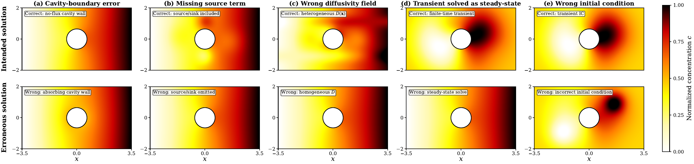

Silent-failure gallery for cavity diffusion simulations. Panels show runnable simulations that produce plausible fields while violating the intended specification: (a) cavity boundary condition, (b) source/sink term, (c) diffusivity field, (d) transient formulation, and (e) initial condition.

Recent LLM-based systems generate scientific simulation code from natural language, including MOOSEnger for MOOSE, MetaOpenFOAM for CFD, and AutoFLUKA for radiation transport (Li et al. 2026; Chen et al. 2024; Ndum et al. 2024). These systems reduce the expertise required to initiate simulations, but their evaluation largely centers on _executability_, conflating syntactic validity with intent fidelity. DPIaC-Eval shows a similar deployment–intent gap (95.5% deployment success vs. 25.2% intent satisfaction) (Zhang et al. 2025); the same failure mode appears in MOOSE (Appendix [[#^motivating-examples-detailed-description|18]]).

We identify this as a _comprehension–generation gap_: LLMs may explain the governing physics correctly, yet fail to encode all required terms in executable simulation code. MOOSE makes this gap structurally verifiable: each Kernel or BC object contributes a specific weak-form or boundary term, so the active object set determines a compact PDE-level representation of the generated input. This enables _intent alignment_: reconstructing the PDE encoded by generated code and comparing it with the user-intended PDE. This raises a concrete question: can the physics encoded in LLM-generated simulation code be verified automatically against the user’s intended PDE, without relying on execution or the model’s own judgment?

Our central contribution is a _physics-level diagnostic layer_ for LLM-generated MOOSE simulations: a framework that exploits MOOSE’s explicit mathematical semantics rather than attempting general-purpose program verification. Around this layer, we make four contributions:

1.  **Silent physics failures and MooseBench.** We show that LLM-generated simulations can execute while encoding incorrect physics, and introduce MooseBench, a 220-case audited benchmark spanning seven physics families with PDE-level ground truth.
    
2.  **Deterministic PDE reconstruction and IFS.** We formalize the kernel$\leftrightarrow$weak-form correspondence, reconstruct the PDE encoded by MOOSE inputs, and define IFS as a weighted structural-fidelity metric with actionable violation reports.
    
3.  **Contract-guided generation and refinement.** We use structured physics contracts as interfaces between intent understanding and code generation, with deterministic violation reports enabling targeted refinement beyond execution-only feedback.
    
4.  **Portability and boundary analysis.** We extend the reconstruction and comparison pattern to UFL/FEniCS, FreeFEM, FiPy, and Devito as proof-of-concept demonstrations. We also report MCS as a limitation-aware diagnostic for the coefficient/material blind spots that structural IFS does not cover.
    

## Related Work ^related-work

##### LLM systems for simulation code. ^llm-systems-for-simulation

A growing line of work applies LLMs to scientific simulation code generation. MOOSEnger (Li et al. 2026) generates MOOSE inputs through a multi-agent pipeline, and MechAgents (Ni and Buehler 2024) uses a similar architecture for mechanics. MetaOpenFOAM (Chen et al. 2024) targets CFD, and AutoFLUKA (Ndum et al. 2024) targets Monte Carlo radiation transport. All four rely on execution-based validation, equating a successful run with functional correctness. We show this signal is insufficient: a MOOSE input can execute and converge while encoding a PDE different from the one specified.

##### Verifying generated code against user intent. ^verifying-generated-code-against

Intent verification for generated code has been studied through specification-based translation (Schellhorn et al. 2024), step-wise verifiers that ask whether each generated step matches user intent (Endres et al. 2024), and policy-guided verifier feedback for Infrastructure-as-Code (Jana et al. 2026). These methods require the verifier itself to reason about correctness, whether through formal proof obligations, LLM critique, or learned policies. We instead exploit MOOSE’s compositional structure, where each Kernel and BC object contributes a fixed weak-form term, reducing verification to a deterministic structural comparison between two PDE objects. Our diagnostic also sits upstream of traditional simulation V&V (Oberkampf and Roy 2010), which assumes the input file already encodes the correct equations.

##### Self-refinement and PDE representations. ^self-refinement-and-pde-representations

LLM self-refinement methods iteratively improve generated code via the model’s own critique (Madaan et al. 2023) or runtime traces (Chen et al. 2023). These signals are themselves produced by the same model that generated the code, leaving them exposed to the comprehension–generation gap we identify. Our refinement instead feeds the LLM a deterministic, structurally computed PDE discrepancy, so missing or extra terms are surfaced explicitly regardless of whether the model would detect them. Prior machine-readable PDE representations (Lample and Charton 2020; Li et al. 2020; Alnæs 2012) encode equations as inputs to models that solve equations, generate code, or constrain physics-aware learning (Liu and Arson 2026; Liu and Arson 2025). Our representation supports verification, which only requires deterministic comparison between two discrete structures and admits a coarser classification-level descriptor.

## MOOSE Semantics and Silent Physics Failures ^moose-semantics-and-silent

### MOOSE Framework: Kernels as Weak-Form Residual Terms ^moose-framework-kernels-as

The MOOSE framework (Permann et al. 2020) solves systems of partial differential equations with the finite element method. Its core abstraction is the _Kernel_, a modular object representing a domain contribution to the weak form; boundary integrals are handled separately by boundary-condition objects. For example, the weak form of the zero-gravity Darcy pressure equation can be written as 

$$
\begin{equation}
\underbrace{\left(\nabla \psi,\frac{K}{\mu}\nabla p\right)}_{\texttt{Kernel}}
-
\underbrace{\left\langle \psi,\frac{K}{\mu}\nabla p \cdot \hat{n}\right\rangle}_{\texttt{Boundary Condition}}
= 0.
\tag{1}
\end{equation}
$$

 The detailed derivation of (1) and its corresponding MOOSE input file structure are given in Appendix [[#^weak-form-derivation-and-moose|10]]. For the representative Kernels covered in Table 6, enumerating the active Kernel and boundary-condition objects in a MOOSE input file reconstructs its encoded weak-form residual for intent-fidelity comparison. The figure below illustrates this mapping on a coupled thermomechanical example.

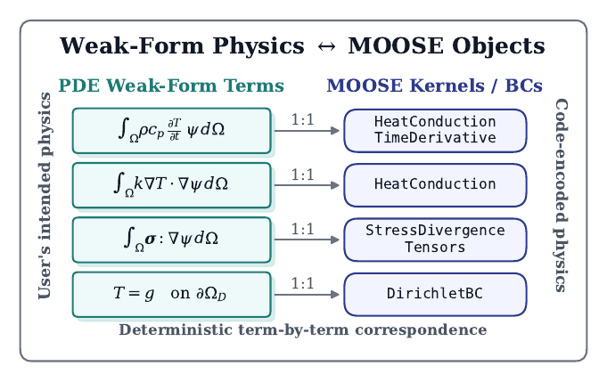

##### MOOSE objects as semantic macros. ^moose-objects-as-semantic

We use _semantic macro_ informally to describe a MOOSE object as a named, reusable unit of PDE semantics. Instantiating an object correctly means satisfying its schema, such as required parameters and valid types; however, this only checks that the object can exist in the input file. Intent fidelity asks a different question: whether the chosen objects collectively encode the weak-form structure intended by the user.

To make this structure explicit, term comparison is keyed by the variable and a normalized PDE operator type drawn from the kernel–PDE mapping table. As a structural witness for each operator type, the table additionally records a descriptor 

$$
(\tau,\phi,\gamma)\in
\mathcal{O}_{\mathrm{trial}}\times
\mathcal{O}_{\mathrm{test}}\times
\mathcal{G},
\quad
|\mathcal{O}_{\mathrm{trial}}|=8,\quad
|\mathcal{O}_{\mathrm{test}}|=4,\quad
|\mathcal{G}|=3,
$$

 capturing the operator on the trial-side quantity, the operator on the test function, and their contraction. This two-level representation makes operator-type assignments auditable against the underlying weak-form contributions rather than taken on faith. Thus, for the covered fragment, reconstruction reduces MOOSE objects to bound normalized PDE terms plus BC, IC, coefficient/material, and time-scheme facts; the full formalization appears in Appendix [[#^operator-type-formalization|15]].

## PDE-Grounded Intent Verification and Generation ^pde-grounded-intent-verification-and

### Problem Formulation ^problem-formulation

Given a natural-language description $d$ of a physical simulation, the task is to generate MOOSE input code $c$ that faithfully encodes the intended physics. We measure fidelity by comparing the physics contract deterministically reconstructed from $c$ against a reference physics contract. Let $\mathcal{P}_{\mathrm{code}}(c)$ denote the contract reconstructed from code $c$, and let $\mathcal{P}_{\mathrm{ref}}$ denote the comparison reference: $\mathcal{P}_{\mathrm{gt}}$ during benchmark evaluation and $\mathcal{P}_{\mathrm{llm}}$ during deployment-time refinement. We use $\mathcal{P}_{\mathrm{cand}}$ for a generic candidate contract. The resulting score is 

$$
\begin{equation}
\mathrm{IFS}\!\left(\mathcal{P}_{\mathrm{ref}},\; \mathcal{P}_{\mathrm{code}}(c)\right)
= 1-\Delta_{\mathrm{phys}}\!\left(\mathcal{P}_{\mathrm{ref}},\; \mathcal{P}_{\mathrm{code}}(c)\right),
\tag{2}
\end{equation}
$$

 where $\Delta_{\mathrm{phys}}$ is the weighted checkpoint discrepancy defined in [[#^intent-fidelity-score-ifs|4.3]], so higher IFS indicates fewer mismatches in the reconstructed physics.

### PDE Formal Representation ^pde-formal-representation

We use a compact representation for the physics encoded by a MOOSE input: 

$$
\begin{equation}
\mathcal{P} = \left(\mathcal{T},\; \mathcal{B},\; \mathcal{I},\; \mathcal{C},\; \mathcal{S},\; \Omega\right),
\tag{3}
\end{equation}
$$

 where $\mathcal{T}$ contains governing-equation terms, $\mathcal{B}$ boundary conditions (BCs), $\mathcal{I}$ initial conditions (ICs), $\mathcal{C}$ coefficient/material facts, $\mathcal{S}$ the time scheme, and $\Omega$ the domain specification. We call this tuple a physics contract when it is used as the reference for synthesis or evaluation. We use the subscript convention introduced in [[#^problem-formulation|4.1]] for ground-truth, LLM-extracted, code-reconstructed, reference, and candidate contracts.

Reconstruction is deterministic for the covered MOOSE fragment: each active Kernel is mapped by $\mathcal{M}$ to a normalized PDE operator type, an optional descriptor witness, a coefficient extraction rule, and a severity weight; BCs and ICs are normalized analogously. The term set $\mathcal{T}$ is keyed by variable and normalized operator type. The mapping is sufficient for the MooseBench coverage; uncovered kernel–term instances are tracked in $\mathcal{U}$ and excluded from IFS computation. Exact coverage statistics appear in Appendix [[#^operator-type-formalization|15]] and Table 6. The full mapping and reconstruction algorithm appear in Appendices [[#^kernel-pde-mapping-table|13]] and [[#^full-system-architecture|11]] (Algorithm 1).

### Intent Fidelity Score (IFS) ^intent-fidelity-score-ifs

IFS compares a reference physics contract $\mathcal{P}_{\mathrm{ref}}$ with a candidate $\mathcal{P}_{\mathrm{cand}}$ through checkpoints $\mathcal{Q}(\mathcal{P}_{\mathrm{ref}})$ induced by the reference. We first define the weighted physics discrepancy: 

$$
\begin{equation}
\Delta_{\mathrm{phys}}(\mathcal{P}_{\mathrm{ref}}, \mathcal{P}_{\mathrm{cand}})
= \frac{
\sum_{j \in \mathcal{Q}(\mathcal{P}_{\mathrm{ref}})}
w_j \cdot \mathbf{1}[\textnormal{fail}_j(\mathcal{P}_{\mathrm{ref}}, \mathcal{P}_{\mathrm{cand}})]
}{
\sum_{j \in \mathcal{Q}(\mathcal{P}_{\mathrm{ref}})} w_j
}.
\tag{4}
\end{equation}
$$

 The reported fidelity score is its complement: 

$$
\begin{equation}
\mathrm{IFS}(\mathcal{P}_{\mathrm{ref}}, \mathcal{P}_{\mathrm{cand}})
=1-\Delta_{\mathrm{phys}}(\mathcal{P}_{\mathrm{ref}}, \mathcal{P}_{\mathrm{cand}}).
\tag{5}
\end{equation}
$$

 where $w_j>0$ is the importance weight of checkpoint $j$, and $\mathbf{1}[\textnormal{fail}_j]$ indicates a checkpoint mismatch. Checkpoints cover terms, BCs, ICs, direct coefficient attributes represented in the contract, and time scheme; variables are aligned by signatures over normalized PDE operator types, so naming differences do not affect the score. Severity weights emphasize equation-structure errors and assign lower weights to parameter-level mismatches. Details on variable alignment, operator-type matching, descriptor auditing, and severity weights are provided in Appendix [[#^operator-type-formalization|15]].

IFS is a structural fidelity score, not a physical validity certificate. It does not assess mesh adequacy, solver convergence, discretization error, or coefficient magnitudes hidden in complex material chains. We use the Material Consistency Score (MCS) as a conditional secondary diagnostic for explicit coefficient/material facts when comparable facts are available; Appendix [[#^mcs-definition-and-boundary|14]] defines and scopes this diagnostic. Within the covered MOOSE semantic fragment, IFS is exact over the induced checkpoints. The representation-relative guarantee and proof appear in Appendix [[#^operator-type-formalization|15]] (Theorems 1–3).

### Error-Guided Refinement ^error-guided-refinement

Before refinement, the system factors synthesis as $d\to\mathcal{P}_{\mathrm{llm}}\to c$: the extracted contract lists governing terms, BCs, ICs, coefficients/material facts, and time scheme, and code generation uses it as a checklist for MOOSE synthesis. After code generation, the system reconstructs $\mathcal{P}_{\mathrm{code}}$ and compares it with $\mathcal{P}_{\mathrm{llm}}$. If $\mathrm{IFS}<\tau_{\mathrm{IFS}}$, a structured violation report in the candidate’s own variable names is fed back to the LLM for targeted correction; the loop repeats until convergence or $N_{\max}$ iterations (Figure 2). The feedback is computed by deterministic physics-contract comparison.

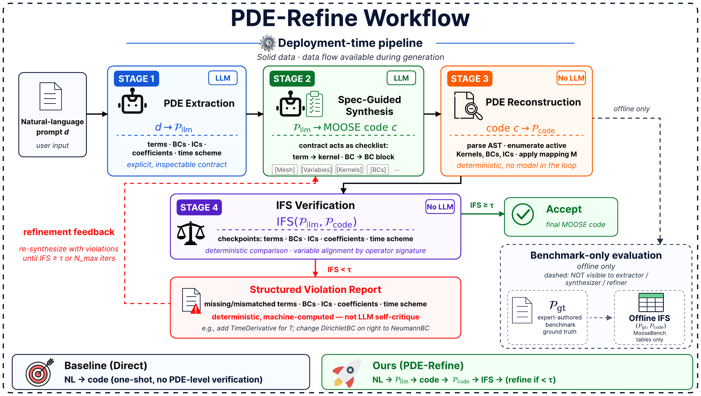

System architecture. The deployment-time loop extracts $\mathcal{P}_{\mathrm{llm}}$, synthesizes MOOSE code, reconstructs $\mathcal{P}_{\mathrm{code}}$, and feeds deterministic IFS violations back for refinement. Offline benchmark evaluation uses $\mathcal{P}_{\mathrm{gt}}$ only after generation; it is never available to the extractor, generator, or refiner.

## MooseBench: A PDE-Grounded Multiphysics Benchmark ^moosebench-a-pde-grounded-multiphysics

We construct **MooseBench**, a 220-case benchmark for AI-assisted multiphysics code generation with deterministic PDE-level ground truth. The benchmark spans seven physics families and three complexity tiers; the full family distribution and tier definitions are reported in Appendix [[#^moosebench-benchmark-details|23]] (Table 16). Prompts vary in verbosity and engineering context, but each is well-posed enough to determine the target PDE, boundary/initial conditions, coefficients, geometry, and time scheme.

### Ground Truth Construction and Audit ^ground-truth-construction-and

For each prompt, an expert-written reference MOOSE input encodes the intended governing equations, BCs, ICs, material properties, and time scheme. Applying the deterministic reconstruction in [[#^pde-formal-representation|4.2]] gives $\mathcal{P}_{\mathrm{gt}}$. To avoid circularity, the audit reviews the prompt, reference input, and reconstructed $\mathcal{P}_{\mathrm{gt}}$ jointly, checking prompt faithfulness, operator coverage, BC/IC consistency, material and time-scheme consistency, and prompt leakage. Kernel variants are canonicalized to normalized PDE operator types by the mapping table, and all benchmark artifacts are released in the supplementary material.

## Experiments ^experiments

### Experimental Setup ^experimental-setup

##### LLMs. ^llms

We evaluate four LLMs spanning capability tiers and providers: Claude Sonnet 4.6 (Anthropic) (Anthropic 2026), GPT-5.4 and GPT-4.1-mini (OpenAI) (OpenAI 2026; OpenAI 2025), and DeepSeek V4 Flash (DeepSeek) (DeepSeek-AI 2026), all at temperature $=0$. Sonnet 4.6, GPT-5.4, and DeepSeek V4 Flash form the main sweep; GPT-4.1-mini serves as a weak-model case study. Two additional models appear in appendix experiments only. Claude Haiku 4.5 (Anthropic 2025) appears in the weak-model registry stress tests, and Gemini 3.1 Flash Lite (Gemini Team, Google 2026) appears in both the mixed-model ablation and weak-model stress tests (Appendix [[#^additional-figures-and-tables|24]]).

##### Method variants. ^method-variants

We organize variants by the feedback source available to the generator. **Direct** maps the prompt directly to MOOSE code. **SpecGen** first extracts an intermediate $\mathcal{P}_{\mathrm{llm}}$ contract and uses it as a synthesis checklist, but receives no deterministic comparison feedback. **PDE-Refine** adds deterministic reconstruction: the generated code is mapped to $\mathcal{P}_{\mathrm{code}}$, compared against $\mathcal{P}_{\mathrm{llm}}$, and corrected using the resulting IFS violation report.

The execution audit holds the object-realization registry (Appendix [[#^object-realization-registry|16.1]]) frozen and varies only the feedback signal: **Exec-Repair+Reg** receives runtime-log feedback, while **PDE-Reg** receives PDE/IFS feedback. Official-document retrieval is reported separately as a secondary access control.

##### Key hyperparameters. ^key-hyperparameters

We use $N_{\max}=2$ refinement iterations, IFS convergence threshold $\tau_{\mathrm{IFS}}=0.85$, and coefficient relative tolerance $\delta_{\mathrm{coef}}=0.1$. Each PDE refinement step uses a regression guard that accepts refined code only when IFS improves. The full reproducibility manifest, including registry-repair settings, the InitExec2 definition, and convergence diagnostics, is in Appendix [[#^reproducibility-manifest|16]] (Table 10) and Appendix [[#^additional-figures-and-tables|24]] (Figure 6).

### Main Results ^main-results

Table 1 reports the 220-case standard non-registry sweeps (parse failures scored as IFS = 0). All three main models are compared under identical Direct/SpecGen/PDE-Refine configurations. Under structural-uniform checkpoint weights, PDE-Refine gains remain positive for all three sweeps; full deltas are reported in Appendix [[#^additional-figures-and-tables|24]] (Table 17).

220-case standard non-registry MooseBench results. IFS is the unconditional mean over all cases with parse failures counted as 0; entries report mean $\pm$ 95% bootstrap half-width over case IDs. **Bold** indicates the best deployable method within each sweep.

| **LLM** | **Direct** | **SpecGen** | **PDE-Refine** |
| --- | --- | --- | --- |
| Claude Sonnet 4.6 | $0.744{\pm}0.032$ | $0.800{\pm}0.023$ | $\mathbf{0.816{\pm}0.021}$ |
| GPT-5.4 | $0.756{\pm}0.033$ | $0.769{\pm}0.028$ | $\mathbf{0.802{\pm}0.025}$ |
| DeepSeek V4 Flash | $0.599{\pm}0.048$ | $0.668{\pm}0.045$ | $\mathbf{0.782{\pm}0.031}$ |

Table 2 reports the controlled deployment audit. **Exec** uses InitExec2: an output is accepted if MOOSE exits with code 0, a solve starts before the first error, or no error appears within 2 seconds—an object-realization signal, not a convergence certificate. **GoodExec** is the fraction of all 220 cases passing Exec with $\mathrm{IFS}\geq0.85$; **FalseExec** is the fraction passing Exec with $\mathrm{IFS}<0.85$.

Deployment audit: PDE feedback vs. execution-only feedback under the same frozen object-realization registry. IFS is unconditional mean IFS; GoodExec and FalseExec are fractions of all cases, not conditional fractions among executed cases.

| **LLM** | **Method** | **IFS** | **Exec** | **GoodExec** | **FalseExec** |
| --- | --- | --- | --- | --- | --- |
| Claude Sonnet 4.6 | Exec-Repair+Reg | 0.753 | 83.2% | 43.2% | 40.0% |
| Claude Sonnet 4.6 | PDE-Reg | **0.854** | **91.4%** | **60.0%** | 31.4% |
| GPT-5.4 | Exec-Repair+Reg | 0.757 | 82.3% | 42.3% | 40.0% |
| GPT-5.4 | PDE-Reg | **0.839** | **86.8%** | **56.8%** | 30.0% |
| DeepSeek V4 Flash | Exec-Repair+Reg | 0.626 | 74.1% | 35.0% | 39.1% |
| DeepSeek V4 Flash | PDE-Reg | **0.824** | **87.7%** | **60.0%** | 27.7% |

**Finding 1: PDE-grounded physics contracts raise fidelity most where direct generation is weak.** Tables 1 and 11 show that PDE-Refine improves the standard semantic sweeps, with the largest gains on weaker models and $\mathrm{IFS}_{\mathrm{Direct}}<0.7$ hard cases.  
**Finding 2: executability and intent fidelity are separable.** Table 2 shows that, under the same frozen registry, PDE-Reg reduces FalseExec and increases GoodExec relative to execution-only repair: object-realization infrastructure can make simulations run, while PDE-grounded feedback is needed to reduce runnable-but-wrong outputs. PDE-Reg also raises Exec itself relative to Exec-Repair+Reg in weaker-model stress tests (GPT-4.1-mini 25.5% $\to$ 63.2%, Gemini 3.1 Flash Lite 51.8% $\to$ 85.0%; Table 21). This is consistent with PDE-grounded feedback producing more self-consistent variable, kernel, BC, and material references, leaving the frozen registry fewer mechanical gaps to resolve (Appendix [[#^execution-based-refinement-failure-analy|21]]).

##### Official-document access control. ^official-document-access-control

We use official-document retrieval as a secondary control, not a main method family. It improves Direct IFS (0.599 to 0.672), but documentation plus execution-only repair mainly raises Exec while leaving a large runnable-but-wrong region (38.2% FalseExec). With the same documents and frozen registry, Docs+PDE-Reg reaches the best IFS and GoodExec in this control (Table 3), supporting the same conclusion: documentation helps object realization, while PDE-level feedback drives the fidelity gain. Leakage controls are reported in Appendix [[#^official-document-rag-diagnostics|12]].

Official-document access control on the full 220-case DeepSeek V4 Flash setting. Exec uses InitExec2; GoodExec and FalseExec are fractions of all cases.

| **Method** | **IFS** | **Exec** | **GoodExec** | **FalseExec** |
| --- | --- | --- | --- | --- |
| DocsDirect | 0.672 | 41.8% | 25.5% | 16.4% |
| Docs+ExecRepair | 0.660 | 74.1% | 35.9% | 38.2% |
| Docs+PDE-Reg | **0.816** | **87.3%** | **58.6%** | 28.6% |

##### Weak-model stress test. ^weak-model-stress-test

We report GPT-4.1-mini, Claude Haiku 4.5, and Gemini 3.1 Flash Lite as appendix stress tests rather than main deployment-audit models. They follow the same qualitative pattern, with PDE-Reg improving fidelity and GoodExec over execution-only repair despite lower absolute model capability (Appendix [[#^additional-figures-and-tables|24]], Table 21).

### Error Analysis ^error-analysis

Direct generation primarily fails through BC mismatches and missing/extra terms, especially in weaker models; coefficient, IC, and time errors are secondary. BC failures rarely occur alone; most co-occur with term, time, or coefficient errors. Coefficient/material-only cases retain high IFS and motivate MCS as a secondary diagnostic. Per-model taxonomy, BC co-attribution, and family/sub-dimensional breakdowns appear in Appendix [[#^additional-figures-and-tables|24]] (Tables 19, 20, and 22).

##### Error detection coverage. ^error-detection-coverage

Table 4 quantifies the IFS detection boundary for Direct outputs. Of 766 imperfect parsed Direct outputs, 87.5% contain a structural component (term, BC, IC, or time scheme error) that IFS detects through the reconstructed physics contract. The remaining 12.5% are coefficient/material-only cases: their mean IFS remains high because the mismatch is not a structural PDE discrepancy, motivating MCS as a conditional diagnostic for comparable coefficient/material facts (Appendix [[#^mcs-definition-and-boundary|14]]).

Error category breakdown under Direct generation (three main sweeps plus the GPT-4.1-mini stress sweep; $n{=}766$ imperfect outputs). IFS detects structural errors; coefficient/material-only errors motivate MCS as a complementary diagnostic.

| **Error Category** | % | **Mean IFS** | **IFS Detects?** |
| --- | --- | --- | --- |
| Structural only (term/time/IC) | 7.4% | 0.60 | Yes |
| BC only | 14.4% | 0.74 | Yes |
| Structural + coefficient | 32.8% | 0.64 | Yes (structural) |
| Mixed structural | 32.9% | 0.25 | Yes |
| Coefficient/material only | 12.5% | 0.94 | No (structural); MCS |

Cross-DSL proof-of-concept results (DeepSeek V4 Flash). “Deploy” uses Direct generation when $\mathrm{IFS}_{\mathrm{Direct}} \geq 0.7$ and physics-contract generation otherwise. $\Delta_{\mathrm{hard}}$ is the PDE-Refine$-$Direct improvement on the hard subset ($\mathrm{IFS}_{\mathrm{Direct}} < 0.7$).

| **DSL** | **Slice** | $\boldsymbol{n}$ | **Direct** | **PDE-Refine** | **Deploy** | $\boldsymbol{\Delta_{\mathrm{hard}}}$ | $\boldsymbol{n_{\mathrm{hard}}}$ |
| --- | --- | --- | --- | --- | --- | --- | --- |
| UFL | Five-family | 25 | 0.779 | 0.779 | **0.851** | +0.455 | 4 |
|  | Hard-stress | 30 | 0.580 | 0.749 | **0.791** | +0.486 | 13 |
|  | Documentation-source | 12 | 0.857 | 0.984 | **0.984** | +0.764 | 2 |
| FreeFEM | Documentation-source | 11 | 0.862 | 0.926 | **0.919** | +0.207 | 3 |
| FiPy | Documentation-source | 7 | 0.769 | 0.943 | **0.933** | +0.574 | 2 |
| Devito | Documentation-source | 9 | 0.793 | 0.831 | **0.829** | +0.109 | 3 |
| **FreeFEM/FiPy/Devito combined** |  | **27** | **0.815** | **0.899** | **0.893** | **+0.262** | **8** |

### Cross-DSL Generalization ^cross-dsl-generalization

We instantiate the same $\mathcal{P}$\-reconstruction/IFS engine on **UFL/FEniCS** (Alnæs 2012), **FreeFEM** (Hecht 2012), **FiPy** (Guyer et al. 2009), and **Devito** (Lange et al. 2016) via framework-specific parsers and static analysis (no runtime execution). Table 5 reports documentation-derived slices and a UFL stress-test slice. The configured deployment setting, which uses physics contract generation only when $\mathrm{IFS}_{\mathrm{Direct}}<0.7$, improves the eight hard non-UFL cases by a mean IFS of $+0.262$, with the strongest gains on FiPy advection and FreeFEM Robin/Helmholtz cases (where DSL syntax differs from typical training data). Adoption requirements per framework are summarized in Table 18.

## Discussion ^discussion

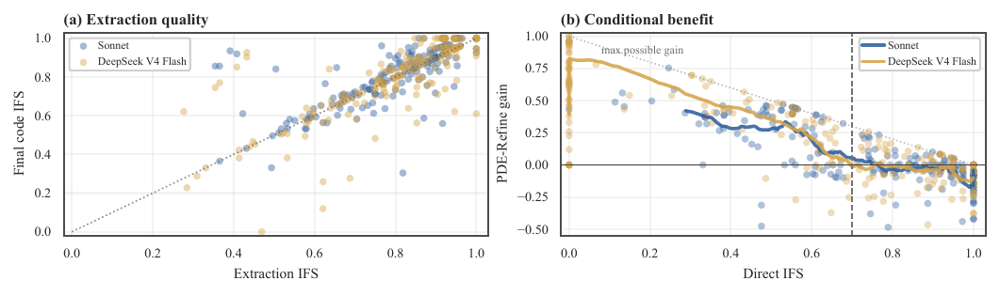

Compact PDE-pipeline diagnostics for two representative 220-case sweeps. (a) PDE extraction quality predicts final code fidelity; the dotted diagonal is the $y=x$ reference, not a fitted trend. (b) PDE-Refine gains concentrate in low-Direct-IFS cases; trend curves summarize rolling means, and the dotted ceiling marks the maximum possible gain $1-\mathrm{IFS}_{\mathrm{Direct}}$.

### Empirical Validation: IFS Detects Structural Physics Errors ^empirical-validation-ifs-detects

Figure 3 summarizes the empirical mechanism. Panel (a) shows that PDE extraction quality predicts final code fidelity: cases with high $\mathcal{P}_{\mathrm{llm}}$ fidelity also achieve high final IFS, supporting the extraction–synthesis factorization underlying mixed-model transfer (Section [[#^mixed-model-pde-contract-transfer|7.2]]). Panel (b) shows that PDE-Refine gains concentrate in low-Direct-IFS cases, with the trend curve approaching the maximum possible gain $1-\mathrm{IFS}_{\mathrm{Direct}}$ in the hard regime.

To validate that IFS captures physically meaningful differences, not merely syntactic discrepancies, we construct 30 MOOSE-executed perturbation pairs spanning structural, boundary-value, and coefficient errors. The set combines controlled edits with perturbations applied to real MooseBench ground-truth files, matching the observed LLM error taxonomy (Table 19). Both versions are run through MOOSE, and we report the final-field relative error $E_{L^2}$ on the common output grid (definition in Appendix [[#^mcs-definition-and-boundary|14]]). All simulations converge successfully, while execution-based testing detects none of these physics errors.

Figure 4a validates IFS’s structural boundary rather than calibrating it to numerical error: structural perturbations fall below high IFS, while coefficient-magnitude errors can remain near $\mathrm{IFS}\approx1.0$ despite nontrivial field error. This blind spot motivates MCS as a conditional secondary diagnostic, not a replacement for IFS. Figure 4b visualizes the complementary diagnostic: on the 220-case GPT-5.4$\rightarrow$DeepSeek V4 Flash PDE-Refine sidecars, MCS identifies 32 high-IFS/low-MCS cases among 176 comparable outputs; point color marks the main coefficient/material mismatch source and black rings mark the repair subset. Appendix [[#^mcs-definition-and-boundary|14]], Table 8, reports that the 22-case repair diagnostic raises mean MCS from 0.316 to 0.985 while preserving structural IFS.

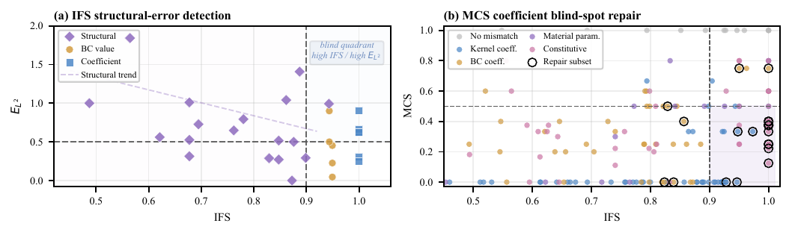

IFS/MCS validation diagnostics. (a) IFS validation on 30 MOOSE-verified perturbation pairs: structural and BC-value errors fall outside the blind quadrant, whereas coefficient errors can remain high-IFS with large field error; all simulations converge. (b) MCS coefficient/material blind-spot repair: the shaded quadrant marks high-IFS/low-MCS cases, colors denote mismatch type, and black rings mark repaired cases.

### Mixed-Model PDE Contract Transfer ^mixed-model-pde-contract-transfer

Because PDE-Refine factors extraction from synthesis, we test whether $\mathcal{P}_{\mathrm{llm}}$ transfers across tested model families (Appendix [[#^additional-figures-and-tables|24]], mixed-model ablation table). GPT-5.4 extraction with DeepSeek generation reaches 0.772 IFS, between DeepSeek self (0.765) and GPT self (0.792); Gemini extraction with DeepSeek shows the same ordering (0.784 vs. 0.765 and 0.796). Contracts transfer across the tested model families, but final quality remains bounded by the generator.

### Scope and Limitations ^scope-and-limitations

**Scope.** IFS checks structural correspondence in the covered MOOSE fragment: terms, BCs, ICs, direct coefficient checkpoints represented in the physics contract, and time scheme. It does not verify mesh quality, solver convergence, discretization error, formal soundness, agreement with measurements, or coefficient/material-only facts outside that reconstructed structural contract. Custom objects and specialized kernel branches outside the covered semantic map require registered mappings for representation-relative claims and are tracked through $\mathcal{U}$ when encountered. Cross-DSL extensions are symbolic-PDE proof-of-concepts, not runtime verification. MCS is the conditional diagnostic for comparable coefficient/material blind spots.

## Conclusion ^conclusion

This paper addresses the comprehension–generation gap for AI-generated MOOSE simulations by separating object executability from PDE intent fidelity. Deterministic reconstruction and IFS turn silent physics mismatches into violation reports; on 220-case MooseBench, PDE-Refine improves fidelity most on weak models and hard cases (+0.22 to +0.41 IFS), and under a frozen object-realization registry, PDE-Reg reduces runnable-but-wrong outputs (Sonnet 4.6 FalseExec 40.0% $\to$ 31.4%) relative to execution-only repair. Mixed-model, MCS, and cross-DSL diagnostics define the boundary of the approach: contracts transfer across tested model families, coefficient/material facts require a secondary diagnostic, and reconstruction-and-comparison extends to DSLs with compositional PDE semantics. The results support treating execution as a runtime-validity check, not as a proxy for the structural fidelity of the encoded physics.

## Code Availability ^code-availability

The code for this work is publicly available at:

[https://github.com/HaningZS/moose-ifs.git](https://github.com/HaningZS/moose-ifs.git)

:::callout {title="Appendix" collapse="closed"}
## Details of the Silent-Failure Simulations ^details-of-the-silent-failure

Figure 1 uses a diffusion problem on a perforated rectangular domain 

$$
\Omega=\Omega_0\setminus\overline{\Omega}_{\rm cav},\qquad
\Omega_0=[-3.5,3.5]\times[-2,2],
\qquad
\Omega_{\rm cav}=\{(x,y):x^2+y^2<R^2\},\quad R=0.65 .
$$

 The intended transient model is 

$$
\partial_t c-\nabla\!\cdot(D(\mathbf{x})\nabla c)=s(\mathbf{x},t)
\quad \textnormal{in } \Omega,
\qquad
\nabla c\cdot\mathbf{n}=0 \quad \textnormal{on } \Gamma_{\rm cav},
\qquad
c(\mathbf{x},0)=c_0(\mathbf{x}).
$$

 Steady-state cases are obtained by omitting the transient term $\partial_t c$.

The five columns perturb different parts of this specification. Panel (a) replaces the no-flux cavity wall with an absorbing cavity boundary. Panel (b) omits the source/sink term. Panel (c) replaces the heterogeneous diffusivity $D(\mathbf{x})$ with a homogeneous coefficient. Panel (d) solves the steady-state problem instead of the intended transient problem. Panel (e) uses an incorrect initial condition. All fields are normalized for visualization.

## Weak-Form Derivation and MOOSE Input Example ^weak-form-derivation-and-moose

To illustrate the kernel–PDE correspondence, consider the zero-gravity, divergence-free form of Darcy’s pressure equation: 

$$
-\nabla \cdot \left(\frac{K}{\mu}\nabla p\right) = 0 \quad \textnormal{in } \Omega .
$$

 Multiplying by a test function $\psi$ and integrating by parts gives the weak-form residual 

$$
\begin{equation}
\underbrace{
\int_\Omega \nabla \psi \cdot \frac{K}{\mu}\nabla p \, d\Omega
}_{\textnormal{Kernel contribution}}
\;-\;
\underbrace{
\int_{\partial\Omega} \psi
\left(\frac{K}{\mu}\nabla p \cdot \mathbf{n}\right)\, d\Gamma
}_{\textnormal{BC contribution}}
= 0 .
\tag{6}
\end{equation}
$$

 The volume term is assembled by a MOOSE Kernel, while the boundary term is imposed through a BC object. The corresponding MOOSE input file is:

```
[Kernels]
  [./diff]
    type = DarcyFluxPressure
    variable = pressure
  [../]
[]

[BCs]
  [./left_bc]
    type = DirichletBC
    variable = pressure
    boundary = left
    value = 1.0e6
  [../]
  [./right_bc]
    type = DirichletBC
    variable = pressure
    boundary = right
    value = 0.0
  [../]
[]

[Materials]
  [./porous]
    type = GenericConstantMaterial
    prop_names = 'permeability viscosity'
    prop_values = '1e-12 1e-3'
  [../]
[]
```

## Full System Architecture ^full-system-architecture

The system factors generation through an explicit physics contract and verifies the generated input by reconstructing its encoded contract. The deterministic reconstruction step is formalized in Algorithm 1.

**Algorithm 1** (PDE reconstruction).

- **Input:** MOOSE input file AST $\mathcal{A}$, Kernel–PDE mapping $\mathcal{M}$
- **Output:** Physics contract $\mathcal{P}_{\mathrm{code}}$

1. $\mathcal{T} \leftarrow \emptyset$; $\mathcal{B} \leftarrow \emptyset$; $\mathcal{I} \leftarrow \emptyset$; $\mathcal{C} \leftarrow \{\}$; $\mathcal{U} \leftarrow \emptyset$
2. $\mathcal{S} \leftarrow$ Transient if $\mathcal{A}$`.Executioner.type` = `Transient` else Steady
3. $\mathcal{U} \leftarrow \mathcal{U} \cup \{\kappa.\texttt{type}\}$; **continue**
4. $(v_\kappa,o_\kappa,\alpha_\kappa) \leftarrow \mathcal{M}[\kappa.\texttt{type}](\kappa.\texttt{params})$
5. $\mathcal{T} \leftarrow \mathcal{T} \cup \{(v_\kappa,o_\kappa,\alpha_\kappa)\}$
6. $\mathcal{B} \leftarrow \mathcal{B} \cup \{(\beta.\texttt{type}, \beta.\texttt{boundary}, \beta.\texttt{value})\}$; similarly for $\mathcal{I}$, $\mathcal{C}$
7. **return** $(\mathcal{T}, \mathcal{B}, \mathcal{I}, \mathcal{C}, \mathcal{S}, \mathcal{A}\texttt{.Mesh}, \mathcal{U})$

##### Stage 1: PDE Intent Extraction. ^stage-1-pde-intent

The extractor receives a natural-language simulation description and produces $\mathcal{P}_{\mathrm{llm}}$, a structured physics contract containing governing terms, BCs, ICs, coefficient/material facts, and time scheme. The output is parsed as JSON before being passed downstream.

##### Stage 2: Specification-Guided Code Synthesis. ^stage-2-specification-guided-code

The generator receives $\mathcal{P}_{\mathrm{llm}}$ and writes a MOOSE input file. The contract is used as a checklist for terms, BCs, ICs, materials, and time scheme rather than as a hidden ground truth.

##### Stage 3: PDE Reconstruction and Verification. ^stage-3-pde-reconstruction

The verifier parses the generated input, extracts kernel, BC, IC, and material blocks, and applies the kernel–PDE mapping to reconstruct $\mathcal{P}_{\mathrm{code}}$. It computes $\mathrm{IFS}(\mathcal{P}_{\mathrm{llm}}, \mathcal{P}_{\mathrm{code}})$ and emits a dimension-wise violation report; when comparable coefficient/material facts exist, the same parse also yields MCS.

##### Stage 4: Error-Guided Refinement. ^stage-4-error-guided-refinement

If $\mathrm{IFS} < \tau_{\mathrm{IFS}}$, the refiner receives the current code and the structured violation report, then makes targeted edits. The revised code is re-verified until convergence or $N_{\max}$ iterations.

##### Prompt-level self-checking. ^prompt-level-self-checking

Generation and refinement prompts ask the model to identify governing equations, select MOOSE objects, and check the file against the provided contract before returning the final input. This is prompt structure rather than an additional verification signal.

##### Iteration and regression guard. ^iteration-and-regression-guard

The refinement loop is bounded by $N_{\max}$ and controlled by the IFS threshold. A regression guard keeps the best-scoring candidate if a refinement step lowers IFS.

##### Mixed-LLM configuration. ^mixed-llm-configuration

Because PDE extraction and code generation are separated by an explicit $\mathcal{P}_{\mathrm{llm}}$ contract, the framework can assign different models to each stage. The 220-case mixed-model ablation in Appendix [[#^additional-figures-and-tables|24]] uses this configuration to cross GPT-5.4, Gemini 3.1 Flash Lite, and DeepSeek V4 Flash as extractor/generator pairs. The cross-model rows diagnose whether the physics contract transfers across providers rather than measuring a new leaderboard method.

##### Execution-based refinement (Exec-Repair) prompt construction. ^execution-based-refinement-exec-repair-p

The Exec-Repair baseline follows the standard self-refinement paradigm (Madaan et al. 2023; Chen et al. 2023): the LLM receives its previously generated code along with the generic instruction “Review your code for correctness and fix any issues.” No physics-specific guidance, PDE-level analysis, or structured violation report is provided. When the LLM encounters blocks referencing undefined variables or material properties, a common repair is _deletion_: removing the problematic block to eliminate the error. This can remove physically necessary kernels. For example, deleting a `TimeDerivative` kernel that referenced an undefined material property resolves the runtime error but changes the PDE from parabolic to elliptic. The resulting code executes successfully but solves a different problem.

## Official-Document RAG Diagnostics ^official-document-rag-diagnostics

The official-document diagnostics isolate document access from PDE-level feedback. They test whether realistic MOOSE documentation snippets, without benchmark answers or PDE violation reports, explain the gains from PDE-grounded verification.

##### Corpus. ^corpus

The main corpus is an official MOOSE object-documentation corpus whose records expose object names, descriptions, and documentation text. The runner also provides core HIT syntax snippets as fallback context. Retrieval is a deterministic keyword top-$k$ over documentation snippets, with at most eight retrieved snippets and a 6000-character prompt budget. No vector index, case library, or generated-answer corpus is used.

##### Diagnostic variants. ^diagnostic-variants

DocsDirect retrieves official documentation before direct code generation. Docs+ExecRepair adds the same object-realization registry and one runtime-log repair round without PDE/IFS feedback, while Docs+PDE-Reg adds the same documentation context to PDE-Reg. These diagnostics test whether official-document access and execution repair alone explain the PDE-grounded gains.

##### Leakage controls. ^leakage-controls

The RAG corpus excludes MooseBench reference inputs, $\mathcal{P}_{\mathrm{gt}}$, generated answers, cached benchmark outputs, and annotated input-card or case-card corpora. In particular, records with answer-like fields such as `input_card_name`, `annotated_input_card`, or `overall_description` are not used, and full HIT input-card shaped records are skipped. DocsDirect and Docs+ExecRepair receive no deterministic PDE reconstruction or IFS violation report. Docs+PDE-Reg uses the same PDE-level feedback as non-document PDE-Reg, but receives no benchmark reference input, no $\mathcal{P}_{\mathrm{gt}}$, and no execution/check-input feedback. Each JSONL result stores `rag_sources`; in the 220-case DeepSeek V4 Flash runs used for Table 3, all records had non-empty official-document sources.

##### Interpretation. ^interpretation

DocsDirect tests documentation access alone; Docs+ExecRepair tests documentation plus execution-only repair; Docs+PDE-Reg tests whether PDE-grounded repair also benefits from the same documents. The results show that official documentation helps Direct generation, but docs plus execution repair still leaves a large FalseExec region. Documentation-conditioned generation does not by itself solve structural PDE alignment or material-value consistency; IFS and MCS handle those semantic checks separately.

## Kernel–PDE Mapping Table ^kernel-pde-mapping-table

Table 6 provides the covered kernel–PDE weak-form mapping table used for MooseBench, including source-grounded weak-form contributions and normalized operator types.

Kernel–PDE mapping table for the covered MOOSE fragment (continued).

| **MOOSE Kernel** | **Operator** | **Variable** | **Canonical Weak-Form Residual Contribution** |
| --- | --- | --- | --- |
| ACGrGrMulti | allen\_cahn | $\eta_i$ | $\left(\psi,\ \mu\!\left(\eta_i^3-\eta_i+2\eta_i\sum_j \gamma_{ij}\eta_j^2\right)\right)$ |
|  | allen\_cahn | $\eta_i$ | $(\kappa_i \nabla \eta_i,\ \nabla(L_i \psi))$ |
|  | allen\_cahn | $\eta_{\alpha i}$ | $\left(\nabla (L \psi), \frac{1}{2} \frac {\partial \kappa} {\partial \nabla \eta_{\alpha i}} \sum (\nabla \eta_{\beta j})^2 \right)$ |
|  | allen\_cahn | $\eta_{\alpha i}$ | $\left( \kappa \nabla \eta_{\alpha i}, \nabla (L \psi) \right)$ |
|  | allen\_cahn | $\eta_i$ | $(\psi,\ \sum_j \frac{\partial h_j}{\partial \eta_i} F_j)$ |
|  | source | $u$ | $(\psi,\,-f)$ |
|  | diffusion | $u$ | $(\nabla \psi,\ \nabla u)$ |
|  | diffusion | $T$ | $(\nabla \psi,\ k \nabla T)$ |
|  | time\_derivative | $T$ | $(\psi,\ \rho c_p \partial_t T)$ |
|  | stress\_divergence | $(u_r,\,u_z)$ | $(\nabla \boldsymbol{\psi},\ \boldsymbol{\sigma}_{RZ}) + (\psi_r/r,\ \sigma_{\theta\theta})$ |
|  | stress\_divergence | $\mathbf{u}$ | $(\nabla \boldsymbol{\psi},\ \boldsymbol{\sigma})$ |
|  | time\_derivative | $u$ | $(\psi,\ \partial_t u)$ |
|  | diffusion | $\mathbf{u}$ | $(\nabla \boldsymbol{\psi},\ \nabla \mathbf{u})$ |
|  | allen\_cahn | $\eta_i$ | $L\left(\dfrac{\partial f_{loc}}{\partial \eta_i} + \dfrac{\partial E_d}{\partial \eta_i},\ \psi_m\right)$ |
|  | diffusion | $u$ | $(\nabla \psi,\ \widetilde{k}\nabla u)$ |
|  | source | $\mathbf{u}$ | $(\boldsymbol{\psi},\ -\mathbf{f})$ |
|  | diffusion | $\mathbf{u}$ | $(\nabla \boldsymbol{\psi},\ \mathbf{D}\nabla \mathbf{u})$ |
|  | reaction | $\mathbf{u}$ | $(\boldsymbol{\psi},\ \mathbf{R}\mathbf{u})$ |
|  | time\_derivative | $\mathbf{u}$ | $(\boldsymbol{\psi},\ \mathbf{T}\,\partial_t \mathbf{u})$ |
|  | source | $u$ | $(\psi,\,-f)$ |
|  | cahn\_hilliard | $c_i$ | $(\kappa_i \nabla^2 c_i,\ \nabla \cdot (M_i \nabla \psi))$ |
|  | other | $c$ | $(\nabla \psi,\ \nabla(c^3-c))$ |
|  | cahn\_hilliard | $j$ | $(\psi,\ j + M\nabla \mu)$ |
|  | cahn\_hilliard | $c_i$ | $\left(M_i \left(\nabla \dfrac{\partial f_{loc}}{\partial c_i} + \nabla \dfrac{\partial E_d}{\partial c_i}\right),\ \nabla \psi\right)$ |
|  | diffusion | $u$ | $(\nabla \psi,\ D \nabla u)$ |
|  | reaction | $u$ | $(\psi,\ \lambda u)$ |
|  | time\_derivative | $u$ | $(\psi,\ \alpha \partial_t u)$ |
|  | advection | $u$ | $-(\nabla \psi,\ \mathbf{v}u)$ |
|  | stress\_divergence | $\mathbf{u}$ | $(\nabla \boldsymbol{\psi},\ \boldsymbol{\sigma}_{\mathrm{Cosserat}})$ |
|  | other | $C_j$ | $(\psi,\ \partial_t(\phi \sum_i \nu_{ji} C_i))$ |
|  | other | $C_m$ | $(\psi,\ \partial_t(\phi \sum_m w_m C_m))$ |
|  | reaction | $C_j$ | $(\psi,\ \mathbf{q}\cdot \nabla(\sum_i \nu_{ji} C_i))$ |
|  | diffusion | $C_j$ | $(\nabla \psi,\ D \nabla (\sum_i \nu_{ji} C_i))$ |
|  | source | $u$ | $(\psi,\ -\alpha v)$ |
|  | time\_derivative | $\eta_i$ | $\left(\psi,\ \left(\sum_j \frac{\partial h_j}{\partial \eta_i} F_j\right)\partial_t v\right)$ |
|  | time\_derivative | $u$ | $(\psi,\ \partial_t v)$ |
|  | curl\_curl | $\mathbf{u}$ | $(\nabla \times \boldsymbol{\psi},\ a\,\nabla \times \mathbf{u})$ |
|  | other | $P$ | $(\nabla \psi,\ \dfrac{K}{\mu}(\nabla P-\rho \mathbf{g}))$ |
|  | source | $m$ | $(\psi,\ \dot{m})$ |
|  | source | $m$ | $(\psi,\ -\dot{m})$ |
|  | diffusion | $u$ | $(\nabla \psi,\ \nabla u)$ |
|  | stress\_divergence | $\mathbf{u}$ | $(\nabla \boldsymbol{\psi},\ \boldsymbol{\sigma}_{\mathrm{dyn}})$ |
|  | diffusion | $u$ | $(\nabla \psi,\ f(\mathbf{x},t)\nabla v)$ |
|  | other | $u$ | $(\psi,\ \pm (p-u))$ |
|  | other | $u$ | $(\psi,\ u - \partial_\alpha v)$ |
|  | source | $\mathbf{u}$ | $(\boldsymbol{\psi},\ \mathbf{g})$ |
|  | diffusion | $T$ | $(\nabla \psi,\ k \nabla T)$ |
|  | time\_derivative | $T$ | $(\psi,\ \rho C_p \partial_t T)$ |
|  | source | $T$ | $(\psi,\ -\dot{q})$ |
|  | ns\_continuity | $p$ | $(\psi,\ \nabla \cdot \mathbf{u})$ |
|  | advection | $\mathbf{u}$ | $(\boldsymbol{\psi},\ \rho (\mathbf{u}\cdot\nabla)\mathbf{u})$ |
|  | ns\_pressure | $\mathbf{u}$ | $-(\nabla \cdot \boldsymbol{\psi},\ p)$ |
|  | ns\_viscous | $\mathbf{u}$ | $(\tau\,\mathbf{u}\cdot\nabla \boldsymbol{\psi},\ \mathbf{R}_{\mathrm{mom}})$ |
|  | ns\_viscous | $\mathbf{u}$ | $(\nabla \boldsymbol{\psi},\ \boldsymbol{\tau})$ |
|  | ns\_continuity | $p$ | $-\rho \,\bar{\mathbf{v}} \cdot \nabla \psi$ |
|  | ns\_viscous | $\mathbf{v}$ | $\rho\,\epsilon\,(\mathbf{v}\cdot\nabla\mathbf{v})\,\psi+\epsilon\,(\nabla p)\,\psi-\epsilon\rho\mathbf{g}\,\psi+\boldsymbol{\tau}\cdot\nabla\psi+\mathbf{f}_{\mathrm{fric}}\,\psi$ |
|  | ns\_continuity | $p$ | $(\psi,\ -\nabla \cdot \mathbf{u})$ |
|  | ns\_viscous | $\mathbf{u}$ | $(\nabla \boldsymbol{\psi},\ \mu \nabla \mathbf{u})$ |
|  | time\_derivative | $\mathbf{u}$ | $(\boldsymbol{\psi},\ \rho\,\partial_t \mathbf{u})$ |
|  | inertia | $\mathbf{u}$ | $(\boldsymbol{\psi},\ \rho\,\ddot{\mathbf{u}}+\eta\,\rho\,\dot{\mathbf{u}})$ |
|  | inertia | $\mathbf{u}$ | $(\psi,\ \rho\,\epsilon_{ijk}u_j\ddot{u}_k)$ |
|  | allen\_cahn | $\eta_1$ | $\left(\psi,\ -\dfrac{\partial F_1}{\partial c_1}\sum_j \dfrac{\partial h_j}{\partial \eta_1} c_j\right)$ |
|  | allen\_cahn | $\eta_i$ | $\left(\psi,\ \sum_j \dfrac{\partial h_j}{\partial \eta_i}F_j + w_i\dfrac{\partial g_i}{\partial \eta_i}\right)$ |
|  | other | $c_a$ | $\left(\psi,\ \dfrac{\partial F_a}{\partial c_a}\dfrac{1}{k_a}-\dfrac{\partial F_b}{\partial c_b}\dfrac{1}{k_b}\right)$ |
|  | other | $u$ | $\lambda(\psi,\ -c\,u)$ |
|  | time\_derivative | $u$ | $(\psi,\ \partial_t u)$ |
|  | diffusion | $u$ | $(\nabla \psi,\ D\nabla u)$ |
|  | reaction | $u$ | $(\psi,\ -L\,v)$ |
|  | allen\_cahn | $\eta_i$ | $\left(\psi,\ -\sum_m \frac{\partial F_1}{\partial c_{m,1}} \sum_j \frac{\partial h_j}{\partial \eta_i} c_{m,j}\right)$ |
|  | allen\_cahn | $\eta_i$ | $\left(\psi,\ \sum_j \dfrac{\partial h_j}{\partial \eta_i}F_j + w_i\dfrac{\partial g_i}{\partial \eta_i}\right)$ |
|  | other | $u$ | $(\psi,\ 0)$ |
|  | time\_derivative | $p$ | $\left(\psi,\ \epsilon \left(\dfrac{\partial \rho}{\partial T}\dot{T}+\dfrac{\partial \rho}{\partial p}\dot{p}\right)\right)$ |
|  | time\_derivative | $v_i$ | $\left(\psi,\ \rho \dfrac{\partial v_i}{\partial t} + v_i \dfrac{\partial \rho}{\partial t}\right)$ |
|  | advection | $\chi_\beta^\kappa$ | $\left(\nabla\psi,\ \sum_{\beta}\chi_\beta^\kappa \rho_\beta \dfrac{k\,k_{r,\beta}}{\mu_\beta}\left(\nabla P_\beta-\rho_\beta \mathbf{g}\right)\right)$ |
|  | advection | $u$ | $-(\nabla\psi,\ \mathbf{v}_\beta u)$ |
|  | diffusion | $\chi_\beta^\kappa$ | $\left(\nabla\psi,\ \sum_{\beta}\rho_\beta \mathbf{D}_\beta^\kappa \nabla X_\beta^\kappa\right)$ |
|  | pf\_effective\_stress | $\mathbf{u}$ | $-\alpha_B\,p_{\mathrm{eff}}\,\partial_{x_c}\psi$ |
|  | time\_derivative | $T$ | $\left(\psi,\ \partial_t\left((1-\phi)e_r+\phi\sum_{\beta}S_\beta \rho_\beta e_\beta\right)\right)$ |
|  | advection | $u$ | $\left(\nabla\psi,\ \sum_{\beta}\chi_\beta^\kappa \rho_\beta \dfrac{k\,k_{r,\beta}}{\mu_\beta}\left(\nabla P_\beta-\rho_\beta \mathbf{g}\right)\right)$ |
|  | advection | $\chi^\kappa$ | $\left(\nabla\psi,\ (\rho)\chi^\kappa \dfrac{k}{\mu}\left(\nabla P-\rho \mathbf{g}\right)\right)$ |
|  | pf\_darcy\_flux | $P$ | $\left(\nabla\psi,\ (\rho)\dfrac{k}{\mu}\left(\nabla P-\rho \mathbf{g}\right)\right)$ |
|  | advection | $\chi^\kappa$ | $\left(\nabla\psi,\ (\rho)\chi^\kappa \dfrac{k}{\mu}\left(\nabla P-\rho \mathbf{g}\right)\right)$ |
|  | advection | $h$ | $\left(\nabla\psi,\ \sum_{\beta} h_\beta \rho_\beta \dfrac{k\,k_{r,\beta}}{\mu_\beta}\left(\nabla P_\beta-\rho_\beta \mathbf{g}\right)\right)$ |
|  | diffusion | $T$ | $(\nabla\psi,\ \lambda \nabla T)$ |
|  | other | $u$ | $(\psi,\ k_{\mathrm{tr}}(u-v))$ |
|  | time\_derivative | $\chi^\kappa$ | $\left(\psi,\ \partial_t\!\left(\phi \sum_{\beta} (\rho_\beta) S_\beta \chi_\beta^\kappa\right)\right)$ |
|  | source | $\chi^\kappa$ | $\left(\psi,\ \phi \sum_{\beta} (\rho_\beta) S_\beta \chi_\beta^\kappa \,\dot{\epsilon}_v\right)$ |
|  | reaction | $c_i$ | $\left(\psi,\ \phi\,S_{\mathrm{aq}}\sum_r \nu_{ir}\rho_r R_r\right)$ |
|  | advection | $u$ | $(\psi,\ \mathbf{v}_D\cdot\nabla u)$ |
|  | diffusion | $c_j$ | $-(\nabla\psi,\ \phi D \nabla c_j)$ |
|  | time\_derivative | $c_j$ | $\left(\psi,\ \phi \dfrac{\partial c_j}{\partial t}\right)$ |
|  | reaction | $u$ | $(\psi,\ \lambda u)$ |
|  | cahn\_hilliard | $c$ | $\left(-\kappa_i \nabla^2 c_i + \dfrac{\partial f_{loc}}{\partial c_i} + \dfrac{\partial E_d}{\partial c_i} - \mu_i\right)$ |
|  | cahn\_hilliard | $w$ | $(M\nabla u,\nabla\psi)$ |
|  | stress\_divergence | $\mathbf{u}$ | $(\nabla\boldsymbol{\psi},\ \boldsymbol{\sigma})$ |
|  | stress\_divergence | $\mathbf{u}$ | $(\nabla\boldsymbol{\psi},\ \boldsymbol{\sigma})$ |
|  | time\_derivative | $u$ | $\left(\psi,\ F(u,a,b,\ldots)\,\partial_t u\right)$ |
|  | time\_derivative | $u$ | $(\psi,\ \partial_t u)$ |
|  | source | $\mathbf{u}$ | $(\boldsymbol{\psi},\ -\mathbf{f})$ |
|  | diffusion | $\mathbf{u}$ | $(\nabla\boldsymbol{\psi},\ \nabla \mathbf{u})$ |
|  | reaction | $\mathbf{u}$ | $(\boldsymbol{\psi},\ \lambda(\mathbf{x},t)\mathbf{u})$ |
|  | time\_derivative | $\mathbf{u}$ | $(\boldsymbol{\psi},\ \partial_t \mathbf{u})$ |

Representative boundary-condition mappings in MOOSE; these follow the same normalization logic as the kernel–PDE mappings.

| **MOOSE BC** | **Mathematical Form** | **Type** |
| --- | --- | --- |
| `DirichletBC` | $u = g \quad \textnormal{on } \partial\Omega_D$ | Dirichlet (essential) |
| `FunctionDirichletBC` | $u = g(t,\mathbf{x}) \quad \textnormal{on } \partial\Omega_D$ | Dirichlet (space/time-dependent) |
| `FunctorDirichletBC` | $u = h(t,\mathbf{x},\ldots) \quad \textnormal{on } \partial\Omega_D$ | Dirichlet (functor-based) |
| `PenaltyDirichletBC` | $u = g \quad \textnormal{on } \partial\Omega_D$ | Dirichlet (penalty/weak) |
| `PostprocessorDirichletBC` | $u = g_{\mathrm{pp}} \quad \textnormal{on } \partial\Omega_D$ | Dirichlet (postprocessor-driven) |
| `NeumannBC` | $\dfrac{\partial u}{\partial n} = h \quad \textnormal{on } \partial\Omega_N$ | Neumann (prescribed flux) |
| `FunctionNeumannBC` | $\dfrac{\partial u}{\partial n} = h(t,\mathbf{x}) \quad \textnormal{on } \partial\Omega_N$ | Neumann (space/time-dependent) |
| `FunctorNeumannBC` | $\dfrac{\partial u}{\partial n} = h(t,\mathbf{x},\ldots) \quad \textnormal{on } \partial\Omega_N$ | Neumann (functor-based) |
| `CoupledVarNeumannBC` | $\dfrac{\partial u}{\partial n} = v \quad \textnormal{on } \partial\Omega_N$ | Neumann (coupled-variable) |
| `MatNeumannBC` | $\dfrac{C\,\partial u}{\partial n} = M\,h \quad \textnormal{on } \partial\Omega_N$ | Neumann (material-scaled flux) |
| `FunctionGradientNeumannBC` | $-\langle \psi_i,\mathbf{n}\!\cdot\! k\nabla f\rangle \quad \textnormal{on } \partial\Omega_N$ | Neumann (gradient-based weak form) |
| `ConvectiveHeatFluxBC` | $\mathbf{q}\cdot\hat{\mathbf{n}} = h(T-T_\infty) \quad \textnormal{on } \partial\Omega$ | Robin (convective heat transfer) |
| `VacuumBC` | $\displaystyle \int_{\partial\Omega}\frac{\alpha\,u(\mathbf{r})\,\psi_t(\mathbf{r})}{2}\,dS$ | Robin (vacuum-type) |
| `DiffusionFluxBC` | $-\displaystyle\int_{\partial\Omega_F}\frac{\partial u}{\partial n}\,v\,ds$ | Flux contribution (residual only) |
| `Periodic BC` | $u(\mathbf{x}_s)=u(\mathbf{x}_m)$ on paired boundaries | Periodic constraint |
| `PorousFlowSink` | $s=f(t,\mathbf{x}) \quad \textnormal{on } \partial\Omega$ | PorousFlow sink/source flux BC |
| `PorousFlowPiecewiseLinearSink` | $s=f(t,\mathbf{x})\,g(P^\beta-P_e) \quad \textnormal{on } \partial\Omega$ | PorousFlow piecewise-linear sink/source BC |
| `PorousFlowOutflowBC` | $\displaystyle \int_{\partial\Omega}\psi\,\mathbf{n}\cdot\mathbf{F}$ | PorousFlow outflow flux contribution |

## MCS Definition and Boundary Diagnostics ^mcs-definition-and-boundary

MCS is a limitation-aware diagnostic for the coefficient/material blind spot of structural IFS. It is reported only when comparable material or coefficient facts can be extracted from both reference and candidate files. For the MOOSE perturbation study in Figure 4a, we compute $E_{L^2}=\|\mathbf{u}_{\mathrm{pert}}-\mathbf{u}_{\mathrm{gt}}\|_2/ \max(\|\mathbf{u}_{\mathrm{gt}}\|_2,10^{-15})$ on the common output grid, where $\mathbf{u}_{\mathrm{pert}}$ and $\mathbf{u}_{\mathrm{gt}}$ are the concatenated final solution vectors.

**Definition 1** (MCS diagnostic facts). Let $\mathcal{F}(c)$ be the set of normalized coefficient/material facts extracted from a MOOSE input file, including material-backed kernel coefficients, convective/Robin BC coefficients, material model signatures, and uncovered constitutive parameters. For comparable reference and candidate facts, 

$$
\begin{equation}
\mathrm{MCS}(c_{\mathrm{ref}}, c_{\mathrm{cand}}) =
\frac{1}{|\mathcal{F}_{\mathrm{ref}}|}
\sum_{f \in \mathcal{F}_{\mathrm{ref}}}
\mathbf{1}\!\left[\exists g \in \mathcal{F}_{\mathrm{cand}}:
\operatorname{key}(g)=\operatorname{key}(f) \wedge \operatorname{value}(g)\approx\operatorname{value}(f)\right].
\tag{7}
\end{equation}
$$

 Here $\approx$ denotes the normalized fact comparator: scalar values use the same reference-relative numerical tolerance as $\approx_{\delta}$ in Definition 7, categorical material signatures use exact normalized matching, and structured values are compared by their normalized representation. MCS is undefined when no comparable reference facts exist. It is a coefficient/material diagnostic for high-IFS blind spots, not part of IFS term matching or descriptor-level structural auditing.

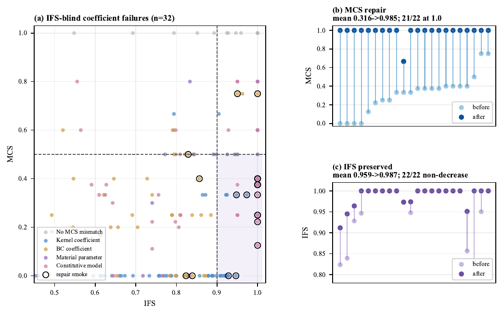

Full MCS blind-spot and repair diagnostic, referenced from [[#^empirical-validation-ifs-detects|7.1]]. The left panel shows high-IFS/low-MCS coefficient/material blind spots; black rings mark the 22-case repair subset. The right panels show that MCS repairs remove almost all coefficient/material mismatches while preserving structural IFS.

MCS coefficient/material diagnostics. The survey uses the 220-case post-guard GPT-5.4$\rightarrow$DeepSeek V4 Flash PDE-Refine sidecars; the repair diagnostic uses 22 representative blind-spot cases repaired by DeepSeek V4 Flash from only the MCS mismatch facts and the candidate code.

| **Quantity** | **Survey / before repair** | **After repair** |
| --- | --- | --- |
| Comparable generated outputs | 176 / 220 | – |
| High-IFS / low-MCS outputs | 32 | – |
| Mismatch facts | kernel 125; BC 79; material 279; model 110 |  |
| Repair smoke cases | 22 | 22 |
| Accepted local repairs | – | 22 / 22 |
| Mean IFS | 0.959 | 0.987 |
| Mean MCS | 0.316 | 0.985 |
| Mean MCS mismatches | 3.91 | 0.05 |
| Cases with MCS$=1.0$ | 0 / 22 | 21 / 22 |

Relationship between IFS and MCS in deployment. IFS remains the main structural gate; MCS is a conditional secondary check for explicit material/coefficient facts.

| **Gate** | **Purpose** | **Always available?** | **Main-text role** |
| --- | --- | --- | --- |
| IFS | PDE structural fidelity | Yes, within covered fragment | Main metric |
| MCS | Explicit material/coefficient consistency | Only when comparable facts exist | Boundary diagnostic |

## Operator-Type Formalization ^operator-type-formalization

This appendix formalizes the two-level representation used by reconstruction and IFS: normalized PDE operator types are the comparison keys, while weak-form descriptors are structural witnesses for auditing the mapping table.

**Definition 2** (Operator sets). 

$$
\begin{align}
\mathcal{O}_{\mathrm{trial}} &= \{\texttt{identity}, \texttt{grad}, \texttt{div}, \texttt{curl}, \texttt{ddt}, \texttt{ddt2}, \texttt{stress}, \texttt{strain}\}\qquad\textnormal{(8)}\\
\mathcal{O}_{\mathrm{test}} &= \{\texttt{identity}, \texttt{grad}, \texttt{div}, \texttt{curl}\}\qquad\textnormal{(9)}\\
\mathcal{G} &= \{\texttt{scalar\_mult}, \texttt{dot}, \texttt{double\_dot}\}\qquad\textnormal{(10)}
\end{align}
$$

 $\mathcal{O}_{\mathrm{trial}}$ describes operators on the trial-side quantity, $\mathcal{O}_{\mathrm{test}}$ describes operators on the test function, and $\mathcal{G}$ describes the contraction mode.

**Definition 3** (Normalized PDE operator type and descriptor projection). Let $\mathcal{O}_{\mathrm{PDE}}$ be the finite inventory of normalized PDE operator types in the kernel–PDE mapping table. When an operator type has a weak-form witness, the table records the partial descriptor projection 

$$
\begin{equation}
d:\mathcal{O}_{\mathrm{PDE}}\rightharpoonup
\mathcal{O}_{\mathrm{trial}}\times\mathcal{O}_{\mathrm{test}}\times\mathcal{G}.
\tag{11}
\end{equation}
$$

 Here $\rightharpoonup$ denotes a partial function: $d(o)$ is defined only when the operator type $o$ has an associated weak-form descriptor in the mapping table.

_Remark 1_ (Role of the descriptor). The operator type $o\in\mathcal{O}_{\mathrm{PDE}}$ is the term-comparison key; the descriptor $d(o)$ is its weak-form witness. Together they make the kernel–PDE mapping table auditable: operator-type assignments are justified by the corresponding weak-form contributions recorded in the table, while IFS scoring uses normalized operator-type equality.

**Definition 4** (Bound PDE term). 

$$
\begin{equation}
\mathrm{BoundTerm} := (v,\; o,\; \alpha), \qquad
v\in\mathrm{Variables},\; o\in\mathcal{O}_{\mathrm{PDE}},\;
\alpha\in\mathbb{R}\cup\{\bot\}.
\tag{12}
\end{equation}
$$

 Here $\alpha=\bot$ denotes a unit coefficient (unspecified or identically 1). Descriptor metadata remains attached to $o$ through the mapping table; it is not part of the runtime term key.

**Definition 5** (Kernel–PDE mapping). $\mathcal{M}$ maps each covered MOOSE kernel class deterministically to a normalized PDE operator type, coefficient extraction rule, severity weight, and optional descriptor witness. Applied to a concrete kernel block $\kappa$, it yields a bound term $(v_\kappa,o_\kappa,\alpha_\kappa)$. The paper table documents 762 of 766 MooseBench ground-truth kernel-term instances (99.48%) with source-grounded weak-form contributions; BC and IC maps contain 16 and 21 entries, respectively.

**Definition 6** (Descriptor structural equivalence). For available descriptors $d_a=(\tau_a,\phi_a,\gamma_a)$ and $d_b=(\tau_b,\phi_b,\gamma_b)$, 

$$
\begin{equation}
d_a \sim_s d_b \iff \tau_a = \tau_b \wedge \phi_a = \phi_b \wedge \gamma_a = \gamma_b .
\tag{13}
\end{equation}
$$

**Proposition 1**. _$\sim_s$ is an equivalence relation on available weak-form descriptors._

_Proof._ $\sim_s$ is the conjunction of equality on three descriptor components. ◻

_Remark 2_ (Audit-only structural relation). $\sim_s$ is used only for descriptor-level auditing; IFS scoring uses operator-type equality on $\mathcal{O}_{\mathrm{PDE}}$ and does not depend on $\sim_s$.

**Definition 7** (Coefficient-tolerant match). For an ordered reference–candidate pair of bound terms $t_{\mathrm{ref}}=(v_{\mathrm{ref}},o_{\mathrm{ref}},\alpha_{\mathrm{ref}})$ and $t_{\mathrm{cand}}=(v_{\mathrm{cand}},o_{\mathrm{cand}},\alpha_{\mathrm{cand}})$, 

$$
\begin{equation}
t_{\mathrm{ref}} \approx_{\delta} t_{\mathrm{cand}}
\iff
v_{\mathrm{ref}}=v_{\mathrm{cand}} \wedge
o_{\mathrm{ref}}=o_{\mathrm{cand}} \wedge
\frac{|\alpha_{\mathrm{ref}}-\alpha_{\mathrm{cand}}|}
{\max(|\alpha_{\mathrm{ref}}|,\epsilon_0)}
\leq \delta_{\mathrm{coef}} .
\tag{14}
\end{equation}
$$

 Here $\delta_{\mathrm{coef}}$ is the coefficient relative tolerance (default 0.1), and $\epsilon_0$ prevents division by zero.

_Remark 3_ (Reference-relative coefficient matching). The predicate $\approx_{\delta}$ is reference-relative: for $\delta_{\mathrm{coef}}>0$ it is generally neither symmetric nor transitive. This asymmetry is intentional, because IFS scores candidate checkpoints against the fixed reference-induced set $\mathcal{Q}(\mathcal{P}_{\mathrm{ref}})$ rather than comparing two terms as an unordered pair. The reference coefficient $\alpha_{\mathrm{ref}}$ defines the tolerance scale, consistent with $\mathcal{P}_{\mathrm{ref}}$ serving as ground truth during evaluation and as the LLM-extracted contract during deployment-time refinement.

##### Severity weight table. ^severity-weight-table

Each IFS checkpoint inherits a severity weight from the mapping table, reflecting the physical impact of the error type:

IFS severity weights (6-level, expert-defined).

| **Severity** | **Weight** | **Justification** |
| --- | --- | --- |
| Highest | 4.0 | Missing/wrong time derivative or inertial term (changes PDE class) |
| Very High | 3.0 | Wrong dominant operator (changes PDE structure) |
| High | 2.0 | Coupling term missing, BC/IC type wrong (breaks constraints) |
| Medium | 1.0 | Value-level change with correct operator (quantitative error) |
| Medium-Low | 0.7 | Source/forcing term missing (quantitative $>$ structural impact) |
| Low | 0.5 | Non-physics metadata issue |

##### Variable alignment procedure. ^variable-alignment-procedure

Before IFS comparison, candidate variable names are aligned to reference names via operator-signature matching. For each variable $v$, its _operator signature_ $\sigma(v) = \operatorname{sort}(\{o_i : t_i \textnormal{ acts on } v\})$ is the sorted set of normalized PDE operator types. A 1:1 mapping is found between reference and candidate variables with matching signatures. When multiple candidates share identical signatures (e.g., two species with identical diffusion–reaction equations), the mapping is disambiguated by: (1) boundary condition alignment (matching boundary names and values), and if needed, (2) coefficient values. All subsequent IFS comparisons use the aligned names.

**Definition 8** (Term set of a PDE). $\mathcal{T} = \{(v_i,o_i,\alpha_i)\}_{i=1}^{n}$, i.e., a PDE is represented as the set of bound normalized PDE terms.

**Definition 9** (Term matching function). Given reference $\mathcal{T}_{\mathrm{ref}}$ and candidate $\mathcal{T}_{\mathrm{cand}}$: 

$$
\begin{equation}
\operatorname{match}(t_{\mathrm{ref}}) =
\begin{cases}
t_{\mathrm{cand}} & \textnormal{if } \exists\, t_{\mathrm{cand}}\in\mathcal{T}_{\mathrm{cand}}:
v_{\mathrm{ref}}=v_{\mathrm{cand}} \wedge o_{\mathrm{ref}}=o_{\mathrm{cand}}, \\
\bot & \textnormal{otherwise (missing term).}
\end{cases}
\tag{15}
\end{equation}
$$

 Extra terms are $\mathcal{T}_{\mathrm{extra}}=\mathcal{T}_{\mathrm{cand}}\setminus\operatorname{range}(\operatorname{match})$.

**Theorem 1** (Reconstruction soundness). _Let $c$ be a syntactically valid MOOSE input file and $\mathcal{M}$ a correct kernel–PDE mapping. Then $\mathcal{P}_{\mathrm{code}}=\operatorname{reconstruct}(c,\mathcal{M})$ satisfies: (a) Completeness: every covered active kernel has a corresponding bound term; (b) Fidelity: each bound term uses the normalized operator type and descriptor witness, when defined, specified by $\mathcal{M}$; (c) No spurious terms: $|\mathcal{T}| = |\{\textnormal{covered active kernels}\}|$._

_Proof sketch._ By construction of Algorithm 1: the algorithm iterates all kernel blocks, applies $\mathcal{M}$ to covered kernels, and adds exactly one bound term per covered kernel. Unknown kernels are tracked in `unresolved_kernels` and reported diagnostically. ◻

**Theorem 2** (IFS soundness). _If $\mathrm{IFS}(\mathcal{P}_{\mathrm{ref}}, \mathcal{P}_{\mathrm{cand}}) = 1.0$, then: (a) a bijection $\sigma: \mathcal{T}_{\mathrm{ref}} \to \mathcal{T}_{\mathrm{cand}}$ exists with matching variables and normalized PDE operator types; (b) all BC checkpoints pass their type, boundary, and value predicates; (c) all IC checkpoints pass their type and value predicates; (d) time schemes agree; (e) all reference coefficient checkpoints are matched by the candidate under $\approx_{\delta}$._

_Proof._ IFS $= 1.0$ implies zero failed weight across all dimensions. For terms, zero failures means no missing and no extra terms, yielding a bijection over aligned variables and normalized operator types. For BCs, ICs, time scheme, and coefficients, zero failures means every reference-induced checkpoint predicate passes, including coefficient matches under $\approx_{\delta}$. ◻

**Theorem 3** (Representational completeness). _Let $\mathcal{P}_{\mathrm{ref}}$ and $\mathcal{P}_{\mathrm{cand}}$ be two aligned PDE representations. If they differ in any represented dimension covered by the checkpoint set $\mathcal{Q}(\mathcal{P}_{\mathrm{ref}})$—i.e., there exists a reference term with no candidate term sharing the aligned variable and normalized PDE operator type, or an attribute (type, value, boundary) fails its prescribed reference-induced predicate—then at least one checkpoint fails and $\mathrm{IFS}(\mathcal{P}_{\mathrm{ref}}, \mathcal{P}_{\mathrm{cand}}) < 1$._

_Proof._ By construction, every represented reference item induces at least one checkpoint with positive weight $w_j > 0$. If the candidate differs on that item, the corresponding checkpoint predicate evaluates to failure ($\mathbf{1}[\textnormal{fail}_j] = 1$). The IFS numerator therefore contains at least one positive term, making the penalty nonzero and $\mathrm{IFS} < 1$. ◻

**Corollary 1**. _Combining Theorems 1–3: within the covered MOOSE semantic fragment, reported violations correspond to reconstructed PDE mismatches, and all represented mismatches are detected as failed checkpoints._

_Remark 4_ (Severity weight design). The six-level severity assignment (highest: 4.0 down to low: 0.5) encodes a domain-expert prior over typical physical impact: errors changing PDE _type_ receive the largest weights; errors changing coefficient _values_ receive lower structural-fidelity weights. The numerical values are engineering choices rather than universal physical constants; their relative ordering reflects typical impact severity in multiphysics practice. The severity of each checkpoint is inherited from the normalized operator type and checkpoint dimension in the domain-expert-annotated mapping table (Appendix [[#^kernel-pde-mapping-table|13]]).

## Reproducibility Manifest ^reproducibility-manifest

This manifest summarizes the parameters needed to reproduce all experiments. Provider snapshot IDs, API access dates, container hashes, result JSONLs, and a SHA-256 manifest will be recorded in the anonymous supplementary material.

Key reproducibility parameters for MooseBench experiments. Provider snapshot IDs, access dates, result JSONLs, SHA-256 manifests, and container hashes will be recorded in the anonymous supplementary manifest.

| **Item** | **Value** |
| --- | --- |
| Benchmark | MooseBench canonical 220-case clean set |
| Benchmark exclusions | 40 excluded cases, fixed exclusion list |
| MOOSE execution app | local `combined-opt`, Application Version 541a9f6f |
| Standard non-registry methods | Direct, SpecGen, PDE-Refine |
| Deployment-audit methods | Exec-Repair+Reg, PDE-Reg |
| Official-doc diagnostics | DocsDirect, Docs+ExecRepair, Docs+PDE-Reg |
| RAG corpus | official MOOSE object docs only; no benchmark answers or execution feedback |
| LLM temperature | 0 |
| Maximum refinement iterations | $N_{\max}=2$ |
| IFS threshold | $\tau_{\mathrm{IFS}}=0.85$ |
| Coefficient relative tolerance | $\delta_{\mathrm{coef}}=0.1$ |
| MCS applicability | reported when comparable coefficient/material facts exist |
| Parse failure handling | parse failures counted as $\mathrm{IFS}=0$ |
| Exec definition | InitExec2: exit 0, solve start before first error, or no error within 2s |
| Main statistic | paired mean IFS difference + Wilcoxon signed-rank test |
| Execution audit statistic | Exec, GoodExec, FalseExec over all 220 cases |
| Release artifact | benchmark, mapping table, code, result JSONLs and SHA-256 manifest |

### Object-Realization Registry ^object-realization-registry

The object-realization registry is a deterministic engineering layer that translates generated kernel/BC blocks into MOOSE-instantiable objects: parameter resolution, material wiring, default Mesh / Executioner / Outputs fill-ins, and minimal type repair when names mismatch the framework. The registry does not modify IFS or MCS computation, does not provide PDE-level feedback, and is held frozen across **Exec-Repair+Reg** and **PDE-Reg** in the deployment audit (Table 2). We treat it as standard engineering infrastructure for experimental reproducibility rather than as a methodological contribution.

## Statistical Details ^statistical-details

##### Wilcoxon signed-rank test. ^wilcoxon-signed-rank-test

For each pair of methods, we compute the Wilcoxon signed-rank statistic on per-prompt IFS differences within the same experiment sweep. The paper contains standard semantic sweeps and registry execution-audit sweeps, so comparisons are not made across incompatible method families unless they share the same generated-output setting.

Paired statistical comparisons on 220-case MooseBench sweeps. $\Delta$ is the mean paired IFS difference across all 220 cases; Wilcoxon $W$ and $p$ use the standard signed-rank test with zero differences omitted.

| **Sweep** | **Comparison** | $n$ | $\boldsymbol{\Delta}$ | $W$ | $p$ |
| --- | --- | --- | --- | --- | --- |
| Claude Sonnet 4.6 | SpecGen vs. Direct | 220 | $+0.056$ | 7000.5 | $0.037$ |
| Claude Sonnet 4.6 | PDE-Refine vs. Direct | 220 | $+0.072$ | 6553.5 | $0.002$ |
| GPT-5.4 | SpecGen vs. Direct | 220 | $+0.014$ | 6225 | $0.167$ |
| GPT-5.4 | PDE-Refine vs. Direct | 220 | $+0.046$ | 4911.5 | $0.003$ |
| DeepSeek V4 Flash | SpecGen vs. Direct | 220 | $+0.069$ | 5679 | $0.004$ |
| DeepSeek V4 Flash | PDE-Refine vs. Direct | 220 | $+0.183$ | 4170 | $6.4 \times 10^{-11}$ |
| Claude Sonnet 4.6 registry | PDE-Reg vs. Exec-Repair+Reg | 220 | $+0.101$ | 3637.5 | $2.6 \times 10^{-8}$ |
| GPT-5.4 registry | PDE-Reg vs. Exec-Repair+Reg | 220 | $+0.082$ | 3416.5 | $1.6 \times 10^{-7}$ |
| GPT-4.1-mini registry | PDE-Reg vs. Exec-Repair+Reg | 220 | $+0.357$ | 2595.0 | $1.3 \times 10^{-20}$ |
| DeepSeek V4 Flash registry | PDE-Reg vs. Exec-Repair+Reg | 220 | $+0.198$ | 2416.5 | $2.1 \times 10^{-15}$ |

Conditional pipeline effectiveness on hard cases ($\mathrm{IFS}_{\mathrm{Direct}}<0.7$). The method is PDE-Refine for standard non-registry sweeps and PDE-Reg for registry sweeps.

| **LLM** | $n$ | $\boldsymbol{\Delta}$ IFS | $W$ | $p$ |
| --- | --- | --- | --- | --- |
| Claude Sonnet 4.6 | 84 | $+0.273$ | 188 | $1.0 \times 10^{-11}$ |
| GPT-5.4 | 67 | $+0.219$ | 227 | $3.3 \times 10^{-8}$ |
| GPT-4.1-mini | 197 | $+0.406$ | 1494.0 | $7.3 \times 10^{-23}$ |
| DeepSeek V4 Flash | 108 | $+0.414$ | 178 | $1.1 \times 10^{-15}$ |

##### Threshold sensitivity. ^threshold-sensitivity

The hard-case effect remains positive across Direct-IFS thresholds:

Threshold sensitivity for PDE-grounded improvement on cases where $\mathrm{IFS}_{\mathrm{Direct}}<\theta$.

| **LLM** | $\theta$ | $n$ | $\Delta$ IFS | $p$ |
| --- | --- | --- | --- | --- |
| Claude Sonnet 4.6 | 0.6 | 61 | $+0.341$ | $1.0 \times 10^{-9}$ |
| Claude Sonnet 4.6 | 0.7 | 84 | $+0.273$ | $1.0 \times 10^{-11}$ |
| Claude Sonnet 4.6 | 0.8 | 109 | $+0.212$ | $1.6 \times 10^{-11}$ |
| GPT-5.4 | 0.6 | 44 | $+0.284$ | $2.4 \times 10^{-7}$ |
| GPT-5.4 | 0.7 | 67 | $+0.219$ | $3.3 \times 10^{-8}$ |
| GPT-5.4 | 0.8 | 97 | $+0.170$ | $7.4 \times 10^{-10}$ |
| GPT-4.1-mini | 0.6 | 172 | $+0.438$ | $7.2 \times 10^{-22}$ |
| GPT-4.1-mini | 0.7 | 197 | $+0.406$ | $7.3 \times 10^{-23}$ |
| GPT-4.1-mini | 0.8 | 202 | $+0.367$ | $1.3 \times 10^{-19}$ |
| DeepSeek V4 Flash | 0.6 | 86 | $+0.505$ | $1.8 \times 10^{-14}$ |
| DeepSeek V4 Flash | 0.7 | 108 | $+0.414$ | $1.1 \times 10^{-15}$ |
| DeepSeek V4 Flash | 0.8 | 135 | $+0.334$ | $1.3 \times 10^{-16}$ |

##### Bootstrap confidence intervals. ^bootstrap-confidence-intervals

For descriptive means and table values, confidence intervals can be reproduced by bootstrap resampling over case IDs. We do not pool standard non-registry and registry runs for paired inference because their generation prompts and object-realization controls differ.

##### Execution-audit proportions. ^execution-audit-proportions

Registry audit claims are additionally evaluated with GoodExec and FalseExec, which are Bernoulli case-level proportions over the same 220 prompts.

## Motivating Examples: Detailed Descriptions ^motivating-examples-detailed-description

The four additional failure modes below illustrate the same silent-error pattern as Figure 1. All examples are from actual MOOSE simulations that converge without error.

##### Example 1: Missing TimeDerivative (transient $\to$ steady-state). ^example-1-missing-timederivative

An LLM asked to model “transient heat conduction in a steel rod” generates the `HeatConduction` kernel but omits `TimeDerivative`. The code runs without error—but it solves Laplace’s equation $\nabla^2 T = 0$ instead of the heat equation $\rho c_p \frac{\partial T}{\partial t} - \nabla \cdot (k \nabla T) = 0$. The simulation converges in one time step; the entire time-dependent behavior is absent.

##### Example 2: Wrong boundary condition type. ^example-2-wrong-boundary

A prompt specifies “convective cooling on the right side” ($q = h(T - T_\infty)$ with $h = 2$ W/m$^2$K, $T_\infty = 20$ K). The LLM instead generates a `DirichletBC` fixing $T = 20$ K. The code executes, but the boundary condition is physically wrong—forced temperature instead of convective heat transfer, producing an ${\approx}80$ K boundary-region error in the tested setup.

##### Example 3: Wrong coefficient value. ^example-3-wrong-coefficient

The prompt specifies thermal conductivity $k = 3~\textnormal{W/m}\cdot\textnormal{K}$. The LLM generates $k = 0.3$, an order-of-magnitude error. The simulation runs and produces plausible-looking contour plots, but heat diffuses ten times more slowly than intended.

##### Example 4: Missing source term (3D). ^example-4-missing-source

A 3D simulation requires a volumetric heat source (`BodyForce` kernel) representing internal heat generation with a Gaussian spatial profile (peak 80,000 W/m$^3$). The LLM omits this kernel entirely, solving Laplace’s equation $\nabla^2 T = 0$ instead of the Poisson equation $-\nabla^2 T = f(\mathbf{x})$. The entire internal-heating response vanishes despite successful execution.

## Prompt Templates ^prompt-templates

The following templates are used verbatim in the pipeline. All LLMs receive identical prompts; only the natural-language description $d$ varies per case.

**PDE extraction prompt (Stage 1).**

```
You are a MOOSE simulation physics expert. Given a natural language description
of a simulation problem, extract the physics contract as a JSON object.

Return ONLY valid JSON with this structure:
{ "variables": ["var1"],
  "terms": [
    {"variable": "var1", "operator": "diffusion", "coefficient": 45.0},
    {"variable": "var1", "operator": "time_derivative", "coefficient": null}
  ],
  "boundary_conditions": [
    {"variable":"var1","boundary":"left","bc_type":"Dirichlet","value":300.0}
  ],
  "initial_conditions": [{"variable":"var1","value":300.0,"ic_type":"constant"}],
  "time_scheme": "transient", "dimensions": 2 }

Valid operators: diffusion, time_derivative, source, reaction, advection,
  stress_divergence, coupled_force, curl_curl, inertia, pf_darcy_flux,
  pf_effective_stress, allen_cahn, cahn_hilliard, ns_continuity,
  ns_pressure, ns_viscous
Valid bc_type: Dirichlet, Neumann, Robin
```

**SpecGen prompt (Stage 2).**

```
You are a MOOSE simulation expert. Given a structured physics contract,
generate a complete MOOSE input file (.i format) that implements exactly
this physics.

CRITICAL: the coefficient values listed in the specification are EXACT.
You MUST use them verbatim in [Materials]. Do NOT substitute 1.0 or any
default value for a coefficient that is explicitly given.
```

**PDE-Refine prompt (Stage 4).**

```
The MOOSE input file you generated has specific physics-level errors
detected by automated PDE verification.

Current code: <code>
Violations detected: <structured violation report>

CRITICAL: Make ONLY minimal changes to fix the listed violations.
Do NOT modify kernels/BCs not mentioned in violations.
If "missing term": ADD the missing kernel without removing existing ones.
If "extra term": REMOVE only that specific kernel.
For coefficient violations: set the EXACT numerical value.
```

**Exec-Repair prompt.**

```
The MOOSE input file you generated may have errors. Please review
and fix any problems. Return the corrected MOOSE input file.
```

The Exec-Repair prompt is deliberately generic—no physics-specific guidance is provided, mirroring standard self-debugging practice.

## Case Study: Pipeline Walkthrough ^case-study-pipeline-walkthrough

We trace the full pipeline on `framework_009`, a medium-complexity coupled diffusion-reaction problem (IFS: Direct$=$0.62 $\to$ PDE-Refine$=$0.98).

##### Natural-language prompt. ^natural-language-prompt

“In a 1D domain (1 m), variable $v$ (initially 10 everywhere) diffuses and decays at rate 0.5/s, with left boundary at 10 and right at 0. Variable $u$ (initially zero) diffuses and is produced proportionally to the local value of $v$ (coefficient 0.5). Left boundary of $u$ is zero, right boundary has zero flux. Simulate 3 s with $dt = 0.05$ s.”

##### Stage 1: PDE extraction. ^stage-1-pde-extraction

The LLM correctly identifies two coupled variables with: (1) $v$: diffusion + time derivative + reaction (decay $-0.5v$), Dirichlet BCs; (2) $u$: diffusion + time derivative + coupled source ($+0.5v$), mixed BCs (Dirichlet left, Neumann right).

##### Direct failure. ^direct-failure

Direct generation ($\mathrm{IFS}=0.62$) omits the `CoupledForce` kernel linking $u$ to $v$ and uses a `DirichletBC` instead of `NeumannBC` on the right boundary of $u$. The code executes without error, but the two variables evolve independently—the intended coupling is entirely absent.

##### PDE-Refine correction. ^pde-refine-correction

The IFS violation report identifies: (1) missing `coupled_force` term on variable $u$; (2) wrong BC type on $u$/right (Dirichlet vs. Neumann). The LLM adds the missing `CoupledForce` kernel and changes the BC type. After one refinement iteration, IFS reaches 0.98 (the residual 0.02 deficit is a minor coefficient relative-tolerance issue).

## Execution-Based Refinement Failure Analysis ^execution-based-refinement-failure-analy

We document the characteristic failure mode of execution-only repair. In the registry audit, Exec-Repair+Reg raises Exec for GPT-5.4 (82.3%) and DeepSeek V4 Flash (74.1%) but leaves large executable-but-low-IFS fractions (40.0% and 39.1%), whereas PDE-Reg achieves higher mean IFS and higher GoodExec.

##### Why PDE-Reg can also improve executability. ^why-pde-reg-can-also

PDE-Reg routes generation through an extracted PDE contract and IFS-guided refinement, so generated files tend to preserve more consistent variable, kernel, BC, and material references. Under this structural consistency, the registry can resolve remaining mechanical gaps such as parameter wiring, material-property closure, and safe defaults. Execution-only repair starts from Direct outputs with more accumulated inconsistencies; MOOSE error logs usually surface the first encountered failure, so repairing the reported issue may leave later object, variable, or material mismatches unresolved. This explains why PDE-Reg can improve both GoodExec and Exec while still being a PDE-feedback method rather than an execution-optimization method, consistent with the weaker-model stress tests in Table 21.

##### Deletion strategy. ^deletion-strategy

When the LLM encounters a kernel referencing an undefined variable or material property, its typical repair strategy under generic self-debugging is _deletion_—removing the problematic block to eliminate the error. This resolves the runtime error but can destroy physically necessary kernels.

##### Example: `mechanics_004` (Direct$=$0.61 $\to$ Exec-Repair$=$0.00). ^example-mechanics004-direct-0

Direct generation produces a partially correct elasticity input with `StressDivergenceTensors` kernels but references an undefined elasticity tensor. The Exec-Repair prompt (“review and fix any problems”) leads the LLM to remove the stress kernels entirely, producing a degenerate file that parses but encodes no physics. IFS drops from 0.61 to 0.00.

##### Example: `coupled_014` (Direct$=$0.90 $\to$ Exec-Repair$=$0.41). ^example-coupled014-direct-0

A high-quality direct generation with a minor material property mismatch. Exec-Repair “fixes” the mismatch by restructuring the entire file, inadvertently removing two of three boundary conditions and changing the time scheme. IFS drops by $-$0.49.

These examples illustrate why execution-based feedback is insufficient: the LLM optimizes for “code that runs” rather than “code that solves the intended PDE.”

## Execution-Optimized Direct Generation ^execution-optimized-direct-generation

We include a diagnostic variant that explicitly optimizes Direct generation for MOOSE acceptance rather than PDE fidelity. The model is asked to produce a minimal executable surrogate when the full multiphysics realization is difficult. This is not a proposed method; it isolates the failure mode induced by an execution-only objective.

Execution-pressure diagnostic on a 20-case DeepSeek V4 Flash coupled slice. Execution is measured by a short MOOSE acceptance audit. Exec-Optimized Direct substantially improves executability, but creates executable semantic regressions; PDE-Reg shows that object realization support can improve executability without abandoning the PDE-level contract.

| **Method** | **Mean IFS** | **Exec** | **Executable IFS drops $>0.1$** |
| --- | --- | --- | --- |
| Direct | 0.711 | 4/20 | – |
| Exec-Optimized Direct | 0.722 | 16/20 | 4 |
| PDE-Reg | 0.829 | 17/20 | – |

Qualitative example from `coupled_012`. The execution-optimized output is accepted by MOOSE but solves a simplified surrogate rather than the intended coupled carburization problem.

| **Aspect** | **Intended prompt** | **Exec-Optimized output** |
| --- | --- | --- |
| Domain | 2D steel component | 1D line |
| Variables | temperature + carbon | temperature only |
| Terms | heat time/diffusion + carbon time/diffusion | time + scalar diffusion |
| Boundary conditions | temperature/carbon Dirichlet + oil convection | temperature Dirichlet left/right |
| IFS / execution | Direct $\mathrm{IFS}=0.894$ | $\mathrm{IFS}=0.415$, execution pass |

The example clarifies why execution should be treated as a mechanical signal rather than a semantic objective. The generated file is easier for MOOSE to accept because it removes the carbon field, carbon diffusion, carbon boundary conditions, the two-dimensional domain, and the convective heat-flux boundary. IFS detects this drift because the reconstructed PDE no longer contains the intended terms and boundary conditions.

## MooseBench Benchmark Details ^moosebench-benchmark-details

MooseBench contains 220 curated prompts (260 total, 40 excluded) spanning 7 expert-defined physics families and 3 complexity tiers:

-   **Simple** ($\leq 4$ checkpoints): Single-physics, minimal configuration (e.g., steady-state diffusion with two BCs).
    
-   **Medium** (5–8 checkpoints): Single-physics with richer configuration or simple coupling.
    
-   **Complex** ($\geq 9$ checkpoints): Coupled multiphysics, multiple variables, or sophisticated boundary conditions.
    

##### Family balance. ^family-balance

The heat-transfer families are larger because they supply many stable single- and multi-physics MOOSE examples with clean PDE-level ground truth and executable source files, not because they are selected to favor the proposed method. We therefore report per-family results in Appendix [[#^additional-figures-and-tables|24]] rather than relying only on aggregate means. The largest gains are not concentrated in the heat subsets; coupled, elasticity, plasticity, THM, and phase-field families provide the harder tail where PDE-grounded feedback has the most headroom.

Canonical 220-case MooseBench family distribution, referenced from Section [[#^moosebench-a-pde-grounded-multiphysics|5]]. Complexity-tier Direct-IFS breakdowns are reported in Appendix [[#^additional-figures-and-tables|24]].

| **Physics Family** | **Count** | % |
| --- | --- | --- |
| Transient Heat Conduction | 66 | 30.0 |
| Steady-State Heat Conduction | 36 | 16.4 |
| TH-Coupled Porous Media Flow | 30 | 13.6 |
| Linear Elasticity | 28 | 12.7 |
| THM-Coupled Porous Media Flow | 20 | 9.1 |
| Plasticity | 20 | 9.1 |
| Phase-Field | 20 | 9.1 |
| **Total** | **220** | **100** |

##### Prompt design. ^prompt-design

All prompts describe physics in domain-expert language without referencing MOOSE-specific constructs (kernel names, BC type names, variable naming conventions). Each prompt is well-posed: it explicitly specifies all boundary conditions, initial conditions, material properties (with numerical values), geometry, and time scheme.

Complex-tier prompts feature genuinely challenging physics: multi-variable coupling (up to 3 fields), specialized MOOSE kernels (`HeatConduction`, `MatDiffusion`, `AnisotropicDiffusion`, `CoupledForce`, `CoefReaction`), mixed boundary condition types (Dirichlet + Neumann + convective), and real-world scenarios (nuclear fuel pellet, cascade reaction A$\to$B$\to$C, thermal shock with hydrogen permeation). The hardest case (coupled\_007) involves 10 kernels, 3 variables, and 7 numerical coefficients.

##### Ground-truth construction. ^ground-truth-construction

For each prompt, a reference MOOSE input file implements the intended physics. Ground truth $\mathcal{P}_{\mathrm{gt}}$ is derived deterministically via `reconstruct_pde()`, ensuring consistency with the kernel–PDE mapping $\mathcal{M}$. Each GT includes an `acceptable_kernel_variants` field auto-populated from the `equivalent_to` relations in the mapping table, so that kernel variants normalized to the same PDE operator type (e.g., `Diffusion` $\equiv$ `ADDiffusion` $\equiv$ `HeatConduction` for the diffusion operator) are all accepted.

All 220 cases pass self-validation: $\mathrm{IFS}(\mathcal{P}_{\mathrm{gt}}, \mathcal{P}_{\mathrm{gt}}) = 1.0$ with zero MOOSE-term leakage in NL descriptions.

##### Example prompts (one per tier). ^example-prompts-one-per

_Simple (thermal\_001):_ “A thin membrane separates two regions with different concentrations of a dissolved substance. The bottom side is maintained at concentration 1, the top side at concentration 0. Assuming uniform diffusivity, find the steady-state concentration distribution through the membrane.” **GT:** 1 term (diffusion), 2 Dirichlet BCs, steady. **Results:** Claude Direct$=$1.00, GPT Direct$=$0.33, both SpecGen$=$PDE-Refine$=$1.00.

_Medium (diffusion\_004):_ “A substance with diffusivity 0.1 m$^2$/s spreads through a 2D square region (1 m $\times$ 1 m). The left boundary is held at zero concentration. A constant mass flux of 1 mol/(m$^2$s) enters from the right. The top and bottom are insulated. Starting from zero concentration everywhere, simulate the transient evolution for 2 seconds using dt $=$ 0.1 s.” **GT:** 2 terms (diffusion + time\_derivative), Dirichlet + Neumann BCs, transient. **Results:** Claude Direct$=$0.92, GPT Direct$=$0.53; GPT SpecGen$=$0.80 (+51%).

_Complex (coupled\_007):_ “A three-step cascade reaction A $\to$ B $\to$ C occurs in a 1D tube (length 10 cm). Species A (D $=$ 10$^{-4}$ m$^2$/s) enters from the left at 5 mol/m$^3$ and degrades at rate 1 s$^{-1}$ to produce B. Species B (D $=$ 5$\times$10$^{-5}$ m$^2$/s) degrades at rate 0.5 s$^{-1}$ to produce C. Species C (D $=$ 2$\times$10$^{-5}$ m$^2$/s) is collected at the right (concentration 0). All other boundaries: zero flux. Simulate 1 second.” **GT:** 10 terms, 6 BCs, 3 variables, transient. **Results:** Claude Direct$=$0.73, SpecGen$=$0.90; GPT Direct$=$0.22, SpecGen$=$0.26.

##### Full pipeline walkthrough (diffusion\_004, GPT-4.1-mini). ^full-pipeline-walkthrough-diffusion

_Stage 1 (PDE extraction):_ LLM reads the NL prompt and produces a structured physics contract: {variable: $c$, operators: \[diffusion ($D=0.1$), time\_derivative\], BCs: \[Dirichlet on left ($c=0$), Neumann on right ($\textnormal{flux}=1$)\], time: transient}.

_Stage 2 (SpecGen):_ LLM generates a MOOSE input file guided by the spec, including `[Kernels]` with `Diffusion` and `TimeDerivative`, `[BCs]` with `DirichletBC` and `NeumannBC`, and `[Materials]` with diffusivity$=$0.1.

_Stage 3 (PDE reconstruction):_ `reconstruct_pde()` parses the generated code into $\mathcal{P}_{\mathrm{code}}$ with 2 terms, 2 BCs, transient.

_Stage 4 (IFS evaluation):_ $\mathrm{IFS}(\mathcal{P}_{\mathrm{gt}}, \mathcal{P}_{\mathrm{code}}) = 0.80$. Two checkpoints fail: coefficient mismatch (diffusivity resolved as string, not numeric) and BC value tolerance. Without spec guidance, Direct scored 0.53 — missing the Neumann BC entirely and using steady-state instead of transient.

## Additional Figures and Tables ^additional-figures-and-tables

Severity-weight ablation on standard non-registry sweeps, referenced from [[#^main-results|6.2]]. Values are paired mean deltas for PDE-Refine against Direct with 95% bootstrap CIs. Structural-uniform scoring removes expert severity weights over term, BC, IC, and time checkpoints; coefficient/material facts are evaluated separately by MCS.

| **LLM** | **Feedback Method** | **Severity-Weighted $\Delta$** | **Structural-Uniform $\Delta$** |
| --- | --- | --- | --- |
| Claude Sonnet 4.6 | PDE-Refine | $+0.072$ \[$+0.042$, $+0.104$\] | $+0.058$ \[$+0.041$, $+0.076$\] |
| GPT-5.4 | PDE-Refine | $+0.046$ \[$+0.019$, $+0.077$\] | $+0.021$ \[$+0.005$, $+0.037$\] |
| DeepSeek V4 Flash | PDE-Refine | $+0.183$ \[$+0.139$, $+0.228$\] | $+0.107$ \[$+0.076$, $+0.139$\] |

Framework conditions for instantiating the PDE-grounded diagnostic pattern, referenced from [[#^cross-dsl-generalization|6.4]].

| **Framework** | **Compositional semantics?** | **Direct op map?** | **Shared contract?** |
| --- | --- | --- | --- |
| MOOSE | Yes | Yes | Yes |
| FEniCS / UFL | Yes | Yes, via symbolic forms | Yes (proof-of-concept, 6.4) |
| FreeFEM | Yes | Yes, via `int2d` text | Yes (proof-of-concept, 6.4) |
| FiPy | Yes | Yes, via term constructors | Yes (proof-of-concept, 6.4) |
| Devito | Partial | Yes, via symbolic stencils | Yes (proof-of-concept, 6.4) |
| Firedrake | Yes | Yes, via UFL frontend | Yes (expected) |
| deal.II | Partial | Requires assembly analysis | Partial |
| OpenFOAM | No direct weak-form exposure | Indirect | Requires different target |

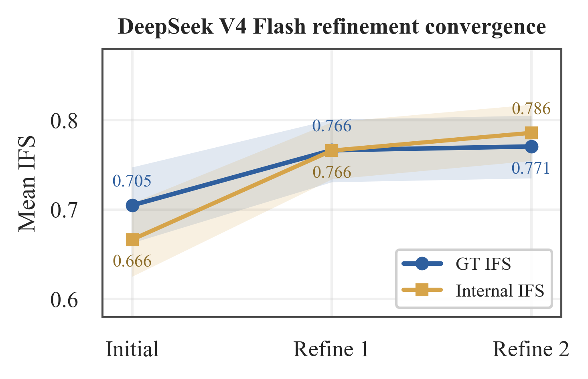

Refinement convergence in an instrumented 220-case DeepSeek V4 Flash PDE-Refine diagnostic run, referenced from Section [[#^experimental-setup|6.1]]. Mean GT IFS rises from 0.715 initially to 0.782 after one refinement and 0.786 after two; internal IFS follows the same monotone trend. This diagnostic supports the $N_{\max}=2$ setting without replacing the main standard non-registry sweep in Table 1.

Error taxonomy under Direct generation in 220-case sweeps, referenced from [[#^error-analysis|6.3]]. Entries are the fraction of cases where the corresponding IFS sub-dimension is imperfect; each model column has $n{=}220$, so Wilson 95% half-widths are at most about 7 percentage points.

| **Error Type** | **Dim.** | **Sonnet** | **GPT-5.4** | **GPT-mini** | **DeepSeek** |
| --- | --- | --- | --- | --- | --- |
| Missing/extra kernel | Term | 35% | 25% | 87% | 40% |
| Wrong coefficient | Coeff | 35% | 45% | 40% | 37% |
| Wrong/missing BC | BC | 56% | 60% | 80% | 66% |
| Missing IC | IC | 1% | 1% | 1% | 1% |
| Time scheme mismatch | Time | 10% | 8% | 13% | 19% |

BC error co-attribution under Direct generation across 220-case sweeps, referenced from [[#^error-analysis|6.3]]. The cohort is all Direct outputs with imperfect BC alignment ($n{=}578$). Shares use Wilson 95% CIs; mean IFS uses bootstrap 95% CIs.

| **BC-Error Cohort** | **Share of BC Errors** | **Mean IFS** |
| --- | --- | --- |
| Isolated BC only | 19.0% \[16.0, 22.4\] | 0.739 \[0.706, 0.769\] |
| BC + coefficient only | 22.8% \[19.6, 26.4\] | 0.756 \[0.734, 0.775\] |
| BC + term/time/IC | 43.6% \[39.6, 47.7\] | 0.253 \[0.222, 0.286\] |
| BC + structural + coefficient | 14.5% \[11.9, 17.6\] | 0.440 \[0.403, 0.476\] |

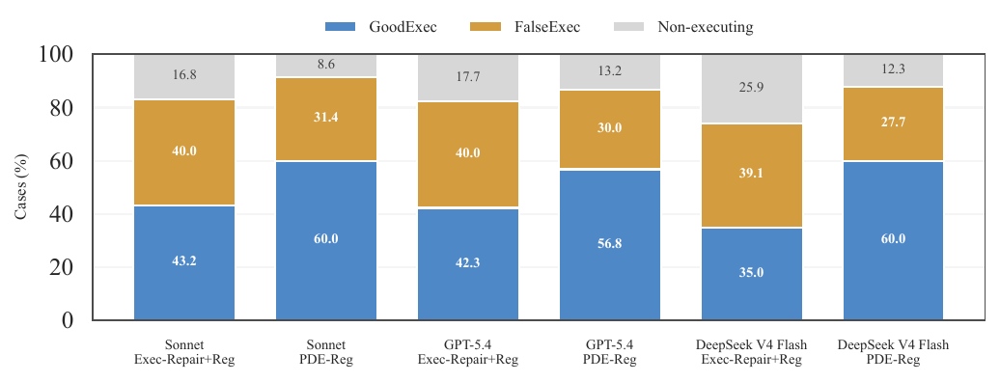

Execution/fidelity quadrants under controlled object-realization infrastructure, referenced from [[#^main-results|6.2]]. Bars partition all 220 cases into GoodExec (Exec and $\mathrm{IFS}\geq0.85$), FalseExec (Exec but $\mathrm{IFS}<0.85$), and non-executing outputs. Execution-only repair leaves a large FalseExec region, while PDE-Reg shifts more cases into GoodExec by adding PDE-grounded feedback.

Weak-model registry stress tests under the same frozen object-realization registry. Exec uses InitExec2; GoodExec and FalseExec are fractions of all 220 cases. These appendix rows test registry-control transfer to weaker or lower-cost models without changing the main deployment-audit model set.

| **LLM** | **Method** | **IFS** | **Exec** | **GoodExec** | **FalseExec** |
| --- | --- | --- | --- | --- | --- |
| GPT-4.1-mini | Exec-Repair+Reg | 0.346 | 25.5% | 3.6% | 21.8% |
| GPT-4.1-mini | PDE-Reg | **0.703** | **63.2%** | **43.6%** | 19.5% |
| Claude Haiku 4.5 | Exec-Repair+Reg | 0.735 | 74.1% | 39.1% | 35.0% |
| Claude Haiku 4.5 | PDE-Reg | **0.811** | **80.0%** | **48.2%** | 31.8% |
| Gemini 3.1 Flash Lite | Exec-Repair+Reg | 0.671 | 51.8% | 23.6% | 28.2% |
| Gemini 3.1 Flash Lite | PDE-Reg | **0.828** | **85.0%** | **55.9%** | 29.1% |

| **Configuration** | **Mean IFS** | **Errors** |
| --- | --- | --- |
| GPT-5.4 extracts $\rightarrow$ GPT-5.4 generates | 0.792 | 0 |
| DeepSeek V4 Flash extracts $\rightarrow$ DeepSeek V4 Flash generates | 0.765 | 12 |
| GPT-5.4 extracts $\rightarrow$ DeepSeek V4 Flash generates | 0.772 | 0 |
| DeepSeek V4 Flash extracts $\rightarrow$ GPT-5.4 generates | 0.783 | 8 |
| Gemini 3.1 Flash Lite extracts $\rightarrow$ Gemini 3.1 Flash Lite generates | 0.796 | 0 |
| DeepSeek V4 Flash extracts $\rightarrow$ DeepSeek V4 Flash generates | 0.765 | 12 |
| Gemini 3.1 Flash Lite extracts $\rightarrow$ DeepSeek V4 Flash generates | 0.784 | 1 |
| DeepSeek V4 Flash extracts $\rightarrow$ Gemini 3.1 Flash Lite generates | 0.791 | 7 |

Full sub-dimensional IFS breakdown for standard non-registry and registry sweeps, referenced from [[#^error-analysis|6.3]].

| **Sweep** | **Method** | **Term** | **Coeff** | **BC** | **IC** | **Time** |
| --- | --- | --- | --- | --- | --- | --- |
| Sonnet 4.6 | Direct | 0.750 | 0.737 | 0.743 | 0.991 | 0.905 |
|  | SpecGen | 0.892 | 0.435 | 0.785 | 0.991 | 0.918 |
|  | PDE-Refine | 0.906 | 0.485 | 0.797 | 0.995 | 0.923 |
| Sonnet 4.6 registry | Exec-Repair+Reg | 0.742 | 0.745 | 0.767 | 0.991 | 0.914 |
|  | PDE-Reg | 0.924 | 0.633 | 0.828 | 0.995 | 0.923 |
| GPT-5.4 | Direct | 0.827 | 0.627 | 0.728 | 0.991 | 0.923 |
|  | SpecGen | 0.814 | 0.496 | 0.782 | 0.991 | 0.914 |
|  | PDE-Refine | 0.869 | 0.599 | 0.770 | 0.995 | 0.918 |
| GPT-5.4 registry | Exec-Repair+Reg | 0.827 | 0.638 | 0.730 | 0.991 | 0.914 |
|  | PDE-Reg | 0.924 | 0.607 | 0.787 | 1.000 | 0.918 |
| GPT-4.1-mini registry | Direct | 0.344 | 0.626 | 0.441 | 0.991 | 0.868 |
|  | Exec-Repair+Reg | 0.332 | 0.608 | 0.433 | 0.991 | 0.873 |
|  | PDE-Reg | 0.759 | 0.572 | 0.686 | 0.995 | 0.827 |
| DeepSeek V4 Flash plain | Direct | 0.656 | 0.688 | 0.559 | 0.991 | 0.814 |
|  | SpecGen | 0.742 | 0.534 | 0.643 | 0.891 | 0.759 |
|  | PDE-Refine | 0.873 | 0.537 | 0.750 | 0.959 | 0.864 |
| DeepSeek V4 Flash registry | Exec-Repair+Reg | 0.677 | 0.729 | 0.585 | 0.991 | 0.841 |
|  | PDE-Reg | 0.900 | 0.609 | 0.799 | 0.968 | 0.886 |

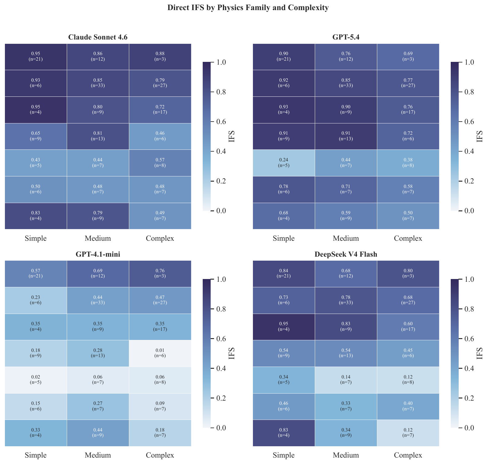

Direct IFS by physics family and complexity tier for the four Direct sweeps. Each cell shows mean IFS and sample count.

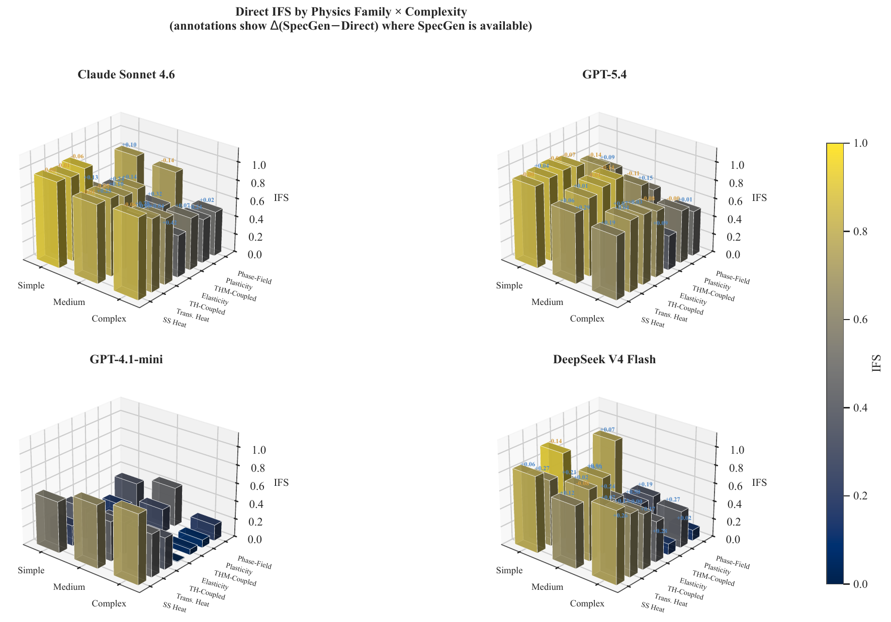

Companion family–complexity Direct IFS view. Bars compare Direct baselines by expert family and complexity tier for each model; annotations report $\Delta$(SpecGen–Direct) where SpecGen is available.

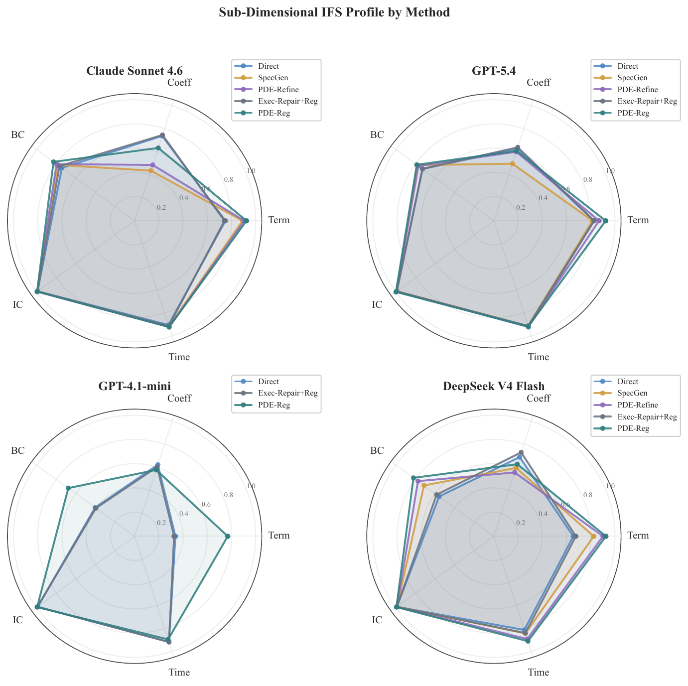

Sub-dimensional IFS profiles for standard non-registry and registry variants. Registry-only execution repair improves object realization but does not dominate the structural term/BC dimensions; PDE-Reg gives the largest structural lift for weak models.

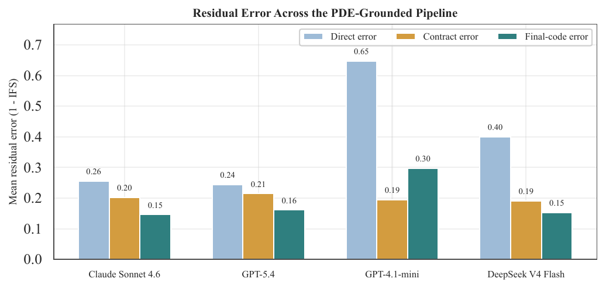

Residual-error view for PDE-grounded methods. Bars compare Direct error, extracted-contract error, and final-code error, separating the PDE-comprehension bottleneck from the final synthesized-code fidelity.
:::

:::hide
## References ^references

-   Martin Sandve Alnæs. Ufl: a finite element form language. In _Automated solution of differential equations by the finite element method: the FEniCS Book_, pages 303–338. Springer, 2012.
    
-   Anthropic. Introducing Claude Haiku 4.5. [https://www.anthropic.com/news/claude-haiku-4-5](https://www.anthropic.com/news/claude-haiku-4-5), October 2025. Accessed: 2026-05-07.
    
-   Anthropic. Introducing Claude Sonnet 4.6. [https://www.anthropic.com/news/claude-sonnet-4-6](https://www.anthropic.com/news/claude-sonnet-4-6), February 2026. Accessed: 2026-05-07.
    
-   Meron Belachew, Yulong Liu, J. David Frost, and Chloé Arson. Numerical assessment of plasticity development and energy expenditure of ant-like microtunnelling. _Tunnelling and Underground Space Technology_, 172: 107501, 2026. ISSN 0886-7798. . URL [https://www.sciencedirect.com/science/article/pii/S0886779826000593](https://www.sciencedirect.com/science/article/pii/S0886779826000593).
    
-   Xinyun Chen, Maxwell Lin, Nathanael Schärli, and Denny Zhou. Teaching large language models to self-debug, 2023. URL [https://arxiv.org/abs/2304.05128](https://arxiv.org/abs/2304.05128).
    
-   Yuxuan Chen, Xu Zhu, Hua Zhou, and Zhuyin Ren. Metaopenfoam: an llm-based multi-agent framework for cfd. _arXiv preprint arXiv:2407.21320_, 2024.
    
-   DeepSeek-AI. Deepseek-v4: Towards highly efficient million-token context intelligence, 2026.
    
-   Madeline Endres, Sarah Fakhoury, and Saikat Chakraborty. Can we verify step by step for correct user intent satisfaction? In _Proceedings of FSE_, 2024.
    
-   Gemini Team, Google. : Built for intelligence at scale. [https://blog.google/innovation-and-ai/models-and-research/gemini-models/gemini-3-1-flash-lite/](https://blog.google/innovation-and-ai/models-and-research/gemini-models/gemini-3-1-flash-lite/), March 2026. Accessed: 2026-05-07.
    
-   Jonathan E Guyer, Daniel Wheeler, and James A Warren. Fipy: Partial differential equations with python. _Computing in Science & Engineering_, 11 (3): 6–15, 2009.
    
-   Frédéric Hecht. New development in freefem++. _Journal of numerical mathematics_, 20 (3-4): 1–14, 2012.
    
-   Prithwish Jana, Sam Davidson, Bhavana Bhasker, Andrey Kan, Anoop Deoras, and Laurent Callot. Terraformer: Automated infrastructure-as-code with llms fine-tuned via policy-guided verifier feedback. _arXiv preprint arXiv:2601.08734_, 2026.
    
-   Guillaume Lample and François Charton. Deep learning for symbolic mathematics. In _International Conference on Learning Representations_, 2020. URL [https://openreview.net/forum?id=S1eZYeHFDS](https://openreview.net/forum?id=S1eZYeHFDS).
    
-   Michael Lange, Navjot Kukreja, Mathias Louboutin, Fabio Luporini, Felippe Vieira, Vincenzo Pandolfo, Paulius Velesko, Paulius Kazakas, and Gerard Gorman. Devito: Towards a generic finite difference dsl using symbolic python. In _2016 6th workshop on python for high-performance and scientific computing (PyHPC)_, pages 67–75. IEEE, 2016.
    
-   Jae Ryong Lee and Han Young Yoon. Multi-physics simulation of nuclear reactor core by coupled simulation using cupid/master. _International Journal of Heat and Mass Transfer_, 115: 1020–1032, 2017.
    
-   Mengnan Li, Jason Miller, Zachary Prince, Alexander Lindsay, and Cody Permann. Moosenger–a domain-specific ai agent for the moose ecosystem. _arXiv preprint arXiv:2603.04756_, 2026.
    
-   Zongyi Li, Nikola B. Kovachki, Kamyar Azizzadenesheli, Burigede Liu, Kaushik Bhattacharya, Andrew M. Stuart, and Anima Anandkumar. Fourier neural operator for parametric partial differential equations. _CoRR_, abs/2010.08895, 2020. URL [https://arxiv.org/abs/2010.08895](https://arxiv.org/abs/2010.08895).
    
-   Yulong Liu and Chloé Arson. Physics-informed neural network surrogate modeling of pressurized cavity in homogeneous and bilayered media. In _ARMA US Rock Mechanics/Geomechanics Symposium_, page D022S018R006. ARMA, 2025.
    
-   Yulong Liu and Chloé Arson. A physics-informed neural network for modeling pressurized cavities of arbitrary smooth shape embedded in heterogeneous rock, January 2026. URL [https://doi.org/10.21203/rs.3.rs-8492281/v1](https://doi.org/10.21203/rs.3.rs-8492281/v1). Preprint, Version 1, Research Square.
    
-   Aman Madaan, Niket Tandon, Prakhar Gupta, Skyler Hallinan, Luyu Gao, Sarah Wiegreffe, Uri Alon, Nouha Dziri, Shrimai Prabhumoye, Yiming Yang, et al. Self-refine: Iterative refinement with self-feedback. _Advances in neural information processing systems_, 36: 46534–46594, 2023.
    
-   Zavier Ndum Ndum, Jian Tao, John Ford, and Yang Liu. Autofluka: A large language model based framework for automating monte carlo simulations in fluka. _arXiv preprint arXiv:2410.15222_, 2024.
    
-   Bo Ni and Markus J Buehler. Mechagents: Large language model multi-agent collaborations can solve mechanics problems, generate new data, and integrate knowledge. _Extreme Mechanics Letters_, 67: 102131, 2024.
    
-   William L Oberkampf and Christopher J Roy. _Verification and validation in scientific computing_. Cambridge university press, 2010.
    
-   OpenAI. Introducing GPT-4.1 in the API. [https://openai.com/index/gpt-4-1/](https://openai.com/index/gpt-4-1/), April 2025. Accessed: 2026-05-07.
    
-   OpenAI. Introducing GPT-5.4. [https://openai.com/index/introducing-gpt-5-4/](https://openai.com/index/introducing-gpt-5-4/), March 2026. Accessed: 2026-05-07.
    
-   Cody J Permann, Derek R Gaston, David Andrš, Robert W Carlsen, Fande Kong, Alexander D Lindsay, Jason M Miller, John W Peterson, Andrew E Slaughter, Roy H Stogner, et al. Moose: Enabling massively parallel multiphysics simulation. _SoftwareX_, 11: 100430, 2020.
    
-   Gerhard Schellhorn, Stefan Bodenmüller, and Wolfgang Reif. Vericode: Correct translation of abstract specifications to c code. In _International Conference on Integrated Formal Methods_, pages 53–74. Springer, 2024.
    
-   Tianyi Zhang, Shidong Pan, Zejun Zhang, Zhenchang Xing, and Xiaoyu Sun. Deployability-centric infrastructure-as-code generation: Fail, learn, refine, and succeed through llm-empowered devops simulation. _arXiv preprint arXiv:2506.05623_, 2025.
:::
