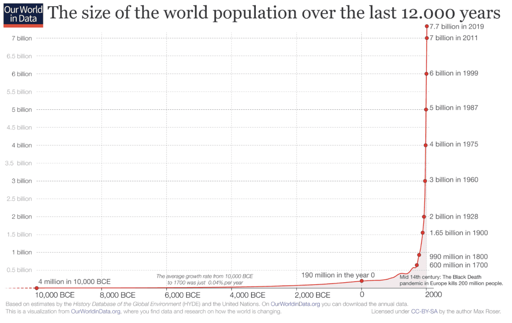
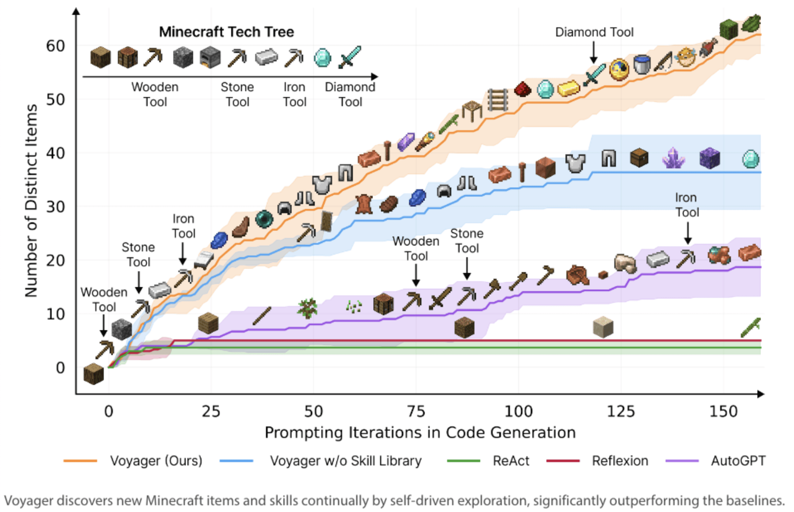

%%
Add discussion note here:

...

%%

##### Intelligence is mechanistic and it is possible to build AGI ^intelligence-is-mechanistic-and

Evaluating the existential risk of AI centers on the feasibility of building Artificial General Intelligence (AGI), an AI that rivals human capabilities. The [debate](https://medium.com/@francois.chollet/the-impossibility-of-intelligence-explosion-5be4a9eda6ec) [about](https://intelligence.org/2017/12/06/chollet/) whether AI can be considered truly “intelligent” first requires establishing a definition of intelligence.

We contend that intelligence consists of intellectual tasks, which are self-contained problems such as planning, summarizing, generating ideas, or calculation, that must be solved to achieve a goal. We solve these tasks through intellectual work, which is similar to the notion of [work in physics](https://en.wikipedia.org/wiki/Work_\(physics\)). For example, solving a difficult research problem takes more intellectual work than solving a simple addition problem – it requires more hours of thought, more calculations, and more experimentation.

By considering intelligence as the intellectual tasks it is composed of we arrive at a mechanistic model, where the question of whether we can create AGI is not “can we recreate human intelligence?” but rather “can we automate all intellectual tasks?” To which we say: yes.

-   In **[[#^what-is-intelligence|What is intelligence?]]**, we argue that intelligence is the ability to solve intellectual tasks. Humanity has expanded the range of feasible tasks by mechanistic means, specifically through the usage of tools, groups and specialization, and improved methods of thought.
-   In **[[#^applications-to-artificial-intelligence|Applications to artificial intelligence]]**, we demonstrate that AI capabilities can similarly expand, and that an AI capable of automating all human-manageable intellectual tasks is functionally an AGI.
-   In **[[#^against-arguments-of-ai|Against arguments of AI limitations]]**, we argue against the notion that there is a missing component of intelligence that will prevent AI from rivaling human intelligence. We show how the “AI Effect” has led to shifting the goalposts of “real artificial intelligence,” leading to pseudoscientific discourse.
-   In **[[#^thus-agi|Thus, AGI]]**, we conclude that even if we account for uncertainty, the rapid expansion of AI capabilities and the absence of known limitations can lead to AGI, and that we must proceed with caution.

##### What is intelligence? ^what-is-intelligence

Intelligence is not yet a [hard science](https://en.wikipedia.org/wiki/Hard_and_soft_science) that we can study mathematically and base predictions on. As a result, most [definitions](https://en.wikipedia.org/wiki/Intelligence) of intelligence are imprecise, but converge on some combination of processing information and responding accordingly in pursuit of a goal. Intelligence seems to be what makes one human “smarter” than another and differentiates humans from the rest of the animal kingdom. A complex piece of technology demonstrates intelligence, and we understand it to be man-made: nothing else we know of can similarly rearrange nature. Whatever “intelligence” is, it has enabled humans to dominate Earth.

This ability has evolved over millennia; humans have gone from struggling to survive by hiding in caves and hunting beasts, to going to space, curing a vast range of diseases, and producing enough food to sustain 8 billion people (if it were distributed equally). Human intelligence grew as a result of three primary factors:

-   **Tools**: We have created tools that capture the ability to solve specific tasks, and make it possible to solve them with much less knowledge, understanding, and competence.
    
-   **Groups**: We split complex intellectual tasks (such as designing an airplane) into many smaller ones, which are further distributed across multiple people, allowing for parallelization and specialization.
    
-   **Methods**: We have improved our methods to solve intellectual tasks, such as developing the scientific method and other means to account for biases and systematic sources of errors.
    

By looking at the three factors that have most increased human intelligence, we can bypass abstract theorizations and directly examine what has made us more capable: simple mechanistic processes that could be replicated with the right software.

###### Tools ^tools

Our inventions and tools have played a critical role in our intellectual and societal growth. Physical tools, such as writing implements, enabled preserving knowledge across generations, leading to complex societies. The printing press democratized knowledge by making books more accessible, expanding literacy. Tools let humans offload intellectual tasks — before modern computers and calculators, [“computers” were humans](https://www.nasa.gov/centers-and-facilities/jpl/when-computers-were-human/#:~:text=At%20one%20time%2C%20they%20were,computer%20called%20the%20IBM%20704.) who performed calculations by hand. Today, the intellectual work is distributed between the human and the calculator.

Critically, solving a task is a composition of distributed, physical processes: the brain apprehends the question and the need to solve it, triggering a nerve impulse that travels to our fingers and leads us to punch keys on a calculator, which in turn moves internal digits to compute an answer, display it on the screen, return photons to our eyes, and carry nerve impulses to the brain to signal that we have answered the question. When we think about intelligence this way we can see that it is not something that just happens in the brain.

The processes we use to solve intellectual tasks have co-evolved with our tools. Before smartphones and GPS systems, navigation required a physical map; today, increased reliance on navigation systems means that fewer people own maps, or even know how to use one. As technology encodes the intellectual processes that were once essential for survival, we no longer use or develop the requisite skills ourselves.

Without our tools, we would not just be uncomfortable, we would be handicapped. Without language, literacy, or numeracy, it’s not just that we couldn’t speak, remember, or calculate; it’s that we couldn’t _think_. Without written language, we could not preserve information except by memorization. Without language at all, we would have no internal monologue. What would our “intelligence” be like then?

###### Groups ^groups

Population scale and specialization have helped expand humanity’s intelligence. If more people work on a problem, there is more intellectual work being directed toward solving it. Today, we have nearly 8 billion humans _thinking_ about stuff.

_There are a whole lot more thinking humans today than ever before._

If intelligence is a matter of solving intellectual tasks, then having more people to distribute them across helps it grow. Consider the task of finding a cure for cancer — while an individual researcher may discover a breakthrough drug, this achievement will have depended on intellectual work performed by many different humans: collaborating with researchers, reading the papers of predecessors, running experiments with interns, and so on.

Just as intellectual work is distributed across individuals and tools, it is also shared across groups like school departments, companies, internet subcultures, markets, governments, and international bodies. These groups can be thought of as intelligent entities with coordinated goals and processes for sensing, thinking, communicating, and surviving. For example, Airbus has the goal of building airplanes, senses and responds to events like changes in market conditions, thinks and communicates through its employees and the tools they use, and aims to survive and grow by building airplanes and outcompeting the market. The law even treats groups as single entities: states and companies are considered agentic enough to have liabilities, form contracts, and own property and debt.

Companies like Airbus are much smarter than any individual because they can solve more complex intellectual tasks than any single human could. States are more intelligent than companies (although Big Tech is challenging this now) because they can be thought of as performing the economic work of all of the companies within their jurisdiction. In general, groups are more intelligent than individuals because they can solve tasks that are too complex for an individual to solve alone.

###### Methods ^methods

Intelligence has also grown within an individual. This was not the result of evolution — a few thousand years is a relatively short time frame in evolutionary terms, and the human brain has remained largely unchanged since the advent of Homo sapiens around 200,000 years ago.

It is our thinking — the software and methods of intelligence — that has evolved.

While we consider humans to be the most intelligent species on Earth, we also know that we are fallible. Our memory is terrible and our learning is slow. Most of us are profoundly irrational, believing contradictory things and failing to use logic, and we can be incoherent and operate contrary to our goals. We are not always agentic — we fail to consistently plan and follow our own goals and end up stuck. All-in-all, we have many shortcomings.

Over the last several thousand years, we have discovered techniques to circumvent some of these shortcomings and grow our individual intelligence.[^note-6] Logic, mathematics, and science structure our thinking into correspondence with reality; psychology and therapy aim to correct psychological mistakes that lead to individual failures. Formal education strives to teach people how to learn and correct their own mistakes. Improving our methods in turn helps us solve intellectual tasks more effectively.

###### A mechanistic model of intelligence ^a-mechanistic-model-of

We have shown that humanity’s intelligence has grown as a result of tools, scale, and improvements to thinking methods. These are concrete, mechanistic factors, suggesting that intelligence is not a mysterious force in the brain, but rather a systematic, distributed process across physical entities.

The world is composed of processes that solve intellectual tasks. Solving a complex calculation is a coordinated process between a human and a calculator. At a larger scale, shipping fulfillment is a coordinated process between a customer, their computer, an algorithm that handles the purchase, a physical warehouse with the item, employees who process the order, shipping companies, and so on. The same is true for much more complex tasks, such as building a rocket, or state functions such as diplomacy, policy implementation, or adjusting the treasury rate. An entity’s intelligence is a measure of the intellectual tasks it can perform.

It follows that to create an AI that rivals human intelligence, it simply needs to be capable of performing the same intellectual tasks. If all intellectual tasks are automatable, then intelligence itself is automatable.

##### Applications to artificial intelligence ^applications-to-artificial-intelligence

If intelligence is the mechanistic completion of intellectual tasks, then what has made humans intelligent is trivial to recreate in artificial intelligence — tool use, scaling and collective intelligence, and improving methods are all available to AI.

**Tools:** Today’s AI is able to use online tools. Because large AI models have learned how to use natural language, they have also learned how to code, which allows them to use APIs to use tools and other interfaces. Shortly after the release of ChatGPT, OpenAI developed [plugins](https://openai.com/index/chatgpt-plugins/) to support using APIs, and the technology has only improved since. For example, open-source project [ToolBench](https://github.com/OpenBMB/ToolBench) has collected over 16,000 APIs that AI models can interact with.

Tool use transforms an LLM into a meaningful agent that can complete tasks. For example, [Voyager](https://voyager.minedojo.org/) is an open-source project that shows that GPT-4 can inherently play Minecraft — researchers connected the LLM to a text representation of the game and showed that it is capable of navigating environments and solving complex tasks by writing small programs for skills to “mine,” “craft,” and “move.” Just as humans solve intellectual tasks in Minecraft through processes that trace through our brain, the computer, the game environment, and back, so too can Voyager solve problems through processes that coordinate the LLM, the computer, and the game environment API.

The range of physical and virtual environments an AI can navigate is growing. [FigureAI](https://github.com/OpenBMB/ToolBench) and other robotics companies are training advanced AI models to perform domestic tasks and navigate warehouses. [AdeptAI](https://www.forbes.com/sites/kenrickcai/2023/03/14/adept-ai-startup-raises-350-million-series-b/) and other research companies are training advanced AI models to navigate computer interfaces. Once these problems are solved, all human tools and environments will become available to AI. Considering the impact of tool use on improving human intelligence, this will be a significant lever to increasing the overall intelligence of AI.

**Specialization and scale:** Compared to human population growth, it is trivial to scale AI — we can make multiple copies by simply opening new browser windows. Researchers are working on agent frameworks to allow AIs to communicate with each other. Should we find more robust frameworks, AI will benefit from the advantages of group intelligence and distributing intellectual labor. We can already see this in action: Deepmind’s [AlphaProof and AlphaGeometry](https://deepmind.google/discover/blog/ai-solves-imo-problems-at-silver-medal-level) systems achieved an IMO silver medal by generating thousands of “candidate” answers and assessing them in parallel, akin to a large group of math students dividing up proofs and manually reviewing them. Parallelization also leads to efficiency gains: distributing the work leads to faster solutions than sequential processing.

Scale can enable the growth of AI’s capabilities in the same way that it has for humanity. If we build an AGI that is as smart as a single human, we could theoretically scale it to rival humanity’s collective intelligence by creating and coordinating billions of copies. This is a big deal, as it suggests that there is no “secret” to scaling from AGI to superintelligent entities.

**Methods:** AIs are programs. In the same way that we have expanded individual intelligence by improving our own methods and programming, we can improve the programs that AIs run. If we can create an AI that can perform each intellectual task that a human can, then we can compose those tasks into processes that mimic the intelligence of a human, a company, or even humanity.

Today, AI companies are chipping away at these tasks, solving meaningful problems in language use and multimodality, search, planning, and inference. Many of these are solvable with traditional code that does not require AI, such as the applications we use on our phones. AI can also solve these tasks, and each successive model grows in its capabilities. If a task is unsolved by a base model, engineers often build extensions through finetuning, scaffolding, and other means.

Whenever we find a programmatic way to solve a task using AI, that process can be distributed to other AIs far faster than we can distribute new skills across humans — every application that used GPT-3 as a base model made an immediate stepwise improvement when upgraded to GPT-4. While it may take humans hundreds of years to improve our collective rationality, the discovery of a post-processing method to reduce AI hallucinations could be rolled out in days.[^note-7]

Today’s AI research is aimed at automating all of the intellectual tasks that humans currently perform. The system that can solve all of those tasks will be an AGI.

##### Against arguments of AI limitations ^against-arguments-of-ai

We have shown that expanding intelligence is a mechanistic process, and that it is possible to build AGI using the same techniques that have augmented humanity’s collective intelligence.

And yet, many people do not intuitively have the feeling that AI is “intelligent,” or anything other than a tool. Though AIs are [increasingly autonomous](https://baai-agents.github.io/Cradle/), able to [navigate environments](https://www.youtube.com/watch?v=fKXztwtXaGo), “think” [chains of thought](https://arxiv.org/abs/2201.11903), and master language which enables “general” performance across many domains, public perception writes these off as mere components of intelligence, suggesting that AI is missing something that would make it the “real thing.” Many reject the existential risks of AI because of the intuition that AI is missing a fundamental component of intelligence.

This section explores whether there is in fact a missing component of intelligence that we cannot automate, and that will therefore impede AGI. We argue against the existence of a missing component, showing that the historical tendency has been to shift the goalposts around the definition of intelligence every time AI is able to perform a novel task. We also consider broader theories of intelligence, disproving theoretical justifications for “missing components” arguments.

###### The AI Effect ^the-ai-effect

Before establishing a solid theory about how something works, the mechanism can seem “magic,” and beyond the confines of science and reason. In AI, this phenomenon is common enough to be termed as the “[AI Effect](https://en.wikipedia.org/wiki/AI_effect)” — once AI achieves a new capability, it is dismissed as an aspect of intelligence.

For example, in the early days of computer science and AI, memory was an unsolved problem. It was not clear how to best store and retrieve information, which plays a role in general intelligence. We have since developed databases, filesystems, querying languages, and other tools that “solve” most memory problems, but we wouldn’t consider an SQL database to be intelligent, despite its extremely sophisticated abilities to store and retrieve complex memories.

This is a recurring pattern. Chess was once considered the pinnacle of human intelligence, but AI has been able to significantly outperform the best humans since 1997.[^note-8] Logic systems have solved mechanical reasoning. Classifiers are now able to infer patterns from data as well as humans can, and we now class linear regression and other statistical methods as “data science,” not AI. AI can increasingly manage tasks that we consider demonstrative of intelligence, but we do not yet consider AI itself to be intelligent.

It is important to track these improvements as progress towards general intelligence. Computer memory, chess bots, and good classifiers do not “solve” intelligence, but they each get us one step closer by automating a vital intellectual task. Now that AI can solve [PhD-level problems](https://openai.com/index/learning-to-reason-with-llms/), the number of tasks AI cannot perform is few and getting smaller by the day, suggesting an overall trend toward more and more automation of intellectual tasks. Because of this trend, one should be wary of arguments that claim general intelligence is a discrete milestone that some “missing component” prevents us from reaching.

While deep learning seems more impervious to the AI Effect because of its inscrutability, this illegibility feeds into myths around the missing component of intelligence, leading some to believe that because we don’t understand deep learning, we must be missing something profound about the nature of intelligence. For example, even scientific experts have suggested that [planning](https://www.newyorker.com/science/annals-of-artificial-intelligence/can-an-ai-make-plans), [consciousness](https://time.com/collection/time100-voices/6980134/ai-llm-not-sentient/), [reasoning](https://thenextweb.com/news/meta-yann-lecun-ai-behind-human-intelligence), and [inferring new patterns](https://garymarcus.substack.com/p/breaking-news-scaling-will-never) are all missing components that we must solve before we have AGI.[^note-9]

Let’s dig into one of these examples to demonstrate the shape of the “missing component” argument and how it falls apart on inspection.

One proposed refutation of AI’s intelligence is that [AI is not capable of planning](https://www.newyorker.com/science/annals-of-artificial-intelligence/can-an-ai-make-plans). At first glance, this might seem reasonable: we do not yet have long-lived robots that make plans in the real world and interact with people, and when asked, ChatGPT’s plans are mediocre. Yann LeCun argues that LLMs are inherently reactive systems that [cannot plan or engage in long-term strategic thinking](https://x.com/ylecun/status/1625118108082995203?lang=en), and therefore are missing one of the “[four key ingredients for intelligence](https://thenextweb.com/news/meta-yann-lecun-ai-behind-human-intelligence).”

But let’s consider what “planning” actually is: the ability to devise a sequence of actions in order to reach a goal. We understand the pragmatic vision of planning quite well. The entire field of [traditional AI](https://en.wikipedia.org/wiki/Automated_planning_and_scheduling) is about planning, from general algorithms like [backward chaining](https://en.wikipedia.org/wiki/Backward_chaining) to more specific subfields like [scheduling](https://en.wikipedia.org/wiki/Scheduling_\(computing\)). Today, one can ask ChatGPT to plan for any situation; it often fails because it lacks topical knowledge and not because of an inability to plan, but this is also true for people. Current engineering efforts are focused on [agent architectures](https://github.com/e2b-dev/awesome-ai-agents) that are fundamentally predicated on planning, such as powerful game-playing AIs like [Voyager](https://voyager.minedojo.org/) and [Cradle](https://baai-agents.github.io/Cradle/), or [Devin](https://www.youtube.com/watch?v=fjHtjT7GO1c), which aim to replace software engineers. AI’s search capability is also [very well](https://en.wikipedia.org/wiki/Search_problem) [studied](https://en.wikipedia.org/wiki/Search_algorithm), and demonstrated by AI’s ability to solve mazes, look many moves ahead in chess, and consider battlefield tactics. For more technical readers, there is some early evidence of neural networks [learning to search at an intuitive level](https://twitter.com/jenner_erik/status/1798018379560943825), in a single forward pass.

Why are planning and search sometimes held up as the next [big breakthrough](https://www.reuters.com/technology/artificial-intelligence/openai-working-new-reasoning-technology-under-code-name-strawberry-2024-07-12/) in AI, despite the fact that AI is already capable of both?

In short, this is a common fallacy where a distinction is made between a “true capability” and mere imitations/parroting. Such arguments fail to see that any capability such as planning is simply an intellectual task, made of smaller intellectual tasks. There is no massive breakthrough to reach, only more and more tasks to automate.

**To put this another way: the “missing component” argument is not actually pointing to a real thing at all.** Yes, the argument does identify certain limitations of what today’s AI are capable of doing. But when broken down to investigate why or what exactly AI cannot do, the question dissolves. All we find is that we are making incremental traction on planning, and that we’ve automated many components of it and have some more to go. What we certainly do not find is a mystical threshold we would need to cross over to get to “true planning.”

This type of mistake appears again and again in debates about artificial intelligence, with many experts making pseudoscientific claims about key skills that AI lacks. But instead of trying to respond to each of these particular claims, let’s explore the general reason these arguments fail.

###### The general issue with missing components ^the-general-issue-with

“Missing component” arguments are brittle because they can’t be scientifically substantiated.

To make a compelling argument about a missing component of intelligence, one would need to both prove through an empirically supported theory of intelligence that the component is indeed a necessary element of intelligence, and then show that it is impossible to automate.

Neither of these is possible today because humanity’s scientific understanding of intelligence is so limited and piecemeal that we have no agreed upon theory.

Traditional psychological theories of intelligence fall into one of two camps: they are either partially mechanistic but wholly unsupported empirically, or empirically grounded but not theoretical and conceptual enough to point to a missing component. The [Theory of Multiple Intelligences](https://en.wikipedia.org/wiki/Theory_of_multiple_intelligences) is an example of the former: it proposes different forms of intelligence that could count as potential missing components, [but lacks empirical confirmation](https://en.wikipedia.org/wiki/Theory_of_multiple_intelligences#Lack_of_empirical_evidence). The [Parieto-frontal integration theory](https://en.wikipedia.org/wiki/Parieto-frontal_integration_theory) is an example of the latter: it is considered the best empirical claim we have on the locus of intelligence in the brain, but it lacks any explanation of cognitive processes that could help identify a missing component. Even recent computational models of intelligence, such as [active inference](https://en.wikipedia.org/wiki/Free_energy_principle#Active_inference) and [computational learning theory](https://en.wikipedia.org/wiki/Computational_learning_theory), are not sufficiently developed to identify the necessary conditions for intelligence.

AI complicates this further. Even if we knew all the necessary components of intelligence, we lack the understanding of modern AI necessary to predict if AI could automate those components.

Simply put, we do not yet have any scientific theories of intelligence to make a “missing components” argument, nor evidence that AI fundamentally cannot do something. Where this leaves us is that the “missing components” argument is nothing more than a vibe, an intuition against the possibility of automation that grasps to use any example of modern AI struggling.

**But this is a vibe that contradicts all the historical evidence we have about AI.** The AI Effect shows us that we are constantly breaking walls that we thought were impossible for AI to solve, at unexpected times. Moreover, AI capabilities already increase rapidly without us understanding them, with new models constantly revealing previously unexpected capabilities.

We’re a frog in boiling water. A mechanistic view of intelligence-as-intellectual-tasks demonstrates that we are getting closer to AGI by the day, as we automate more and more intellectual tasks. Arguments of a “missing component” seek to undermine this view, holding “real intelligence” as some never-quite reachable standard. The fact these arguments are scientifically unsubstantiated is a big deal, because it means that we have no scientific evidence to disbelieve the trend towards AGI.

##### Thus, AGI ^thus-agi

If intelligence is a matter of solving modular tasks through the sophisticated usage of tools, specialization, and refining methods, and there is no viable theory of a missing component, we are led to adopt a physicalist interpretation of intelligence. In other words, intelligence is built on matter and mechanistic, there is no spiritual barrier to building AGI, and the path to AGI is to build systems that can perform each intellectual task that a human can perform.

Every advancement in AI is chipping away at the number of tasks humans can perform that AI cannot perform. Building intelligence component by component, AGI is an engineering problem like any other which we are closer to solving by the day. Because we have already built systems close to human-level performance, it is simply a matter of time before we build an AGI that is able to perform all of the tasks that a human can perform. At this point, adding tools and cloning the AGI to billions of copies could create an intelligence that quickly rivals that of humanity.

We therefore find ourselves in a precarious position:

-   AI capabilities are rapidly increasing and will continue to, regardless of our understanding of the nature of intelligence.
    
-   Major AI companies are racing to build AGI, chipping away at the tasks that comprise intelligence.
    
-   Once built, AGI can quickly exceed the intelligence of a single human.
    
-   And yet, modern AI is unpredictable and uninterpretable, and we lack any theory of intelligence that allows us to make confident claims about when AGI will be built or what it will be capable of doing.
    

We believe that the burden of proof is on anyone who believes that we will not be able to create AGI. Given the evidence of AI’s progress, the effort directed at building AGI, and the risks that come from building such world-changing technology, it is extremely meaningful to substantiate arguments for why we shouldn’t be worried about building powerful technology, or the related risks. But we do not have credible evidence of a “missing component” that will prevent it, and related arguments appear unscientific.

Given this situation, we argue for a cautious approach: one that looks at the trendlines of massively increasing progress and prepares to deal with the advent of AGI seriously.

[^note-6]: One of the massive benefits of these methods is that they can be applied without understanding exactly how to rederive them. Most people applying various scientific methods would struggle to rederive them, but they don't need to.
[^note-7]: Consider that updating and deploying anything made of atoms (physical products and infrastructure) is much more costly and slow than updating and deploying anything made of bits (software).
[^note-8]: When DeepBlue beat reigning world chess champion Garry Kasparov in a series of six games.
[^note-9]: The most common argument against AGI is that AI is not yet conscious. Fortunately we don’t need to enter the quagmire which is the field of consciousness studies, because the one thing everyone seems to agree on is that we do not have a good theory of consciousness. If it were the missing component, our theories still wouldn’t be able to tell us anything useful about AI. And for our purposes, an AI capable of automating all intellectual tasks would not need to be conscious to be functional and dangerous.
