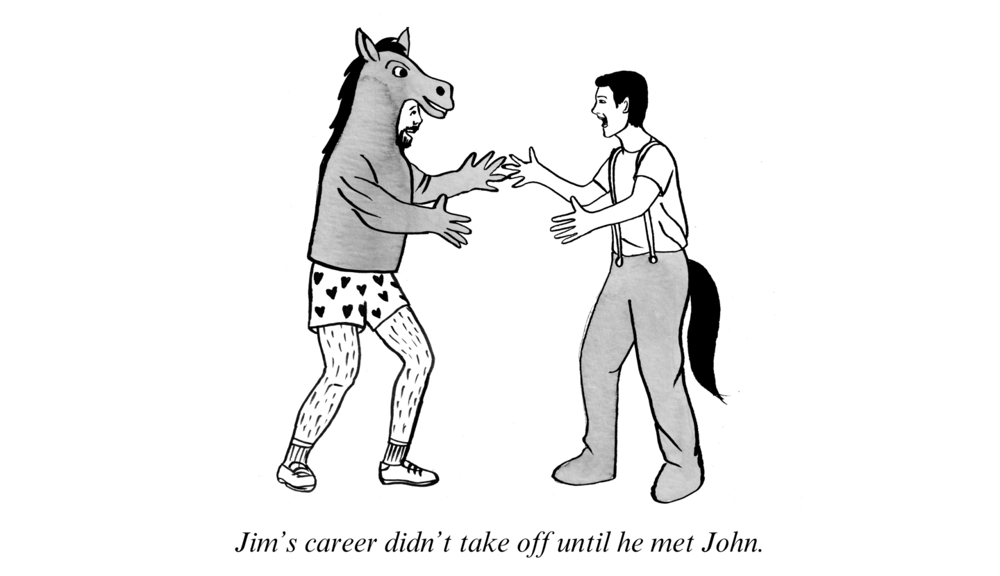
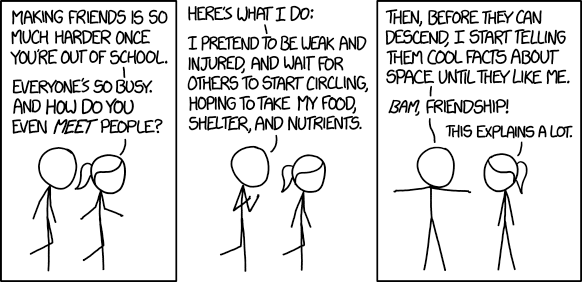
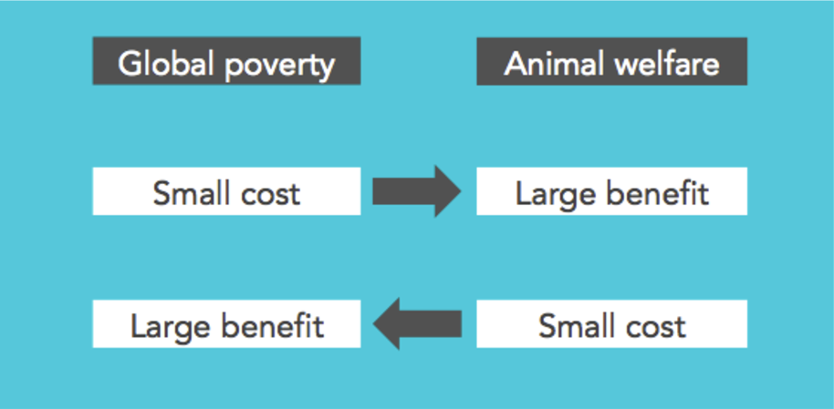

%%
Add discussion note here:

...

%%

Everyone talks about the importance of networking for a successful career — and they’re right. As we saw in [part 14](https://80000hours.org/career-guide/how-to-get-a-job/), a large fraction of jobs are found through connections. And many are never even advertised, meaning connections are the _only_ way to find them.

But the importance of connections extends well beyond finding a job. It may be an overstatement to say that “you become the average of the five people you spend the most time with,” but there’s certainly some truth in it. The people around you set the behaviour you see as normal and directly influence how you feel.

The social scientists Nicholas Christakis and James Fowler [wrote a book](https://web.archive.org/web/20260212235016/https://www.hachettebookgroup.com/titles/james-h-fowler-phd/connected/9780316036139/) documenting this evidence. They found that if one of your friends becomes happy, you’re 15% more likely to be happy. Even more intriguing, they discovered that even if a friend of a friend becomes happy, you’re 10% more likely to be happy.[^cite-1] They found the same was also true with negative behaviours like smoking.

So if you spend time around more generous people, you’ll see generosity as the norm. If you’re around people who regularly bend the truth, dishonesty will feel more acceptable. If you spend time with productive people, you’ll pick up the habits of being productive.

The people you spend time with are also a major source of personalised, up-to-date information that never gets published. If you want to find out what job opportunities might be a good fit for you in clean energy, a friend in the industry would be the best source of information. The same is true if you want to learn about the day-to-day reality of any job. And if you ever want to start a new project, or to hire someone, your connections will be the first place to look, because you already know and trust them.

If you care about making a difference, then your connections are even more important, because so much social change spreads through social networks. For instance, by starting to donate to charity, you may well encourage some of your friends to donate too.

So given the huge importance of your connections, how can you network effectively?

_Reading time: 10 minutes_

:::callout {title="The bottom line" tone="neutral"}
## How to network ^how-to-network

Networking isn’t about business cards or LinkedIn requests. It’s about meeting people you like, helping them out, and building genuine relationships. Here’s the best advice on how to network:

-   Don’t focus on dedicated networking events. Ask for introductions from people you already know, or meet people through common interests.
-   When you meet a new person, think of a ‘five-minute favour’: something you can do in five minutes that would help them out, like an introduction or a book recommendation.
-   Passively browsing social media doesn’t help, but running a useful feed can. Is there a niche, professionally relevant topic you could become the best place for?
-   Instead of one-on-one coffee meetings, consider holding a two-hour mixer on a weekday evening, allowing you to connect with 10–15 friends and strangers in one go.
-   The most powerful technique of all is to find the right community. It’s like gaining hundreds of connections and insider knowledge at once, making it the most powerful networking technique. Try several to see which fits.
:::

## How to build connections ^how-to-build-connections

Nothing spells community like the letters c, o, m, m, u, n, i, t, and y. Thanks, Large Group of People Holding Word Community / Getty Images.

When people think of networking, they often think of conference cocktail mixers, or sending hundreds of ‘connect’ requests on LinkedIn. But these aren’t the most effective techniques. Networking at its core is simple: **meet people you like, help them out, and build genuine relationships. That’s it.**

If you meet a lot of people and find small ways to be useful to them, you’ll have lots of people to turn to when you need a favour in return. To start, just help people with no expectation of reward. That’s what the best networkers do, and there’s evidence to suggest it’s more successful, too.[^cite-2]

Here’s a habit you can start using right away: the five-minute favour. When you meet a new person, think what you can do with just five minutes of your time that would help them, then do it. Two of the best five-minute favours are making an introduction to someone you think they should meet, or recommending a book, app, or other resource that would help them with a problem they’re facing right now. The right introduction at the right time could change somebody’s life, and it costs you very little.

You don’t have to meet people at dedicated networking events, and in fact, this is usually not the best option. That’s because you start with little common ground, these events are often awkward, and the people who go to them are often not the most useful to meet.

Instead, meet people through people you already know. Ask for an introduction and explain why you’d like to meet (using the tips in [part 14](https://80000hours.org/career-guide/how-to-get-a-job/)). Another option is to prioritise events organised by your friends, or to meet people through common interests: things you actually enjoy doing.

The next step is to develop habits that let you build connections automatically, so you no longer need to proactively reach out to people; for example, living with people who have lots of interesting visitors.

Passively browsing social media isn’t especially useful, but _creating_ content can be. As I write these words, many of the world’s most successful people are still addicted to X. By running a good feed, or by posting thoughtful comments — and only then sending a DM — it’s possible to meet people you’d never get a chance to speak to otherwise. Even if you never connect on the platform, being known within your industry can get you invited to the better events and make people take you more seriously when you show up.

One way to do this is by picking a niche. This should be a (professionally relevant!) topic you know about.[^note-3] Aim to make your feed one of the key places for people interested in that topic to learn more. An example is to post summaries of recent research or news within an area. Wharton professor [Ethan Mollick](https://www.oneusefulthing.org/) initially built a following by posting summaries of psychology papers, but is now the key person to follow on how to use AI.

Another option that can work well is to run a newsletter or Substack. YouTube can also work well, though the learning curve is a bit steeper because you need to master video editing as well as writing and presenting. Podcasts can work, though because there’s no virality built into podcasting platforms, it’s harder to build an audience (most big podcasters were either already well-known, or built their audience on YouTube or Twitter). AI tools have made all of these easier to run, though as the volume of content increases, trust and a distinctive personality become more important.

From _[xkcd](https://www.xkcd.com/1746/)._

If you don’t like social media, you could try hosting events. This requires a bit of activation energy, but can be far more effective than coffee meetings. Host drinks for 10–15 people, and you can renew connections with all of them in a couple of hours and establish yourself at the centre of a social circle.

Many formats can work, but when you get started, the key is to make it easy: host on a Tuesday or Wednesday evening (not the weekend), keep it short (e.g. 7–9 PM), host at your home, and provide cheap drinks and ready-to-go-snacks only (no elaborate food). Start by getting five good friends to commit, so you’re confident someone will come, and then add another 5–10 people you’d like to connect with more. Organise at least two weeks in advance and have people RSVP.[^cite-4]

If not events, find other ways to stay in touch with people you’d like to get to know better, whether occasional one-on-ones or just a short message with something they might find interesting. Keep looking for ways to help each other, and build real friendships when appropriate and authentic.

Ultimately you want both depth and breadth in your connections. You need at least a couple of allies who know you really well and can help you out in a tough spot. These could be old friends or mentors, and it’s important to stay in touch with them regularly. But it’s also good to know people from many different walks of life, so you can encounter new perspectives and opportunities. In fact, there’s evidence that [being the ‘bridge’ between different groups is what’s most useful for getting jobs](https://80000hours.org/2013/05/how-important-is-networking-for-career-success). Finally, here’s the most powerful networking technique of all.

## The most powerful way to network: finding the right community ^the-most-powerful-way

Not many students start a successful charity straight out of a philosophy degree. But in 2018, Tom Billington attended a conference about neglected ways to do good, and while there he discovered an opportunity to start a nonprofit that could have a major impact on factory-farmed animals.

While factory farming as a whole is extremely neglected, there’s a subsection that is particularly ignored: fish. Tom realised he could start the first organisation focused on improving the welfare of farmed fish in China and India, who are often treated worse than other farmed animals because they are (most likely incorrectly) thought to not be capable of suffering, but might be even more numerous.[^cite-5]

Through others he met at the conference, he ended up receiving advice, seed funding, and entry to an [incubation programme](https://web.archive.org/web/20260212233550/https://www.charityentrepreneurship.com/incubation-program). Founding a charity wasn’t a thing he’d seriously considered doing, but talking to people who saw it as normal made him take it seriously. Today, Tom’s charity, the [Fish Welfare Initiative](https://www.fishwelfareinitiative.org/), has a budget of over $900,000. It does things like test water quality and check that farms are not overcrowded, working with farmers to improve both the welfare of farmed fish and food safety.

If Tom had just added loads of people on LinkedIn, this would probably never have happened. And this illustrates the best way to network: finding the right community.

Finding the right community can be like gaining hundreds of allies in one go, making it the most powerful networking technique. But the importance of community goes beyond networking. It can allow you to have [a greater impact](https://80000hours.org/articles/coordination/) than you could alone.

Here’s a bit of the theory. Suppose I want to build and sell a piece of software. One approach would be to learn all the skills needed myself — design, engineering, marketing, and so on.

A much better approach is to form a team of people who specialise in each area, and then build it together. Although I’ll have to share the gains with the other people, the size of the gains will be much larger, so we’ll all win.

The team can also share costs — the same company registration, office, and so on. It’s not three times harder to create an expenses tracking system for three people than one person. Two people working together really can achieve more than twice as much. This example was about business, but nonprofits and communities can also benefit from the same kinds of effects; for example, achieving economies of scale with shared research, conferences, or online forums.

These factors drive what economists call [gains from trade](https://en.wikipedia.org/wiki/Gains_from_trade). One interesting thing about ‘trade’ in this context is that you can do it even with people who _don’t_ share your values. Suppose you run an animal rights charity and meet someone who runs a global health charity. You don’t think global health is as pressing as animal rights, while the other person thinks the opposite. But maybe you know a donor who might give to the global health charity, and they know a donor who might give to yours. In that case you can trade. If you both make introductions, which is a small cost to you, but you might both find a new donor, which is a big benefit.

If you can find a community where you _do_ share aims, however, then the scope for cooperation is even greater. If I want to tackle climate change, and I help someone else reduce CO2 emissions, that’s just as good as if I reduced them myself. When you share aims, you don’t even need to trade, you can just help people, furthering both your goals and theirs.

Earning to give can be an example of that kind of coordination. In the early days of 80,000 Hours, Matt (who we mentioned in part six) and I had to make a choice between running the organisation and [earning to give](https://80000hours.org/career-guide/high-impact-jobs/#earning-to-give). We realised that Matt’s offer at Jane Street meant he’d likely earn more than me, but given the volunteer projects we’d done so far, I would probably be better at running the organisation. We were both inexperienced at management, but managing the organisation was my _comparative_ advantage, especially since he had such a strong alternative way to contribute. In part, this is why I became CEO and Matt became our first major donor (as well as a seed funder to several other organisations).

The alternative would have been for both of us to earn to give, in which case 80,000 Hours might not have existed. Or both of us could have worked at 80,000 Hours, in which case it would have taken us much longer to fundraise.

Rather than always trying to maximise your impact as an individual — assuming that what everyone else does is fixed — if you’re part of a community, think about what portfolio of opportunities would be best for the community to take, and which gaps you’re best placed to fill relative to others. Helping to build infrastructure for the community can become one of the most impactful career paths, because it can multiply the impact of everyone else involved.

## How to find the right community ^how-to-find-the

Every community has a unique culture, so we recommend trying out several and seeing which fit you best.

Historically, I’ve been most involved with the [effective altruism](https://www.effectivealtruism.org/articles/introduction-to-effective-altruism) community, which 80,000 Hours helped to launch in 2011. Effective altruism is both a research field that aims to identify the most effective ways to help others and a practical community that aims to apply those findings. Those involved try to treat the interests of all beings equally, use evidence and reason to identify where they can help most, and take unconventional approaches seriously. It addresses questions like where to donate, what to do with your career, and which ideas to promote.

Through the effective altruism community, I’ve met some of the smartest and kindest people in my life. 80,000 Hours has worked with people involved in prestigious networks like Harvard Business School, the Fulbright Scholarship, and the World Economic Forum, but many of them say they found it more useful to meet people in the effective altruism community.

Why? Doing a lot of good means working on neglected problems, and the effective altruism community is one of the few places where people do that. The conference Tom went to was an effective altruism conference, and those shared values were what let him collaborate so effectively. If you want to try one for yourself, search for an [EAGx conference](https://www.effectivealtruism.org/ea-global/events) near you.[^note-6]

These days, I think what’s happening with AI is the most important thing going on in the world, so I find I learn more from [AI-focused communities](http://aisafety.com/communities), and that’s where I spend most of my time today.[^note-7]

What other communities could you join? There are far more options than we can list, but here are some prompts.

-   Consider communities around the global problems you’re most interested in, whether that’s pandemics, factory farming, or international development. Look for sub-communities that might be more relevant (e.g. the ‘randomistas’ within international development).
-   If you’re trying to develop expertise in a specific topic or skill, is there a community around that (e.g. around academic economics, video production, or entrepreneurship)?
    
-   Consider communities dedicated to a broad approach to doing good, such as [social entrepreneurship](https://en.wikipedia.org/wiki/Social_entrepreneurship), or a particular political philosophy, like [analytical Marxism](https://en.wikipedia.org/wiki/Analytical_Marxism).
    
-   Many of our readers have also joined communities that aren’t directly about doing good, but are supportive for personal development, such as nonviolent communication or meditation.
    
-   The best communities can also be much smaller than any of these, just a group of friends or a local scene. Think about who you most admire, and try to figure out where they hang out.
    

Make a list of several communities you might join, then try to meet a variety of people within each. Try out a couple of events. Then pick at least one to get more involved with. Keep in mind engaging online is often very different from engaging in person, and it might take some time to find the most vibrant parts of a scene.

If you’re already a member of a community, ask yourself, “What could I do to better help other members?” This could be something very small, like answering someone’s question online, or it could be bigger, like hosting events or mentoring. You can also ask how you might become a bridge between two communities.

Communities shape your identity, which is both a pro (because you may be able to take on their best traits) and a con (because you’ll likely take on their weaknesses too). And every community has some major weaknesses (not to mention drama). You might also identify with the values of a community, but not be a match for the specific people involved.

My most important recommendation is to remain a member of more than one community, since this can help you see each one more objectively. And if you find a community is no longer supportive, it makes it easier to leave.

## Coordination as superpower ^coordination-as-superpower

When it comes to having an impact, we often imagine the lone genius in their garage, the solitary activist changing the world, the individual hero. But that’s not how impact actually works.

The most effective people I’ve met are embedded in communities that multiply their efforts. When Matt and I were deciding who should run 80,000 Hours and who should earn to give, we weren’t just dividing labour — we were creating more total impact than either of us could achieve alone.

Somewhere, there are people working on the problems you care about. They have knowledge you need. You have skills they’re looking for. The infrastructure might already exist — conferences, online forums, local meetups — or you might need to build it yourself.

Either way, the lesson is clear: impact is rarely a solo endeavour. Find your people. The problems we’re facing are too big to solve alone.

Now, when you look back on your life, what will matter most? In the final section of the guide, we’ll [imagine your deathbed](https://80000hours.org/career-guide/final-thought/).

:::callout {tone="neutral"}
## Put into practice ^put-into-practice

1.  **Who have you met recently that you’d like to stay in touch with? Is there anything you can do to follow up with them?** (e.g. a five-minute favour)
2.  **Which kinds of people would you most like to meet?** Is there a friend, or friend of a friend, you could ask for an introduction?
3.  **Should you try posting more useful content on social media or hosting an event?** How could you eventually get to a place where you’re regularly meeting interesting people?
4.  **Which communities would you most like to participate in?** To get ideas, consider groups that are:
    -   United around ideals you identify with or ways of making the world better, such as effective altruism, rationality, social entrepreneurship, or progress studies.
    -   Devoted to specific global problems, like AI safety, biosecurity, or animal welfare.
    -   Oriented around alumni communities, scholarship networks, or industry conferences.
    -   United around a particular field or skill, like economics, engineering, or illustration.
    -   Focused on personal development, such as authentic relating or meditation, or other interests outside of work.
    -   Associated with particular social scenes — who do you admire and where do they hang out?
5.  **What are one or two small ways you could test out getting involved with these communities?** List a couple of actions you could take next month, and when you’ll do them.
    -   Do you know anyone who already engages with this community? Could you attend an event with them?
    -   Are there any relevant public events you could attend?
    -   Can you subscribe to a relevant newsletter, podcast, or other channel where they hang out online?
6.  **If you’re already involved in a community, what are 1–2 things you could do to better help others?** Can you make more introductions? Run events? Write a guide to something? (Learn more about [how to coordinate effectively](https://80000hours.org/articles/coordination/).)

If you’d like to test out getting involved with effective altruism, try attending an EAGx conference, or [find out more online here](https://effectivealtruism.org/). If you’d like to get more involved with AI safety, I’d recommend doing a course with [BlueDot Impact](https://bluedot.org/), and then joining their slack community and in-person events.
:::

[^cite-1]: The researchers don’t think this effect is caused by the fact that happy people tend to hang out with other happy people — they used a couple of smart techniques to separate causation from correlation. The effect sounds implausibly large to me, so I’d guess there’s a problem with the analysis, but I expect it’s directionally correct, and it’s in line with the findings of other research, such as a substantial body of research on “emotional contagion” — how the feelings of people around us tend to affect our own feelings.

    Fowler, James H., and Nicholas A. Christakis. “Dynamic Spread of Happiness in a Large Social Network: Longitudinal Analysis over 20 Years in the Framingham Heart Study.” _BMJ_, vol. 337, 5 Dec. 2008. [doi.org/10.1136/bmj.a2338](https://doi.org/10.1136/bmj.a2338).

    Herrando, Carolina, and Efthymios Constantinides. “Emotional Contagion: A Brief Overview and Future Directions.” _Frontiers in Psychology_, vol. 12, 712606, 16 Jul. 2021. [doi:10.3389/fpsyg.2021.712606](https://doi.org/10.3389/fpsyg.2021.712606).

[^cite-2]: In his book [_Give and Take_](https://web.archive.org/web/20140110153811/http://giveandtake.com/), psychologist Adam Grant argues that _givers_, who help others without condition, are more likely to be successful (provided they can avoid being exploited or burning out). This advice is also very common in what seems to us like the best networking advice, e.g. in [_The Startup of You_](https://web.archive.org/web/20260212201016/http://startupofyou.com/) by Reid Hoffman or [_Never Eat Alone_](https://www.amazon.com/Never-Eat-Alone-Expanded-Updated/dp/0385346654) by Keith Ferrazzi.

[^note-3]: Strictly speaking, your feed doesn’t need to be directly professionally relevant, but it should set you up to attract an audience interested in topics that are. It’s also ideal if the audience comes to build a relationship directly with you, rather than receive generic content. We’ve met a number of people who had a huge social media following around a specific topic or format (e.g. cat photos), but would find if they ever posted outside of that niche, the algorithm would give them no views.

[^cite-4]: Nick Gray has a detailed (if overly specific) step-by-step guide called the [_2-hour Cocktail Party_](https://www.amazon.com/2-Hour-Cocktail-Party-Relationships-Gatherings/dp/1544530072).

[^cite-5]: The Sentience Institute estimated that between 40 and 215 billion fish were farmed in 2019, possibly exceeding the 80 billion farmed animals slaughtered that year across all land animals.

    Anthis, Kelly, and Jacy Reese Anthis. “Global Farmed & Factory Farmed Animals Estimates.” _Sentience Institute_, 21 Feb. 2019. [sentienceinstitute.org/global-animal-farming-estimates](https://www.sentienceinstitute.org/global-animal-farming-estimates).

    Ritchie, Hannah, et al. “Animal Welfare.” _Our World in Data_, 2023. [ourworldindata.org/animal-welfare](https://ourworldindata.org/animal-welfare).

[^note-6]: See all upcoming events here (note that EAG events are aimed at people who’ve been involved for a few years, while EAGx and Summits are more aimed at new people):

    [effectivealtruism.org/ea-global/events](https://www.effectivealtruism.org/ea-global/events)

    To learn more or participate online, go to [effectivealtruism.org](http://effectivealtruism.org/)

[^note-7]: If you’re looking for a place to find out more, I would recommend doing a course with [Bluedot](https://bluedot.org/courses), then joining their [Slack community](https://bluedot.org/our-community) and [in-person events](https://luma.com/bluedotevents?utm_source=website&utm_campaign=nav).
