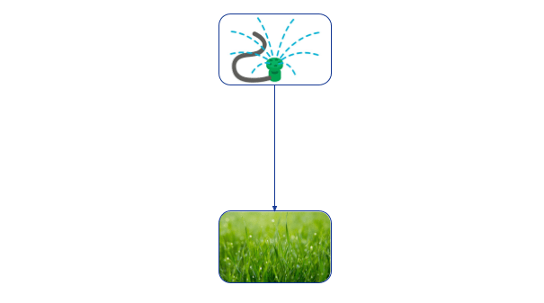
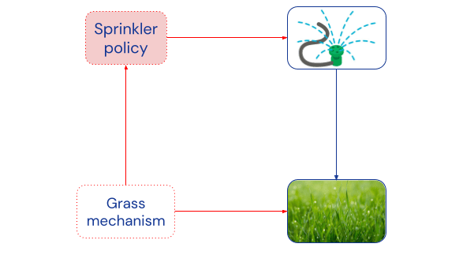
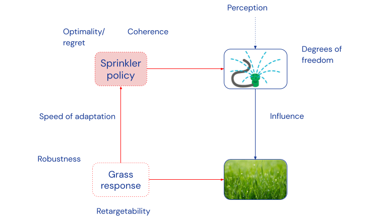

%%
Add discussion note here:

...

%%

_Post 3 of_ [_Towards Causal Foundations of Safe AGI_](https://www.alignmentforum.org/s/pcdHisDEGLbxrbSHD)_, preceded by_ [_Post 1: Introduction_](https://www.alignmentforum.org/posts/3oQCY4he4zRzF6vQb/introduction-to-towards-causal-foundations-of-safe-agi) and [_Post 2: Causality_](https://www.alignmentforum.org/posts/9ag5JGBnMsayBidwh/causality-a-brief-introduction).

_By Matt MacDermott, James Fox, Rhys Ward, Jonathan Richens, and Tom Everitt representing the_ [_Causal Incentives Working Group_](https://causalincentives.com/)_. Thanks also to Ryan Carey, Toby Shevlane, and Aliya Ahmad._

The purpose of this post is twofold: to lay the foundation for subsequent posts by exploring what agency means from a causal perspective, and to sketch a research program for a deeper understanding of agency.

## The Importance of Understanding Agency ^the-importance-of-understanding

Agency is a complex concept that has been studied from multiple perspectives, including [social science](https://en.wikipedia.org/wiki/Agency_\(sociology\)), [philosophy](https://academic.oup.com/book/10322), and [AI research](https://incompleteideas.net/book/ebook/node28.html). Broadly it refers to a system able to act autonomously. For the purposes of this blog post, we interpret agency as _goal-directedness_, i.e. acting as if trying to direct the world in some particular direction.

There are strong incentives to create more agentic AI systems. Such systems could potentially do many tasks humans are currently needed for, such as independently researching topics, or even run their own companies. However, making systems more agentic comes with an additional set of potential [dangers](https://www.alignmentforum.org/posts/wnnkD6P2k2TfHnNmt/threat-model-literature-review) and [harms](https://arxiv.org/abs/2302.10329), as goal-directed AI systems could become capable adversaries if their goals are misaligned with human interest.

A better understanding of agency may let us:

-   **Understand dangers and harms from powerful machine learning systems.**
-   **Evaluate** whether a particular ML model is dangerously agentic.
-   **Design** systems that are not agentic, such as [AGI scientists](https://yoshuabengio.org/2023/05/07/ai-scientists-safe-and-useful-ai/) or [oracles](https://www.fhi.ox.ac.uk/publications/armstrong-s-sandberg-a-bostrom-n-2012-thinking-inside-the-box-controlling-and-using-an-oracle-ai-minds-and-machines-224-299-324/), or which are agentic in a safe way.
-   **Lay a foundation** for progress on other AGI safety topics, such as interpretability, incentives, and generalisation.
-   **Preserve human agency**, e.g. through a better understanding of the conditions under which agency is enhanced or diminished.

## Degrees of freedom ^degrees-of-freedom

(Goal-directed) agents come in all shapes and sizes – from bacteria to humans, from football teams to governments, and from RL policies to [LLM simulacra](https://www.alignmentforum.org/posts/vJFdjigzmcXMhNTsx/simulators) – but they share some fundamental features.

First, an agent needs the freedom to choose between a set of options.[^note-agent-choice] We don’t need to assume that this decision is free from causal influence, or that we can’t make any prediction about it in advance – but there does need to be a sense in which it could either go one way or another. Dennett calls this [degrees of freedom](https://now.tufts.edu/2020/09/02/our-brains-our-selves#:~:text=A%20degree%20of%20freedom%20is,you%20can%20think%20about%20anything.).

For example, Mr Jones can choose to turn his sprinkler on or not. We can model his decision as a random variable with “watering” and “not watering” as possible outcomes:

_Degrees of freedom can be captured by the possible outcomes of a random variable_

Freedom comes in degrees. A thermostat can only choose heater output, while most humans have access to a range of physical and verbal actions.

## Influence ^influence

Second, in order to be relevant, an agent’s behaviour must have consequences. Mr Jones’ decision to turn on the sprinkler affects how green his grass becomes:
 

_Mr Jones’ sprinkler influences grass greenness._

The amount of influence varies between different agents. For example, a language model’s influence will heavily depend on whether it only interacts with its own developers, or with millions of users through a public API, and causal influence of our actions [seems to determine](https://www.tandfonline.com/doi/full/10.1080/09515089.2021.1985102) sense of agency in humans. Suggested measures of influence include ([causal](https://www.mdpi.com/1099-4300/21/10/975)) [channel capacity](https://uhra.herts.ac.uk/bitstream/handle/2299/1918/901933.pdf?sequence=1&isAllowed=n), [performative power](https://arxiv.org/abs/2203.17232), and [power in Markov decision processes](https://arxiv.org/abs/1912.01683).

## Adaptation ^adaptation

Third, and most importantly, goal-directed agents [_do things for reasons_](https://mitpress.mit.edu/9780262540537/the-intentional-stance/). That is, (they act as if) they have preferences about the world, and these preferences drive their behaviour: Mr Jones turns on the sprinkler _because_ it makes the grass green. If the grass didn’t need water, then Mr Jones likely wouldn’t water it. The consequences drive the behaviour.

This feedback loop, or [backwards causality](https://www.alignmentforum.org/posts/gEKHX8WKrXGM4roRC/saving-time), can be represented by adding a so-called **mechanism node** to each **object-level node** in the original graph. The mechanism node specifies the [causal mechanism](https://www.alignmentforum.org/posts/9ag5JGBnMsayBidwh/causality-a-brief-introduction#:~:text=the%20graph%2C%20a-,causal%20mechanism,-of%20how%20the) of its associated object-level node, i.e. how the outcome of the object-level node is determined by its object-level parents. For example, a mechanism node for the sprinkler specifies Mr Jones’ watering policy, and a mechanism node for the grass specifies how the grass responds to different amounts of water:[^note-pre-post-policy]

_A mechanised causal graph showing Mr Jones’ adaptation to changes in the environment. Mechanism nodes are dotted red, object-level nodes are solid blue._

By explicitly representing causal mechanisms with nodes, we can consider interventions on them. For example, an intervention on _grass mechanism_ might change the type of grass to one that requires less water. The link from _grass mechanism_ to _sprinkler policy_ says that such an intervention could influence Mr Jones’ watering habits.[^note-alternative-interpretation] That is, _he would adapt his behaviour to still achieve his goal._

Given the right variables and experiments, adaptation can be detected with [causal discovery algorithms](https://www.frontiersin.org/articles/10.3389/fgene.2019.00524/full), and can thereby potentially be used to [discover agents](https://www.alignmentforum.org/posts/XxX2CAoFskuQNkBDy/discovering-agents). In particular, when one mechanism variable adapts to changes in another, the first may belong to a decision node and the second to a utility node that the decision is optimising. If the agents are ideal game-theoretic players, [refinements](https://www.alignmentforum.org/posts/XxX2CAoFskuQNkBDy/discovering-agents) of these conditions yield necessary and sufficient criteria for detecting decision and utility nodes.

Adaptation comes in degrees. [Dennett](https://en.wikibooks.org/wiki/Cognitive_Science:_An_Introduction/Kinds_of_Intelligences) makes a distinction between Darwinian, Skinnerian, Popperian, and Gregorian agents, depending on whether they adapt by evolution, experience, planning, or by learning from others. For example, a human who notices the cold puts on a coat, while a species may grow warmer fur over evolutionary timescales. Language models likely fall on the highest, Gregorian, level, as they can be taught some things in the prompt, and learn many things from humans during pre-training.

Quantitative measures of adaptation can be obtained by considering how **quickly** and **effectively** an agent adapts to **different** interventions. The speed of adaptation can be measured if we extend our framework with mechanism interventions at different timescales (e.g. at evolutionary or human timescales). The effectiveness of a particular adaptation can be quantified by comparing the agent's performance in the presence and the absence of an intervention. One common performance measure using reward functions is (worst-case) [regret](https://en.wikipedia.org/wiki/Multi-armed_bandit#The_multi-armed_bandit_model). Finally, which environment interventions the agent appropriately adapts to measures how **robust** it is, and which utility interventions measures its [retargetability](https://www.alignmentforum.org/posts/znfkdCoHMANwqc2WE/the-ground-of-optimization-1) or task generality.

In a subsequent post, we will present a result showing that adaptation requires the agent to have a causal model. This result will connect the behavioural perspective taken in this post with the agent’s internal representation.

## Coherence and Self-preservation ^coherence-and-self-preservation

Related to adaptation is how **coherently** an agent pursues a long-term goal? For example, why is it that governments can pursue large infrastructure projects over decades, while (current) language agents (such as autoGPT) veer off course quickly? First, building on the above discussion, we can operationalise a goal in terms of what mechanism interventions the agent adapts to. For example, a [sycophantic](https://www.lesswrong.com/posts/yRAo2KEGWenKYZG9K/discovering-language-model-behaviors-with-model-written) language model that adapts its answers to the user’s political leanings, might have the goal of pleasing the user or get more reward. Extending this, coherence can be operationalised by how similar the goal is for different decision nodes. Curiously, more intelligence [doesn’t necessarily](https://sohl-dickstein.github.io/2023/03/09/coherence.html) bring more coherence.

An agent that does not [**persist**](https://selfawaresystems.files.wordpress.com/2008/01/ai_drives_final.pdf) cannot coherently pursue a goal. This is likely the reason that we (humans) want to preserve our own agency,[^note-meta-preferences] as alluded to in the [intro post](https://www.alignmentforum.org/posts/3oQCY4he4zRzF6vQb/introduction-to-towards-causal-foundations-of-safe-agi). Current language models [express a desire](https://cdn2.assets-servd.host/anthropic-website/production/files/model-written-evals.pdf) for self-preservation. In contrast, more limited systems like content recommenders and GPS navigation systems exhibit no self-preservation drive at all, in spite of being somewhat goal-directed.

## Putting it all together ^putting-it-all-together

So far, we have discussed eight dimensions of agency: degrees of freedom, influence, adaptation (speed, effectiveness, robustness, retargetability), coherence, and self-preservation. To the list can also be added ([Markov](https://www.cambridge.org/core/journals/behavioral-and-brain-sciences/article/abs/emperors-new-markov-blankets/715C589A73DDF861DCF8997271DE0B8C)) [**separation**](https://www.alignmentforum.org/s/LWJsgNYE8wzv49yEc) [from](https://www.lesswrong.com/posts/fjgoMaBenyXcRDrbX/boundaries-membranes-and-ai-safety-compilation) the environment (e.g. a cell wall, skin, or encryption of internal emails, captured by [d-separation](http://bayes.cs.ucla.edu/BOOK-2K/d-sep.html) in causal graphs), and the amount of information or perception the agent has of its environment.

The dimensions are all about the strength or quality of different causal relationships, and can be conceptually associated with different parts of our diagram from above:

_Dimensions of agency_

These dimensions also emphasise the point that agency comes in degrees, and there are several different dimensions along which a system can be more or less agentic. For example, a human is more agentic than a fish, which is more agentic than a thermostat, while AlphaGo exceeds humans in coherence but has much fewer degrees of freedom.

## Future work ^future-work

The high-level discussion in this post has aimed to explain the conceptual connections between agency and causality: adaptation in particular is a causal notion, capturing how behaviour is causally influenced by interventions on the environment and the agent’s goals. Subsequent posts will build on this idea.

We would also like to highlight some lines of future work suggested by this perspective:

-   What are the **key dimensions of agency**? Can we come up with a unified formalisation of the above concepts? How do they relate to [optimisation power](https://www.lesswrong.com/posts/Q4hLMDrFd8fbteeZ8/measuring-optimization-power) and [the ground of optimisation](https://www.lesswrong.com/posts/znfkdCoHMANwqc2WE/the-ground-of-optimization-1)? Is there a basis set of mutually independent agency dimensions of which all other concepts are a function?
-   Can we **measure** goal-directedness in language models and in humans? Perhaps overall goal-directedness or [optimisation power](https://www.lesswrong.com/posts/Q4hLMDrFd8fbteeZ8/measuring-optimization-power) can be (upper) bounded by an agent’s influence, adaptation, coherence, and so on. This could feed into an [evaluation](https://arxiv.org/abs/2305.15324) of a system's dangerous capabilities.
-   Can we **design** agents that are only partially goal-directed? Systems like content recommenders and GPS navigation systems exhibit no self-preservation at all, in spite of being somewhat goal-directed. Current language models [exhibit](https://cdn2.assets-servd.host/anthropic-website/production/files/model-written-evals.pdf) some self-preservation, but perhaps this can be avoided? Evolution has likely simultaneously been selecting for all of the above concepts when developing biological agents, but artificial systems need not face much evolutionary pressure. If [inadvertent](https://www.alignmentforum.org/posts/pRkFkzwKZ2zfa3R6H/without-specific-countermeasures-the-easiest-path-to) and [deliberate](https://agpt.co/) creation of coherently self-preserving agents can be avoided, [this](https://link.springer.com/article/10.1007/s11023-012-9282-2) [could](https://www.alignmentforum.org/tag/tool-ai) [potentially](https://yoshuabengio.org/2023/05/07/ai-scientists-safe-and-useful-ai/) offer a path to reap most of the benefits of AI, with only a fraction of the danger.
-   Can we better understand the conditions under which agency **emerges** from less agentic components? When is agency **enhanced** and when is it **diminished**? When does a digital assistant or content recommender boost vs undermine my agency? What if I play chess with the help of AlphaZero? 

**The next post** will focus on incentives. Understanding incentives is important for promoting the right kind of behaviour in the AI systems we design. As we shall see, the incentives analysis builds naturally on the notion of agency discussed in this post.

[^note-agent-choice]: Some uses of the term _agent_ might allow for a system to be an agent even if it has no way to choose an action, such as a completely paralysed person. We don’t use the term in this sense, focusing instead on _goal-directed systems that act_. It is also worth noting that for us, agency is relative to the “[frame](https://arxiv.org/abs/2208.08345)” defined by the variables in the model. If Mr Jones’s sprinkler broke, he’d have no agency relative to the frame in this post, but he may still have agency according to other frames (he might still be able to freely walk around his garden, for example).
[^note-pre-post-policy]: Mechanism nodes enable a [formalisation](https://arxiv.org/abs/2301.02324) of pre-policy and post-policy interventions, [discussed](https://www.alignmentforum.org/posts/9ag5JGBnMsayBidwh/causality-a-brief-introduction#:~:text=In%20models%20with,the%20next%20post.) in the previous post. Pre-policy interventions are interventions that agents can adapt their policy to. They correspond to interventions on mechanism nodes. Post-policy interventions are interventions that agents cannot adapt their policy to. They correspond to interventions on object-level nodes. For example, the mechanism edge from _grass mechanism_ to _sprinkler policy_ says that Mr Jones can adapt to pre-policy interventions. But there is no edge from object-level _grass_ to _sprinkler policy_, so he cannot adapt his policy to (post-policy) interventions on _grass_.
[^note-alternative-interpretation]: An alternative interpretation, natural from a [finite-factored sets](https://www.alignmentforum.org/posts/N5Jm6Nj4HkNKySA5Z/finite-factored-sets#2b__Time_and_Orthogonality) perspective, is to interpret the agent’s behaviour as answering a more fine-grained question than its goal, and the object-level nodes as answering more fine-grained questions than their mechanisms. Relatedly, causal relationships [can be inferred from algorithmic information theory](https://arxiv.org/abs/0804.3678), which is convenient [when discussing](https://arxiv.org/pdf/2102.11107.pdf) independence between non-intervenable nodes.
[^note-meta-preferences]: Such meta-preferences are sometimes seen as a hallmark of agency. They can likely be modelled analogously to normal preferences by adding another layer of mechanism nodes (i.e. mechanism nodes for mechanism nodes)
