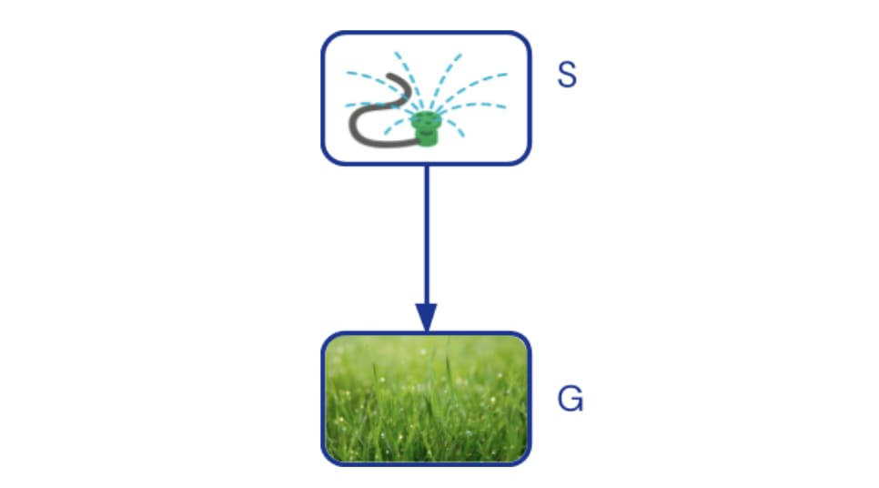
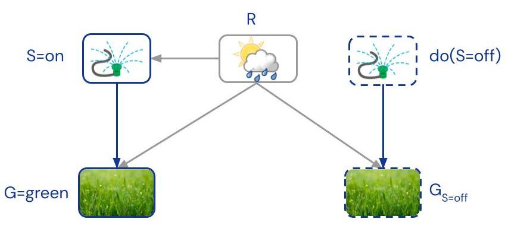
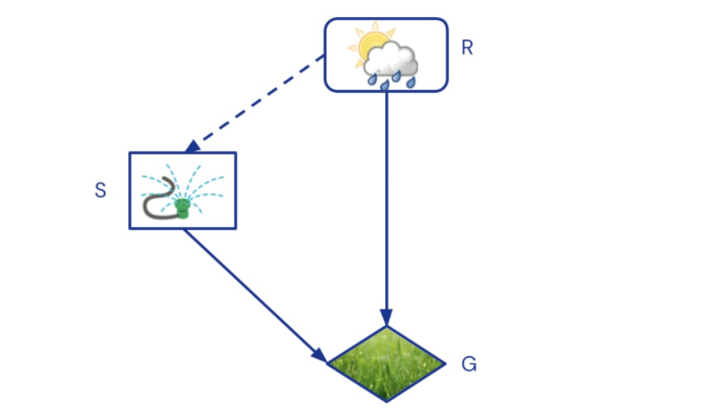
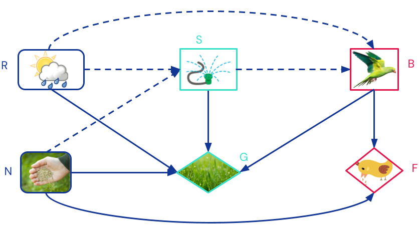
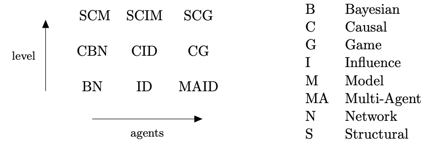

%%
Add discussion note here:

...

%%

_Post 2 of_ [_Towards Causal Foundations of Safe AGI_](https://www.alignmentforum.org/s/pcdHisDEGLbxrbSHD)_, see also_ [_Post 1 Introduction_](https://www.alignmentforum.org/posts/3oQCY4he4zRzF6vQb/introduction-to-towards-causal-foundations-of-safe-agi).

_By Lewis Hammond, Tom Everitt, Jon Richens, Francis Rhys Ward, Ryan Carey, Sebastian Benthall, and James Fox, representing the_ [_Causal Incentives Working Group_](https://causalincentives.net/)_. Thanks also to Alexis Bellot, Toby Shevlane, and Aliya Ahmad._

Causal models are the foundations of our work. In this post, we provide a succinct but accessible explanation of causal models that can handle interventions, counterfactuals, and agents, which will be the building blocks of future posts in the sequence. Basic familiarity with (conditional) probabilities will be assumed.

## What is causality? ^what-is-causality

What does it mean for the rain to _cause_ the grass to become green? [Causality](https://plato.stanford.edu/entries/causation-metaphysics/) is a philosophically intriguing topic that underlies many other concepts of human importance. In particular, many concepts relevant to safe AGI, like [influence](https://arxiv.org/abs/2102.01685), [response](https://arxiv.org/abs/2102.01685), [agency](https://www.alignmentforum.org/posts/XxX2CAoFskuQNkBDy/discovering-agents), [intent](https://www.cs.cornell.edu/home/halpern/papers/moralresp.pdf), [fairness](https://arxiv.org/abs/1907.06430), [harm](https://arxiv.org/abs/2204.12993), and [manipulation](https://arxiv.org/abs/2303.09387), cannot be grasped without a causal model of the world, as we mentioned in [the intro post](https://www.alignmentforum.org/posts/3oQCY4he4zRzF6vQb/introduction-to-towards-causal-foundations-of-safe-agi) and will discuss further in subsequent posts.

We follow [Pearl](http://bayes.cs.ucla.edu/BOOK-2K/) and adopt an [interventionist](https://plato.stanford.edu/entries/causation-mani/#StruEquaDireGrapManiTheoCaus) definition of causality: the sprinkler today _causally influences_ the greenness of the grass tomorrow, because if someone intervened and turned on the sprinkler, then the greenness of the grass would be different. In contrast, making the grass green tomorrow has no effect on the sprinkler today (assuming no one predicts the intervention). So the sprinkler today causally influences the grass tomorrow, but not vice versa, as we would intuitively expect.

## Interventions ^interventions

[Causal Bayesian Networks](http://bayes.cs.ucla.edu/BOOK-2K/ch1-3.pdf) (CBNs) represent causal dependencies between aspects of reality using a [directed acyclic graph](https://en.wikipedia.org/wiki/Directed_acyclic_graph). An arrow from a variable A to a variable B means that A influences B under some fixed setting of the other variables. For example, we draw an arrow from sprinkler (S) to grass greenness (G):

_A causal graph representing our running example. The sprinkler (S) influences the greenness of the grass (G)._

For each node in the graph, a **causal mechanism** of how the node is influenced by its parents is specified with a [conditional probability distribution](https://en.wikipedia.org/wiki/Conditional_probability_distribution). For the sprinkler, a distribution $p(S)$  specifies how commonly it is turned on, e.g. $P(S=\text{on})= 30\%$. For the grass, a conditional distribution $p(G \mid S)$ specifies how likely it is that the grass becomes green when the sprinkler is on, e.g. $p(G=\text{green} \mid S=\text{on}) = 100\%$, and how likely it is that the grass becomes green when the sprinkler is off, e.g. $p(G=\text{green} \mid S=\text{off}) = 30\%$.

By multiplying the distributions together, we get a [joint probability distribution](https://en.wikipedia.org/wiki/Joint_probability_distribution) $p(S, G) = p(S) p(G \mid S)$ that describes the likelihood of any combination of outcomes. Joint probability distribution are the foundation of standard probability theory, and can be used to answer questions such as "what is the likelihood that the sprinkler is on, given that I observe that the grass is wet?"

An **intervention** on a system changes one or more causal mechanisms. For example, an intervention that turns the sprinkler on corresponds to replacing the causal mechanism $p( S )$ for the sprinkler, with a new mechanism $\mathbb{1}( S = \text{on} )$ that always has the sprinkler on. The effects of the intervention can be computed from the updated joint distribution $p( S, G \mid do(S=\text{on}) ) = \underbrace{\mathbb{1}( S = \text{on} )}_{\substack{\text{intervened}\\\text{mechanism}}} p( G \mid S )$ where $do(S=\text{on})$ denotes the intervention. 

Note that it would **not** be possible to compute the effect of the intervention from just the joint probability distribution $p(S, G)$, as without the causal graph, there'd be no way to tell whether a mechanism should be changed in the factorisation $P(S)P(G\mid S)$ or in $p(G)p(S\mid G)$.

Ultimately, all statistical correlations are [due to causal influences](https://plato.stanford.edu/entries/physics-Rpcc/). Hence, for a set of variables there is always some CBN that represents the underlying causal structure of the data generating process, though extra variables may be needed to explain e.g. unmeasured confounders.

## Counterfactuals ^counterfactuals

Suppose that the sprinkler is on and the grass is green. Would the grass have been green had the sprinkler not been on? Questions about **counterfactuals** like these are harder than questions about interventions, because they involve reasoning across multiple worlds. Counterfactuals are key to defining e.g. [harm](https://arxiv.org/abs/2204.12993), [intent](https://arxiv.org/abs/1810.05903), [fairness](https://arxiv.org/abs/1703.06856), and [impact measures](https://www.alignmentforum.org/posts/pf48kg9xCxJAcHmQc/understanding-recent-impact-measures), as they all depend on comparing outcomes across hypothetical worlds.

To handle such reasoning, [structural causal models (SCMs)](http://bayes.cs.ucla.edu/BOOK-2K/) refine CBNs in three important ways. First, background context that is shared across hypothetical worlds is explicitly separated from variables that can be intervened and vary across the worlds. The former are called _exogenous_ variables, and the latter _endogenous_. For our question, it will be useful to introduce an exogenous variable R for whether it rains or not. The sprinkler and the grass are endogenous variables.

The relationship between hypothetical worlds can be represented with a [twin-graph](https://www.jmlr.org/papers/volume9/shpitser08a/shpitser08a.pdf), where there are two copies of the endogenous variables for actual and hypothetical worlds, and the exogenous variable(s) provide shared context:

_A twin graph to answer whether the sprinkler is the reason the grass is green. Nodes in the hypothetical world are dashed. The right hand sprinkler node is intervened_ $do(S=\text{off})$_, representing the hypothetical. The grey exogenous rain node R provides shared context._

Second, SCMs introduce notation to distinguish endogenous variables in different hypothetical worlds. For example, $G_{S=\text{off}}$ denotes grass greenness in the hypothetical world where the sprinkler is off. It can be read as shorthand for “$G \mid do(S=\text{off})$”, and has the benefit that it can occur in expressions involving variables from other worlds. For example, our question can be expressed as $p( \underbrace{G_{S=\text{off}} = \text{green}}_{\text{hypothetical}} \mid \underbrace{S=\text{on}, G=\text{green}}_{\text{actual observations}} )$.

Third, SCMs require all endogenous variables to have **deterministic** causal mechanisms. This is satisfied in our case if we assume that the sprinkler is on whenever it’s not raining, and the grass becomes green (only) if it rains or the sprinkler is on.

The determinism means that conditioning is as simple as updating the distribution over exogenous variables, e.g. $P(R)$ updates to $P(R \mid S=\text{on}, G=\text{green})$. In our case, the probability for rain decreases from $30\%$ to $0\%$, since the sprinkler is never on if it's raining.

This means our question is answered by the following reasoning steps:

-   Abduction: update $P(R)$  to $P(R \mid S=\text{on}, G=\text{green})$
-   Intervention: intervene to turn the sprinkler off,  $do(S=\text{off})$
-   Prediction: compute the value of G in the updated model.

Equivalently, in one formula:

$$
\begin{align} &\underbrace{p( G_{S=\text{off}} = \text{green} \mid S=\text{on}, G=\text{green} )}_{\text{original question}} = \\ =& \sum_{\substack{r \in \{\text{yes}, \text{no}\}\\ s\in \{\text{on}, \text{off}\}}} \underbrace{p(R = r \mid S=\text{on}, G=\text{green})}_{\text{update exogenous}}   \underbrace{\mathbb{1}( S = \text{off} )}_{\text{intervene}} \underbrace{p(G = \text{green} \mid R = r, S = s)}_{\text{predict}} \\ =& 0\end{align}
$$

That is, we can say that the grass would not have been green if the sprinkler had been off (under the assumption we’ve made about the specific relationships).

SCMs are strictly more powerful than CBNs. Their [primary drawback](https://www.ics.uci.edu/~sternh/courses/265/dawid_jasa2000.pdf) is that they require deterministic relationships between endogenous variables, which are often hard to determine in practice. They're also limited to [non-backtracking](https://plato.stanford.edu/entries/causation-mani/#InteCoun) counterfactuals, where hypothetical worlds are distinguished by interventions.

## One agent ^one-agent

To infer Mr Jones’ [intentions](https://arxiv.org/abs/1810.05903) or [incentives](https://arxiv.org/abs/2102.01685), or predict how his behaviour [would adapt](https://arxiv.org/abs/2208.08345) to changes in his model of the world, we need a [causal influence diagrams (CID)](https://arxiv.org/abs/2102.01685) that labels variables as chance, decision, or utility nodes. In our example, rain would be a chance node, the sprinkler a decision, and grass greenness a utility. Since rain is a parent of the sprinkler, Mr Jones observes it before making his decision. Graphically, chance nodes are rounded as before, decisions are rectangles, utilities are diamonds, and dashed edges denote observations:

_A CID representing our running example. The sprinkler is a decision optimising grass greenness._

The agent specifies causal mechanisms for its decisions, i.e. a policy, with the goal of maximising the sum of its utility nodes. In our example, an optimal policy would be to turn the sprinkler on when it's not raining (the decision when it is raining doesn’t matter). Once a policy is specified, the CID defines a CBN.

In models with agents, there are two kinds of interventions, depending on whether agents get to adapt their policy to the intervention or not. For example, only if we informed Mr Jones about an intervention to the grass _before_ he made his sprinkler decision, could he pick a different sprinkler policy. Both **pre-policy** and **post-policy** interventions can both be handled with the standard do-operator if we add so-called [mechanism nodes](https://www.sciencedirect.com/science/article/pii/S0004370223000656) to the model. More about these in the next post.

## Multiple agents ^multiple-agents

Interaction between multiple agents can be modelled with [causal games](https://www.sciencedirect.com/science/article/pii/S0004370223000656), in which each agent has a set of decision and utility variables.

To illustrate this, assume Mr Jones sometimes sows new grass. Birds like to eat the seeds, but cannot tell from afar whether there are any. They can only see whether Mr Jones is using the sprinkler, which is more likely when the grass is new. Mr Jones wants to water his lawn if it's new, but does not want the birds to eat his seeds. This [signalling game](https://en.wikipedia.org/wiki/Signaling_game) has the following structure:

_A causal game representing an extension of our running example. Different colours denote different agents’ decision and utility nodes. The missing link from the new seeds (N) to the bird (B) means the bird cannot see whether new seeds are present._

Beyond modelling causality better, causal games also have some other advantages over standard [extensive-form games (EFGs)](https://en.wikipedia.org/wiki/Extensive-form_game). For example, the causal game immediately shows that the birds are indifferent to whether Mr Jones waters the grass or not, because the only directed path from the sprinkler S to food F goes via the birds' own decision B. In an EFG, this information would be hidden in the payoffs. By explicitly representing independencies, causal games can sometimes find more [subgames](https://en.wikipedia.org/wiki/Subgame) and rule out more [non-credible threats](https://en.wikipedia.org/wiki/Non-credible_threat) than EFGs. A causal game can always be converted to an EFG.

Analogously to the distinction between joint probability distributions, CBNs, and SCMs, there are ([multi-agent](https://www.sciencedirect.com/science/article/pii/S0899825602005444)) [influence diagrams](https://en.wikipedia.org/wiki/Influence_diagram) that include agents in graphs that need not be causal, and [structural causal influence models](https://arxiv.org/abs/2102.01685) and [structural causal games](https://www.sciencedirect.com/science/article/pii/S0004370223000656) that combine agents with exogenous nodes and determinism to answer counterfactual questions.

## Summary ^summary

This post introduced models that can answer correlational, interventional and counterfactual questions, and that can handle zero, one, or many agents. All in all, there are nine possible kinds of models. For more comprehensive introductions to causal models, see Section 2 of [Reasoning about causality in games](https://arxiv.org/abs/2301.02324), and Pearl's book [A Primer](http://bayes.cs.ucla.edu/PRIMER/).

_A_ [_taxonomy_](https://arxiv.org/abs/2301.02324) _of causal models and their acronyms. The vertical axis positions models in the causal hierarchy (associational, interventional, or counterfactual), while the horizontal axis specifies the number of agents (0, 1, or n)._

**Next post.** CIDs and causal games are used to model agent(s). But, what is an agent? In the next post, we take a deeper look at what agents are by looking at some characteristics shared by all agentic systems.
