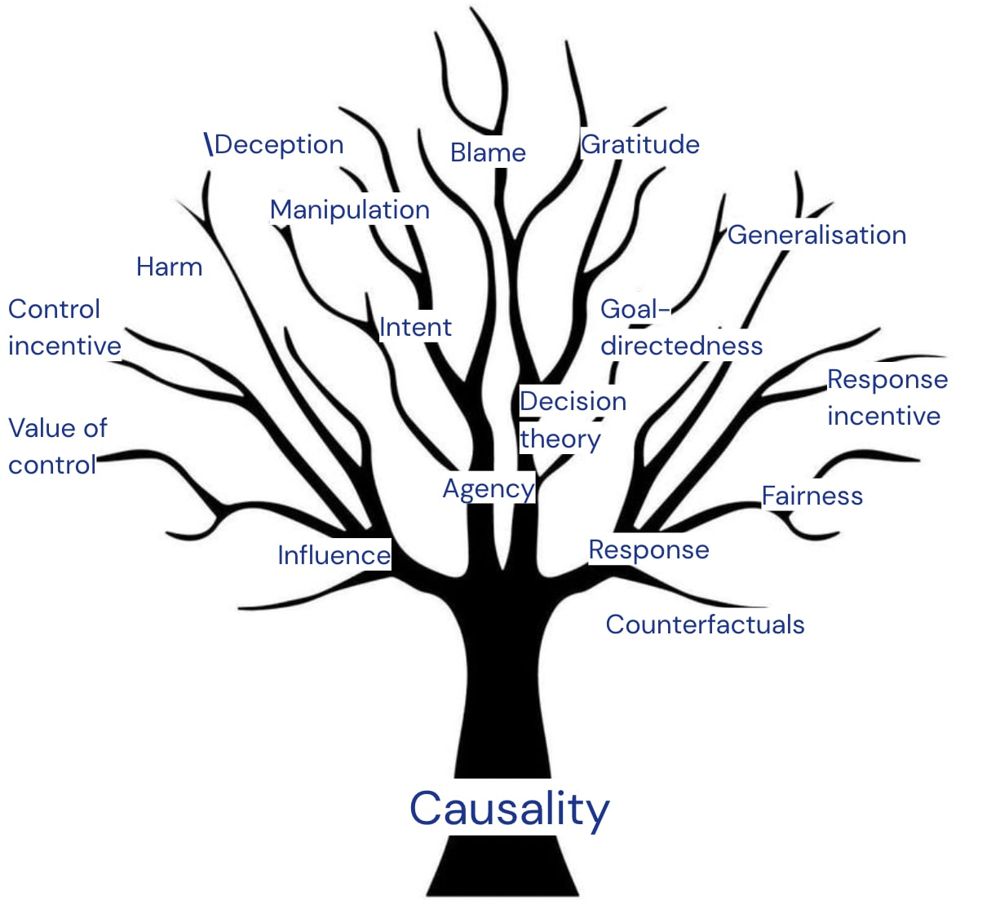

%%
Add discussion note here:

...

%%

_By Tom Everitt, Lewis Hammond, Rhys Ward, Ryan Carey, James Fox, Sebastian Benthall, Matt MacDermott and Shreshth Malik representing the_ [_Causal Incentives Working Group_](https://causalincentives.com/)_. Thanks also to Toby Shevlane, MH Tessler, Aliya Ahmad, Zac Kenton, Maria Loks-Thompson, and Alexis Bellot._

Over the next few years, society, organisations, and individuals will face a number of fundamental questions stemming from the rise of advanced AI systems: 

-   How to make sure that advanced AI systems do what we want them to (the alignment problem)?
-   What makes a system safe enough to develop and deploy, and what constitutes sufficient evidence of that?
-   How do we preserve our autonomy and control as decision making is increasingly delegated to digital assistants?

A causal perspective on **agency** provides conceptual tools for navigating the above questions, as we’ll explain in this sequence of blog posts. An effort will be made to minimise and explain jargon, to make the sequence accessible to researchers from a range of backgrounds.

## Agency ^agency

First, with **agent** we mean a _goal-directed_ system that acts as if it is _trying_ to steer the world in some particular direction(s). Examples include animals, humans, and organisations (more on agents in a subsequent post). Understanding agents is key to the above questions. Artificial **agents** are widely considered the [primary existential threat](https://global.oup.com/academic/product/superintelligence-9780199678112?cc=gb&lang=en&) from AGI-level technology, whether they [emerge](https://www.lesswrong.com/posts/pRkFkzwKZ2zfa3R6H/without-specific-countermeasures-the-easiest-path-to) [spontaneously](https://arxiv.org/abs/2209.00626) or through [deliberate design](https://github.com/Significant-Gravitas/Auto-GPT).  Despite the [myriad risks to our existence](https://theprecipice.com/), highly capable agents pose a distinct danger, because many goals can be achieved [more effectively](https://selfawaresystems.files.wordpress.com/2008/01/ai_drives_final.pdf) by accumulating influence over the world. Whereas an asteroid moving towards earth isn’t intending to harm humans and won’t resist redirection, misaligned agents might be distinctly adversarial and active threats.

Second, the preservation of **human** agency is critical in the approaching technological transition, for both individuals and collectives. Concerns have already [been](https://arxiv.org/abs/2109.04083) [raised](https://arxiv.org/abs/2107.10939) that manipulative social media algorithms and content recommenders undermine users’ ability to focus on their long-term goals. More powerful assistants could exacerbate this. And as more decision-making is delegated to AI systems, the ability of society to [set its own trajectory](https://www.nytimes.com/2023/03/24/opinion/yuval-harari-ai-chatgpt.html) comes into question.

Human agency can also be _nurtured_ and protected. Helping people to help themselves is less paternalistic than directly fulfilling their desires, and fostering empowerment may be less contingent on complete alignment than direct satisfaction of individual preferences. Indeed, [self-determination theory](https://en.wikipedia.org/wiki/Self-determination_theory) provides evidence that humans intrinsically value agency, and some human rights can be interpreted as “[protections of our normative agency](https://academic.oup.com/book/8845/chapter-abstract/155043519?redirectedFrom=fulltext)”.

Third, artificial agents might themselves eventually [constitute moral patients](https://pubmed.ncbi.nlm.nih.gov/34109927/). A clearer understanding of agency could help us refine our moral intuitions and avoid unethical actions. Some ethical dilemmas might be possible to avoid altogether by only designing artificial systems that lack moral patienthood.

## Key questions ^key-questions

One hope for our research is that it would build up a theory of agency. Such a theory would ideally answer questions such as:

-   What are the **possible kinds of agents** that can be created, and along what dimension can they differ? The agents we’ve seen so far primarily include animals, humans, and human organisations, but the range of possible goal-directed systems is likely much larger than that.
-   **Emergence**: how are agents created? For example, when might a large language model become agentic? When does a system of agents become a “meta-agent”, such as an organisation?
-   **Disempowerment**: how is agency lost? How do we preserve and nurture human agency?
-   What are the **ethical demands** posed by various types of systems and agents?
-   How to **recognise** agents and **measure** agency? A concrete operationalization would help us to detect agency in artificial systems, and agency loss in humans.
-   How to **predict agent behaviour**? What behaviour is incentivised and how do agents generalise to new situations? If we understand the impact of the behaviour, we may also be able to **anticipate danger**.
-   What are the **possible relationships** between agents? Which are harmful and which are beneficial?
-   How do we **shape agents**, to make them safe, fair, and beneficial?

## Causality ^causality

Causality is helpful for understanding agents. Philosophers have been interested in causality for a [long time](https://en.wikipedia.org/wiki/Causality#History_2), not just because the exact relationship between a cause and an effect is intellectually intriguing, but because it underpins so many other concepts, many of which are relevant to understanding agents and designing safe AGI.

For example, both influence and response are causal concepts. We want agents that [**influence**](https://arxiv.org/abs/2102.01685) the world in positive ways, and **respond** appropriately to instructions. A range of other relevant concepts also build on causality:

-   [Agency](https://arxiv.org/abs/2208.08345), since a goal-directed system is one where the system’s goals are **driving** (causing) its behaviour.
-   [Intention](https://link.springer.com/article/10.1007/s10506-022-09322-x), which relates to the **reasons for** (causes of) action, and to goal-directed means-end **influence**. Intent is an important concept when ascribing [legal and moral responsibility](https://ojs.aaai.org/index.php/AAAI/article/view/11557). 
-   [Harm](https://arxiv.org/abs/2204.12993), [manipulation](https://arxiv.org/abs/2303.09387), and [deception](https://causalincentives.com/pdfs/deception-ward-2023.pdf) which consider how your well-being, actions, or beliefs were **influenced** and which are usually taken to be _intentional._
-   [Fairness](https://arxiv.org/abs/1703.06856) in how e.g. a hiring decision **responds** to personal attributes such as gender or race and make them **influence** the outcome.
-   [Robust generalisation](https://arxiv.org/abs/2102.11107) to changes in the environment is much easier for agents with a **causal model** of their environment.
-   [Hypotheticals / counterfactuals](http://bayes.cs.ucla.edu/PRIMER/primer-ch4.pdf), as the alternative world deviates from the actual world based on one or more causal interventions.

_The tree of causality_

The rest of this sequence will explain in more detail how these concepts are grounded in causality, and the research this has led to. We hope this will enable and motivate other researchers to join our effort of building a formal theory of safe A(G)I based on causal foundations. Much of our recent work fits into this vision. For example, in [discovering agents](https://arxiv.org/abs/2208.08345) and [reasoning about causality in games](https://arxiv.org/abs/2301.02324), we developed a better understanding of how to represent various aspects of reality with causal models. With the [agent incentives](https://arxiv.org/abs/2102.01685) paper, we showed how such models can be analysed to reveal safety-relevant properties. And with [path-specific objectives](https://arxiv.org/abs/2204.10018), we illustrated how this kind of analysis can inspire improved designs.

We hope this will complement other research directions crucial to safe AGI, like [scalable alignment](https://deepmindsafetyresearch.medium.com/scalable-agent-alignment-via-reward-modeling-bf4ab06dfd84), [dangerous capability evaluations](https://arxiv.org/abs/2305.15324), [robustness](https://arxiv.org/abs/2209.07858), [interpretability](https://www.lesswrong.com/posts/jLAvJt8wuSFySN975/mechanistic-interpretability-quickstart-guide), [ethics](https://www.nature.com/articles/s42256-019-0088-2), [policy and governance](http://www.fhi.ox.ac.uk/wp-content/uploads/GovAI-Agenda.pdf), [forecasting](https://arxiv.org/abs/1901.08579), [agent foundations](https://intelligence.org/files/TechnicalAgenda.pdf), and [risk](https://arxiv.org/abs/2206.13353) [mapping](https://www.lesswrong.com/posts/wnnkD6P2k2TfHnNmt/threat-model-literature-review). 

## Conclusions ^conclusions

We hope that a causality-based understanding of agency and related aspects will help designers of AI systems by clarifying the space of possibilities for agents, and how to avoid especially risky configurations. It may help regulators with a better picture of what to look out for, and what should count as sufficient evidence of safety. It may help us all decide what behaviour is acceptable towards what kinds of systems. And finally, but not least, it may help individuals understand what it is that they seek to preserve and enhance in their interactions with artificially intelligent systems.

In the [next post](https://www.alignmentforum.org/s/pcdHisDEGLbxrbSHD/p/9ag5JGBnMsayBidwh), we explain causality and causal models in more detail, covering Pearl’s different causal models, and how they can be generalised to account for the presence of one or more agents.
