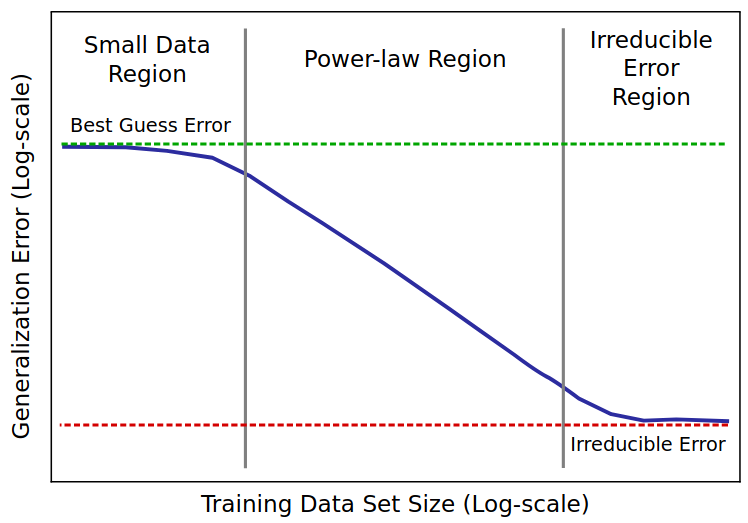

%%
Add discussion note here:

...

%%

Common shape of a scaling law, taken from Hestness et al. (2017)

## Executive summary ^executive-summary

-   Scaling laws are predictable relations between the scale of a model and performance or other useful properties.
-   I have collected a [database](https://docs.google.com/spreadsheets/d/1XHU0uyCojH6daSWEq9d1SHnlrQVW7li8iqBMasawMns/edit#gid=0) of scaling laws for different tasks and architectures, and [reviewed](https://docs.google.com/document/d/1kpdCPU2I0NLWPRwQ4qPSUZcZDobnyR9UY-iSOSBQRm4/edit#heading=h.urdgcuw7nklv) dozens of papers in the scaling law literature.
-   My main takeaways are:
    -   **Functional forms**: a basic power law can effectively model the scaling behavior in the power-law region but not the transitions to the other two regions. For this, either the [M4 estimator](https://arxiv.org/abs/2209.06640v2) or the [BNSL estimator](https://arxiv.org/abs/2210.14891) introduced below seem to be the best options right now.
    -   **Transfer learning**: there is not a simple universal scaling law for transfer learning between arbitrary tasks. When the tasks are similar enough, upstream loss and downstream performance are closely related, but when tasks are very different, the details of the architecture and hyperparameters become very relevant.

**See the full table of scaling laws [here](https://docs.google.com/spreadsheets/d/1XHU0uyCojH6daSWEq9d1SHnlrQVW7li8iqBMasawMns/edit#gid=0).**

## Introduction ^introduction

The term “scaling laws” in deep learning refers to relations between functional properties of interest (usually the test loss or some performance metric for fine-tuning tasks) and properties of the architecture or optimization process (like model size, width, or training compute). These laws can help inform the design and training of deep learning models, as well as provide insights into their underlying principles.

In this document, I present a detailed table outlining the known scaling laws and a summary of each paper’s contributions to the understanding of scaling in deep learning.

My main goal for this document is to serve as a comprehensive and up-to-date resource for information on scaling laws in deep learning. By presenting a curated list of papers that have explored various scaling laws, and providing a detailed table outlining the known scaling laws and a summary of each paper’s contributions, I aim to make it easier to access and understand the current state of knowledge on scaling in deep learning.

I selected the papers using the following criteria:

-   Publication date: I only focus on recent papers, and exclude work prior to 2015
-   Contribution: I include papers which contribute in one of these ways:
    -   Reporting empirical scaling laws
    -   Proposing better functional forms or fitting methods
    -   Proposing theoretical models to explain scaling behavior
    -   Connecting scaling behavior with lower-level properties of models

## Overview ^overview

While the scaling behavior of machine learning models has been studied for a long time (e.g., [Statistical Mechanics of Learning from Examples](https://journals.aps.org/pra/abstract/10.1103/PhysRevA.45.6056)), it was only recently that empirical research into scaling deep learning models became widely known and incorporated into practice.

Previous theoretical analyses often predicted that the test loss would decrease as a power law of training data, L = BD^{-b} + E, with exponent b = 1 or 1/2. However, this clashes with empirical results, in which the scaling exponent is usually smaller than 1/2.

The modern study of scaling laws arguably started with [Hestness et al. (2017)](https://arxiv.org/abs/1712.00409), who empirically identified power-law scaling of the test loss with respect to training data size in several different domains. In [Hestness et al. (2019)](https://arxiv.org/abs/1909.01736) this previous result was used to predict the increases in model and dataset sizes that would be needed to reach important performance milestones.

Shortly after, [Rosenfeld et al. (2020)](https://arxiv.org/pdf/1909.12673.pdf) constructed a joint error function with respect to model and data sizes, given by L = AN^{-a} + BD^{-b} + E and showed that this form could accurately reproduce the empirical error landscape.

During 2020 and 2021, our understanding of scaling laws was greatly expanded:

-   [Henighan et al. (2020)](https://arxiv.org/abs/2010.14701) found scaling laws for more tasks and architectures.
-   [Kaplan et al. (2020)](https://arxiv.org/abs/2001.08361) tested them at much larger scales.
-   [Sharma et al. (2020)](https://arxiv.org/abs/2004.10802), [Hutter (2021)](https://arxiv.org/abs/2102.04074) and [Bahri et al. (2021)](https://arxiv.org/abs/2102.06701) proposed theoretical mechanisms behind the values of the scaling exponents.
-   [Hernandez et al. (2021)](https://arxiv.org/abs/2102.01293), [Mikami et al. (2021)](https://arxiv.org/abs/2108.11018) and [Abnar et al. (2021)](https://arxiv.org/abs/2110.02095) studied scaling laws in the setting of transfer learning.

More recently, there have been several surprising results in the field that seem to suggest that the previously found scaling laws are less universal than one might have expected, particularly for downstream performance:

-   [Hoffmann et al. (2022)](https://arxiv.org/abs/2203.15556) revealed that the scaling laws found by [Kaplan et al. (2020)](https://arxiv.org/abs/2001.08361) were suboptimal, after finding better hyperparameter choices and testing at larger scales.
-   [Sorscher et al. (2022)](https://arxiv.org/abs/2206.14486) showed that, at least for some tasks, loss can scale exponentially with dataset size, rather than as a power-law.
-   [Tay et al. (2022)](https://arxiv.org/abs/2210.11399) were able to drastically improve downstream performance with a small amount of extra pretraining on a different objective.
-   [Caballero et al. (2022)](https://arxiv.org/abs/2210.14891) found that trend breaks in scaling curves can’t be easily predicted from smaller scale data.

In addition, scaling laws have been found for other properties, such as Goodharting ([Gao et al. 2022](https://arxiv.org/abs/2210.10760)), and there have been more connections between high-level scaling and low-level model features.

## Takeaways ^takeaways

### Upstream loss ^upstream-loss

For a vast collection of architectures and tasks, test loss for direct training scales predictably, transitioning from an initial random-guessing loss, to a power law regime, to a plateau at the irreducible loss. This is true for parameter, data, and compute scaling, and is relatively independent from the choice of architecture and hyperparameters, with some exceptions such as the learning rate schedule.

Except for the initial transition from random guessing to the power-law regime, and the transition from the power-law regime to the final plateau, the loss is well approximated by the functional form L(N,D) = AN^{-a} + BD^{-b}. There are several possible ways of modeling the transitions, but empirically it seems the best ones are the M4 estimator from [Alabdulmohsin et al. (2022)](https://arxiv.org/abs/2209.06640v2):

$$
\frac{L-E}{(I-L)^\alpha} = AN^{-a}+BD^{-b}
$$

and the BNSL estimator from [Caballero et al. (2022)](https://arxiv.org/abs/2210.14891), although it has significantly more parameters:

$$
L(D) = E + (b \cdot D^{-c_0})\prod_{i=1}^n\left(1+\left(\frac{D}{d_i}\right)^{\frac{1}{f_i}}\right)^{-c_if_i}
$$

### Transfer and downstream accuracy ^transfer-and-downstream-accuracy

While ‘scale is all you need’ seems mostly true for direct training, when it comes to transfer learning, the downstream performance critically depends on the tasks at hand as well as the choice of architecture and hyperparameters ([Tay et al., 2022](https://arxiv.org/abs/2207.10551)). When the upstream and downstream tasks are similar, downstream loss can be reasonably well predicted from upstream loss, but this is not the case when the two tasks are substantially different ([Abnar et al., 2021](https://arxiv.org/abs/2110.02095)).

### Theoretical analyses ^theoretical-analyses

So far the most convincing theoretical analyses I’ve found are [Sharma et al. (2020)](https://arxiv.org/abs/2004.10802) and [Bahri et al. (2021)](https://arxiv.org/pdf/2102.06701.pdf). In them, the magnitude of the scaling exponents are shown to be inversely proportional to the intrinsic dimension of the data manifold, both empirically and theoretically.

:::callout {title="Appendix" collapse="closed"}
## Appendix: Paper reviews ^appendix-paper-reviews

For a summary of all the papers reviewed, see [here](https://docs.google.com/document/d/1kpdCPU2I0NLWPRwQ4qPSUZcZDobnyR9UY-iSOSBQRm4/edit#heading=h.urdgcuw7nklv).
:::

## Bibliography ^bibliography

1.  Abnar, Samira, et al. _Exploring the Limits of Large Scale Pre-Training_. arXiv, 5 Oct. 2021. _arXiv.org_, [https://doi.org/10.48550/arXiv.2110.02095](https://doi.org/10.48550/arXiv.2110.02095).
2.  Alabdulmohsin, Ibrahim, et al. _Revisiting Neural Scaling Laws in Language and Vision. 2_, arXiv, 1 Nov. 2022. _arXiv.org_, [https://doi.org/10.48550/arXiv.2209.06640](https://doi.org/10.48550/arXiv.2209.06640).
3.  Ardalani, Newsha, et al. _Understanding Scaling Laws for Recommendation Models_. arXiv, 17 Aug. 2022. _arXiv.org_, [https://doi.org/10.48550/arXiv.2208.08489](https://doi.org/10.48550/arXiv.2208.08489).
4.  Bahri, Yasaman, et al. _Explaining Neural Scaling Laws_. arXiv, 12 Feb. 2021. _arXiv.org_, [https://doi.org/10.48550/arXiv.2102.06701](https://doi.org/10.48550/arXiv.2102.06701).
5.  Bansal, Yamini, et al. _Data Scaling Laws in NMT: The Effect of Noise and Architecture_. arXiv, 4 Feb. 2022. _arXiv.org_, [https://doi.org/10.48550/arXiv.2202.01994](https://doi.org/10.48550/arXiv.2202.01994).
6.  Caballero, Ethan, et al. _Broken Neural Scaling Laws_. arXiv, 10 Nov. 2022. _arXiv.org_, [https://doi.org/10.48550/arXiv.2210.14891](https://doi.org/10.48550/arXiv.2210.14891).
6.  Droppo, Jasha, and Oguz Elibol. _Scaling Laws for Acoustic Models_. arXiv, 11 June 2021. _arXiv.org_, [https://doi.org/10.48550/arXiv.2106.09488](https://doi.org/10.48550/arXiv.2106.09488).
7.  Gao, Leo, et al. _Scaling Laws for Reward Model Overoptimization_. arXiv, 19 Oct. 2022. _arXiv.org_, [https://doi.org/10.48550/arXiv.2210.10760](https://doi.org/10.48550/arXiv.2210.10760).
8.  Ghorbani, Behrooz, et al. _Scaling Laws for Neural Machine Translation_. 1, arXiv, 16 Sept. 2021. _arXiv.org_, [https://doi.org/10.48550/arXiv.2109.07740](https://doi.org/10.48550/arXiv.2109.07740).
9.  Gordon, Mitchell A., et al. “Data and Parameter Scaling Laws for Neural Machine Translation.” _Proceedings of the 2021 Conference on Empirical Methods in Natural Language Processing_, Association for Computational Linguistics, 2021, pp. 5915–22. ACLWeb, [https://doi.org/10.18653/v1/2021.emnlp-main.478](https://doi.org/10.18653/v1/2021.emnlp-main.478).
10.  Henighan, Tom, et al. _Scaling Laws for Autoregressive Generative Modeling_. arXiv, 5 Nov. 2020. _arXiv.org_, [https://doi.org/10.48550/arXiv.2010.14701](https://doi.org/10.48550/arXiv.2010.14701).
11.  Hernandez, Danny, et al. _Scaling Laws for Transfer_. arXiv, 1 Feb. 2021. _arXiv.org_, [https://doi.org/10.48550/arXiv.2102.01293](https://doi.org/10.48550/arXiv.2102.01293).
12.  Hestness, Joel, et al. _Deep Learning Scaling Is Predictable, Empirically_. arXiv, 1 Dec. 2017. _arXiv.org_, [https://doi.org/10.48550/arXiv.1712.00409](https://doi.org/10.48550/arXiv.1712.00409).
13.  Hoffmann, Jordan, et al. _Training Compute-Optimal Large Language Models_. arXiv, 29 Mar. 2022. _arXiv.org_, [https://doi.org/10.48550/arXiv.2203.15556](https://doi.org/10.48550/arXiv.2203.15556).
14.  Hutter, Marcus. _Learning Curve Theory_. arXiv, 8 Feb. 2021. _arXiv.org_, [https://doi.org/10.48550/arXiv.2102.04074](https://doi.org/10.48550/arXiv.2102.04074).
15.  Jones, Andy L. _Scaling Scaling Laws with Board Games_. arXiv, 15 Apr. 2021. _arXiv.org_, [https://doi.org/10.48550/arXiv.2104.03113](https://doi.org/10.48550/arXiv.2104.03113).
16.  Kaplan, Jared, et al. _Scaling Laws for Neural Language Models_. arXiv, 22 Jan. 2020. _arXiv.org_, [https://doi.org/10.48550/arXiv.2001.08361](https://doi.org/10.48550/arXiv.2001.08361).
17.  Mikami, Hiroaki, et al. _A Scaling Law for Synthetic-to-Real Transfer: How Much Is Your Pre-Training Effective?_ arXiv, 8 Oct. 2021. _arXiv.org_, [https://doi.org/10.48550/arXiv.2108.11018](https://doi.org/10.48550/arXiv.2108.11018).
18.  Neumann, Oren, and Claudius Gros. _Scaling Laws for a Multi-Agent Reinforcement Learning Model_. arXiv, 29 Sept. 2022. _arXiv.org_, [https://doi.org/10.48550/arXiv.2210.00849](https://doi.org/10.48550/arXiv.2210.00849).
19.  Ramasesh, Vinay Venkatesh, et al. _Effect of Scale on Catastrophic Forgetting in Neural Networks_. 2022. _openreview.net_, [https://openreview.net/forum?id=GhVS8\_yPeEa](https://openreview.net/forum?id=GhVS8_yPeEa).
20.  Rosenfeld, Jonathan S., et al. _A Constructive Prediction of the Generalization Error Across Scales_. arXiv, 20 Dec. 2019. _arXiv.org_, [https://doi.org/10.48550/arXiv.1909.12673](https://doi.org/10.48550/arXiv.1909.12673).
21.  Rosenfeld, Jonathan S. _Scaling Laws for Deep Learning_. 1, arXiv, 17 Aug. 2021. _arXiv.org_, [https://doi.org/10.48550/arXiv.2108.07686](https://doi.org/10.48550/arXiv.2108.07686).
22.  Seung, H. S., et al. “Statistical Mechanics of Learning from Examples.” _Physical Review A_, vol. 45, no. 8, Apr. 1992, pp. 6056–91. APS, [https://doi.org/10.1103/PhysRevA.45.6056](https://doi.org/10.1103/PhysRevA.45.6056).
23.  Sharma, Utkarsh, and Jared Kaplan. _A Neural Scaling Law from the Dimension of the Data Manifold_. arXiv, 22 Apr. 2020. _arXiv.org_, [https://doi.org/10.48550/arXiv.2004.10802](https://doi.org/10.48550/arXiv.2004.10802).
24.  Sorscher, Ben, et al. _Beyond Neural Scaling Laws: Beating Power Law Scaling via Data Pruning_. arXiv, 15 Nov. 2022. _arXiv.org_, [https://doi.org/10.48550/arXiv.2206.14486](https://doi.org/10.48550/arXiv.2206.14486).
25.  Tay, Yi, Mostafa Dehghani, et al. _Scaling Laws vs Model Architectures: How Does Inductive Bias Influence Scaling?_ arXiv, 21 July 2022. _arXiv.org_, [https://doi.org/10.48550/arXiv.2207.10551](https://doi.org/10.48550/arXiv.2207.10551).
26.  Tay, Yi, Jason Wei, et al. _Transcending Scaling Laws with 0.1% Extra Compute_. arXiv, 16 Nov. 2022. _arXiv.org_, [https://doi.org/10.48550/arXiv.2210.11399](https://doi.org/10.48550/arXiv.2210.11399).
27.  Zhai, Xiaohua, et al. _Scaling Vision Transformers_. arXiv, 20 June 2022. _arXiv.org_, [https://doi.org/10.48550/arXiv.2106.04560](https://doi.org/10.48550/arXiv.2106.04560).

## About the authors ^about-the-authors

Pablo Villalobos

Pablo Villalobos has a background in Mathematics and Computer Science. After spending some time as a software engineer, he decided to pivot towards AI. His interests include the economic consequences of advanced AI systems and the role of algorithmic improvements in AI progress.
