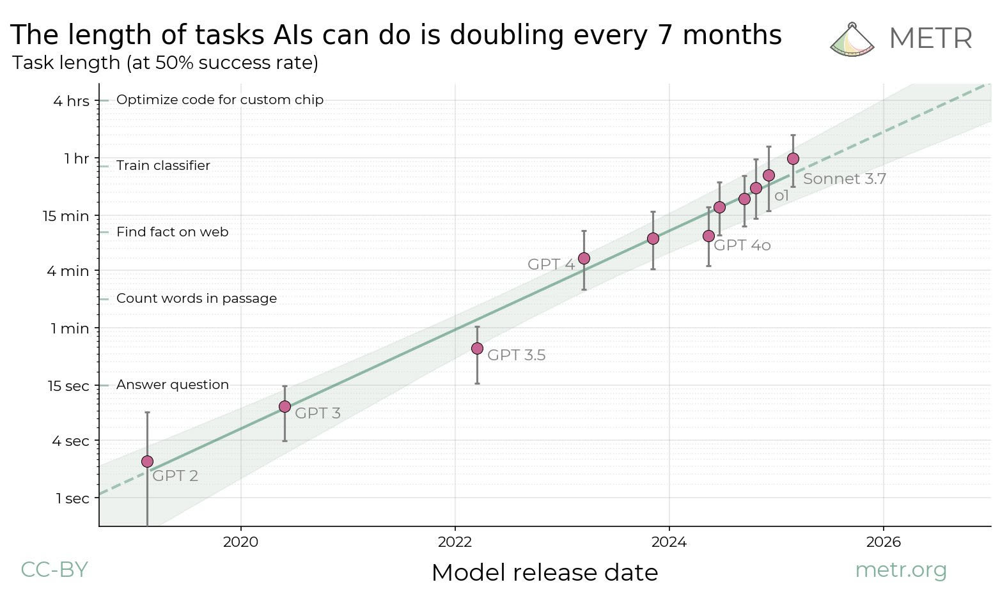

%%
Add discussion note here:

...

%%

_Epistemic status: Briefer and more to the point than_ [_my model of what is going on with LLMs_](https://www.lesswrong.com/posts/vvgND6aLjuDR6QzDF/my-model-of-what-is-going-on-with-llms)_, but also lower effort. This is my most "combative"-toned post to date and I think a little too much so. \[EDIT 2026: It looks like I was wrong!\]_

Here is [the paper](https://arxiv.org/abs/2503.14499). The main reaction I am talking about is [AI 2027](https://ai-2027.com/), but also basically every lesswrong take on AI 2027. (EDIT: A couple of the authors of AI 2027 have pointed out that its predictions are not mainly based on METR's report, but I think the main points of this post still hold up). 

A lot of people believe in very short AI timelines, say <2030. They want to justify this with some type of outside view, straight-lines-on-graphs argument, which is pretty much all we've got because nobody has a good inside view on deep learning (change my mind). 

The outside view, insofar is that is a well-defined thing, does not justify very short timelines. 

If AGI were arriving in 2030, the outside view says interest rates would be very high (I'm not particularly knowledgeable about this and might have the details wrong but see the analysis [here](https://basilhalperin.com/essays/agi-vs-emh.html), I believe the situation is still similar), and less confidently I think the S&P's value would probably be measured in lightcone percentage points (?). We might also look at the track record of previous (wrong) predictions that AGI was near dating back as far as the 1960's or so. Also, we might use the predictions of experts and superforcasters. Only the last (and perhaps least pure) "outside view" seems to support short timelines at all, but depending on the way the question is posed it still seems to predict [more like 2050](https://goodjudgment.com/superforecasting-ai/). 

As far as I can tell, this is why everyone keeps using this plot instead of those other methods:

I'm glad METR did this work, and I think their approach is sane and we should keep adding data points to this plot. Also, over the last couple of years this has been one of my only updates towards shorter timelines - almost everything else has pushed me towards longer timelines (I don't expect to be able to change anyone's intuitions here, but I look outside and do not see AGI reshaping the world, do not find chatbots particularly useful, etc. and it's clear that this is not a central prediction of my short-timelines-conditioned model). 

The plot doesn't say what people want it to say. There are three major problems. 

I'm not sure which is most serious, but I think it's probably that the line just doesn't have a lot of points on it. This is a boring objection which I don't expect to change anyone's mind, so I'll just move past it.

The second problem is that the plot does not exactly predict AGI will arrive by 2030. From the paper:

> Naively extrapolating the trend in horizon length implies that AI will reach a time horizon of >1 month (167 work hours) between late 2028 and early 2031...

As far as I am concerned, AGI should be able to do any intellectual task that a human can do. I think that inventing important new ideas tends to take at least a month, but possibly the length of a PhD thesis. So it seems to be a reasonable interpretation that we might see human level AI around mid-2030 to 2040, which happens to be about my personal median.

However, the authors of AI 2027 predict pretty radical superintelligence before 2030, which does not seem to be justified by the plot. Arguably, since the plot is focused on software engineering tasks, the most relevant comparison is actually their prediction  for human level software engineers, which is I believe is around 2026-2028 (clearly inconsistent with the plot). 

Now, the counterargument goes something like this: _We only need to focus on human level AI research and the rest will follow. Early AI systems will speed up software engineering by iterating quickly and this will increase the rate of progress drastically._ 

This is no longer a straight-lines-on-graphs argument. Doesn't the current plot already factor in AI coding assistance over the 2023-2025 period or so?

**But the deeper problem is that the argument is ultimately, subtly circular. Current AI research does look a lot like rapidly iterating and trying random engineering improvements. If you already believe this will lead to AGI, then certainly AI coding assistants which can rapidly iterate would expedite the process. However, I do not believe that blind iteration on the current paradigm leads to AGI (at least not anytime soon), so I see no reason to accept this argument.** 

I bolded that because I think otherwise people won't absorb it. I think it ties into a wider disagreement; I believe intelligence is pretty sophisticated while others seem to think it's mostly brute force. This tangent would however require a longer discussion on the proper interpretation of Sutton's bitter lesson.

Others have argued that the line can't stay straight forever because eventually AI systems will "unlock" all the abilities necessary for long-horizon tasks. If you believe this, please explain to me why you believe it. It seems to require a sophisticated inside view on deep learning that no one has. 

I am least certain about the following third objection, because it involves a game of reference class tennis which I am not sure I win. Basically, the plot is conflating two different things: the performance of base (pretrained) models and reasoning models. The base models seem to have topped out their task length around 2023 at a few minutes (see on the plot that GPT-4o is little better than GPT-4).  Reasoning models use search to do better. We already have search-based AI algorithms that can perform longer horizon tasks above human level, for instance Go and Chess, and those would totally flatten the slope of the line if they were included (on the top left of the plot). However, I don't think this is a knock-down argument because there are some principled reasons not to include these points. We are only focusing on software engineering tasks here. Also, reasoning models seem importantly more general than even the most general game playing algorithms (AlphaZero, MuZero). Still, I think it's worth pointing out that a very specific choice has been made in order to get this line with this slope.

(EDIT: I no longer endorse this, since [@AnthonyC](https://www.lesswrong.com/users/anthonyc?mention=user) reminded me distilling CoT will probably solve it.) The stronger conclusion I want to make from the last objection is that taking the plot seriously, it seems that further progress depends on scaling up inference-time compute. If so, we may not expect to suddenly summon an army of superhuman coders. The first superhuman coders might be very, very expensive to run, particularly when we need them to perform longer-horizon tasks. However, I have not analyzed this situation carefully.

This is important because though I am appropriately terrified of AGI arriving before or around 2030, acting as if this were near-certain sacrifices a lot of opportunities in worlds where AGI arrives around 2040 or later. For instance, we will look pretty crazy for setting off a false alarm. Also, on an individual level we may not prioritize gathering resources like career capital or gaining influence in slower moving established institutions.

Also, I am just surprised I seem to be the only one making this fairly obvious point (?), and it raises some questions about our group epistemics.
