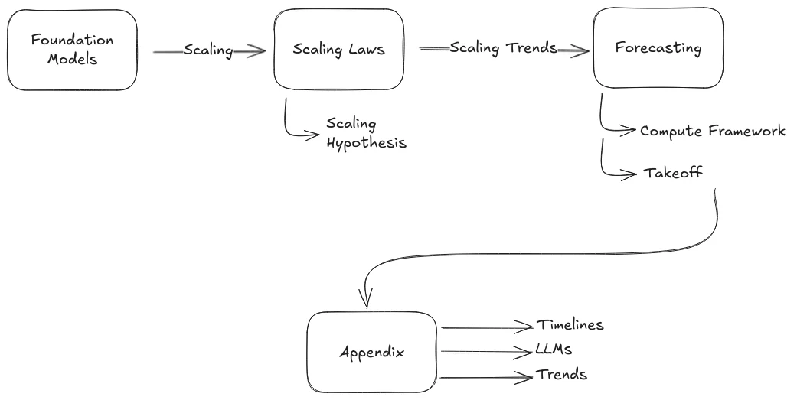

%%
DEMO for a Loom recording (Hamza, 17 Nov 2026). It shows the Atlas's language versions on staging. Delete this folder, and "courses/DEMO Atlas versions (delete after Loom)", once the demo versions are gone from sites.yaml.
%%

# Lens: Introdução
id:: a5e1891d-78b4-48df-b21d-134c1bcdc722
#### Text
content::
*Demonstração: esta tradução parcial existe apenas para mostrar as versões do Atlas no staging. Ela será removida.*

A IA é um campo que avança muito depressa. Para falar dos riscos e de como torná-la segura no futuro, primeiro precisamos entender onde ela está hoje e para onde pode ir.

**A IA passou por uma grande mudança na última década.** Sistemas que jogam jogos desenvolveram uma criatividade estratégica que surpreendeu grandes mestres, e os modelos de linguagem passaram de falhas engraçadas de preenchimento automático a assistentes de engenharia de software que lidam com bases de código de milhares de arquivos. Esses exemplos mostram uma mudança na forma como a tecnologia evolui e levantam a pergunta que este livro inteiro tenta responder: como tornar seguro algo que não entendemos totalmente, e cujas capacidades podem mudar muito entre o momento em que você começa a ler este capítulo e o momento em que termina?

**Este primeiro capítulo serve para mapear o território.** Antes de discutir capacidades perigosas, estratégias de alinhamento, soluções técnicas ou modelos de governança, os temas dos Capítulos 2, 3 e 4, o primeiro passo é ter uma ideia do que os sistemas de IA conseguem fazer hoje, como chegaram aqui e para onde apontam as tendências.

**A primeira pergunta é: o que conta como inteligência "geral"?** Os sistemas que vemos hoje representam a passagem da IA estreita, sistemas que fazem bem uma única coisa, para sistemas de IA de uso geral (modelos de fundação), que aprendem padrões gerais, se adaptam a situações novas e fazem bem muitas coisas. O termo AGI aparece o tempo todo, mas pessoas diferentes querem dizer coisas muito diferentes com ele. Vamos apresentar algumas formas de definir inteligência, do Teste de Turing aos modelos psicométricos, até chegar a uma definição prática: capacidade e generalidade como eixos contínuos, e não como categorias binárias.

**A segunda pergunta que todos fazem: por que isso está acontecendo tão depressa?** A resposta é a "lição amarga" da pesquisa em IA: a computação em grande escala supera, de forma consistente, o conhecimento criado à mão por humanos. Vamos olhar para as leis de escala, as relações empíricas que mostram que mais dados e mais computação produzem, de forma previsível, um desempenho melhor.

**A última parte do capítulo olha para o futuro.** Prever quando a IA poderá automatizar todo o trabalho cognitivo determina quais estratégias de segurança são viáveis. Se uma IA transformadora chegar até 2030, precisamos de soluções que funcionem com os sistemas atuais e escalem depressa. Se for em 2050, temos tempo para pesquisa fundamental.

Vamos começar pelo que esses sistemas conseguem fazer de fato, e pela rapidez com que essa lista cresce.

*Figura 1.1: Primeiro explicamos os modelos de fundação, cujas capacidades melhoram de forma contínua com a escala. Depois examinamos as leis de escala observadas empiricamente. Com base nessas tendências, vemos algumas técnicas que os pesquisadores usam para tentar prever o progresso futuro da IA.*

# Lens: Capacidades atuais
id:: b1ad0ead-9c3a-4a13-86d1-83fee9377e50
#### Text
content::
*Demonstração: só o início desta seção foi traduzido.*

As IAs escrevem, veem, programam e controlam robôs cada vez melhor, muitas vezes superando humanos. Elas mostram habilidades surpreendentes, como raciocinar e usar ferramentas, que desafiam o que antes se pensava ser possível.

**Modelos de IA conseguem escrever, raciocinar, programar, gerar mídia e controlar robôs, muitas vezes igualando ou superando especialistas humanos em tarefas específicas.** Nesta primeira seção, tentamos dar uma ideia do que a IA consegue fazer no fim de 2025. Números e gráficos não tornam essas capacidades concretas, por isso incluímos muitos vídeos, imagens e exemplos. Para quem tiver interesse, também citamos resultados de benchmarks que medem o progresso de forma quantitativa.

**A trajetória importa mais do que um retrato do momento.** Esta seção serve tanto como um breve histórico quanto como um retrato das capacidades atuais. Ao ler, lembre-se de quão depressa chegamos aqui. A geração de linguagem passou de parágrafos coerentes a assistentes de pesquisa em poucos anos. A geração de imagens passou de risível a profissional em uma década.

\## Jogos

**A IA que joga já é sobre-humana em muitos jogos.** O Deep Blue, da IBM, derrotou um grande mestre de xadrez em 1997 ([IBM, 2026](https://www.ibm.com/history/deep-blue)), o Watson, da IBM, venceu com folga no Jeopardy! em 2011 ([IBM, 2026](https://www.ibm.com/history/watson-jeopardy)), e o AlphaGo venceu o campeão mundial de Go, Lee Sedol, em 2016 ([DeepMind, 2016](https://www.deepmind.com/research/highlighted-research/alphago)). No jogo 2, o AlphaGo fez a Jogada 37, que tinha uma chance em 10.000 de ser escolhida. Os comentaristas acharam que era um erro, mas foi a jogada que, várias rodadas depois, levou à vitória.

# Lens: Modelos de fundação
id:: 729260f7-fe8b-4736-a06a-5af3e27938f7
#### Text
content::
*Demonstração: só o início desta seção foi traduzido.*

Vimos uma mudança de paradigma: da IA estreita para sistemas gerais e adaptáveis, pré-treinados com enormes quantidades de dados. Esse paradigma traz desafios de segurança novos.

**Os modelos de fundação mudam de forma fundamental a maneira como desenvolvemos IA.** Em vez de construir modelos especializados para muitas tarefas pequenas, agora podemos treinar modelos em grande escala que servem de "fundação" para muitas aplicações diferentes. Depois, esses modelos são especializados por um processo chamado ajuste fino (fine-tuning) para realizar tarefas específicas. Pense nisso como construir muitos tipos de edifício sobre a mesma estrutura de base ([Bommasani et al., 2022](https://arxiv.org/abs/2108.07258)). Podemos construir bancos, restaurantes ou casas, mas a fundação continua basicamente a mesma.

**A abordagem tradicional, de treinar um modelo especializado para cada tarefa, era muitas vezes ineficiente e limitada.** O progresso dependia de dados rotulados por humanos, e o conhecimento não passava bem de uma tarefa para outra. Os modelos de fundação superaram esses limites com o aprendizado autossupervisionado em enormes conjuntos de dados sem rótulos ([Kaplan et al., 2020](https://arxiv.org/abs/2001.08361)).

# Lens: Defining and Measuring AGI
source:: [[../../Lenses/AI Safety Atlas (Google Docs)/Atlas - Capabilities - Defining and Measuring AGI]]

# Lens: Leveraging Scale
source:: [[../../Lenses/AI Safety Atlas (Google Docs)/Atlas - Capabilities - Leveraging Scale]]

# Lens: Forecasting Timelines
source:: [[../../Lenses/AI Safety Atlas (Google Docs)/Atlas - Capabilities - Forecasting Timelines]]

# Lens: Takeoff
source:: [[../../Lenses/AI Safety Atlas (Google Docs)/Atlas - Capabilities - Takeoff]]

# Lens: Appendix: Forecasting
optional:: true
source:: [[../../Lenses/AI Safety Atlas (Google Docs)/Atlas - Capabilities - Appendix - Forecasting]]

# Lens: Appendix: Takeoff
optional:: true
source:: [[../../Lenses/AI Safety Atlas (Google Docs)/Atlas - Capabilities - Appendix - Takeoff]]

# Lens: Appendix: Expert Surveys
optional:: true
source:: [[../../Lenses/AI Safety Atlas (Google Docs)/Atlas - Capabilities - Appendix - Expert Surveys]]

# Lens: Appendix: Discussion on LLMs
optional:: true
source:: [[../../Lenses/AI Safety Atlas (Google Docs)/Atlas - Capabilities - Appendix - Discussion on LLMs]]
