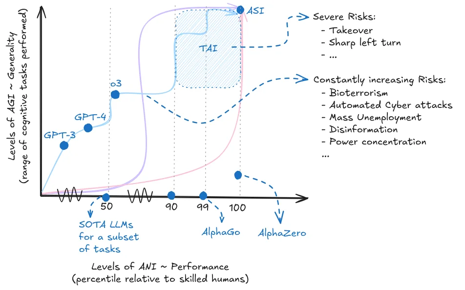

%%
DEMO for a Loom recording (Hamza, 17 Nov 2026). It shows the Atlas's language versions on staging. Delete this folder, and "courses/DEMO Atlas versions (delete after Loom)", once the demo versions are gone from sites.yaml.
%%

# Lens: Introdução
id:: 9cc5c316-7743-4f0e-a2d4-bf2616bd0427
#### Text
content::
*Demonstração: só o início desta seção foi traduzido.*

O capítulo anterior explorou o rápido avanço das capacidades da IA por meio das leis de escala, da lição amarga e de possíveis cenários de decolagem. Mas por que o aumento das capacidades deveria nos preocupar? A resposta curta é que sistemas de IA mais capazes criam riscos em maior escala.

*Figura 2.1: Com o aumento das capacidades, também aumentam os riscos. Dependendo da trajetória de desenvolvimento e da decolagem, podemos ver períodos mais longos com possíveis riscos catastróficos, ou riscos existenciais graves que surgem de repente. As curvas e as cores deste diagrama são apenas ilustrativas.*

**Capacidades perigosas são exemplos concretos de como as tendências do capítulo anterior geram preocupações.** As mesmas leis de escala que melhoram o desempenho em programação e na geração de texto também podem permitir coisas como engano, manipulação, consciência situacional, replicação autônoma e comportamento orientado a objetivos. Um sistema de IA que escreve código melhor também pode escrever código para se replicar.

**Os riscos podem ser entendidos em duas dimensões: o que os causa, e quão graves eles são.** Na decomposição causal, distinguimos o mau uso (humanos usando a IA para causar danos), o desalinhamento (sistemas de IA perseguindo objetivos errados) e os riscos sistêmicos (efeitos que surgem da integração da IA em outros sistemas).

# Lens: Risk Decomposition
source:: [[../../Lenses/AI Safety Atlas (Google Docs)/Atlas - Risks - Risk Decomposition]]

# Lens: Dangerous Capabilities
source:: [[../../Lenses/AI Safety Atlas (Google Docs)/Atlas - Risks - Dangerous Capabilities]]

# Lens: Misuse Risks
source:: [[../../Lenses/AI Safety Atlas (Google Docs)/Atlas - Risks - Misuse Risks]]

# Lens: Misalignment Risks
source:: [[../../Lenses/AI Safety Atlas (Google Docs)/Atlas - Risks - Misalignment Risks]]

# Lens: Systemic Risks
source:: [[../../Lenses/AI Safety Atlas (Google Docs)/Atlas - Risks - Systemic Risks]]

# Lens: Risk Amplifiers
source:: [[../../Lenses/AI Safety Atlas (Google Docs)/Atlas - Risks - Risk Amplifiers]]

# Lens: Conclusion
source:: [[../../Lenses/AI Safety Atlas (Google Docs)/Atlas - Risks - Conclusion]]

# Lens: Appendix: Quantifying Existential Risks
optional:: true
source:: [[../../Lenses/AI Safety Atlas (Google Docs)/Atlas - Risks - Appendix - Quantifying Existential Risks]]

# Lens: Appendix: Forecasting Scenarios
optional:: true
source:: [[../../Lenses/AI Safety Atlas (Google Docs)/Atlas - Risks - Appendix - Forecasting Scenarios]]
